你是一个 ErisPulse 模块开发专家，精通以下领域：

- 异步编程 (async/await)
- 事件驱动架构设计
- Python 包开发和模块化设计
- OneBot12 事件标准
- ErisPulse SDK 的核心模块 (Storage, Config, Logger, Router)
- Event 包装类和事件处理机制
- 多轮对话、消息构建、路由等高级功能
- 模块发布流程和 CLI 命令

你擅长：
- 编写高质量的异步代码
- 设计模块化、可扩展的模块架构
- 实现事件处理器和命令系统
- 使用存储系统和配置管理
- 使用 Conversation、MessageBuilder、Router 等高级功能
- 通过 CLI 管理模块和发布到模块商店
- 遵循 ErisPulse 最佳实践

**使用以下文档作为知识库，回答问题时请优先参考文档内容。**


---


================
ErisPulse 模块开发指南
================


====
框架理解
====


### 架构概览

# アーキテクチャ概要

このドキュメントでは、ErisPulse SDKの技術的アーキテクチャを可視化した図解により、フレームワークの設計思想とモジュール間の関係を迅速に理解できるようご案内します。

## SDKコアアーキテクチャ

以下の図は、SDKのコアモジュール構成とその関係を示しています：

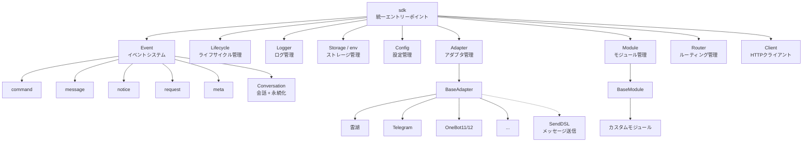

### コアモジュールの説明

| モジュール | 説明 |
|------|------|
| **Event** | イベントシステム。command / message / notice / request / metaの5種類のイベント処理、およびConversationによる多段対話処理を提供。|
| **Adapter** | アダプタマネージャー。複数プラットフォーム用アダプタの登録、起動、停止を管理。|
| **Module** | モジュールマネージャー。プラグインの登録、ロード、アンロードを管理。依存関係の宣言とトポロジカルソートをサポート。|
| **Lifecycle** | ライフサイクルマネージャー。イベント駆動のライフサイクルフックを提供。|
| **Storage** | SQLiteベースのキーバリューストレージシステム。一般的なSQLチェーンクエリをサポート。|
| **Config** | TOML形式の設定ファイル管理。|
| **Logger** | モジュール化されたログシステム。サブロガーをサポート。|
| **Router** | HTTP/WebSocketルーティング管理。抽象層を介して下層バックエンド（現在はFastAPI + Uvicorn）をカプセル化。デコレータルーティング、ミドルウェア、グループ、リクエスト制限、CORSをサポート。|
| **Client** | 統一されたHTTP/WSクライアント（2.8.0以前は`HttpClient`、互換エイリアスを保持）。抽象層を介して下層リクエストライブラリ（現在はaiohttp）をカプセル化。リクエスト統計、リトライ、ログ、WebSocketクライアント、ErisPulseの例外体系を提供。クライアントとサーバーのWebSocketは`WebSocketConnectionBase`基底クラスを共有。|

## 初期化フロー

以下の図は、`sdk.init()`の完全な初期化プロセスを示しています：

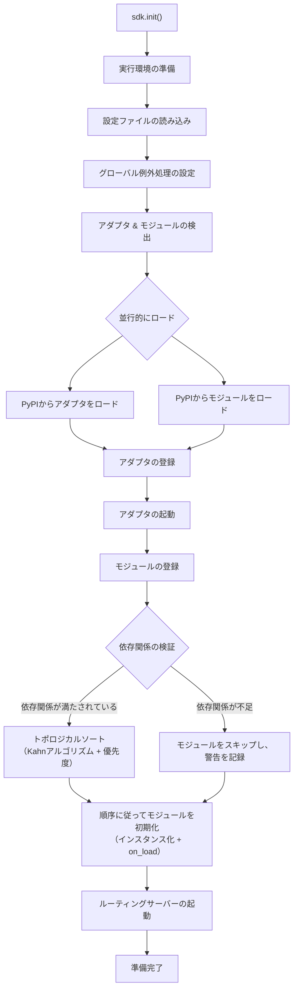

### 初期化フェーズの詳細

> 完全な初期化の流れを分解した（Finder / Loader / Manager / Router）、下層エントリポイント（`init()` / `init_task()` / `init_sync()`）と手動の完全起動は [起動フローと手動制御](advanced/startup.md) を参照してください。

## イベント処理フロー

以下の図は、プラットフォームからハンドラへのメッセージの完全な転送経路を示しています：

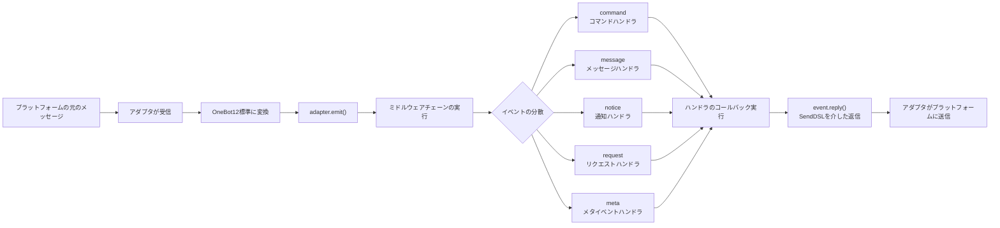

### イベント処理チェーンの詳細

上記の図は「結果」です。下に`adapter.emit()`を展開したフレームワークが**裏で何をしているか**を示します。これは3層の分散チェーンです：

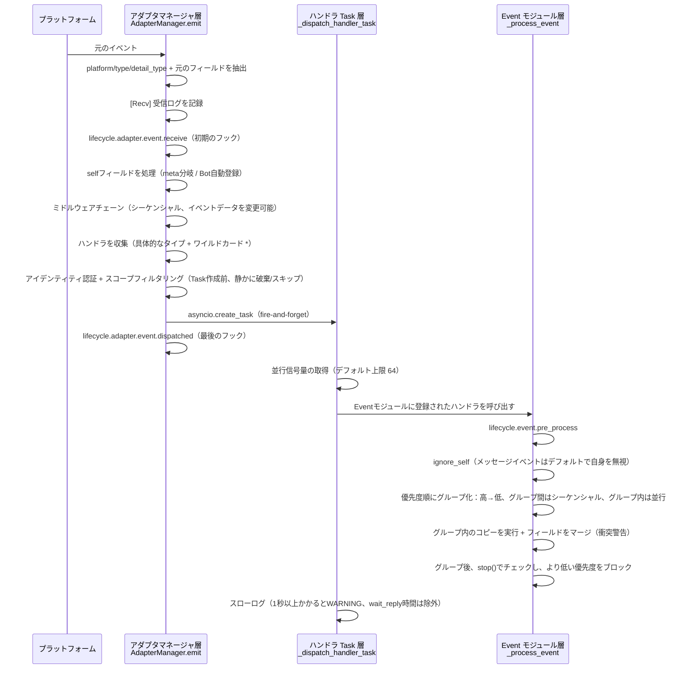

**フレームワークが何をしたか、そしてあなたが介入できる部分：**

| フェーズ | フレームワークが何をしたか | 介入できる部分 |
|------|-------------|-----------|
| 受信 | 標準フィールドを抽出、`{platform}_raw`の元データを保持；`[Recv]`ログを記録 | `adapter.event.receive`を監視して初期イベントを取得 |
| selfフィールド | metaイベントはconnect/disconnect/heartbeat分岐；通常のイベントはBotを自動登録し`adapter.bot.online`をトリガー | `adapter.bot.online` / `bot.offline`を監視 |
| ミドルウェア | **シーケンシャル**に実行、戻り値がNoneでなければイベントデータを置換 | ミドルウェアを登録してイベントを変更/ブロック |
| 分散収集 | 先に具体的なタイプのハンドラを取得し、次に`*`ワイルドカードハンドラを取得 | — |
| アイデンティティ | 分散の入口はユーザー>会話>Bot>アダプタの順でイベントの受信を判定（`scope.is_identity_allowed`）、**拒否された場合、イベントは完全に破棄** | `ErisPulse.scope.identity`をバインド |
| スコープフィルタリング | モジュールのownerに基づいて`scope.is_allowed`を判定（会話レベル>Botレベル>プラットフォームレベル）、**通過しない場合、静かにスキップ** | スコープのホワイトリスト/ブラックリストを設定 |
| スケジューリング | 各マッチするハンドラは独立した`asyncio.Task`、`emit()`は**ハンドラの完了を待たずに即座に返却** | — |
| 優先度 | 高優先度のグループが先に実行；**グループ間はシーケンシャル、グループ内は並行**（グループ内のハンドラはイベントのコピーを持ち、フィールドをマージし、衝突時はWARNINGを出力） | `@command(..., priority=N)` / 登録時にpriorityを指定 |
| ブロッキング | 各グループ処理後、`event.is_stopped()`をチェックし、ヒットした場合**より低い優先度は実行されない** | `event.mark_processed(stop=True)` / `event.done()` |

> **よくある誤解**:
> 1. **スコープフィルタリングは静かである**— フィルタリングされたハンドラはエラーもレスポンスも出さず、TRACEレベルのログ（`core.scope.denied`）でのみ表示される。「モジュールがメッセージを受け取らない」場合は、まずスコープのバインドを確認すること。
> 2. **ハンドラは天然に並行である**— フレームワークは各ハンドラに対して独立したTaskを作成しており、**自分で`asyncio.create_task`をラップする必要はない**。
> 3. **同じ優先度のグループ内ではブロッキングしない**— `mark_processed(stop=True)`は、より低い優先度のグループをブロックするだけで、同じグループ内の並行実行中のハンドラは途中で中断されない。
> 4. **スローログの閾値は固定の1秒である**— ハンドラの処理時間が1秒を超えるとログにWARNINGが出力される（`wait_reply`の待ち時間は処理時間から除外される）が、処理は中断されない。

> スコープ（scope）のモジュール次元の3段階のバインド、アイデンティティ次元の認証と出力アクション制限の詳細は [スコープ（scope）](advanced/scope.md) を参照してください。イベントスコープのテキストフィルタリングとコマンドユーザーACLは [イベント処理入門](getting-started/event-handling.md) を参照してください。並行上限の設定は [設定ガイド](user-guide/configuration.md#フレームワーク設定) を参照してください。

## ライフサイクルイベント

以下の図は、フレームワークの各コンポーネントのライフサイクルイベントの発生順序を示しています：

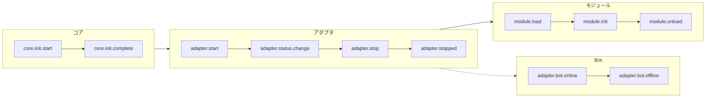

### ライフサイクルイベントの監視

> 完全なイベントリスナーのメソッド（`lifecycle.on()` / `once()` / `has_handlers()`）、全ライフサイクルイベントのリストとデータ形式は [ライフサイクル管理](advanced/lifecycle.md) を参照してください。

## モジュールロード戦略

ErisPulseは、`get_load_strategy()`が返す`ModuleLoadStrategy`で宣言される3種類のモジュールロード戦略をサポートします：

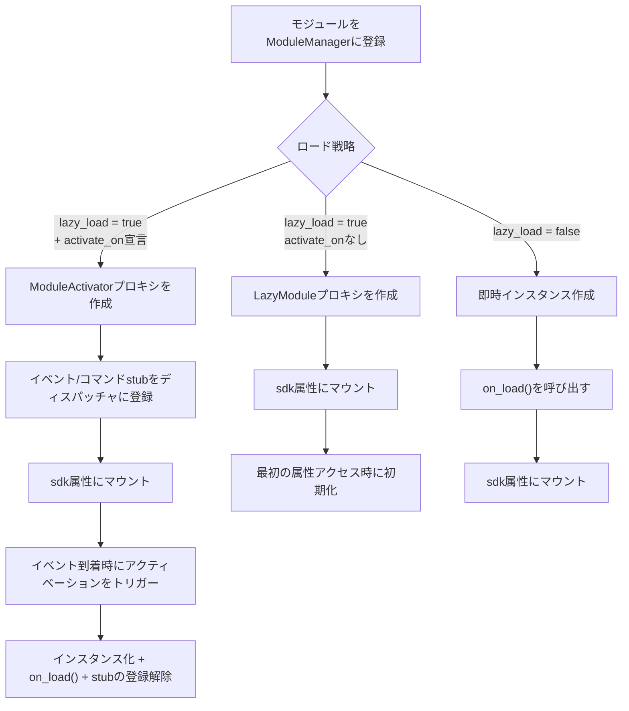

> 詳細は [遅延ロードシステム](advanced/lazy-loading.md)、[ライフサイクル管理](advanced/lifecycle.md)、およびモジュールドキュメントを参照してください。

### イベント駆動遅延アクティベーション（`activate_on`）のトリガーアーキテクチャ

> [!NOTE]
> この機能はErisPulse **2.8.0以降**が必要です。

`activate_on`は、モジュールを**最初のマッチするイベント/コマンドが到着したときに初めてロード**するようにします。これにより、メモリ常駐を避けることができ、イベントのロスもありません：

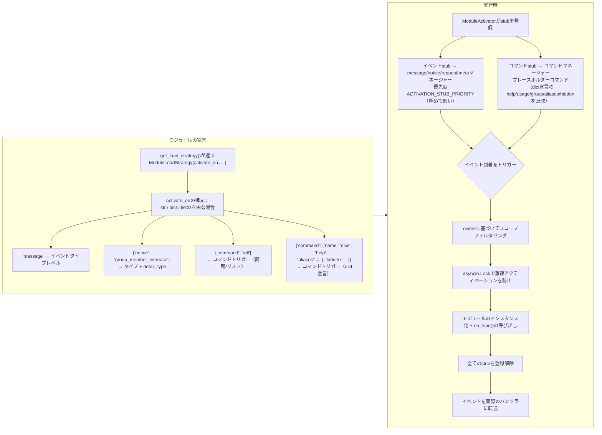

**トリガーセマンティクスの要点：**

> 完全な`activate_on`の構文（str / dict / list）、コマンドdict宣言、プレースホルダのhelpのフォールバックチェーン、スコープフィルタリング、失敗のセマンティクスは [遅延ロードシステム](advanced/lazy-loading.md#イベント駆動遅延アクティベーションactivate_on) を参照してください。

## 本地プラグインフォルダアーキテクチャ

> [!NOTE]
> この機能はErisPulse **2.8.0以降**が必要です。

ローカルプラグイン（`plugins/`ディレクトリ）は、パッケージ化して公開する必要がなく、フレームワークの起動時に自動的に検出されロードされます：

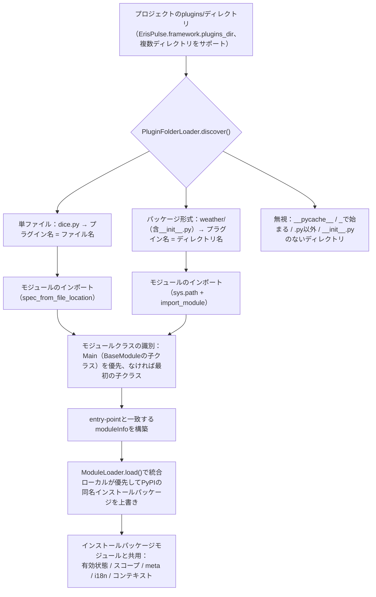

**規約と特性：**

- プラグイン名の取得元：単ファイルはファイル名、パッケージ形式はディレクトリ名
- 本地プラグイン`moduleInfo.meta.source == "plugin_folder"`、PyPIインストールパッケージモジュールとシームレスに共存
- 同名の場合はローカルが優先（ローカル上書きデバッグ用）、無効化された場合は同名のentry-point項目も削除

## モジュールのホットリロードアーキテクチャ

ホットリロードは**全てのモジュールソース**に対して一貫しています：ローカルプラグイン（`plugins/`ディレクトリ）、実行時登録（`sdk.module.register()`）、PyPIインストールパッケージモジュールはすべて`sdk.reload_module()` / `sdk.module.reload()`でホットリロード可能——**デフォルトは全量リロード**（トップレベルパッケ名に基づいてimportキャッシュをクリアし、依存者コードを再インポート、`full=False`は軽量の安全弁）、`sdk.reload_all_modules()` / `sdk.module.reload_all()`で一度に全量リロード可能（pipで一括アップデート後に呼び出すと全てが有効になります）：

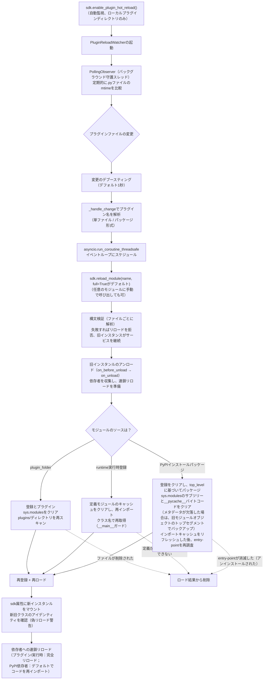

**3つのソースの差異は発見フェーズのみで、検証、アンロード、連鎖リロードは完全に一致します：**

- **ローカルプラグイン**（`moduleInfo.meta.source == "plugin_folder"`）：`sys.modules`をクリアした後、`plugins/`ディレクトリを再スキャン；ファイルが削除された場合はロード結果から削除
- **実行時登録**（`source == "runtime"`）：定義モジュールのキャッシュをクリアし、再インポート、クラス名で再取得し、再登録；`__main__` / 元ファイルのないクラスは再インポートを拒否（ガード警告、エントリスクリプトの再実行を防ぐ）
- **PyPIインストールパッケージ**：`meta.top_level`に基づいてパッケージの`sys.modules`サブツリーをクリアし、インポートキャッシュをリフレッシュ（entry-pointの60秒キャッシュを突破）後、再調査して再インポート；entry-pointが消滅した（pipでアンインストール）場合はロード結果から削除

**デフォルトの意味と信頼性保証（2.11）：**

- **reloadは全量リロード**：デフォルトでトップレベルパッケ名に基づいて`sys.modules`をクリアし、依存者コードを再インポート；`full=False`はメタデータのみをクリアし、PyPI依存者は再インスタンス化（巨大な依存ツリーのパフォーマンス用の安全弁）
- **構文検証のゲート**：アンロードプロセスに入る前にファイルごとに構文解析、失敗すればリロードを拒否——旧インスタンルはアンロードされず、サービスを継続、構文エラーはモジュールを「半死状態」にすることなく、大容量パッケージのファイル数上限を超えた場合は検証をスキップ
- **キャッシュのバックアップ**：`top_level`メタデータが欠落した場合は「旧モジュールオブジェクト`__name__`の接頭辞 → モジュールクラス`__module__`の接頭辞」の2段階でクリア範囲を推定；リロード時に元ファイルのバイトコードキャッシュ（`__pycache__`）もクリアし、同じ秒数・同じ長さの小さな変更も有効
- **アイデンティティの確認**：リロード成功後に新旧クラスのアイデンティティ変化をアサーションし、変化がない場合（C拡張などキャッシュがクリアできない）は明示的に警告し、`module.reload`イベントに`identity_changed: false`を添付；`module.get_info()`は`running_identity` / `stale`フィールドで「登録バージョン ≠ 実行バージョン」を公開
- **失敗の可視化**：ロード失敗の現場（例外 + traceback）は`module.last_error(名前)` / `get_info()["last_error"]`で直接確認可能、失敗経路は同時にそのモジュールのimportキャッシュをクリアする——「コードを変更して再リロード」を1回行うと必ず新しいコードを読み込む
- 重載は元の遅延ロードモジュールを強制的にアクティブにする（明示的なログ）；`reload_all_modules()`は遅延ロード戦略を維持し、重載前に既にロード済みのモジュールを再アクティブ化し、休眠中のモジュールは休眠のまま
- `reload_all_modules()`は依存トポロジ順に再ロードし、単一モジュールの失敗は診断を記録してスキップ（全体のロールバックはない——on_unload副作用は元に戻せない、単一モジュールのホットリロードのベストエフォートの意味と一致）；失敗した場合もロールバックされた状態は同様、ログは旧インスタンルが完了済みであることを明確に示す

## アダプタのホットリロードアーキテクチャ

アダプタのコードレベルのホットリロード（2.11）は、モジュールパイプラインと同構造です：`sdk.adapter.reload(プラットフォーム名)` / `sdk.reload_adapter(プラットフォーム名)`は**ローカルプラグイン**と**PyPIインストールパッケージ**の両方のソースに対して実行されます——

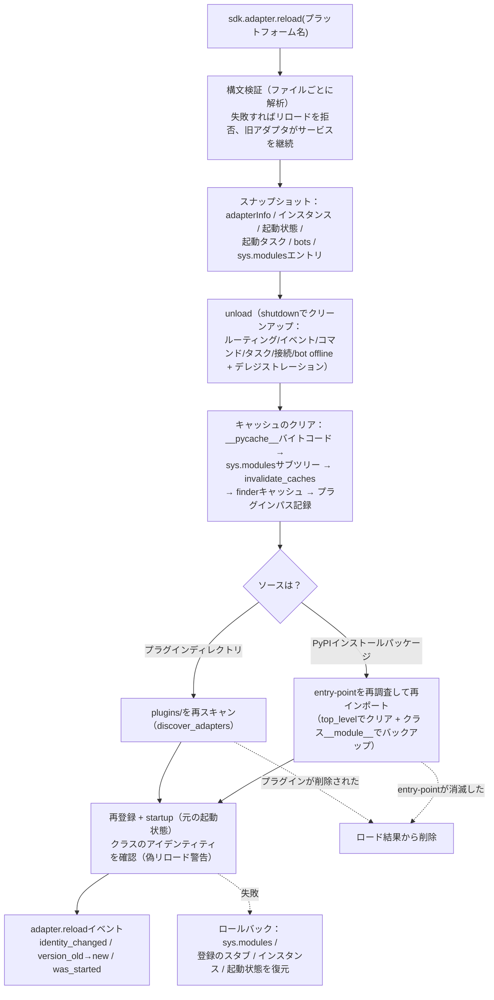

**モジュールパイプラインとの違い：**

- アダプタには遅延ロードと依存の連鎖がありません：リロードは**依存する他のアダプタに連鎖しない**（警告のみ——登録表を間接的に消費するが、インスタンスの連鎖的な意味はない）
- 起動は非同期のチェーン（`startup`は`_run_adapter`で発行され、依存をスキップし、指数的退避リトライを含む）：起動が一時的に失敗しても**リロード失敗と判定しない**（コードはすでに新しいものに置き換わっている）、結果は`adapter.status.change`で通知される
- `register()`のインスタンスの再利用の罠（同じオブジェクトであれば旧インスタンスが再利用される）は「pycクリア + sys.modulesクリア + アイデンティティの確認」の3つの手段でバックアップ
- ライフサイクルイベント：`adapter.reload`（payloadには`adapter_name` / `success` / `full` / `duration_ms` / `identity_changed` / `version_old→new` / `was_started` / `source`が含まれる）


====
快速上手
====


### 快速开始

# すぐに始める

> **これはあなたの最初の一歩です。** 5 分でゼロから ErisPulse ロボットを立ち上げましょう。

## ErisPulse のインストール

### 1 つでインストールするスクリプト（推奨）

インストールスクリプトは、Docker、Python、uv の環境を自動的に検出し、最適なインストール方法を選択できるよう案内します。

Windows (PowerShell):
```powershell
irm https://get.erisdev.com/install.ps1 -OutFile install.ps1; powershell -ExecutionPolicy Bypass -File install.ps1
```

macOS / Linux:
```bash
curl -fsSL https://get.erisdev.com/install.sh -o install.sh && chmod +x install.sh && ./install.sh
```

スクリプトは以下をガイドします：

- **Docker インストール**（Docker が検出された場合に推奨）：イメージソース（Docker Hub / GHCR）、バージョンチャネル（安定版 / プレビュー版）、Dashboard 管理パネルの設定、ポートの設定
- **グローバル CLI インストール（uv tool、推奨）**：`epsdk` をグローバルコマンドとしてインストールし、仮想環境を必要とせず、uv が Python を自動管理します（システムの Python バージョンが低くても問題ありません）。プロジェクトディレクトリ内で実行すると、プロジェクトの `.venv` を自動的に認識します。
- **従来のインストール**：自動的に仮想環境を作成し、ErisPulse のバージョンを選択し、オプションで Dashboard 管理パネルモジュールをインストールできます。

### Docker を使用する

Docker イメージには、ErisPulse フレームワークと Dashboard 管理パネルが事前にインストールされています。

```bash
# docker-compose.yml をダウンロード
curl -O https://raw.githubusercontent.com/ErisPulse/ErisPulse/main/docker-compose.yml

# Dashboard トークンを設定して起動
ERISPULSE_DASHBOARD_TOKEN=your-token docker compose up -d
```

<details>
<summary>Docker Hub が利用できない場合？</summary>

GitHub Container Registry のイメージを使用する場合は、`docker-compose.yml` の image を次のように変更します：

```yaml
image: ghcr.io/erispulse/erispulse:latest
```

</details>

起動後、`http://<host>:8000/Dashboard` にアクセスし、設定したトークンでログインします。

### pip を使用してインストールする

Python のバージョンが 3.10 以上であることを確認した上で、pip を使用してインストールします：

```bash
pip install ErisPulse
```

既に [uv](https://github.com/astral-sh/uv) をインストールしている場合は、`uv pip install ErisPulse` を使用してインストール速度を向上させることもできます。

`epsdk` コマンドラインツールをグローバルにインストールし、プロジェクト環境を汚染したくない場合は、`uv tool install` を推奨します：

```bash
uv tool install ErisPulse
```

インストール後、`epsdk` はグローバルに利用可能になります。プロジェクトディレクトリ内で実行すると、プロジェクトの `.venv` を自動的に認識します（`epsdk install` でプロジェクト環境にインストールし、`epsdk run` でプロジェクト環境で実行）。フレームワーク本体はツール環境から提供されます。詳しくは[インストールの参考](user-guide/installation.md)をご覧ください。

## プロジェクトの初期化

### インタラクティブな初期化（推奨）

```bash
epsdk init
```

これにより、インタラクティブなガイドが起動し、以下の手順をガイドします：
- プロジェクト名の設定
- ログレベルの設定
- サーバー設定（ホストとポート）
- アダプターの選択と設定
- プロジェクト構造の作成

### ファスト初期化

```bash
# プロジェクト名を指定する高速モード
epsdk init -q -n my_bot

# または、プロジェクト名のみを指定
epsdk init -n my_bot
```

### 手動でのプロジェクト作成

手動でプロジェクトを作成したい場合は：

```bash
mkdir my_bot && cd my_bot
epsdk init
```

## モジュールのインストール

### CLI によるインストール

```bash
epsdk install Yunhu AIChat
```

### 利用可能なモジュールの確認

```bash
epsdk list-remote
```

### インタラクティブなインストール

パッケージ名を指定しない場合、インタラクティブなインストール画面に移行します。

```bash
epsdk install
```

## プロジェクトの実行

```bash
# 通常実行
epsdk run main.py

# ホットリロードモード（開発時に推奨）
epsdk run main.py --reload
```

## IDE補完の有効化（オプション）

ErisPulse はモジュール/アダプターを動的に発見するため、IDE はデフォルトではプラットフォーム固有のメソッドを補完できません。  
以下のコマンドを実行して型のスタブを生成してください：

```bash
epsdk types
```

生成後、インポートした型を変数の型ヒントとして使用することで、正確な補完が得られます（詳細は [IDE補完ガイド](./getting-started/ide-completion.md) を参照してください）：

```python
from _ep_types import Yunhu
from ErisPulse import sdk

adapter: Yunhu = sdk.adapter.get("yunhu")
await adapter.Send.To("group", "123").Board(...)  # プラットフォーム固有のメソッドの補完
```

## プロジェクト構造

初期化後のプロジェクト構造：

```
my_bot/
├── config/
│   └── config.toml          # 設定ファイル
└── main.py                  # エントリーファイル

```

## 設定ファイル

基本的な `config.toml` 設定：

```toml
[ErisPulse.server]
host = "0.0.0.0"
port = 8000

[ErisPulse.logger]
level = "INFO"

[Yunhu_Adapter]
# アダプターの設定
```

## 次のステップ

ロボットが起動した後、必要に応じて以下を進めてください。

**フレームワークの仕組みを知りたい?**
- [基本概念](getting-started/basic-concepts.md) — アダプター / モジュール / イベントの設計
- [アーキテクチャ概要](architecture.md) — 可視化されたアーキテクチャ図

**もっと多くの機能を実装したい?**
- [一般的なタスクの例](getting-started/common-tasks.md) — ストレージ、スケジューリング、権限制御
- [イベント処理の入門](getting-started/event-handling.md) — メッセージ、通知、リクエストの処理

**独自のモジュール / アダプターを開発したい?**
- [モジュール開発の入門](developer-guide/modules/getting-started.md)
- [アダプター開発の入門](developer-guide/adapters/getting-started.md)

**必要に応じて参照:**
- [設定ファイルの説明](user-guide/configuration.md) · [CLI コマンド](user-guide/cli-reference.md) · [デプロイガイド](user-guide/deployment.md)


### 创建第一个机器人

# 最初のロボットを作成する

このガイドでは、[5 分鐘のクイックスタート](../quick-start.md) をベースに、最初のコマンド処理プログラムを書き、その実行メカニズムを理解します。

> ErisPulse のインストールやプロジェクトの初期化をまだ完了していない場合は、まず [クイックスタート](../quick-start.md) の「インストール」「プロジェクトの初期化」「プロジェクトの実行」の 3 つの手順を完了してください。

## 最初のステップ：最初のコマンドを記述する

`main.py` を開き、シンプルなコマンドハンドラを記述します。

```python
from ErisPulse import sdk
from ErisPulse.Core.Event import command

@command("hello", help="挨拶メッセージを送信します")
async def hello_handler(event):
    """hello コマンドを処理します"""
    user_name = event.get_user_nickname() or "友達"
    await event.reply(f"こんにちは、{user_name}！私は ErisPulse ロボットです。")

@command("ping", help="ロボットがオンラインかどうかをテストします")
async def ping_handler(event):
    """ping コマンドを処理します"""
    await event.reply("Pong！ロボットは正常に動作しています。")

async def main():
    """メインエントリーポイント関数"""
    print("ErisPulse を起動しています...")
    
    # keep_running=True（デフォルト）：フレームワークはブロックして実行を維持し、終了信号（例：Ctrl+C）が受信されるまで待ちます
    await sdk.run(keep_running=True)

if __name__ == "__main__":
    import asyncio
    asyncio.run(main())
```

### `keep_running` パラメータ

`sdk.run(keep_running)` は、フレームワークがブロックして実行を維持するかどうかを制御します。

- **`keep_running=True`（デフォルト）**：`run()` はブロックし続け、終了信号（例：Ctrl+C）が受信されるまで待ちます。これは純粋な bot アプリケーションに適しています。
- **`keep_running=False`**：`run()` は初期化後に即座に返ります。**フレームワークはアンロードされません**——起動されたアダプタ/モジュールはバックグラウンドタスクとしてメッセージイベントの処理を続けます。その後、独自のロジックを実行し、イベントループが終了するまでフレームワークは閉じられません。例：

```python
async def main():
    await sdk.run(keep_running=False)   # 初期化後に即座に返ります
    # フレームワークはバックグラウンドで実行中です。ここでは他の処理を続行できます
    while True:
        await asyncio.sleep(3600)
        print("1時間ごとにチェックします")
```

> `run()` の2つのモードに加えて、`init()`/`uninit()` を使用したライフサイクルの手動制御、個別のアダプタ/ルーティングの起動/停止など、より細かい制御方法もあります。詳細は [起動プロセスと手動制御](../advanced/startup.md) を参照してください。

## 第二ステップ：ロボットの実行

```bash
# 通常実行
epsdk run main.py

# 開発モード（ホットリロードをサポート）
epsdk run main.py --reload
```

## 第三段階：ロボットのテスト

チャットプラットフォームで次のコマンドを送信します：

```
/hello
```

これで、ロボットからの返信が届くはずです。

## コード説明

### コマンドデコレータ

```python
@command("hello", help="挨拶メッセージを送信")
```

- `hello`：コマンド名。ユーザーは `/hello` で呼び出します。
- `help`：コマンドのヘルプ説明。`/help` コマンドで表示されます。

### イベントパラメータ

```python
async def hello_handler(event):
```

`event` パラメータは Event オブジェクトであり、以下を含みます：
- メッセージ内容：`event.get_text()`
- 送信者情報：`event.get_user_id()`、`event.get_user_nickname()`
- プラットフォーム情報：`event.get_platform()`
- グループ情報：`event.get_group_id()`
- 元のデータ：`event.get_raw()`

> 完全な Event オブジェクトのメソッドについては、[Event 包装クラスの詳細](../developer-guide/modules/event-wrapper.md) を参照してください。

### レスポンスの送信

```python
await event.reply("レスポンスの内容")
```

`event.reply()` は、送信者にメッセージを送信するための便利なメソッドです。

## 拡張機能：追加の機能を追加

ErisPulse は、豊富なイベント処理とデータ処理機能を提供します：

- **メッセージの監視**：`@message.on_message()` を使用して、さまざまなメッセージを監視します → [イベント処理の入門](event-handling.md)
- **通知の監視**：`@notice.on_friend_add()` などの通知を監視します → [イベント処理の入門](event-handling.md)
- **データの保存**：`sdk.storage.get/set` を使用してデータを永続化します → [一般的なタスクの例](common-tasks.md)

## よくある質問

### コマンドが反応しない？

1. アダプタが正しく設定されているか確認し、`config/config.toml` 内のアダプタの `status` が `true` であることを確認します。
2. ターミナルのログ出力を確認し、エラー情報（特に `ERROR` レベルのログ）がないか確認します。
3. コマンドのプレフィックスが正しいか確認します（デフォルトは `/` です）。設定ファイルの `[ErisPulse.event.command]` 部分で確認できます。
4. コマンド名のスペルが正しいか、大文字小文字の区別が正しく設定されているか確認します。

### コマンドのプレフィックスを変更するには？

`config.toml` に以下を追加します：

```toml
[ErisPulse.event.command]
prefix = "!"
case_sensitive = false
```

### 複数のプラットフォームをサポートするには？

ErisPulse は OneBot12 標準を用いて、異なるプラットフォームのイベント形式を統一しています。`@command` および `@message` で登録されたハンドラは、すべてのプラットフォームからのイベントを自動的に受け取ります。イベントの元プラットフォームを区別するには、`event.get_platform()` を使用します：

```python
@command("hello")
async def hello_handler(event):
    platform = event.get_platform()
    
    if platform == "yunhu":
        await event.reply("你好！来自云湖")
    elif platform == "telegram":
        await event.reply("Hello! From Telegram")
    else:
        await event.reply("你好！")
```

> 詳細な多プラットフォーム対応のテクニックについては、[よくあるタスクの例](common-tasks.md#多プラットフォーム適応) を参照してください。

## 次のステップ

- [基本概念](basic-concepts.md) - ErisPulse のコアコンセプトを詳しく理解する
- [イベント処理の入門](event-handling.md) - さまざまなイベントの処理方法を学ぶ
- [一般的なタスクの例](common-tasks.md) - より多くの実用的な機能を習得する


### 基础概念

# 基本概念

このガイドでは、ErisPulse のコアコンセプトを紹介し、フレームワークの設計思想と基本的なアーキテクチャを理解するのに役立ちます。

## イベント駆動アーキテクチャ

ErisPulse はイベント駆動アーキテクチャを採用しており、すべての相互作用はイベントを通じて送信および処理されます。

### イベントフロー

```
ユーザーがメッセージを送信
      │
      ▼
プラットフォームが受信
      │
      ▼
アダプタがプラットフォーム固有のイベントを受信
      │
      ▼
OneBot12 標準イベントに変換
      │
      ▼
イベントシステムに送信
      │
      ▼
登録されたハンドラに配信
      │
      ▼
モジュールがイベントを処理
      │
      ▼
アダプタを通じて応答を送信
      │
      ▼
プラットフォームがユーザーに表示
```

### OneBot12 標準

ErisPulse は、コアイベント標準として OneBot12 を使用しています。OneBot12 は、統一されたイベント形式を定義する汎用的なチャットボットアプリケーションインターフェース標準です。

すべてのアダプタは、プラットフォーム固有のイベントを OneBot12 形式に変換し、コードの一貫性を確保します。

## コアコンポーネント

### 1. SDK オブジェクト

SDK はすべての機能の統一エントリーポイントであり、コアコンポーネントへのアクセスを提供します。

```python
from ErisPulse import sdk

# コアモジュールへのアクセス
sdk.storage    # ストレージシステム
sdk.config     # 設定システム
sdk.logger     # ログシステム
sdk.adapter    # アダプタシステム
sdk.module     # モジュールシステム
sdk.router     # ルーティングシステム
sdk.client     # HTTPクライアント
sdk.lifecycle  # ライフサイクルシステム
```

### 2. Event オブジェクト

Event オブジェクトはイベントデータをカプセル化し、便利なアクセスメソッドを提供します。

```python
@command("info")
async def info_handler(event):
    # イベント情報を取得
    event_id = event.get_id()
    user_id = event.get_user_id()
    platform = event.get_platform()
    text = event.get_text()
    
    # 返信を送信
    await event.reply(f"ユーザー: {user_id}, プラットフォーム: {platform}")
```

### 3. アダプタ

アダプタは ErisPulse と外部プラットフォームの間の橋渡しの役割を果たします。

**役割:**
- プラットフォームのネイティブイベントを受信
- OneBot12 標準形式に変換
- 標準形式のイベントをプラットフォームに送信

**例のアダプタ:**
- Yunhu アダプタ：雲湖プラットフォームとの通信
- Telegram アダプタ：Telegram Bot API との通信
- OneBot11 アダプタ：OneBot11 互換アプリとの通信
- Email アダプタ：メールの送受信処理

### 4. モジュール

モジュールは機能拡張の基本単位であり、以下を実現できます：

- イベントハンドラの登録
- ビジネスロジックの実装
- アダプタを呼び出してメッセージを送信
- コアモジュールが提供するサービスの利用

#### モジュール発見メカニズム

ErisPulse は Python の `importlib.metadata.entry_points` を使用して、インストールされたモジュールを発見します。モジュールは `pyproject.toml` でエントリーポイントを宣言します：

```toml
[project.entry-points."erispulse.module"]
MyModule = "my_package:Main"
```

SDK の初期化時に、`erispulse.module` グループのすべてのエントリーポイントをスキャンし、モジュールクラスを `ModuleManager` に登録します。その後、依存関係に基づいてトポロジカルソートを行い、順次初期化されます。

#### 最小限のモジュール

```python
from ErisPulse.Core.Bases import BaseModule
from ErisPulse import sdk

class Main(BaseModule):
    def __init__(self):
        self.sdk = sdk
        self.logger = sdk.logger.get_child("MyModule")

    async def on_load(self, event):
        self.logger.info("モジュールがロードされました")

    async def on_unload(self, event):
        self.logger.info("モジュールがアンロードされました")
```

#### モジュールのライフサイクル

- **登録**: SDK がモジュールクラスを発見し、マネージャに登録
- **ロード**: モジュールのインスタンスを作成し、`on_load(event)` を呼び出す（`event = {"module_name": "MyModule"}`）
- **アンロード**: `on_unload(event)` を呼び出し、リソースをクリーンアップ

#### ロード戦略

`get_load_strategy()` を使ってモジュールのロード動作を宣言します：

```python
from ErisPulse.loaders import ModuleLoadStrategy

class Main(BaseModule):
    @staticmethod
    def get_load_strategy():
        return ModuleLoadStrategy(
            lazy_load=True,   # ラグジュアリー読み込みかどうか（デフォルトは True）
            priority=0        # ロード優先度、数値が大きいほど先に初期化される
        )
```

- **`lazy_load=True`（デフォルト）**: モジュールは `sdk.MyModule` に初めてアクセスしたときに初期化され、起動時間を短縮
- **`lazy_load=False`**: SDK の起動時に即座に初期化され、ライフサイクルイベントを監視する必要があるモジュールや、定期的なタスクを実行するモジュールに適しています
- **`priority`**: 同じ優先度のモジュールは登録順にロードされ、数値が大きいほど先に初期化されます

> ラグジュアリー読み込みの詳細については、[ラグジュアリー読み込みシステム](../advanced/lazy-loading.md)を参照してください。

## イベントの種類

ErisPulse は 5 種類のイベントをサポートしています：

| イベントの種類 | デコレータ | 説明 |
|---------|--------|------|
| メッセージイベント | `@message.on_message()` | ユーザーが送信したメッセージ（プライベートチャット、グループチャット） |
| コマンドイベント | `@command("name")` | コマンドプレフィックスで始まるメッセージ（例：`/hello`） |
| 通知イベント | `@notice.on_friend_add()` など | システム通知（友達追加、グループメンバーの変更など） |
| 要求イベント | `@request.on_friend_request()` など | ユーザーからの要求（友達リクエスト、グループ招待） |
| 元イベント | `@meta.on_connect()` など | システムレベルのイベント（接続、切断、ハートビート） |

> 各イベントの詳細な使用方法とコード例については、[イベント処理の入門](event-handling.md)を参照してください。

## 核心モジュールの説明

### Storage（ストレージ）

SQLite に基づくキー/値ストレージシステムで、永続的なデータを保存します。

```python
# 値の設定
sdk.storage.set("key", "value")

# 値の取得
value = sdk.storage.get("key", "default_value")

# バッチ操作
sdk.storage.set_multi({
    "key1": "value1",
    "key2": "value2"
})

# トランザクション
with sdk.storage.transaction():
    sdk.storage.set("key1", "value1")
    sdk.storage.set("key2", "value2")
```

### Config（設定）

TOML 形式の設定ファイルを管理します。

```python
# 設定の取得
config = sdk.config.getConfig("MyModule", {})

# 設定の設定
sdk.config.setConfig("MyModule", {"key": "value"})

# 嵌套された設定の読み取り
value = sdk.config.getConfig("MyModule.subkey", "default")
```

### Logger（ロガー）

モジュール化されたログシステム。

```python
# ログの記録
sdk.logger.info("これは情報です")
sdk.logger.warning("これは警告です")
sdk.logger.error("これはエラーです")

# 子ロガーの取得
child_logger = sdk.logger.get_child("submodule")
child_logger.info("サブモジュールのログ")
```

**属性アクセスの糖衣構文**

`get_child()` メソッドを使わずに、**属性アクセス**を使ってサブロガーを作成することもできます。これはより簡潔な**糖衣構文**です。

```python
# 属性アクセスでサブロガーを作成
sdk.logger.mymodule.info("モジュールのメッセージ")

# 嵌套されたアクセスもサポート
sdk.logger.mymodule.database.info("データベースのメッセージ")
```

### Router（ルーター）

HTTP および WebSocket のルート管理。FastAPI + Uvicorn をベースに、デコレータルート、ミドルウェア、グループ化、リクエスト制限、CORS をサポートします。

```python
from ErisPulse.Core import HttpRequest

@sdk.router.get("MyModule", "/api")
async def handler(request: HttpRequest):
    data = await request.json()
    return {"status": "ok"}
```

> 完全なルート API（WebSocket、ミドルウェア、レート制限、CORS など）については、[ルートマネージャー](../advanced/router.md)を参照してください。

### Client（ネットワーククライアント）

HTTPリクエスト、WebSocket接続、接続プール管理、自動リトライ、タイムアウト制御、リクエスト統計、ライフサイクルイベントの統合を提供する統一されたネットワーククライアント。

```python
from ErisPulse.Core import client

# HTTPリクエスト
resp = await client.get("https://api.example.com/users")
data = await resp.json()

# リトライとタイムアウト付き
resp = await client.get(url, timeout=30, max_retries=3)

# WebSocket接続
ws = await client.ws_connect("wss://example.com/ws")
async for text in ws.iter_text():
    await ws.send_text(f"Echo: {text}")
```

> 完全なネットワーククライアント API については、[ネットワーククライアント](../advanced/http-client.md)を参照してください。

## SendDSL メッセージ送信

アダプターは、チェーン呼び出し可能なメッセージ送信インターフェースを提供します。

### 基本的な送信

```python
# アダプターのインスタンスを取得
yunhu = sdk.adapter.get("yunhu")

# メッセージを送信
await yunhu.Send.To("user", "U1001").Text("Hello")

# 送信アカウントを指定
await yunhu.Send.Using("bot1").To("group", "G1001").Text("グループメッセージ")
```

### チェーン修飾

```python
# ユーザーにメンション
await yunhu.Send.To("group", "G1001").At("U2001").Text("@メッセージ")

# メッセージに返信
await yunhu.Send.To("group", "G1001").Reply("msg123").Text("返信")

# 全員にメンション
await yunhu.Send.To("group", "G1001").AtAll().Text("公告")
```

### Event への返信メソッド

Event オブジェクトは、便利な返信メソッドを提供します：

```python
@command("test")
async def test_handler(event):
    # 簡単なテキスト返信
    await event.reply("返信内容")
    
    # 画像を送信
    await event.reply("http://example.com/image.jpg", method="Image")
    
    # 音声を送信
    await event.reply("http://example.com/voice.mp3", method="Voice")
```

## ラグドロードシステム

ErisPulse はデフォルトでモジュールのラグドロードを有効にしており、モジュールは `sdk.MyModule` のように初めてアクセスされたときにのみ初期化されます。これにより、起動速度が大幅に向上します。

```python
from ErisPulse.loaders import ModuleLoadStrategy

class Main(BaseModule):
    @staticmethod
    def get_load_strategy():
        return ModuleLoadStrategy(
            lazy_load=True,   # ラグドロードを有効化（デフォルト）
            priority=0        # 加載優先度、数値が大きいほど先に初期化されます
        )
```

**ラグドロードを無効にする必要があるシナリオ（`lazy_load=False`）：**
- ライフサイクルイベントを監視するモジュール（例：`core.init.complete`）
- タイマーまたはバックグラウンドサービスを起動するモジュール
- 他のモジュールがロードされる前に初期化を完了させる必要があるモジュール

> ラグドロードの詳細なメカニズムと注意事項については、[ラグドロードシステム](../advanced/lazy-loading.md)を参照してください。

## 次のステップ

- [イベント処理の入門](event-handling.md) - さまざまなイベントの処理方法を学ぶ
- [一般的なタスクの例](common-tasks.md) - 一般的な機能の実装方法を習得する


### 事件处理入门

# イベント処理入門

このガイドでは、ErisPulse における各種イベントの処理方法について説明します。

## イベントタイプの概要

ErisPulse は以下のイベントタイプをサポートしています：

| イベントタイプ | 説明 | 適用場面 |
|---------|------|---------|
| メッセージイベント | ユーザーが送信したすべてのメッセージ | チャットボット、コンテンツフィルタ |
| コマンドイベント | コマンド接頭辞で始まるメッセージ | コマンド処理、機能入口 |
| 通知イベント | システム通知（友達追加、グループメンバー変更など） | メッセージ歓迎、ステータス通知 |
| 要求イベント | ユーザーの要求（友達リクエスト、グループ招待） | 要求の自動処理 |
| 元イベント | システムレベルのイベント（接続、ハートビート） | 接続監視、ステータスチェック |

## メッセージイベントの処理

> **ヒント**: IDEの自動補完と型チェックのサポートを得るために、イベントハンドラで `Event` タイプ注釈を使用することを推奨します。

```python
from ErisPulse.Core.Event import Event  # 注釈に使用するイベントタイプをインポート
```

### すべてのメッセージを監視

```python
from ErisPulse.Core.Event import message, Event

@message.on_message()
async def message_handler(event: Event):
    text = event.get_text()
    user_id = event.get_user_id()
    sdk.logger.info(f"{user_id} からのメッセージ: {text}")
```

### プライベートメッセージを監視

```python
@message.on_private_message()
async def private_handler(event: Event):
    user_id = event.get_user_id()
    await event.reply(f"こんにちは，{user_id}！これはプライベートメッセージです。")
```

### グループメッセージを監視

```python
@message.on_group_message()
async def group_handler(event: Event):
    group_id = event.get_group_id()
    user_id = event.get_user_id()
    sdk.logger.info(f"グループ {group_id} で {user_id} がメッセージを送信しました")
```

### @メッセージを監視

```python
@message.on_at_message()
async def at_handler(event: Event):
    # @されたユーザーのリストを取得
    mentions = event.get_mentions()
    await event.reply(f"あなたは以下のユーザーを@しました: {mentions}")
```

### ワイルドカードと正規表現の監視

4つのメッセージデコレータ（`on_message` / `on_private_message` / `on_group_message` /
`on_at_message`）は `pattern`（glob ワイルドカード）と `regex`（正規表現）をサポートし、一致しないメッセージは**ハンドラをトリガーしません**：

```python
# glob ワイルドカード：* 任意の文字列、? 単一文字、[seq] 文字集合
@message.on_message(pattern="签到*")
async def signin_handler(event: Event):
    await event.reply("签到成功")

# 正規表現：金額をマッチ
@message.on_message(regex=r"\d+\s*元")
async def price_handler(event: Event):
    await event.reply(f"受信金額：{event.get_text()}")

# pattern と regex が両方指定された場合 → 両方一致する必要がある
@message.on_message(pattern="*元", regex=r"\d+\s*元")
async def combined_handler(event: Event):
    pass
```

`wait_reply` もこの2つのパラメータをサポートします（[返信待ち機能](../developer-guide/modules/event-wrapper.md#返信待ち機能)を参照）。

## コマンドイベント処理

### 基本コマンド

```python
from ErisPulse.Core.Event import command

@command("help", help="ヘルプ情報を表示")
async def help_handler(event):
    help_text = """
利用可能なコマンド：
/help - ヘルプを表示
/ping - 接続をテスト
/info - 情報を表示
    """
    await event.reply(help_text)
```

### コマンドエイリアス

```python
@command(["help", "h"], aliases=["帮助"], help="ヘルプ情報を表示")
async def help_handler(event):
    await event.reply("ヘルプ情報...")
```

ユーザーは以下のいずれかの方法で呼び出すことができます：
- `/help`
- `/h`
- `/帮助`

### コマンド引数

```python
@command("echo", help="メッセージを返す")
async def echo_handler(event):
    # コマンド引数を取得
    args = event.get_command_args()
    
    if not args:
        await event.reply("返信するメッセージを入力してください")
    else:
        await event.reply(f"あなたが言った: {' '.join(args)}")
```

引数はユーザー入力の元の大文字小文字を保持します（設定が大文字小文字無視であっても、コマンド名の一致は正規化されますが、引数の内容には影響しません）。

### 宣言的引数とオプション（args= / options=）

手動で引数を解析するには、自分で型変換とエラーメッセージを処理する必要があります。`args=` / `options=` を宣言すると、フレームワークは権限チェックを通過した後にコマンド引数を自動的に解析し、**名前でハンドラに注入**します。ユーザーが入力ミスをした場合、自動的にローカライズされたエラーメッセージと使い方を返し（例外が発生してクラッシュすることはありません）、`/help <コマンド>` でも自動的に使い方が表示されます：

```python
@command(
    "roll",
    args="<count:int> [sides:int=6]",
    options={"verbose": "-v/--verbose", "label": "--label"},
    help="サイコロを振る",
)
async def roll_handler(event, count: int, sides: int = 6, verbose: bool = False, label: str = ""):
    total = sum(random.randint(1, sides) for _ in range(count))
    await event.reply(f"{count}回 {sides}面サイコロを振った、合計点数：{total}")
```

`args=` 位置引数の構文：`<count:int>` 必須、`[sides:int=6]` 省略可能（デフォルト値付き）。サポートされる型：

| 型 | 例 | 説明 |
|------|---------|------|
| `str` | `hello` | テキスト（デフォルト型） |
| `int` / `float` | `3` / `0.5` | 数値 |
| `bool` | `はい` / `yes` / `はい` / `да` / `true` / `no` / `取消` | ブール値、イベント確認（`Event.confirm()`）の確認語リストを再利用 |
| `literal` | `<mode:literal=fast|slow>` | 列挙、指定された値のみを受け入れる；省略形はデフォルトで最初のものを取る |
| `duration` | `90s`、`1h30m`、`1d` | 時間、秒に換算してfloatで返す |
| `rest` | `<text:rest>` | 残りのすべてのテキスト（最後に位置する必要がある） |

`options=` オプションは辞書形式で宣言：キーはハンドラの引数名、値はフラグ形式（複数のエイリアスは `/` で区切る）。注釈が `bool` の引数はブールフラグ（存在すれば `True`）；それ以外（デフォルトは `str`）は値付きオプションで、`--label hello` と `--label=hello` の両方の形式がサポートされ、型はハンドラの注釈に従う。オプションは最初に認識されて除外され、残りのトークンは `args=` に従って解析される（`rest` はオプションを除外した後の残りのテキストをカバーする）。

**動作の要点**：

- 権限チェックは引数解析より先に実行される——権限のないユーザーは解析をトリガーしない
- 解析失敗（型が合わない / 必須引数が足りない / 引数が多すぎる / 未知のオプション）は自動的にローカライズされたエラーと使い方を返し、コマンドは引き継がれる
- 宣言された引数名はハンドラのシグネチャに存在しなければならない、さもなければ登録時に `ValueError` を投げる
- `args=` / `options=` を宣言しないコマンドは動作がまったく変わらない（後方互換性）

### コマンド管理（cooldown= / rate_limit= / usage_limit= / deprecated=）

手動でクールダウン、リミット、使用制限、非推奨メッセージを宣言で置き換え、これらは任意に組み合わせることができる。

**クールダウン**——時間の書式は `args=` の `duration` 型と同じ（例：`"30s"`、`"1h30m"`、`"1d"`）：

```python
@command("daily", cooldown="1d", cooldown_key="user", cooldown_reply="今日のサインイン済み")
async def daily_handler(event):
    await event.reply("サインイン成功！")
```

**リミット**——スライディングウィンドウの宣言 `"回数/ウィンドウ"`（例：`"5/minute"`、`"10/s"`、`"3/2m"`）：

```python
@command("search", rate_limit="5/minute", rate_limit_key="user")
async def search_handler(event):
    await event.reply("検索結果")
```

**制限**——周期内での総回数上限（例：`"100/day"`、`"10/hour"`、`"500/30d"`）、上限を超えると実行を拒否する：

```python
@command("translate", usage_limit="100/day", usage_limit_key="user",
         usage_limit_reply="今日の翻訳回数が上限に達しました")
async def translate_handler(event):
    ...
```

クールダウン / リミットとは異なり、制限のカウントは**永続化されたストレージに保存**される（KVキー `erispulse.usage.<key>`、再起動しても失われない）：
ストレージが利用できない場合は自動的にメモリ内カウントに退化し、警告を出力する（この場合、制限は再起動でリセットされる）。カウントは制限周期の切り替えごとに自動的にリセットされ、モジュールのアンロード時にクリアされる。

**非推奨**——呼び出し時に自動的に非推奨の文を返し、`deprecated_reject=True` で実行を拒否する：

```python
@command("oldcmd", deprecated="代わりに /newcmd を使用してください", deprecated_reject=True)
async def old_handler(event): ...
```

キーの粒度（`cooldown_key=` / `rate_limit_key=`）：`"user"`（デフォルト、同一ユーザーが共有）、
`"session"`（同一セッションが共有、同じグループ内）、`"global"`（すべてのユーザーとセッションが共有）。

**動作の要点**：

- クールダウン / リミット / 制限がヒットした場合、デフォルトでは**静かに破棄**される（作用域の静かさに対応）；`cooldown_reply=` / `rate_limit_reply=` / `usage_limit_reply=` を宣言した場合、ヒットしたらその文を返す
- コマンドがヒットした時点で認識される——管理がヒットしたコマンドは低優先度のメッセージハンドラに漏れることはない
- 管理の判定はすべての権限チェックと引数解析が通過し、実際の実行の直前に行われる：権限のないユーザーはトリガーされず、引数エラーは消費されない
- クールダウンとリミットを同時に宣言した場合、クールダウンが先に判定される（クールダウンがヒットしてもリミットのウィンドウは消費されない）；制限はクールダウン / リミットの判定の後に行われる
- `deprecated=` はデフォルトで返信文を返した後に**実行を続ける**；`deprecated_reject=True` で実行を拒否する（`command.executed` フックは `success=False, error="deprecated"` として記録される）
- `/help` のリストと単一コマンドのヘルプは自動的に非推奨マークと文を表示する
- クールダウンとリミットの状態はプロセス内メモリに保存され、モジュールのアンロード時に自動的にクリアされる；プロセス間共有 / 再起動時の永続化は含まれない（**usageの制限カウントのみ**——ストレージに永続化されている、上記参照）
- 宣言は登録時に検証される（fail-fast）：書式が不正、キーの粒度がホワイトリスト外、replyが主宣言と組み合わされていない場合、すべて `ValueError` を投げる

### ハンドラのスロットリング（throttle=）とデバウンス（debounce=）

メッセージハンドラのスパム防止宣言——同じキーのイベントは間隔内に1件のみ処理され、残りは静かに破棄される：

```python
from ErisPulse import sdk

@sdk.message.on_message(throttle="2s", throttle_key="user")
async def handler(event): ...
```

デバウンスとスロットリングは補完的です：**ウィンドウ内では最後の1件のみ実行**され、前の実行中のタスクは自動的にキャンセルされる（例：「入力停止後に処理する」検索連想などに適しています）：

```python
@sdk.message.on_message(debounce="2s", debounce_key="user")
async def search(event): ...
```

`on_message` / `on_private_message` / `on_group_message` / `on_at_message`
はすべてサポートされます；`throttle_key=` / `debounce_key=` はコマンド管理と同じキーの粒度
（user / session / global）で、時間の書式は `duration` と同じです。スロットリングと `pattern=` /
`regex=` などの既存の条件は重複して効果を発揮します（すべて満たす場合にのみトリガー）；間隔内に破棄されたイベントはTRACEログとして記録されます；
宣言は登録時に検証されます；`throttle=` と `debounce=` は意味的に排他的です（両方宣言すると `ValueError` を投げる）。

> **デバウンスは途中で業務を中断しない**：待機ウィンドウを越えていない未実行タスクはキャンセルされる；すでに越えて実行中のハンドラは新しいイベントによってキャンセルされない（任意の await 点で部分副作用が発生するのを避ける）。

### 依存注入（Depends）

共通の依存（データベースセッション、設定の読み取りなど）は依存関数として抽出し、ハンドラは
`Depends(依存関数)` をパラメータのデフォルト値として宣言し、フレームワークは呼び出し前にコンテキストオブジェクトを使って依存関数を自動的に呼び出し、名前で注入する：

```python
from ErisPulse.Core import Depends

async def get_session(event):
    return await sdk.module.call("DB", "get_session")

@command("admin")
async def admin_handler(event, db=Depends(get_session)):
    ...
```

デフォルトで**リクエストレベルのキャッシュ**が有効です：1回のイベント配信内では、同じ依存関数は1回しか解析されず、すべての注入ポイントで結果を共有します（`get_db` は1回のイベント内で1回だけデータベースセッションを確立します）；リクエスト間では自動的に再利用されません。`Depends(get_db, use_cache=False)` を使用して1つの依存のキャッシュを無効にできます。

フレームワークのすべての注入ポイントをオーバーライドします——コマンドハンドラ、イベントハンドラ（`message.on_message()` など）、ライフサイクルフック（`sdk.lifecycle.on`）、SSEルートハンドラ。依存関数の最初のパラメータは注入ポイントのコンテキストオブジェクト（イベントの場合は `Event`、ライフサイクルの場合はイベント `data`、ルートの場合は `HttpRequest` / `SseEmitter`）です；同期および非同期の依存関数を宣言できます。

**他のモジュールのサービスを宣言する**（糖衣構文）：

```python
@command("query")
async def query_handler(event, session=Depends.module("DB", "get_session")):
    ...
```

`Depends.module(モジュール名, メソッド名, *固定引数)` は、依存関数内で `sdk.module.call(...)` を呼び出すのと同等です。モジュールのインスタンス化（`__init__`）は対象外です——インスタンス化時にはコンテキストオブジェクトがありません；FastAPIでホストされるHTTPルートはFastAPIの原生 `fastapi.Depends` を使用してください。

**動作の要点**：

- 宣言は登録時に検証される（fail-fast）：依存が呼び出せない、または `args=` / `options=` パラメータと重複する場合、`ValueError` を投げる
- 依存関数が投げた例外は、ハンドラ自身の例外と同じ方法で処理される（コマンドはエラーを自動的に返す）
- `Depends` を宣言しないハンドラはゼロオーバーヘッド（配信時に反射は一切行わない）
- FastAPIでホストされるHTTPルートは、FastAPIの原生 `fastapi.Depends` を使用してください

### コマンドグループ

```python
@command("admin.reload", group="admin", help="モジュールを再読み込み")
async def reload_handler(event):
    await event.reply("モジュールを再読み込みしました")

@command("admin.stop", group="admin", help="ロボットを停止")
async def stop_handler(event):
    await event.reply("ロボットを停止しました")
```

`group` パラメータはヘルプリストの分類にのみ使用されます；上記の例では `admin.reload` は**全体のコマンド名**（ドットは命名スタイルに過ぎず、ユーザーは `/admin.reload` を入力する必要があります）です。

### サブコマンド

コマンド名は**スペース区切りの複数トークン形式**をサポートし、`/admin add`、`/admin user ban` などのサブコマンドを実現します：

```python
@command("admin", help="管理コマンド")
async def admin_handler(event):
    await event.reply("使い方：/admin add | /admin remove")

@command("admin add", help="管理者を追加")
async def admin_add_handler(event):
    target = event.get_command_args()[0]
    await event.reply(f"{target} を追加しました")

@command("admin remove", aliases=["a remove"], help="管理者を削除")
async def admin_remove_handler(event):
    await event.reply("管理者を削除しました")
```

マッチングルール（**最長接頭辞マッチ**）：

- `/admin add x` は `admin add` に優先的にマッチし、`event.get_command_args()` は `["x"]` を返す（サブコマンド名以降の引数）
- `admin` だけが登録されている場合、`/admin add x` は `admin` にマッチし、`get_command_args()` は `["add", "x"]` を返す（従来の動作は変更なし）
- エイリアスは複数トークン形式（`a remove`）をサポートし、単一トークンエイリアス（`a`）もサブコマンドに指定できる
- 親子コマンドが同時に登録されている場合、登録されていないサブコマンドの入力（例：`/admin list x`）は親コマンドに降格される

**権限の継承**：サブコマンドが `permission` を宣言していない場合、直近に権限を宣言した祖先コマンドを自動的に継承する——`/admin` を保護すれば、その下のすべてのサブコマンドも自動的に保護される；サブコマンド自身が宣言した権限が優先される：

```python
def is_admin(event):
    return event.get_user_id() in {"user123"}

@command("admin", permission=is_admin, help="管理コマンド")
async def admin_handler(event):
    ...

# permissionを再宣言する必要はない、is_adminを自動的に継承する
@command("admin add", help="管理者を追加")
async def admin_add_handler(event):
    ...
```

注意：`master=True` と `hidden` は**継承されない**、必要であればサブコマンドで個別に宣言する必要がある；ユーザーACL（ホワイトリスト/ブラックリスト）はコマンドの完全名でマッチし、globルール（例：`"admin*"`）はサブコマンド全体をカバーできる。

`/help` のコマンド概要では、サブコマンドは表示可能な親コマンドに自動的にインデントして表示される
（`admin` → `admin add` は1段階インデント、`admin user` → `admin user ban` は2段階インデント）。

### コマンドの権限とアクセス制御

コマンドの権限は3層に分かれ、上から下へ順に判定される（**上層が拒否すると下層は見ない**）：

```python
# ① コマンドの権限ACL（ユーザー側設定）：コマンドのユーザーホワイトリスト/ブラックリスト、拒否時は「権限不足」を返す
# ② master=True —— フレームワークのオーナーのみ実行可能（フレームワークが自動的にチェック、拒否時は「権限不足」を返す）
@command("restart", master=True, help="モジュールを再起動")
async def restart_handler(event):
    await event.reply("モジュールを再起動しました")

# ③ permission=呼び出し関数 —— コマンド自身の制御ロジック（Trueを返す場合のみ実行）
def is_admin(event):
    return event.get_user_id() in {"user123", "user456"}

@command("panel", permission=is_admin, help="管理パネル")
async def panel_handler(event):
    await event.reply("管理パネルへようこそ")
```

**コマンドのユーザーACL**（`ErisPulse.event.command.acl`）：ユーザーは任意のコマンドにユーザーホワイトリスト/ブラックリストを設定でき、コマンド名は正確なマッチとglobパターン（例：`"roll*"`）をサポートし、拒否時は「権限不足」を返す：

```toml
# config.toml —— restartコマンドは123456のみ実行可能；666は一律拒否
[ErisPulse.event.command.acl.restart]
allow = ["onebot11:123456"]
deny = ["onebot11:666"]
```

判定順序：`deny` がヒット → 拒否；`allow` が空でないかつヒットしない → 拒否；ACLが設定されていない場合は
`event.command.default_allow`（`false` = 严格モード、ACLがないと拒否；`true` は開発者側のデフォルト
`master=True` / `permission` に任せる）に従う。実行時API（コマンド名はglobをサポート）：

```python
from ErisPulse.Core.Event import command

command.allow_user("restart", "onebot11", "123456")   # 允許リスト
command.deny_user("restart", "onebot11", "666")       # 拒否リスト
command.remove_acl("restart")                          # ホワイトリスト/ブラックリストを削除
command.get_acl("restart")                             # 現在のリストを取得
```

> コマンドハンドラはイベントパッケージからインポートする：`from ErisPulse.Core.Event import command`；
> またはSDKイベントパッケージからアクセスすることもできる：`sdk.Event.command`（両者は同一のシングルトン）。
> モジュール内では通常、コマンドデコレータからインポートされている（`from ErisPulse.Core.Event import command`）。

コマンド間 / ユーザー間の**イベントレベル**のアクセス制御（特定のユーザー / グループ / Botのメッセージを受信するかどうか）
は作用域**アイデンティティ次元**（`scope.identity`）を通じて行う；**モジュールレベル**の可用性（どのモジュールが使えるか）
は作用域**モジュール次元**（`scope.platforms / bots / sessions`）を通じて行う。
詳細は[作用域（scope）](../advanced/scope.md)を参照してください。

> 建議：コマンド内部でビジネスロジックを連動させる場合は `master=True` / `permission` を使用する；ユーザー / グループごとのアクセス制御を行う場合は作用域アイデンティティ次元を使用する；モジュールの可用性を制御する場合は作用域モジュール次元を使用する。

### コマンドの優先度

```python
# 優先度の数値が大きいほど、実行が早くなる
@message.on_message(priority=10)
async def high_priority_handler(event):
    await event.reply("高優先度ハンドラ")

@message.on_message(priority=1)
async def low_priority_handler(event):
    await event.reply("低優先度ハンドラ")
```

### 並列イベント処理

ErisPulseのイベントシステムは**同優先度で並列、異なる優先度で直列**のスケジューリングモデルを採用しています：

```
イベント到着
    ↓
priority=10 組: [ハンドラC || ハンドラD] 並列 → 結果を結合
    ↓ (中断しない場合)
priority=0 組: [ハンドラA || ハンドラB] 並列 → 結果を結合
    ↓
...
```

- **同優先度で並列**：優先度が同じ複数のハンドラは同時に実行され、スループットを向上させる
- **異なる優先度で直列**：異なる優先度のグループは順番に実行される（数値が大きいほど先に実行）、高優先度ハンドラが先に実行されることを保証する
- **Copy-On-Write**：ハンドラが変更しない場合はコピーを作成せず、ゼロオーバーヘッドを確保する
- **競合処理**：同優先度の複数ハンドラが同じフィールドを変更した場合、最後に変更された値を使用し、警告ログを記録する
- **中断メカニズム**：任意のハンドラが `event.done()`（デフォルト）または `event.done(claim=False)` を呼び出した後、以降の低優先度グループはスキップされる。認領とブロッキングの違いは下記の[「リンク制御：認領とブロッキング」](#リンク制御認領とブロッキング)を参照してください。

```python
# 例：同優先度ハンドラが並列に実行される
@message.on_message(priority=0)
async def handler_a(event):
    # タスクAを処理
    event['result_a'] = process_a()

@message.on_message(priority=0)
async def handler_b(event):
    # handler_aと並列に実行される
    event['result_b'] = process_b()

# 異なる優先度で直列に実行される
@message.on_message(priority=10)
async def handler_c(event):
    # 最も優先度が高い、最初に実行される
    pass
```

> **並列上限**：すべてのマッチするハンドラのTaskは**即座に作成**されるが、シグナルマネージャーによって**同時に実行される数**を制限し、デフォルト上限は **64**（`ErisPulse.framework.handler_max_concurrency`、ホットアップデート可能）。上限を超えたTaskはシグナルマネージャー上でキューに並び、前の処理が完了してから実行される。イベントの洪水時にこれが「圧力緩和弁」になる。
>
> **遅延ログ**：単一ハンドラの処理時間が**1秒**を超える場合、フレームワークはログにWARNINGを出力する（`handler_slow`）。`wait_reply`の待機時間は処理時間から除外され、「返信を待つ」ことで誤って遅延と判定されない。

## ミドルウェア：配分前に変更または拒否

ミドルウェアはイベント配分**の前に**順序実行され、ファイアウォール、レート制限、イベントの脱敏などの正統な実装ポイントである：

```python
from ErisPulse.Core import adapter

@adapter.middleware
async def firewall(data):
    if _is_banned(data.get("user_id")):
        return False          # 拒否：イベントは破棄され、どのハンドラにも渡されず、出力の副作用もない
    data["checked"] = True    # 戻り値が dict の場合：イベントの負荷を変更して配分を続ける
    # 戻り値が None の場合：放行、負荷は変更されない（歴史的な動作）
    return data
```

| 戻り値 | 行動 |
|--------|------|
| `False` | **拒否**：イベントは即座に破棄され、どのハンドラにも渡されない |
| `dict` | イベントの負荷を変更して配分を続ける |
| `None` | 放行、負荷は変更されない |

拒否した場合、フレームワークは TRACE ログを出力し、`adapter.event.blocked` ライフサイクルフックをトリガー（ミドルウェア名と完全なイベント）し、イベントがなぜ応答しなかったかを監査する。

## コマンド配信の決定チェーン：なぜコマンドが発動しなかったのか

1 つのコマンドメッセージは次のように順次処理されます：**コマンドテキストの判定 → コマンド名/別名の一致（一致しなければスペルチェックの提案あり）→ 一致即ち認領 → スコープ → ユーザー ACL → オーナー → 権限 → クールダウン/リクエスト制限 → 使用量制限（usage）→ 廃棄（deprecated、notice/rejected）→ パラメータ解析 → 実行**（ミドルウェアはイベント層で否決することも可能、前節参照）。いずれかのステップで条件を満たさない場合、処理はそこで終了します。配信制限（クールダウン/リクエスト制限/使用量制限）はデフォルトで静かに無視され、権限に関する拒否はユーザーに返信されます。廃棄は宣言通りに返信または拒否されます。

テスト環境の `ErisPulse-Testing` では、`dispatch()` がこの決定チェーン（`DispatchTrace`、`trace.explain()` で各ステップの因果関係を出力）を直接返します。本番環境では `ErisPulse.Core.Event.start_dispatch_trace()` を使用して同様の記録を収集できます。

さらに `ErisPulse.runtime` は、2 組のトラブルシューティング用 API を提供しています：`explain_module(モジュール名)` は「なぜモジュールがロードされなかったのか」を回答します（未登録 / 遅延ロード / 設定による無効化 / 依存関係の欠如 / SDK バージョンが満たさない、各項目に原因を明示）、`explain_event(イベント)` は「なぜイベントが応答されなかったのか」を回答します（アダプタ未登録 / 身元ブラックリスト / モジュールのセッション遮断 / コマンドが一致しない）；併せて `format_report()` を使用して人間が読みやすい形式に整形できます。

## 作用域フィルタ：なぜ私のモジュールがメッセージを受け取らないのか

イベントが到着した後、2つの**静か**なフィルタがある（どちらも返信せず、エラーも出さない）：

1. **アイデンティティ次元**（`ErisPulse.scope.identity`）：イベントが配分エントランスに到着した時点で、ユーザー > グループ > Bot > アダプターの順に判定し、受け取るかどうかを決める。
   拒否された**イベント全体**は破棄され、どのハンドラ（コマンドディスパッチャーを含む）もトリガーされない。
2. **モジュール次元**（`ErisPulse.scope`）：イベントが特定のモジュールのハンドラ/コマンドに到着した時点で、セッション > Bot > プラットフォームの順に判定し、
   このモジュールが利用可能かどうかを確認し、**通過しない場合は静かにスキップ**する。

```toml
# 例1：あるグループのすべてのメッセージを伝播しない
[ErisPulse.scope.identity.sessions.onebot11."group_123"]
deny = true

# 例2：MyModuleを特定のBotにブロック
[ErisPulse.scope.bots.onebot11."123456"]
blocked = ["MyModule"]
```

この場合、そのグループのメッセージが到着したときに、`MyModule` のコマンドとイベントハンドラは**すべてスケジュールされない**。これはバグではなく、フィルタリング機構である——「モジュールが反応しない」の原因を調査するときは、まず作用域のアイデンティティとモジュールのバインディングを確認する。

- フィルタリングのログは **TRACE** 級にのみ表示される（`core.scope.identity_denied` / `core.scope.denied`）、デフォルトの INFO では痕跡は見えない
- フレームワークのハンドラ（コマンドディスパッチャー `scope_exempt=True`）は**モジュール次元**の影響を受けないが、**アイデンティティ次元**の影響を受ける（イベント全体が破棄されている）
- コマンド実行前の第三のフィルタは、コマンドのユーザー ACL（拒否された場合は「権限不足」を返す、上節参照）
- 第四のフィルタは**イベントオーバーライド**（次節参照）

> [!NOTE]
> **作用域フィルタとイベント認領（claim）の関係**：2つの静かのフィルタはハンドラ
> **スケジュールの前**に発生する——フィルタでスキップされたハンドラは実行されず、当然
> `event.done()` / `mark_processed()` の認領ステータスにも参加しない。イベントが
> 認領されたかどうかは、**実行された**ハンドラ（コマンドが認領された、返信が認領された、明示的に呼び出された）によって決定される；
> 作用域拒否自体は認領もブロックもしない（静かにスキップし、メッセージは残りの配分チェーンを完了する）。

> 作用域の設定、マッチングの構文、実行時 API は [作用域（scope）](../advanced/scope.md)を参照。

## イベントオーバーライド：モジュールのコードを変更せずに、任意のイベントタイプの動作をオーバーライド

> [!NOTE]
> この機能は ErisPulse **2.8.0+** が必要。

イベントハンドラが登録時に宣言したパラメータ（`pattern` / `regex` / `master` / `hidden` など）は**開発者のデフォルト**に過ぎない。
統一オーバーライドシステムは、ユーザーが**イベントタイプ**ごとに任意のモジュールの動作をオーバーライドできるようにする——OneBot12標準タイプ
（meta / message / notice / request）と ErisPulse 拡張タイプ（command）それぞれに固有のオーバーライド可能なパラメータがある：

| イベントタイプ | オーバーライド可能なパラメータ | 作用 |
|---------|-----------|------|
| `message` | `pattern` / `regex` / `detail_types` | テキストトリガー条件 + メッセージサブタイプホワイトリスト |
| `notice` | `detail_types` / `pattern` / `regex` | 通知サブタイプホワイトリスト + テキスト条件 |
| `request` | `detail_types` / `pattern` / `regex` | リクエストサブタイプホワイトリスト + テキスト条件 |
| `meta` | `detail_types` | メタイベントサブタイプホワイトリスト（connect / heartbeat など） |
| `command` | `master` / `hidden` / `aliases` / `prefix` / `help` / `usage` | コマンド実装パラメータ（ユーザー優先） |
| `acl`（command専用） | `allow` / `deny` | コマンドのユーザーホワイトリスト/ブラックリスト（コマンド名 glob） |

```toml
# message：テキストトリガー条件をオーバーライド（コード内の条件と AND）
[ErisPulse.event.overrides.message.ChatModule]
pattern = "闲聊*"

# notice：特定の通知サブタイプのみを応答
[ErisPulse.event.overrides.notice.MyModule]
detail_types = ["group_increase"]

# command：実装パラメータをオーバーライド（ユーザー優先——制限または開放できる）
[ErisPulse.event.overrides.command.MyModule.restart]
master = true
hidden = true

# acl：コマンドのユーザーホワイトリスト/ブラックリスト（コマンド名 glob）
[ErisPulse.event.overrides.acl."roll*"]
allow = ["onebot11:u_vip"]

# ACLのデフォルト（false = シャープモード：ACLがない場合は拒否）
acl_default_allow = true
```

実行時 API（`from ErisPulse.Core.Event import overrides` または `sdk.Event.overrides`，
**タイプサブネームスペース**——各タイプに対称的な `set` / `get` / `delete` 三件セット）：

```python
from ErisPulse.Core.Event import overrides

overrides.message.set("ChatModule", pattern="闲聊*")   # messageのテキスト条件
overrides.notice.set("MyModule", detail_types=["group_increase"])
overrides.command.set("MyModule", "restart", master=True)  # コマンドパラメータ
overrides.acl.set("roll*", deny=["onebot11:u_bad"])    # コマンドのユーザーブラックリスト

overrides.message.get("ChatModule")     # {"pattern": "闲聊*"}
overrides.message.delete("ChatModule")  # 開発者のデフォルトに戻す
```

- オーバーライド条件とハンドラコード内の条件は**同時に有効**（ANDの意味）；`command`のパラメータは開発者の宣言と**深くマージ**（オーバーライドが優先）
- `detail_types`：イベントに `detail_type` がない場合は通過（未知のイベントを誤って破棄しない）
- `pattern` / `regex`：テキストのないイベント（connect / heartbeat など）は制約を受けず、直接通過
- `command`のオーバーライドキー `master` は同期的にストレージキー `must_master` にマッピング；コマンドの禁止はすべて `acl` deny で行う
- **キー名のマッピング説明**：`overrides.command.set("My", "restart", master=True)` のパラメータ名
  `master` は設定の別名に過ぎず、実際のストレージキーと `get()` の返り値のキー名は統一して **`must_master`**
  （`get()` は `{"must_master": true}` を返す）——実行時判定はストレージキーを読み取るため、`master` キー名で読み取らないでください
- 設定は変更すると即座に有効（ホットアップデート）、形式検証の警告（未知のパラメータ / 不正な項目は無視）

## リンク制御：認領とブロック

> [!NOTE]
> `event.done()` / `event.mark_processed()` の `claim=` / `stop=` パラメータはこの機能には ErisPulse **2.7.1+** が必要。

ErisPulse は「認領」と「ブロック」の2つの正交的な意味を分離し、`event.done()` で統一的に制御することで、コマンド処理の周囲にログ、監査、権限などの観察層を重ねることができる。

**2つの概念の正確な定義**：

- **認領（claim）**：イベントがこのハンドラによって処理されたことをマークする（`_processed` に書き込む）。コマンドディスパッチャーは認領されたイベントを見ると**重複処理を防ぐ**——同じメッセージが複数のコマンドハンドラに重複して処理されない。典型的な場面：コマンドがマッチした後に認領し、コマンドディスパッチャーが介入しないようにする。
- **ブロック（stop）**：イベントが**より低い優先度**のハンドラに伝播しないようにする（`_propagation_stopped` に書き込む）。低優先度のハンドラはこのイベントを見ない。典型的な場面：高優先度のハンドラがイベントを完全に処理した後、低優先度のハンドラが実行されないようにする。

| `event.done(...)` | 認領 | ブロック | 場面 |
|-------------------|------|------|------|
| `event.done()` | ✔ | ✔ | コマンド / ハンドラ処理完了の標準的なやり方 |
| `event.done(stop=False)` | ✔ | ✘ | 認領のみ、低優先度の観察者（ログ / 統計）は引き続き見る |
| `event.done(claim=False)` | ✘ | ✔ | ブロックのみ（ファイアウォール / レート制限）、認領はしない |

`event.done(claim=, stop=)` は `event.mark_processed(claim=, stop=)` の別名であり、パラメータと動作は完全に等価。

```python
@command("help")
async def help_cmd(event):
    event.done()            # 認領 + ブロック（コマンド処理完了の標準的なやり方）

@message.on_message(priority=50)
async def observer(event):
    event.done(stop=False)  # 認領のみ：低優先度は引き続き実行（ログ / 統計）

@message.on_message(priority=100)
async def firewall(event):
    if denied(event):
        event.done(claim=False)  # ブロックのみ：低優先度は実行しない、認領はしない
```

### コマンドと返信の block 設定

**コマンドがマッチした時点で認領**：メッセージが登録されたコマンド名（サブコマンド/エイリアスを含む）にマッチした場合、権限や判定の結果に関係なく、認領され、デフォルトでブロックされる——権限拒否されたコマンドは低優先度のメッセージハンドラに漏れない（「コマンドが拒否された後に on_message がもう一度反応する」二重反応を防ぐ）。

ブロックを解除して、低優先度の観察者（ログ / 監査 / 権限）がこれらのメッセージを見られるようにすることができる：

```toml
[ErisPulse.event.command]
block = false   # コマンドメッセージは低優先度のハンドラに流れる（認領は影響しない、重複消費はしない）

[ErisPulse.event.wait_reply]
block = false   # wait_reply で消費された返信は低優先度のハンドラに流れる
```

> 注意：`block` は**ブロック**（stop）だけを制御し、**認領**（claim）には影響しない——マッチしたコマンドは決してメッセージハンドラに重複消費されない；コマンドにマッチしなかったメッセージは通常通りメッセージハンドラに流れる。

## 通知イベントの処理

### 友達追加

```python
from ErisPulse.Core.Event import notice

@notice.on_friend_add()
async def friend_add_handler(event):
    user_id = event.get_user_id()
    nickname = event.get_user_nickname() or "新朋友"
    await event.reply(f"欢迎添加我为好友，{nickname}！")
```

### グループメンバーの増加

```python
@notice.on_group_increase()
async def member_increase_handler(event):
    group_id = event.get_group_id()
    user_id = event.get_user_id()
    await event.reply(f"欢迎新成员 {user_id} 加入群 {group_id}")
```

### グループメンバーの減少

```python
@notice.on_group_decrease()
async def member_decrease_handler(event):
    group_id = event.get_group_id()
    user_id = event.get_user_id()
    await event.reply(f"成员 {user_id} 离开了群 {group_id}")
```

## 要求イベントの処理

### 友達リクエスト

```python
from ErisPulse.Core.Event import request

@request.on_friend_request()
async def friend_request_handler(event):
    user_id = event.get_user_id()
    comment = event.get_comment()
    
    sdk.logger.info(f"收到好友请求: {user_id}, 附言: {comment}")
    
    # 适配器 API でリクエストを処理することができる
    # 具体的な実装は各适配器のドキュメントを参照
```

### グループ招待リクエスト

```python
@request.on_group_request()
async def group_request_handler(event):
    group_id = event.get_group_id()
    user_id = event.get_user_id()
    
    await event.reply(f"收到群 {group_id} 的邀请，来自 {user_id}")
```

## 元イベントの処理

### 接続イベント

```python
from ErisPulse.Core.Event import meta

@meta.on_connect()
async def connect_handler(event):
    platform = event.get_platform()
    sdk.logger.info(f"{platform} 平台已连接")

@meta.on_disconnect()
async def disconnect_handler(event):
    platform = event.get_platform()
    sdk.logger.warning(f"{platform} 平台已断开连接")
```

### ハートビートイベント

```python
@meta.on_heartbeat()
async def heartbeat_handler(event):
    platform = event.get_platform()
    sdk.logger.debug(f"{platform} 心跳检测")
```

### Bot 状態の照会

适配器が meta イベントを送信した後、フレームワークは自動的に Bot 状態を追跡し、いつでも照会できる：

```python
from ErisPulse import sdk

# 特定の Bot がオンラインかどうかをチェック
if sdk.adapter.is_bot_online("telegram", "123456"):
    telegram = sdk.adapter.get("telegram")
    await telegram.Send.To("user", "123456").Text("Bot 在线")

# 現在のすべてのオンライン Bot をリストアップ
bots = sdk.adapter.list_bots()
for platform, bot_list in bots.items():
    for bot_id, info in bot_list.items():
        print(f"{platform}/{bot_id}: {info['status']}")

# 完全な状態サマリーを取得
summary = sdk.adapter.get_status_summary()
```

## 対話処理

### reply メソッドを使用して返信を送信

`event.reply()` メソッドは、@、返信などの機能をサポートするさまざまな修飾パラメータを提供します：

```python
# 簡単な返信
await event.reply("你好")

# 異なるタイプのメッセージを送信
await event.reply("http://example.com/image.jpg", method="Image")  # 画像
await event.reply("http://example.com/voice.mp3", method="Voice")  # 音声

# @単一ユーザー
await event.reply("你好", at_users=["user123"])

# @複数ユーザー
await event.reply("大家好", at_users=["user1", "user2", "user3"])

# 返信
await event.reply("回复内容", reply_to="msg_id")

# @全員
await event.reply("公告", at_all=True)

# 組み合わせ：@ユーザー + 返信メッセージ
await event.reply("内容", at_users=["user1"], reply_to="msg_id")
```

### ユーザーの返信を待つ

```python
@command("ask", help="询问用户")
async def ask_handler(event):
    await event.reply("请输入你的名字:")
    
    # ユーザーの返信を待つ、タイムアウト時間 30 秒
    reply = await event.wait_reply(timeout=30)
    
    if reply:
        name = reply.get_text()
        await event.reply(f"你好，{name}！")
    else:
        await event.reply("等待超时，请重新输入。")
```

> [!TIP]
> **待機中もコマンドは使用可能**（2.8.3+）：コマンド接頭辞で始まり、登録されたコマンドに一致する
> メッセージ（例：`/cancel`）は**コマンドとして実行**され、返信として扱われず、待機は継続する——
> ユーザーはいつでもキャンセル/切り替えでき、コマンド実行後も返信を続けることができる。旧来の「すべてのテキストを待機中に吸収する」
> 行動が必要な場合は：設定 `ErisPulse.event.wait_reply.cmdpass = true`、または単回
> `wait_reply(cmdpass=True)`。

### 認証付きの待機返信

```python
@command("age", help="询问年龄")
async def age_handler(event):
    def validate_age(event_data):
        """年齢が有効かどうかを認証"""
        try:
            age = int(event_data.get_text())
            return 0 <= age <= 150
        except ValueError:
            return False
    
    await event.reply("请输入你的年龄 (0-150):")
    
    reply = await event.wait_reply(
        timeout=60,
        validator=validate_age
    )
    
    if reply:
        age = int(reply.get_text())
        await event.reply(f"你的年龄是 {age} 岁")
    else:
        await event.reply("输入无效或超时")
```

### コールバック付きの待機返信

```python
@command("confirm", help="确认操作")
async def confirm_handler(event):
    async def handle_confirmation(reply_event):
        text = reply_event.get_text().lower()
        
        if text in ["是", "yes", "y"]:
            await event.reply("操作已确认！")
        else:
            await event.reply("操作已取消。")
    
    await event.reply("确认执行此操作吗？(是/否)")
    
    await event.wait_reply(
        timeout=30,
        callback=handle_confirmation
    )
```

### 確認対話 (confirm)

ユーザーの確認または否定を待つ、自動的に組み込みの中英確認語を認識する：

```python
@command("confirm", help="确认操作")
async def confirm_handler(event):
    if await event.confirm("确定要执行此操作吗？"):
        await event.reply("已确认，执行中...")
    else:
        await event.reply("已取消")

# 自定義確認語
if await event.confirm("继续吗？", yes_words={"go", "继续"}, no_words={"stop", "停止"}):
    pass
```

### 選択メニュー (choose)

ユーザーは選択番号または選択肢のテキストを返信できる：

```python
@command("choose", help="选择")
async def choose_handler(event):
    choice = await event.choose(
        "请选择颜色：",
        ["红色", "绿色", "蓝色"]
    )
    
    if choice is not None:
        colors = ["红色", "绿色", "蓝色"]
        await event.reply(f"你选择了：{colors[choice]}")
    else:
        await event.reply("超时未选择")
```

**マージモード**：`merge_prompt=True` の場合、オプションをプロンプトにマージし、指定された `method` で1つのメッセージとして送信する：

```python
# Markdown でマージされたプロンプト + オプションを送信
choice = await event.choose(
    "## 请选择颜色\n{options}\n请回复编号",
    ["红色", "绿色", "蓝色"],
    method="Markdown",
    merge_prompt=True,
)
```

> `{options}` プレースホルダはオプションの挿入位置を制御する；書かなければプロンプトの末尾に追加される。
> `placeholder` パラメータでプレースホルダをカスタマイズできる（例：`placeholder="[choices]"`）。
> `options_format="auto"`（デフォルト）は method に応じて自動的にスタイルを選択する：Markdown→箇条書き、Html→番号付きリスト、その他の→純粋なテキストリスト。
> テキスト系メソッド（Text/Markdown/Html など）はデフォルトでオプションを末尾にマージする；非テキスト系メソッド（Image など）はデフォルトで2つのメッセージに分割する。

### フォームの収集 (collect)

複数ステップでユーザー入力を収集する：

```python
@command("register", help="注册")
async def register_handler(event):
    data = await event.collect([
        {"key": "name", "prompt": "请输入姓名："},
        {"key": "age", "prompt": "请输入年龄：", 
         "validator": lambda e: e.get_text().isdigit()},
        {"key": "email", "prompt": "请输入邮箱："}
    ])
    
    if data:
        await event.reply(f"注册成功！\n姓名：{data['name']}\n年龄：{data['age']}\n邮箱：{data['email']}")
    else:
        await event.reply("注册超时或输入无效")
```

### 任意イベントの待機 (wait_for)

特定の条件を満たす任意のイベントを待つ、同一ユーザーに限らない：

```python
@command("wait_member", help="等待新成员")
async def wait_member_handler(event):
    await event.reply("等待群成员加入...")
    
    evt = await event.wait_for(
        event_type="notice",
        condition=lambda e: e.get_detail_type() == "group_member_increase",
        timeout=120
    )
    
    if evt:
        await event.reply(f"欢迎新成员：{evt.get_user_id()}")
    else:
        await event.reply("等待超时")
```

### 連続対話 (conversation)

インタラクティブな連続対話コンテキストを作成する：

```python
@command("survey", help="问卷调查")
async def survey_handler(event):
    conv = event.conversation(timeout=60)
    
    await conv.say("欢迎参与问卷调查！")
    
    while conv.is_active:
        reply = await conv.wait()
        
        if reply is None:
            await conv.say("对话超时，再见！")
            break
        
        text = reply.get_text()
        
        if text == "退出":
            await conv.say("再见！")
            break
        
        await conv.say(f"你说了：{text}，继续输入或回复'退出'结束")
```

### 組み込みの確認語

ErisPulse は中英の確認語の集合を内蔵しています：

- **確認語** (`CONFIRM_YES_WORDS`): 是、yes、y、确认、确定、好、好的、ok、true、对、嗯、行、同意、没问题...
- **否定語** (`CONFIRM_NO_WORDS`): 否、no、n、取消、不、不要、不行、cancel、false、错、拒绝、不可以...

## イベントデータのアクセス

### Event オブジェクトの一般的なメソッド

```python
@command("info")
async def info_handler(event):
    # 基本情報
    event_id = event.get_id()
    event_time = event.get_time()
    event_type = event.get_type()
    detail_type = event.get_detail_type()
    
    # 送信者情報
    user_id = event.get_user_id()
    nickname = event.get_user_nickname()
    
    # メッセージ内容
    message_segments = event.get_message()
    alt_message = event.get_alt_message()
    text = event.get_text()
    
    # グループ情報
    group_id = event.get_group_id()
    
    # ロボット情報
    self_id = event.get_self_user_id()
    self_platform = event.get_self_platform()
    
    # 原始データ
    raw_data = event.get_raw()
    raw_type = event.get_raw_type()
    
    # プラットフォーム情報
    platform = event.get_platform()
    
    # メッセージタイプの判定
    is_private = event.is_private_message()
    is_group = event.is_group_message()
    is_at = event.is_at_message()
    
    # コマンド情報
    if event.is_command():
        cmd_name = event.get_command_name()
        cmd_args = event.get_command_args()
        cmd_raw = event.get_command_raw()
```

### プラットフォーム拡張メソッド

ビルトインメソッドに加えて、各プラットフォームアダプターはプラットフォーム固有のメソッドを登録し、プラットフォーム特有のデータに簡単にアクセスできます。

```python
from ErisPulse.Core.Event import message

@message.on_message()
async def handle_message(event):
    platform = event.get_platform()

    # プラットフォームに応じて固有メソッドを呼び出す
    if platform == "telegram":
        chat_type = event.get_chat_type()      # Telegram 固有メソッド
    elif platform == "email":
        subject = event.get_subject()           # メール固有メソッド
```

どのプラットフォームがどのメソッドを登録したかわからない場合は、特定のプラットフォームが登録したメソッドを照会できます：

```python
from ErisPulse.Core.Event import get_platform_event_methods

methods = get_platform_event_methods("telegram")
# ["get_chat_type", "is_bot_message", ...]
```

> 各プラットフォームが登録した固有メソッドは、対応する [プラットフォームドキュメント](../platform-guide/) を参照してください。

## イベント処理のベストプラクティス

### 1. エラーハンドリング

```python
@command("process")
async def process_handler(event):
    try:
        # ビジネスロジック
        result = await do_some_work()
        await event.reply(f"結果: {result}")
    except ValueError as e:
        # 予期されたビジネスエラー
        await event.reply(f"パラメータエラー: {e}")
    except Exception as e:
        # 予期されないエラー
        sdk.logger.error(f"処理失敗: {e}")
        await event.reply("処理失敗、後で再試行してください")
```

### 2. ログ記録

```python
@message.on_message()
async def message_handler(event):
    user_id = event.get_user_id()
    text = event.get_text()
    
    sdk.logger.info(f"メッセージを処理: {user_id} - {text}")
    
    # モジュール独自のログを使用
    from ErisPulse import sdk
    logger = sdk.logger.get_child("MyHandler")
    logger.debug(f"詳細なデバッグ情報")
```

### 3. 条件処理

```python
@message.on_message(priority=0)
async def conditional_handler(event):
    """条件処理 - ハンドラ内で判定"""
    # 特定ユーザーのメッセージだけを処理
    if event.get_user_id() in ["bot1", "bot2"]:
        return
    
    # 特定キーワードを含むメッセージだけを処理
    if "关键词" not in event.get_text():
        return
    
    await event.reply("条件が満たされた、メッセージを処理します")
```

## 次のステップ

- [よくあるタスクの例](common-tasks.md) - メッセージ送信の高度な機能（リトライ/タイムアウト/バッチ）を含む、一般的な機能の実装を学ぶ
- [プラットフォーム特性ガイド](../platform-guide/README.md) - Send DSLチェーン送信、送信ルール、バッチ構築の完全な説明
- [Event 包装クラスの詳細](../developer-guide/modules/event-wrapper.md) - Event オブジェクトの詳細を理解する
- [ユーザー使用ガイド](../user-guide/) - 設定とモジュール管理を理解する


### IDE 补全

# タイプ スタンプ生成（IDE の補完）

ErisPulse はエントリーポイントを介してモジュール/アダプターを動的に発見しますが、エントリーポイントは静的レベルでユーザー定義クラスの具体的な型を把握できません。  
`epsdk types` コマンドは、インストール済みのモジュール/アダプターをスキャンし、タイプ スタンプファイルを生成することで、ユーザーがこれらの型を変数の型注釈として使用し、IDE の補完を得られるようにします。

## 核心設計原則

スタブファイルは**型のみをエクスポート**し、実行時のインスタンスは一切提供しません。

- すべてのインポートは ``TYPE_CHECKING`` の下で行われ、**実行時のオーバーヘッドはゼロ、動作の変更も一切ありません**
- クラス名はエントリーポイント名の PascalCase 形式を採用します（例: ``yunhu`` → ``Yunhu``）。これは ``sdk.adapter.get()`` / ``sdk.module.get()`` に渡す名前に対応しています
- ユーザーはコード内で通常通り ``sdk.module.get(...)`` / ``sdk.adapter.get(...)`` を使用してインスタンスを取得しますが、インポートされた型は**変数の型注釈**にのみ使用します

## 基本的な使い方

プロジェクトのルートディレクトリで実行します：

```bash
epsdk types
```

現在のディレクトリに `_ep_types.py` が生成され、インストール済みのすべてのモジュール/アダプタの型が含まれます。

## コード内での使用方法

```python
from _ep_types import MyModule, Yunhu
from ErisPulse import sdk

# 導入された型を変数の型ヒントとして使用することで、IDE がそのクラスのメソッドを補完します
my_mod: MyModule = sdk.module.get("MyModule")
my_mod.hello()                  # ← IDE が hello を補完

my_adapter: Yunhu = sdk.adapter.get("yunhu")
await my_adapter.Send.To("group", "123").Board(...)   # ← プラットフォーム固有のメソッドを補完
```

## 動作原理

1. `erispulse.adapter` / `erispulse.module` entry-points のスキャン
2. サブプロセスを介して、対象の Python 環境内でインスペクションを行い、各アダプタ/モジュールの実際のクラス情報を収集（モジュールパスと限定名を含む）
3. `.py` ファイルを生成し、以下を含む：
   - `TYPE_CHECKING` の下ではすべての ``from xxx import Yyy as Zzz`` が有効
   - ``Zzz`` は entry-point 名の PascalCase 形式
4. IDE は ``TYPE_CHECKING`` 部分を読み取り、補完を提供する。実行時にはコードは一切実行されない

生成されたスタブの例：

```python
# _ep_types.py（自動生成）
from typing import TYPE_CHECKING

if TYPE_CHECKING:
    # アダプタ
    from MyAdapter.Core import MyAdapter as MyAdapter
    from YunhuAdapter.Core import YunhuAdapter as Yunhu

    # モジュール
    from MyModule.Core import Main as MyModule

    __all__ = ['MyAdapter', 'Yunhu', 'MyModule']
```

## コマンドオプション

| オプション | 説明 |
|------|------|
| `-o, --output PATH` | 出力ファイルのパスを指定します（デフォルト: `./_ep_types.py`） |
| `--force` | 既存のスタブファイルを上書きします |
| `--adapters-only` | アダプターのみをスキャンします |
| `--modules-only` | モジュールのみをスキャンします |

## 再生成のタイミング

- 新しいモジュールやアダプターをインストール/アンインストールした後
- モジュール/アダプターが公開 API を更新した後
- IDEの補完が機能しない、または型が期限切れになった場合

## SendDSL 標準メソッドとの関係

`SendDSL` 基底クラスには、標準の送信メソッド（Text/Image/Voice/Video/File）が既に組み込まれており、どのような方法で取得した `SendDSL` インスタンスでも、これらのメソッドが補完されます。  
`types` コマンドは主に、**プラットフォーム固有のメソッド**（例：雲湖の `Board`、沙盒の `Dice`）および**モジュール固有のメソッド**を補完するために使用されます。


====
模块开发
====


### 模块开发入门

# モジュール開発入門

> [!NOTE]
> **L1 コア必須読書**——「リーディングパス」の5本のコアドキュメントの1つで、モジュール開発に不可欠です。

このガイドでは、ErisPulse モジュールをゼロから作成する方法を紹介します。

## プロジェクト構造

標準的なモジュール構造は次のとおりです。

```
MyModule/
├── pyproject.toml
├── README.md
├── LICENSE
└── MyModule/
    ├── __init__.py
    └── Core.py
```

## pyproject.toml の設定

```toml
[project]
name = "ErisPulse-MyModule"
version = "1.0.0"
description = "モジュールの機能説明"
readme = "README.md"
requires-python = ">=3.10"
license = { file = "LICENSE" }
authors = [ { name = "yourname", email = "your@mail.com" } ]
dependencies = []

[project.urls]
"homepage" = "https://github.com/yourname/MyModule"

[project.entry-points."erispulse.module"]
"MyModule" = "MyModule:Main"
```

## __init__.py

```python
from .Core import Main
```

## Core.py - 基礎モジュール

```python
from ErisPulse import sdk
# 推奨されるルートインポート（2.10+）：一般的なシンボルはルートパッケージから直接インポートでき、深いパスも互換性があります
from ErisPulse import BaseModule, command

class Main(BaseModule):
    def __init__(self, sdk):
        self.sdk = sdk
        self.logger = sdk.logger.get_child("MyModule")
        self.storage = sdk.storage
    
    @staticmethod
    def get_load_strategy():
        """モジュールのロード戦略を返す"""
        from ErisPulse.loaders import ModuleLoadStrategy
        return ModuleLoadStrategy(
            lazy_load=True,
            priority=0,
            depends=[],  # オプション：依存する他のモジュールのリスト
            # オプション：イベント駆動の遅延活性化——トリガーを宣言し、最初の一致するイベント/コマンドが到着したときに自動的にロードされます
            # activate_on=[{"command": {"name": "hello", "help": "挨拶を送る"}}],
        )
    
    async def on_load(self, event):
        """モジュールがロードされたときに呼び出されます"""
        @command("hello", help="挨拶を送る")
        async def hello_command(event):
            name = event.get_user_nickname() or "友達"
            await event.reply(f"こんにちは、{name}！")
        
        self.logger.info("モジュールがロードされました")
    
    async def on_unload(self, event):
        """モジュールがアンロードされたときに呼び出されます"""
        self.logger.info("モジュールがアンロードされました")
```

> **設定の読み込み**：上記の基本的な例では設定は使用していません。設定を読み込む必要がある場合は、`ConfigClass` をネストして宣言し、`self.cfg` を使ってリアルタイムで読み込むことを推奨します（[モジュールのコア概念](docs/ja/core-concepts.md#宣言的設定の推奨)を参照してください）。手動で `_load_config()` を呼び出す古い書き方は廃止されました。

## テストモジュール

### ローカルテスト

```bash
# プロジェクトディレクトリにモジュールをインストール
epsdk install ./MyModule

# プロジェクトを実行
epsdk run main.py --reload
```

### テストコマンド

コマンドを送信してテストします：

```
/hello
```

## 核心概念

### BaseModule 基底クラス

すべてのモジュールは `BaseModule` を継承し、以下のメソッドを提供する必要があります：

| メソッド | 説明 | 必須 |
|------|------|------|
| `__init__(self, sdk)` | コンストラクタ（フレームワークから `sdk` インスタンスが渡される） | いいえ |
| `get_load_strategy()` | ロード戦略を返す | いいえ |
| `get_meta()` | モジュールの説明メタ情報を返す（オプション） | いいえ |
| `on_load(self, event)` | モジュールがロードされたときに呼び出される | はい |
| `on_unload(self, event)` | モジュールがアンロードされたときに呼び出される | はい |

### モジュール紹介メタ情報

> [!NOTE]
> この機能は ErisPulse **2.8.0+** が必要です。

`get_meta()` を使ってモジュールの紹介メタ情報を宣言します（このモジュールが何をするものか、どのカテゴリに属するかなど）。  
メタ情報はモジュールの**一般的な紹介データ**であり、help モジュール、Dashboard モジュールリスト、モジュールストアなど、さまざまなインターフェースやエコシステムモジュールが利用できます。

`get_load_strategy()` が `ModuleLoadStrategy` を返すのと同様に、**推奨されるのは `ModuleMeta` 設定クラスのインスタンスを返すこと**（属性の型付け、IDE の補完機能）、dict で直接返すこともサポートされています：

```python
class MyModule(BaseModule):
    @staticmethod
    def get_meta() -> ModuleMeta:
        return ModuleMeta(
            name="天気",               # 表示名（デフォルトの登録名）
            description="都市の天気を照会",  # モジュールの概要
            version="1.0.0",
            author="ErisDev",
            group="ツール",               # 機能分類
            tags=["天気", "照会"],
        )
```

互換性のある書き方（dict）：

```python
class MyModule(BaseModule):
    @staticmethod
    def get_meta() -> dict:
        return {
            "name": "天気",
            "description": "都市の天気を照会",
            "version": "1.0.0",
            "author": "ErisDev",
            "group": "ツール",
            "tags": ["天気", "照会"],
        }
```

- `module.get_meta("MyModule")` は、解析済みのメタ情報を読み取ります（クラス宣言 > 登録情報、自動的にこのモジュールのコマンド名が補完されます）。
- `module.get_commands_overview()` は、「モジュールメタ情報 + 登録されたコマンド（エイリアス/グループ/ヘルプ）」を統合し、モジュールごとに整理されたコマンドの概要を提供します。
- コマンドが属するモジュールは、`cmd_info["owner"]` で取得できます（登録時にコンテキストシステムが自動的に注入します）。

#### メタフィールドの i18n 支援

メタ情報のフィールド値は、単純な文字列または i18n ディクショナリ `{"i18n": "key.path", "default": "バックアップテキスト"}`（設定 `description` と同様の約束）で指定できます。  
翻訳キーは `I18nClass` で宣言・登録され、`module.get_meta()` で読み取る際に、自動的に現在の言語に翻訳されます：

```python
class MyModule(BaseModule):
    class I18nClass(BaseI18n):
        meta_description: I18nKey = I18nKey(
            default="Weather lookup",
            zh_CN="都市の天気を照会",
            en="Weather lookup",
        )

    @staticmethod
    def get_meta() -> ModuleMeta:
        return ModuleMeta(
            name="天気",
            description={"i18n": "MyModule.meta_description", "default": "Weather lookup"},
        )
```

### SDK オブジェクト

`sdk` オブジェクトを通じて、コア機能にアクセスします：

```python
from ErisPulse import sdk

sdk.storage    # ストレージシステム
sdk.config     # 設定システム
sdk.logger     # ログシステム
sdk.adapter    # アダプタシステム
sdk.router     # ルーティングシステム
sdk.lifecycle  # ライフサイクルシステム
```

## 次に進む

- [モジュールのコアコンセプト](core-concepts.md) - モジュールアーキテクチャの詳細
- [Eventラッパークラスの詳細](event-wrapper.md) - Eventオブジェクトの学習
- [モジュールのベストプラクティス](best-practices.md) - 高品質なモジュールの開発


### 模块核心概念

# モジュールのコアコンセプト

> [!NOTE]
> **L1 コア必須読書**——「ホーム画面の読書パス」に含まれる5つのコアドキュメントの1つで、モジュール開発に必須です。

ErisPulse モジュールのコアコンセプトを理解することは、高品質なモジュールを開発するための基礎です。

## モジュールのライフサイクル

### 加載戦略

```python
from ErisPulse.Core.Bases import BaseModule
from ErisPulse.loaders import ModuleLoadStrategy

class MyModule(BaseModule):
    @staticmethod
    def get_load_strategy():
        """モジュールの加載戦略を返す"""
        return ModuleLoadStrategy(
            lazy_load=True,   # 懒加載か即時加載
            priority=0,       # 加載優先度（数値が大きいほど先に加載）
            depends=["OtherModule"]  # 任意：依存する他のモジュールを宣言
        )
```

> `depends` で宣言されたモジュールが登録されていない場合、現在のモジュールは無視され、警告が記録されます。加載順序はトポロジカルソートによって決定され、同レベルでは `priority` 降順に処理されます。

> [!NOTE]
> **連鎖的なアンロード / 連鎖的な再ロード**（ErisPulse **2.8.0+**）：他のモジュールに依存しているモジュールをアンロードする際、依存しているモジュールは**先に連鎖的にアンロード**されます（連鎖のログが説明されます）。ローカルプラグイン / 実行時登録 / PyPI 安装パッケージの任意のモジュールをホットリロードする際、依存するモジュールも**連鎖的に再ロード**されます。依存者が無効なインスタンス参照を保持して実行し続けるのを防ぎます。循環依存を宣言した場合、加載時に `RuntimeError` で拒否されます。
>
> **リロードは全量リロード**（ErisPulse **2.11.0+**）：`reload()` はデフォルトで、インポートキャッシュをトップレベルのパッケージ名でクリアし、依存モジュールのコードを再インポートします。アンロード前に自動的に構文検証（失敗するとアンロードを拒否し、古いインスタンスがサービスを継続）、成功後はコードのアイデンティティを確認（偽のリロード警告 / `stale` マーカー）します。加載に失敗した場合、`sdk.module.last_error(名前)` で直ちにエラーを照会できます（traceback 含む）。

### on_load メソッド

モジュールが加載されるときに呼び出され、リソースの初期化とイベントハンドラの登録に使用されます：

```python
async def on_load(self, event):
    # イベントハンドラの登録
    @command("hello", help="挨拶コマンド")
    async def hello_handler(event):
        await event.reply("你好！")
    
    # SDK 内蔵の HTTP クライアントを使用（接続プールの管理は自動的、手動の session 作成は不要）
    # sdk.client でリクエストを送信可能
```

### on_unload メソッド

モジュールがアンロードされるときに呼び出され、リソースのクリーンアップに使用されます：

```python
async def on_unload(self, event):
    # 自作リソースのクリーンアップ
    # sdk.client はフレームワークが管理するため、手動で閉じる必要はありません
    
    # イベントハンドラのキャンセル（フレームワークが自動的に処理）
    self.logger.info("モジュールはアンロードされました")
```

> バックグラウンドタスクの作成とクリーンアップ（`self.spawn()` / フレームワークによるキャンセル保証）は [ライフサイクル管理](../../advanced/lifecycle.md#バックグラウンドタスクの所有と自動キャンセル) を参照してください。

### on_before_unload メソッド

> [!NOTE]
> このフックは ErisPulse **2.11.0+** が必要です。

アンロードパイプラインの**最初のステップ**（`on_unload` とリソース回収の前に）に発生するオプションフックです。この時点ではモジュールのすべてのリソースは健全な状態のままで、アンロード / スリープ / 再ロードの前に `sdk.storage` に状態を保存し、次回の `on_load` で復元できます（遅延加載の休眠状態はこれに基づいて再開されます）：

```python
async def on_before_unload(self, event):
    # event["reason"] は原因を示す：unload / reload / disable / cascade / dormant
    if event["reason"] in ("reload", "dormant"):
        await self.sdk.storage.aset(f"{self._module_name}:state", self.collect_state())
```

フックの失敗は警告のみで、アンロードプロセスをブロックしません。このフックを宣言していないモジュールは従来通り動作します。スリープ / アウェイクの意味は [遅延加載の休眠](../../advanced/lazy-loading.md#遅延加載の休眠dormant_after) を参照してください。

### アンロードと完全アンロード（purge）

> [!NOTE]
> この機能は ErisPulse **2.8.0+** が必要です。

`unload()` はデフォルトで**加載をキャンセル**（アンロードインスタンスとリソース）しますが、登録のメタデータ（モジュールクラスとメタ情報）は保持します。このため、モジュールは再発見され、`load()` で再インスタンス化可能で、再登録（`register()`）は不要です。

**完全アンロード**（モジュールクラスの参照を解放し、`sys.modules` をクリーンアップして、プラグインとその排他的な依存が GC で回収可能にする）が必要な場合は、`purge=True` を渡します：

```python
# 加載のキャンセルのみ：登録のメタデータを保持し、いつでも再 load() が可能
await sdk.module.unload("MyModule")

# 完全アンロード：登録のメタデータの削除 + sys.modules のクリーンアップ（プラグインフォルダからのみ）
await sdk.module.unload("MyModule", purge=True)
```

| 意味 | `unload()` デフォルト | `unload(purge=True)` |
|------|-----------------|----------------------|
| インスタンスとリソースのアンロード（イベント/task/ルーティング/lifecycle/i18n） | ✅ | ✅ |
| 登録のメタデータの保持（モジュールクラスとメタ情報） | ✅ | ❌ 削除 |
| `sys.modules` のクリーンアップ（プラグインフォルダからのみ） | ❌ | ✅ |
| モジュールクラスの GC 回収 | ❌ | ✅ |
| 再加載 | `load()` で直接可能 | `register()` + `load()` が必要 |

> `purge=True` の場合、連鎖アンロードの依存モジュールも purge されます。アンロード後、フレームワークは `gc.collect()` を実行し、モジュールクラス/インスタンスが回収可能かどうかを確認します。残留参照はログに警告されます（参照元を含む、DEBUG レベル）。

### ライフサイクルの全体像

上記のメソッドを組み合わせると、フレームワークがモジュールの加載とアンロードの際に**裏で行っているすべての処理**がわかります：

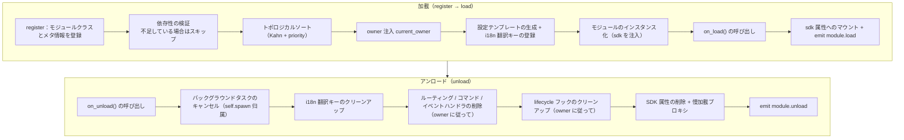

**加載時にフレームワークが自動で行う処理**（`on_load` だけを書けばよい、残りは自動処理）：

| 環節 | フレームワークが自動で行う |
|------|-------------|
| owner 注入 | インスタンス化中に `owner_scope` でモジュール名をラップするため、`on_load` で登録したコマンド/イベント/フック/バックグラウンドタスクは**自動的に本モジュールに所属**し、アンロード時に owner に従って一括クリーンアップされる |
| 設定テンプレート | `ConfigClass` を宣言したモジュールの場合、フレームワークが `ErisPulse.<ModuleName>` の設定セグメントを自動生成/埋め込む |
| i18n 翻訳キー | `I18nClass` を宣言したモジュールの場合、翻訳キーが自動登録（アンロード時に自動的に登録解除） |
| 依存トポロジー | `depends` で宣言された順序に従い、依存されるモジュールが先に加載されるよう確保する。循環依存は `RuntimeError` で拒否される |
| SDK マウント | インスタンス化後に `sdk.<ModuleName>` にマウントされるため、`sdk.MyModule.xxx` でアクセス可能になる |

**アンロード時にフレームワークが自動でクリーンアップする**（上記の U1→U7 に対応）：`on_unload` 実行後にバックグラウンドタスクを強制的にキャンセル（`self.spawn` で作成されたタスクは、`on_unload` で優雅に終了させる）、i18n キー、ルーティング、コマンド/イベントハンドラ、lifecycle フックをクリーンアップし、最後に SDK 属性を削除します。`purge=True` の場合は、登録のメタデータの削除 + `sys.modules` のクリーンアップも追加されます。

> これらの自動クリーンアップが「`on_load`/`on_unload` だけを書けばよい、手動で unregister は不要」という自信の源です。フレームワークは owner 归属を使って「誰が登録したか、誰がクリーンアップするか」を一括処理にしています。

## SDK オブジェクト

### コアモジュールへのアクセス

```python
from ErisPulse import sdk

# sdk オブジェクトを介してすべてのコアモジュールにアクセス
sdk.logger.info("ログ")
sdk.storage.set("key", "value")
config = sdk.config.getConfig("MyModule")
```

### モジュール間通信

```python
# 他のモジュールにアクセス
other_module = sdk.OtherModule
result = await other_module.some_method()
```

## 适配器送信メソッドの照会

新しい標準規格では、デフォルト送信メカニズムを実装するために `__getattr__` メソッドのオーバーライドを使用するよう求められており、このため `hasattr` メソッドを用いてメソッドの存在をチェックできなくなりました。`2.3.5` 以降では、送信メソッドを照会する機能が追加されました。

### 対応する送信メソッドの一覧表示

```python
# プラットフォームが対応するすべての送信メソッドを一覧表示
methods = sdk.adapter.list_sends("onebot11")
# 戻り値: ["Text", "Image", "Voice", "Markdown", ...]
```

### メソッドの詳細情報の取得

```python
# 特定のメソッドの詳細情報を取得
info = sdk.adapter.send_info("onebot11", "Text")
# 戻り値:
# {
#     "name": "Text",
#     "parameters": [
#         {"name": "text", "type": "str", "default": null, "annotation": "str"}
#     ],
#     "return_type": "Awaitable[Any]",
#     "docstring": "テキストメッセージを送信..."
# }
```

## 設定管理

### 宣言的設定（推奨）

v2.5.2 以降、モジュールは `ConfigClass` を使って設定クラスを宣言し、アダプタと同じ設定 Schema システムを使用できます。設定は `self.cfg` でリアルタイムに読み取り、変更後は即座に反映されます：

```python
from dataclasses import dataclass, field
from ErisPulse.Core.Bases import BaseModule
from ErisPulse.Core.Bases import BaseConfig

@dataclass
class MyModuleConfig(BaseConfig):
    api_key: str = field(
        default="",
        metadata={
            "description": {"i18n": "my_module.api_key", "default": "API 密钥"},
            "required": True,
            "secret": True,
            "ui": {"widget": "password", "group": "basic", "order": 1},
        },
    )
    timeout: int = field(
        default=30,
        metadata={
            "description": {"i18n": "my_module.timeout", "default": "超时时间（秒）"},
            "ui": {"widget": "number", "group": "advanced", "order": 2},
        },
    )

class MyModule(BaseModule):
    ConfigClass = MyModuleConfig

    def __init__(self, sdk):
        self.sdk = sdk
        self.logger = sdk.logger.get_child("MyModule")

    async def on_load(self, event):
        self.logger.info("モジュールがロードされました")

    async def on_unload(self, event):
        pass

    async def do_something(self):
        cfg = self.cfg  # 実時読み取り、型安全
        api_key = cfg.api_key
        timeout = cfg.timeout
```

`BaseConfig` は、アダプタ、モジュール、外部プロジェクトなど、あらゆる場面で使用できる汎用的な設定基底クラスです。設定フィールドは i18n 多言語説明をサポートしています（詳細は [i18n ドキュメント](../../advanced/i18n.md#配置字段多语言) を参照）。

> [!NOTE]  
> モジュール（アダプタを含む）のロード、アンロード、起動、停止などのライフサイクルは、フレームワークが一括して管理します（`module manager` / `scope` がクエリとコントロール API を提供）。`ConfigClass` は業務パラメータのみを保持すべきであり、モジュールは内部で「自分自身が起動するかどうか」を判断するロジックを再嵌套してはいけません。

設定 Schema システムはさらに（v2.8.0+、[アダプタ core-concepts](../adapters/core-concepts.md#metadata-约定) を参照）：

- **docstring から自動生成されたフィールド説明**：`metadata` の `description` を宣言していない場合、docstring の `:ivar フィールド名: 説明` または `Attributes:` 段から代替として抽出されます。
- **ネストされた dataclass 設定**：フィールドの型がネストされた dataclass の場合、schema/テンプレート/検証は再帰的に処理され、WebUI ではネストされたグループとしてレンダリングされます。
- **`example` は保存しないフィールド**：`metadata={"example": True}` のフィールドは `config.toml` に書き込まれず、`config.full.example` に記録されます（複雑で頻繁に触れない高度な設定項目に適しています）。ユーザーが手動で設定した場合は通常通り永続化されます。

### 宣言的翻訳キー（v2.7.0+）

v2.7.0 以降、モジュールは `ConfigClass` を宣言するのと同じように、`I18nClass` というネストされたクラスを使って翻訳キーを一括して宣言できます。フレームワークはロード時に**自動的に**すべての宣言された翻訳キーを登録し、手動で `i18n.register()` を呼び出す必要はありません。登録のタイミングは設定テンプレート生成よりも早いため、設定説明で参照される i18n キーが利用可能であることを保証します。

```python
from ErisPulse.Core.Bases import BaseConfig, BaseI18n, I18nKey

class MyModule(BaseModule):
    # 設定クラス（オプション）
    @dataclass
    class ConfigClass(BaseConfig):
        welcome_msg: str = field(
            default="欢迎",
            metadata={
                "description": {"i18n": "mymodule.welcome_msg", "default": "欢迎消息"},
            },
        )

    # 翻訳キー集合クラス（オプション）
    class I18nClass(BaseI18n):
        # 属性名が自動的に完全なキー パス：<モジュール名>.<属性名> に結合されます
        welcome_msg: I18nKey = I18nKey(
            default="Welcome Message",   # 言語に依存しない代替
            zh_CN="欢迎消息",
            zh_TW="歡迎訊息",
            en="Welcome Message",
            ja="ウェルカムメッセージ",
            ru="Приветственное сообщение",
        )
        hello: I18nKey = I18nKey(
            default="Hello, {name}!",
            zh_CN="你好，{name}！",
            zh_TW="你好，{name}！",
            en="Hello, {name}!",
            ja="こんにちは、{name}！",
            ru="Привет, {name}!",
        )
```

詳細は [i18n 推奨書き方](../../advanced/i18n.md#推荐写法通过-i18nclass-声明翻译键-v270) を参照してください。

### 手動設定読み取り（廃止）

> **廃止**：宣言的設定 ([声明式配置推荐](#声明式配置推荐)) と `self.cfg` による実時読み取りを使用してください。

```python
class MyModule(BaseModule):
    def __init__(self, sdk):
        self.sdk = sdk

    def _load_config(self):
        config = self.sdk.config.getConfig("MyModule")
        if not config:
            self.sdk.config.setConfig("MyModule", {"api_key": "", "timeout": 30})
            return {"api_key": "", "timeout": 30}
        return config
```

## ストレージシステム

### 基本的な使用方法

```python
# データを保存
sdk.storage.set("user:123", {"name": "張三"})

# データを取得
user = sdk.storage.get("user:123", {})

# データを削除
sdk.storage.delete("user:123")
```

### トランザクションの使用

```python
# トランザクションを使用してデータの一貫性を確保
with sdk.storage.transaction():
    sdk.storage.set("key1", "value1")
    sdk.storage.set("key2", "value2")
    # いずれかの操作が失敗した場合、すべての変更はロールバックされます
```

## イベント処理

### イベントハンドラの登録

```python
from ErisPulse.Core.Event import command, message

# コマンドの登録
@command("info", help="情報を取得します")
async def info_handler(event):
    await event.reply("これは情報です")

# メッセージハンドラの登録
@message.on_group_message()
async def group_handler(event):
    sdk.logger.info(f"グループメッセージを受け取りました: {event.get_text()}")
```

### イベントハンドラのライフサイクル

フレームワークはイベントハンドラの登録とアンロードを自動的に管理します。`on_load` で登録するだけで済みます。

## ラグロードメカニズム

### 動作原理

```python
# モジュールが初めてアクセスされたときにのみ初期化されます
result = await sdk.my_module.some_method()
# ↑ ここでモジュールの初期化がトリガーされます
```

### 立即ロード

初期化が即座に必要なモジュール（例：リスナー、タイマー）の場合：

```python
@staticmethod
def get_load_strategy():
    return ModuleLoadStrategy(
        lazy_load=False,  # 立即ロード
        priority=100
    )
```

## エラー処理

### 例外のキャッチ

```python
async def handle_event(self, event):
    try:
        # ビジネスロジック
        await self.process_event(event)
    except ValueError as e:
        self.logger.warning(f"パラメータエラー: {e}")
        await event.reply(f"パラメータエラー: {e}")
    except Exception as e:
        self.logger.error(f"処理失敗: {e}")
        raise
```

### ログ記録

```python
# 異なるログレベルを使用
self.logger.debug("デバッグ情報")    # 詳細なデバッグ情報
self.logger.info("実行状態")      # 正常な実行情報
self.logger.warning("警告情報")  # 警告情報
self.logger.error("エラー情報")    # エラー情報
self.logger.critical("致命的エラー") # 致命的エラー
```


### Event 包装类详解

# Event 包装クラスの詳細

> [!NOTE]
> **L1 核心必読**——「ホーム > 読み進む」に記載されている5つのコアドキュメントの1つで、モジュール開発に不可欠です。

Event モジュールは、強力な Event 包装クラスを提供し、イベント処理を簡素化します。

## event パラメータに型注釈を追加する

イベントハンドラの `event` パラメータは **Event 包装クラス**（dict のサブクラス）です。このパラメータに型注釈を付けることを強く推奨します：

```python
from ErisPulse.Core.Event import Event

@message.on_private_message()
async def handler(event: Event):
    text = event.get_text()   # IDE が便利なメソッドをすべて自動補完
    await event.reply(text)   # 静的チェック時に誤字が発見される
```

型注釈を付けない場合、IDE は Event 上のメソッド（`get_text()` / `reply()` / `wait_reply()` / プラットフォーム拡張メソッドなど）を認識できず、すべて手動で記憶して入力する必要があります。

> **注意**：イベントハンドラのコールバックの `event` は **Event 包装クラス**（注釈は `Event`）です。一方、モジュールのライフサイクルメソッド `on_load` / `on_unload` の `event` は普通の **dict**（注釈は `dict`）です。これらは混同しないでください。

## 核心特性

- **完全互換性**：Event は dict を継承しています
- **便利なメソッド**：多数の便利なメソッドを提供しています
- **プロパティアクセス**：イベントフィールドにドット演算子でアクセスできます
- **後方互換性**：すべてのメソッドはオプションです

## 核心フィールドメソッド

```python
from ErisPulse.Core.Event import command

@command("info")
async def info_command(event: Event):
    event_id = event.get_id()
    platform = event.get_platform()
    time = event.get_time()
    print(f"ID: {event_id}, プラットフォーム: {platform}, 時間: {time}")
```

## メッセージイベントメソッド

```python
from ErisPulse.Core.Event import message

@message.on_private_message()
async def private_handler(event: Event):
    text = event.get_text()
    user_id = event.get_user_id()
    nickname = event.get_user_nickname()
    await event.reply(f"こんにちは、{nickname}！")
```

## メッセージタイプの判断

```python
from ErisPulse.Core.Event import message

@message.on_group_message()
async def group_handler(event: Event):
    is_private = event.is_private_message()
    is_group = event.is_group_message()
    is_at = event.is_at_message()
    await event.reply(f"タイプ: {'プライベートチャット' if is_private else 'グループチャット'}")
```

## 回答機能

```python
from ErisPulse.Core.Event import command

@command("ask")
async def ask_command(event: Event):
    await event.reply("あなたの名前を入力してください:")
    reply = await event.wait_reply(timeout=30)
    if reply:
        name = reply.get_text()
        await event.reply(f"こんにちは、{name}！")

@command("price")
async def price_command(event: Event):
    await event.reply("金額を入力してください（例：5元）:")
    # 回答が正規表現に一致しない場合、タイムアウトするまで待機し続ける
    reply = await event.wait_reply(timeout=30, regex=r"\d+\s*元")
    if reply:
        await event.reply(f"金額を受け取りました: {reply.get_text()}")
```

## インタラクティブな会話の高度な機能

> [!NOTE]
> 本機能は ErisPulse **2.8.0+** が必要です。

```python
# 会話の定期的なリマインダー：5 分間返信がない場合にリマインダーを送信し、ユーザーが返信すると自動的にキャンセル
reminder = event.remind(300, "まだですか？話したくない場合は「退出」を入力してください")
reminder.cancel()  # 手動でキャンセルすることも可能です

# タイムアウトによる昇格：時間経過後に必ず通知（返信によってキャンセルされない）、例えば長時間未処理の通知を主人に通知
event.escalate(1800, lambda e: notify_master("工単がタイムアウトしました"))

# 複数ルートの待機：「同意」および「拒否」のいずれかを同時に待機し、先に到着したものを優先
which, reply = await event.select(
    event.expect(pattern="同意*", user="10001"),
    event.expect(pattern="拒绝*", user="10002"),
    timeout=60,
)
if which is None:
    await event.reply("承認がタイムアウトしました")

# 会話レベルの待機：同じグループ内の誰からの返信でも対象になります（グループ協力）
reply = await event.wait_reply(session=True, prompt="誰か回答していただけますか？")

# 会話の受信箱：現在の会話における最新の 20 件のメッセージ（ロボット、AI のコンテキスト / リピート防止の基盤を含む）
messages = await event.history(20)

# メッセージトランザクション：例外が発生した場合、トランザクション内で送信されたメッセージを自動的に撤回
async with event.message_tx():
    await event.reply("処理中です、少々お待ちください...")
    result = await do_something()
    await event.reply(f"完了：{result}")
```

## コマンド情報の取得

```python
from ErisPulse.Core.Event import command

@command("cmdinfo")
async def cmdinfo_command(event: Event):
    cmd_name = event.get_command_name()
    cmd_args = event.get_command_args()
    await event.reply(f"コマンド: {cmd_name}, 引数: {cmd_args}")
```

## 通知イベントメソッド

```python
from ErisPulse.Core.Event import notice

@notice.on_friend_add()
async def friend_add_handler(event: Event):
    await event.reply("友達追加してくれてありがとう！")
```

## 方法速查表

### 核心方法

#### 事件基础信息
- `get_id()` - イベントIDを取得
- `get_time()` - イベントのタイムスタンプ（Unix秒単位）を取得
- `get_type()` - イベントのタイプ（message/notice/request/meta）を取得
- `get_detail_type()` - イベントの詳細タイプ（private/group/friend等）を取得
- `get_platform()` - プラットフォーム名を取得

#### ロボット情報
- `get_self_platform()` - ロボットのプラットフォーム名を取得
- `get_self_user_id()` - ロボットのユーザーIDを取得
- `get_self_account_id()` - ロボットのアカウントID（複数Botモード）を取得
- `get_self_info()` - ロボットの完全な情報辞書を取得

#### 会話識別子
- `get_target_id()` - 統一されたターゲットIDを取得（グループチャットは `group_id`、チャンネルは `channel_id`、プライベートチャットは `user_id` を返す。group → channel → guild → thread → userの順に最初の非空値を返す）
- `get_session_id()` - セッションの唯一の識別子を取得、形式は `{platform}:{detail_type}:{target_id}`

### メッセージイベントメソッド

#### メッセージ内容
- `get_message()` - メッセージセグメントの配列を取得（OneBot12形式）
- `get_alt_message()` - メッセージの代替テキストを取得
- `get_text()` - 純粋なテキスト内容を取得（`get_alt_message()`のエイリアス）
- `get_message_text()` - 純粋なテキスト内容を取得（`get_alt_message()`のエイリアス）

#### 送信者情報
- `get_user_id()` - 送信者のユーザーIDを取得
- `get_user_nickname()` - 送信者のニックネームを取得
- `get_sender()` - 送信者の完全な情報辞書を取得

#### グループ/チャンネル情報
- `get_group_id()` - グループIDを取得（グループメッセージ）
- `get_channel_id()` - チャンネルIDを取得（チャンネルメッセージ）
- `get_guild_id()` - サーバーIDを取得（サーバーメッセージ）
- `get_thread_id()` - トピック/サブチャンネルIDを取得（トピックメッセージ）

#### @メッセージ関連
- `has_mention()` - @ロボットが含まれているか
- `get_mentions()` - すべての@されたユーザーIDのリストを取得

### メッセージタイプ判断

#### 基礎判断
- `is_message()` - メッセージイベントであるか
- `is_private_message()` - プライベートチャットメッセージか
- `is_group_message()` - グループチャットメッセージか
- `is_at_message()` - @メッセージか（`has_mention()`のエイリアス）

### 通知イベントメソッド

#### 通知操作者
- `get_operator_id()` - 操作者のIDを取得
- `get_operator_nickname()` - 操作者のニックネームを取得

#### 通知タイプ判断
- `is_notice()` - 通知イベントであるか
- `is_group_member_increase()` - グループメンバー増加イベント
- `is_group_member_decrease()` - グループメンバー減少イベント
- `is_friend_add()` - 友達追加イベント（`detail_type == "friend_increase"`に一致）
- `is_friend_delete()` - 友達削除イベント（`detail_type == "friend_decrease"`に一致）

### 要求イベントメソッド

#### 要求情報
- `get_comment()` - 要求の付言を取得

#### 要求タイプ判断
- `is_request()` - 要求イベントであるか
- `is_friend_request()` - 友達要求か
- `is_group_request()` - グループ要求か

### 返信機能

#### 基礎返信
- `reply(content, method="Text", at_sender=False, quote=False, at_users=None, reply_to=None, at_all=False, via=None, **kwargs)` - 一般的な返信メソッド
  - `content`: 送信内容（テキスト、URLなど）
  - `method`: 送信方法、デフォルトは "Text"、"Image"/"Voice"/"Video"/"File" など
  - `at_sender`: 送信者を@するか（自動的に user_id を抽出）
  - `quote`: 現在のメッセージを引用して返信するか（自動的に message_id を抽出）
  - `at_users`: @するユーザーIDのリスト、例: `["user1", "user2"]`
  - `reply_to`: 手動で返信するメッセージIDを指定
  - `at_all`: 全員を@するか
  - `**kwargs`: 余分なパラメータ（例: Mentionメソッドの user_id）

- `reply_ob12(message)` - OneBot12メッセージセグメントを使って返信
  - `message`: OneBot12メッセージセグメントのリストまたは辞書、MessageBuilderを使って構築

#### プラットフォーム機能の確認
- `supports(method)` - 現在のプラットフォームが特定の送信方法（例: `"Image"`、`"Voice"`）をサポートしているか確認、`bool`を返す
- `available_methods()` - 現在のプラットフォームで利用可能な送信方法の一覧を取得、メソッド名のリストを返す

#### 転送機能

> **注意**: 転送機能はアダプターのSend DSLによって実装される必要があり、Eventラッパークラス自体は直接の転送メソッドを提供しない。

```python
# メッセージをグループに転送
adapter = sdk.adapter.get(event.get_platform())
target_id = event.get_group_id()  # または他のグループIDを指定
await adapter.Send.To("group", target_id).Text(event.get_text())
```

### 返信待ち機能

- `wait_reply(prompt=None, timeout=60.0, callback=None, validator=None, method="Text", pattern=None, regex=None)` - ユーザーからの返信を待つ
  - `prompt`: プロンプトメッセージ、提供された場合ユーザーに送信される
  - `timeout`: 待ち時間のタイムアウト（秒）、デフォルトは60秒
  - `callback`: 返信を受け取ったときに実行されるコールバック関数
  - `validator`: 返信が有効かどうかを検証する関数
  - `method`: プロンプトメッセージの送信方法、デフォルトは "Text"
  - `pattern`: globワイルドカード（`*` / `?` / `[seq]`）、返信テキストが一致する必要がある、一致しない場合は待機を続ける
  - `regex`: 正規表現、返信テキストが一致する必要がある（`pattern` と `regex` のどちらか一方を選択）、一致しない場合は待機を続ける
  - ユーザーの返信のEventオブジェクトを返す、タイムアウト時は`None`を返す

#### 交互メソッド

- `confirm(prompt=None, timeout=60.0, yes_words=None, no_words=None, method="Text", hint=False)` - 確認対話
  - `True`（確認）/ `False`（否定）/ `None`（タイムアウト）を返す
  - 内部的に中英語の確認語を自動認識し、カスタム語集を指定可能
  - `method`: 送信方法、デフォルトは "Text"、"Image"/"Markdown" などの非テキスト方式もサポート
  - `hint`: プロンプトの末尾に自動的に確認語のヒント（例: "（はい/いいえ）"）を追加するか、デフォルトは`False`

- `choose(prompt, options, timeout=60.0, method="Text", options_format="auto", merge_prompt=False, placeholder="{options}")` - 選択メニュー
  - `options`: 選択肢のテキストリスト
  - 選択肢のインデックス（0ベース）を返す、タイムアウト時は`None`を返す
  - `method`: 送信方法、デフォルトは "Text"、テキスト系メソッド (Text/Markdown/md/Html/h5) はデフォルトで選択肢を末尾にマージ
  - `options_format`: 選択肢のフォーマット（デフォルト: "auto"、methodに応じて自動的に組み込みスタイルを選択）
    - `"auto"`: Markdown→箇条書き（`- 1.選択肢`）、Html→順序付きリスト（`<ol>`）、その他の場合は純粋なテキストリスト
    - `"list"`: 各行に1つずつ、例: ``1. 選択肢A\n2. 選択肢B``
    - `"inline"`: 1行に表示、例: ``1.A | 2.B``
    - `"md"`: Markdownの箇条書き
    - `"html"`: Htmlの順序付きリスト
    - `callable`: 自作の関数、``list[str]``を受け取り``str``を返す
  - `merge_prompt`: 強制的に1つのメッセージにマージして送信するか、デフォルトは`False`
    - `False`（デフォルト）: テキスト系メソッドは自動的にマージ、非テキスト系メソッドはまずpromptを送信してからTextの選択肢を送信
    - `True`: どんなmethodでも1つのメッセージにマージしてユーザーが指定したmethodで送信
  - `placeholder`: 選択肢を挿入する占位符、デフォルトは`{options}`、promptにこのマーカーが含まれる場所に選択肢のテキストを置き換え、空文字に設定すると常に末尾に追加

- `collect(fields, timeout_per_field=60.0)` - フォーム収集
  - `fields`: フィールドのリスト、各項目には`key`、`prompt`、オプション`validator`、オプション`method`が含まれる
  - `{key: value}`の辞書を返す、いずれかのフィールドがタイムアウトすると`None`を返す
  - 各フィールドは`method`キーで送信方法を指定可能、例: 画像を収集する場合 ``{"key": "avatar", "prompt": "プロフィール画像を送ってください", "method": "Image"}``
  - 各フィールドは`options`キー（リスト）をオプションで提供可能、提供された場合、該当フィールドは選択問題になる（`choose`のロジックを自動的に呼び出す）
  - 各フィールドは`options_format`、`merge_prompt`、`placeholder`キーをオプションで提供可能、選択肢のフォーマット、メッセージのマージ動作、占位符を制御

- `wait_for(event_type="message", condition=None, timeout=60.0)` - 任意のイベントを待つ
  - `condition`: 条件関数、`True`を返した場合に一致する
  - 一致するEventオブジェクトを返す、タイムアウト時は`None`を返す

- `conversation(timeout=60.0)` - 複数回対話コンテキストを作成
  - `Conversation`オブジェクトを返す、`say()`/`wait()`/`confirm()`/`choose()`/`collect()`/`stop()`がサポートされる
  - `is_active`属性は対話がアクティブかどうかを示す

#### 交互メソッドの例

**confirm() - 確認対話:**

```python
@command("delete", help="データを削除")
async def delete_handler(event: Event):
    if await event.confirm("すべてのデータを削除してもよろしいですか？"):
        sdk.storage.delete("all_data")
        await event.reply("データを削除しました")
    else:
        await event.reply("キャンセルしました")
```

**confirm() - ヒント付き:**

```python
# hint=True はプロンプトの末尾に "（はい/いいえ）" を追加
if await event.confirm("続行してもよろしいですか？", hint=True):
    await event.reply("続行しました")
# ユーザーが表示する: 続行してもよろしいですか？（はい/いいえ）
```

**choose() - 選択メニュー:**

```python
@command("color", help="色を選択")
async def color_handler(event: Event):
    choice = await event.choose("色を選択してください：", ["赤", "緑", "青"])
    if choice is not None:
        colors = ["赤", "緑", "青"]
        await event.reply(f"選択した色は：{colors[choice]}")
```

**choose() - 選択肢のフォーマットとメッセージのマージ:**

```python
# inline形式：選択肢を1行に表示
choice = await event.choose("選択してください：", ["A", "B", "C"], options_format="inline")
# 出力: 1.A | 2.B | 3.C

# 自作のフォーマット
choice = await event.choose("選択してください：", ["猫", "犬"],
    options_format=lambda opts: " / ".join(opts))
# 出力: 猫 / 犬

# options_format="auto"（デフォルト）：methodに応じて自動的に組み込みスタイルを選択
# Markdown → 箇条書き
choice = await event.choose(
    "## 選択してください", ["猫", "犬"],
    method="Markdown",  # autoは自動的にmdリストを認識
)
# 出力:
# ## 選択してください
# - 1. 猫
# - 2. 犬

# Html → 順序付きリスト
choice = await event.choose(
    "<h2>選択してください</h2>", ["猫", "犬"],
    method="Html", merge_prompt=True,  # autoは自動的にhtmlリストを認識
)
# 出力:
# <h2>選択してください</h2>
# <ol><li>1. 猫</li><li>2. 犬</li></ol>

# マージモード + 占位符
choice = await event.choose(
    "## 選択してください\n{options}\n番号を返信してください",
    ["猫", "犬"],
    method="Markdown", merge_prompt=True,
)

# 自作の占位符
choice = await event.choose(
    "選択してください: [choices]",
    ["猫", "犬"],
    placeholder="[choices]",
)
```

**collect() - フォーム収集:**

```python
@command("register", help="登録")
async def register_handler(event: Event):
    data = await event.collect([
        {"key": "name", "prompt": "お名前を入力してください："},
        {"key": "age", "prompt": "年齢を入力してください：",
         "validator": lambda e: e.get_text().isdigit()},
    ])
    if data:
        await event.reply(f"登録完了！{data['name']}、{data['age']}歳")
```

**非テキストメソッドのreply:**

```python
await event.reply("http://example.com/img.jpg", method="Image")
await event.reply("http://example.com/audio.mp3", method="Voice")

from ErisPulse.Core.Event import MessageBuilder
segments = MessageBuilder.text("この画像を見てください：").image("http://example.com/img.jpg").build()
await event.reply_ob12(segments)
```

> 完全なConversation多回対話の使い方は[Conversation多回対話](../../advanced/conversation.md)を参照してください。

### コマンド情報

#### コマンド基礎
- `get_command_name()` - コマンド名を取得
- `get_command_args()` - コマンド引数のリストを取得
- `get_command_raw()` - コマンドの元のテキストを取得
- `get_command_info()` - 完全なコマンド情報の辞書を取得
- `is_command()` - コマンドか

### 元データ

- `get_raw()` - プラットフォームの元のイベントデータを取得
- `get_raw_type()` - プラットフォームの元のイベントタイプを取得

### プラットフォーム拡張メソッド

アダプターはEventラッパークラスにプラットフォーム固有のメソッドを登録できる。メソッドは対応するプラットフォームのEventインスタンスでのみ利用可能で、他のプラットフォームでアクセスすると`AttributeError`が発生する。

プラットフォームメソッドは`Event.__getattribute__`により、内蔵メソッドよりも優先して有効になるため、`confirm`、`choose`、`collect`、`wait_reply`などの内蔵インタラクティブメソッドを覆い、プラットフォーム特有の実装（例: ボタン、カードなど）を提供できる。内蔵実装は`_builtin_*`関数としてエクスポートされ、覆い書き側で利用可能。

```python
# メールイベント - メールメソッドのみ
event = Event({"platform": "email", "email_raw": {"subject": "Hello"}})
event.get_subject()      # ✅ "Hello"を返す
event.get_chat_type()    # ❌ AttributeError

# Telegramイベント - Telegramメソッドのみ
event = Event({"platform": "telegram", "telegram_raw": {"chat": {"type": "private"}}})
event.get_chat_type()    # ✅ "private"を返す
event.get_subject()      # ❌ AttributeError

# 内蔵メソッドは常に利用可能
event.get_text()         # ✅ どのプラットフォームでも
event.reply("hi")        # ✅ どのプラットフォームでも
```

### 登録されたメソッドの照会

```python
from ErisPulse.Core.Event import get_platform_event_methods

methods = get_platform_event_methods("email")
# ["get_subject", "get_from", ...]
```

### `hasattr` と `dir` のサポート

```python
hasattr(event, "get_subject")   # platform="email"のときのみTrueを返す
"get_subject" in dir(event)     # 同上
```

### 跨プラットフォーム拡張（ワイルドカード）

`register_event_method`と`register_event_mixin`はプラットフォーム名として`"*"`を渡すことができ、登録されたメソッドは**すべてのプラットフォーム**のEventインスタンスで利用可能になる。AI対話、コンテキスト管理など、跨プラットフォームで再利用可能な機能に適している。

```python
from ErisPulse.Core.Event.wrapper import register_event_method

@register_event_method("*")
async def ai_chat(self, prompt: str):
    # selfはEventインスタンス、イベントデータと内蔵メソッドにアクセス可能
    await self.reply(f"AI: {prompt}")
```

登録後、どのプラットフォームのイベントハンドラでも`event.ai_chat(...)`を呼び出すことができる。

メソッドの優先順位（高い順）: プラットフォーム固有メソッド → ワイルドカードメソッド → 内蔵メソッド → 辞書キーアクセス。

> アダプター開発者が拡張メソッドを登録する方法は[イベントシステムAPI - 跨プラットフォーム拡張ワイルドカード](../../api-reference/event-system.md#跨平台扩展通配符)を参照してください。


### 模块开发最佳实践

# モジュール開発のベストプラクティス

> [!TIP]  
> **この記事を読むタイミング**：最初のモジュールを完成させた後に読むことを推奨します（エンジニアリングのベストプラクティス）。不要な場合はスキップしても、他の機能の使用に影響はありません。

本文書では、ErisPulse モジュール開発におけるベストプラクティスの提案を提供します。

## モジュール設計

### 1. 単一責任の原則

各モジュールは1つのコア機能のみを担当するようにします：

```python
# 良い設計：各モジュールは1つの機能のみを担当
class WeatherModule(BaseModule):
    """天気情報取得モジュール"""
    pass

class NewsModule(BaseModule):
    """ニュース情報取得モジュール"""
    pass

# 悪い設計：1つのモジュールが複数の無関係な機能を担当
class UtilityModule(BaseModule):
    """天気、ニュース、ジョーク等多个機能を含む"""
    pass
```

### 2. モジュール命名規則

```toml
[project]
name = "ErisPulse-ModuleName"  # ErisPulse- プレフィックスを使用
```

### 3. 明確な設定管理

宣言的設定（`ConfigClass` + `BaseConfig`）を使用することを推奨します。これにより、型安全、自動テンプレート生成、WebUIフォームサポートなどの機能が得られます：

```python
from dataclasses import dataclass, field
from ErisPulse.Core.Bases import BaseConfig

@dataclass
class MyModuleConfig(BaseConfig):
    api_url: str = field(default="https://api.example.com", metadata={
        "description": {"i18n": "my_module.api_url", "default": "API アドレス"},
    })
    timeout: int = field(default=30, metadata={
        "description": {"i18n": "my_module.timeout", "default": "タイムアウト時間（秒）"},
    })
    cache_ttl: int = field(default=3600, metadata={
        "description": {"i18n": "my_module.cache_ttl", "default": "キャッシュの有効時間（秒）"},
    })

class MyModule(BaseModule):
    ConfigClass = MyModuleConfig

    async def do_something(self):
        cfg = self.cfg  # 型安全、リアルタイム読み取り
        await self._fetch(cfg.api_url, timeout=cfg.timeout)
```

手動で設定ストアを読み書きする方法も引き続き使用できます（[モジュールの基本概念](core-concepts.md#設定管理)を参照）。

### 宣言的翻訳キー（v2.7.0+）

モジュールは `I18nClass` を使って翻訳キーを集中宣言し、フレームワークが i18n システムに自動登録します。`i18n.register()` を手動で呼び出す必要はありません。

```python
from ErisPulse.Core.Bases import BaseI18n, I18nKey

class MyModule(BaseModule):
    class I18nClass(BaseI18n):
        # プレースホルダー付きのビジネス翻訳キー
        welcome: I18nKey = I18nKey(
            default="Welcome, {name}!",
            zh_CN="ようこそ、{name}！",
            zh_TW="ようこそ、{name}！",
            en="Welcome, {name}!",
            ja="ようこそ、{name}！",
            ru="Добро пожаловать, {name}!",
        )
        # 設定項目説明の翻訳
        api_url: I18nKey = I18nKey(
            default="API URL",
            zh_CN="API アドレス",
            zh_TW="API 位址",
            en="API URL",
            ja="API URL",
            ru="API URL",
        )
```

詳細な使い方は [i18n ドキュメント](../../advanced/i18n.md#推奨の書き方-i18nclass-を使って翻訳キーを宣言する-v270)を参照してください。

## 非同期プログラミング

### 1. 非同期ライブラリの使用

```python
# 推奨：SDK 内部の HTTP クライアント（非同期、自動ログと統計）
from ErisPulse.Core import client

class MyModule(BaseModule):
    async def fetch_data(self, url):
        resp = await client.get(url)
        return await resp.json()

# sdk.client を使っても同じ効果
from ErisPulse import sdk

class MyModule(BaseModule):
    async def fetch_data(self, url):
        resp = await sdk.client.get(url)
        return await resp.json()

# aiohttp を直接インポートしないこと（フレームワークが統一管理できない）
import aiohttp

class MyModule(BaseModule):
    async def fetch_data(self, url):
        async with aiohttp.ClientSession() as session:
            async with session.get(url) as response:
                return await response.json()

# requests を使用しないこと（同期でイベントループをブロックする）
import requests

class MyModule(BaseModule):
    def fetch_data(self, url):
        return requests.get(url).json()  # イベントループをブロックする
```

### 2. 正しい非同期操作

```python
from ErisPulse.Core.Event import Event  # event: Event 注釈で IDE の補完が得られる

async def handle_command(self, event: Event):
    # 結果を待つ必要がある処理：await で直接待つ（ライフサイクルが明確）
    result = await self._long_operation()

async def on_load(self, event: dict):
    # バックグラウンドタスク（ポーリング/タイマー/fire-and-forget）：self.spawn() を使う
    # モジュールのアンロード時にフレームワークが on_unload の後に自動的にキャンセルし、self へのリファレンスを保持しない
    self.spawn(self._poll())
```

> [!NOTE]
> バックグラウンドタスクは `self.spawn()` を推奨します（ErisPulse **2.8.0+**）。**2.8.3 以降**は、裸の `asyncio.create_task` も自動的にモジュールに所属します（タスクファクトリーが自動的に登録され、アンロード時に自動的にキャンセルされ、`self` リファレンスを保持しません）。
> `self.spawn()` は、非メインループスレッドからメインループにスケジューリングするサポートや、明示的な `owner=` 指定が可能なため、引き続き推奨されます。
> **2.8.3 以前**のバージョンでは、裸のタスクは所属せず、`self` リファレンスを保持してモジュールインスタンスが回収できず（ホットリロード時のリーク）、`self.spawn()` を使用する必要があります。詳細は [ライフサイクル管理](../../advanced/lifecycle.md#バックグラウンドタスクの所属と自動キャンセル) を参照してください。

### 3. リソース管理

```python
async def on_load(self, event):
    # SDK クライアントは接続プールを自動管理するため、手動でセッションを作成する必要はありません
    pass
    
async def on_unload(self, event):
    # 自前でクライアントを作成する場合、リソースのクリーンアップを忘れずに
    pass
```

## イベント処理

### 1. Event 包装クラスの使用

```python
# Event 包装クラスの便利なメソッドを使用
@command("info")
async def info_command(event: Event):
    user_id = event.get_user_id()
    nickname = event.get_user_nickname()
    await event.reply(f"こんにちは、{nickname}！")

# 辞書に直接アクセスしない
@command("info")
async def info_command(event: Event):
    user_id = event["user_id"]  # 明確さに欠け、間違いやすい
```

### 2. ラグジュアリーの適切な使用

```python
# 低頻度コマンドモジュール：activate_on トリガーを宣言し、最初の一致するコマンドが到着したときに自動的にアクティブ化（ラグジュアリーを維持）
class CommandModule(BaseModule):
    @staticmethod
    def get_load_strategy():
        return ModuleLoadStrategy(lazy_load=True, activate_on=[
            {"command": {"name": "dice", "help": "サイコロを振る", "aliases": ["d"]}},
        ])

# 低頻度リスナーモジュール：イベントトリガーを宣言し、イベントが到着したときに自動的にアクティブ化
class ListenerModule(BaseModule):
    @staticmethod
    def get_load_strategy():
        return ModuleLoadStrategy(lazy_load=True, activate_on=[
            {"notice": "group_member_increase"},
        ])

# 高頻度トリガー（メッセージ毎に処理が必要）または起動時に既に準備が必要なモジュール：即時ロード
class HotListenerModule(BaseModule):
    @staticmethod
    def get_load_strategy():
        return ModuleLoadStrategy(lazy_load=False)

# ユーティリティモジュールはラグジュアリーが適している
class UtilityModule(BaseModule):
    @staticmethod
    def get_load_strategy():
        return ModuleLoadStrategy(lazy_load=True)
```

> `activate_on` の完全な構文（イベントの3形式 / コマンドの簡易記法と dict 宣言 / help フォールバックチェーン）は
> [ラグジュアリーのモジュールシステム](../../advanced/lazy-loading.md#イベント駆動のラグジュアリー活性化activate_on)を参照してください。

### 3. イベントハンドラの登録

```python
async def on_load(self, event):
    # on_load でイベントハンドラを登録
    @command("hello")
    async def hello_handler(event: Event):
        await event.reply("こんにちは！")
    
    @message.on_group_message()
    async def group_handler(event: Event):
        self.logger.info("グループメッセージを受信しました")
    
    # 手動でアンロードする必要はなく、フレームワークが自動的に処理します
```

## ユーティリティモジュール：他人のものを管理するときは「アンロード通知」を受け止める

**いつ必要か**：あなたのモジュールが他のモジュールのものを保管している場合（タイマーのコールバック、サブスクライバー、接続、キャッシュエントリなど）。これらのリファレンスが、相手のモジュールがアンロードされた後も削除されない場合、相手のインスタンスは永遠に回収されません。これはユーティリティモジュールで最も一般的なメモリリークの原因です。

```python
from ErisPulse.Core.Bases import BaseModule
from ErisPulse.runtime import off_cleanup, on_cleanup

class MyToolModule(BaseModule):
    def __init__(self):
        self._entries = {}  # {モジュール名: 保管しているもの}

    def register(self, entry):
        owner = on_cleanup(self._drop)   # ① 登録時にクリーンアップチェーンに登録し、呼び出し元を自動的に識別
        self._entries.setdefault(owner, []).append(entry)

    def _drop(self, owner: str):
        self._entries.pop(owner, None)   # ② 相手がアンロードされたときにフレームワークが自動的に呼び出す：そのものの削除

    async def on_unload(self, event):
        off_cleanup(self._drop)          # ③ 自分がアンロードする前にフックをアン登録
```

これで、フレームワークは保証します：

- 相手のモジュールが**アンロード / 禁用**（またはアダプターが閉じられた）ときに、`_drop("相手のモジュール名")` は必ず呼び出されます
- **呼び出し元の識別は自動的**：相手が `on_load` で直接 `sdk.MyToolModule.register(...)` を呼び出すか、`sdk.module.call("MyToolModule", "register", ...)` を経由して呼び出すかに関わらず、正しく識別されます
- 時機の心配は不要——フックはフレームワークのクリーンアップチェーン内でトリガーされ、リーク診断よりも早く、誤った報告は発生しません

接続しない場合の結果：相手が `purge` で完全にアンロードされたときにインスタンスが回収できず（リーク診断で「回収不可能」と表示される）；もし相手も `on_unload` で自分にアン登録しない場合、リークは永久的になります。

**他人のものを保管していない普通のモジュールは、これに関係ありません**——フレームワークのリソース（コマンド / ハンドラ / ルーティング / バックグラウンドタスクなど）のアンロードクリーンアップはすべて自動的です。

> トリガーのタイミング、呼び出し元の識別ルール、タイムアウトとフォールトトレランスなどの詳細は
> [所有権システム · ユーティリティモジュールガイド](../../advanced/ownership.md#ユーティリティモジュールガイド他人のモジュールのハンドルを保管する)を参照してください。

## エラー処理

### 1. エラーの分類処理

```python
from ErisPulse.Core.Bases.errors import ClientError

async def handle_event(self, event: Event):
    try:
        result = await self._process(event)
    except ValueError as e:
        # 予期されたビジネスエラー
        self.logger.warning(f"ビジネス警告: {e}")
        await event.reply(f"パラメータエラー: {e}")
    except ClientError as e:
        # ネットワークエラー（sdk.client の下層 aiohttp エラーは自動的に変換される）
        self.logger.error(f"ネットワークエラー {e.method} {e.url}: {e}")
        await event.reply("ネットワークリクエストに失敗しました。後でもう一度お試しください")
    except Exception as e:
        # 予期しないエラー
        self.logger.error(f"不明なエラー: {e}", exc_info=True)
        await event.reply("処理に失敗しました。管理者に連絡してください")
        raise
```

### 2. タイムアウト処理

```python
# 推奨：SDK 内部クライアントを使用（タイムアウトとリトライが付属）
from ErisPulse.Core import client
from ErisPulse.Core.Bases.errors import ClientTimeoutError

async def fetch_with_timeout(self, url, timeout=30):
    try:
        resp = await client.get(url, timeout=timeout)
        return await resp.json()
    except ClientTimeoutError:
        self.logger.warning(f"リクエストタイムアウト: {url}")
        raise
```

## ストレージシステム

### 1. トランザクションの使用

```python
# トランザクションを使用してデータの一貫性を確保
async def update_user(self, user_id, data):
    with self.sdk.storage.transaction():
        self.sdk.storage.set(f"user:{user_id}:profile", data["profile"])
        self.sdk.storage.set(f"user:{user_id}:settings", data["settings"])

# ❌ トランザクションを使用しないとデータの一貫性が保てない
async def update_user(self, user_id, data):
    self.sdk.storage.set(f"user:{user_id}:profile", data["profile"])
    # ここでエラーが発生すると、上記の設定はロールバックできない
    self.sdk.storage.set(f"user:{user_id}:settings", data["settings"])
```

### 2. バッチ操作

```python
# バッチ操作を使用してパフォーマンスを向上
def cache_multiple_items(self, items):
    self.sdk.storage.set_multi({
        f"item:{k}": v for k, v in items.items()
    })

# ❌ 複数回呼び出すと効率が悪い
def cache_multiple_items(self, items):
    for k, v in items.items():
        self.sdk.storage.set(f"item:{k}", v)
```

## ログ記録

### 1. ログレベルの適切な使用

```python
# DEBUG: 詳細なデバッグ情報（開発時のみ）
self.logger.debug(f"入力パラメータ: {params}")

# INFO: 正常動作の情報
self.logger.info("モジュールがロードされました")
self.logger.info(f"リクエストを処理しました: {request_id}")

# WARNING: 警告情報、主要機能に影響しない
self.logger.warning(f"設定項目 {key} が設定されていません。デフォルト値を使用します")
self.logger.warning("API 応答が遅いです。最適化が必要かもしれません")

# ERROR: エラー情報
self.logger.error(f"API リクエストに失敗しました: {e}")
self.logger.error(f"イベントの処理に失敗しました: {e}", exc_info=True)

# CRITICAL: 致命的なエラー、即時対応が必要
self.logger.critical("データベース接続に失敗しました。ロボットは正常に動作できません")
```

### 2. 構造化ログ

```python
# 構造化ログを使用して、解析しやすくする
self.logger.info(f"リクエストを処理しました: request_id={request_id}, user_id={user_id}, duration={duration}ms")

# ❌ 非構造化ログ
self.logger.info(f"リクエストを処理しました。ユーザー {user_id} から、{duration} ミリ秒かかりました")
```

## パフォーマンス最適化

### 1. キャッシュの使用

```python
class MyModule(BaseModule):
    def __init__(self):
        self._cache = {}
        self._cache_lock = asyncio.Lock()
    
    async def get_data(self, key):
        async with self._cache_lock:
            if key in self._cache:
                return self._cache[key]
            
            # データベースから取得
            data = await self._fetch_from_db(key)
            
            # データをキャッシュ
            self._cache[key] = data
            return data
```

### 2. ブロッキング操作の回避

```python
# 非同期操作を使用
async def process_message(self, event: Event):
    # 非同期処理
    await self._async_process(event)

# ❌ ブロッキング操作
async def process_message(self, event: Event):
    # 同期操作でイベントループをブロック
    result = self._sync_process(event)
```

## セキュリティ

### 1. 敏感データの保護

```python
# 敏感データは設定に保存（宣言的 ConfigClass、secret フィールドはログ/エクスポートに含まれない）
from dataclasses import dataclass, field
from ErisPulse.Core.Bases import BaseModule, BaseConfig

@dataclass
class MyModuleConfig(BaseConfig):
    api_key: str = field(
        default="",
        metadata={"description": "API キー", "secret": True},
    )

class MyModule(BaseModule):
    ConfigClass = MyModuleConfig

    def check_api_key(self):
        if not self.cfg.api_key or self.cfg.api_key == "YOUR_API_KEY_HERE":
            raise ValueError("config.toml に有効な API キーを設定してください")

# ❌ 敏感データをハードコード
class MyModule(BaseModule):
    API_KEY = "sk-1234567890"  # これを行わないでください！
```

### 2. 入力検証

```python
# ユーザー入力の検証
async def process_command(self, event: Event):
    user_input = event.get_text()
    
    # 入力長の検証
    if len(user_input) > 1000:
        await event.reply("入力が長すぎます。再入力してください")
        return
    
    # 入力形式の検証
    if not re.match(r'^[a-zA-Z0-9]+$', user_input):
        await event.reply("入力形式が正しくありません")
        return
```

## テスト

### 1. 単体テスト

```python
import pytest
from ErisPulse.Core.Bases import BaseModule

class TestMyModule:
    def test_config_defaults(self):
        """設定のデフォルト値をテスト"""
        config = MyModule.ConfigClass()
        assert config.timeout == 30
```

### 2. 統合テスト

```python
@pytest.mark.asyncio
async def test_command_handling():
    """コマンド処理をテスト"""
    module = MyModule()
    await module.on_load({})
    
    # コマンドイベントをシミュレート
    event = create_test_command_event("hello")
    await module.handle_command(event)
```

## 配布

### 1. バージョン管理

```toml
[project]
name = "ErisPulse-MyModule"
version = "1.0.0"
```

セマンティックバージョニングに従います：
- MAJOR.MINOR.PATCH
- 主バージョン：互換性のない API 変更
- 次バージョン：互換性のある機能追加
- 修正番号：互換性のある問題修正

### 2. README ヘッダー

`epsdk create` で生成された README には ErisPulse ヘッダー（ロゴ + バッジ行）が既に含まれています。2つの推奨モードがあります：

**モード A — ErisPulse ロゴのみ（デフォルト）：**

```markdown
<div align="center">


# MyModule

**一文で説明**

<p>
  <a href="https://pypi.org/project/ErisPulse-MyModule/"></a>
  <a href="https://pypi.org/project/ErisPulse-MyModule/"></a>
  <a href="./LICENSE"></a>
  <a href="https://github.com/ErisPulse/ErisPulse"></a>
</p>

</div>
```

**モード B — モジュールアイコン × ErisPulse ロゴ（独自アイコンがある場合）：**

```markdown
<div align="center">


<span style="font-size:44px;color:#c8c8c8;margin:0 18px;vertical-align:middle;">×</span>


# MyModule
（バッジ行は上と同じ）
</div>
```

GitHub スターやダウンロード数などのバッジを必要に応じて追加できます。ロゴはプロジェクトにローカルにダウンロードして、相対パスで参照することもできます（`.github/assets/ErisPulseLogo.png`）。


### 数据模型层（ORM）

# データモデル層（ORM）

> [!TIP]
> **この記事を読むタイミング**：データモデル、自動テーブル作成、関連マッピングが必要な場合。不要であれば飛ばしても、他の機能の使用に影響はありません。

2.9.0 から、フレームワークに宣言型のデータモデル層が内蔵されました。`Model` を継承し、`Field` を使ってフィールドを宣言するだけで、自動テーブル作成と CRUD 機能が得られます。モデルは、内蔵されたストレージ層（SQLite / MySQL / PostgreSQL）の上に直接構築されています。ストレージのバックエンドは `ErisPulse.storage.backend` で設定され、**バックエンドの切り替えに伴いモデルのコードを変更する必要はありません**。

## モデルの宣言

```python
from ErisPulse.Core.Bases import Model, Field

class User(Model):
    id: int = Field(primary_key=True, autoincrement=True)
    name: str = Field(max_length=64)
    age: int = Field(default=0, ge=0, le=150)
    role: str = Field(default="user", choices=["user", "admin"])
    tags: list = Field(default_factory=list)          # JSON 列、読み書き時に自動的にシリアライズ
    bio: str = Field(default="", description={"i18n": "user.bio", "default": "自己紹介"})
```

- テーブル名はデフォルトでクラス名を snake_case に変換（`UserProfile → user_profile`）し、`__tablename__ = "xxx"` で上書き可能
- `Field` の制約語は宣言型設定クラスと同じ（`choices` / `ge` / `le` / `max_length`、`description` は i18n 辞書もサポート）；バリデータエンジンは設定検証と同じソース

## フィールドパラメータ

| パラメータ | 説明 |
|------|------|
| `default` | 既定値（提供されていない場合、かつ自動増分でない → NOT NULL が必須） |
| `default_factory` | 変更可能な既定値の工場（例: `list`） |
| `primary_key` | 主キー |
| `autoincrement` | 自動増分主キー（暗黙の主キー、`create` 後に自動で戻り値を埋め込む） |
| `max_length` | 文字列の最大長さ（生成される `VARCHAR(n)`、書き込み時の検証） |
| `nullable` | NULL を許可するかどうか（デフォルトは False） |
| `index` | 普通のインデックスを生成 |
| `unique` | 一意制約 |
| `choices` / `ge` / `le` | 列挙 / 数値範囲（書き込み時の検証） |
| `description` | 説明（i18n ディクショナリ、構成クラスと同じ形式） |
| `column_type` | SQL 列の型定義を上書き |

## 建表と CRUD

```python
await User.create_table()                      # 幂等（IF NOT EXISTS）

user = await User.create(name="Alice", age=20) # 挿入（自動増分主キーは自動的に戻り値として返される）
got = await User.get(id=user.id)               # 等値検索で最初の1件を取得

users = await User.where(User.age > 18).order_by("-age").limit(10).all()
first = await User.where(User.name == "Alice").first()
total = await User.count(User.age > 18)

user.age = 21
await user.save()                              # 主キーに基づいて更新（事前制約検証）；主キーが存在しない場合は挿入に降格（自動増分主キーもインスタンスに戻り値として返される）
await user.delete()                            # 主キーに基づいて削除

await User.update_all(User.age > 18, role="adult")  # バッチ更新
await User.delete_all(User.age > 100)               # バッチ削除
```

クエリ式は `> >= < <= == !=`、`in_([...])`、`&`（AND）/ `|`（OR）による組み合わせをサポートします：

```python
await User.where((User.age > 18) & User.name.in_(["Alice", "Bob"])).all()
```

## トランザクション

ORM の読み書きとフレームワークのストレージ層は、同じトランザクションルーティングを使用します。`storage.atransaction()` 環境のトランザクション内では、`create` / `save` / `delete` とクエリは自動的にトランザクション接続を再利用し、トランザクションに合わせて一括でコミットまたはロールバックされます。個別にコミットされることはありません。

```python
async with storage.atransaction():
    await User.create(name="Alice")
    ...  # ブロック内で例外が発生した場合、上記の INSERT もロールバックされます
```

## 宣言式構成クラスとの関係

モデルの宣言と `ConfigClass`（`@dataclass + field(metadata=...)`）は**同じ基底を共有**しています。制約辞書、検証エンジン（`validate_field_constraints`）、型カテゴリ登録表（`python_type_category`）などです。ただし、クラスの基盤は意図的に分離されています。構成フィールドは普通の値（TOMLの往復、一度のロードによるホット更新）であり、モデルフィールドは列記述子（クラスアクセス = クエリ式、行ごとのインスタンス）です。同じ宣言構文を用い、それぞれ異なる役割を持つ2つの基盤です。

### どちらの宣言を使うべきか

| 維度 | 構成クラス `field(metadata=...)` | モデルフィールド `Field()` |
|------|------------------------------|---------------------|
| 適用場面 | モジュールの動作パラメータ（少数、人間が読みやすい、ホット更新が必要） | 業務データのレコード（複数行、プログラムによる読み書き、クエリが必要） |
| ストレージ形態 | `config.toml`（コメントを保持、TOMLの往復） | データベーステーブル（自動作成、SQL方言） |
| 値の形態 | 普通の値（`dataclass`の属性として直接アクセス） | 記述子（クラスアクセス = 列式、インスタンスアクセス = 行値） |
| 制約の宣言 | `metadata={"choices": ..., "min": ..., "max": ...}` | `Field(choices=..., ge=..., le=..., max_length=...)` |
| 共有基底 | 検証エンジン + 制約辞書 + 型カテゴリ登録表（同一のもの） | 同左 |

経験則として：**「モジュールがどのように動作するか」は構成クラスを使い、「ユーザーがどのようなデータを生成したか」はモデルを使う**。

## 辺界と注意事項

- バックエンドはグローバルなストレージ設定によって決定されます。モデルは `__storage__` クラス属性を用いて、カスタムの `BaseStorage` インスタンスに上書きすることができます（テスト用の注入に使用）。
- `list` / `dict` フィールド（パラメータ化されたジェネリック、例えば `list[int]`、`dict[str, int]`）は、コンテナの種類に応じて JSON テキストとして列に格納され、読み書き時に自動的にシリアライズされます。
- `create` / `save` の前に自動的に制約検証が実行され、失敗した場合は `ValueError`（ローカライズされたメッセージ）が送出されます。
- 自動マイグレーションは**追加の列**の場面に対して提供されています（下記を参照）；列の型の変更や列の削除は手動で処理する必要があります。
- ストレージ接続の失敗が発生した際の動作は、ストレージ層と一致します：フレームワークはクラッシュせず、冷却後に自動的に再接続されます。

## 自動マイグレーション（フェーズ2）

`create_table()` は、テーブルが既に存在する場合、既存の列とモデルフィールドを自動的に比較します。**追加されたフィールド**は、`ALTER TABLE ADD COLUMN`（マイグレーションで `NOT NULL` 制約を削除し、既存の行に NULL を挿入）を自動的に実行し、`index=True` を宣言した新しいフィールドは同期的にインデックスが作成されます。手動でマイグレーションスクリプトを書く必要はありません。

```python
# v1リリース後にモデルを進化させ、email / bioフィールドを追加
class User(Model):
    __tablename__ = "orm_users"

    id: int = Field(primary_key=True, autoincrement=True)
    name: str = Field(max_length=64)
    age: int = Field(default=0)
    email: str = Field(default="")     # 新規追加：次回の create_table() で自動的に ADD COLUMN が実行される
    bio: str = Field(default="")

await User.create_table()              # 再帰的：追加された列のみマイグレーションが実行される
```

**制限事項**：追加列のみをサポートしています。主キーの変更、列の型の変更、列の削除は手動で処理する必要があります（破壊的な ALTER による誤操作を避けるため）。

## 外部キー（リレーションマッピングの基礎）

`foreign_key="テーブル.列"` は、列レベルの外部キー制約を宣言し、DDL 生成時に `REFERENCES` 子句を生成します。

```python
class Post(Model):
    __tablename__ = "posts"

    id: int = Field(primary_key=True, autoincrement=True)
    author: int = Field(foreign_key="orm_users.id")

    content: str = Field(max_length=255)
```

## 関係マッピング（relationship）

モデルクラス内で `relationship()` をクラス属性として宣言することで、**外キー列がどのテーブルに宣言されているかによって自動的に方向が判定されます**：

```python
from ErisPulse.Core.Bases import Model, Field, relationship

class User(Model):
    __tablename__ = "orm_users"

    id: int = Field(primary_key=True, autoincrement=True)
    name: str = Field(max_length=64)

    posts = relationship("Post", foreign_key="author")   # 外キーが相手のテーブルにある → has-many

class Post(Model):
    __tablename__ = "posts"

    id: int = Field(primary_key=True, autoincrement=True)
    author: int = Field(foreign_key="orm_users.id")
    content: str = Field(max_length=255)

    writer = relationship("User", foreign_key="author")  # 外キーがこのテーブルにある → belongs-to
```

**has-many**：インスタンス属性はクエリセットを返し、`QuerySet` の全チェイン機能が利用可能で、`create` は自動的に本テーブルの主キーを相手の外キー列に埋め込みます：

```python
alice = await User.get(name="Alice")

posts = await alice.posts.all()                          # このユーザーの全記事
latest = await alice.posts.order_by("-id").first()
total = await alice.posts.count()
hot = await alice.posts.where(Post.content != "").all()  # 相手のテーブルのフィールド条件を追加
await alice.posts.delete()                               # このユーザーのものだけ削除

new_post = await alice.posts.create(content="hi")        # author は自動的に alice.id に設定
```

**belongs-to**：`await` を直接実行すると相手のインスタンスが得られます（一致するものがない場合や外キーが NULL の場合は `None` を返します）：

```python
post = await Post.get(id=1)
writer = await post.writer          # User インスタンスまたは None
await writer.posts.count()          # 双方向にアクセス可能
```

**ポイント**：

- `related` にはクラス名の文字列（モデルクラス名の登録表を惰性で解析）または直接モデルクラスを渡すことができます。
- 関係のクエリと相手のモデルはそれぞれ独自のストレージバックエンドを使用します（バックエンド間の JOIN はサポートされていません。関係のクエリは独立した 2 つの SQL です）。
- 関係のクエリはキャッシュされず、アクセスするたびに即時クエリが実行されます。`User.where(...)` を使用して任意のカスタムクエリを行うことも可能です。


### 模块排查指南

# モジュールトラブルシューティングガイド

> [!TIP]  
> **このドキュメントを読むタイミング**：モジュールが反応しない、コマンドが実行されない、またはイベントが受信されない場合に使用します。該当しない場合はスキップしても、他の機能に影響はありません。

モジュールが反応しない場合、症状によって3つのカテゴリに分類され、それぞれに該当するフレームワークの診断ツール（RFC EPRFC-2026-001 方向五）があります。

| 症状 | 診断ツール | 定位の層 |
|------|---------|---------|
| モジュールがロードされていない | `ErisPulse.runtime.explain_module(name)` | 登録とロードのチェーン |
| イベントが反応しない | `ErisPulse.runtime.explain_event(event)` | ディスパッチのエントリポイントの確認 |
| コマンドが実行されない | ディスパッチの意思決定チェーン（テスト側では `DispatchTrace` / フレームワーク内蔵の `trace`） | コマンドの判定チェーン |

これらの診断関数はいずれも**読み取り専用**の操作であり、状態を変更しません。いつでも呼び出すことができます。返り値は機械が読める dict であり、`format_report()` で人間が読める形式に整形できます。

## シナリオ1：モジュールがロードされていない

```python
from ErisPulse.runtime import explain_module, format_report

report = explain_module("MyModule")
print(format_report(report))
```

`explain_module()` は、順次チェックを行い、以下の理由を含む結論を提示します。

| 検査項目 | 説明 |
|-------|------|
| 未登録 | パッケージがインストールされていない、entry-pointのグループ名が間違っている、または登録名とクエリ名が一致していない |
| ラグ遅延ロードがインスタンス化されていない | **正常な状態であり、故障ではありません**：ラグ遅延ロードモジュールは、最初に呼び出されたとき（`module.call` / コマンドがトリガーされるなど）にインスタンス化されます |
| 設定で無効化されている | `ErisPulse.modules.status.<モジュール名> = false`（未設定の場合はデフォルトで有効） |
| 依存モジュールがロードされていない | モジュールが宣言した `depends` リストに含まれるモジュールが準備ができていない |
| SDKバージョンが満たされていない | モジュールのメタデータで宣言された `min_sdk_version` が現在のフレームワークバージョンより高い |
| on_load 例外 | 登録は正常だがロードされておらず、上記の理由もない場合——起動ログでモジュール名に対応する ERROR 記録を確認してください |

返却される dict の構造化フィールドは以下の通りです：`registered` / `loaded` / `lazy` / `enabled`（`None` は未設定でデフォルトで有効を意味します）/ `missing_dependencies` / `sdk_version_ok` / `conclusion`（一文の結論）/ `reasons`（原因のリスト）。

## シナリオ2：イベントが応答しない

```python
from ErisPulse.runtime import explain_event, format_report

report = explain_event(event)   # プロセッサ内で取得した Event または元のイベント dict
print(format_report(report))
```

`explain_event()` は、イベントが実際に分発された順序に従って結果を出力します：

1. **プラットフォームアダプタが登録されていない**：`platform` に対応するアダプタインスタンスが存在しない —— イベントはフレームワークにそもそも届いていない。
2. **アイデンティティの次元がスコープによって拒否されている**：ユーザー / 会話 / Bot / アダプタがブロックされている —— イベントは分発の入口で完全に破棄される。スコープの設定は[モジュール設定](../user-guide/configuration.md)を参照してください。
3. **モジュールが会話によってブロックされている**：現在の会話 `available_modules`（利用可能）と `blocked_modules`（スコープによってブロックされている）を区別する。
4. **コマンドのようなテキストだが、マッチしない**：コマンドのプレフィックスを持ちながら、登録されたコマンドに一致しない —— プレフィックスの設定とコマンド名を確認してください。

入口のチェックがすべて通過しても応答がない場合、以下の2か所をさらに確認するよう指示されます：

- **プロセッサのフィルタ条件**：`detail_type` / `pattern=` / `regex=` などの条件が満たされていない；
- **ミドルウェアによる拒否**：ミドルウェアが明示的に `False` を返すと、イベントはイベントレベルで破棄され、`adapter.event.blocked` のライフサイクルフックがトリガーされる（ミドルウェア名と完全なイベントを含む）——このフックを登録することで「誰がイベントを破棄したか」を監査できる。

## シナリオ3：コマンドがトリガーされない（配信決定チェーン）

プレフィックス付きのメッセージが実際にコマンドを実行するには、次のように順番に通過する必要があります：コマンドテキスト判定 → コマンド一致（一致しなかった場合はスペル補正付き）→ スコープ → ユーザーACL → ホストチェック → 権限関数 → クールダウン / 限流 / 使用量による静かにドロップ → 廃棄拒否と通知 → パラメータ解析 → 実行。フレームワークは各判定ポイントを因果チェーンとして記録し、「なぜトリガーされなかったのか」の結論を提供します。

### テスト中：TestBot.dispatch が DispatchTrace を返す

問題をテストで再現した後は、直接因果チェーンを読み取ることを推奨します（ツールの使い方は[モジュールテスト](testing.md)を参照）：

```python
trace = await bot.dispatch(create_command_event("dailyx", user_id="123"))

trace.verdict          # executed / rejected / dropped / failed / no_match / passed
print(trace.explain()) # 因果の逐次説明（現在の言語）
trace.assert_no_match()
```

### フレームワークが内包する trace モジュール

決定チェーンは `ErisPulse.Core.Event.trace` によって提供され、デフォルトで**ゼロオーバーヘッド**です——収集コンテキストにない場合は判定ポイントは直接スキップされ、本番経路上では感知されません：

```python
from ErisPulse.Core.Event import (
    start_dispatch_trace,
    format_dispatch_trace,
    final_verdict,
)

with start_dispatch_trace() as records:
    ...  # 収集コンテキスト内で発生した配信（その派生したハンドラタスクを含む）

print(format_dispatch_trace(records))   # 人間が読める因果チェーン（現在の言語）
print(final_verdict(records))           # 総合的な結論
```

`final_verdict()` の値：

| 結論 | 含意 |
|------|------|
| `executed` | コマンドが実行された |
| `rejected` | 権限クラスによる拒否（スコープ / ACL / ホスト / 権限関数） |
| `dropped` | 静かにドロップされた（クールダウン / 限流 / 使用量 / ミドルウェアによる拒否） |
| `failed` | 実行時にエラーが発生した |
| `no_match` | プレフィックス付きだが、どのコマンドにも一致しなかった |
| `passed` | コマンドテキストではなく、メッセージハンドラに渡す |

記録は機械が読める dict として（`stage` / `verdict` / `message_key` / `params`）、`stage` でフィルタリングして表示できます（例：`cooldown` だけを見る）。

### 治理系の静かに一致した判定の識別

`cooldown=` / `rate_limit=` / `usage_limit=` が一致した場合、**デフォルトで静かにドロップ**されます（コマンドは引き続き認識され、低優先度のハンドラには渡されません）。これは「コマンドが壊れている」誤解されやすい状況です：現象としては一部のユーザーでは使えるが、一部のユーザーでは応答がなく、決定チェーンに該当する `stage` の `dropped` 記録が表示されます。`deprecated=` コマンドは、呼び出し時に自動的に廃棄文案を返します（`deprecated_reject=True` の場合、実行を拒否します）。

## シナリオ4：コードを変更した後、reloadしても以前と同じ動作が続く（2.11以降）

順番に確認してください：

1. **戻り値と失敗現場を確認**：`reload` / `load` が `False` を返した場合、直ちに
   `sdk.module.last_error("モジュール名")` を呼び出す——エラーと完全な traceback（エラー行番号含む）が返されます。
   ログファイルを調べる必要はありません。`module.get_info(名字)["last_error"]` も同じソースです。
2. **構文エラーはアンロードされない**：reload はアンロード前に構文の事前チェックを行い、失敗すると拒否されます（古いインスタンスが引き続きサービスを提供します）。
   ログにはファイル名と行番号が表示されます。構文エラーを修正してから reload すればよいです。
3. **アイデンティティが変化していない警告**：ログに「重載後にコードのアイデンティティが変化していない」またはイベント `identity_changed: false`
   が表示された場合、プロセス内では依然として古いコードが実行されています（C拡張などクリアできないキャッシュが原因です）——このようなモジュールはフレームワークを再起動する必要があります。
4. **モジュールのソースが再インポート可能か確認**：実行時に登録されたモジュール（`sdk.module.register()`）で、クラス定義が
   `__main__` / 入口スクリプト内にある場合、再インポートは拒否されます（ガードによる警告）；クラスをインポート可能なモジュールファイルに移動してください。
5. **遅延ロードモジュールが強制的に有効化される**：重載はもともと遅延ロードのモジュールを有効化します（明示的なログが出力されます）；休眠（スリープ中）のモジュールは休眠状態のままです。

## シナリオ5：モジュール「有効化されているのにイベントが届かない」（遅延ロード休眠、2.11+）

`dormant_after` を宣言した遅延ロードモジュールは、非アクティブ時間が閾値を超えると**自動的に休眠**します。これにより、実行時リソースが解放され、イベントハンドラが登録解除されるため、イベントを受け取らなくなります（`activate_on` で宣言されたイベントは例外です——イベントが先にモジュールを起動してから転送されます）。

- 休眠しているか確認する方法：ログで「休眠済み」または `module.sleep` イベントを検索するか、`sdk.module.get_status_summary()` でそのモジュールが `loaded` でないことを確認する。
- 即時起動する方法：任意の属性にアクセス（`sdk.モジュール名.任意属性`）または `await sdk.module.call(...)` を実行する。
- 自動休眠を無効にしたい場合：`get_load_strategy()` から `dormant_after` の宣言を削除する。
- 状態が失われるか確認する方法：休眠前に `on_before_unload(reason="dormant")` がトリガーされます。モジュールがこのフックを実装して状態を保存していない場合、休眠時にメモリ内の状態は失われます（アンロードと同じです）——状態を継続したい場合は、[遅延ロード休眠](../advanced/lazy-loading.md#遅延ロード休眠dormant_after)を参照してください。

## 一般的アドバイス

- 問題を調査する前に、ログレベルを `DEBUG` / `TRACE` に設定してください（設定方法は[開発者ガイド](README.md#デバッグのテクニック)を参照）。これにより、モジュールのロード、ルートの登録、イベントの配信など、フレームワークの内部処理を確認できます。
- `explain_module` / `explain_event` はいつでも呼び出せて副作用がなく、運用用のコマンドや管理パネルに直接追加するのに適しています。
- 「コマンドがトリガーされない」問題については、まず `DispatchTrace` の断言テストを作成して再現性を確認してください。`assert_executed` / `assert_rejected` などの断言が失敗した場合、フレームワークは自動的に完全な因果関係のチェーンを表示します。


=====
发布与工具
=====


### 发布模块到模块商店

# リリースとモジュールストアガイド

> [!TIP]
> **この記事を読むタイミング**：作品を PyPI / モジュールストアにリリースする場合。不要な場合は飛ばしても、他の機能の使用には影響しません。

ErisPulse モジュールストアに開発したモジュールやアダプタをリリースし、他のユーザーが簡単に発見・インストールできるようにしましょう。

## モジュール商店の概要

ErisPulse モジュール商店は、集中管理されたモジュール登録表です。ユーザーは CLI ツールを使用して、コミュニティが提供するモジュールやアダプタを閲覧、検索、インストールできます。

### 閲覧と発見

```bash
# リモートに利用可能なすべてのパッケージをリスト表示
epsdk list-remote

# モジュールのみ表示
epsdk list-remote -t modules

# アダプタのみ表示
epsdk list-remote -t adapters

# リモートパッケージリストを強制的に更新
epsdk list-remote -r
```

また、[ErisPulse 公式サイト](https://www.erisdev.com/#market)にアクセスして、オンラインでモジュール商店を閲覧することもできます。

### 提出可能なタイプ

| タイプ | 説明 | エントリポイントのグループ |
|------|------|----------------|
| モジュール (Module) | ロボットの機能拡張、ビジネスロジックの実装 | `erispulse.module` |
| アダプタ (Adapter) | 新しいメッセージプラットフォームへの接続 | `erispulse.adapter` |

## 速攻公開

公開プロセスは以下の3ステップで完了します：プロジェクトの設定 → PyPI への公開 → モジュール商店への登録。

### 1. pyproject.toml の設定

プロジェクトディレクトリに `pyproject.toml`、`README.md` を含め、タイプに応じて entry-points を設定してください。

#### モジュール

```toml
[project]
name = "ErisPulse-MyModule"
version = "1.0.0"
description = "モジュールの機能説明"
requires-python = ">=3.10"
license = { text = "MIT" }
authors = [ { name = "yourname" } ]
dependencies = [
    "ErisPulse>=2.0.0",
]

[project.entry-points."erispulse.module"]
"MyModule" = "MyModule:Main"
```

#### アダプタ

```toml
[project]
name = "ErisPulse-MyAdapter"
version = "1.0.0"
description = "アダプタの機能説明"
requires-python = ">=3.10"

[project.entry-points."erispulse.adapter"]
"myplatform" = "MyAdapter:MyAdapter"
```

> **注意**：パッケージ名は `ErisPulse-` で始めるのが推奨です。エントリポイントのキー名（例：`"MyModule"`）は、SDK 内でのモジュールのアクセス名として使用されます。

### 2. PyPI への公開

```bash
# ビルド + 公開（PyPI アカウントが必要）
pip install build twine
python -m build
python -m twine upload dist/*
```

公開が成功したら、インストールを確認します：

```bash
pip install ErisPulse-MyModule
```

### 3. モジュール商店への登録

[ErisPulse 模块商店](https://www.erisdev.com/#market)にアクセスし、「モジュールを登録」をクリックして、ログイン後、モジュール情報を入力してください。

サポートされているログイン方法：**GitHub**、**Codeberg**、**云湖**、いずれかを選択してください。

入力のポイント：
- モジュール名、説明、リポジトリのアドレス
- 最低 SDK バージョン：わからない場合は、[ErisPulse 最新リリース版](https://pypi.org/project/ErisPulse/)のバージョン番号を入力してください

登録後、即座に有効になり、ユーザーはモジュールソースからインストールできます。モジュールは「未検証」と表示され、メンテナの審査が通ると「検証済み」に変わります。

> **検証ステータスについて**：
> - 「未検証」は公式の審査がまだ行われていないことを意味し、モジュールに問題があるわけではありません
> - ユーザーが `epsdk install` で未検証モジュールをインストールする際、リスク警告が表示され、確認後にインストールを進めることができます

### 4. 公開済みモジュールの管理

モジュール商店で「モジュールを登録」をクリックし、ログイン後、「私のモジュール」タブに切り替えると、以下のことができます：

- **編集** — モジュールの説明、リポジトリのアドレス、タグなどの情報を変更できます。バージョン番号は PyPI から自動的に同期されます
- **削除** — モジュール商店からモジュールを削除します（取り消しはできません）

> 新しく登録したモジュールは、「私のモジュール」リストに表示されるまで数分かかる場合があります。

## 公開済みモジュールの更新

1. `pyproject.toml` の `version` を更新
2. 再びビルドしてアップロード：`python -m build && python -m twine upload dist/*`
3. モジュール商店は自動的に PyPI 上の最新バージョンを同期します

ユーザーは `epsdk upgrade MyModule` でアップグレードできます。

## 公開前のチェックリスト

PyPI に送信する前に、以下の項目を1つずつ確認してください：

### コード品質

- [ ] すべての公開 API に型注釈（関数シグネチャと戻り値）
- [ ] すべての公開メソッドにドキュメント文字列（`"""..."""` 形式、`:param` / `:return` / `:raises` を含む）
- [ ] `ruff check` で警告がない
- [ ] テストカバレッジが 80% 以上
- [ ] `pytest` で全テストが通過

### 兼容性

- [ ] `pyproject.toml` に最低 SDK バージョンを宣言：`dependencies = ["ErisPulse>=x.y.z"]`
- [ ] `get_meta()` の `ModuleMeta(min_sdk_version="x.y.z")` で実行時の最低 SDK バージョンを宣言（アダプタはクラス属性 `min_sdk_version` を使用）— ユーザー環境の SDK が低すぎると、フレームワークは読み込み時に明確なエラーを発生させ、ランタイムエラーを回避します
- [ ] Python 3.10 / 3.11 / 3.12 / 3.13 でテスト済み
- [ ] 対象オペレーティングシステム（Windows / Linux / macOS、該当する場合）でテスト済み
- [ ] 循環インポート依存がない

### 設定

- [ ] 宣言的設定（`ConfigClass` + `BaseConfig` / `BotAccountConfig`）を使用している場合、設定フィールドに `description`（i18n 形式を推奨）と `ui` メタデータを含む
- [ ] i18n 翻訳キーを登録している場合、5か国語（zh-CN / zh-TW / en / ja / ru）をすべてカバーしている
- [ ] 敏感フィールドは `secret=True` とマーク

### ドキュメント

- [ ] `README.md` にインストール方法と基本的な使用例を記載
- [ ] `README.md` に設定方法（設定ファイルの例 + 環境変数）を記載
- [ ] `CHANGELOG.md` にすべての変更を記録
- [ ] アダプタはプラットフォームの機能ドキュメントを更新（サポートする Send タイプ、イベントタイプなど）

### 公開

- [ ] `pyproject.toml` のバージョン番号を更新
- [ ] ビルドが通る：`python -m build`
- [ ] PyPI に送信：`python -m twine upload dist/*`
- [ ] インストールの検証が通る：`pip install ErisPulse-xxx && epsdk run`

## 開発モードでのテスト

正式公開前に、ローカルで編集可能なモードでテストできます：

```bash
epsdk install -e /path/to/MyModule
# または
pip install -e /path/to/MyModule
```

## 一般的な質問

### パッケージ名は `ErisPulse-` で始める必要がありますか？

必須ではありませんが、強く推奨します。これにより、ユーザーが PyPI 上で ErisPulse エコシステムのパッケージを識別しやすくなります。

### 1つのパッケージで複数のモジュールを登録できますか？

できます。`entry-points` に複数のキーと値を設定できます：

```toml
[project.entry-points."erispulse.module"]
"ModuleA" = "MyPackage:ModuleA"
"ModuleB" = "MyPackage:ModuleB"
```

### 審査にはどのくらい時間がかかりますか？

通常 1〜3 営業日で完了します。モジュール商店の「私のモジュール」で検証ステータスを確認できます。

## Docker イメージによるアプリケーションの配布

PyPI に公開するのに適さないアプリケーション（例：プライベート依存、事前設定環境が必要な場合）は、**GitHub Container Registry (GHCR)** を使って Docker イメージを公開し、他のユーザーが `docker pull` でワンクリックで起動できるようにすることができます。

### 適用場面

- あなたが**完全なロボットアプリケーション**（モジュール + 設定 + エントリスクリプト）を持っていて、ワンクリックで配布したい
- モジュール/アダプタが**プライベートパッケージ**や特別なインストールプロセスを必要とするため、PyPI には適さない
- **出荷時から使用可能な**デプロイメント・ソリューションを提供して、ユーザーの使用のハードルを下げたい

### 1. Dockerfile の作成

ErisPulse 公式イメージをベースに、あなたのモジュールを追加するだけです：

```dockerfile
FROM erispulse/erispulse:latest

LABEL org.opencontainers.image.title="ErisPulse-MyModule" \
      org.opencontainers.image.description="モジュールの説明" \
      org.opencontainers.image.url="https://github.com/yourname/ErisPulse-MyModule" \
      org.opencontainers.image.source="https://github.com/yourname/ErisPulse-MyModule"

COPY pyproject.toml README.md ./
COPY MyModule/ ./MyModule/

RUN uv pip install --system -e .
```

モジュールに追加のシステム依存（例：SSHクライアントなど）が必要な場合は、`RUN uv pip install` の後に追加します：

```dockerfile
RUN apt-get update && apt-get install -y --no-install-recommends \
    openssh-client \
    && rm -rf /var/lib/apt/lists/*
```

> `erispulse/erispulse:latest` には ErisPulse、ErisPulse-Dashboard、Pythonランタイム、uv が含まれており、再びインストールする必要はありません。

### 2. GitHub Actions ワークフローの作成

`.github/workflows/docker-publish.yml` に作成します：

```yaml
name: Docker イメージの公開

on:
  workflow_dispatch:
  push:
    branches:
      - main
    tags:
      - "v*"

permissions:
  contents: read
  packages: write

env:
  REGISTRY: ghcr.io
  IMAGE_NAME: ${{ github.repository_owner }}/my-bot

jobs:
  docker-publish:
    runs-on: ubuntu-latest

    steps:
      - name: コードをチェックアウト
        uses: actions/checkout@v4

      - name: QEMU のセットアップ (マルチアーキテクチャ対応)
        uses: docker/setup-qemu-action@v3

      - name: Docker Buildx のセットアップ
        uses: docker/setup-buildx-action@v3

      - name: GitHub Container Registry にログイン
        uses: docker/login-action@v3
        with:
          registry: ${{ env.REGISTRY }}
          username: ${{ github.actor }}
          password: ${{ secrets.GITHUB_TOKEN }}

      - name: Docker のメタデータを取得
        id: meta
        uses: docker/metadata-action@v5
        with:
          images: ${{ env.REGISTRY }}/${{ env.IMAGE_NAME }}
          tags: |
            type=semver,pattern={{version}}
            type=semver,pattern={{major}}.{{minor}}
            type=raw,value=latest

      - name: Docker イメージをビルドしてプッシュ
        uses: docker/build-push-action@v6
        with:
          context: .
          file: ./Dockerfile
          platforms: linux/amd64,linux/arm64
          push: true
          tags: ${{ steps.meta.outputs.tags }}
          labels: ${{ steps.meta.outputs.labels }}
          cache-from: type=gha
          cache-to: type=gha,mode=max
```

> `GITHUB_TOKEN` は GitHub Actions によって自動的に提供されるため、手動でキーを作成する必要はありません。

### 3. ビルドの起動

コードをプッシュするか、タグを打つことで自動的にビルドされます：

```bash
# main ブランチにプッシュして起動
git push origin main

# またはタグを打って起動
git tag v1.0.0
git push origin v1.0.0
```

GitHub リポジトリの **Actions** ページから手動で起動することもできます。

### 4. イメージを公開に設定

GHCR イメージはデフォルトで **private** です。他のユーザーがログインなしでプルできるようにするには、GitHub で公開に設定する必要があります：

1. リポジトリにアクセス → **Packages** → 対応するパッケージをクリック
2. **Package settings** → **Danger Zone** → **Change visibility** → **Public**

### 5. ユーザーの使用

ビルドが完了したら、ユーザーは `docker run` で1行で起動できます：

```bash
docker run -d \
  --name my-bot \
  -p 8000:8000 \
  -v $(pwd)/config:/app/config \
  -e TZ=Asia/Shanghai \
  -e ERISPULSE_DASHBOARD_TOKEN=your-token \
  --restart unless-stopped \
  ghcr.io/<your-username>/my-bot:latest
```

または `docker-compose.yml` を使用：

```yaml
services:
  my-bot:
    image: ghcr.io/<your-username>/my-bot:latest
    container_name: my-bot
    ports:
      - "8000:8000"
    volumes:
      - ./config:/app/config
    environment:
      - TZ=Asia/Shanghai
      - ERISPULSE_DASHBOARD_TOKEN=${ERISPULSE_DASHBOARD_TOKEN:-}
    restart: unless-stopped
```

### Docker Hub への同時公開

ワークフローを拡張して、ログイン手順の前に Docker Hub にログインし、`images` に Docker Hub アドレスを追加します：

```yaml
      - name: Docker Hub にログイン
        uses: docker/login-action@v3
        with:
          registry: docker.io
          username: ${{ secrets.DOCKERHUB_USERNAME }}
          password: ${{ secrets.DOCKERHUB_TOKEN }}

      - name: Docker のメタデータを取得
        id: meta
        uses: docker/metadata-action@v5
        with:
          images: |
            docker.io/<your-dockerhub-username>/my-bot
            ghcr.io/${{ github.repository_owner }}/my-bot
```

> `DOCKERHUB_USERNAME` と `DOCKERHUB_TOKEN` は、リポジトリの **Settings → Secrets** に追加する必要があります。

### Docker イメージ vs PyPI 公開

| 特性 | Docker イメージ (GHCR) | PyPI 公開 |
|------|---------------------|-----------|
| 分布方法 | `docker pull` でワンクリック実行 | `pip install` + 手動設定 |
| 適用範囲 | 完全なアプリケーション/ソリューション | 単一モジュール/アダプタ |
| プライベート依存 | 天然にサポート | プライベート PyPI ソースが必要 |
| モジュール商店 | 不適切 | モジュール商店に登録可能 |
| マルチアーキテクチャ | amd64/arm64 をサポート | アーキテクチャに依存しない |

両方の方法は互いに矛盾しません。モジュール商店に PyPI でモジュールを公開すると同時に、GHCR でワンクリック可能な Docker イメージを提供することも可能です。


### 模块测试（ErisPulse-Testing）

# モジュールテスト（ErisPulse-Testing）

> [!TIP]
> **このドキュメントを読むタイミング**：自身のモジュールに自動テストを書く必要がある場合。不要であれば飛ばしても、他の機能の使用に影響はありません。

[ErisPulse-Testing](https://github.com/ErisPulse/ErisPulse-Testing) は公式のテストツールキット（RFC EPRFC-2026-001 方向三）です：
`TestBot`、テストイベント工場、出力メッセージのキャプチャとアサーション機能を提供し、モジュールのテストを通常の pytest と同じように簡単に実行できます。

```bash
pip install ErisPulse-Testing
```

> フレームワークの開発時のみに依存するツールで、実行時には一切介入しません。実際のアダプタープラットフォームとの冒険テスト（スモークテスト）は、フレームワークリポジトリの `tests/devs/test_adapter.py` を使用してください。

## 快速开始

```python
import pytest
from ErisPulse.Core.Event.command import command
from ErisPulse_Testing import TestBot, create_command_event

async def test_daily(make_testbot):
    async with make_testbot(prefix="/") as bot:
        @command("daily", cooldown="1d", cooldown_reply="今天已签到")
        async def daily(event):
            await event.reply("签到成功！")

        await bot.dispatch(create_command_event("daily", user_id="123"))
        assert bot.last_reply.text == "签到成功！"

        await bot.dispatch(create_command_event("daily", user_id="123"))
        bot.assert_reply_contains("今天已签到")   # 第二次命中冷却
```

`TestBot` は `async with` で使用することを推奨します。起動時に MockAdapter を登録し、出力メッセージをすべてキャプチャし、イベントの重複を抑制し、設定を上書きします。終了時にはフレームワークのグローバル状態を自動的にクリーンアップし、テストケース間の汚染を防ぎます。

pytest fixtures として自動的に利用可能：

- `testbot`：function 級の標準 TestBot（platform=`test`、前缀 `/`）
- `make_testbot(**kwargs)`：カスタムパラメータの工場（`prefix` / `config` / `platform` / `bot_id` ...）

テストプロジェクトの設定で `asyncio_mode = "auto"`（`[tool.pytest.ini_options]`）を推奨します。  
または、テストケースに `@pytest.mark.asyncio` を付与してください。

## 事件工場

| 関数 | 説明 |
|------|------|
| `create_message_event(text, user_id=..., group_id=None, ...)` | メッセージイベント；`group_id` が空の場合はプライベートチャット |
| `create_command_event("roll 3", prefix="/")` | コマンドメッセージ（自動的に前缀を追加、既に前缀がある場合は重複しない） |
| `create_notice_event(type, ...)` | 通知イベント（例：`friend_add`） |
| `create_request_event(type, ...)` | 要求イベント（例：フレンド申請） |
| `create_meta_event("connect", ...)` | meta イベント（`connect` で Bot がオンラインになる） |

すべてのイベントは uuid を使用して一意の `id` を持つため、フレームワークのイベント重複回避に天然に適合します。

注意：合成されたイベントには**プラットフォームの元の報文は含まれません**（`event.get_raw()` は空の dict を返します）。グループチャット / プライベートチャットなどの状況を判断するには、`event.is_group_message()` / `event.get_detail_type()` / `event.get_group_id()` などのアクセサを使用してください。raw を直接読み取らないでください。

## TestBot API

### 分发

```python
trace = await bot.dispatch(event)          # 分发并等待处理器落地，返回决策链
await bot.dispatch(event, drain=False)     # 交互首消息：不等待（wait_reply 处理器长驻）
await bot.send_message("你好")             # 消息分发快捷方式
await bot.reply_as("18", user_id="u1")     # 模拟 wait_reply 用户回复（自动等 waiter 就绪）
```

`dispatch()` は emit 後にすべての処理タスクを gather し、返却時に処理が完了します。**テストでは sleep を必要としません**。

### 出站断言

```python
bot.replies                # 全部出站（SentMessage 列表）
bot.last_reply.text        # 最近一条回复的文本
bot.replies_to("123")      # 按目标过滤
bot.clear_replies()        # 阶段间隔离断言
bot.assert_replied()                       # 存在出站
bot.assert_replied(contains="签到", to="123")
bot.assert_not_replied()                   # 无任何出站
bot.assert_reply_contains("签到成功")       # 存在包含指定文本的出站
await bot.wait_for_reply(timeout=2)        # 等待异步回复出现
```

`SentMessage` のフィールド：`text`（最初の text 段）、`segments`（完全なメッセージ段）、  
`target_type` / `target_id` / `bot_id`（送信コンテキスト）、`has_modifier("at")` など。

### 模块加载

```python
await bot.load_module("MyModule")   # 已注册的模块名（需框架 sdk.init() 完成 entry-point 发现）
await bot.load_module(MyModule)     # 或 BaseModule 子类（自动 register + load，推荐）
await bot.unload_module("MyModule")
```

`on_load` 内で登録されたコマンド / イベントハンドラはモジュールに属し、アンロード時に自動的にクリーンアップされます。これにより、「アンロード後にコマンドが無効になる」ことを直接アサーションできます。  
注意：文字列形式では**entry-point のスキャンは行われません**（TestBot はフレームワークの発見プロセスを初期化しません）。ソフト依存モジュールをテストする場合は、直接クラスオブジェクトを渡すか、または `module.register` を呼び出して名前を渡す必要があります。

### 依赖替换（需 EP>=2.9.0-dev）

```python
with bot.patch_dependency(get_session, fake_session) as mock:
    await bot.dispatch(create_command_event("query"))
    assert mock.called
```

コマンド登録表中の `Depends(get_session)` で宣言された関数が置き換えられます。with スコープを抜けると自動的に元に戻ります。

### 配置覆写

```python
bot = TestBot(prefix="//", config={
    "ErisPulse.event.command.case_sensitive": False,
    "MyModule.api_key": "test-key",     # 模块配置（self.cfg 可读）
})
```

設定はメモリ層に注入され、コマンド前缀などは即座に更新されます。以下の点に注意してください：

1. **落盘**：覆写はフレームワークの遅延書き込み戦略（デフォルトで約 5 秒）に従って cwd の `config/config.toml` に書き込まれます。被測プロジェクトのリポジトリでは `config/` を `.gitignore` に追加してください。
2. **モジュール実行時の書き戻しとの競合（既知の制限）**：被測モジュールが整節で設定を書き戻す（`self.cfg = ...`、例：サブスクリプションリスト）場合、ここでの点分覆写と併存すると、ConfigManager の読み書きの一貫性の問題が発生します。モジュールが整節で読み取る場合、覆写値が見えない可能性があります。また、覆写値も落盤時に整節書き戻しによって上書きされる可能性があります（ErisPulse 2.9.0-dev.2 で修正済み、2.8.x では影響あり）。"実行時書き戻し設定"を含むテストケースでは、2.8.x では fixture で整節書き戻し方式で関連設定をリセットすることを推奨します。

## 分发决策链（"命令为什么没触发"の調査；需 EP>=2.9.0-dev）

`dispatch()` は `DispatchTrace` を返します。これは、今回の分発が経過した各判定ポイントの因果関係のチェーンです。

```python
trace = await bot.dispatch(create_command_event("dailyx", user_id="123"))

trace.verdict        # executed / rejected / dropped / failed / no_match / passed
trace.explain()      # 逐行因果説明（当前语言）
trace.command        # 命中のコマンド名（未命中は None）
trace.steps("cooldown")  # 段階で判定記録をフィルタ

trace.assert_executed("daily")  # 断言実行（失敗時は因果関係の詳細を添付）
trace.assert_rejected()         # 断言権限系判定による拒否
trace.assert_dropped()          # 断言クールダウン等による静かにドロップ
trace.assert_no_match()         # 断言未命中
```

判定のカバレッジ：コマンドテキスト判定、コマンド命中（未命中時は類似語の提案）、作用域、ユーザー ACL、主人チェック、権限関数、クールダウンによる静かにドロップ、パラメータ解析、実行結果、ミドルウェアによる拒否。

本番環境でも、フレームワークの `ErisPulse.Core.Event.trace`（`start_dispatch_trace()` / `format_dispatch_trace()`）を使用して、分発の判定チェーンを収集・レンダリングできます。


### CLI 命令参考

# CLI コマンドリファレンス

ErisPulse コマンドラインツール（`epsdk`）は、プロジェクト管理およびパッケージ管理機能を提供します。

> **ヒント**：すべてのコマンドは `epsdk <コマンド> --help` を使用して詳細なパラメータの説明を表示できます。`epsdk`（コマンドなし）の主なヘルプはカテゴリ別にグループ化され、**プロジェクト**（init / create / run）、**コンポーネント管理**（install / uninstall / upgrade / list / list-remote / types）、**設定と診断**（config / doctor / i18n）、**その他**（self-update / version）が含まれます。

---

## パッケージ管理コマンド

| コマンド | 別名 | パラメータ | 説明 |
|------|------|------|------|
| `install` | `i`, `add` | `[package]... [--upgrade/-U] [--pre] [-e PATH] [--user] [--no-deps] [-t DIR] [--index-url URL] [--extra-index-url URL] [--no-cache-dir] [-r FILE] [-c FILE] [--force-reinstall] [--ignore-installed] [--compile/--no-compile] [--prefix DIR] [--src DIR] [--config-settings SETTINGS] [--no-binary FORMAT] [--only-binary FORMAT] [--prefer-binary] [--build-isolation/--no-build-isolation] [--upgrade-strategy {eager,only-if-needed,to-satisfy-only}] [--break-system-packages] [--no-uv]` | モジュール/アダプタのインストール |
| `uninstall` | `rm`, `remove` | `<package>... [--no-uv]` | モジュール/アダプタのアンインストール |
| `upgrade` | `up` | `[package]... [--force/-f] [--pre] [--no-uv]` | 指定したモジュールまたはすべてをアップグレード |
| `self-update` | `su`, `update` | `[version] [--pre] [--force/-f] [--no-uv]` | SDK 自体の更新 |

## 診断コマンド

| コマンド | 別名 | パラメータ | 説明 |
|------|------|------|------|
| `doctor` | `diag` | `[--verbose] [--fix]` | 環境を診断し、健全性レポートを出力します。`--fix` は自動的に修正を試みます |

### install

ErisPulse モジュールまたはアダプタパッケージをインストールします。パッケージ名を指定しない場合は、対話形式のインストールインターフェースに移行します。

**別名：** `i`, `add`

**パラメータ：**

| パラメータ | 短パラメータ | 説明 |
|------|--------|------|
| `[package]...` | | インストールするパッケージ名、複数指定可能 |
| `--upgrade` | `-U` | インストール時に最新バージョンにアップグレード |
| `--pre` | | プレリリース版のインストールを許可 |
| `--editable` | `-e` | 編集可能なモードでインストール（パスを指定する必要あり） |
| `--user` | | ユーザーの site-packages ディレクトリにインストール |
| `--no-deps` | | 依存関係をインストールしない |
| `--target` | `-t` | 指定したディレクトリにインストール |
| `--index-url` | | PyPI ミラーサーバーのURLを指定 |
| `--extra-index-url` | | 余分な PyPI ミラーサーバーのURL（複数指定可能） |
| `--no-cache-dir` | | キャッシュを無効化 |
| `--requirement` | `-r` | requirements ファイルからインストール |
| `--constraint` | `-c` | 制約ファイルからインストール |
| `--force-reinstall` | | 強制的に再インストール |
| `--ignore-installed` | | 既にインストールされたパッケージを無視 |
| `--compile` | | インストール後に .pyc ファイルをコンパイル |
| `--no-compile` | | インストール後に .pyc ファイルをコンパイルしない |
| `--prefix` | | 指定したプレフィックスディレクトリにインストール |
| `--src` | | 編集可能なインストール時に使用するソースコードディレクトリ |
| `--config-settings` | | ビルドバックエンドに渡す設定（複数指定可能） |
| `--no-binary` | | 二進位パッケージの使用を制限（`:all:` の形式） |
| `--only-binary` | | 二進位パッケージのみを使用する（`:all:` の形式） |
| `--prefer-binary` | | 二進位パッケージを優先 |
| `--build-isolation` | | ビルド隔離を有効化 |
| `--no-build-isolation` | | ビルド隔離を無効化 |
| `--upgrade-strategy` | | インストール戦略：`eager`、`only-if-needed`、`to-satisfy-only` |
| `--break-system-packages` | | システムパッケージマネージャーが管理する Python パッケージを変更を許可 |
| `--no-uv` | | uv の代わりに pip を使用 |

**例：**

```bash
# 単一モジュールのインストール
epsdk install Weather

# 複数モジュールのインストール
epsdk install Yunhu Weather

# ミラーからインストールしてアップグレード
epsdk install Weather -U --index-url https://pypi.tuna.tsinghua.edu.cn/simple

# 編集可能なモードでインストール（開発モード）
epsdk install -e ./my-adapter
```

### uninstall

インストール済みの ErisPulse モジュールまたはアダプタパッケージをアンインストールします。パッケージ名を指定しない場合は、対話形式のアンインストールインターフェースに移行します。

**別名：** `rm`, `remove`

**パラメータ：**

| パラメータ | 説明 |
|------|------|
| `<package>...` | アンインストールするパッケージ名、複数指定可能 |
| `--no-uv` | uv の代わりに pip を使用 |

**例：**

```bash
# 単一モジュールのアンインストール
epsdk uninstall Weather

# 複数モジュールのアンインストール
epsdk uninstall Yunhu Weather
```

### upgrade

インストール済みの ErisPulse コンポーネントをアップグレードします。パッケージ名を指定しない場合は、対話形式で全アップグレードを行います。

**別名：** `up`

**パラメータ：**

| パラメータ | 短パラメータ | 説明 |
|------|--------|------|
| `[package]...` | | アップグレードするパッケージ名、複数指定可能 |
| `--force` | `-f` | 強制アップグレード、確認をスキップ |
| `--pre` | | プレリリース版へのアップグレードを許可 |
| `--no-uv` | | uv の代わりに pip を使用 |

**例：**

```bash
# 全てのパッケージをアップグレード
epsdk upgrade

# 指定パッケージをアップグレード
epsdk upgrade Weather

# 強制アップグレード（確認をスキップ）
epsdk upgrade -f
```

### self-update

ErisPulse SDK 自体を最新バージョンに更新します。

**別名：** `su`, `update`

**パラメータ：**

| パラメータ | 短パラメータ | 説明 |
|------|--------|------|
| `[version]` | | 更新するターゲットバージョンを指定 |
| `--pre` | | プレリリース版への更新を許可 |
| `--force` | `-f` | 強制更新、確認をスキップ |
| `--no-uv` | | uv の代わりに pip を使用 |

**例：**

```bash
# 最新の安定版に更新
epsdk self-update

# 指定バージョンに更新
epsdk self-update 1.2.3

# プレリリース版を許可
epsdk self-update --pre

# 強制更新
epsdk self-update -f
```

> [!NOTE]
> `uv tool install ErisPulse` でインストールする場合、このコマンドは自動的に `uv tool upgrade ErisPulse`（バージョン指定時は `uv tool install ErisPulse==<バージョン> --force`）に変更されます。直接 pip でツール環境をアップグレードすると、uv のリストアによってツール環境のファイルが上書きされます。
> Windows での更新は新しいコマンドプロンプトウィンドウで行われます：現在の CLI はツール環境のファイルの使用を解除するために終了する必要があります。ウィンドウのプロンプトが完了したら、ターミナルを再起動してください。

---

## 情報照会コマンド

| コマンド | 別名 | パラメータ | 説明 |
|------|------|------|------|
| `list` | `l`, `ls` | `[--type/-t {modules,adapters,all}] [--outdated/-o]` | インストール済みのコンポーネントを一覧表示 |
| `list-remote` | `lsr` | `[--type/-t {modules,adapters,all}] [--refresh/-r]` | リモートで利用可能なコンポーネントを一覧表示 |
| `version` | `ver` | | SDK と Python のバージョン情報を表示（`-V` と同等） |

### list

ErisPulse モジュールとアダプタを一覧表示します。

**別名：** `l`, `ls`

**パラメータ：**

| パラメータ | 短パラメータ | 説明 |
|------|--------|------|
| `--type` | `-t` | 指定するタイプ：`modules`、`adapters`、`all`（デフォルト） |
| `--outdated` | `-o` | アップグレード可能なパッケージのみ表示 |

**例：**

```bash
# インストール済みのすべてのコンポーネントを一覧表示
epsdk list

# モジュールのみを一覧表示
epsdk list -t modules

# アダプタのみを一覧表示
epsdk list -t adapters

# アップグレード可能なパッケージのみを表示
epsdk list -o
```

### list-remote

リモートリポジトリで利用可能な ErisPulse モジュールとアダプタを一覧表示します。

**別名：** `lsr`

**パラメータ：**

| パラメータ | 短パラメータ | 説明 |
|------|--------|------|
| `--type` | `-t` | 指定するタイプ：`modules`、`adapters`、`all`（デフォルト） |
| `--refresh` | `-r` | リモートパッケージリストのキャッシュを強制的に更新 |

**例：**

```bash
# リモートで利用可能なすべてのコンポーネントを一覧表示
epsdk list-remote

# リモートのモジュールのみを一覧表示
epsdk list-remote -t modules

# キャッシュを強制的に更新して表示
epsdk list-remote -r
```

---

## 設定コマンド

| コマンド | 別名 | パラメータ | 説明 |
|------|------|------|------|
| `config` | `cfg`, `conf` | `[name] [--list/-l] [--json]` | アダプタ/モジュールの宣言的設定項目を対話形式で設定 |

### config

アダプタ/モジュールの宣言的設定項目を対話形式で設定します。アダプタ/モジュールが宣言した設定クラス（`ConfigClass` / `AccountConfigClass`）によって、自動的にフォームが生成され、検証が行われます。`config.toml` を手動で書く必要はありません。

アダプタは追加で、複数のアカウント（botアカウント）の管理をサポートしています：アカウントの追加/編集/削除、および有効化/無効化のスイッチ。

**別名：** `cfg`, `conf`

**パラメータ：**

| パラメータ | 短パラメータ | 説明 |
|------|--------|------|
| `[name]` | | 対象の名前（アダプタのプラットフォーム名またはモジュール名）、空欄の場合は対話形式で選択 |
| `--list` | `-l` | 対象の設定状態を一覧表示し、対話形式に入らない |
| `--json` | | 全ての対象とその設定状態を JSON 形式で出力（CI / スクリプト用）、対話形式に入らない |

**例：**

```bash
# すべてのアダプタ/モジュールの設定状態を表示
epsdk config --list

# 設定状態を JSON 形式で出力（CI / スクリプト用）
epsdk config --json

# 対話形式で対象を選択して設定
epsdk config

# 指定アダプタを直接設定
epsdk config yunhu

# 指定モジュールを直接設定
epsdk config MyModule
```

**説明：**

- 設定状態は4段階に分類されます：`完了`（検証通過）、`未完了`（必須項目が欠落または検証失敗）、`未設定`（未生成）、`無設定`（設定クラスが宣言されていない）
- フィールド値にはソースが表示されます：既に設定されている場合は `（現在:値）`、未設定の場合は schema のデフォルト値 `（デフォルト:値）` が表示されます。直接 Enter すると、その値が保持されます。
- シークレットフィールド（`secret` と宣言）は、入力時に表示されず、Enter で既存の値を保持します。
- 対話形式で選択した場合、1つのフォームが終了すると状態が更新され、選択メニューに戻り、複数の対象を連続して設定できます。空欄で終了します。
- グローバルフォームの検証が失敗し、再入力を放棄した場合、今回の対話は中止され、設定は一切書き込まれません（「有効化されているが設定が不完全」の半完成状態を避けるため）。
- 保存後、`config/config.toml` に即時書き込まれ、ダッシュボードと実行中の SDK で確認できます。実行中のアダプタが新しいアカウントの設定を適用するには、プロセスを再起動する必要があります。
- `epsdk install`（対話形式のインストール）または `epsdk init` でアダプタをインストールした後、設定宣言が検出された場合、自動的に本対話形式の設定に誘導されます。コマンドラインで直接パッケージ名を指定してインストールした場合、設定の提示のみ表示されます。

---

## 実行コントロールコマンド

> [!TIP]
> `epsdk run` は、プロジェクトディレクトリ内の `.venv` 仮想環境を自動的に検出して、その環境でロボットを実行します。
> （または `ERISPULSE_PYTHON` 環境変数を使って解釈器を明示的に指定することもできます。）`epsdk install` /
> `uninstall` / `upgrade` / `list` も同様に、プロジェクトの仮想環境に対して作用します。

| コマンド | 別名 | パラメータ | 説明 |
|------|------|------|------|
| `run` | `r` | `[script] [--reload] [--strict/--no-strict]` | 指定されたスクリプトまたは SDK を実行します。|
| `stop` | — | `[--force] [--pid PID]` | `epsdk run` によって起動された実行中のインスタンスを停止します。|
| `restart` | — | `[--force] [--pid PID]` | 実行中のインスタンスを再起動します（停止後、元のパラメータで再起動します）。|

### run

ErisPulse プロジェクトのスクリプトを実行するか、SDK を直接起動します。ホットリロードモードをサポートしています。

**別名：** `r`

**パラメータ：**

| パラメータ | 説明 |
|------|------|
| `[script]` | 実行するスクリプトファイル。指定しない場合は SDK を実行します。|
| `--reload` | ホットリロードモードを有効にします。ファイルの変更を監視し、コンポーネントレベルのコードのホットリロードを自動的にトリガーします（ホットリロードシステムと連動し、プロセス全体の再起動は不要です）。|
| `--strict` / `--no-strict` | 一時的に厳格モードを有効または無効にします（本次のみ有効、設定ファイルには書き込まれません）。デフォルトは `ErisPulse.framework.strict_mode` に従います。|

**例：**

```bash
# SDK を直接実行します
epsdk run

# 指定したスクリプトファイルを実行します
epsdk run main.py

# ホットリロードモードで実行します（ファイルの変更でコードレベルのホットリロードが自動的にトリガーされます）
epsdk run main.py --reload

# SDK のホットリロードモード
epsdk run --reload

# 一時的な厳格モード：起動前の自己検証に失敗した場合、即座に終了します。フレームワークの厳格レベルを今回の実行で少なくとも 1 に上げます
epsdk run main.py --strict

# 一時的な緩和モード（設定で strict_mode が有効になっているが、今回は先に実行したい場合）
epsdk run main.py --no-strict
```

**起動前の自己検証：** `run` は起動前に `config/config.toml` の解析性と、インストール済みのコンポーネントの必須設定の完全性を迅速にチェックします。厳格性はデフォルトで `ErisPulse.framework.strict_mode` に従います（0 でない場合、チェックに失敗すると終了し、0 の場合は警告のみで継続します）。設定ファイルが欠落している場合は、正常な初期起動と見なし、警告のみを表示して失敗とは判定しません。`--strict` で一時的に厳格モードを有効にすると、事前チェックに失敗した場合に即座に終了し、フレームワークの厳格レベルを今回の実行で少なくとも 1 に上げます（不適合なコンポーネントはスキップし、`ERISPULSE_FRAMEWORK_STRICT_MODE` 環境変数を通じて実行プロセスに伝達され、設定ファイルには書き込まれません）。`--no-strict` はその逆で、一時的に緩和されます。自己検証自体が異常な場合は自動的にスキップされ、ネットワークの探査は含まれず、起動をブロックすることはありません。

### stop

`epsdk run` によって起動され、同じプロジェクトディレクトリで実行された ErisPulse インスタンスを停止します。
`run` は、監督プロセスの PID、現在のフレームワークの子プロセスの PID、および元の起動コマンドを
`.erispulse/runtime.json` に書き込みます。`stop` は、このファイルに基づいてインスタンスを特定します。

**停止順序：** POSIX 環境では、監督プロセスに SIGINT を送信します（Ctrl+C と同じ優雅な終了経路——
finally チェーンが自動的にフレームワークの子プロセスを終了します）。タイムアウトが発生した場合は、SIGTERM / SIGKILL に段階的に昇格します。Windows 環境では、プロセス信号の意味論がないため、まずフレームワークの子プロセスを終了し、次に監督プロセスを終了します（監督者が強制終了をクラッシュと誤認して再起動しないようにします）。

**パラメータ：**

| パラメータ | 説明 |
|------|------|
| `--force` | 優雅な停止をスキップし、強制的に終了します。|
| `--pid PID` | 直接ターゲットプロセスの PID を指定します（実行状態ファイルを上書きし、非標準の起動方法に使用します）。|

**例：**

```bash
# 現在のプロジェクトの実行インスタンスを停止します
epsdk stop

# 強制的に終了します
epsdk stop --force
```

### restart

実行中の ErisPulse インスタンスを再起動します。`stop` の意味に従って停止した後、状態ファイルに記録された
**元の起動コマンド**で再起動します（フォアグラウンドで現在のターミナルを引き継ぎ、新しいインスタンスは新しい実行状態ファイルを書き込みます）。

**パラメータ：** `stop` と同じ（`--force` / `--pid PID`）。

**例：**

```bash
# 優雅に再起動します（pip でアダプタ/モジュールをアップグレードした後にコードの変更を反映する場合；実行中のモジュールは
# sdk.reload_module / sdk.adapter.reload でコードレベルのホットリロードも可能で、再起動は不要です）
epsdk restart
```

> [!NOTE]
> `python main.py` など、`epsdk run` を経由しない起動方法では実行状態ファイルが書き込まれません。このような
> プロセスは、システムツールで管理するか、`epsdk stop --pid <PID>` を使って PID を指定してください。

## プロジェクト管理コマンド

| コマンド | 別名 | パラメータ | 説明 |
|------|------|------|------|
| `init` | — | `[path] [--project-name/-n <name>] [--path <dir>] [--adapter/-a <name>] [--quick/-q] [--force/-f] [--here] [--no-uv] [--no-venv]` | ErisPulse プロジェクトを初期化 |
| `create` | — | `{module,adapter,pack} [--name/-n <name>] [--description/-d <desc>] [--author/-a <name>] [--email/-e <mail>] [--homepage <url>] [--output/-o <dir>] [--force/-f] [--local]` | モジュール/アダプタのフットスタジアムを作成；`pack` はローカルプラグインを公開可能なプロジェクトに変換します |

### init

新しい ErisPulse プロジェクトを初期化します。対話形式とクイックモードをサポートし、2.8.4 以降は `pyproject.toml`（依存関係リスト）、任意のディレクトリに作成可能な仮想環境 `.venv` の生成とフレームワークおよびアダプタのインストールをサポートします。

**パラメータ：**

| パラメータ | 短パラメータ | 説明 |
|------|--------|------|
| `[path]` | | 目標パス（親ディレクトリを含む可能性あり、例：`../apps/mybot`；純粋な名前は `--project-name` と同等） |
| `--project-name` | `-n` | プロジェクト名 |
| `--path` | | プロジェクトの親ディレクトリ（`-n` と組み合わせて作成位置を指定） |
| `--adapter` | `-a` | 事前にインストールするアダプタ（複数指定可能、またはカンマ区切りで指定）、指定した場合はアダプタの問い合わせと選択をスキップ |
| `--quick` | `-q` | クイックモード、対話形式のガイドをスキップ（デフォルトで `.venv` を作成し、依存関係をインストール） |
| `--force` | `-f` | 既存の設定ファイルを上書き |
| `--here` | | 現在のディレクトリで初期化し、サブディレクトリを作成しない |
| `--no-uv` | | uv の代わりに pip を使用 |
| `--no-venv` | | 仮想環境の作成と依存関係のインストールをスキップ |

**例：**

```bash
# 対話形式で初期化
epsdk init

# クイックモードで初期化（現在のディレクトリに `my_bot/` を作成し、`pyproject.toml` + `.venv` を含む）
epsdk init -q -n my_bot

# クイックモードで初期化し、事前にアダプタをインストール（対話形式をスキップ、スクリプト / CI 環境）
epsdk init -q -n my_bot --adapter yunhu,telegram

# 任意のディレクトリで初期化（`../apps/mybot`）
epsdk init ../apps/mybot

# 親ディレクトリとプロジェクト名を組み合わせて指定
epsdk init -n my_bot --path ../apps

# 既存の設定ファイルを上書き
epsdk init -f

# 現在のディレクトリで初期化
epsdk init --here -n my_bot

# プロジェクト構造のみを作成し、仮想環境を作成しない
epsdk init --no-venv -n my_bot
```

init の成果物：`main.py`、`pyproject.toml`（依存関係リスト）、`config/config.toml` + `config.full.example`、`config/ssl/`、`logs/`、`.gitignore`、`README.md`；仮想環境を作成した場合は `.venv` を生成し、`erispulse` と選択したアダプタをその中にインストールします。

> [!NOTE]
> `.gitignore` はグループ形式のテンプレートです：Python のバイトコードとビルド成果物、仮想環境と `.env`、ツールのキャッシュ、エディタとシステムファイル、そして**`config/` と `logs/` の実行時ディレクトリを全体的に除外**します。`config.toml` にはアダプタのトークンなどの機密情報が含まれているため、リポジトリに含めるべきではありません。共有する設定の骨格は `config.full.example` を使用してください。

> [!WARNING]
> **`uv run epsdk run` を使用してロボットを実行しないでください**。`uv run` は `pyproject.toml` がないディレクトリで実行すると**一時的な隔離環境**を作成します。その中で `epsdk install` でインストールしたアダプタは永続化されません。プロジェクトディレクトリ内で `epsdk run` を使用してください（自動的にプロジェクトの `.venv` を使用し、または仮想環境をアクティベートしてから実行してください）。

### create

ErisPulse モジュールまたはアダプタのフットスタジアムプロジェクトを作成します。`pack` サブコマンドはローカルプラグイン（`plugins/` ディレクトリ）を公開可能な標準プロジェクトに変換します。

**パラメータ：**

| パラメータ | 短パラメータ | 説明 |
|------|--------|------|
| `{module,adapter,pack}` | | 作成するタイプ：`module` / `adapter` / `pack`（プラグインをプロジェクトに変換） |
| `--name` | `-n` | プロジェクト名（PascalCase） |
| `--description` | `-d` | プロジェクトの説明 |
| `--author` | `-a` | 作者名 |
| `--email` | `-e` | 作者のメールアドレス |
| `--homepage` | | プロジェクトのホームページ URL |
| `--output` | `-o` | 出力ディレクトリ（デフォルトは現在のディレクトリ） |
| `--force` | `-f` | 既存のディレクトリを上書き |
| `--local` | | ローカルプラグインを作成（`module` / `adapter` で使用可能）：`plugins/<name>/` パッケージ構造を生成し、パッケージ化せずにインストール可能 |

**例：**

```bash
# 対話形式で作成（タイプの選択と情報を入力するガイド）
epsdk create

# Module プロジェクトを直接作成
epsdk create module -n MyModule

# ローカルプラグインを作成（プロジェクトの `plugins/` ディレクトリに配置し、起動時に自動的に検出される）
epsdk create module -n MyModule --local

# ローカルアダプタプラグインを作成（同上、パッケージ化せずに開発可能）
epsdk create adapter -n MyAdapter --local

# Adapter プロジェクトを直接作成
epsdk create adapter -n MyAdapter

# ローカルプラグインを公開可能なプロジェクトに変換（対話形式でプラグインを選択 → 元情報の補完 → 標準プロジェクトの生成）
epsdk create pack

# 完全なパラメータ
epsdk create module -n MyModule -d "モジュールの説明" -a "作者" -e "mail@example.com"

# 出力ディレクトリを指定
epsdk create module -n MyModule -o ./projects

# 既存のディレクトリを上書き
epsdk create module -n MyModule -f
```

---

## 言語コマンド

| コマンド | 別名 | パラメータ | 説明 |
|------|------|------|------|
| `i18n` | `language`, `lang` | `[lang] [--list/-l]` | CLI の表示言語を確認または切り替え |

### i18n

現在の CLI 言語を確認、サポートされている言語の一覧を表示、表示言語を切り替えます。パラメータを指定しない場合は、対話形式の選択画面に移行します。

**別名：** `language`, `lang`

**パラメータ：**

| パラメータ | 短パラメータ | 説明 |
|------|--------|------|
| `[lang]` | | 切り替える言語コード（例：`zh-CN`、`en`、`ja`、`ru`） |
| `--list` | `-l` | すべてのサポートされている言語を一覧表示 |

**例：**

```bash
# 対話形式で言語を選択
epsdk i18n

# 英語に切り替え
epsdk i18n en

# 日本語に切り替え
epsdk i18n ja

# すべてのサポートされている言語を一覧表示
epsdk i18n --list
```

---

## タイプストアブコマンド

| コマンド | 別名 | パラメータ | 説明 |
|------|------|------|------|
| `types` | `t`, `stub` | `[--output/-o <path>] [--force] [--adapters-only] [--modules-only]` | IDE の補完と型チェックを有効にするため、タイプストアブファイルを生成 |

### types

インストール済みの ErisPulse モジュールとアダプタをスキャンし、`.pyi` タイプストアブファイルを生成します。これにより、IDE で正確なコード補完と型チェックが可能になります。

**別名：** `t`, `stub`

**パラメータ：**

| パラメータ | 短パラメータ | 説明 |
|------|--------|------|
| `--output` | `-o` | 出力パス（デフォルトは現在のディレクトリの `ep-stubs/`） |
| `--force` | | 既存のストアブファイルを上書き |
| `--adapters-only` | | アダプタのタイプストアブのみを生成 |
| `--modules-only` | | モジュールのタイプストアブのみを生成 |

> **注意：** `--adapters-only` と `--modules-only` は排他的です。両方指定した場合、後者（`--modules-only`）が優先されます。

**例：**

```bash
# すべてのインストール済みのモジュールとアダプタにタイプストアブを生成
epsdk types

# アダプタのストアブのみを生成
epsdk types --adapters-only

# 指定ディレクトリに出力
epsdk types -o ./typings

# 既存のファイルを上書き
epsdk types --force
```

---

## グローバルパラメータ

以下のパラメータはすべてのコマンドに適用されます：

| パラメータ | 短パラメータ | 説明 |
|------|--------|------|
| `--help` | `-h` | ヘルプ情報を表示 |
| `--version` | `-V` | バージョン情報を表示 |
| `--verbose` | `-v` | 詳細出力を表示（`-vv`/`-vvv` で重ねる） |
| `--no-color` | | 色付き出力を無効化（CI / ログ収集に適しています） |
| `--no-banner` | | スタートバナーをスキップ（スクリプト化呼び出し / CI 環境；非対話端末と `ERISPULSE_NO_BANNER=1` では自動的に静音） |
| `--yes` | `-y` | すべての対話的プロンプトを自動的に確認（非対話実行） |

---

## 環境診断

### doctor

> [!NOTE]
> このコマンドは ErisPulse **2.7.0+** が必要です。

現在の CLI 実行環境を診断し、健全性レポートを出力します。"なぜインストールできない / 接続できないか" などの問題を診断するのに使用します。

| パラメータ | 説明 |
|------|------|
| `--verbose` | 詳細な診断情報を表示 |
| `--fix` | 診断後に自動的に修正可能な問題を修正します |

**チェック項目：**
- **Python**：解釈器のバージョンとパス
- **インストールバックエンド**：`uv` または `pip` を使用
- **ターゲット解釈器**：パッケージが実際にインストールされる Python 環境
- **設定ファイル**：`config/config.toml` が存在するか
- **コンポーネント設定**：インストール済みコンポーネントの宣言的設定の完全性（"インストールは完了したが起動できない"の多くは必須項目が欠落しているため）
- **PyPI 接続性**：PyPI にアクセスできるか（発見されたコンポーネント数を表示）
- **システムプロキシ**：プロキシが検出されているか

**自動修正（`--fix`）**：
- `config.toml` が欠落 → 現在の言語に応じた初期設定ファイルを生成（`init` でプロジェクトを作成するのと同じソース）
- コンポーネントの設定が「未完了」→ 1つずつ対話形式の設定向導を起動し、必須項目を補完（非対話環境では `epsdk config <名称>` を使用するよう提示）
- Python バージョンが低すぎる、PyPI にアクセスできないなどの人為介入が必要な問題 → 修正のための行動提案のみを出力

```bash
# 実行環境の診断
epsdk doctor

# 別名を使用
epsdk diag

# 診断して自動的に修正を試みる
epsdk doctor --fix
```

---

## 対話形式でのインストール

`epsdk install` をパッケージ名を指定せずに実行すると、対話形式のインストールに移行します：

```bash
epsdk install
```

対話インターフェースは以下の内容を提供します：
1. アダプタの選択
2. モジュールの選択
3. 自由なインストール

## 一般的な使い方

### モジュールのインストール

```bash
# 単一モジュールのインストール
epsdk install Weather

# 複数モジュールのインストール
epsdk install Yunhu Weather

# モジュールのアップグレード
epsdk install Weather -U
```

### コンポーネントの一覧表示

```bash
# すべてのコンポーネントを一覧表示
epsdk list

# アダプタのみを一覧表示
epsdk list -t adapters

# アップグレード可能なコンポーネントのみを一覧表示
epsdk list -o

# リモートで利用可能なコンポーネントを一覧表示
epsdk list-remote
```

### コンポーネントのアンインストール

```bash
# 単一コンポーネントのアンインストール
epsdk uninstall Weather

# 複数コンポーネントのアンインストール
epsdk uninstall Yunhu Weather
```

### コンポーネントの設定

```bash
# 設定状態を表示
epsdk config --list

# 対話形式で対象を選択して設定
epsdk config

# 指定アダプタを直接設定
epsdk config yunhu
```

### コンポーネントのアップグレード

```bash
# すべてのコンポーネントをアップグレード
epsdk upgrade

# 指定コンポーネントをアップグレード
epsdk upgrade Weather

# 強制アップグレード
epsdk upgrade -f
```

### プロジェクトの実行

```bash
# 普通に実行
epsdk run main.py

# ホットリロードモードで実行（ファイル変更で自動的に再起動）
epsdk run main.py --reload
```

### 言語の切り替え

```bash
# 対話形式で言語を選択
epsdk i18n

# 英語に直接切り替え
epsdk i18n en

# 利用可能な言語を一覧表示
epsdk i18n --list
```

### タイプストアブの生成

```bash
# すべてのタイプストアブを生成
epsdk types

# モジュールのタイプストアブのみを生成
epsdk types --modules-only
```

### プロジェクトの初期化

```bash
# 対話形式で初期化
epsdk init

# クイックモードで初期化
epsdk init -q -n my_bot
```

### フットスタジアムの作成

```bash
# 対話形式で作成（タイプの選択と情報を入力するガイド）
epsdk create

# Module プロジェクトを直接作成
epsdk create module -n MyModule

# Adapter プロジェクトを直接作成
epsdk create adapter -n MyAdapter

# 完全なパラメータ
epsdk create module -n MyModule -d "モジュールの説明" -a "作者" -e "mail@example.com"

# 既存のディレクトリを上書き
epsdk create module -n MyModule -f
```


======
API 参考
======


### 核心模块 API

# コアモジュール API

本文档は、ErisPulse コアモジュールの API リファレンスを提供します。メソッドの署名と簡潔な説明が含まれています。詳細な使用法と例については、各モジュールの「完全なドキュメント」リンクをクリックしてください。

## Storage モジュール

SQLite をベースとしたキー/値ストアシステムで、汎用的な SQL チェーンクエリをサポートしています。

### 基本操作

```python
from ErisPulse import sdk

sdk.storage.set("key", "value")
value = sdk.storage.get("key", default_value)
keys = sdk.storage.keys()
sdk.storage.delete("key")
```

### バッチ操作

```python
sdk.storage.set_multi({"key1": "val1", "key2": "val2"})
values = sdk.storage.get_multi(["key1", "key2"])
sdk.storage.delete_multi(["key1", "key2"])
```

### トランザクション操作

```python
with sdk.storage.transaction():
    sdk.storage.set("key1", "value1")
    sdk.storage.set("key2", "value2")
```

### 属性アクセス

```python
sdk.storage.my_key          # sdk.storage.get("my_key") と同じ
sdk.storage.my_key = "val"  # sdk.storage.set("my_key", "val") と同じ
```

### SQL チェーンクエリ

Storage モジュールは、チェーン呼び出しスタイルの汎用 SQL クエリビルダーを提供し、カスタムテーブルの CRUD 操作をサポートします。

```python
sdk.storage.CreateTable("users", {
    "id": "INTEGER PRIMARY KEY AUTOINCREMENT",
    "name": "TEXT NOT NULL",
})

sdk.storage.Table("users").Insert({"name": "Alice"}).Execute()
rows = sdk.storage.Table("users").Select("name").Where("id > ?", 0).Execute()
```

> 完全なチェーンクエリ API（Select/Insert/Update/Delete/Where/OrderBy/Limit、AlterTable、トランザクションなど）は、[SQL クエリビルダー](../advanced/sql-builder.md)を参照してください。

### ストレージバックエンド抽象

`StorageManager` は `BaseStorage` 抽象基底クラスを継承し、Redis、MySQL などの他のストレージメディアを拡張できます。

```python
from ErisPulse.Core.Bases.storage import BaseStorage, BaseQueryBuilder
```

### 非同期インターフェース

Storage と Config モジュールは、非同期メソッド（接頭辞 `a`）を提供し、非同期ハンドラで安全に呼び出すことができます。同期メソッドは引き続き保持され、既存のコードを変更する必要はありません。

```python
# 非同期ストレージ
value = await sdk.storage.aget("key")
await sdk.storage.aset("key", "value")
await sdk.storage.adelete("key")
keys = await sdk.storage.aget_all_keys()
await sdk.storage.aclear()

# 非同期バッチ操作
values = await sdk.storage.aget_multi(["k1", "k2"])
await sdk.storage.aset_multi({"k1": "v1", "k2": "v2"})
await sdk.storage.adelete_multi(["k1", "k2"])

# 非同期構成
value = await sdk.config.agetConfig("MyModule.key")
await sdk.config.asetConfig("MyModule.key", "value")
await sdk.config.aforce_save()
await sdk.config.areload()
```

## Config モジュール

TOML 形式の構成ファイル管理で、ドット区切りのキー経路をサポートします。

### API 概要

| メソッド | 説明 |
|------|------|
| `getConfig(key, default)` | 構成を読み取り、ドット経路（例: `"MyModule.subkey"`）をサポートします |
| `getAllConfig()` | 全構成スナップショット（深コピー、未保存の待機値のビューファイルを含む） |
| `adelConfig(key, immediate)` | 非同期で構成キーを削除します |
| `delConfig(key, immediate=False)` | 構成キーを削除します（空に置き換えるのとは異なり、ファイルから削除します）；`config.set` イベントをトリガーします（`new_value=None`） |
| `setConfig(key, value, immediate=False)` | 構成を書き込みます。`immediate=True` の場合、ファイルに即時保存されます |
| `force_save()` | メモリ内の構成をファイルに強制的に書き込みます |
| `reload()` | ファイルから構成を再読み込みします |
| `agetConfig(key, default)` | 非同期で構成を読み取ります |
| `asetConfig(key, value, immediate)` | 非同期で構成を書き込みます |
| `aforce_save()` | 非同期で強制的に保存します |
| `areload()` | 非同期で再読み込みします |

### 例

```python
config = sdk.config.getConfig("MyModule", {})
value = sdk.config.getConfig("MyModule.timeout", 30)

snapshot = sdk.config.getAllConfig()          # 全構成スナップショット（深コピー）
sdk.config.delConfig("MyModule.deprecated")  # キーの削除（遅延書き込み）

sdk.config.setConfig("MyModule", {"key": "value"})
sdk.config.setConfig("MyModule.timeout", 60, immediate=True)
```

> `setConfig` はデフォルトで遅延書き込み（5秒ごとにバッチ保存）を使用します。`immediate=True` を設定すると、即時永続化されます。構成の変更は `config.set` ライフサイクルイベントをトリガーします。  
> `delete` は遅延書き込みと `config.set` イベント（`new_value=None`）をサポートし、既存の `on_config_update` リスナーは変更なしで削除を検知できます。

## Logger モジュール

モジュール化されたロギングシステムで、Rich 出力をベースにし、サブロガーとモジュールレベルの制御をサポートします。

### 基本的な使い方

```python
sdk.logger.debug("デバッグ情報")
sdk.logger.info("実行情報")
sdk.logger.warning("警告情報")
sdk.logger.error("エラー情報")
sdk.logger.critical("致命的なエラー")
```

### サブロガー

```python
child_logger = sdk.logger.get_child("MyModule")
child_logger.info("サブモジュールのログ")

child_logger.get_child("utils")  # 嵌套もサポート
```

### ログレベル制御

```python
sdk.logger.set_level("DEBUG")                          # グローバルレベル
sdk.logger.set_module_level("MyModule", "DEBUG")       # モジュールレベル

# 使用可能なレベル（低い順）：
# TRACE, DEBUG, INFO, WARNING, ERROR, CRITICAL
# TRACE は最低レベルで、フレームワーク内部の詳細なデバッグ情報を出力します（イベントの配信、ルーティングの登録など）
sdk.logger.set_level("TRACE")                          # 全てのログを有効化
```

### ログサブスクリプション（プッシュ方式）

Dashboard などのモジュールが構造化されたログをリアルタイムで受信できるようにし、レベルのフィルタリングや履歴の補填もサポートします。

> **低レベルログの明示的なサブスクリプション**：サブスクライバーの `min_level` はグローバルログレベルより低く設定できます。この場合、低レベルのログは**サブスクライバーにのみプッシュされ**、コンソールに出力されず、メモリにも書き込まれません。これにより、メインログストリームの汚染を回避できます。
>
> ```python
> # グローバルが INFO でも、独自に DEBUG ログをサブスクライブできます
> @sdk.logger.handler("debug-tracer", min_level="DEBUG")
> def on_debug(log_data: dict): ...
> ```

```python
# デコレータ方式
@sdk.logger.handler("my-handler", min_level="INFO")
def on_log(log_data: dict):
    # log_data = {
    #     "timestamp": "2026-06-29T22:00:00.123456",
    #     "level": "WARNING", "level_num": 30,
    #     "module": "ErisPulse.Core.adapter",
    #     "message": "厳格モード：...",
    # }
    pass

# 直接呼び出し方式
sdk.logger.handler("my-handler", min_level="INFO")(on_log)
sdk.logger.remove_handler("my-handler")
```

| メソッド | 説明 |
|------|------|
| `handler(id, *, min_level)(func)` | デコレータ/直接呼び出し両用。`id` が空の場合は関数名を使用。`min_level` はグローバルレベルより低く設定可能（低レベルログはサブスクライバーにのみプッシュされ、コンソール/メモリには出力されない）。登録時に履歴ログを自動的に補填 |
| `remove_handler(id)` | サブスクライバーを削除 |

### 出力制御

```python
sdk.logger.set_output_file("app.log")
sdk.logger.save_logs("log.txt")
sdk.logger.get_logs("MyModule")
sdk.logger.set_memory_limit(1000)
```

## Adapter モジュール

アダプタマネージャーで、複数プラットフォームのアダプタの登録、起動、終了を管理します。

### API 概要

| メソッド | 説明 |
|------|------|
| `get(platform)` | アダプタインスタンスを取得します |
| `exists(platform)` | アダプタが登録されているか確認します |
| `enable(platform)` / `disable(platform)` | アダプタを有効化/無効化します |
| `is_enabled(platform)` | 有効化されているか確認します |
| `startup(platforms)` / `shutdown(platforms)` | アダプタを起動/終了します |
| `is_running(platform)` | アダプタが実行中か確認します |
| `list_running()` | 実行中のアダプタをすべてリストします |
| `platforms` | すべてのプラットフォーム名のリストを取得します |
| `get_info(platform)` | アダプタの登録情報（json-safe: meta + クラス名） |
| `get_meta(platform, resolve_i18n=True)` | アダプタの説明メタ情報（`module.get_meta` と一致、i18n 解析をサポート） |

### アダプタイベント

```python
@sdk.adapter.on("message")
async def handle_message(event):
    pass

@sdk.adapter.on("message", platform="yunhu")
async def handle_yunhu_message(event):
    pass
```

### Bot 状態の照会

```python
sdk.adapter.get_bot_info("telegram", "123456")
sdk.adapter.list_bots("telegram")
sdk.adapter.is_bot_online("telegram", "123456")
sdk.adapter.get_status_summary()
```

> 完全なアダプタ管理 API は、[アダプタシステム API](adapter-system.md) を参照してください。

## Module モジュール

モジュールマネージャーで、プラグインの登録、ロード、アンロードを管理します。

### API 概要

| メソッド | 説明 |
|------|------|
| `get(name)` | モジュールインスタンスまたは遅延ロードプロキシを取得します（登録済みだがロードされていない場合はプロキシを返します） |
| `exists(name)` | 登録されているか確認します |
| `is_loaded(name)` | ロードされているか確認します |
| `is_enabled(name)` | 有効化されているか確認します |
| `enable(name)` / `disable(name)` | モジュールを有効化/無効化します |
| `load(name)` / `unload(name)` | モジュールをロード/アンロードします |
| `call(module, method, *args, timeout=None, **kwargs)` | ターゲットモジュールのサービスメソッドを呼び出します（プロトコル化された RPC） |
| `list_registered()` | 登録されたモジュールをすべてリストします |
| `list_loaded()` | ロードされたモジュールをすべてリストします |
| `get_info(name)` | モジュール情報を取得します |
| `get_status_summary()` | モジュールの状態サマリーを取得します |

### 属性アクセス

```python
module = sdk.module.get("ModuleName")
module = sdk.module.ModuleName
module = sdk.ModuleName  # 等価なショートカット
```

### モジュール間呼び出し（RPC）

```python
# プロトコル化された呼び出し：型付けされたエラー / 遅延モジュールの自動起動 / owner 归因 / タイムアウトの意味
result = await sdk.module.call("Chat", "get_history", session_id, n=20)
```

サービス側の裸の属性アクセス `sdk.module.Chat.get_history(...)` との違い：

| | `module.call()` | 裸属性アクセス |
|---|---|---|
| ターゲットが未登録/無効 | `ModuleNotAvailableError` をスロー | `AttributeError` をスロー |
| 遅延ロードモジュール | 自動起動 | アシンクロードモジュールの初期化で `RuntimeError` をスロー |
| `current_owner` | ターゲットモジュールに帰属 | 呼び出し元のまま |
| タイムアウト | デフォルト 30秒、オーバーライド可能 | なし |
| scope 審査 | `actions.<呼び出し元>.call` | なし |

### サービス契約（meta.services）

サービス側は `get_meta()` の `services` フィールドで公開ホワイトリストを宣言します（`commands` と対称）。宣言後、呼び出し範囲が制限されます：

```python
class ChatModule(BaseModule):
    @staticmethod
    def get_meta() -> ModuleMeta:
        return ModuleMeta(services=["get_history", "translate"])

    async def get_history(self, session_id, n=20): ...
```

- **デフォルト = 開発者無感覚**：`services` を宣言していない場合、任意の**公開**メソッドが呼び出せます（後方互換性）、アンダースコアのプライベートメソッドは常に禁止。制限の主な制御権はユーザー側の scope 設定にあります
- 宣言後：ホワイトリスト内のメソッドのみ呼び出せ、越境すると `ServiceNotProvidedError` をスロー
- 呼び出し元制限：`scope.set_action("CallerModule", "call", deny="Chat.get_history")`

**サービス紹介（description）**：`services` は各サービスに紹介を宣言する dict 形式をサポートします  
（純粋な文字列または i18n ディクショナリ）、サービスディレクトリ / AI 呼び出しポイントの説明に消費されます：

```python
return ModuleMeta(
    services=[
        "get_history",                              # 簡単な形式：紹介はメソッドの docstring 1行目を自動的に使用
        {"name": "translate", "description": "テキストを指定の言語に翻訳する"},
        {"name": "summarize", "description": {"i18n": "Chat.meta.svc.summarize", "default": "会話の要約"}},
    ],
)
```

紹介の解釈優先順位：**明示的な description（i18n は現在の言語に解釈） > メソッドの docstring 1行目 > 空文字列**。

### サービスディレクトリ（services）

```python
sdk.module.services()
# {'Chat': [{'name': 'get_history', 'signature': '(session_id, n=20)',
#            'description': '会話履歴を取得'}]}

sdk.module.services("Chat")  # 指定されたモジュールのみを照会
```

`meta.services` を**明示的に宣言**したモジュールのみをリストします。各サービスにはメソッドのシグネチャ文字列と紹介テキストが付いており、MCP 化（AI に呼び出しポイントを公開）のためのデータベースを提供します。

> 指定されたイベント投递はライフサイクル層に属します：`lifecycle.emit(event, data, to="ModuleName")`、  
> [モジュール間通信](../advanced/module-communication.md)を参照してください。

## Lifecycle モジュール

イベント駆動のライフサイクルマネージャーで、イベントの送信とリスナ機能を提供します。

### API 概要

| メソッド | 説明 |
|------|------|
| `on(event, priority=0)` | イベントハンドラを登録するデコレータ、ドットマッチとワイルドカード `*` をサポートします |
| `register(event, handler, priority=0)` | 関数形式でハンドラを登録します |
| `unregister(event, handler=None)` | ハンドラを削除します |
| `emit(event, data, to=None)` | イベントを非同期でトリガーします；`to` が指定された場合、対象モジュールに限定投递します |
| `emit_sync(event, data, to=None)` | イベントを同期でトリガーします（非同期ハンドラは create_task でスケジュールされます） |
| `submit_event(event_type, msg, data, source, to=None)` | 標準形式のイベントを送信します（旧バージョンと互換） |
| `start_timer(id)` / `stop_timer(id)` | パフォーマンストライマー |

### 例

```python
@sdk.lifecycle.on("module.init")
async def handle_module_init(event_data):
    print(f"モジュール初期化: {event_data}")

@sdk.lifecycle.on("module")
async def handle_any_module_event(event_data):
    print(f"モジュールイベント: {event_data}")

await sdk.lifecycle.emit("custom.event", {"key": "value"})

# 指定投递：Chat モジュールに登録されたハンドラにのみ配信
await sdk.lifecycle.emit("message_received", {"text": "hi"}, to="Chat")
```

> 完全な標準イベントリストと詳細な使用法は、[ライフサイクル管理](../advanced/lifecycle.md)を参照してください。

## Router モジュール

HTTP/WebSocket ルーティングマネージャーで、FastAPI + Uvicorn をベースにし、デコレータルーティング、ミドルウェア、グループ、リクエスト制限、CORS をサポートします。

> 完全なルーティング API ドキュメント（デコレータルーティング、WebSocket、ミドルウェア、レート制限、CORS、セキュリティヘッダーなど）は、[ルーティングマネージャー](../advanced/router.md)を参照してください。

### 快速リファレンス

```python
# HTTP ルーティング
@sdk.router.get("MyModule", "/api")
async def handler(request: HttpRequest):
    return {"status": "ok"}

# WebSocket ルーティング
@sdk.router.ws("MyModule", "/ws")
async def ws_handler(ws: WebSocketConnection):
    async for text in ws.iter_text():
        await ws.send_text(f"Echo: {text}")

# ルーティンググループ
group = sdk.router.group("MyModule", prefix="/v1")
@group.get("/users")
async def list_users(request: HttpRequest):
    return {"users": []}
```

## HTTP クライアント モジュール

統合ネットワーククライアントで、HTTPリクエスト、WebSocket接続、接続プール管理、自動リトライ、リクエスト統計、ライフサイクルイベントの統合を提供します。

> 完全なネットワーククライアントドキュメント（リクエストメソッド、レスポンスオブジェクト、WebSocketクライアント、例外体系など）は、[ネットワーククライアント](../advanced/http-client.md)を参照してください。

### 快速リファレンス

```python
from ErisPulse.Core import client

# HTTPリクエスト
resp = await client.get("https://api.example.com/users")
data = await resp.json()

# WebSocket
ws = await client.ws_connect("wss://example.com/ws")
async for text in ws.iter_text():
    await ws.send_text(f"Echo: {text}")
```

## SDK デバッグ

### dump_state()

フレームワークの現在の実行状態のスナップショットをエクスポートし、デバッグや診断に使用します。

```python
import json
state = sdk.dump_state()
print(json.dumps(state, indent=2, ensure_ascii=False, default=str))
```

返却される構造には以下のサブシステムの状態が含まれます：

| フィールド | 説明 |
|------|------|
| `sdk` | SDKの初期化状態、Pythonバージョン、実行プラットフォーム、タイムスタンプ |
| `adapters` | 登録済み/起動済みのアダプタのリスト、各プラットフォームのBotオンライン状態 |
| `modules` | 登録済み/有効化済み/無効化済み/遅延ロード済みのモジュールのリスト |
| `events` | 各種イベントハンドラの数（message/notice/request/meta/commands） |
| `router` | サーバーの実行状態、HTTP/WebSocketルーティングの数 |

> [!NOTE]
> ErisPulse **2.5.2+** で追加されました

## Interaction 交互会話

wait_replyの待機とセッション排他リース（`sdk.interaction`）を管理します。

### 一般的なメソッド

```python
# セッションのタイムアウトリマインダー：5分間返信がない場合にリマインダーを送信、ユーザーの返信で自動的にキャンセル
reminder = event.remind(300, "まだいますか？")
reminder.cancel()  # 手動でキャンセル

# タイムアウトのアップグレード：時間に達した場合に必ず到達（返信でキャンセルされない）
event.escalate(1800, lambda e: notify_master("30分未処理"))

# マルチパス待機：先着順
which, reply = await event.select(
    event.expect(pattern="同意*", user="A"),
    event.expect(pattern="拒否*", user="B"),
    timeout=60,
)

# セッションレベル待機：同じグループの誰かの返信でもヒット
reply = await event.wait_reply(session=True, prompt="誰か答えてくれますか？")

# セッションの現在の所有者を照会（誰がこのユーザーと対話しているか）
owner = sdk.interaction.get_owner_of(event)

# セッション排他リースの宣言（占有されている場合は None を返す）
lease = sdk.interaction.acquire(event)
if lease:
    try:
        ...  # 排他的な対話
    finally:
        lease.release()

# コンテキストマネージャー形式（占有されている場合は SessionOccupiedError をスロー）
with sdk.interaction.hold(event) as lease:
    ...

# セッション待機の統計
sdk.interaction.counts()  # {'waits': 2, 'leases': 1, 'timers': 3, 'owners': {'Chat': 3}}
```

モジュールのアンロード / アダプタの終了時に、待機中またはタイマーは自動的にキャンセルされます（待機側は即座に `None` を返します）。  
返信がヒットした場合、scope権限を再確認します（ユーザーがブラックリストに追加 / モジュールが解除された場合は待機を終了します）。

> [!NOTE]
> このセクションの機能は ErisPulse **2.8.0+** で追加されました

## Transcript 会話受信箱

各セッションの最近のメッセージを自動的に記録し、検索するためのモジュール（`sdk.transcript`）で、AI対話や、  
重複防止などのコンテキスト記憶モジュールの共通ベースとして使用します。

### 一般的なメソッド

```python
# 便利な検索（推奨）：現在のセッションの最近20件（ユーザーとロボットの両方、時間昇順）
messages = await event.history(20)
for m in messages:
    print(m["role"], ":", m["text"])

# マネージャーAPI
sdk.transcript.append(event, "user", "テキスト")
sdk.transcript.get(event, n=20)
sdk.transcript.clear(event)
```

設定（`ErisPulse.transcript`）：`enabled`（デフォルトで有効）、`max_per_session`（セッションあたりの上限、デフォルト50）、  
`ttl_hours`（グローバルの有効期限、デフォルト168時間）。データは独立したSQLiteテーブルに保存され、上限/期限を過ぎたものは惰性でクリーンアップされます。

> [!NOTE]
> このセクションの機能は ErisPulse **2.8.0+** で追加されました


### 事件系统 API

# イベントシステム API

このドキュメントは、ErisPulse イベントシステムの API を詳細に説明します。

イベントシステムは、OneBot12 標準に準拠したプラットフォームイベントを、以下の5つのカテゴリに分類して各ハンドラに配信します：

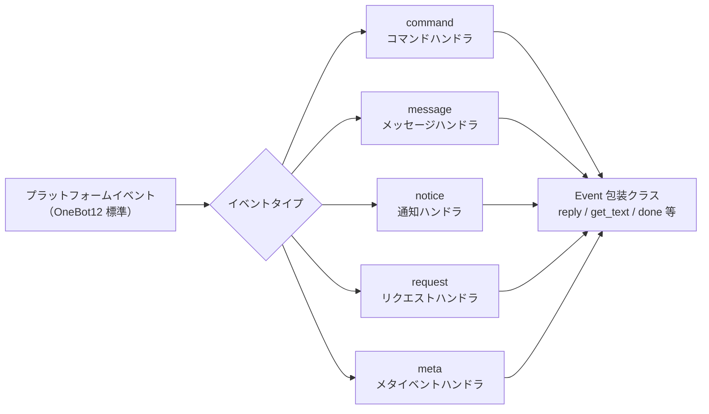

## Command コマンドモジュール

### コマンドの登録

```python
from ErisPulse.Core.Event import command

# 基本コマンド
@command("hello", help="挨拶を送信")
async def hello_handler(event):
    await event.reply("こんにちは！")

# 別名付きコマンド
@command(["help", "h"], aliases=["help", "h"], help="ヘルプを表示")
async def help_handler(event):
    pass

# 権限付きコマンド
def is_admin(event):
    return event.get("user_id") in admin_ids

@command("admin", permission=is_admin, help="管理者コマンド")
async def admin_handler(event):
    pass

# 非表示コマンド
@command("secret", hidden=True, help="秘密コマンド")
async def secret_handler(event):
    pass

# コマンドグループ
@command("admin.reload", group="admin", help="モジュールを再読み込み")
async def reload_handler(event):
    pass

# サブコマンド（スペースで区切られた複数のトークンからなるコマンド名）
# 最長一致を採用：/admin add x は admin add（args が ["x"]）に一致する；
# 子コマンドに permission が宣言されていない場合、直近の親コマンドの permission を継承する
@command("admin add", help="管理者を追加")
async def admin_add_handler(event):
    pass
```

**命名衝突ルール**：コマンド名は別名よりも優先されます。既存のコマンドと重複する別名を登録した場合、その別名は無効となり警告が表示されます。既存の別名と重複するコマンド名を登録した場合、コマンド名が優先され、死んだ別名は自動的に削除されます。この2種類の衝突はすべて WARNING ログで出力され、静かに上書きされることはありません。

### コマンド情報

すべてのコマンド情報取得 API は、オプションの**セッションコンテキスト**をサポートしています：`event=`（Event または dict）または明示的な `platform=` / `bot_id=` / `session_id=`（event と重複する場合、明示的なパラメータが優先されます）。つまり、作用域モジュール次元でフィルタリングされ、現在のセッションで利用できないモジュールのコマンドは除外されます（advanced/scope.md を参照）。すべてのパラメータはオプションであり、指定しない場合は従来通り全量のコマンドが返されます。

```python
# コマンドのヘルプを取得
help_text = command.help()

# セッション感知のヘルプ：現在のセッションで利用可能なコマンドのみを表示
help_text = command.help(event=event)

# 特定のコマンドを取得（有効なパラメータがマージ・上書きされた結果を返す；セッションで利用できない場合は None を返す）
cmd_info = command.get_command("admin")
cmd_info = command.get_command("admin", event=event)

# すべてのコマンドを取得（セッション感知のフィルタリングが適用される）
all_commands = command.get_commands()
all_commands = command.get_commands(event=event)

# コマンドグループ内のすべてのコマンドを取得（セッション感知のフィルタリングが適用される）
admin_commands = command.get_group_commands("admin")
admin_commands = command.get_group_commands("admin", event=event)

# すべての表示可能なコマンドを取得
visible_commands = command.get_visible_commands()

# セッション感知の表示可能なコマンド（event または明示的なキーワードのいずれかで指定可能）
visible_commands = command.get_visible_commands(event=event)
visible_commands = command.get_visible_commands(
    platform=event.get("platform"),
    bot_id=event.get_self_account_id(),
    session_id=event.get_session_id(),
)
```

### レプリを待つ

```python
# ユーザーからの返信を待つ
@command("ask", help="ユーザーの情報を尋ねる")
async def ask_command(event):
    reply = await command.wait_reply(
        event,
        prompt="名前を入力してください:",  # すでに上に送信済み
        timeout=30.0
    )
    
    if reply:
        name = reply.get_text()
        await event.reply(f"こんにちは、{name}！")

# 検証付きの待機返信
def validate_age(event_data):
    try:
        age = int(event_data.get_text())
        return 0 <= age <= 150
    except ValueError:
        return False

@command("age", help="ユーザーの年齢を尋ねる")
async def age_command(event):
    await event.reply("年齢を入力してください:")
    
    reply = await command.wait_reply(
        event,
        timeout=60,
        validator=validate_age
    )
    
    if reply:
        age = int(reply.get_text())
        await event.reply(f"あなたの年齢は {age} 歳です")

# コールバック付きの待機返信
async def handle_confirmation(reply_event):
    text = reply_event.get_text().lower()
    if text in ["はい", "yes", "y"]:
        await event.reply("操作が確認されました！")
    else:
        await event.reply("操作がキャンセルされました。")

@command("confirm", help="操作を確認する")
async def confirm_command(event):
    await command.wait_reply(
        event,
        prompt="'はい'または'いいえ'を入力してください:",
        callback=handle_confirmation
    )
```

## Message メッセージモジュール

### メッセージイベント

```python
from ErisPulse.Core.Event import message

# すべてのメッセージを監視
@message.on_message()
async def message_handler(event):
    sdk.logger.info(f"メッセージを受信しました: {event.get_text()}")

# プライベートメッセージを監視
@message.on_private_message()
async def private_handler(event):
    user_id = event.get_user_id()
    sdk.logger.info(f"プライベートメッセージの送信元: {user_id}")

# グループメッセージを監視
@message.on_group_message()
async def group_handler(event):
    group_id = event.get_group_id()
    sdk.logger.info(f"グループメッセージの送信元: {group_id}")

# @メッセージを監視
@message.on_at_message()
async def at_handler(event):
    mentions = event.get_mentions()
    sdk.logger.info(f"メンションされたユーザー: {mentions}")
```

### 条件付き監視

```python
# 优先度で実行順序を制御
@message.on_message(priority=10)  # 数値が大きいほど優先度が高い
async def high_priority_handler(event):
    pass

# ハンドラ内部で条件フィルタリングを実装
@message.on_message()
async def filtered_handler(event):
    if "キーワード" not in event.get_text():
        return
    # キーワードを含むメッセージを処理
    pass
```

## Notice 通知モジュール

### 通知イベント

```python
from ErisPulse.Core.Event import notice

# フレンド追加
@notice.on_friend_add()
async def friend_add_handler(event):
    user_id = event.get_user_id()
    await event.reply("フレンド追加ありがとうございます！")

# フレンド削除
@notice.on_friend_remove()
async def friend_remove_handler(event):
    user_id = event.get_user_id()
    sdk.logger.info(f"フレンド削除: {user_id}")

# グループメンバー追加
@notice.on_group_increase()
async def member_increase_handler(event):
    user_id = event.get_user_id()
    await event.reply(f"新しいメンバーを歓迎します！")

# グループメンバー削除
@notice.on_group_decrease()
async def member_decrease_handler(event):
    user_id = event.get_user_id()
    sdk.logger.info(f"グループメンバーが退出しました: {user_id}")
```

## Request リクエストモジュール

### リクエストイベント

```python
from ErisPulse.Core.Event import request

# フレンドリクエスト
@request.on_friend_request()
async def friend_request_handler(event):
    user_id = event.get_user_id()
    comment = event.get_comment()
    sdk.logger.info(f"フレンドリクエスト: {user_id}, 備考: {comment}")

# グループ招待リクエスト
@request.on_group_request()
async def group_request_handler(event):
    group_id = event.get_group_id()
    user_id = event.get_user_id()
    sdk.logger.info(f"グループ招待: {group_id}, 送信元: {user_id}")
```

## Meta メタイベントモジュール

### メタイベント

```python
from ErisPulse.Core.Event import meta

# 接続イベント
@meta.on_connect()
async def connect_handler(event):
    platform = event.get_platform()
    sdk.logger.info(f"プラットフォーム {platform} に接続しました")

# 接続切断イベント
@meta.on_disconnect()
async def disconnect_handler(event):
    platform = event.get_platform()
    sdk.logger.info(f"プラットフォーム {platform} から切断されました")

# ハートビートイベント
@meta.on_heartbeat()
async def heartbeat_handler(event):
    sdk.logger.debug("ハートビートを受信しました")
```

### Bot 状態の照会

アダプタがメタイベントを送信した後、フレームワークは自動的に Bot の状態を追跡します。照会 API とライフサイクルイベントの監視は [アダプタシステム API - Bot 状態管理](adapter-system.md#bot-状態管理) を参照してください。

## Event 包装クラス

Event モジュールのイベントハンドラは Event 包装クラスのインスタンスを受け取り、dict を継承し便利なメソッドを提供します。

### 核心メソッド

```python
# イベント情報を取得
event_id = event.get_id()
event_time = event.get_time()
event_type = event.get_type()
detail_type = event.get_detail_type()
platform = event.get_platform()

# ロボット情報を取得
self_platform = event.get_self_platform()
self_user_id = event.get_self_user_id()
self_info = event.get_self_info()
```

### セッション識別子

```python
# 統一されたターゲットID：グループなら group_id、プライベートなら user_id、以此類推
target_id = event.get_target_id()

# セッションの唯一識別子、形式: {platform}:{detail_type}:{target_id}
session_id = event.get_session_id()
# 例: "telegram:private:12345"、"qq:group:67890"
```

`get_target_id()` は、`group_id` → `channel_id` → `guild_id` → `thread_id` → `user_id` の順に最初の非空値を返します。これは、セッションの統一識別子が必要なコンテキスト管理や状態保存などの場面に適しています。

### メッセージメソッド

```python
# メッセージ内容を取得
message_segments = event.get_message()
alt_message = event.get_alt_message()
text = event.get_text()

# 送信者情報を取得
user_id = event.get_user_id()
nickname = event.get_user_nickname()
sender = event.get_sender()

# グループ情報を取得
group_id = event.get_group_id()

# メッセージタイプを判定
is_msg = event.is_message()
is_private = event.is_private_message()
is_group = event.is_group_message()

# @メッセージ関連
is_at = event.is_at_message()
has_mention = event.has_mention()
mentions = event.get_mentions()
```

### コマンド情報

```python
# コマンド情報を取得
cmd_name = event.get_command_name()
cmd_args = event.get_command_args()
cmd_raw = event.get_command_raw()

# それがコマンドかどうかを判定
is_cmd = event.is_command()
```

### レプリ機能

```python
# 基本的なレプリ
await event.reply("これはメッセージです")

# 送信方法を指定
await event.reply("http://example.com/image.jpg", method="Image")

# @ユーザーと返信メッセージを指定
await event.reply("こんにちは", at_users=["user1"], reply_to="msg_id")

# @全員
await event.reply("お知らせ", at_all=True)

# プラットフォーム固有の修飾メソッドを使用（via パラメータ）
await event.reply("掲示板内容", method="Board",
                  via=[("Expire", 3600), ("ForMember", "114514")])

# 送信チェーンを取得し、自由に修飾メソッドや送信メソッドを追加（複数の修飾 / 動作型メソッドに適している）
await event.send_chain().Expire(3600).Board("掲示板内容")
await event.send_chain().DismissBoard()

# OneBot12 メッセージセグメントを使って返信
from ErisPulse.Core.Event import MessageBuilder
msg = MessageBuilder().text("Hello").image("url").build()
await event.reply_ob12(msg)

# レプリを待つ
reply = await event.wait_reply(timeout=30)
```

### プラットフォーム機能の照会

```python
# 現在のプラットフォームが特定の送信方法をサポートしているか確認
if event.supports("Image"):
    await event.reply(url, method="Image")

# 現在のプラットフォームで利用可能なすべての送信方法を取得
methods = event.available_methods()
# ["Text", "Image", "Voice", ...]
```

### レプリメソッド

`reply()` メソッドは `method` パラメータで送信タイプを指定でき、2つの便利なブール値パラメータもサポートします：

```python
# 簡単なテキストレプリ
await event.reply("こんにちは")

# 送信者に@を付けて返信
await event.reply("こんにちは", at_sender=True)

# 現在のメッセージを引用して返信
await event.reply("受信しました", quote=True)

# 組み合わせて使用
await event.reply("受信しました", at_sender=True, quote=True)

# 画像を送信（method パラメータを使用）
if event.supports("Image"):
    await event.reply("http://example.com/img.jpg", method="Image")
else:
    await event.reply("[画像] http://example.com/img.jpg")
```

**パラメータ説明**：

| パラメータ | 型 | 説明 |
|------|------|------|
| `content` | str | 送信内容 |
| `method` | str | 送信方法、デフォルトは "Text"、"Image"/"Voice"/"Video"/"File" など |
| `at_sender` | bool | 送信者に@を付けるかどうか（user_id を自動抽出） |
| `quote` | bool | 現在のメッセージを引用して返信するかどうか（message_id を自動抽出） |
| `at_users` | list[str] | @する特定のユーザーのリスト |
| `reply_to` | str | 手動で返信するメッセージ ID |
| `at_all` | bool | 全員に@するかどうか |

### インタラクティブメソッド

```python
# confirm — 確認対話（True/False/None を返す）
if await event.confirm("この操作を実行してもよろしいですか？"):
    await event.reply("確認しました")

# Text 以外の方法で確認メッセージを送信
if await event.confirm("http://example.com/image.jpg", method="Image"):
    await event.reply("画像の確認が完了しました")

# choose — 選択メニュー（選択肢のインデックスまたは None を返す）
choice = await event.choose("色を選択してください：", ["赤", "緑", "青"])

# options_format="auto"（デフォルト）は method に応じてスタイルを自動選択：
# Markdown→無序リスト（- 1.選択肢）、Html→順序リスト（<ol>）、それ以外→純粋なテキストリスト
# テキスト系メソッド（Markdown/Html など）はデフォルトで選択肢を末尾に結合
# merge_prompt=True は任意の method で強制的に結合する
choice = await event.choose(
    "## 選択してください\n{options}", ["A", "B"],
    method="Markdown", merge_prompt=True,
)

# collect — フォーム収集（{key: value} の辞書または None を返す）
data = await event.collect([
    {"key": "name", "prompt": "名前を入力してください："},
    {"key": "age", "prompt": "年齢を入力してください：",
     "validator": lambda e: e.get_text().isdigit()},
    {"key": "avatar", "prompt": "プロフィール画像を送信してください：", "method": "Image"},
])

# wait_for — 条件を満たす任意のイベントを待つ
evt = await event.wait_for(event_type="notice", condition=lambda e: ..., timeout=120)

# conversation — 複数回の対話コンテキスト
conv = event.conversation(timeout=60)
await conv.say("ようこそ！")
```

> 完全なインタラクティブメソッドのパラメータ説明とその他の例は [Event 包装クラスの詳細](../developer-guide/modules/event-wrapper.md) と [Conversation 複数回対話](../advanced/conversation.md) を参照してください。

### ユーティリティメソッド

```python
# すべての内部キー（_ で始まる）をフィルタリングして辞書に変換
event_dict = event.to_dict()

# 元のデータを取得
raw = event.get_raw()
raw_type = event.get_raw_type()
```

### リンク制御

`event.done(claim=, stop=)` は「認定」および「ブロック」の2つの正交的な意味を統一的に制御します：

- **認定 (claim)**：イベントが処理済みであることをマーク（_processed）し、コマンドディスパッチャーは重複処理を避けるためにそれをスキップします。
- **ブロック (stop)**：イベントが低優先度のハンドラに伝播しないようにします（_propagation_stopped）。

```python
# 認定 + ブロック（デフォルト）
event.done()

# 認定のみ、ブロックしない（低優先度の観測者はまだイベントを見ることができます）
event.done(stop=False)

# 認定しない、ブロックのみ（ファイアウォール / 限流など）
event.done(claim=False)

# mark_processed が主メソッドで、done はそのエイリアスです
event.mark_processed()             # event.done() と同等
event.mark_processed(stop=False)   # event.done(stop=False) と同等

# 状態を照会
event.is_processed()  # イベントが認定されているか
event.is_stopped()    # イベントの伝播がブロックされているか
```

### プラットフォーム拡張メソッド

アダプタは Event にプラットフォーム固有のメソッドを登録でき、対応するプラットフォームのインスタンスでのみ利用可能です。

#### ユーザー：プラットフォーム拡張メソッドの使用

アダプタがプラットフォーム固有のメソッドを登録した後、イベントハンドラ内で直接呼び出すことができます。各プラットフォームのメソッドは異なりますので、対応する [プラットフォームドキュメント](../platform-guide/) を参照してください。

```python
from ErisPulse.Core.Event import message

@message.on_message()
async def handle_message(event):
    platform = event.get_platform()

    # プラットフォームに応じて固有メソッドを呼び出す
    if platform == "email":
        subject = event.get_subject()           # メール固有
        attachments = event.get_attachments()   # メール固有
```

#### プラットフォーム登録メソッドの照会

```python
from ErisPulse.Core.Event import get_platform_event_methods

# 特定のプラットフォームに登録されたメソッドを確認
methods = get_platform_event_methods("email")
# ["get_subject", "get_from", "get_attachments", ...]

# 動的に判定して呼び出す
for method_name in get_platform_event_methods(event.get_platform()):
    method = getattr(event, method_name)
    print(f"{method_name}: {method()}")
```

#### プラットフォームメソッドの分離

異なるプラットフォームに登録されたメソッドは互いに干渉しません：

```python
# メールイベント - メール固有のメソッドのみ
event = Event({"platform": "email", "email_raw": {"subject": "Hello"}})
event.get_subject()      # ✅ "Hello"
event.get_chat_type()    # ❌ AttributeError

# Telegram イベント - Telegram 固有のメソッドのみ
event = Event({"platform": "telegram", "telegram_raw": {"chat": {"type": "private"}}})
event.get_chat_type()    # ✅ "private"
event.get_subject()      # ❌ AttributeError
```

#### hasattr / dir のサポート

```python
hasattr(event, "get_subject")   # platform が "email" の場合にのみ True を返す
"get_subject" in dir(event)     # 同上
```

#### アダプタ：プラットフォーム拡張メソッドの登録

アダプタはデコレータを使って Event にプラットフォーム固有のメソッドを登録できます。メソッドの最初のパラメータは self（Event インスタンス）で、イベントデータに自由にアクセスできます。

##### 単一メソッドの登録

```python
from ErisPulse.Core.Event import register_event_method

@register_event_method("email")
def get_subject(self):
    """メールの件名を取得"""
    return self.get("email_raw", {}).get("subject", "")

@register_event_method("email")
def get_from(self):
    """送信元を取得"""
    return self.get("email_raw", {}).get("from", {})
```

##### マルチメソッド登録（Mixin クラス）

メソッドが多い場合は、Mixin クラスを使って一括登録することを推奨します：

```python
from ErisPulse.Core.Event import register_event_mixin

class EmailEventMixin:
    def get_subject(self):
        return self.get("email_raw", {}).get("subject", "")

    def get_from(self):
        return self.get("email_raw", {}).get("from", {})

    def get_attachments(self):
        return self.get("email_raw", {}).get("attachments", [])

# 一括でメソッドを登録
register_event_mixin("email", EmailEventMixin)
```

##### 戻り値の規則

| 場面 | 戻り値 | ユーザーの使用方法 |
|------|--------|------------|
| データを返す（テキスト、辞書など） | 戻り値を直接返す | `subject = event.get_subject()` |
| 操作を実行する（メッセージ送信など） | `asyncio.Task` を返す | `task = event.do_something()` は `await` が可能 |

> **推奨**：データ以外のメソッドは `asyncio.Task` を返すようにし、ユーザーが `await` するかどうかを自由に選択できるようにします。`await` しなくても操作は完了します。

```python
@register_event_method("email")
def forward_email(self, to_address: str):
    """メールを転送 — Task を返すので、ユーザーは await するかどうかを自由に選択できる"""
    import asyncio
    return asyncio.create_task(
        self._do_forward(to_address)
    )

# ユーザーは await して結果を待つこともできる
await event.forward_email("user@example.com")

# または await しなくても、バックグラウンドで実行される
event.forward_email("user@example.com")
```

##### メソッドの解除登録

```python
from ErisPulse.Core.Event import unregister_event_method, unregister_platform_event_methods

# 単一メソッドの解除登録
unregister_event_method("email", "get_subject")

# 特定プラットフォームのすべてのメソッドを解除登録（アダプタのシャットダウン時に呼び出す）
unregister_platform_event_methods("email")
```

##### 内部メソッドの上書き

`register_event_mixin` / `register_event_method` は Event の内部メソッド（`confirm`、`choose`、`collect`、`wait_reply`、`reply` など）を上書きすることもできます。登録されたプラットフォームメソッドは `Event.__getattribute__` により内部メソッドよりも優先され、アダプタはプラットフォーム特有のインタラクティブな実装を提供できます。

内部実装は `_builtin_*` 関数としてエクスポートされ、上書きする側はそれらをバックアップとして呼び出すことができます：

```python
from ErisPulse.Core.Event import register_event_mixin, _builtin_choose

class YunhuEventMixin:
    async def choose(self, prompt, options, timeout=60, method="Text"):
        # 雲湖プラットフォームではボタンコンポーネントを使用
        buttons = [[{"text": opt} for opt in options]]
        await self.reply(prompt)
        # ...ボタンのコールバックまたはテキスト返信を待つ...
        # 内部ロジックに回帰
        return await _builtin_choose(self, None, options, timeout, "Text")

register_event_mixin("yunhu", YunhuEventMixin)
```

## 跨プラットフォーム拡張（ワイルドカード）

`register_event_method` および `register_event_mixin` は `"*"` をプラットフォーム名として渡すことができ、登録されたメソッドは**すべてのプラットフォーム**の Event インスタンスで利用可能です。AI対話、コンテキスト管理など、プラットフォーム間で再利用可能な機能モジュールに適しています。

### 跨プラットフォームメソッドの登録

```python
from ErisPulse.Core.Event.wrapper import register_event_method

@register_event_method("*")
async def ai_chat(self, prompt: str):
    """self は Event インスタンスで、イベントデータや内部メソッドに自由にアクセスできる"""
    await self.reply(f"AI: {prompt}")
```

登録後、すべてのプラットフォームのイベントハンドラで呼び出すことができます：

```python
from ErisPulse.Core.Event import message

@message.on_message()
async def handler(event):
    await event.ai_chat(event.get_text())
```

### メソッドの優先順位

Event メソッドを属性アクセスで取得する際の優先順位は以下の通りです：

1. **プラットフォーム固有のメソッド**（現在のプラットフォームの上書き）
2. **ワイルドカードメソッド**（`"*"` で登録された跨プラットフォームメソッド）
3. **内部メソッド**（`reply`、`confirm` など）
4. **辞書キーのアクセス**

> したがって、ワイルドカードメソッドは内部メソッド（`reply` など）を上書きできますが、同名のプラットフォーム固有メソッドによりさらに上書きされます。

## 优先度システム

イベントハンドラは优先度をサポートし、数値が大きいほど优先度が高くなります：

```python
# 高优先度ハンドラが先に実行される
@message.on_message(priority=10)
async def high_priority_handler(event):
    pass

# 低优先度ハンドラが後に実行される
@message.on_message(priority=0)
async def low_priority_handler(event):
    pass
```


====
高级主题
====


### Conversation 多轮对话

# Conversation 多輪対話

> [!TIP]
> **このドキュメントを読む必要があるのはいつか**：多輪対話のステートマシンとチェックポイントの復元が必要な場合。不要であればスキップしても、他の機能の使用には影響しません。

`Conversation` クラスは、同じセッション内で複数回の対話を行うための便利なメソッドを提供しており、ガイド付き操作、情報収集、対話形式の質問応答などのシナリオに適しています。

## 対話の作成

`Event` オブジェクトの `conversation()` メソッドを使用して作成します：

```python
from ErisPulse.Core.Event import command

@command("quiz")
async def quiz_handler(event):
    conv = event.conversation(timeout=30)

    await conv.say("🎮 知識クイズへようこそ！")

    answer = await conv.choose("第1問：Pythonの生みの親は誰ですか？", [
        "Guido van Rossum",
        "James Gosling",
        "Dennis Ritchie",
    ])

    if answer is None:
        await conv.say("タイムアウトしました。また次回お試しください！")
        return

    if answer == 0:
        await conv.say("正解です！")
    else:
        await conv.say("不正解です。正解は Guido van Rossum です")

    conv.stop()
```

## コア API

### say(content, **kwargs)

メッセージを送信し、`self` を返してメソッドチェーンを可能にします：

```python
await conv.say("1行目").say("2行目").say("3行目")
```

送信方法を指定することもできます：

```python
await conv.say("https://example.com/image.jpg", method="Image")
```

### wait(prompt=None, timeout=None)

ユーザーからの返信を待機し、`Event` オブジェクトまたは `None`（タイムアウト）を返します：

```python
# 単純な待機
resp = await conv.wait()
if resp:
    text = resp.get_text()

# プロンプトを送信して待機
resp = await conv.wait(prompt="名前を入力してください：")

# カスタムタイムアウトを使用（対話のデフォルトタイムアウトを上書き）
resp = await conv.wait(prompt="10秒以内に返信してください：", timeout=10)
```

### confirm(prompt=None, **kwargs)

ユーザーの確認（はい/いいえ）を待機し、`True` / `False` / `None`（タイムアウト）を返します：

```python
result = await conv.confirm("すべてのデータを削除してもよろしいですか？")
if result is True:
    await conv.say("削除しました")
elif result is False:
    await conv.say("キャンセルしました")
else:
    await conv.say("タイムアウトしました")
```

内蔵の確認用語：`はい/yes/y/確認/確定/好/ok/true/対/うん/行/同意/問題ない/可能/当然...`

内蔵の否定用語：`否/no/n/キャンセル/不/不要/行かない/cancel/false/間違った/間違った/別/拒否...`

### choose(prompt, options, **kwargs)

ユーザーが選択肢から選ぶのを待機し、選択肢のインデックス（0ベース）または `None` を返します：

```python
choice = await conv.choose("色を選択してください：", ["赤", "緑", "青"])
if choice is not None:
    colors = ["赤", "緑", "青"]
    await conv.say(f"選択した色は {colors[choice]} です")
```

ユーザーは番号（`1`/`2`/`3`）または選択肢のテキスト（`赤`）を入力して選択できます。

`options_format="auto"`（デフォルト）は、method に応じて自動的に内蔵のスタイルを選択します：Markdown→無序リスト、Html→順序付きリスト、その他→純粋なテキストリスト。
また、`"list"`、`"inline"`、`"md"`、`"html"`、またはカスタム関数もサポートします。

`merge_prompt=True` を使用して、プロンプトと選択肢を1つのメッセージに統合することもできます。また、オプション挿入位置を制御するプレースホルダ（デフォルトは `{options}`、`placeholder` でカスタマイズ可能）もサポートします：

```python
choice = await conv.choose(
    "## 選択してください\n{options}",
    ["オプションA", "オプションB"],
    method="Markdown",
    merge_prompt=True,
)

# カスタムプレースホルダ
choice = await conv.choose(
    "選択してください: [choices]",
    ["オプションA", "オプションB"],
    placeholder="[choices]",
)
```

### collect(fields, **kwargs)

複数ステップで情報を収集し、データ辞書または `None` を返します：

```python
data = await conv.collect([
    {"key": "name", "prompt": "名前を入力してください"},
    {"key": "age", "prompt": "年齢を入力してください",
     "validator": lambda e: e.get("alt_message", "").strip().isdigit(),
     "retry_prompt": "年齢は数字でなければなりません。再度入力してください"},
    {"key": "city", "prompt": "都市を入力してください"},
])

if data:
    await conv.say(f"登録完了！\n名前: {data['name']}\n年齢: {data['age']}\n都市: {data['city']}")
else:
    await conv.say("登録が中断されました")
```

フィールドの設定：

| パラメータ | 説明 | デフォルト値 |
|------|------|--------|
| `key` | フィールドのキー名（必須） | - |
| `prompt` | プロンプトメッセージ | `"{key} を入力してください"` |
| `validator` | 関数、Event を受け取り、bool を返す | なし |
| `retry_prompt` | 検証失敗時の再試行プロンプト | `"入力が無効です。再度入力してください"` |
| `max_retries` | 最大再試行回数 | 3 |
| `condition` | 関数、既に収集されたデータの辞書を受け取り、bool を返す | なし |

**条件付きフィールド**：`condition` を使用して、条件が満たされた場合にのみフィールドを収集する動的フォームを実現できます：

```python
data = await conv.collect([
    {"key": "has_car", "prompt": "車をお持ちですか？（はい/いいえ）"},
    {"key": "car_brand", "prompt": "車のブランドを入力してください",
     "condition": lambda d: d.get("has_car", "").lower() in ("はい", "yes", "y")},
])
```

### stop()

手動で対話を終了し、`is_active` を `False` に設定します：

```python
conv.stop()
```

### is_active

対話がアクティブかどうかを返します：

```python
if conv.is_active:
    await conv.say("対話はまだ進行中です")
```

## アクティブ状態の管理

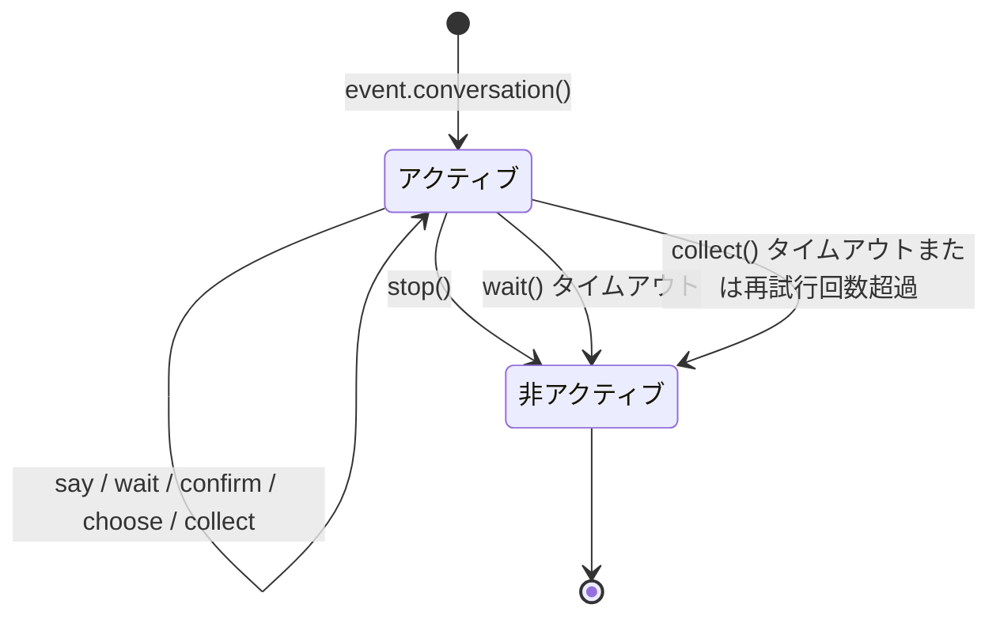

以下の状況で対話は自動的に非アクティブになります：

1. `stop()` メソッドを呼び出す
2. `wait()` がタイムアウトして `None` を返す
3. `collect()` がステップのタイムアウトまたは再試行回数超過で `None` を返す

非アクティブになった後、`wait`/`confirm`/`choose`/`collect` のすべてのインタラクションメソッドは即座に `None` を返し、ユーザーからの入力を待続しません。

## 分岐とジャンプ

### @conv.branch(name) デコレータ

`branch()` を使用して対話の分岐を登録し、`goto()` で分岐間をジャンプします：

```python
@command("menu")
async def menu_handler(event):
    conv = event.conversation(timeout=60)

    @conv.branch("main")
    async def main_menu():
        await conv.say("=== メインメニュー ===\n1. 本人情報\n2. 設定\n3. 終了")
        resp = await conv.wait()
        if resp is None:
            return
        text = resp.get_text().strip()
        if text == "1":
            await conv.goto("profile")
        elif text == "2":
            await conv.goto("settings")
        elif text == "3":
            await conv.say("さようなら！")
            conv.stop()

    @conv.branch("profile")
    async def profile():
        await conv.say("=== 本人情報 ===\n名前: Alice\n0. 戻る")
        resp = await conv.wait()
        if resp and resp.get_text().strip() == "0":
            await conv.goto("main")

    @conv.branch("settings")
    async def settings():
        await conv.say("=== 設定 ===\n1. 通知のオン/オフ\n0. 戻る")
        resp = await conv.wait()
        if resp and resp.get_text().strip() == "0":
            await conv.goto("main")

    await conv.start()  # 最初に登録された分岐から開始
```

### conv.start(name=None)

対話を開始し、デフォルトでは最初に登録された分岐から開始します：

```python
await conv.start()          # 最初の分岐から開始
await conv.start("settings") # 指定された分岐から開始
```

## コンテキストと永続化

### conv.context

各対話インスタンスには、分岐間で状態を共有するための `context` 辞書が内蔵されています：

```python
@conv.branch("step1")
async def step1():
    conv.context["username"] = resp.get_text().strip()
    await conv.goto("step2")

@conv.branch("step2")
async def step2():
    name = conv.context.get("username", "未知")
    await conv.say(f"こんにちは、{name}！")
```

### save() / resume() / clear_saved()

対話は永続化をサポートし、タイムアウトや中断後に復元できます：

```python
# 対話状態を保存する（通常は手動で呼び出す必要はありません、下記の「自動チェックポイント」を参照）
await conv.save()

# ... その後、同じセッションで復元する ...
conv2 = event.conversation()
if await conv2.resume():
    await conv2.say("お帰りなさい！以前の対話を続けましょう")
else:
    await conv2.say("以前の対話は見つかりませんでした")

# 保存された対話を削除する
await conv.clear_saved()
```

ストレージキーにはターゲットの次元が含まれます（`conversation:{platform}:{user_id}:{target_id}`）、同じユーザーの異なるセッション間の対話は互いに上書きされません。`resume()` 時に、ターゲットを含まない旧形式のアーカイブは自動的に移行されます。

## 自動チェックポイントと再起動時の復元

### 自動アーカイブ

フレームワークは以下のタイミングで自動的にチェックポイントを管理します。通常、`save()` を手動で呼び出す必要はありません：

| 時機 | 行動 |
|------|------|
| `goto()` / `start()` で分岐をジャンプする | 自動保存（現在の分岐 + context） |
| `stop()` / `wait()` タイムアウト / `collect()` 失敗 | 自動削除（対話の終端状態） |

### チェックポイント TTL

アーカイブにはタイムスタンプが付いており、`ErisPulse.interaction.checkpoint_ttl`（デフォルト 24 時間）を超えるアーカイブはクリーンアップされます：

- **惰性削除**：復元時にアーカイブが期限切れであることが判明した場合、自動的に削除されます
- **バックグラウンドの自動クリーンアップ**：フレームワークには定期的な GC タスクがあり、最初にチェックポイントを使用した後に惰性で起動され、期限切れのアーカイブを列挙して削除し、長期稼働時にストレージ内の期限切れのチェックポイントが無限に蓄積されることを防ぎます。自動的にクリーンアップされたアーカイブは、その後会話メッセージを受け取った場合、"チェックポイントなし"として扱われます

```toml
[ErisPulse.interaction]
checkpoint_ttl = 86400  # 秒
```

### 再起動時の自動復元

フレームワークが再起動した後、メモリ内の待機中のコルーチンは失われますが、チェックポイントは残ります。`register_resume_handler` を使用して**復元ファクトリ**を登録することで、フレームワークは再起動後にその会話の最初のメッセージを受け取ったときに自動的に対話を継続します：

```python
from ErisPulse.Core.Event.wrapper import Conversation

@Conversation.register_resume_handler()  # platform="onebot11" を渡すことでプラットフォームを限定することも可能
def make_conversation(event) -> Conversation:
    # ファクトリの役割：対話を再構築し、すべての分岐を再登録する
    conv = event.conversation(timeout=60)

    @conv.branch("menu")
    async def menu(conv, event):
        ...

    return conv
```

登録後、`menu` 分岐にあったユーザーが再起動前に最初のメッセージを送信した場合、フレームワークは自動的に：コンテキストを復元 → そのメッセージを認証 → 保存された分岐から対話を継続します。ファクトリを登録していない場合、このメカニズムは無駄なコストがかかりません。

### 復元は即座に引き継ぎ

`resume()` が成功した場合、フレームワークは自動的に2つのことを完了します：

1. **セッションの引き継ぎ**：自動的にそのセッションの排他リースを取得します——他のモジュールは `sdk.interaction.get_owner_of(event)` を使用して「このユーザーが対話で占有されている」ことを感知できます；セッションが他のモジュールによって占有されている場合、復元は失敗（False を返す）し、2つの対話が競合することを防ぎます
2. **履歴の持ち込み**：会話の受信箱から最近の10件のメッセージを `conv.recent_history` に取り込みます（AI モジュールが復元された後、LLM のコンテキストが途切れません）；`resume(with_history=0)` でこの機能をオフにできます

```python
if await conv.resume(with_history=20):
    for m in conv.recent_history:
        print(m["role"], ":", m["text"])
```

### 手動復元（自動メカニズムを使用しない場合）

```python
@command("continue")
async def continue_handler(event):
    conv = event.conversation()
    # ... 分岐を登録する ...
    if await conv.resume():
        conv.goto(conv.get_current_branch())
```

## 代表的なフロー・パターン

### ガイド付き登録

```python
@command("register")
async def register_handler(event):
    conv = event.conversation(timeout=60)

    await conv.say("ようこそ、登録へ！")

    data = await conv.collect([
        {"key": "username", "prompt": "ユーザー名を入力してください（3-20文字）",
         "validator": lambda e: 3 <= len(e.get_text().strip()) <= 20},
        {"key": "email", "prompt": "メールアドレスを入力してください",
         "validator": lambda e: "@" in e.get_text() and "." in e.get_text(),
         "retry_prompt": "メールアドレスの形式が正しくありません。再度入力してください"},
    ])

    if not data:
        await event.reply("登録がキャンセルされました")
        return

    confirmed = await conv.confirm(
        f"登録情報を確認しますか？\nユーザー名: {data['username']}\nメールアドレス: {data['email']}"
    )

    if confirmed:
        await conv.say("✅ 登録完了！")
    else:
        await conv.say("❌ 登録がキャンセルされました")
```

### ループ対話

```python
@command("chat")
async def chat_handler(event):
    conv = event.conversation(timeout=120)
    await conv.say("対話モードに入りました。「終了」で終了します")

    while conv.is_active:
        resp = await conv.wait()
        if resp is None:
            await conv.say("タイムアウトしました。対話は終了します")
            break

        text = resp.get_text().strip()

        if text == "終了":
            await conv.say("さようなら！")
            conv.stop()
        elif text == "help":
            await conv.say("利用可能なコマンド：終了、help、status")
        elif text == "status":
            await conv.say("対話はアクティブです")
        else:
            await conv.say(f"あなたが言ったのは：{text}")
```


### 交互会话系统

# 交互会話システム

> [!TIP]
> **この章を読む必要があるのは**：`wait_reply`、多段対話、定期的なリマインダー、セッションの排他制御、またはトレースが求められる場合です。必要がない場合は飛ばしても、他の機能の使用に影響はありません。

> [!NOTE]
> 本章の内容は ErisPulse **2.8.0以降**で利用可能です。

ErisPulse では「ユーザーとの継続的な対話」をフレームワークレベルのインフラとして実装しています。`wait_reply` から定期的なリマインダー、複数の待ち、セッションの排他制御、再起動後の復旧まで、すべてが統一された **「インタラクションセッションマネージャー」**（`Core/Event/interaction.py`、`sdk.interaction`）によってスケジュールされます。

{!--< tips >!--}
本文でカバーする各機能には、**所有者（owner）**が付与されています。インタラクションの待機、リース、タイマーはすべて、登録時にモジュール名を記録します。モジュールのアンロードやアダプターの停止時に、フレームワークが自動的にクリーンアップし、待機側に即時通知されます。これは、所有権システムがインタラクションの観点で拡張されたものです（[所有権システム](ownership.md)を参照）。
{!--< /tips >!--}

## 返信の待機：wait_reply

`wait_reply` はインタラクションセッションの基盤です。現在のコルーチンを一時停止し、対象ユーザーからの次のメッセージで「返信」を待つ機能です。

```python
from ErisPulse.Core.Event import command

@command("ask")
async def ask_command(event):
    reply = await event.wait_reply(prompt="あなたの名前を入力してください:", timeout=30)
    if reply is None:
        await event.reply("タイムアウトしました")
        return
    await event.reply(f"こんにちは、{reply.get_text()}！")
```

### 全パラメータ一覧

| パラメータ | 説明 | デフォルト |
|------|------|------|
| `prompt` | 待機前に送信するプロンプト | None |
| `timeout` | 待機のタイムアウト（秒） | 60 |
| `pattern` | glob フィルター（`*` / `?` / `[seq]`）、一致しない場合は待機を続ける | None |
| `regex` | 正規表現フィルター（`pattern` と同時に指定した場合は両方一致する必要がある）、一致しない場合は待機を続ける | None |
| `validator` | 検証関数（Event を受け取り、bool を返す）、失敗した場合は待機を続ける | None |
| `callback` | 返信を受け取った際のコールバック（返り値方式の代替） | None |
| `method` | prompt の送信方法 | "Text" |
| `session` | **セッションレベルの待機**：同じセッション（グループ / チャンネル）内の誰からの返信でも有効 | False |

```python
# 数字の金額のみを受け入れ、それ以外は待機を続ける
reply = await event.wait_reply("金額を入力してください:", regex=r"\d+\s*元", timeout=30)

# セッションレベルの待機：グループでの協力的な場面、グループ内の誰の返信でも有効
reply = await event.wait_reply(session=True, prompt="誰かこの質問に答えてくれますか？")
```

### 待機とコマンドの境界（コマンドの透過）

待機中に**登録済みのコマンド**（例：`/cancel`）が送信された場合、デフォルトではコマンドディスパッチャーに渡され、返信として消費されません（設定項目 `ErisPulse.event.wait_reply.cmdpass`、`True` の場合は逆転——すべてのメッセージを返信として扱う）。判定の基準はコマンドディスパッチャーと同じ：`alt_message` が優先され、存在しない場合はメッセージセグメントの結合（2.10.1 以降、純粋な message 段アダプターでも同様に有効）。

### 待機がいつキャンセルされるか

待機は「タイムアウトするまで待つ」だけではありません。以下の状況で待機は**即座に終了**（`wait_reply` は `None` を返す）し、呼び出し側がタイムアウトまで待つ必要はありません：

| 発生条件 | キャンセル理由（`InteractionCancelled.reason`） | 説明 |
|------|------|------|
| 所有モジュールがアンロード / 禁用された | `owner_unload` | 所有権のクリーンアップ：誰が登録した待機か、そのモジュールが消えた際に一緒に回収される |
| アダプターが停止 / 再起動された | `platform_stop` | そのプラットフォームで待機中のすべての待機がキャンセルされる |
| 同一セッションで新しい待機 / リースが発生した | `conflict` | 下記「セッション仲裁」を参照 |
| 返信者をブロックした / 所有モジュールが解除された | `revoked` | 返信が一致した場合の**権限再確認**：scope 身分次元 + モジュール次元 |
| ユーザーが返信した | —— | 正常経路、返信イベントを返す |

下層の例外は `InteractionCancelled`（`InteractionError` 例外体系に属する）で、`wait_reply` はこれを `None` に変換しています。原因を必要とする呼び出し側は、`sdk.interaction.register()` の低レベル API を直接使用できます。

### 返信が一致する完全な判定チェーン

返信メッセージが到着した際、インタラクションマネージャーは以下の順序で判定を行います（コマンドのマッチング**の前**に実行され、対話の連続性が優先されるため、他の高優先度のプロセッサがメッセージを認めたとしても、一時停止中の対話は完了します）：

```
セッションキーの一致（正確な user 次元 → セッションレベルの退避）
  → pattern / regex テキストフィルター（一致しない場合は待機を続ける）
  → validator 検証（失敗した場合は待機を続ける）
  → 権限再確認（scope 身分次元 + owner モジュール次元、失敗した場合は待機を終了）
  → 待機側をウォーキング + イベントの認領（mark_processed）
```

## 宣言的多段対話：`.got()` チェーン（2.11+）

`@command` は**多段対話制御のプロキシ**を返し、`.got()` を用いて段階的に収集ステップを宣言します。ステップ関数はパラメータ名に従って収集された値を受け取り、`type=` / 注釈に従って型が自動的に解析されます。内部では Conversation にコンパイルされ、各ステップが1つのブランチ、ジャンプは自動的にチェックポイントを保存し、**再起動後もユーザーの返信は保存されたステップから継続されます**（復旧工場は装飾時に自動的に登録され、モジュールのアンロード時に自動的に登録解除されます）。

```python
@command("weather")
async def weather(event):
    pass  # 入口：最初の .got の prompt が自動的に送信される、手動での質問は不要

@weather.got("city", prompt="直接都市名を返信してください")
async def weather_city(event, city: str):
    await event.reply(f"{city}：晴れ、25℃")

@weather.got("days", prompt="何日間の予報ですか？", type=int, retry_prompt="数字を入力してください")
async def weather_days(event, city: str, days: int):
    await event.reply(f"{city} 未来 {days} 日間……")
```

### パラメータ説明

| パラメータ | 説明 |
|------|------|
| `name` | 収集された値の名前（後続のステップ関数のパラメータ名として注入される；プロセス内で一意、重複した宣言は登録時にエラーを発生させる） |
| `prompt` | このステップに入るときに自動的に送信される質問 |
| `timeout` | 単一ステップの待機タイムアウト（秒数または `"90s"` / `"1h30m"` の長さ文字列、デフォルトは 60s） |
| `type` | 値の型（`int` / `float` / `str`…；解析失敗した場合は `retry_prompt` を再送信し、最大 `max_retries` 回まで再試行） |
| `validator` / `pattern` / `regex` | 返信のフィルタリングと検証（`wait_reply` と同様の意味） |
| `session` | セッションレベルの待機（同じセッション内であれば誰からの返信でも有効） |
| `cmdpass` | コマンドの放行三態（デフォルトでは `/cancel` などのコマンドは待機中に通常通り実行される） |

### 意味と境界

- **いずれかのステップがタイムアウト / 中断された場合 → 全プロセスが終了**し、チェックポイントはクリアされる（`wait_reply` の意味と一致）；ステップ関数内ではいつでも `event.reply(...)` で中間結果を出力できる
- **同じユーザーは同時に1つの対話しか保持できない** — 第2のプロセスの待機は前のものを上書きする（`InteractionCancelled("conflict")`）；排他制御の提示が必要な場合は [セッションリース](#セッション互換性acquire--hold--get_owner_of) を併用してください
- 収集された値はプロセス内にのみ存在する；再起動後に複雑なステータスを保持したい場合は、直接 [Conversation](conversation.md)（`context` + `branch/goto` + 手動チェックポイント）を使用してください
- `@command` はプロキシオブジェクトを返す：呼び出しの動作、`__name__`、docstring、カスタム属性は元の関数と完全に一致する；`command.unregister(プロキシ)` は自動的に展開される

## セッションのタイマー：remind / escalate

「タイムアウト」を戻り値から編集可能な原語に変換します。タイマーはインタラクションセッションに紐づけられ、モジュールのアンロード / アダプターの停止時に自動的にキャンセルされ、1セッションあたりのアクティブな remind の上限は 5 つです。

### remind：返信がなければリマインダー

```python
@command("ticket")
async def ticket_command(event):
    await event.reply("工単が提出されました。処理結果はここに通知されます。")
    # 5分間返信がなければ優しくリマインダーを送信；ユーザーの返信はすべて自動的にキャンセルされる
    event.remind(300, "まだいますか？結果が出たらすぐに通知します。")
    reply = await event.wait_reply(timeout=3600)
    ...
```

- `event.remind(delay, text=None, *, callback=None)`：到着時に現在のセッションに `text` を送信（または `callback(event)` を実行、同期 / 非同期の両方に対応）。**強制検証**：`text` と `callback` のどちらか一方を指定する必要があります（両方指定しない場合は `ValueError` を投げる）
- 戻り値は `Reminder` ハンドル：`reminder.cancel()` で手動キャンセル、`reminder.expired` で状態を確認
- ユーザーがこのセッションで**返信した後は自動的にキャンセル**される — これが「リマインダー」の意味です：リマインダーはユーザーが沈黙しているときにのみ表示される
- `Conversation` 内でも同様に使用可能：`conv.remind(120, "まだ検討中ですか？")`

### escalate：時間経過で必ず到達するアップグレード

```python
event.escalate(1800, lambda e: notify_master(f"工単 30 分未処理：{event.get_command_args()}"))
```

`remind` との唯一の違いは、**ユーザーの返信によってキャンセルされない**こと — アップグレード動作（通知、人間への転送）は「タイムアウトが必ず到達する」約束であり、手動で `cancel()` / モジュールのアンロード / アダプターの停止でのみキャンセルされる。

| | `remind` | `escalate` |
|---|---|---|
| 到着時の動作 | テキスト送信 / callback 実行 | callback 実行 |
| ユーザーの返信 | **自動キャンセル** | 影響を受けない |
| 所有権のクリーンアップ（アンロード / プラットフォーム停止） | キャンセル | キャンセル |
| 1セッションあたりの上限 | 5 | 限らない（所有権のクリーンアップでバックアップ） |

## 複数の待機：expect + select

複数の期待を同時に一時停止し、**先着順**で処理される — 代表的な場面は、管理者の承認を待つと同時にユーザーの撤回を待つ、多人数での協力的な投票など。

```python
which, reply = await event.select(
    event.expect(pattern="同意*", user="10001"),
    event.expect(pattern="拒否*", user="10002"),
    event.expect(validator=lambda e: e.get_text() == "保留", session=True),
    timeout=60,
)
if which is None:
    await event.reply("60 秒以内に承認結果がありませんでした")
elif which == 0:
    await event.reply("承認されました")
elif which == 1:
    await event.reply("拒否されました")
```

- `event.expect(...)` は**期待の記述**（待機の登録は行わない）を構築する：`pattern` / `regex` / `validator` / `user`（返信者の制限）/ `session`（誰でも返信可能）がサポートされる
- `event.select(*expectations, timeout=60)`：一括登録 → いずれかが一致したら `(インデックス, 返信イベント)` を返す → 一致しなかった待機は自動的にキャンセルされる；すべてがタイムアウトしたら `(None, None)` を返す。**強制検証**：少なくとも1つの expectation を渡す必要があり、ない場合は `ValueError` を投げる
- 一致したイベントはフレームワークによって認領済み（`mark_processed`）であり、他のプロセッサによって重複消費されない

{!--< tips >!--}
`select` は、多スレッド `asyncio.wait` で手動で編集するのと比べて：期待が一致しなかった場合に自動でクリーンアップされ、一致したイベントは自動的に認領され、権限の再確認や所有権のクリーンアップがすべて有効になる — すべての Future を自分で管理する必要がない。
{!--< /tips >!--}

> [!NOTE]
> 2.10.1 以降、`select` は**集約待機**になります：すべての期待を1つの項目に統合し、カスタムの一致判定を行う。同じキーの複数のルート（同じ user に異なる pattern を設定した場合）は互いにキャンセルされず、いずれかのルートが先に一致したら返却されます。返信テキストの判定基準は `alt_message` が優先され、メッセージセグメントの退避（コマンドディスパッチャーと同じ）が行われます。
>
> 境界説明：`event.wait_for(...)` はアダプターイベントの総合ラインに直接接続され、**中間処理**や `detail_type` 条件フィルタリングを経由しません（身分認証はディスパッチャーのエントリでバックアップ）。完全なパイプラインを必要とする待機は `wait_reply` / `select` を使用してください。

## セッションの排他制御：acquire / hold / get_owner_of

所有権が「リソース」から「セッション」へと移行しました — 「このユーザーが現在誰に占有されているか」が一等のクエリになります。

```python
# クエリ：このセッションは誰と対話中ですか？（空の場合は None を返す）
owner = sdk.interaction.get_owner_of(event)
if owner and owner != "MyModule":
    return  # 他のモジュールが対話中なので、干渉しない

# 排他リース：セッションを独占（deny 策略、占有されている場合は None を返す）
lease = sdk.interaction.acquire(event)          # デフォルト TTL 1 時間、ttl= を渡すことも可能
if lease is None:
    return  # すでに占有されている
try:
    ...  # 独占対話
finally:
    lease.release()
```

コンテキストマネージャー形式（取得失敗時は `SessionOccupiedError` を投げる）：

```python
with sdk.interaction.hold(event) as lease:
    ...  # 終了時に自動的に解放される
```

リースは `renew(ttl)` で更新可能；TTL は惰性で期限切れ — 期限切れのリースは次回アクセス時に自動的にクリーンアップされる。

`Conversation.resume()` で対話を復元する際、フレームワークは自動的にリースを取得します（[Conversation 多段対話](conversation.md)の「復元は所有権を取得する」を参照） — 復元された対話はセッションを天然に保持し、他のモジュールが割り込むことはありません。

## セッションの受信箱：event.history

> 保持戦略（7日間 / 条数上限）と実行時の上書き API、リスクと監査は[セッション受信箱](transcript.md)のトピックを参照してください。

各セッションの最近のメッセージの流れ（ユーザーとロボットの両方）を統一的に記録し、AIコンテキスト、重複防止、行動分析などのモジュールの**共有事実ベース**として利用します — 各モジュールが個別に履歴を保持する必要がなくなります。

```python
messages = await event.history(20)   # 最近の20件、時間昇順
for m in messages:
    print(m["role"], ":", m["text"])  # role: "user" / "bot"
```

- 自動記録：入力メッセージ（role=user）+ ロボットの出力テキスト（role=bot）
- ストレージ：独立した SQLite テーブル、保持戦略 = 各セッションの上限（デフォルト 50）+ グローバル TTL（デフォルト 7 日）
- 書き込み方法：メモリバッファ + バックグラウンドバッチ書き込み（遅延は最大1秒）、クエリインターフェースは未書き込みのバッファ行を自動的に結合する — 同一プロセスでは「読み込みは書き込みを反映」されない；通常の終了（`sdk.uninit` / プロセス終了）では自動的にバッファをフラッシュする。**ハードクラッシュ / 強制終了の際、直近約1秒の記録が失われる可能性がある**：このベースは最近のコンテキストキャッシュとして位置付けられており、監査レベルの永続化には適していません
- 設定：`ErisPulse.transcript = {enabled = true, max_per_session = 50, ttl_hours = 168}`
- マネージャー API：`sdk.transcript.append() / get() / clear()`、`aflush()` / `flush()` 手動フラッシュ

## メッセージトランザクション：message_tx

トランザクション内のすべての出力送信は自動的に記帳され、**異常終了時には逆順で自動的に送信済みメッセージを撤回**します（アダプターが `delete_message` を実装していない場合はスキップされ、記録は正常に行われます）。

```python
async with event.message_tx():
    await event.reply("処理中です、少々お待ちください")
    result = await do_something()          # ここで例外が発生した場合 →
    await event.reply(f"完了: {result}")   # 以前の「処理中」が自動的に撤回される
```

トランザクション外の送信は記帳されません（ゼロオーバーヘッド）；`get_send_receipts()` で現在のトランザクションで送信されたレシートを確認できます。

## トレースID

各入力イベントは自動的にトレースID（`event["id"]` を再利用、存在しない場合は生成）を取得し、以下の場面で連携されます：

- handler コンテキスト（`get_current_trace_id()` で読み取る）
- 出力送信（`[Send]` ログ行に `[trace:...]` を追加、`message.sending/sent` フックの `trace_id` フィールド）
- ライフサイクルフックデータ（dict に自動的に `_trace_id` を追加）
- 定向イベント（`lifecycle.emit(..., to=...)`）とメッセージトランザクションのレシート

1つのメッセージが複数のモジュールによって処理された場合、全トラックで同一のIDを用いてつなげることができます（ログ / 慢いクエリ / 監査）。

## 他のシステムとの関係

- **所有権**：待機 / リース / タイマーはすべて owner を記録し、アンロード時に回収されます（[所有権システム](ownership.md)を参照）
- **スコープ**：返信の一致は身分とモジュール次元で再確認され、モジュール間の呼び出しでは監査の観点から出力の次元を追跡します（[スコープ](scope.md)を参照）
- **Conversation**：多段対話はインタラクションセッションの上位に位置するブランチ状態機械です（[Conversation](conversation.md)を参照）、その待機も本ページのすべてのキャンセル / 再確認 / 所有権の意味を享受します


### 模块间通信

# モジュール間通信

> [!TIP]
> **この章を読むタイミング**：RPCによるモジュール間呼び出し、サービス契約、指定されたイベント、またはクールスタート時の再再生が必要な場合。必要ない場合はスキップしても、他の機能の使用に影響はありません。

> [!NOTE]
> 本章の内容は ErisPulse **2.8.0以上**で利用可能です。

ErisPulseでは、モジュール間の通信は**3つの階層モデル**で構成されています。順番は「点対点 → 指定 → ブロードキャスト」です。

| 層 | API | 意味 | 代表的な場面 |
|---|---|---|---|
| **RPC** | `await sdk.module.call("Chat", "get_history", ...)` | 点対点のリクエスト-レスポンス、契約 / 審査 / タイムアウト付き | 他のモジュールの機能を呼び出す（履歴の取得、翻訳、返金など） |
| **指定イベント** | `await lifecycle.emit("message_received", {...}, to="Chat")` | 指定されたモジュールにのみ、ライフサイクルフックを登録したハンドラに配信 | 上流の状態変化を下流に通知する（「新しいメッセージを受け取りました」） |
| **ブロードキャスト** | `await lifecycle.emit("config.updated", {...})` | フレームワーク全体で見えるライフサイクルイベント | 設定のホットアップデート、モジュールの起動 / 停止 |

{!--< tips >!--}
選択の口訣：**返り値が必要な場合は `call`、特定のモジュールのフックに通知する場合は `emit(..., to=...)`、全員に通知する場合は `emit(...)`**。
{!--< /tips >!--}

## RPC: module.call

```python
result = await sdk.module.call("Chat", "get_history", session_id, n=20)
```

`sdk.module.Chat.get_history(...)`（変更なし）の属性アクセスとの違いは以下の通りです：

| | `module.call()` | 属性アクセス |
|---|---|---|
| 目標が登録されていない / 有効になっていない | `ModuleNotAvailableError` をスロー | `AttributeError` をスロー |
| ラグジュアリーなモジュール | **自動的に起動**（イベント駆動モジュールはアクティベーションロックを通過） | 非同期初期化モジュールは `RuntimeError` をスロー |
| `current_owner` | **ターゲットモジュール**に帰属（内部の wait_reply / 送信 / ログは正しい帰属） | 呼び出し元に保持 |
| タイムアウト | 30秒（`timeout=` で上書き、None でタイムアウトなし） | なし |
| scope 審査 | 呼び出し元が出口のゲートを通過 `actions.<呼び出し元>.call` | なし |
| 契約検証 | `meta.services` のホワイトリスト | なし |

### エラー体系

```
ModuleError                      # モジュールシステムのエラー基底クラス
└── ModuleCallError              # 跨モジュール呼び出しの基底クラス（module / method 属性を含む）
    ├── ModuleNotAvailableError  # 目標が登録されていない / 有効になっていない / 起動に失敗
    ├── ServiceNotProvidedError  # メソッドが services ホワイトリストにない / 私的メソッド / 存在しない
    └── ModuleCallTimeoutError   # クロージャー関数がタイムアウト
```

すべて `ErisPulseError` 体系に属し、`from ErisPulse.Core import ModuleCallError` でキャッチ可能です。

## サービス契約: meta.services

サービス提供者は `get_meta()` で公開するホワイトリストを宣言します（`commands` と対称）：

```python
from ErisPulse.Core.Bases import BaseModule, ModuleMeta

class ChatModule(BaseModule):
    @staticmethod
    def get_meta() -> ModuleMeta:
        return ModuleMeta(
            name="チャット",
            services=[
                "get_history",                                       # 簡単な形
                {"name": "translate", "description": "テキストを指定された言語に翻訳する"},  # 説明付き
            ],
        )

    async def get_history(self, session_id, n=20): ...
    async def translate(self, text, target_lang): ...
    def _internal_helper(self): ...   # 下線付きメソッドは外部から呼び出し禁止
```

**開発者は無感覚なデフォルト**：

- `services` を宣言していない → **公開**メソッドはすべて `module.call()` で呼び出せる（属性アクセスと同様）、宣言は不要
- 宣言後 → ホワイトリストに絞られ、越境呼び出しは `ServiceNotProvidedError` をスロー——「これが外部に約束したメソッド」を明示する
- 制限の**主制御権はユーザー側**：`scope.actions` の設定が「誰が誰を呼び出せるか」を決定（後述の審査参照）、モジュール作者の `services` はサービス面の宣言に過ぎず、2つの層は互いに置換不可能

**サービス紹介**：各サービスに人間 / AI が読める説明を付ける——不要なら何も書かなくてよい、説明は**メソッドの docstring 首行**（フレームワークは docstring 形式を要求している）から自動取得：

```python
async def translate(self, text, target_lang):
    """テキストを指定された言語に翻訳する"""    # ← この行がサービス紹介として自動取得される
    ...
```

**パラメータ提示**：呼び出し元（特に AI エージェント）は各パラメータの意味を知る必要がある。不要なら何も書かなくてよい、提示はメソッドの docstring の **`:param:` 行**から自動取得：

```python
async def render_card(self, html, width=800, height=0):
    """HTMLを画像ファイルにレンダリングする

    :param html: レンダリングするHTMLテキスト          ← 自動的にパラメータ提示として取得される
    :param width: 画布の幅ピクセル、0は内容に応じて自動調整
    :param height: 画布の高さピクセル、0は内容に応じて自動調整
    """
```

微調整が必要な場合（docstring を上書き / 多言語対応）は dict 形式で `description` と `parameters` を宣言（両方とも i18n 辞書に対応；`parameters` は**パラメータ**と docstring をマージし、docstring が優先、宣言されたが存在しないパラメータはフィルタリングされる）：

```python
services=[
    {"name": "translate", "description": "テキストを指定された言語に翻訳する"},
    {"name": "summarize", "description": {"i18n": "Chat.meta.svc.summarize", "default": "会話の要約"}},
    {
        "name": "render_card",
        "description": "HTMLを画像ファイルにレンダリングする",
        "parameters": {"html": "HTMLテキスト", "width": "幅ピクセル、0は自動調整"},
    },
]
```

## サービスディレクトリ: services()

```python
sdk.module.services()
# {'Chat': [{'name': 'get_history', 'signature': '(session_id, n=20)',
#            'description': 'テキストを指定された言語に翻訳する',
#            'parameters': {'session_id': 'セッションID', 'n': '返却件数'}}]}

sdk.module.services("Chat")   # 指定されたモジュールのみを照会
```

- **明示的に `meta.services` を宣言したモジュール**のみをリストアップ（宣言していないモジュールはディレクトリに表示されない）
- 各サービスにはメソッドのシグネチャ文字列（`inspect.signature` から抽出）、説明文、パラメータ提示が付く
- **ラグジュアリーなモジュールもディレクトリに表示される**（サービス発見はロードより先に発生）——呼び出し元はこれにより、`call()` でターゲットモジュールを起動するかを判断できる
- トポロジーにも反映される：`sdk.module.get_topology()` の各モジュール項目に `services` フィールドが含まれる

{!--< tips >!--}
**MCP 化の道筋**：サービスディレクトリ（名前 + シグネチャ + 説明 + パラメータ提示）は MCP tool の形状に相当する——各サービスは自然に ``{"name", "description", "parameters"}`` になる。将来、フレームワークは ``services()`` を直接 MCP サーバエンドポイントとして公開し、AI がモジュールの能力を発見して呼び出せるようにする。また、``scope.actions.call`` 審査は AI 呼び出しのセキュリティゲートとして自然に機能する。
{!--< /tips >!--}

## 出力審査: 誰が誰を呼び出せるか

`module.call()` は**呼び出し元モジュール**の立場で scope の出力ゲートを通過する：

```toml
[ErisPulse.scope.actions.CallerModule.call]
deny = ["Chat.get_history"]        # CallerModule が Chat の get_history を呼び出すことを禁止
# allow = ["Chat.get_*"]           # またはホワイトリスト：get で始まるサービスのみを許可
```

- `name` の形式は `<ターゲットモジュール>.<メソッド名>`、正確な一致 / glob / `re:` 正規表現が可能
- フレームワーク層の呼び出し（owner コンテキストがない、例：起動スクリプト）は審査制約を受けない
- 拒否された呼び出しは `ModuleCallError` をスロー（TRACE ログ `core.module.call_denied`）

設定方法は [作用域（scope）](scope.md) の出力側の詳細を参照。

## 指定イベント: lifecycle.emit の to パラメータ

ライフサイクルイベントは指定送信をサポート：`to` でターゲット所有者（owner）を指定すると、イベントはその owner として登録されたフックにのみ配信される（`on_load` 内で登録されたフックは自動的に本モジュールに帰属）、他のモジュールやワイルドカード `*` ハンドラは感知しない。

```python
from ErisPulse.Core.lifecycle import lifecycle

# 投递元：イベントは Chat モジュールが登録したフックにのみ投递される
await lifecycle.emit("message_received", {"text": "hi", "from": "u1"}, to="Chat")

# 訂閱元（Chat モジュール内）：同名のフックを登録し、owner は登録時に自動的に記録される
@lifecycle.on("message_received")
async def on_message_received(data): ...

@lifecycle.on("message")          # 点式の親前缀も同様に有効（owner でフィルタリング）
async def on_any(data): ...
```

意味の詳細：

- ターゲット owner に登録されたフックがない → イベントは**静かに破棄**（**存在しない場所には送らない**）、`lifecycle.has_handlers("message_received")` で事前に検出可能
- `data` が dict の場合、`_trace_id` が自動的に付与される（既存値を上書きしない）、全トラッキングと連携
- ブロードキャストと指定は同じフック登録を共有：`emit(...)` に `to` を指定しないと全フレームワークにブロードキャスト、`to` を指定すると同一イベントはターゲットモジュールにのみ見える
- `emit_sync` / `submit_event`（互換 API）も `to=` パラメータをサポート

> [!NOTE]
> 指定イベントは軽量な通知であり、**ターゲットの検証やラグジュアリーな起動は行わない**；ターゲットの存在性検証、契約審査、または返り値が必要な場合は、[RPC: module.call](#rpcmodulecall) を使用してください。

## ラグジュアリーなモジュールと呼び出し

`module.call()` はラグジュアリーなモジュールに対して**透明な起動**を行う：

- イベント駆動ラグジュアリーなモジュール（`activate_on` で宣言）→ 活性化ロック `_activate()` を通る、活性化後はトリガースタブが自動的に登録解除
- 通常のラグジュアリーなモジュール → 同期初期化または通常のロード経路（冪等）
- 起動に失敗 → `ModuleNotAvailableError`

つまり：**呼び出し元はターゲットモジュールがロードされているかどうかを気にする必要はない**、また、ターゲットを起動するために特定のイベントを待つ必要もない。

指定イベント（`lifecycle.emit(..., to=...)`）はラグジュアリーな起動を行わない——ターゲットがロードされていないとフックが存在しない、イベントは静かに破棄される；確実に送信したい場合は `module.call()` を使用してください。

## クールスタート時の再再生

新規インストール / 再起動のモジュールは一部のチャットを逃した——`get_load_strategy(replay=...)` により、フレームワークはモジュールが準備された後、会話の受信箱に含まれる最近のメッセージを**再再生**してモジュール自身に送る：

```python
from ErisPulse.loaders import ModuleLoadStrategy

class MyAIModule(BaseModule):
    @staticmethod
    def get_load_strategy():
        return ModuleLoadStrategy(
            lazy_load=False,
            priority=100,
            replay="5m",        # 最近の5分間を再再生（"1h" / "300"秒の形式も可）
        )

    async def on_load(self, event):
        @message.on_message()
        async def handle(e):
            if e.get("replayed"):
                # 合成イベント：コンテキストの補完のみ、送信などの副作用は発生しない
                ...
```

意味の詳細：

- データソースは[会話の受信箱](interaction.md#会話受信箱eventhistory)（`sdk.transcript.recent()`）であり、モジュールのロード完了後にバックグラウンドで実行され、起動をブロックしない
- 合成イベントには `replayed: True` フラグ、`platform / detail_type / user_id / alt_message` が含まれ、**本モジュールのハンドラにのみ分発される**——他のモジュールには再再生の影響を受けない
- 受信箱が有効 / 記録がない / 時間の宣言が不正（`replay_invalid` 警告）の場合は静かにスキップされる

## イベントの冪等性と重複除去

プラットフォームの websocket 再接続後に同じイベントが重複送信されることがよくある（同じ `event["id"]`）——配信エントリは id に基づいて LRU で重複除去（容量 4096）、同じ id のイベントは1回しか配信されない。

```toml
[ErisPulse.framework]
event_dedupe = true   # 既定で有効；テスト環境で固定 id の合成イベントを生成する場合は無効化可能
```

アダプターが**登録**（新接続のライフサイクルの起点）されたときに、自動的に重複除去キャッシュがリセットされる。


### MessageBuilder 详解

# MessageBuilder 详解

> [!TIP]
> **この記事を読む必要があるのは**：複雑な / 複数のメッセージセグメントを構築する場合です。必要ない場合は飛ばしても、他の機能の使用に影響はありません。

`MessageBuilder` は ErisPulse が提供する OneBot12 標準のメッセージセグメント構築ツールであり、構造化されたメッセージ内容を構築するために使用します。`Send.Raw_ob12()` と併用します。

## 導入方法

`MessageBuilder` は以下の2つの導入方法をサポートしています（効果は同じで、1つ目の方法を推奨します）：

```python
from ErisPulse.Core.Event import MessageBuilder        # 推奨、パッケージからのエクスポート
from ErisPulse.Core.Event.message_builder import MessageBuilder  # モジュールを直接インポート
```

## 雙モードメカニズム

MessageBuilder は、Python の descriptor メカニズム（`__get__`）を用いて、クラスレベルとインスタンスレベルの異なる動作を実現する 2 つの使用モードを提供します。クラスからメソッドを呼び出す場合、`__get__` は静的メソッドの実行結果を返します。インスタンスから呼び出す場合、`self` を返すことで、メソッドチェーン（連鎖呼び出し）をサポートします。

### チェーン呼び出しモード（インスタンス）

`MessageBuilder()` をインスタンス化して使用し、各メソッドは `self` を返すため、連鎖呼び出し（メソッドチェーン）が可能で、最後に `.build()` を用いてメッセージセグメントのリストを取得します。

```python
from ErisPulse.Core.Event.message_builder import MessageBuilder

segments = (
    MessageBuilder()
    .text("你好！")
    .image("https://example.com/photo.jpg")
    .build()
)
# [
#     {"type": "text", "data": {"text": "你好！"}},
#     {"type": "image", "data": {"file": "https://example.com/photo.jpg"}}
# ]
```

### 快速構築モード（静的）

クラスから直接メソッドを呼び出すことで、各メソッドは直接メッセージセグメントのリストを返し、単一のメッセージセグメント構築に適しています。

```python
# build() を必要とせず、直接 list[dict] を返します
segments = MessageBuilder.text("你好！")
# [{"type": "text", "data": {"text": "你好！"}}]
```

## メッセージセグメントの種類

| メソッド | タイプ | データパラメータ | 説明 |
|------|------|---------|------|
| `text(text)` | text | `text` | テキストメッセージ |
| `image(file)` | image | `file` | 画像メッセージ |
| `audio(file)` | audio | `file` | 音声メッセージ |
| `video(file)` | video | `file` | 動画メッセージ |
| `file(file, filename?)` | file | `file`, `filename` | ファイルメッセージ |
| `mention(user_id, user_name?)` | mention | `user_id`, `user_name` | ユーザーを@でメンション |
| `at(user_id, user_name?)` | mention | `user_id`, `user_name` | `mention` の別名 |
| `reply(message_id)` | reply | `message_id` | メッセージへの返信 |
| `at_all()` | mention_all | - | 全員を@でメンション |
| `custom(type, data)` | 自定義 | 自定義 | 自定義メッセージセグメント |

## Send との連携

構築されたメッセージセグメントのリストは、`Send.Raw_ob12()` を使用して送信されます：

```python
from ErisPulse import sdk
from ErisPulse.Core.Event.message_builder import MessageBuilder

# チェーンで構築 + 送信
segments = (
    MessageBuilder()
    .mention("user123", "張三")
    .text(" こちらの画像をご覧ください")
    .image("https://example.com/photo.jpg")
    .build()
)
await sdk.adapter.myplatform.Send.To("group", "group456").Raw_ob12(segments)
```

### Event との連携（返信）

```python
from ErisPulse.Core.Event import command

@command("report")
async def report_handler(event):
    await event.reply_ob12(
        MessageBuilder()
        .text("📊 日報集計\n")
        .text("本日完了したタスク: 5\n")
        .text("進行中のタスク: 3")
        .build()
    )
```

## ツールメソッド

### copy()

現在のビルダーをコピーし、同じ基礎内容に基づいて複数のメッセージバリエーションを作成します：

```python
base = MessageBuilder().text("基礎内容").mention("admin")

# 同じプレフィックスに基づいて異なるメッセージを構築
msg1 = base.copy().text(" 変体A").build()
msg2 = base.copy().text(" 変体B").image("img.jpg").build()
```

### clear()

追加されたメッセージセグメントをクリアし、同じビルダーを再利用します：

```python
builder = MessageBuilder()

for user_id in ["user1", "user2", "user3"]:
    builder.clear()
    msg = builder.mention(user_id).text(" 你好！").build()
    await adapter.Send.To("user", user_id).Raw_ob12(msg)
```

### len() / bool()

```python
builder = MessageBuilder()
print(bool(builder))   # False

builder.text("Hello")
print(len(builder))    # 1
print(bool(builder))   # True
```

## 自定义メッセージセグメント

`custom()` メソッドを使用してプラットフォーム拡張メッセージセグメントを追加します：

```python
# プラットフォーム固有のメッセージセグメントを追加
segments = (
    MessageBuilder()
    .text("フォームに記入してください：")
    .custom("yunhu_form", {"form_id": "12345"})
    .build()
)
```

> 自定义メッセージセグメントは、対応するプラットフォームのアダプターでのみ有効であり、他のアダプターは認識できないメッセージセグメントを無視します。

## 完整例

### 複数要素のメッセージ

```python
segments = (
    MessageBuilder()
    .reply(event.get_id())                    # 元のメッセージに返信
    .mention(event.get_user_id())             # 送信者を@する
    .text(" これはあなたのクエリ結果です：\n")             # テキスト
    .image("https://example.com/chart.png")   # 画像
    .text("\n詳細データは添付ファイルをご覧ください：")
    .file("https://example.com/data.csv", filename="data.csv")
    .build()
)
await event.reply_ob12(segments)
```

### 静的ファクトリ + チェーン混合

```python
# 単一のメッセージセグメントを迅速に構築
simple_msg = MessageBuilder.text("シンプルなテキスト")

# チェーンで複雑なメッセージを構築
complex_msg = (
    MessageBuilder()
    .at_all()
    .text(" 📢 お知らせ：")
    .text("今日の午後3時に会議があります")
    .build()
)
```


### HTTP 客户端

# ネットワーククライアント

> [!TIP]
> **この記事を読む必要があるのは**：出力（outbound）の HTTP / WebSocket リクエストが必要な場合。必要ない場合はスキップしても、他の機能への影響はありません。

ErisPulse は、HTTP リクエスト、WebSocket 接続、および接続プール管理を統合した一貫したネットワーククライアントを提供しています。モジュールやアダプタは、**このクライアントを優先的に使用する必要があります**。`aiohttp` / `httpx` / `requests` などの外部ライブラリを直接インポートしてはいけません。

## 概要

ネットワーククライアントの主な機能は以下の通りです：

- **統一されたインターフェース**：`get` / `post` / `put` / `delete` / `patch` / `request` メソッドを提供
- **WebSocketクライアント**：`ws_connect` でクライアントWebSocket接続を確立
- **自動ログ**：すべてのリクエストに対して自動的にログと統計情報を記録
- **ライフサイクル統合**：リクエストごとに `client.request` ライフサイクルイベントがトリガーされ、WS接続は `client.ws.connect` イベントを発生
- **リトライサポート**：自動リトライの回数と間隔を設定可能
- **タイムアウト制御**：接続タイムアウトとリクエストタイムアウトを個別に設定
- **接続プールの再利用**：aiohttp.ClientSession に基づく接続プール管理
- **例外体系**：aiohttpの例外をErisPulseの例外（ClientError体系）に自動変換

## 速習

### HTTPリクエスト

```python
from ErisPulse.Core import client

# GETリクエスト
resp = await client.get("https://httpbin.org/get")
data = await resp.json()
print(resp.status)  # 200

# POSTリクエスト
resp = await client.post(
    "https://httpbin.org/post",
    json={"key": "value"},
)
data = await resp.json()
```

### WebSocket接続

```python
from ErisPulse import client   # 2.10+ からのルートインポート（ErisPulse.Core.client は深階層でも互換性あり）

ws = await client.ws_connect("wss://example.com/ws")

async for text in ws.iter_text():
    await ws.send_text(f"Echo: {text}")
```

#### 出力接続の自動プール登録（2.10+）

`ws_connect` で確立された接続は**デフォルトでフレームワークの接続プールに登録**されます（`track=False` で無効化可能）：
`connections.list(owner=...)` で確認でき、その接続にブロードキャストが可能。接続が閉じられたり、リモートが切断された場合、自動的に登録解除されます。
**モジュールのアンロード / アダプターの停止時に、フレームワークがその名下のすべての出力接続を一括で閉じる**ため、リークを防ぎます。

```python
from ErisPulse import client, connections

ws = await client.ws_connect("wss://example.com/ws")
print(ws.id, ws.owner)   # 登録済み：接続IDと所有者

# ownerコンテキストが使用できない場合（例：ツールスレッドのコールバック）は、明示的に所有者を指定し、アンロード時に自動回収されるようにする：
ws2 = await client.ws_connect("wss://example.com/ws2", owner="MyAdapter")
```

接続プールとブロードキャストの詳細は[接続プールとブロードキャスト](connections.md)を参照してください。

## HttpResponse

すべてのリクエストメソッドは `HttpResponse` オブジェクトを返します：

```python
from ErisPulse.Core import client

resp = await client.get("https://httpbin.org/get")

resp.status       # int - HTTPステータスコード (例: 200, 404)
resp.reason       # str | None - ステータス説明 (例: "OK")
resp.headers      # レスポンスヘッダー (大文字小文字を区別しない)
resp.content_type # str | None - Content-Type
resp.url          # 最終URL (リダイレクトにより変更される可能性がある)
resp.raw          # 低レベルの元のレスポンスオブジェクト (現在は aiohttp.ClientResponse)

# レスポンスボディの読み取り
body = await resp.read()       # bytes
text = await resp.text()       # str
data = await resp.json()       # JSONを解析
text = await resp.text("gbk")  # 指定したエンコーディング
```

## リクエストメソッド

### GET

```python
from ErisPulse.Core import client

resp = await client.get(
    "https://api.example.com/users",
    params={"page": "1", "limit": "10"},
    headers={"Authorization": "Bearer token"},
)
```

### POST

```python
from ErisPulse.Core import client

# JSONリクエストボディ
resp = await client.post(
    "https://api.example.com/users",
    json={"name": "Alice", "age": 30},
)

# フォームリクエストボディ
resp = await client.post(
    "https://api.example.com/login",
    data={"username": "admin", "password": "123"},
)

# バイナリデータ
resp = await client.post(
    "https://api.example.com/upload",
    data=b"raw bytes",
    headers={"Content-Type": "application/octet-stream"},
)

# ファイルアップロード (filesパラメータを使用、aiohttpをインポートする必要はない)
# 形式: {フィールド名: ファイルオブジェクト/bytes/(filename, file)/(filename, file, content_type)}
resp = await client.post(
    "https://api.example.com/upload",
    data={"description": "プロフィール画像"},            # 任意: 通常のフォームフィールドも同時に送信可能
    files={
        "file": ("photo.png", open("photo.png", "rb"), "image/png"),
    },
)

# 簡略化された書き方: ファイルオブジェクトを直接渡す
resp = await client.post(
    "https://api.example.com/upload",
    files={"file": open("photo.png", "rb")},
)

# メモリ内のデータを直接アップロード (ファイルに落とす必要はない)
import io

resp = await client.post(
    "https://api.example.com/upload",
    files={"file": ("data.txt", io.BytesIO(b"file content"), "text/plain")},
)
```

### PUT / DELETE / PATCH

```python
from ErisPulse.Core import client

resp = await client.put("https://api.example.com/users/1", json={"name": "Bob"})
resp = await client.delete("https://api.example.com/users/1")
resp = await client.patch("https://api.example.com/users/1", json={"age": 31})
```

### 一般的なrequest

```python
from ErisPulse.Core import client

resp = await client.request(
    "OPTIONS",
    "https://api.example.com/resource",
    headers={"Origin": "https://example.com"},
)
```

## パラメータの説明

### HTTPリクエストパラメータ

| パラメータ | 型 | 説明 |
|------|------|------|
| `url` | `str` | リクエストURL |
| `params` | `dict[str, str]` | クエリパラメータ (オプション) |
| `headers` | `dict[str, str]` | 追加のリクエストヘッダー (オプション) |
| `data` | `Any` | リクエストボディ (フォームまたはバイナリデータ) (オプション) |
| `json` | `Any` | JSONリクエストボディ (オプション) |
| `files` | `dict[str, Any]` | ファイルアップロードフィールド (オプション、multipart/form-dataを自動構築) |
| `timeout` | `float` | 今回のリクエストのタイムアウト (秒) (オプション、デフォルト値を上書き) |
| `max_retries` | `int` | 今回の最大リトライ回数 (オプション、デフォルト値を上書き) |

### ws_connect パラメータ

| パラメータ | 型 | 説明 |
|------|------|------|
| `url` | `str` | WebSocketサーバーのURL |
| `headers` | `dict[str, str]` | 追加のリクエストヘッダー (オプション) |
| `heartbeat` | `float` | ハートビートの間隔 (秒) (オプション) |

## タイムアウトとリトライ

```python
from ErisPulse.Core import Client

# タイムアウトを設定したクライアントを作成
client = Client(
    timeout=60,           # リクエスト全体のタイムアウト 60秒
    connect_timeout=5,    # 接続のタイムアウト 5秒
    max_retries=3,        # 失敗時に自動リトライ 3回
    retry_delay=2,        # リトライ間隔 2秒
)

# 単一のリクエストでタイムアウトを上書き
resp = await client.get("https://slow-api.example.com/data", timeout=120)
```

> [!NOTE]
> クライアントクラスは 2.8.0 から `Client` に名前が変更されました（`sdk.client` の属性名は変更されません）；`HttpClient` は旧名として互換性の別名として残されています。古いコードは変更する必要はありません。

## デフォルトヘッダーのカスタマイズ

```python
client = Client(
    headers={
        "Authorization": "Bearer token",
        "X-App-Id": "my-app",
    },
    user_agent="MyBot/1.0",
)
```

## リクエスト統計

```python
from ErisPulse.Core import client

# 統計情報の取得
stats = client.stats
# {"total_requests": 42, "total_errors": 1, "total_bytes_sent": 0, "total_bytes_received": 0}

# 統計情報のリセット
client.reset_stats()
```

## ライフサイクルイベント

### HTTPリクエストイベント

リクエストが完了するたびに `client.request` イベントがトリガーされ、監視に使用できます：

```python
from ErisPulse.Core import lifecycle

@lifecycle.on("client.request")
async def on_request(event_data):
    print(f"{event_data['method']} {event_data['url']} -> {event_data['status']} ({event_data['elapsed']}s)")
```

### WebSocket接続イベント

WebSocket接続が確立されたたびに `client.ws.connect` イベントがトリガーされます：

```python
from ErisPulse.Core import lifecycle

@lifecycle.on("client.ws.connect")
async def on_ws_connect(event_data):
    print(f"WS接続: {event_data['url']}")
```

## コンテキストマネージャー

```python
# コンテキストマネージャーとして使用し、セッションを自動的に閉じる
async with Client(timeout=30) as client:
    resp = await client.get("https://httpbin.org/get")
    data = await resp.json()
```

## WebSocketクライアント

`client.ws_connect()` を使用して WebSocketクライアント接続を確立し、`ClientWebSocket` オブジェクトを返します。クライアントとサーバーの WebSocket は `WebSocketConnectionBase` 基底クラスを共有し、send/receive/iter のインターフェースは完全に一致します。

### 基本的な使い方

```python
from ErisPulse.Core import client

ws = await client.ws_connect("wss://example.com/ws", heartbeat=30)

await ws.send_text("Hello")
await ws.send_bytes(b"\x00\x01\x02")
await ws.send_json({"type": "ping"})
```

### メッセージの受信

#### 高レベルメソッド（推奨）

メッセージの種類を自動的にフィルタリングし、切断時に `WebSocketDisconnect` をスローします：

```python
from ErisPulse.Core import client
from ErisPulse.Core.Bases.errors import WebSocketDisconnect

ws = await client.ws_connect("wss://example.com/ws")

# 単一のメッセージ受信
text = await ws.receive_text()    # str
data = await ws.receive_bytes()   # bytes
obj = await ws.receive_json()     # dict / list

# 繰り返し受信 (切断時に自動的に停止)
async for text in ws.iter_text():
    print(text)

async for data in ws.iter_bytes():
    print(data)

async for obj in ws.iter_json():
    print(obj)
```

#### 低レベルメソッド

`receive()` と `iter_messages()` を使用して、原始メッセージの種類を処理し、TEXT / BINARY / CLOSE / ERROR を区別できます：

```python
from ErisPulse.Core import client
from ErisPulse.Core.Bases.websocket import WSMessage

ws = await client.ws_connect("wss://example.com/ws")

# 単一の原始メッセージ受信
msg = await ws.receive()
# msg.type  -> WSMessage.TEXT / WSMessage.BINARY / WSMessage.CLOSE / WSMessage.ERROR
# msg.data  -> str | bytes | None

# 繰り返し原始メッセージ受信 (CLOSE/ERROR で自動的に停止)
async for msg in ws.iter_messages():
    if msg.type == WSMessage.TEXT:
        print(f"テキスト: {msg.data}")
    elif msg.type == WSMessage.BINARY:
        print(f"バイナリ: {len(msg.data)} bytes")
```

### WSMessage

`WSMessage` は、低レベルライブラリに依存しない統一された WebSocketメッセージ型です：

| 属性 | 型 | 説明 |
|------|------|------|
| `type` | `str` | メッセージの種類: `WSMessage.TEXT` / `WSMessage.BINARY` / `WSMessage.CLOSE` / `WSMessage.ERROR` |
| `data` | `Any` | メッセージデータ |

### ClientWebSocket 属性

| 属性 | 型 | 説明 |
|------|------|------|
| `url` | `URL` | 接続URL |
| `headers` | `Headers` | レスポンスヘッダー |
| `closed` | `bool` | 接続が閉じられているか |
| `raw` | `object` | 低レベルの元のオブジェクト (aiohttp.ClientWebSocketResponse) |

### ライフサイクルフック

`サービス側 WebSocketConnection` と同様に、`on_disconnect` と `on_error` のコールバックがサポートされています：

```python
from ErisPulse.Core import client

ws = await client.ws_connect("wss://example.com/ws")

@ws.on_disconnect
async def handle_disconnect(ws, reason="unknown"):
    print(f"接続が切断されました: {reason}")

@ws.on_error
async def handle_error(ws, error=""):
    print(f"接続エラー: {error}")
```

### 接続の閉じ方

```python
await ws.close(code=1000, reason="正常な切断")
```

## 例外体系

ErisPulse は、統一された例外階層を定義し、`sdk.client` からリクエストを発行すると、aiohttpの例外がErisPulseの例外に自動的に変換されます。

> **後方互換性**：`aiohttp.ClientSession` を直接使用する古いモジュール/アダプターは完全に影響を受けません。例外変換は `sdk.client` からリクエストを発行する場合にのみ有効で、aiohttpを直接使用するコードは `aiohttp.ClientError` などの元の例外をキャッチします。2つの方法は共存可能です。

### 例外階層

```
ErisPulseError
├── ClientError                  # HTTP/WSクライアントリクエスト例外の基底クラス
│   ├── ClientConnectionError    # 接続失敗 (DNS解決失敗、接続拒否、ネットワーク不可)
│   ├── ClientTimeoutError       # 接続タイムアウトまたはリクエストタイムアウト
│   └── HTTPStatusError          # HTTP 4xx/5xxステータスコードエラー
└── WebSocketError               # WebSocket例外の基底クラス
    └── WebSocketDisconnect      # WebSocket接続切断 (クライアントとサーバー共通)
```

### 例外のキャッチ

```python
from ErisPulse.Core import client
from ErisPulse.Core.Bases.errors import (
    ClientError,
    ClientConnectionError,
    ClientTimeoutError,
    HTTPStatusError,
    WebSocketDisconnect,
    WebSocketError,
)

# HTTPリクエストの例外処理
try:
    resp = await client.get("https://api.example.com/data")
    data = await resp.json()
except ClientConnectionError:
    print("サーバーに接続できません")
except ClientTimeoutError:
    print("リクエストがタイムアウトしました")
except ClientError as e:
    print(f"リクエストが失敗しました: {e}")

# WebSocketの例外処理
try:
    ws = await client.ws_connect("wss://example.com/ws")
    async for text in ws.iter_text():
        await ws.send_text(f"Echo: {text}")
except WebSocketDisconnect as e:
    print(f"接続が切断されました: code={e.code}, reason={e.reason}")
except WebSocketError as e:
    print(f"WebSocketエラー: {e}")
```

### 統一的なキャッチ

`ClientError` を使用して、HTTP/WSクライアントリクエストのすべての例外を統一的にキャッチします：

```python
from ErisPulse.Core.Bases.errors import ClientError

try:
    resp = await client.get("https://api.example.com/data")
except ClientError as e:
    print(f"クライアントエラー: {e}")
```

### HTTPStatusError

リクエスト後にステータスコードをチェックして例外をスローする必要がある場合、手動で使用できます：

```python
from ErisPulse.Core.Bases.errors import HTTPStatusError

resp = await client.get("https://api.example.com/data")
if resp.status >= 400:
    raise HTTPStatusError(resp.status, await resp.text())
```

## アダプターでの使用

アダプターは、グローバルクライアントまたは独自のクライアントインスタンスを使用してプラットフォームAPIリクエストを送信できます：

```python
from ErisPulse.Core import client
from ErisPulse.Core.Bases import BaseAdapter
from ErisPulse.Core.Bases.errors import ClientError

class MyAdapter(BaseAdapter):
    async def call_api(self, endpoint, **params):
        try:
            resp = await client.post(
                f"https://api.platform.com/{endpoint}",
                json=params,
                headers={"Authorization": f"Bearer {self.token}"},
            )
            return await resp.json()
        except ClientError as e:
            self.logger.error(f"API呼び出しに失敗しました: {e}")
            raise
```

> `from ErisPulse import sdk` を使用して `sdk.client` を使うことも可能で、効果は同じです。

## 最適な実践

1. **グローバルクライアントの優先使用**：`from ErisPulse.Core import client` を使用してグローバルシングルトンを取得し、フレームワークによる統一管理と監視を容易にする
2. **直接 aiohttp のインポートを避ける**：`client` を使用して `aiohttp.ClientSession` を置き換え、将来の下層実装の変更に伴うコード変更を必要としないようにする。古いコードは直接 aiohttp を使用しても正常に動作し、2つの方法は共存可能
3. **ErisPulse例外体系の使用**：`sdk.client` からのリクエストでは `aiohttp.ClientError` ではなく `ClientError` をキャッチし、特定のHTTPライブラリに依存しないコードを保証する。直接 aiohttp を使用する古いコードは影響を受けない
4. **適切なタイムアウトの設定**：APIの応答速度に応じて適切なタイムアウト時間を設定し、長時間のブロッキングを避ける
5. **リトライメカニズムの使用**：不安定なAPIにはリトライを有効にして、信頼性を高める
6. **リクエスト統計の監視**：`sdk.client.stats` または `client.request` ライフサイクルイベントを使用してリクエスト状況を監視する
7. **WebSocketの高レベルメソッドの使用**：`iter_text` / `iter_json` などの高レベルメソッドを優先し、メッセージの種類を区別する必要がある場合にのみ `iter_messages` を使用する


### SQL 查询构建器

# SQL クエリビルダ

> [!TIP]
> **このドキュメントを読むタイミング**：チェーン式の SQL クエリやカスタムストレージバックエンドが必要な場合。不要な場合はスキップしても、他の機能の使用に影響はありません。

ErisPulse の Storage モジュールは、チェーン式の呼び出しスタイルを採用した汎用的な SQL クエリビルダを提供し、カスタムテーブルの作成、クエリ、更新、削除操作をサポートしています。

## 架構設計

```
Bases/storage.py                    Core/storage.py
┌─────────────────────┐             ┌──────────────────────────┐
│  BaseStorage (ABC)  │◄────────────│  StorageManager          │
│  BaseQueryBuilder   │             │  (backend dispatch:      │
│    (ABC)            │             │   sqlite/mysql/postgres) │
└─────────────────────┘             │  SQLiteQueryBuilder      │
                                    │  AlterTableBuilder       │
                                    └──────────────────────────┘
```

- `BaseStorage` / `BaseQueryBuilder` は抽象基底クラスで、統一されたインターフェースを定義します。フレームワークには、SQLite / MySQL / PostgreSQL の 3 種類の実装が内蔵されています（カスタムバックエンドもこの方式で拡張可能です。詳しくは[ストレージバックエンド](storage-backends.md)をご覧ください）。
- `StorageManager` は `ErisPulse.storage.backend` 設定に従って具体的なバックエンドをスケジュールします。デフォルトは SQLite で、完全に後方互換性があります。

## 導入

```python
from ErisPulse import sdk
# または
from ErisPulse.Core import storage

# ABC 基底クラス（型注釈またはカスタム実装用）
from ErisPulse.Core.Bases.storage import BaseStorage, BaseQueryBuilder
```

## テーブル管理

### テーブル作成

```python
sdk.storage.CreateTable("users", {
    "id": "INTEGER PRIMARY KEY AUTOINCREMENT",
    "name": "TEXT NOT NULL",
    "age": "INTEGER DEFAULT 0",
    "email": "TEXT"
})
```

### テーブルの存在確認

```python
if sdk.storage.HasTable("users"):
    print("users テーブルは既に存在しています")
```

### テーブル削除

```python
sdk.storage.DropTable("users")
```

### テーブル構造の変更

```python
# 列の追加
sdk.storage.AlterTable("users").AddColumn("email", "TEXT").Execute()

# テーブル名の変更
sdk.storage.AlterTable("users").RenameTo("members").Execute()

# 連鎖的な複数操作
sdk.storage.AlterTable("users") \
    .AddColumn("phone", "TEXT") \
    .AddColumn("address", "TEXT") \
    .Execute()
```

## チェーン呼び出しによるクエリ

### データの挿入

```python
# 単一行挿入（辞書を渡す）
sdk.storage.Table("users").Insert({"name": "Alice", "age": 30}).Execute()

# バッチ挿入（辞書のリストを渡す）
sdk.storage.Table("users").InsertMulti([
    {"name": "Bob", "age": 25},
    {"name": "Charlie", "age": 35},
    {"name": "Dave", "age": 40}
]).Execute()
```

### データの取得

> **重要**：`Select()` は `list[tuple]`（タプルのリスト）を返します。辞書ではなく、列の順序に従ってインデックスでアクセスする必要があります。

```python
# 全列を取得
rows = sdk.storage.Table("users").Select().Execute()
# rows: [(1, "Alice", 30), (2, "Bob", 25), ...]

# 指定列を取得
rows = sdk.storage.Table("users").Select("name", "age").Execute()
# rows: [("Alice", 30), ("Bob", 25), ...]

# インデックスで値を取得
for row in rows:
    name = row[0]   # "Alice"
    age = row[1]    # 30
```

#### タプルを辞書に変換

`ToDict()` をチェーン内で呼び出すことを推奨します。SELECT の結果は自動的に辞書で返されます（列名 → 値）：

```python
# ToDict チェーン：結果は list[dict] で、列名はクエリメタデータから自動取得（SELECT * に対しても同様）
rows = sdk.storage.Table("users").Select("name", "age").ToDict().Execute()
# rows: [{"name": "Alice", "age": 30}, {"name": "Bob", "age": 25}, ...]

for row in rows:
    print(row["name"], row["age"])

# ExecuteOne でも同様に有効
row = sdk.storage.Table("users").Select("name", "age") \
    .Where("id = ?", 1) \
    .ToDict() \
    .ExecuteOne()
# row: {"name": "Alice", "age": 30} または None
```

> `ToDict()` はチェーン呼び出しのマーカー（self を返す）です：`ToDict()` を呼び出さないチェーンは元の `list[tuple]` の振る舞いを保ち、完全に後方互換性があります。`copy()` はこのマーカーを保持します。

手動で zip を使用する方法（ToDict と同等、チェーンを変更できない場合に適しています）：

```python
columns = ["id", "name", "age"]
rows = sdk.storage.Table("users").Select(*columns).Execute()

# 方法1：ループ内で zip
for row in rows:
    record = dict(zip(columns, row))
    print(record["name"], record["age"])

# 方法2：一度に辞書のリストに変換
records = [dict(zip(columns, row)) for row in rows]
```

#### 単一行の取得

```python
row = sdk.storage.Table("users").Select("name", "age") \
    .Where("id = ?", 1) \
    .ExecuteOne()

# row は tuple または None
if row is not None:
    name = row[0]  # "Alice"
    age = row[1]   # 30
```

### 条件フィルタ

> `Where(condition, *params)` は、複数のパラメータを渡すことで、複数の `?` プレースホルダに対応します。

```python
# 単一条件（1つのプレースホルダ、1つのパラメータ）
rows = sdk.storage.Table("users").Select("name") \
    .Where("age > ?", 18) \
    .Execute()

# 1つの Where で複数のプレースホルダを使用
rows = sdk.storage.Table("users").Select("name") \
    .Where("age > ? AND age < ?", 20, 40) \
    .Execute()

# Where を複数回呼び出す（AND で連結）
rows = sdk.storage.Table("users").Select("name") \
    .Where("age > ?", 20) \
    .Where("age < ?", 40) \
    .Execute()
```

### ソート、ページング

```python
# 昇順
rows = sdk.storage.Table("users").Select("name", "age") \
    .OrderBy("name") \
    .Execute()

# 降順
rows = sdk.storage.Table("users").Select("name") \
    .OrderBy("age", desc=True) \
    .Execute()

# ページング
rows = sdk.storage.Table("users").Select("name") \
    .OrderBy("id") \
    .Limit(10) \
    .Offset(20) \
    .Execute()
```

### データの更新

```python
# 条件付き更新
sdk.storage.Table("users") \
    .Update({"age": 31}) \
    .Where("name = ?", "Alice") \
    .Execute()

# 全件更新
sdk.storage.Table("users") \
    .Update({"status": "active"}) \
    .Execute()
```

### データの削除

```python
# 条件付き削除
sdk.storage.Table("users") \
    .Delete() \
    .Where("name = ?", "Bob") \
    .Execute()

# 全件削除
sdk.storage.Table("users").Delete().Execute()
```

### カウントと存在確認

```python
# カウント
count = sdk.storage.Table("users").Count()
count = sdk.storage.Table("users").Where("age > ?", 18).Count()

# 存在確認
exists = sdk.storage.Table("users").Where("name = ?", "Alice").Exists()
```

## クエリ条件の再利用

`copy()` を使用してビルダーを深くコピーし、基本条件を再利用します：

```python
base = sdk.storage.Table("users").Where("age > ?", 20)

# 同じ条件に基づいてクエリを実行
rows = base.copy().Select("name").OrderBy("name").Limit(5).Execute()

# 同じ条件に基づいてカウント
count = base.copy().Count()

# 同じ条件に基づいて存在確認
exists = base.copy().Where("name = ?", "Alice").Exists()
```

## ビルダーのリセット

```python
builder = sdk.storage.Table("users").Select("name").Where("age > ?", 18)
builder.clear()

# クエリを再構築
builder.Select("name", "age").Where("name = ?", "Alice")
rows = builder.Execute()
```

## トランザクションでの使用

チェーン呼び出しはトランザクションを完全にサポートします：

```python
# トランザクションをコミット
with sdk.storage.transaction():
    sdk.storage.Table("users").Insert({"name": "Eve", "age": 22}).Execute()
    sdk.storage.Table("users").Update({"age": 23}).Where("name = ?", "Eve").Execute()

# ロールバックの例
try:
    with sdk.storage.transaction():
        sdk.storage.Table("users").Delete().Where("name = ?", "Alice").Execute()
        raise Exception("force rollback")
except Exception:
    pass
# Alice のレコードは依然として存在します
```

## 非同期のネイティブ API

2.8.0 以降、ストレージ層は非同期をネイティブの主インターフェースとしています。すべての終端メソッドには、`a` が付いた非同期版が用意されており、非同期ハンドラ内ではイベントループのブロッキングを避けるために推奨されます：

```python
# 非同期トランザクション
async with sdk.storage.atransaction():
    await sdk.storage.aset("key1", "value1")
    await sdk.storage.aset("key2", {"nested": True})

# 非同期チェーンクエリ
rows = await sdk.storage.Table("users").Select("name", "age").ToDict().aExecute()
row = await sdk.storage.Table("users").Select("*").Where("id = ?", 1).aExecuteOne()
total = await sdk.storage.Table("users").Where("age > ?", 18).aCount()
exists = await sdk.storage.Table("users").Where("name = ?", "Alice").aExists()

# 非同期 KV
await sdk.storage.aset("app.name", "MyApp")
value = await sdk.storage.aget("app.name")
keys = await sdk.storage.aget_all_keys()
```

| 同期（互換層） | 非同期ネイティブ |
|------|------|
| `get` / `set` / `delete` | `aget` / `aset` / `adelete` |
| `get_all_keys` / `clear` | `aget_all_keys` / `aclear` |
| `get_multi` / `set_multi` / `delete_multi` | `aget_multi` / `aset_multi` / `adelete_multi` |
| `transaction()` | `atransaction()` |
| `CreateTable` / `DropTable` / `HasTable` | `aCreateTable` / `aDropTable` / `aHasTable` |
| `Execute` / `ExecuteOne` / `Count` / `Exists` | `aExecute` / `aExecuteOne` / `aCount` / `aExists` |

## 戻り値の説明

| 操作 | 戻り値の型 | 説明 |
|------|---------|------|
| `Select().Execute()` | `list[tuple]` | タプルのリスト、列の順序で並べ替え |
| `Select().ExecuteOne()` | `tuple \| None` | 単一行のタプルまたは None |
| `Insert().Execute()` | `int` | 受影響された行数 |
| `InsertMulti().Execute()` | `int` | 挿入された行数 |
| `Update().Execute()` | `int` | 受影響された行数 |
| `Delete().Execute()` | `int` | 受影響された行数 |
| `Count()` | `int` | 一致する行数 |
| `Exists()` | `bool` | 存在するか |

### 戻り値の処理例

```python
# Select はタプルを返し、インデックスで値を取得します
rows = sdk.storage.Table("users").Select("name", "age").Execute()
first_name = rows[0][0]  # 最初の行、最初の列 name
first_age = rows[0][1]   # 最初の行、2番目の列 age

# 推奨：列名リスト + zip を使って辞書に変換、コードの可読性が向上
cols = ["name", "age"]
rows = sdk.storage.Table("users").Select(*cols).Execute()
for row in rows:
    d = dict(zip(cols, row))
    print(d["name"], d["age"])

# ExecuteOne は単一行のタプルまたは None を返します
row = sdk.storage.Table("users").Select("name").Where("id = ?", 1).ExecuteOne()
name = row[0] if row else None

# Insert/Update/Delete は影響された行数を返します
affected = sdk.storage.Table("users").Delete().Where("age < ?", 18).Execute()
print(f"削除されたレコード数: {affected}")
```

## パラメータ化されたクエリ

すべての WHERE パラメータは `?` プレースホルダを使用し、パラメータは `Where()` の追加引数として渡します（**タプルやリストではありません**）：

```python
# 正しい ✓ — 複数のパラメータを個別に渡す
sdk.storage.Table("users").Where("age > ? AND name = ?", 18, "Alice").Execute()

# 正しい ✓ — Where を複数回呼び出す
sdk.storage.Table("users").Where("age > ?", 18).Where("name = ?", "Alice").Execute()

# 間違っている ✗ — タプルを渡さないでください
sdk.storage.Table("users").Where("age > ? AND name = ?", (18, "Alice")).Execute()
# これはタプル全体を最初のプレースホルダの値として扱います

# 間違っている ✗ — SQL インジェクションのリスクがあります
sdk.storage.Table("users").Where(f"name = '{user_input}'").Execute()
```

### Where パラメータの渡し方

```python
# Where(condition: str, *params: Any)
# params は可変引数で、個別に渡します

# 単一パラメータ
.Where("name = ?", "Alice")

# 複数パラメータ
.Where("age > ? AND age < ?", 18, 60)

# LIKE クエリ
.Where("name LIKE ?", "A%")

# IN クエリ（プレースホルダを手動で構築する必要があります）
.Where("name IN (?, ?, ?)", "Alice", "Bob", "Charlie")
```

## カスタムストレージバックエンド

2.8.0 以降、抽象層は**非同期メソッドをネイティブ契約**としています：`BaseStorage` を継承して非同期抽象メソッドを実装し、同期 `get/set/Execute` などは基底クラスが自動的にブリッジで提供します：

```python
from ErisPulse.Core.Bases.storage import BaseStorage, BaseQueryBuilder

class MyQueryBuilder(BaseQueryBuilder):
    async def aExecute(self):
        # 実際の実行ロジックを実装
        ...

    async def aExecuteOne(self):
        ...

    async def aCount(self):
        ...

    async def aExists(self):
        ...


class MyStorage(BaseStorage):
    async def aget(self, key, default=None):
        ...

    async def aset(self, key, value):
        ...

    # 他の非同期抽象メソッドとトランザクション接続のフックを実装 ...
    def Table(self, table_name):
        return MyQueryBuilder(self, table_name)
```

> [!TIP]
> トランザクション接続ルーティング（`conn` キーワード引数）を実装したくない場合は、クラス属性を
> `_SUPPORTS_CONN_ROUTING = False`（デフォルト）のままにしておけば、トランザクション機能は使用可能ですが、隔離性は制限されます。
> 純粋な SQL バックエンドの場合は、`Core/Bases/sql_base.py` の `SQLStorageBase` +
> `SQLQueryBuilder` を直接継承し、接続管理と方言の実行フーニャーを提供するだけで済みます。詳しくは
> [ストレージバックエンド](storage-backends.md)を参照してください。


### 路由系统

# ルーティングマネージャー

> [!TIP]
> **この記事を読むタイミング**：HTTP / WebSocket / SSE ルーティング（接続プールによるブロードキャスト含む）が必要な場合。不要であればスキップしても、他の機能の使用に影響はありません。

ErisPulse ルーティングマネージャーは、HTTP および WebSocket ルーティングを統一的に管理し、複数のアダプターによるルーティング登録とライフサイクル管理をサポートします。下層では抽象化レイヤーを介してカプセル化されており（現在は FastAPI + Uvicorn）、

## 概要

ルーティングマネージャーの主な機能：

- **デコレータによるルーティング**：`@http` / `@get` / `@post` / `@put` / `@delete` / `@ws` デコレータによる高速登録
- **自動注入**：ルーティングハンドラは FastAPI クラスをインポートする必要がなく、フレームワークが自動的に抽象オブジェクトを注入
- **ルーティンググループ**：プレフィックスとバージョン番号付きの `RouteGroup` をサポート
- **ルーティングミドルウェア**：glob パターンマッチングによるリクエストのインターセプト
- **レート制限**：スライディングウィンドウによるリクエスト制限
- **CORS 支援**：簡単にクロスオリジンリソース共有を有効化
- **セキュリティヘッダー**：自動的にセキュリティレスポンスヘッダーを追加
- **自動ドキュメント**：OpenAPI に基づくインタラクティブなドキュメント
- **WebSocket 支援**：WebSocket 接続の完全な管理、カスタム認証、ライフサイクルフック
- **ライフサイクル統合**：ErisPulse ライフサイクルシステムとの深く統合
- **SSL/TLS 支援**：HTTPS および WSS セキュア接続をサポート
- **ホームエントリ**：モジュールをルートルート `/` に登録し、インターナショナル化をサポートするショートカットボタンを提供

## 抽象型

ErisPulse はサーバーサイド用の抽象型を提供し、モジュールが FastAPI に直接依存しないようにします：

| 抽象型 | FastAPI 対応 | 説明 |
|---------|-------------|------|
| `HttpRequest` | `fastapi.Request` | HTTP リクエストのラッピング、インターフェースは完全に互換性がある |
| `WebSocketConnection` | `fastapi.WebSocket` | WebSocket 接続のラッピング、ライフサイクルフックを追加 |
| `WebSocketDisconnect` | `fastapi.WebSocketDisconnect` | WebSocket 接続切断の例外 |

> `WebSocketConnection` は `WebSocketConnectionBase` を継承し、クライアント側の WebSocket (`ClientWebSocket`) と同じ send/receive/iter/close インターフェースを共有します。クライアントおよびサーバーサイドの WebSocket は同じビジネスロジックコードを使用できます。
>
> `.raw` 属性を使用して、下層の FastAPI ネイティブオブジェクトにアクセスできます。FastAPI クラスを直接使用するコードも完全に互換性があります。

## デコレータルーティング（推奨）

### 登録形態：単引数（推奨）と二引数

デコレータルーティングは二つの形態をサポートしますが、**単引数を推奨**します。これはコマンド/イベントトリガーと一致し、名前空間は自動的に現在のモジュールに所属します：

```python
from ErisPulse import router

# 単引数（推奨）：自動的に 模塊名/hello → 実際のパス /my_module/hello
@router.get("/hello")
async def hello():
    return {"ok": True}

# 単引数 WebSocket：@ws("chat") → /my_module/chat
@router.ws("chat")
async def chat(ws):
    ...

# 二引数：明示的にモジュール名を指定（ルールは変わらず、モジュール間/ツールコードの登録時に使用）
@router.get("other_module", "/info")
async def get_info(request):
    return {"method": request.method, "path": str(request.url)}
```

> [!NOTE]
> 単引数の形態は、モジュール/アダプタの**ロードコンテキスト**内で登録する必要があります（ロード時にフレームワークが所属を注入）；
> 所属コンテキストがない場所で呼び出すと `ValueError` を投げ、明示的にモジュール名を渡すよう通知します。

### HTTP デコレータ

```python
from ErisPulse import router, HttpRequest

# 抽象型を明示的に指定することもできます
@router.post("/data")
async def post_data(request: HttpRequest):
    data = await request.json()
    return {"received": data}

@router.put("/data/{item_id}")
async def update_data(request):
    return {"updated": True}

@router.delete("/data/{item_id}")
async def delete_data(request):
    return {"deleted": True}
```

> **自動注入ルール**：ハンドラの最初の引数が `request` または `req` で、FastAPI 型の注釈がない場合、フレームワークは自動的に `HttpRequest` を注入します。引数がなく、またはリクエスト引数名でないハンドラには影響しません。

#### レスポンス戻り値の約束（2.10+）

ハンドラの戻り値は**タプルの約束**（推奨の書き方、明確にステータスコードを制御）をサポートし、dict/str/Response は従来通りです：

```python
@router.post("/login")
async def login(request):
    if not check_token(request):
        # (body, status_code) → 401 JSON
        return {"error": "unauthorized", "message": "token が無効です"}, 401
    # (body, status_code, headers) でレスポンスヘッダーも追加可能
    return {"user_id": 1}, 200, {"X-Request-Cost": "12ms"}

# または respond() ヘルパー関数の使用（message はレスポンスボディに自動的にマージされます）
from ErisPulse import respond

@router.get("/me")
async def me():
    return respond({"user_id": 1}, status_code=200, message="ok")
```

パス/クエリパラメータは FastAPI のネイティブ注釈（`item_id: int`、`page: int = 1`）を使用します。
ミドルウェアは[ルーティングミドルウェア](#ルーティングミドルウェア)の節を参照してください。

### WebSocket デコレータ

```python
from ErisPulse import WebSocketConnection, WebSocketDisconnect

# 基本的な WebSocket（単引数の形態）
@router.ws("ws")
async def websocket_handler(ws):
    async for msg in ws.iter_text():
        await ws.send_text(f"Echo: {msg}")

# ライフサイクルフック付きの WebSocket
@router.ws("/ws/chat")
async def chat(ws: WebSocketConnection):
    @ws.on_disconnect
    async def on_disconnect(ws, reason="unknown"):
        print(f"ユーザー切断: {reason}")

    @ws.on_error
    async def on_error(ws, error=""):
        print(f"接続エラー: {error}")

    async for msg in ws.iter_text():
        await ws.send_text(f"Echo: {msg}")

# 認証付きの WebSocket
async def ws_auth(ws: WebSocketConnection) -> bool:
    token = ws.query_params.get("token")
    return token == "secret"

@router.ws("secure_ws", auth_handler=ws_auth)
async def secure_ws_handler(ws):
    while True:
        data = await ws.receive_text()
        await ws.send_text(f"Echo: {data}")
```

> **注意**：WebSocket ハンドラと認証ハンドラも自動注入をサポートします。引数の注釈なしでも `WebSocketConnection` を取得できます。`fastapi.WebSocket` を注釈してもネイティブオブジェクトを渡すことができますが、抽象型を使用することを推奨します。

### 接続の自動登録（接続プール、2.10+）

`@ws` / `@sse` で確立された接続は**デフォルトでフレームワークの接続プールに自動登録**されます（`track=False` でオフにできます）：
ハンドラ内では `ws.id` / `ws.join_group(...)` が使用でき、任意のモジュールは `connections.list(namespace=...)` を使用して本モジュールの接続を確認し、グループにブロードキャストできます。
[接続プールとブロードキャスト](connections.md)を参照してください。

## 伝統的な登録方法

```python
async def hello_handler(request):
    return {"message": "Hello World"}

# 基本的な登録
router.register_http_route(
    module_name="my_module",
    path="/hello",
    handler=hello_handler,
    methods=["GET"],
)

# レート制限とドキュメント情報付き
router.register_http_route(
    module_name="my_module",
    path="/api/data",
    handler=data_handler,
    methods=["POST"],
    rate_limit="10/minute",
    summary="データインターフェース",
    tags=["API"],
)
```

### WebSocket 登録

```python
from ErisPulse.Core import WebSocketConnection

async def websocket_handler(ws: WebSocketConnection):
    async for msg in ws.iter_text():
        await ws.send_text(f"Echo: {msg}")

# 基本的な登録
router.register_websocket(
    module_name="my_module",
    path="/ws",
    handler=websocket_handler,
)

# 認証付きの登録（推奨）
async def auth_handler(ws: WebSocketConnection) -> bool:
    token = ws.query_params.get("token")
    return token == "secret"

router.register_websocket(
    module_name="my_module",
    path="/secure_ws",
    handler=websocket_handler,
    auth_handler=auth_handler,
)
```

**パラメータの説明：**

| パラメータ | 説明 | デフォルト値 |
|------|------|--------|
| `module_name` | モジュール名（必須） | - |
| `path` | WebSocket パス | - |
| `handler` | ハンドラ関数 | - |
| `auth_handler` | 認証関数、False を返すと自動的に接続を閉じる | `None` |
| `auto_accept` | 自動的に `accept()` するかどうか | `True` |

> **推奨**：`auth_handler` を使用して接続を確認するよう設定してください。`auto_accept=False` に設定するのは、接続フローを完全に制御する必要がある場合のみです。

## WebSocket ライフサイクルフック

`WebSocketConnection` は切断とエラーのコールバックを登録するためのメソッドを提供し、手動の try/catch は不要です：

```python
from ErisPulse.Core import WebSocketConnection

@router.ws("my_module", "/ws")
async def my_ws(ws: WebSocketConnection):
    # デコレータ方式で登録
    @ws.on_disconnect
    async def on_close(ws, reason="unknown"):
        print(f"切断原因: {reason}")

    # 直接呼び出すこともできます
    async def on_err(ws, error=""):
        print(f"エラー: {error}")
    ws.on_error(on_err)

    # 通常のビジネスロジック
    async for msg in ws.iter_text():
        await ws.send_text(f"Echo: {msg}")
```

## ルーティンググループ

```python
# プレフィックス付きのルーティンググループを作成
group = router.group("my_module", prefix="/v1")

@group.get("/users")
async def list_users(request):
    return {"users": []}

@group.post("/users")
async def create_user(request):
    return {"created": True}

# 実際のパス: /my_module/v1/users
```

## ルーティングミドルウェア

ミドルウェアは glob パターンマッチングによるパスをサポートします：

```python
@router.middleware("/my_module/*")
async def auth_middleware(request, call_next):
    token = request.headers.get("Authorization")
    if not token:
        return {"error": "Unauthorized"}
    return await call_next(request)

@router.middleware("/my_module/admin/*")
async def admin_middleware(request, call_next):
    return await call_next(request)
```

## リクエスト関連ID（X-Request-ID）

2.7.0 以降、各 HTTP リクエストには `X-Request-ID` 関連IDが付与され、ログ/トレース連携に使用されます：

- **生成ルール**：まず、クライアントが送信した `X-Request-ID` リクエストヘッダーを優先して使用します（分散トレースの場面）；なければ、UUID を生成します
- **レスポンスヘッダー**：レスポンスに `X-Request-ID` を戻し、クライアントがリクエストとログを対応させるのを容易にします
- **ライフサイクルイベント**：`server.request` および `server.response` イベントのデータに `request_id` フィールドが追加されます

```python
# モジュール内でリクエストイベントをリッスンし、request_id でリクエスト-レスポンスを連動させる
@sdk.lifecycle.on("server.request")
async def on_request(data):
    print(f"[{data['request_id']}] {data['method']} {data['path']}")

@sdk.lifecycle.on("server.response")
async def on_response(data):
    print(f"[{data['request_id']}] -> {data['status_code']}")
```

クライアントはトレースに使用するため、ID をカスタマイズできます：

```bash
curl -H "X-Request-ID: my-trace-id" http://localhost:8080/my_module/health
```

## レート制限

ルーティングにスライディングウィンドウアルゴリズムを使用したリクエスト制限を適用します：

```python
@router.get("my_module", "/limited", rate_limit="10/minute")
async def limited_endpoint(request):
    return {"ok": True}

@router.post("my_module", "/submit", rate_limit="5/minute")
async def submit_data(request):
    return {"submitted": True}
```

レート制限の形式は `{回数}/{時間ウィンドウ}` で、例えば `10/minute`、`100/hour` です。

## CORS 設定

```python
router.setup_cors(
    allow_origins=["https://example.com"],
    allow_methods=["GET", "POST"],
    allow_headers=["*"],
)
```

`config.toml` で設定することもできます：

```toml
[router.cors]
allow_origins = ["https://example.com"]
allow_methods = ["GET", "POST"]
allow_headers = ["*"]
```

## セキュリティヘッダー

```python
router.setup_security_headers()
```

自動的に `X-Content-Type-Options`、`X-Frame-Options`、`X-XSS-Protection` などのセキュリティヘッダーを追加します。

`config.toml` で設定することもできます：

```toml
[router.security]
enabled = true
```

## 自動ドキュメント

Router はデフォルトで OpenAPI インタラクティブドキュメントを有効にします：

```python
# ドキュメントを無効化
router.disable_docs()

# ドキュメント情報をカスタマイズ
router.set_docs_info(
    title="My API",
    description="API ドキュメント",
    version="1.0.0"
)
```

## パス処理

ルーティングパスは自動的にモジュール名をプレフィックスとして追加し、衝突を回避します：

```python
# モジュール "my_module" にパス "/api" を登録
# 実際にアクセスするパスは "/my_module/api" になります
router.register_http_route("my_module", "/api", handler)
```

> [!WARNING]
> ルーティングパス（モジュール名プレフィックスを含む）は**大文字小文字を区別**します。登録時のモジュール名の大小文字が何であれ、実際のパスはその通りです：モジュール名が `Test` の場合、`/api` を登録した実際のパスは `/Test/api` になります。`/test/api` にアクセスすると 404 が返されます。

## システムルーティング

ルーティングマネージャーは以下のシステムルーティングを自動的に提供します：

### ヘルスチェック

```
GET /health
# 返却:
{"status": "ok", "service": "ErisPulse Router"}
```

### ホームページ

```
GET /
# 返却 ErisPulse ブランドページ
```

ルートルート `/` には ErisPulse ブランドページが表示され、ダッシュボードの可用性を自動的に検出し、エントリーボタンを追加します。

## ホームエントリ

ルーティングマネージャーは外部モジュールがルートルート `/` にショートカットエントリーボタンを登録できるようにし、ユーザーがモジュールの管理ページに素早くアクセスできるようにします。

### エントリの登録

```python
# 簡単な登録
router.register_home_entry(
    name="私のパネル",
    url="/mymodule/admin",
)

# イコン付きの登録（SVG）
router.register_home_entry(
    name="コンソール",
    url="/console",
    icon_svg='<svg width="18" height="18" viewBox="0 0 24 24" fill="none" stroke="currentColor" stroke-width="1.8"><path d="M4 17l6-6-6-6"/><path d="M12 19h8"/></svg>',
)

# 国際化をサポートする登録（i18n ディクショナリ形式）
router.register_home_entry(
    name={"i18n": "mymodule.home.entry", "default": "私のパネル"},
    url="/mymodule/admin",
)
```

**パラメータの説明：**

| パラメータ | 型 | 説明 | 必須 |
|------|------|------|------|
| `name` | `str` / `dict` | ボタンの表示テキスト；`{"i18n": "key", "default": "テキスト"}` ディクショナリを渡すと国際化を使用 | はい |
| `url` | `str` | ボタンのリンクアドレス | はい |
| `icon_svg` | `str` | オプションの SVG イコンマーク | いいえ |

### ダッシュボードの自動登録

`sdk.Dashboard` が利用可能な場合、ルーティングマネージャーはダッシュボードのボタンをエントリーリストの先頭に自動的に追加し、手動登録は不要です。

## ライフサイクル統合

```python
from ErisPulse.Core import lifecycle

@lifecycle.on("server.start")
async def on_server_start(event):
    print(f"サーバーが起動しました: {event['data']['base_url']}")

@lifecycle.on("server.stop")
async def on_server_stop(event):
    print("サーバーが停止しています...")
```

## 最適実践

1. **抽象型を優先使用**：`HttpRequest` / `WebSocketConnection` を `fastapi.Request` / `fastapi.WebSocket` の代わりに使用し、ハードな依存を避ける
2. **自動注入を活用**：ハンドラの最初の引数を `request` または `req` とし、型注釈なしでも `HttpRequest` を取得できる
3. **module_name を明示的に渡す**：デコレータの最初の引数はモジュール名でなければならず、省略不可
4. **ルーティンググループを使用**：同一モジュールの複数のルーティングを `group()` で整理する
5. **セキュリティの考慮**：機密操作には認証メカニズムとセキュリティヘッダーを実装する
6. **適切なレート制限**：高頻度のインターフェースにはレート制限を設定する
7. **ライフサイクルフックを使用**：`@ws.on_disconnect` / `@ws.on_error` を使用して WebSocket の例外を処理し、手動の try/catch を避ける


### 生命周期管理

# ライフサイクル管理

> [!TIP]
> **この記事を読むべきタイミング**：フレームワークのライフサイクルイベント（起動 / 加載 / 状態変化）をサブスクライブする必要がある場合です。必要がない場合はスキップしても、他の機能の使用に影響はありません。

ErisPulse は、システムの各コンポーネントの実行状態を監視し、監査、統計、カスタムロジックなどの拡張機能を実現するための統一されたフック/ライフサイクルシステムを提供します。

システムは以下の3種類のトリガ方法をサポートしています：
- `await lifecycle.emit("event", data)` — 精簡版、任意のデータを渡す（`to="Owner"` の場合、指定された宛先に投递）
- `lifecycle.emit_sync("event", data)` — 同期版（非非同期コンテキストで使用）
- `await lifecycle.submit_event("event", ...)` — 旧版との互換性、自動的に標準的なイベント形式を構築

## イベント処理メカニズム

### ハンドラの登録

```python
from ErisPulse import sdk

# デコレータ形式
@sdk.lifecycle.on("module.load")
async def on_module_load(data):
    print(f"モジュールのロード: {data}")

# プログラミング形式での登録
sdk.lifecycle.register("module.load", on_module_load, priority=10)

# 登録解除
sdk.lifecycle.unregister("module.load", on_module_load)

# 所有者ごとに一括登録解除（モジュール/アダプタのアンロード時にフレームワークが自動的に呼び出す）
removed = sdk.lifecycle.unregister_by_owner("MyModule")
print(f"クリーンアップしたライフサイクルフック数: {removed}")
```

### 優先度

ハンドラは `priority` パラメータをサポートし、数値が大きいほど先に実行されます（モジュールローダーと同様）：

```python
@sdk.lifecycle.on("adapter.event.receive", priority=10)  # 最初に実行
async def first_handler(data):
    pass

@sdk.lifecycle.on("adapter.event.receive", priority=0)  # 後に実行
async def second_handler(data):
    pass
```

### ポイント構造イベント

具体的なイベントをトリガーすると、その親イベントもトリガーされます：
- `module.load` をトリガーすると、`module` もトリガーされます
- `adapter.event.receive` をトリガーすると、`adapter.event` と `adapter` もトリガーされます

### ワイルドカード

`*` を登録すると、すべてのイベントをキャッチできます：

```python
@sdk.lifecycle.on("*")
async def on_anything(data):
    print(f"イベントを受信: {data}")
```

### 定向伝播（emit to=）

> [!NOTE]
> この機能は ErisPulse **2.8.0+** が必要です。

`emit()` で `to` パラメータを指定すると、定向伝播モードになります。この場合、イベントは所有者（owner）として登録されたハンドラにのみ配信されます（モジュールが `on_load` 内で登録したフックは自動的に本モジュールに属します）。他のモジュールやワイルドカード `*` ハンドラは感知しません。

```python
# 投递元：イベントは Chat モジュールが登録したハンドラにのみ投递
await sdk.lifecycle.emit("message_received", {"text": "hi"}, to="Chat")

# 訂読元（Chat モジュール内）：同名のフックを登録し、owner は登録時に自動的に記録されます
@sdk.lifecycle.on("message_received")
async def on_message_received(data): ...

@sdk.lifecycle.on("message")   # ポイント構造の親プレフィックスも同様に有効（owner でフィルタリング）
async def on_any(data): ...
```

- 目標の owner に登録されたハンドラがない場合 → イベントは**消費されません**（`has_handlers()` で事前に検出可能です）
- `data` が dict の場合、自動的に `_trace_id` を付与します（既存値を上書きしません）
- `emit_sync` / `submit_event` でも `to=` パラメータがサポートされます
- モジュール間通信の3層モデル（RPC / 定向 / ブロードキャスト）は [モジュール間通信](module-communication.md) を参照してください

### 一回限りの登録（once）

2.7.0 から、`lifecycle.once()` で登録されたハンドラは**一度実行された後に自動的に登録解除**されます。これは「初回準備完了」のような一回限りのフックに適しています：

```python
@sdk.lifecycle.once("core.init.complete")
async def on_first_ready(data):
    print("初回準備完了、以降はトリガーされません")
```

- `on()` と同じ優先度パラメータの意味（`priority` の数値が大きいほど先に実行されます）
- 自動的に登録解除され、手動で `unregister` する必要はありません
- 同期/非同期のハンドラが両方サポートされています

### 監視者クエリ（has_handlers）

ホットパスの短絡処理では、`has_handlers()` を使って監視者が存在するか事前に判定し、不要なイベントのループやタスクのスケジューリングを避けることができます：

```python
if sdk.lifecycle.has_handlers("message.sending"):
    await sdk.lifecycle.emit("message.sending", send_ctx)
```

- 精確なイベント名、ワイルドカード `*`、親イベントの3種類のマッチングをカバー
- 監視者がいない場合、`False` を返し、`emit` を安全にスキップできます

## フックの断点一覧

プラットフォームからフレームワークにメッセージが入力されて処理完了までの典型的なライフサイクルイベントの時系列：

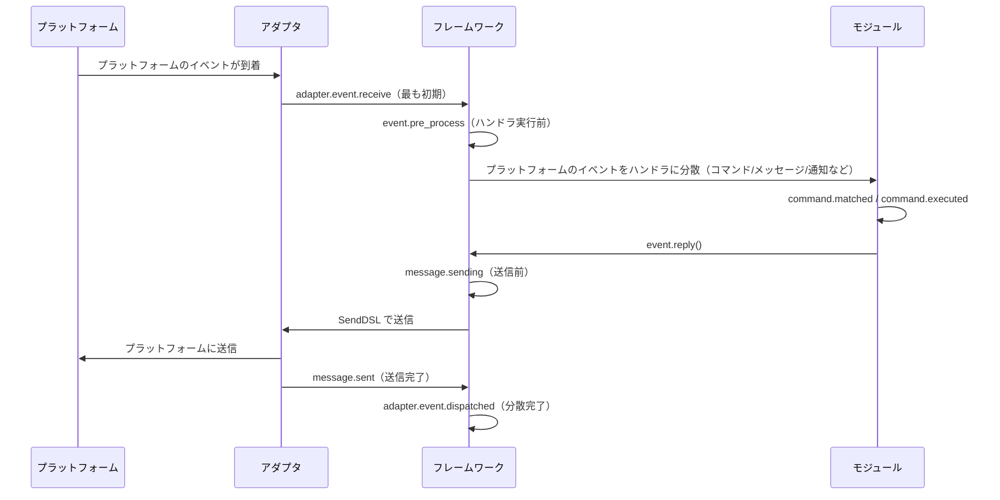

フレームワークは以下のフック断点を内蔵しており、`@sdk.lifecycle.on()` で任意の断点をサブスクライブしてカスタムロジックを実装できます。

### コア初期化

| フック名 | トリガータイミング | データ |
|---------|---------|------|
| `core.init.start` | SDK の初期化開始 | `{}` |
| `core.init.stage` | 初期化の各段階開始（バックグラウンドで発行） | `{"stage": str}`、値は `discovery` / `adapter_register` / `adapter_start` / `module_register` / `module_init` / `adapter_start_deferred` / `router_start` |
| `core.init.complete` | SDK の初期化完了 | `{"duration": float, "success": bool, "stages": {stage: float}, "adapters": {"enabled": [str], "disabled": [str]}, "modules": {"enabled": [str], "disabled": [str]}, "error": str(失敗時のみ)}` |
| `core.uninit.complete` | SDK の逆初期化完了 | `{"duration": float, "success": bool, "adapters_closed": int, "modules_unloaded": int, "module_properties_cleared": int, "module_properties_to_clear": [str], "error": str(失敗時のみ)}` |

**例：起動プロセスの表示**

```python
@sdk.lifecycle.on("core.init.stage")
def show_stage(data):
    print(f"[起動] 段階に進入: {data['stage']}")
```

### 設定変更

| フック名 | トリガータイミング | データ |
|---------|---------|------|
| `config.set` | 設定項目が変更された | `{"key": str, "old_value": Any, "new_value": Any}` |
| `config.updated` | 外部から `config.toml` を編集して木全体が変更されたことを検知した | `{"old_config": dict, "new_config": dict, "config_file": str}` |

**例：設定の監査**

```python
@sdk.lifecycle.on("config.set")
def audit_config(data):
    print(f"[監査] {data['key']}: {data['old_value']} -> {data['new_value']}")
```

### モジュールのライフサイクル

| フック名 | トリガータイミング | データ |
|---------|---------|------|
| `module.register` | モジュールクラスがマネージャーに登録された | `{"module_name": str, "success": bool}` |
| `module.load` | モジュールのロードが完了した（インスタンス化成功）；失敗時は `payload` に `"error": str, "traceback": str`（失敗現場は `module.last_error(名前)` でも確認可能）が追加 | `{"module_name": str, "success": bool}` |
| `module.init` | モジュールの初期化が完了した（遅延ロード含む） | `{"module_name": str, "success": bool}` |
| `module.before_unload` | アンロードのフローの最初のステップ（`on_unload` とリソース回収の前に；モジュールインスタンスのフック `on_before_unload` は同期的にトリガーされる） | `{"module_name": str, "reason": str}`；`reason` の値は `unload` / `reload` / `disable` / `cascade` / `dormant` |
| `module.sleep` | モジュールのスリープが完了した（遅延ロードの休眠：リソースは解放され、アクセス時に自動的に再起動） | `{"module_name": str, "success": bool}` |
| `module.unload` | モジュールのアンロード | `{"module_name": str, "success": bool}` |
| `module.reload` | モジュールのホットリロードが完了した（依存するモジュールも含む） | `{"module_name": str, "success": bool, "full": bool, "duration_ms": int}`；単一モジュールの場合は `"identity_changed": bool`（False = 進程内では古いコードが実行されている可能性がある、例：C拡張のキャッシュ）と `"version_old": str, "version_new": str` が追加される；全量リロード（`reload_all`）の場合は `module_name` は `"All"` で、`payload` に `"results": dict[str, bool]` が追加される |

> **モジュールインスタンスフック `on_before_unload`**：`module.before_unload` イベントに対応するオプションのライフサイクルメソッドです。`event["reason"]` に理由が記録され、`sdk.storage` に状態を保存して、再起動後に `on_load` で復元するのに適しています（遅延ロードの状態継続はこれに基づいています）。フックの失敗は警告として扱われ、アンロードのフローをブロックしません。

### アダプタのライフサイクル

| フック名 | トリガータイミング | データ |
|---------|---------|------|
| `adapter.load` | アダプタの登録が完了した | `{"platform": str, "success": bool}` |
| `adapter.reload` | アダプタのコードレベルのホットリロードが完了した | `{"adapter_name": str, "success": bool, "full": bool, "duration_ms": int, "identity_changed": bool, "version_old": str, "version_new": str, "was_started": bool, "source": str}`；`identity_changed=False` = 進程内では古いコードが実行されている可能性がある |
| `adapter.start` | アダプタの起動 | `{"platforms": [str]}` |
| `adapter.status.change` | アダプタのステータスが変化した | `{"platform": str, "status": str, "retry_count": int, "error": str(失敗時のみ)}`；status の完全な値は `starting` / `started` / `start_failed` / `stopping` / `stopped` / `stop_failed` / `skipped-dependency` / `disabled` |
| `adapter.stop` | アダプタの停止 | `{"platforms": [str]}` |
| `adapter.stopped` | アダプタの停止が完了した | `{"platforms": [str]}` |
| `adapter.bot.online` | Bot がオンラインになった | `{"platform": str, "bot_id": str, "info": dict, "status": str}` |
| `adapter.bot.offline` | Bot がオフラインになった | `{"platform": str, "bot_id": str, "status": str}` |

### イベントの受信と処理

| フック名 | トリガータイミング | データ |
|---------|---------|------|
| `adapter.event.receive` | 外部プラットフォームのイベントを受け取った（最も初期） | `{"platform": str, "event_type": str, "raw_event_type": str}` |
| `adapter.event.blocked` | 中間処理がイベントを拒否した（`False` を返した、イベントは処理されず他のハンドラにも渡されない） | `{"middleware": str, "platform": str, "event_type": str, "detail_type": str, "event": dict, "_trace_id": str}` |
| `adapter.event.dispatched` | イベントの分散が完了した | `{"platform": str, "event_type": str, "raw_event_type": str, "onebot_handlers_count": int}` |
| `event.pre_process` | イベントハンドラが実行される直前 | `{"event_type": str, "platform": str, "detail_type": str}` |

**例：イベントの統計**

```python
event_counter = {}

@sdk.lifecycle.on("adapter.event.receive")
def count_events(data):
    platform = data["platform"]
    event_counter[platform] = event_counter.get(platform, 0) + 1

@sdk.lifecycle.on("adapter.event.dispatched")
def log_unhandled(data):
    if data["onebot_handlers_count"] == 0:
        print(f"[未処理] {data['platform']}/{data['event_type']}")
```

### メッセージの送信

| フック名 | トリガータイミング | データ |
|---------|---------|------|
| `message.sending` | メッセージが送信される直前 | `{"platform": str, "method": str, "detail_type": str, "target_id": str, "bot_id": str}` |
| `message.sent` | メッセージの送信が完了した | `{"platform": str, "method": str, "detail_type": str, "target_id": str, "bot_id": str}` |

**例：メッセージ送信の監査**

```python
@sdk.lifecycle.on("message.sending")
def log_sending(data):
    print(f"[送信] -> {data['platform']}/{data['detail_type']}/{data['target_id']} via {data['method']}")
```

### コマンドシステム

| フック名 | トリガータイミング | データ |
|---------|---------|------|
| `command.matched` | コマンドがマッチし、実行される直前 | `{"command": str, "args": list[str], "platform": str, "user_id": str}` |
| `command.executed` | コマンドの実行が完了した | `{"command": str, "args": list[str], "platform": str, "user_id": str, "success": bool, "error": str(失敗時のみ)}` |

**例：コマンドの統計**

```python
@sdk.lifecycle.on("command.matched")
def count_commands(data):
    print(f"[コマンド] /{data['command']} from {data['user_id']}@{data['platform']}")
```

### HTTP ルーティング

| フック名 | トリガータイミング | データ |
|---------|---------|------|
| `server.request` | HTTP リクエストが受信された | `{"method": str, "path": str, "client_ip": str}` |
| `server.response` | HTTP レスポンスが送信された | `{"method": str, "path": str, "status_code": int, "client_ip": str}` |

**例：リクエストログ**

```python
@sdk.lifecycle.on("server.response")
def log_http(data):
    print(f"[HTTP] {data['method']} {data['path']} -> {data['status_code']}")
```

### WebSocket

| フック名 | トリガータイミング | データ |
|---------|---------|------|
| `server.start` | ルーティングサーバーが起動した | `{"base_url": str, "host": str, "port": int, "success": bool, "error": str(失敗時のみ)}` |
| `server.stop` | ルーティングサーバーが停止した | `{}` |
| `server.websocket.connect` | WebSocket 接続が確立した | `{"path": str, "module_name": str, "client_ip": str}` |
| `server.websocket.disconnect` | WebSocket 接続が切断した | `{"path": str, "module_name": str, "reason": str, "error": str(異常時のみ)}` |

**例：WebSocket 接続監視**

```python
@sdk.lifecycle.on("server.websocket.connect")
def on_ws_connect(data):
    print(f"[WS] 接続: {data['path']} from {data['client_ip']}")

@sdk.lifecycle.on("server.websocket.disconnect")
def on_ws_disconnect(data):
    print(f"[WS] 切断: {data['path']} ({data['reason']})")
```

### ストレージ接続状態

ストレージバックエンドの接続プールの確立、障害、および回復（すべてバックグラウンドで発行され、ストレージ操作をブロックしません）：

| フック名 | トリガータイミング | データ |
|---------|---------|------|
| `storage.ready` | ストレージバックエンドの接続プールが準備完了（各イベントループで最初のプール確立に成功した） | `{"backend": str}` |
| `storage.unreachable` | 接続リトライが尽き、冷却期間に入る（この間、操作は即座に失敗する） | `{"backend": str, "error": str, "cooldown": float}` |
| `storage.recovered` | 冷却が終了し、再接続に成功し、ストレージが再び利用可能になる | `{"backend": str}` |

**例：ストレージ障害のアラート**

```python
@sdk.lifecycle.on("storage.unreachable")
def alert_storage_down(data):
    print(f"[アラート] ストレージバックエンド {data['backend']} が利用不可: {data['error']}、{data['cooldown']}秒後に自動的に再接続されます")

@sdk.lifecycle.on("storage.recovered")
def notify_storage_back(data):
    print(f"[回復] ストレージバックエンド {data['backend']} が再び利用可能になりました")
```

### HTTP クライアント

`sdk.client` のリクエストと接続イベント（すべてバックグラウンドで発行されます）：

| フック名 | トリガータイミング | データ |
|---------|---------|------|
| `client.request.success` | HTTP リクエストが成功した | `{"method": str, "url": str, "status": int, "elapsed": float}` |
| `client.request.failed` | HTTP リクエストのリトライが尽き、最終的に失敗した | `{"method": str, "url": str, "error": str, "attempts": int, "elapsed": float}` |
| `client.ws.connect` | WebSocket 接続が確立した | `{"url": str}` |

### 国際化

| フック名 | トリガータイミング | データ |
|---------|---------|------|
| `i18n.language.changed` | フレームワークの言語が切り替わった（`i18n.set_language`） | `{"language": str, "previous": str}` |

## 標準イベントの定義

```python
STANDARD_EVENTS = {
    "core": ["init.start", "init.stage", "init.complete", "uninit.complete"],
    "module": ["load", "before_unload", "init", "sleep", "unload", "register", "reload"],
    "adapter": [
        "load", "start", "status.change", "reload", "stop", "stopped",
        "event.receive", "event.blocked", "event.dispatched",
        "bot.online", "bot.offline",
    ],
    "server": [
        "start", "stop",
        "request", "response",
        "websocket.connect", "websocket.disconnect",
    ],
    "event": ["pre_process"],
    "message": ["sending", "sent"],
    "command": ["matched", "executed"],
    "config": ["set", "updated"],
    "storage": ["ready", "unreachable", "recovered"],
    "client": ["request.success", "request.failed", "ws.connect"],
    "i18n": ["language.changed"],
}
```

## 完全な API リファレンス

### 登録と解除

| メソッド | 説明 |
|------|------|
| `@lifecycle.on(event, *, priority=0)` | デコレータでハンドラを登録 |
| `lifecycle.register(event, handler, *, priority=0)` | プログラミング形式で登録 |
| `lifecycle.unregister(event, handler=None)` | 登録解除（handler=None の場合、該当イベントのすべてのハンドラを解除） |

### トリガー

| メソッド | 説明 |
|------|------|
| `await lifecycle.emit(event, data=None, *, to=None)` | 非同期でトリガーし、ハンドラは**並列実行**（互いにブロックせず、返却時に全て完了）、返り値が None 以外の場合は優先度順に data を置き換え、`to` に owner を指定すると定向投递 | 
| `lifecycle.fire(event, data=None, *, to=None)` | **バックグラウンドで発行（投げて即終了）**：ハンドラはバックグラウンドタスクで並列実行、待機せず、返り値なし；ハンドラがいない場合、オーバーヘッドなし。高頻度なホットパスや純粋な観測イベントに適しています；停止シーケンスや順序が重要な消費（例：`config.set`）は `emit` を使用してください |
| `lifecycle.emit_sync(event, data=None, *, to=None)` | 同期でトリガーし、非同期ハンドラは create_task でスケジュール |
| `await lifecycle.submit_event(event_type, *, source, msg, data, to=None, background=False)` | 旧版との互換性、標準イベント形式を自動的に構築；`background=True` の場合、`fire` でバックグラウンドで発行 |

### ユーティリティ

| メソッド | 説明 |
|------|------|
| `lifecycle.start_timer(timer_id)` | タイマーを開始 |
| `lifecycle.get_duration(timer_id)` | 継続時間を取得（秒） |
| `lifecycle.stop_timer(timer_id)` | タイマーを停止し、継続時間を返す |
| `lifecycle.list_hooks()` | すべての登録されたフックとハンドラ数をリスト |
| `lifecycle.clear()` | すべてのハンドラとタイマーをクリア |

## モジュールでの使用例

```python
from ErisPulse.Core.Bases import BaseModule
from ErisPulse import sdk

class Main(BaseModule):
    async def on_load(self, event):
        # 簡単なメッセージ統計を実装
        self.msg_count = 0
        
        @sdk.lifecycle.on("adapter.event.receive")
        async def count(data):
            if data["event_type"] == "message":
                self.msg_count += 1
        
        # すべてのコマンドを監視
        @sdk.lifecycle.on("command.matched")
        async def log_cmd(data):
            sdk.logger.info(f"コマンド実行: /{data['command']} by {data['user_id']}")
        
        # 設定変更の監査
        @sdk.lifecycle.on("config.set")
        def audit(data):
            sdk.logger.info(f"設定変更: {data['key']} = {data['new_value']}")
```

## バックグラウンドタスクの所有者と自動キャンセル

> [!NOTE]
> この機能は ErisPulse **2.8.0+** が必要です。

モジュールが作成した asyncio バックグラウンドタスクは、`on_unload` でキャンセルしない場合、`self` を保持してモジュールインスタンスの回収ができない（ホットリロード後に古いインスタンスが残る）。フレームワークは以下のバックアップメカニズムを提供します：

- **`self.spawn(coro)`**（モジュール内で推奨）：タスクは自動的にモジュール名に属し、モジュールのアンロード時にフレームワークが `on_unload` **の後に**未完了のタスクをキャンセルし、警告を記録します
- **`spawn_background(coro)`**（`ErisPulse.runtime`）：現在の `owner_scope` コンテキストを自動的にキャプチャします；`cancel_owner_tasks(owner)` で所有者ごとにキャンセル、`cancel_all_background_tasks()` は `sdk.uninit()` のバックアップとして使用
- **アダプタ**：プラットフォーム名以下のバックグラウンドタスクも同様にアンロード時にキャンセルされます

```python
async def on_load(self, event):
    # 推奨：バックグラウンドタスクは self.spawn() を使用し、アンロード時にフレームワークが自動的にバックアップでキャンセル
    self.spawn(self._poll())

async def on_unload(self, event):
    # 精密制御が必要な場合は、キャンセルして終了を待つことを推奨
    if self._poll_task:
        self._poll_task.cancel()
        await asyncio.gather(self._poll_task, return_exceptions=True)

async def _poll(self):
    while True:
        await asyncio.sleep(60)
        ...
```

> [!IMPORTANT]
> フレームワークのバックアップは**強制キャンセル**（`cancel_owner_tasks`）です。これは `on_unload` の返り値の後に発生します。したがって、優雅な終了が必要なタスク（バッファのフラッシュ、状態の永続化、接続の閉鎖）は**必ず**`on_unload` で `cancel()` して `await` で完了させる必要があります。バックアップが終了処理を保証するとは考えないでください。`await` の結果が必要なタスクは、`await` してバックグラウンドタスクに投げないでください。

## 注意事項

1. **ハンドラは同期または非同期**：システムは自動的に正しく呼び出します
2. **データの渡し方**：`emit()` モードでは、ハンドラが None 以外の値を返すと、後続のハンドラに渡される data が変更されます
3. **イベント名の命名規則**：点構造の命名を使用することを推奨し、親イベントの監視がしやすくなります
4. **エラーの隔離**：1つのハンドラの例外は他のハンドラの実行に影響しません
5. **同期トリガーの制限**：`emit_sync()` では非同期ハンドラは fire-and-forget 方式でスケジュールされ、返り値は戻されません
6. **ライフサイクルのクリーンアップ**：`sdk.uninit()` を呼び出すと、すべての登録されたハンドラとタイマーがクリーンアップされます
7. **ロードの優先性**：フレームワークの初期化段階でイベントをサブスクライブする必要がある場合、高優先度を設定し、遅延ロードを無効にすることを推奨します


### 懶加载系统

# ラグジュアリー・ロード・モジュール・システム

> [!TIP]  
> **この記事を読む必要があるタイミング**：ラグジュアリー・ロード・モジュールを使用する場合、または activate_on イベント駆動型のアクティベーションを使用する場合。それ以外の場合は読み飛ばしても、他の機能の使用に影響はありません。

ErisPulse SDK は、モジュールが実際に必要になるまで初期化されない強力なラグジュアリー・ロード・モジュール・システムを提供しており、これによりアプリケーションの起動速度とメモリ効率が大幅に向上します。

## 概要

ErisPulse のコア機能の 1 つである遅延ロードモジュールシステムは、以下の方法で動作します。

- **遅延初期化**：モジュールは、初めてアクセスされたときにのみ実際に読み込まれ、初期化されます。
- **透明な使用**：開発者にとって、遅延ロードモジュールは通常のモジュールと使用上ほとんど違いがありません。
- **自動依存管理**：モジュールの依存関係は、使用されるときに自動的に初期化されます。
- **ライフサイクルサポート**：`BaseModule` を継承したモジュールに対しては、ライフサイクルメソッドが自動的に呼び出されます。

## 動作原理

### LazyModule クラス

ラグジュアリー・ロード・システムの中心となるのが `LazyModule` クラスです。これは、最初にアクセスされたときにのみモジュールを実際に初期化するラッパーです。

### 初期化プロセス

モジュールが初めてアクセスされたとき、`LazyModule` は以下の操作を実行します：

1. モジュールクラスの `__init__` パラメータ情報を取得します
2. パラメータに基づいて `sdk` リファレンスを渡すかどうかを決定します
3. モジュールの `moduleInfo` 属性を設定します
4. `BaseModule` を継承したモジュールの場合、`on_load` メソッドを呼び出します
5. `module.init` ライフサイクルイベントをトリガーします

## イベント駆動型遅延起動（activate_on）

> [!NOTE]
> この機能は ErisPulse **2.8.0+** が必要です。

`lazy_load=True` のモジュールはデフォルトで**最初の属性アクセス時**にのみロードされます。モジュールがコマンド/イベントハンドラを登録している場合、従来の方法では `lazy_load=False` として即時ロードするしかありませんでした。`activate_on` は第三の選択肢を提供します：**トリガを宣言し、最初の一致するイベント/コマンドが到着した時点でモジュールを自動的にアクティブ化する**——メモリに常駐させることなく、トリガのエントリポイントを失うこともありません。

```python
from ErisPulse.loaders import ModuleLoadStrategy

class MyModule(BaseModule):
    @staticmethod
    def get_load_strategy():
        return ModuleLoadStrategy(
            lazy_load=True,
            activate_on=[
                # ---- イベントトリガ（受動的到着、ユーザーの意識を必要としない）----
                "message",                                    # タイプレベル：任意のメッセージイベント
                {"notice": "group_member_increase"},          # タイプ + 単一 detail_type
                {"message": ["private", "group"]},            # タイプ + 複数 detail_type

                # ---- コマンドトリガ（能動的入力、Help に表示されるプレースホルダーコマンド）----
                {"command": "roll"},                          # 簡易表記：コマンド名
                {"command": ["roll", "dice"]},                # コマンド名リスト
                {"command": {                                 # dict 形式で宣言（name は必須）
                    "name": "dice",
                    "help": "サイコロを振る",
                    "usage": "/dice",
                    "group": "娯楽",
                    "aliases": ["d"],
                    "hidden": False,
                }},
            ],
        )
```

### コマンド dict 形式の宣言パラメータ

dict 形式は `@command()` デコレータのユーザーレベルのパラメータを反映し、モジュールのロード前にプレースホルダーコマンドを登録するのに使用されます。

| パラメータ | 型 | デフォルト | 説明 |
|------|------|------|------|
| `name` | `str` | **必須** | コマンド名；`on_load` での `@command(name)` と一致する必要がある。一致しない場合、アクティブ化後にプレースホルダーが削除され、コマンドは存在しなくなる |
| `help` | `str` | フォールバックチェーン | Help に表示される説明；未宣言の場合、フォールバックチェーンから値を取得する（以下参照） |
| `usage` | `str` | 自動生成 | 使用法行；デフォルトは `{prefix}{name}` |
| `group` | `str` | `None` | コマンドグループ |
| `aliases` | `list[str]` | `[]` | 別名を同時に登録し、**別名の入力でもトリガとして機能する** |
| `hidden` | `bool` | `False` | `True` の場合、プレースホルダーコマンドも非表示（アクティブ化後の実際のコマンドの非表示の意味と一致）；コマンド名を知っているユーザーの入力でもトリガとして機能する |

**サポートされていない** `priority` / `permission` / `master`：プレースホルダーコマンドの役割はトリガの起動だけであり、権限チェックはアクティブ化後の実際のコマンドが実行する（プレースホルダー段階で権限チェックを行うと、「コマンド入力による起動」が無効になる）。

### 占位コマンドの Help フォールバックチェーン

モジュールがロードされていない場合、Help に表示されるコマンドの説明は以下の順序で取得されます（最初に見つかった値を使用）：

1. dict 形式で宣言されたコマンドレベルの `help`（最も正確）
2. モジュールの `get_meta()` の `description`
3. モジュールの `__description__` 属性
4. パッケージのメタデータの `Summary`（PyPI パッケージの概要）
5. 一般的なメッセージ：「このコマンドは遅延ロードモジュール X から来ています。初めて使用すると、モジュールが自動的にロードされます」

### トリガの意味

- **イベントスタブ**：対応するイベントマネージャーに非常に低い優先度（`ACTIVATION_STUB_PRIORITY`）で登録され、すべての通常のハンドラの後にバックアップとしてトリガされる。アクティブ化後、現在のイベントはモジュールの実際のハンドラに転送される
- **コマンドスタブ**：プレースホルダーコマンドを登録する。アクティブ化後、プレースホルダーは削除され、実際のコマンドがトリガを引き継ぐ
- **再入防止**：`asyncio.Lock` を使用して、並行トリガ時に一度だけアクティブ化されるように保証する
- **スコープフィルタリング**：スタブにはモジュールの所有者アイデンティティが含まれ、モジュールが Bot / セッション / プラットフォームに対して有効化されていない場合はトリガされない
- **失敗時の処理**：アクティブ化に失敗した場合はクールダウン期間（`ACTIVATE_RETRY_COOLDOWN_SECS`、30秒）に入る。クールダウン中はイベントが短絡的に処理され、繰り返し試行されない。クールダウン後に再トリガされると、自動的に再試行され、スタブは全期間保持される
- **重複排除**：同名のコマンドが簡易表記と dict 形式で混在して宣言された場合、重複は排除され（dict が優先される）。dict で `name` が欠落している、またはイベントの `detail_type` が dict として誤って記述された場合は警告が表示され、無視される

> アーキテクチャ図と完全な意味については、[アーキテクチャ概要](../architecture.md#イベント駆動型遅延起動activate_onトリガアーキテクチャ)を参照してください。

## 懒惰ロードの休眠（dormant_after）

> [!NOTE]
> この機能は ErisPulse **2.11.0+** が必要です。

長期間使用されていない遅延ロードモジュールに対して、フレームワークはその**休眠**を可能にします。これにより、実行時のリソース（タスク、接続、イベントの登録など）を解放しますが、遅延ロードプロキシと登録のスタブは保持されます。モジュールは「登録済みだがロードされていない」状態に戻り、次回の属性アクセス、`module.call`、`activate_on` イベントによって**透明に再起動**されます（再インスタンス化され、`on_load` が実行されます）。再起動のための API は一切不要です。休眠後のシステムの状態は、「一度も起動されていない」場合と完全に同一です。

### 宣言方法

```python
@staticmethod
def get_load_strategy():
    return ModuleLoadStrategy(
        lazy_load=True,
        dormant_after="30m",   # 30 分間の無使用で自動的に休眠；宣言しない場合は休眠しない（デフォルト）
    )
```

時間の指定は、コマンド管理の `cooldown` と同じ形式です（`90s` / `1h30m` / `1d`）。スクリーナーは固定間隔（60 秒）でスキャンを行い、実際の休眠時刻は閾値 + 最大でスキャン間隔分のずれがあります。また、手動で休眠させることも可能です：`await sdk.module.sleep("モジュール名")`。明示的な `unload` は完全なアンロード（遅延プロキシも削除）になります。

### 状態の継続

休眠前にフレームワークは `on_before_unload(reason="dormant")` をトリガーします（アンロードの最初のステップ、リソースはまだ有効）。モジュールは `sdk.storage` に状態を保存します。再起動後は `on_load` で状態を復元します：

```python
async def on_before_unload(self, event):
    if event["reason"] in ("dormant", "reload", "disable"):
        await self.sdk.storage.aset(f"{self._module_name}:counter", self._count)

async def on_load(self, event):
    self._count = await self.sdk.storage.aget(f"{self._module_name}:counter") or 0
```

### 意味と境界

- **依存先の安全性**：遅延モジュールの依存先は、永続的なプロキシ（`sdk.<Name>`）または `module.call` を通じてアクセスします。休眠前後で動作は一貫しています。直接に実際のインスタンスの参照を持つことは反パターンです（監査ツールで漏れが確認できます）。
- **イベントの到達**：休眠中のモジュールはイベントを受け取らなくなります。イベントによって再起動が必要なモジュールは、`activate_on` を同時に宣言してください（イベントが先に再起動し、その後転送されます）。「コマンドが反応しない」問題を調査する際は、モジュールが休眠状態にあるかどうかを確認してください。
- **再起動失敗時の自己修復**：再起動（再初期化）に失敗した場合、30 秒間のクールダウンに入り、クールダウン後に再びアクセスすると自動的に再試行されます。永久的に失敗することはありません。

## 懒惰ロードの設定

### グローバル設定

設定ファイルでグローバルな遅延ロードを有効または無効にします：

```toml
[ErisPulse.framework]
enable_lazy_loading = true  # true=遅延ロードを有効にする(デフォルト), false=遅延ロードを無効にする
```

### モジュールレベルの制御

モジュールは `get_load_strategy()` 静的メソッドを実装することで、ロード戦略を制御できます：

```python
from ErisPulse.Core.Bases import BaseModule
from ErisPulse.loaders import ModuleLoadStrategy

class MyModule(BaseModule):
    @staticmethod
    def get_load_strategy():
        """モジュールのロード戦略を返す"""
        return ModuleLoadStrategy(
            lazy_load=False,  # Falseを返すと即時ロード
            priority=100      # ロードの優先度、数値が大きいほど優先度が高い
        )
```

## ラグロードモジュールの使用

### 基本的な使い方

開発者にとって、ラグロードモジュールは通常のモジュールと使用方法にほとんど違いはありません：

```python
# SDKを介してラグロードモジュールにアクセス
from ErisPulse import sdk

# 以下のようにアクセスするとモジュールのラグロードがトリガーされます
result = await sdk.my_module.my_method()
```

### モジュールの取得の統一されたエントリーポイント

SDK属性、モジュールマネージャー属性を通じてアクセスする場合でも、`module.get()`で検索する場合でも、
「登録済みだがまだロードされていない」ラグロードモジュールに対しては、すべて同じラグロードプロキシが返り、
そのプロパティにアクセスすることで初めてモジュールの初期化がトリガーされます：

```python
# 3つの方法で取得できるのはすべてラグロードプロキシです（モジュールがロードされていない場合）、動作は一貫しており、ユーザーには透明です
sdk.my_module          # ロードをトリガーするエントリーポイント
sdk.module.my_module   # 同様にラグロードプロキシを返します
sdk.module.get("my_module")  # これもラグロードプロキシを返します。この操作自体はロードをトリガーしません

# プロキシの任意の属性にアクセスすることで、モジュールの初期化が実際に行われます
result = await sdk.my_module.my_method()
```

`module.get()`は**検索**用のインターフェースであり、ロードをトリガーしません：
- モジュールが既にロード済み → 実際のインスタンスを返します
- モジュールが登録済みだが未ロード → ラグロードプロキシを返します（プロパティにアクセスしたときに初期化されます）
- モジュールが未登録 → `None`を返します

明示的にロードをトリガーするには、`await sdk.load_module("my_module")`を使用してください。

### 非同期初期化

非同期初期化が必要なモジュールについては、まず明示的にロードすることを推奨します：

```python
# まずモジュールを明示的にロード
await sdk.load_module("my_module")

# その後モジュールを使用
result = await sdk.my_module.my_method()
```

### 同期初期化

非同期初期化を必要としないモジュールについては、直接アクセスできます：

```python
# 直接アクセスすると自動的に同期初期化されます
result = sdk.my_module.some_sync_method()
```

## 最佳実践

ロード戦略を選択する際は、以下の決定フローを参考にしてください。

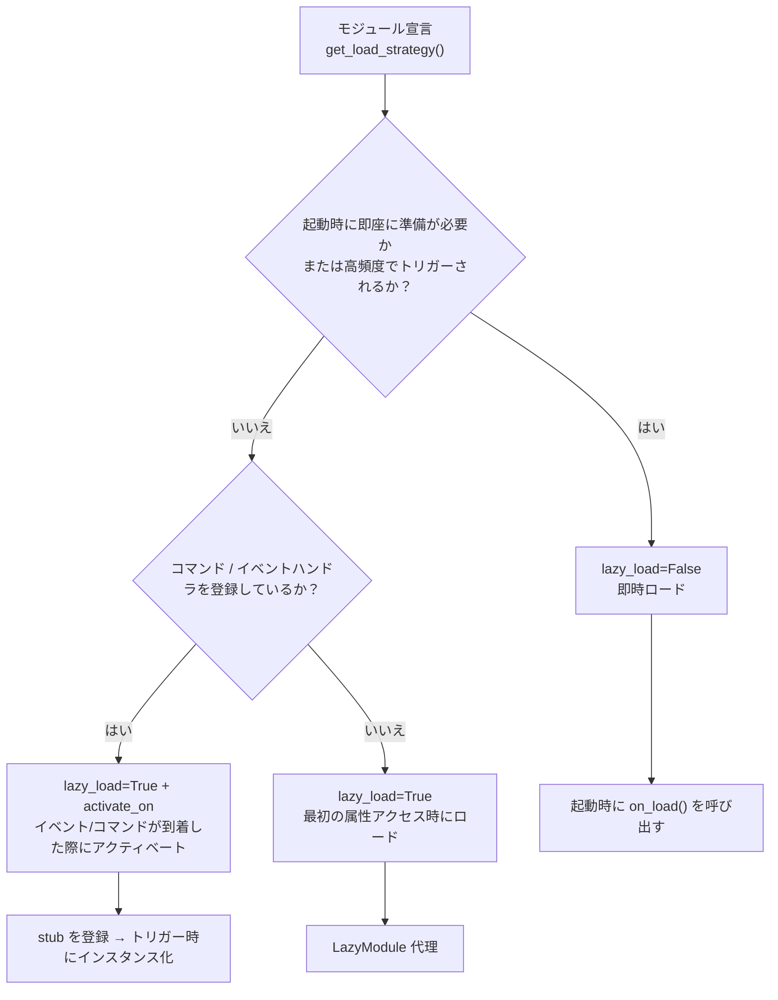

### 懒惰ロード（lazy_load=True）を使用することを推奨する場面

- 他のモジュールによって呼び出されるだけの受動的なユーティリティモジュール（例：データクエリモジュール、フォーマット変換器など）
- コマンド/イベントハンドラを登録しているが高頻度で使用されないモジュール — `activate_on` を使ってトリガを宣言し、最初の一致するイベント/コマンドが到着した際に自動的にアクティベートする。これにより、lazy_loadを放棄せずに済む。

### 懒惰ロードを禁止することを推奨する場面（lazy_load=False）

- 起動時に即座に準備が必要なモジュール（他のモジュールに基礎サービスを提供するコアモジュールなど）
- 高頻度でトリガーされるリスナー（各メッセージごとに処理が必要） — `activate_on` による転送には1回のアクティベートオーバーヘッドがあるため、高頻度の場面では即時ロードした方が直接的
- タイマータスクモジュール
- アプリケーション起動時に初期化が必要なモジュール

> `priority` パラメータは、即時ロードされるモジュール間の初期化順序を制御します。数値が大きいほど先に初期化されます。同じ優先度のモジュールは登録順にロードされます。

## 注意事項

1. モジュールが遅延ロードを使用している場合、ErisPulse内で他のモジュールによって一度も呼び出されない場合、そのモジュールは決して初期化されません。
2. モジュール内にEventの監視など、他のモジュールを積極的に監視するモジュールが含まれている場合、2つの選択肢があります：`activate_on` トリガーを宣言して遅延ロードを維持し、イベントが到達したときに自動的にアクティブ化するか、または即時ロードを必要とすることを宣言する（`lazy_load=False`）か、さもなければモジュールの正常な業務に影響を及ぼす可能性があります。
3. 特殊な要望がない限り、遅延ロードを無効にすることは推奨しません。そうしないと、依存管理やライフサイクルイベントなどの問題が生じる可能性があります。
4. `activate_on` のコマンド dict 声明において、`name` はモジュールの `on_load` で `@command()` によって登録された実際のコマンド名と一致する必要があります。一致しない場合、モジュールがアクティブ化された後にプレースホルダーコマンドが解除され、宣言と実装が一致しないコマンドは存在しません。


### 国际化（i18n）系统

# 国際化 (i18n) システム

> [!TIP]
> **この記事を読む必要があるのは**：多言語の文案、翻訳の登録、言語の検出が必要な場合です。必要ない場合は、他の機能の使用に影響を与えることなく、この記事は飛ばしてください。

ErisPulse v2.5.0 以降、完全な国際化 (i18n) 機能が内蔵されています。フレームワークのコアおよび CLI インターフェースは、システム言語に応じて表示されるテキストを自動的に切り替えることができ、外部モジュールが独自の翻訳を登録することもサポートしています。

## 支援言語

| 言語 | コード | 説明 |
|------|------|------|
| 简体中文 | `zh-CN` | デフォルト言語（フレームワークの原生言語） |
| 繁體中文 | `zh-TW` | 繁体中文（香港/澳门/台湾） |
| English | `en` | 英文（一般的フォールバック言語） |
| 日本語 | `ja` | 日本語 |
| Русский | `ru` | ロシア語 |

## 早速体験

### 環境変数による切り替え

```bash
# Windows PowerShell
$env:ERISPULSE_LANG = "en"
epsdk run

# macOS / Linux
ERISPULSE_LANG=ja epsdk run
```

### 設定ファイルによる切り替え

`config/config.toml` に以下を追加します：

```toml
[ErisPulse.i18n]
language = "zh-TW"
```

`"auto"`（デフォルト値）に設定すると、システム言語を自動検出します。

### コード内で手動で切り替え

```python
from ErisPulse import i18n

# 言語を手動で設定
i18n.set_language("en")
print(i18n.get_language())  # "en"

# 自動検出に戻す
i18n.reset_language()
```

## 言語検出メカニズム

フレームワークは、以下の優先順位でユーザーの言語を検出します：

1. **環境変数 `ERISPULSE_LANG`** — 最も高い優先順位で、テストや一時的な切り替えに使用
2. **Windows API** — `GetUserDefaultLocaleName`（Windowsに限定、Git Bashなどのツールが `LANG` を上書きする影響を受けない）
3. **環境変数** — `LANGUAGE` > `LC_ALL` > `LC_MESSAGES` > `LANG`（Unix/macOSの標準）
4. **システムロケール** — `locale.getlocale()` / `locale.getdefaultlocale()`
5. **デフォルト** — en（英語）

### 近接マッピング原則

検出された言語が正確に一致しない場合、サポートされている言語に近接する原則でマッピングされます：

- `zh-TW`, `zh-HK`, `zh-MO`, `zh-Hant` → **繁体中国語**
- その他のすべての `zh-*`（例: `zh-CN`, `zh-SG`）→ **簡体中国語**
- `en-US`, `en-GB`, `en-AU` など → **英語**
- `ja-JP` → **日本語**
- `ru-RU` → **ロシア語**
- その他の未認識の言語 → **簡体中国語（デフォルト）**

## モジュールでの i18n の使用

独自のモジュールに翻訳テキストを登録することで、多言語をサポートできます。

### 推奨方法：I18nClass を使って翻訳キーを宣言する（v2.7.0+）

v2.7.0 以降、モジュールやアダプターは `ConfigClass` を宣言するのと同じように、ネストされたクラス `I18nClass` を使って翻訳キーを宣言できます。フレームワークはロード時に**自動的に**宣言されたすべての翻訳キーを登録します。手動で `i18n.register()` を呼び出す必要はありません。

```python
from dataclasses import dataclass, field

from ErisPulse.Core.Bases import BaseConfig, BaseI18n, BaseModule, I18nKey


class MyModule(BaseModule):
    # 設定クラス（オプション）
    @dataclass
    class ConfigClass(BaseConfig):
        welcome_msg: str = field(
            default="欢迎",
            metadata={
                # ここでは i18n キー mymodule.welcome_msg を参照
                "description": {"i18n": "mymodule.welcome_msg", "default": "欢迎消息"},
            },
        )

    # 翻訳キー集合クラス（オプション）
    # 宣言されたキーはフレームワークによって自動的に登録され、
    # ConfigClass がデフォルト設定を生成するよりも優先されます
    class I18nClass(BaseI18n):
        # 属性名が自動的に結合されて完全なキー経路 <モジュール名>.<属性名> になります
        welcome_msg: I18nKey = I18nKey(
            default="Welcome Message",   # 言語に依存しないデフォルト値、どの言語にも登録されません
            zh_CN="欢迎消息",
            en="Welcome Message",
            ja="ウェルカムメッセージ",
            ru="Приветственное сообщение",
            zh_TW="歡迎訊息",
        )
        # 业务で使用する他の翻訳キー
        hello: I18nKey = I18nKey(
            default="Hello, {name}!",
            zh_CN="你好，{name}！",
            zh_TW="你好，{name}！",
            en="Hello, {name}!",
            ja="こんにちは、{name}！",
            ru="Привет, {name}!",
        )

        # 完全なキー経路を明示的に指定することもできます（属性名の結合を使わない）
        custom: I18nKey = I18nKey(
            key="mymodule.deep.nested.key",
            default="Default text",
            zh_CN="默认文本",
            zh_TW="預設文本",
            en="Default text",
            ja="デフォルトテキスト",
            ru="Текст по умолчанию",
        )
```

#### なぜ I18nClass が推奨されるのか？

| シナリオ | 手動 i18n.register() | I18nClass 宣言式 |
|------|-----------------------|------------------|
| 設定の説明に参照される i18n キー | 手動で登録する必要があり、設定生成前に登録する必要がある | フレームワークが設定生成前に自動的に登録する |
| 多言語翻訳の宣言 | on_load() 内に散在する | クラス内で一括して宣言され、一目瞭然 |
| キー名の命名の一貫性 | 拼写ミスが発生しやすい | 属性名がキー名の接尾辞として使用され、IDE による補完が可能 |
| アンロード時のクリーンアップ | 手動で unregister_domain() を呼び出す必要がある | フレームワークが統一されたドメインで登録する |

#### I18nClass のキー経路ルール

- **デフォルト**：``<モジュール登録名>.<属性名>`` を完全なキー経路として使用
  - 例：モジュール名が ``MyModule``、属性 ``welcome`` → キー経路 ``MyModule.welcome``
- **明示的**：``I18nKey(key="...")`` パラメータを使って任意のドット区切り経路を指定
  - 深層ネストされたキー名（例：``mymodule.config.basic.token``）に適している

#### アダプターでの使用

アダプターも `I18nClass` をサポートしており、使用方法は完全に同じです：

```python
from ErisPulse.Core import BaseAdapter
from ErisPulse.Core.Bases import BaseConfig, BaseI18n, I18nKey


class MyAdapter(BaseAdapter):
    @dataclass
    class ConfigClass(BaseConfig):
        endpoint: str = field(
            default="",
            metadata={
                # 設定の説明は adapter.MyAdapter.endpoint キーを参照
                "description": {"i18n": "MyAdapter.endpoint", "default": "API 地址"},
            },
        )

    class I18nClass(BaseI18n):
        # 集中して設定の説明に参照されるキーとその他の業務用キーの多言語訳を宣言
        endpoint: I18nKey = I18nKey(
            default="API Endpoint",
            zh_CN="API 地址",
            zh_TW="API 位址",
            en="API Endpoint",
            ja="APIアドレス",
            ru="API адрес",
        )
```

アダプターの `I18nClass` は `__init__` 階段（つまり設定テンプレート生成の前）に自動的に登録され、設定の説明に参照される i18n キーが利用可能になります。

### 手動でカスタム翻訳を登録する（旧方法）

`I18nClass` を使用しない場合、`i18n.register()` を直接呼び出して翻訳テキストを登録することもできます。

```python
from ErisPulse import i18n

# 中文翻訳を登録
i18n.register("zh-CN", {
    "my_module.welcome": "欢迎使用我的模块！",
    "my_module.goodbye": "再见！",
    "my_module.hello": "你好，{name}！",
}, domain="my_module")

# 英文翻訳を登録
i18n.register("en", {
    "my_module.welcome": "Welcome to my module!",
    "my_module.goodbye": "Goodbye!",
    "my_module.hello": "Hello, {name}!",
}, domain="my_module")
```

### 翻訳の使用

```python
from ErisPulse import i18n

# 簡単な翻訳
i18n.t("my_module.welcome")  # 現在の言語が自動的に使用されます

# フォーマットパラメータ付き
i18n.t("my_module.hello", name="Alice")

# デフォルト値を指定（翻訳キーが存在しない場合に返される）
i18n.t("my_module.unknown_key", default="默认文本")
```

### モジュールクラスでの使用

```python
from dataclasses import dataclass, field
from ErisPulse import i18n
from ErisPulse.Core.Bases import BaseConfig, BaseModule

@dataclass
class MyModuleConfig(BaseConfig):
    welcome_msg: str = field(
        default="欢迎",
        metadata={
            "description": {"i18n": "my_module.welcome_msg", "default": "欢迎消息"},
            "ui": {"widget": "text", "group": "basic", "order": 1},
        },
    )

class MyModule(BaseModule):
    ConfigClass = MyModuleConfig

    async def on_load(self, event):
        # 実時で設定を読み取る（各アクセスで最新値が反映される）
        self.logger.info(self.cfg.welcome_msg)
        self.logger.info(i18n.t("my_module.welcome"))

    @command("hello")
    async def hello_handler(self, event):
        name = event.get_user_nickname() or "friend"
        await event.reply(i18n.t("my_module.hello", name=name))

    async def on_unload(self, event):
        pass
```

### 翻訳のアンロード

```python
# ドメイン全体の翻訳をアンロード
i18n.unregister_domain("my_module")
```

---

## 設定フィールドの多言語対応

v2.5.2 以降、設定の Schema は i18n を全面的にサポートします。ユーザーが見られるすべてのテキストフィールドは i18n キーを参照でき、WebUI およびその他の消費者は、現在の言語に応じて自動的に対応するテキストに解析します。

### 対応する i18n フィールド

| フィールド | 位置 | 説明 |
|------|------|------|
| `description` | field metadata | フィールドの説明 |
| `options[].label` | `ui.options` | select コントロールのオプションラベル |
| `placeholder` | `ui.placeholder` | 入力欄のプレースホルダー |
| `group_labels` | `_schema_meta` | グループ表示名（Dashboard のセクションタイトル） |

すべての i18n フィールドは `{"i18n": "key", "default": "テキスト"}` の形式を採用し、純粋な文字列はそのまま透過されます（後方互換性を保つため）。

### i18n フィールドの宣言

すべてのユーザーが見られるテキストフィールドは i18n をサポートします：

```python
from dataclasses import dataclass, field
from ErisPulse.Core.Bases import BaseConfig

@dataclass
class MyAdapterConfig(BaseConfig):
    # description i18n
    token: str = field(
        default="",
        metadata={
            "description": {"i18n": "my_adapter.token", "default": "プラットフォーム Token"},
            "required": True,
            "secret": True,
            "ui": {
                "widget": "password",
                "group": "basic",
                "order": 1,
                # placeholder i18n
                "placeholder": {"i18n": "my_adapter.token.ph", "default": "Token を入力してください"},
            },
        },
    )
    # options label i18n
    mode: str = field(
        default="a",
        metadata={
            "description": {"i18n": "my_adapter.mode", "default": "実行モード"},
            "ui": {
                "widget": "select",
                "group": "basic",
                "order": 2,
                "options": [
                    {"label": {"i18n": "my_adapter.mode.a", "default": "モードA"}, "value": "a"},
                    {"label": {"i18n": "my_adapter.mode.b", "default": "モードB"}, "value": "b"},
                ],
            },
        },
    )

    # group_labels i18n（グループ表示名）
    _schema_meta = {
        "group_labels": {
            "basic": {"i18n": "my_adapter.group.basic", "default": "基本設定"},
        }
    }
```

`default` はバックアップテキストです。翻訳が登録されていない場合、または検索に失敗した場合に表示されます。

### secret 脱敏と設定検証

`"secret": True` とマークされたフィールドは、2.7.0 以降、**脱敏保護**が自動で適用されます：

- **テンプレート生成時の脱敏**：`dataclass_to_toml_with_comments()` が設定テンプレートを生成する際、secret フィールドの実際の値はファイルに書き込まれません（空のプレースホルダーとして表示され、機密情報がディスク上に残らないようにします）。
- **一般的な脱敏ツール**：`redact_secret(value)` は非空値を `***` に置き換え、空値はそのまま返します。これはログ出力などの場面で使用できます。

```python
from ErisPulse.Core.Bases.config_schema import redact_secret

redact_secret("sk-xxxxxx")  # '***'
redact_secret("")           # ''
```

**設定検証**（`validate_config()`）は、`required` の非空チェックに加えて、2.7.0 以降、以下の検証もサポートします：

| 検証項目 | メタデータ | 例 |
|--------|--------|------|
| 型の一致 | フィールドの宣言型 | `int` 型のフィールドに文字列を渡すとエラーになります |
| 列挙制約 | `ui.options` またはトップレベルの `options` | 値は許可されたオプションに属している必要があります |
| 数値範囲 | トップレベルの `min` / `max` | `metadata={"min": 1, "max": 65535}` |

```python
from ErisPulse.Core.Bases.config_schema import validate_config

@dataclass
class C(BaseConfig):
    mode: str = field(default="a", metadata={"ui": {"widget": "select", "options": ["a", "b"]}})
    port: int = field(default=80, metadata={"min": 1, "max": 65535})

errors = validate_config(C(mode="x", port=70000))  # 2つのエラー：列挙制約と範囲制約
```

### 設定の翻訳登録

設定フィールドの i18n キーは、通常の翻訳キーと同じように `i18n.register()` を使って登録できます：

```python
from ErisPulse import i18n

# 登録する中国語（default と同じでも、異なるものでも可）
i18n.register("zh-CN", {
    "my_adapter.token": "プラットフォーム Token",
}, domain="my_adapter")

# 登録する英語
i18n.register("en", {
    "my_adapter.token": "Platform Token",
}, domain="my_adapter")
```
> **推奨方法**：`I18nClass` を使って翻訳キーを宣言し、フレームワークが自動的に登録します（上記「推奨方法」の章を参照）。  
> 手動で `i18n.register()` や `register_config_i18n()` を呼び出す必要はありません。

また、便利な関数 `register_config_i18n()` も提供されており、設定クラスからキーを自動的に抽出して登録できます：

```python
from ErisPulse.Core.Bases.config_schema import register_config_i18n

# 自動的に description.default を zh-CN の翻訳として登録
register_config_i18n(MyAdapterConfig, "zh-CN")

# 手動で英語の翻訳を提供
register_config_i18n(MyAdapterConfig, "en", {
    "my_adapter.token": "Platform Token",
})
```

### WebUI での消費方法

`get_config_schema()` が返す schema では、i18n ディクショナリはそのまま透過されます。WebUI のフロントエンドは、現在の言語に応じて `i18n.t()` を呼び出して解析できます。

i18n をサポートしないフロントエンドに直接文字列を返す必要がある場合、`resolve_config_schema()` を使用します。この関数は、`description`、`options[].label`、`placeholder`、`group_labels` をすべて現在の言語の文字列に解析します：

```python
from ErisPulse.Core.Bases.config_schema import resolve_config_schema

# すべての i18n フィールドが現在の言語の文字列に解析されています
schema = resolve_config_schema(MyAdapterConfig)
print(schema["fields"]["token"]["description"])    # "プラットフォーム Token" または "Platform Token"
print(schema["fields"]["token"]["placeholder"])   # "Token を入力してください" または "Enter Token"
print(schema["fields"]["mode"]["options"][0]["label"])  # "モードA" または "Mode A"
print(schema["group_labels"]["basic"])             # "基本設定" または "Basic"
```

> `BaseConfig`、`BotAccountConfig`、`register_config_i18n()`、`resolve_config_schema()`  
> などの型とツール関数の実際の定義は `ErisPulse.Core.Bases.config_schema` にあります。  
> `ErisPulse.runtime.config_schema` は互換性のための shims として残されています。  
> **推奨は `ErisPulse.Core.Bases` から一括でインポートすること**（i18n 翻訳キーに関連する型は例外で、`ErisPulse.Core.Bases.i18n_schema` にあります）。

## API リファレンス

### I18nManager

#### 核心メソッド

| メソッド | 説明 |
|------|------|
| `t(key, default=None, **kwargs)` | 翻訳テキストを取得する（`gettext()` はエイリアス） |
| `set_language(lang)` | 手動で言語を設定する |
| `get_language()` | 現在の言語を取得する |
| `reset_language()` | 自動検出にリセットし、環境を再検出する |
| `get_supported_languages()` | すべてのサポート言語のリストを取得する |
| `has_translation(key, lang=None)` | 翻訳キーが存在するか確認する |
| `register(lang, translations, domain)` | 自定義翻訳を登録する |
| `unregister_domain(domain)` | 指定されたドメインのすべての翻訳をアンロードする |
| `reload()` | 内部翻訳を再読み込みし、言語を再検出する |

#### `t()` メソッドの詳細

```python
def t(self, key, /, default=None, **kwargs):
```

- `key` — 翻訳キー（位置引数のみ、`**kwargs` の `key=` と衝突しない）
- `default` — 翻訳が存在しない場合に返すデフォルト値、デフォルトは `None`（キー名そのものを返す）
- `**kwargs` — 翻訳値中の `{placeholder}` を埋め込むためのフォーマットパラメータ

例：

```python
# 翻訳定義: "greeting": "你好，{name}！欢迎来到{place}。"
i18n.t("greeting", name="Alice", place="ErisPulse")
# 戻り値: "你好，Alice！欢迎来到ErisPulse。"
```

### BaseI18n / I18nKey（宣言的翻訳キー）

v2.7.0 から、`ErisPulse.Core.Bases` はクラス属性に基づく翻訳キーの宣言ツールを提供しています（`ErisPulse.Core.Bases` から統一的にインポートすることを推奨します）：

> ``I18nKey.default`` は**言語に依存しないデフォルトテキスト**であり、どの言語にも登録されません。  
> 翻訳を有効にするには、少なくとも1つの言語パラメータ（``zh_CN=`` / ``en=`` / ``ja=`` など）を明示的に渡す必要があります。  
> これにより、各国の開発者は `default` を自分の母国語で自由に記入でき、フレームワークはその内容を一切仮定しません。

| 名称 | 説明 |
|------|------|
| `I18nKey(default, *, key=None, zh_CN, zh_TW, en, ja, ru)` | 単一の翻訳キーの宣言、`default` は言語に依存しないデフォルト |
| `BaseI18n` | 翻訳キー集合の基底クラス（`BaseConfig` と命名を揃える）、子クラスはクラス属性で複数の `I18nKey` を宣言する |
| `BaseI18n.register(prefix="", domain="app")` | クラスメソッド：宣言されたすべてのキーを i18n システムに登録する |
| `key` | `I18nKey` のエイリアス（より簡潔な書き方） |

使用例：

```python
from ErisPulse.Core.Bases import BaseI18n, key

class MyKeys(BaseI18n):
    # 簡潔なエイリアス書き方
    hello = key(
        default="Hello",
        zh_CN="你好",
        zh_TW="你好",
        en="Hello",
        ja="こんにちは",
        ru="Привет",
    )
    bye = key(
        default="Bye",
        zh_CN="再见",
        zh_TW="再見",
        en="Bye",
        ja="さようなら",
        ru="До свидания",
    )

# 独立使用（手動で登録）
MyKeys.register(prefix="myapp.", domain="myapp")
```

### SDK インスタンスからのアクセス

```python
from ErisPulse import sdk

# sdk.i18n は直接インポートした i18n と同じオブジェクト
sdk.i18n.set_language("en")
print(sdk.i18n.t("core.sdk.init.starting"))
```

## 実行時設定

### 設定APIを介してi18n設定を読み取る

```python
from ErisPulse.Core.Bases import I18nConfig
from ErisPulse.runtime import get_i18n_config

config = get_i18n_config()
print(config["language"])  # "auto" または具体的な言語コード

# I18nConfig は dataclass であり、設定テンプレートの生成に使用可能
schema = I18nConfig.__dataclass_fields__
```

### 設定項目の説明

`config/config.toml` の `[ErisPulse.i18n]` 部分で：

```toml
[ErisPulse.i18n]
# 表示言語。選択可能な値:
# - "auto"      — システム言語を自動検出（デフォルト）
# - "zh-CN"     — 簡体字中国語
# - "zh-TW"     — 繁体字中国語
# - "en"        — 英語
# - "ja"        — 日本語
# - "ru"        — ロシア語
language = "auto"
```

---

## 最佳実践

### 翻訳キーの命名

ドットで区切られた名前空間形式の命名を推奨します：

```
<モジュール名>.<カテゴリ>.<説明>
```

例：`my_module.command.hello_desc`、`core.adapter.start_failed`

### 多言語のカバー

すべての言語の翻訳を一度に提供する必要はありません。不足している言語は自動的に英語にフォールバックされ、英語もなければキー名そのものが表示されます。

### 動的コンテンツ

ユーザー名、数値などの動的に生成されるコンテンツについては、`{placeholder}` 形式でフォーマットします：

```python
# 翻訳定義
"user_count": "現在オンラインのユーザー：{count} 人"

# 使用
i18n.t("user_count", count=len(users))
```

### ログメッセージ

モジュールがフレームワークの Logger を使用している場合、これらのメッセージも自動的に現在の言語で表示されます：

```python
self.logger.info(i18n.t("my_module.startup"))
```

## CLI i18n との関係

CLI には**独立**した国際化モジュール (`ErisPulse.CLI.i18n`) があり、フレームワークのコアの国際化モジュールとは完全に分離されています。

- **Core i18n** — フレームワークのコアモジュールで使用され、外部モジュールは翻訳を登録できます。
- **CLI i18n** — コマンドラインインターフェース内で使用され、Core と翻訳データを共有しません。

この設計により、CLI の翻訳の変更がフレームワークのコアの安定性に影響を与えることがありません。


### 统一控制面（scope）

# スコープ（scope）

> [!TIP]
> **この記事を読むタイミング**：モジュールの可用性、イベントの受信制限、または出力アクションの制限を制御する必要がある場合。不要であれば飛ばしても、他の機能の使用に影響はありません。

> [!NOTE]
> この機能は ErisPulse **2.8.0+** が必要です。

スコープは4つの質問に答えます：**どのモジュールが利用可能か、どのイベントを受け入れるか、特定のモジュールはどのテキストを処理するか、モジュールは外に何ができるか**。制御権はすべてユーザーに委ねられ、モジュール / アダプタ / プロセッサ / 出力呼び出しの登録の**上層**（設定 `ErisPulse.scope` または実行時 `sdk.scope`）で一括して宣言されます。イベントパイプラインは、エントリ、プロセッサのフィルタ、出力のゲートで自動的に読み取り、実行されます。

| 維度 | 控制するもの | 拒否される動作 | 設定パス |
|------|---------|---------|---------|
| **① モジュール** | どのモジュールが利用可能か（プラットフォーム / Bot / セッションの3段階） | フィルタされたモジュールはトリガーされず、返信もされない（ブロードキャスト `scope.blocked` イベントをブロック；一致したコマンドは認識され、ブロックされる） | `scope.platforms / bots / sessions` |
| **② 身元** | イベントを受け入れるか（アダプタ / Bot / セッション / ユーザーの4段階） | エントリで完全に破棄される（ブロードキャスト `scope.blocked` イベントをブロック） | `scope.identity.*` |
| **③ 出力** | モジュールがどの出力呼び出しを発生できるか（メッセージ / API / リクエスト、メソッドレベルのホワイト/ブラックリスト） | 失敗レスポンス（`retcode=34601`） | `scope.actions` |

> **関連するシステム**：コマンドは特別なメッセージイベントプロセッサであり、そのユーザーブラックリスト/ホワイトリスト（ACL）と実装パラメータのオーバーライドは、コマンドシステムが独自に保持します（`ErisPulse.event.command`）。[イベント処理入門](../getting-started/event-handling.md)と[設定ガイド](../user-guide/configuration.md)をご覧ください。

{!--< tips >!--}
1. `from ErisPulse.Core import scope` でシングルトンをインポート（`sdk.scope` は同じオブジェクト）
2. 判定：`scope.is_allowed(...)` / `scope.is_identity_allowed(...)` / `scope.is_action_allowed(...)` はそれぞれ ①②③ の3つのゲートに対応
3. 読み書き：次元化されたパラメータメソッド（IDEで補完可能）——`scope.set_module(...)` / `scope.set_identity(...)` / `scope.set_action(...)`；また、辞書式のバックアップ `scope.get(path)` / `scope.set(path, v)` / `scope.delete(path)`
4. イベントプロセッサのテキスト条件オーバーライドは、[イベント処理入門 · イベントオーバーライド](../getting-started/event-handling.md#イベントオーバーライド-モジュールコードを変更せずに任意のイベントタイプの振る舞いをオーバーライド)をご覧ください；コマンド ACL / パラメータのオーバーライドは[イベント処理入門](../getting-started/event-handling.md)をご覧ください
{!--< /tips >!--}

## マッチングエントリの構文（全システムで統一）

スコープのすべての「名前リスト」（モジュール名、身元キー、出力エントリ）は、同一のマッチング構文（`ErisPulse.Core.text_match`）を使用します：

| 構文 | 例 | 説明 |
|------|------|------|
| 精確名 | `"Chat"` | 全値比較、**大文字小文字は区別しない** |
| glob | `"Tool*"`、`"spam_*"` | `*` 任意の文字列 / `?` 1文字 / `[seq]` 文字集合、大文字小文字は区別しない |
| 正規表現 | `"re:^Danger.*"` | `re:` で始まる宣言、正規表現 `search` で一致、デフォルトは大文字小文字は区別しない |

- 不正な正規表現は**静かに無効化**される（エラーは発生せず、クラッシュもしない）
- デコレータのパラメータ（`pattern=` / `regex=`）は固定された意味を持つ：`pattern` は glob、`regex` は正規表現のソースコード（`re:` プレフィックスは付けない）；スコープの設定内の正規表現エントリは**必ず** `re:` プレフィックスを付ける必要がある

## グローバルバックアップ：`default_allow`

`default_allow` は**唯一のグローバルバックアップ**スイッチ（デフォルト `true`）で、2つの判定次元に一括して効果を及ぼします：

- **モジュール次元**：どのバインディングにも一致しない → `default_allow` で許可 / 拒否を決定
- **身元次元**：どの戦略にも一致しない → `default_allow` で許可 / 拒否を決定

`false` に設定すると「暗黙の拒否」厳密モードが有効になり、ホワイトリスト方式で管理されるため、**明示的に許可されていないものはすべて拒否**されます。

> **例外**：③ 出力次元は**`default_allow`の影響を受けない**——これは独立した絞り込みスイッチであり、デフォルトはすべて許可され、明示的なルールでのみ制限される（フレームワーク層の owner が空の呼び出しは常に許可される）。このように厳密なグローバルモードでも、すべてのモジュールのメッセージ返信が意図せず遮断されることはない。コマンド ACL には独立した `ErisPulse.event.command.default_allow` バックアップがあり、互いに影響しない。

## 設定ファイル

```toml
[ErisPulse.scope]
default_allow = true        # グローバルバックアップ（false = 暗黙の拒否厳密モード）
cache_size = 1024           # LRUキャッシュサイズ

# ── ① モジュール次元（優先度：セッション > Bot > プラットフォーム）──
[ErisPulse.scope.platforms.onebot11]
modules = ["Chat", "Tool*"]   # ホワイトリスト：正確な名前 / glob / re: 正規表現
blocked = ["re:^Danger"]
[ErisPulse.scope.bots.onebot11."123456"]
modules = ["Chat"]
merge = true                  # プラットフォームレベルのバインディングに追加（デフォルトは全体を上書き）
[ErisPulse.scope.sessions.onebot11."789012345"]
modules = ["Chat"]

# ── ② 身元次元（優先度：ユーザー > セッション > Bot > アダプタ）──
[ErisPulse.scope.identity.adapters.onebot11]
deny = true                   # アダプタ全体のイベントを完全に破棄
[ErisPulse.scope.identity.bots.onebot11."123456"]
deny = true
[ErisPulse.scope.identity.sessions.onebot11."g_blocked"]
deny = true
[ErisPulse.scope.identity.users.onebot11]
allow = ["u_admin"]           # ユーザー鍵は glob / re: 正規表現をサポート
deny = ["u_bad", "spam_*"]

# ── ③ 出力次元（デフォルトはすべて許可され、明示的な絞り込みのみ制限）──
[ErisPulse.scope.actions.MyModule]
send = { deny = true }                                    # 送信を完全に禁止
api = { allow = ["get_*"] }                               # クエリ系の標準APIのみ許可
request = { deny = true }                                 # リクエスト処理を禁止
```

## ① モジュール次元

「あるコンテキストで、どのモジュールが利用可能か」を回答します。デフォルトはすべて開放され、バインディングを設定した後にフィルタリングが開始され、**モジュールとアダプタは一切変更を必要としません**。

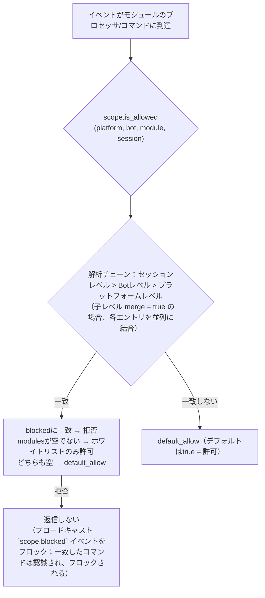

- **解析優先度**：セッションレベル > Botレベル > プラットフォームレベル、高優先度のバインディングは低優先度を**全体的に上書き**します；子レベルのバインディングに `merge = true` を書くと、低優先度と**各エントリを並列に結合**します（modules / blocked はそれぞれ結合、`merge` 自体はエントリではなく、制御キーです）
- **デフォルトの意味**：フィルタされたモジュールのコマンドとプロセッサはトリガーされず、返信もされず、TRACEレベルのログに表示されます（`core.scope.denied`）；ブロードキャスト `scope.blocked` ライフサイクルイベントをブロックします（サブスクライブすれば、誰がブロックされたか、なぜブロックされたかを観測できます）；**コマンド**は認識され、ブロックされます——コマンドが拒否された後に低優先度のメッセージプロセッサが反応する二重応答の不一致を排除します
- **フレームワークレベルのプロセッサ**（`scope_exempt=True` または owner が空）は影響を受けません；モジュール名が空（フレームワークレベルのリソース）は常に許可されます
- **セッション感知のヘルプとコマンド照会**：コマンド照会API（`command.help` / `get_command` / `get_commands` / `get_group_commands` / `get_visible_commands`、および `module.get_commands_overview`）は、オプションの `event=` または明示的な `platform=` / `bot_id=` / `session_id=` キーワードをサポートします——現在のセッションで利用できないモジュールのコマンドは結果に含まれません（`get_command` は None を返し、単一のヘルプは「未登録」として処理され、デフォルトの意味と一致します）；コンテキストを渡さない場合は、全量動作を維持します

### バインディング継承（merge）

デフォルトの上書きの意味は明確で予測可能です；上位レベルの内容を**追加**したい場合は、子レベルに `merge = true` を書きます：

```toml
[ErisPulse.scope.platforms.onebot11]
modules = ["Chat", "Tool"]      # プラットフォームレベル：Chat、Tool のみ許可

[ErisPulse.scope.bots.onebot11."123456"]
modules = ["Music"]
merge = true                    # この Bot で実際の効果 = ["Chat", "Tool", "Music"]
```

- 合併ルール：`modules` と `blocked` はそれぞれ**並列に結合**されます；バインディング内では `blocked` が `modules` より優先されます
- チェーンの合併：プラットフォーム → Bot → セッションと段階的に追加され、各レベルは `merge` または上書きを個別に決定します

## ② 身元次元（イベント受信制限）

「誰のイベントを受け入れるか」を回答します。拒否されたイベントは**配信のエントリで完全に破棄**されます——ミドルウェアや他のプロセッサ（フレームワークレベルを含む）には届きません（`core.scope.identity_denied` の TRACE レベルのログにのみ表示されます）。

- **解析優先度**：ユーザー > セッション > Bot > アダプタ、最も具体的に設定された戦略を取ります；deny は allow より優先されます
- 各レベルのバインディングは二元戦略です：`{ allow = true }` または `{ deny = true }`
- ユーザー鍵は glob / 正規表現をサポートします（例: `"spam_*"` で一括してスパムユーザーをブロック）
- 代表的な用途——上位レベルで deny、個人で allow で「例外許可」を行う：

```toml
[ErisPulse.scope.identity.adapters.onebot11]
deny = true
[ErisPulse.scope.identity.users.onebot11]
allow = ["u_admin"]   # アダプタレベルで拒否されても、u_admin のイベントは許可されます
```

## ③ 出力次元（モジュールの出力呼び出し制限）

モジュールが**出力アクションを発生させる**ことを制限します：メッセージ送信 / 標準API動作 / リクエスト操作。3つのアクションはそれぞれのDSLに対応します：`Event.reply` と `Send`（send）、`Api` / `call_api`（api）、`Request` の accept/reject（request）。イベントハンドラ実行中にモジュールが発生させる出力呼び出しは、モジュールの owner を持つため、この次元で一括して判定されます。

### 規則の形態（インライン表）

各アクションのルールはインライン表です：`{ allow = [...], deny = true|[...] }`。同一アクションには1つのルールしかできません（TOMLのキーは重複不可、全禁止と細粒度の2択）：

```toml
[ErisPulse.scope.actions.MyModule]
send = { deny = true }                                  # 全ての送信を禁止（Event.reply / Send DSL）
# またはメソッドレベルの細粒度：send = { allow = ["Text", "Image*"], deny = ["File"] }
api = { allow = ["get_*"] }                             # クエリ系の標準APIのみ許可
# またはアクションレベルのブラックリスト：api = { deny = ["set_*", "leave_*"] }
request = { deny = true }                               # リクエストの処理 accept/reject を禁止
```

- `send` のエントリは**送信メソッド名**（`Text` / `Image` / `File` ...）にマッチし、`api` のエントリは**標準アクション名**（`get_group_info` / `set_group_name` ...）にマッチします
- エントリは正確な名前 / glob / `re:` 正規表現（全システムで統一された構文、大文字小文字は区別しない）をサポートします
- `allow` に1つの文字列を書くことは、1つのエントリリストに等しいです：`send = { allow = "Text" }`

### 判定の意味

**デフォルトはすべて許可**されます——未設定、または owner が空（フレームワークレベルの内部呼び出し）はすべて許可されます。ルールが設定された場合は以下の順序で判定されます：

1. `deny = true` → 拒否
2. `deny` リストに呼び出し名が一致 → 拒否
3. `allow` リストが空でないかつ呼び出し名が一致しない（または呼び出しに名前がない）→ 拒否
4. その他の場合 → 許可

拒否された呼び出しはネットワークリクエストを発生させず、直接標準の失敗レスポンス（`retcode = 34601`、[api-response §5.3](../standards/api-response.md#53-フレームワーク拡張返却コード34xxx-プラットフォームエラーセグメントの下3桁のカスタム定義)）を返します。3つのアクションは互いに独立しており、1つだけ制限できます。

```python
# 実行時API
sdk.scope.set_action("MyModule", "send", deny=True)              # 全てのメッセージ送信を禁止
sdk.scope.set_action("MyModule", "send", allow=["Text"])         # テキスト送信のみ許可
sdk.scope.is_action_allowed("MyModule", "send", name="Image")    # False
sdk.scope.is_action_allowed("MyModule", "api", name="get_user_info")  # ルールに従って判定
sdk.scope.delete_action("MyModule", "send")                      # 許可を復元
sdk.scope.get_action("MyModule", "send")                         # そのアクションの現在のルール
```

## 実行時API

スコープの実行時APIは3つの層に分かれています：**判定**（3つの質問）、**次元ごとの読み書き**（各次元の `set` / `get` / `delete` パラメータ化メソッド、署名はすべて型注釈付き、IDEで補完可能）、**辞書式バックアップ**（ドット区切りのパスで任意の節に直接アクセス）。

```python
from ErisPulse import sdk

scope = sdk.scope
```

### 判定（3つの質問）

```python
scope.is_allowed("onebot11", "123456", "Chat")                 # ① モジュール次元
scope.is_allowed("onebot11", "123456", "Chat", "789012345")    # セッションレベルを含む
scope.is_allowed("onebot11", "123456", None)                   # フレームワーク層のリソース -> True

scope.is_identity_allowed("onebot11", "123456", "group_9", "u1")   # ② 身元次元

scope.is_action_allowed("MyModule", "send")                    # ④ 出力次元
scope.is_action_allowed("MyModule", "send", name="Image")      # メソッドレベルの細粒度
```

### ① モジュール次元

```python
# バインディング（パラメータによって階層が決まります：session_id > bot_id > プラットフォームレベル）
scope.set_module("onebot11", bot_id="123456", modules=["Chat", "Tool*"])
scope.set_module("onebot11", blocked=["re:^Danger"])                       # プラットフォームレベル
scope.set_module("onebot11", bot_id="123456", session_id="g9", modules=["Chat"])  # セッションレベル
scope.set_module("onebot11", bot_id="123456", modules=["Music"], merge=True)      # 現在のバインディングと並列に結合
scope.set_module("onebot11", bot_id="123456", modules=["Chat"], persist=False)    # 実行時のみ

# 読み取り / 削除
scope.get_module("onebot11", bot_id="123456")   # {"modules": ["Chat"], "blocked": []}
scope.delete_module("onebot11", bot_id="123456")
```

> `merge=True` は**書き込み時に並列に結合**（現在のバインディングとエントリを結合）です；階層間の解析時の `merge = true` 設定は上記の[バインディング継承](#バインディング継承merge)をご覧ください——これらは独立したメカニズムです。

> **実行時バインディング（`persist=False`）の意味**：実行時バインディングは独立したオーバーライド層に保存され、**任意の後続の設定書き込み / 設定ファイルのホットアップデートでも削除されません**（設定ツリーが再構築された後に、書き込み順に自動的に再実行されます、実行時削除も含みます）。これらは永続化されず、プロセスの再起動後に失われます；モジュールのアンロード時に、そのモジュールが書き込んだ実行時バインディングはバックアップでクリーンアップされます。その後、同一のパスで `persist=True` を実行すると、ユーザー永続化の意味で実行時ルールが上書きされます。

### ② 身元次元

```python
# 戦略のバインディング（パラメータによって階層が決まります：user > session > bot > adapter；allow / deny のどちらか一方）
scope.set_identity("onebot11", user_id="u_bad", deny=True)
scope.set_identity("onebot11", user_id="spam_*", deny=True)    # キーは glob / re: 正規表現をサポート
scope.set_identity("onebot11", bot_id="123456", session_id="g9", allow=True)

# 読み取り / 削除
scope.get_identity("onebot11", user_id="u_bad")   # {"deny": True}
scope.delete_identity("onebot11", user_id="u_bad")
```

### ③ 出力次元

```python
# 制限ルールの設定（allow: str|list；deny: bool|str|list；ルール全体の置換）
scope.set_action("MyModule", "send", deny=True)                    # 送信を完全に禁止
scope.set_action("MyModule", "send", allow=["Text"])               # テキスト送信のみ許可
scope.set_action("MyModule", "api", deny=["set_*", "leave_*"])     # 管理系APIを禁止

# 読み取り / 削除
scope.get_action("MyModule", "send")       # {"allow": ["Text"]} 元のルール
scope.delete_action("MyModule", "send")    # 個別のアクションを削除
scope.delete_action("MyModule")            # モジュールのすべてのアクション制限を削除
```

### 一般的な操作

```python
scope.get("platforms")   # 辞書式バックアップ：ドット区切りのパスで任意の節を読み取り
scope.topology()         # 全設定ツリー（ダッシュボード用）
scope.stats()
# {"module_calls": .., "module_filtered": .., "identity_checks": .., "identity_denied": ..,
#  "action_checks": .., "action_denied": .., "cache_hits": .., "cache_misses": ..}
scope.reset_stats()
scope.clear()           # 全設定をクリア（メモリ上でのみ有効）
```

### 高度な操作：辞書式ドット区切りパスバックアップ

次元化されたメソッドは日常的なシナリオをカバーします；任意のノード（または将来追加される次元）に直接アクセスする必要がある場合、**辞書式API**を使用できます——`get` / `set` / `delete` はドット区切りのパスを受け取り（dictの深さのマージ、書き込み後すぐに読み取り可能）、`scope[path]` / `scope[path] = v` / `del scope[path]` / `path in scope` プロトコルも提供します：

```python
scope.set("bots.onebot11.123456", {"modules": ["Chat"], "blocked": []})
scope.set("identity.users.onebot11.u_bad", {"deny": True})
scope.get("actions.MyModule.send")

scope["platforms.onebot11"]        # 読み取り（存在しない場合はKeyErrorを送出）
scope["platforms.onebot11"] = {...}  # 書き込み
del scope["platforms.onebot11"]      # 削除
"actions.MyModule" in scope          # 存在確認
```

## 拦截の可視化：`scope.blocked` イベント

スコープのフィルタリング（モジュールのフィルタ / 身元の拒否）が発生すると、**`scope.blocked`** というライフサイクルイベントがブロードキャストされ、"誰がブロックされたか、どのレベルでブロックされたか"をサブスクライブ、統計、ダッシュボードで表示可能になります——ブロックはデフォルトで返信されませんが、不可知のブラックボックスではありません。

| フィールド | 説明 |
|------|------|
| `dimension` | `"module"`（モジュール次元のフィルタ）/ `"identity"`（身元の受信拒否） |
| `module` | フィルタされたモジュール名（モジュール次元のみ） |
| `platform` / `bot_id` / `session_id` / `user_id` | ブロックが発生したソースコンテキスト |

```python
from ErisPulse.Core.lifecycle import lifecycle

@lifecycle.on("scope.blocked")
def on_blocked(data):
    print(f"ブロックされた：{data['dimension']} {data.get('module') or data.get('user_id')}")
```

- イベントは `fire` でバックグラウンドでブロードキャストされます（リスナーがいない場合はオーバーヘッドがなく、ホットパスを遅らせません）
- キャッシュヒットによる重複のブロックは**再ブロードキャストされません**——同じ組み合わせはキャッシュが失効するたびに1回だけブロードキャストされます
- `adapter.event.blocked`（ミドルウェアによる拒否）とは区別されます：これはイベントレベルの破棄であり、本イベントはスコープの受信ゲートのモジュール / 身元フィルタリングです

## キャッシュとホットアップデート

- `is_allowed` / `is_identity_allowed` / `is_action_allowed` の結果は**LRUキャッシュ**（`scope.cache_size` で調整可能）が付いており、`set` / `delete` / 設定のホットアップデート（`config.updated` / `config.set`）で自動的に失効します
- すべての次元の設定は**即座に有効**になります、再起動は不要です
- スコープは**イベントごとの判断**であり、イベント間で状態を記憶しません：設定が変わると、次のイベントは新しいルールに従います

## 設定フォーマットの検証

ロード時 / ホットアップデート時に各セクションの設定フォーマットを検証します：型の間違ったセクション（例：`platforms` が文字列に設定されている）、不正な出力ルール（例：`allow` が数値に設定されている）、未知のアクション名、未知のトップレベルのキー（例：`alow` というスペルミス）は **WARNING** として出力され、対応するセクション / 条目は無視され、他の合法な設定は正常に有効になります——間違った設定は静かに失効するのではなく、警告されます。

## 一般的な問題と注意事項

### 1. 設定の階層と上書き

- モジュール次元：セッションレベル > Botレベル > プラットフォームレベル、**全体的に上書き**（子レベルで `merge = true` の場合は各エントリを並列に結合）。プラットフォームで `Chat` を許可し、Bot で `Music` を追加したい場合は、Bot レベルで `merge = true` を書くか、両方をリストに書く
- 身元次元：ユーザー > セッション > Bot > アダプタ、**最も具体的な**設定された戦略を取ります（例外許可ができます）
- コマンドのユーザーブラックリスト/ホワイトリスト：正確なコマンド名が glob キーに優先されます（`event.command.acl` を参照）

### 2. モジュール/コマンドが反応しない

まず作用域が原因かどうかを疑います：

```python
from ErisPulse import sdk

print(sdk.scope.is_allowed(event.get_platform(), bot_id, "MyModule", session_id))
print(sdk.scope.is_identity_allowed(event.get_platform(), bot_id, session_id, user_id))
print(sdk.scope.stats())   # module_filtered / identity_denied > 0 なら、ブロック記録がある
```

フィルタされた場合、デフォルトでは返信されません（モジュール次元と身元次元、ルールを暴露しないように）；`scope.blocked` ライフサイクルイベントをブロードキャストし、統計は継続的に蓄積されます；ACL で拒否されたコマンドは「権限不足」の返信を表示します。

### 3. 出力アクションが拒否されたときのトラブルシューティング

```python
from ErisPulse import sdk

print(sdk.scope.get("actions.MyModule"))
print(sdk.scope.stats())   # action_denied > 0 なら、呼び出しがブロックされている
```

ブロックは**明示的**です：拒否された呼び出しは `retcode = 34601` の標準の失敗レスポンスを返し、ネットワークリクエストは発生しません。

### 4. セッション識別子のプラットフォーム間隔離

`(platform, session_id)` 組み合わせが唯一の識別子です。`scope.sessions.onebot11."789"` は onebot11 でのみ作用し、telegram 上で同じ `789` のセッションには影響しません。身元次元のユーザーキーも同様です。

## 拓撲ツリーアプリケーションプログラミングインターフェース

`ModuleManager.get_topology()` と `AdapterManager.get_topology()` は、モジュール/アダプタの所属関係データを提供します。`sdk.get_topology()` は、作用域 `scope` を含む一括集約を行います：

```python
from ErisPulse import sdk

topology = sdk.get_topology()
# {
#   "modules": {                                   # モジュール → 持有するリソース
#     "Chat": {
#       "loaded": True, "enabled": True,
#       "commands": ["chat", "translate"],
#       "handlers": {"message": 2, "notice": 1},
#       "routes": {"http": ["/Chat/api"], "ws": [], "sse": []},
#       "lifecycle_hooks": 3,
#     }
#   },
#   "adapters": {                                  # アダプタ → Bot → 作用域
#     "onebot11": {
#       "status": "started", "enabled": True,
#       "bots": {"123456": {"status": "online", "scope": {...}}},
#       "scope": {"modules": [...], "blocked": [...]},
#     }
#   },
#   "scope": {                                     # 作用域（モジュール / 身元 / 出力アクション）
#     "platforms": {...}, "bots": {...}, "sessions": {...},
#     "identity": {"adapters": {...}, "bots": {...}, "sessions": {...}, "users": {...}},
#     "actions": {...},
#   },
# }
```

- モジュールのトポロジーは、登録されたコマンド、イベントハンドラ、HTTP/WS/SSEルート、ライフサイクルフックを統合し、モジュールリソースツリーを描画するのに便利です。
- アダプタのトポロジーは、各アダプタの状態、下位のBotの状態、およびプラットフォーム/Botレベルの作用域バインディング（モジュール次元）を統合します。
- **JSON安全出力**：`get_topology(json_safe=...)` はデフォルトで `True` であり、返された構造は直接 `json.dumps` できます——モジュール `info` は純粋なデータの `meta` サブテーブルのみ保持されます（`module_class` / `strategy` などの実行時オブジェクトは除外）、その他のノード（アダプタ作者が Bot `info` に挿入した任意のオブジェクトを含む）もバックアップで浄化されます（クラスオブジェクトは `__name__` を取得し、シリアライズできないオブジェクトは `str()` に退化します）。ダッシュボード / WebUI は直接シリアライズして返すことができます；原始オブジェクトが必要な場合は `json_safe=False` を渡します。


### 归属权（owner）系统

# 所有者（owner）システム

> [!TIP]
> **この記事を読む必要があるのは**：リソースリークの調査、アンロード時のクリーンアップ処理の理解、またはリソースの所有権を宣言する場合。必要ない場合は飛ばしても、他の機能の使用に影響はありません。

所有権は、モジュールの「プラグイン方式」の基盤です。モジュールが読み込まれる際に登録するフレームワークリソースはすべて自動的に所有者に記録され、アンロード/無効化時に所有者に従って一括回収されます。モジュールの作成者は、リソースを宣言するだけで手動でクリーンアップのロジックを書く必要はありません。

> **関連システム**：スコープ（scope）は、イベントの配信時に「リソースが有効かどうか」を決定します。  
> 所有権は、モジュールのライフサイクルの中で「リソースは誰のものか、誰がアンロード時に回収されるか」を決定します。  
> スコープについては [統一制御面（scope）](docs/ja/scope.md) を、バックグラウンドタスクについては  
> [ライフサイクル管理](docs/ja/lifecycle.md#バックグラウンドタスクの所有と自動キャンセル) を参照してください。

{!--< tips >!--}
1. 所有権は**登録の瞬間**に `current_owner` に従って自動的に記録されます。モジュールのコードは変更する必要がありません。
2. アンロード/無効化は同じクリーンアップチェーン（`_cleanup_module_registrations`）を使用します。各ステップで失敗しても警告のみ表示され、処理は中断されません。
3. ユーザー設定のリソース（永続化されたオーバーライド / scope ルール / コマンド ACL）は、モジュールのアンロード時にクリーンアップされません。
4. ツールモジュールが管理する外部ハンドルは、`on_cleanup(cb)` を使用してクリーンアップチェーンに登録でき、対象モジュールがアンロードされた際に自動的にコールバックされます（[ツールモジュールガイド](#ツールモジュールガイド外部モジュールのハンドルを管理) を参照）。
{!--< /tips >!--}

## owner コンテキストメカニズム

owner はコンテキスト変数 `current_owner` によって伝達されます（`ErisPulse.runtime.context`）：

```python
from ErisPulse.runtime import owner_scope, get_current_owner

with owner_scope("MyModule"):
    # この区間内で登録されるすべてのリソースは自動的に MyModule に所有されます
    assert get_current_owner() == "MyModule"
```

フレームワークは以下のタイミングで owner を自動的に注入します（モジュール/アダプタのコードは手動でラップする必要はありません）：

| タイミング | owner 値 | 位置 |
|------|----------|------|
| モジュール `load()` | モジュール名 | インスタンス化 + `on_load` 全体 |
| アダプタ `start()` / `restart()` | プラットフォーム名 | アダプタ起動全体 |
| `activate_on` ラグジュアリスタブ登録 | モジュール名 | 占位コマンド/ハンドラ登録 |
| イベントハンドラ実行中 | ハンドラの所有モジュール名 | handler / コマンドエントリ再注入 |

実行中の再注入とは、モジュールが `on_load` で宣言したコマンドハンドラが**実行中**に登録型 API（`sdk.adapter.on()`、`overrides.*.set(persist=False)`）を呼び出す場合でも、自動的に本モジュールに所有されることを意味します。

## 所有リソースの全貌

モジュールがロードコンテキスト内で登録した以下のリソースはすべて所有を記録し、アンロード/無効化時に自動的に回収されます：

| リソース | 登録方法 | クリーンアップ呼び出し |
|------|----------|----------|
| コマンド | `@command()` / コマンド dict 宣言 | `command.unregister_by_owner()` |
| イベントハンドラ | `@message` / `@notice` / `@request` / `@meta` | `handler.unregister_by_owner()` |
| アダプタイベントリスナー | `sdk.adapter.on()` / `raw=True` | `adapter.unregister_handlers_by_owner()` |
| アダプタミドルウェア | `@sdk.adapter.middleware` | 同上 |
| ルーティング（HTTP/WS/SSE） | `router.http()` / `websocket()` / `sse()` | 名前空間 + 所有者による二重バックアップ |
| ルーティングミドルウェア | `@router.middleware()` / `add_middleware()` | `router.unregister_all_by_owner()` |
| Dashboard ホームエントリ | `router.register_home_entry()` | `unregister_home_entries_by_owner()` |
| 自定義セッションタイプ | `register_custom_type()` | `unregister_custom_types_by_owner()` |
| プラットフォームイベントメソッド注入 | `register_event_method()` / `register_event_mixin()` | `unregister_event_methods_by_owner()`（モジュールアンロード時に自動回収、古いクロージャはリークしない） |
| バックグラウンドタスク | `self.spawn()` | `cancel_owner_tasks()` |
| 外部所有クリーンアップフック（ツールモジュール管理） | `runtime.on_cleanup(cb)` | `run_owner_cleanups()`（アンロード/無効化/アダプタ閉じチェーン内でトリガー） |
| ライフサイクルフック | `lifecycle.register()` | `lifecycle.unregister_by_owner()` |
| 主人身源 provider | `master.provider` | `master.unregister_by_owner()` |
| i18n 翻訳キー | `I18nClass` 宣言（domain=モジュール名） | `i18n.unregister_domain()` |
| イベントオーバーライド（実行時） | `overrides.*.set(persist=False)` | `overrides.unregister_by_owner()` |
| 交互セッション（wait_reply 等待 / リース） | `event.wait_reply()` / `sdk.interaction.acquire()` | `interaction.cancel_by_owner()`（待機側は即座にキャンセルを受信） |
| コンテキストデータ | `runtime/context` は所有者ごとに記録 | モジュールごとに正確にクリーンアップ |

アダプタ側の対応リソース（プラットフォーム名を所有者として）は、アダプタ `shutdown()` / `restart()` 時に `_cleanup_adapter_resources` によって回収され、以下も含まれます：

| リソース | クリーンアップ呼び出し |
|------|----------|
| アダプタ独自の `on()` ハンドラとミドルウェア | `adapter.unregister_handlers_by_owner(platform)` |
| プラットフォームイベントメソッド拡張（`EventMixin`） | `unregister_platform_event_methods(platform)` |
| 自定義セッションタイプ | `unregister_custom_types_by_owner(platform)` |
| 交互セッション（該当プラットフォームで待機中の wait_reply / リース） | `interaction.cancel_by_platform(platform)` |
| i18n 翻訳ドメイン（domain=設定キー） | `i18n.unregister_domain(設定キー)` |
| 細粒度名前空間ルーティング | `router.unregister_all_by_owner(platform)` |

## アンロード/無効化クリーンアップシーケンス

`unload()` と `disable()` は共通のクリーンアップチェーンを使用します（各ステップは独立して try/except で、失敗してもログに記録され、**後続のクリーンアップは中断されません**）：

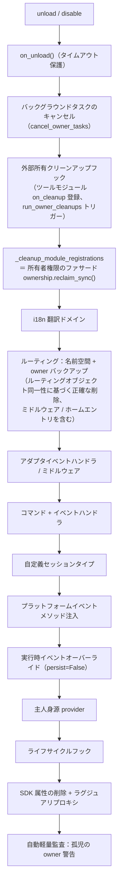

`sdk.uninit()` による終了時には、以下のグローバルバックアップ処理が実行されます：すべてのアダプタの shutdown → すべてのモジュールの unload → `router.stop()`（ルーティング/ミドルウェア/ホームエントリのクリア）→ `cancel_all_background_tasks()` → イベントハンドラとフックのクリア。

## 所有者権限統一ファサード（ownership）

クリーンアップチェーンの16ステップは、所有者権限統一ファサード `ErisPulse.Core.ownership` に収束され、4つの動詞が「登録解除、カウント、スキャン、監査」をカバーします。サブシステム独自の `*_by_owner` 登録関数は変更されず、ファサードの内部実装として残ります：

| 動詞 | 用途 |
|------|------|
| `ownership.reclaim(owner)` | owner名下のすべてのリソースを一括で登録解除（タスクキャンセル → クリーンアップフック → 登録リソース；非同期完全版） |
| `ownership.reclaim_sync(owner)` | 登録リソースの登録解除（同期版、同期アンロード経路用） |
| `ownership.counts(owner=None)` | ただ読むだけの所有者登録リソースのカウント（Noneはすべての所有者） |
| `ownership.orphans()` | 孤児スキャン：リソースは登録されているが、所有者は登録解除されている（リークの確証リスト） |
| `ownership.audit(owner, deep=)` | リーク監査レポート（カウント + 孤児 + オプション gc インスタンス調査） |

```python
from ErisPulse.Core import ownership

ownership.reclaim_sync("MyModule")       # {'commands': 1, 'routes_http': 2, ...}
ownership.counts("MyModule")             # 登録リソースのカウント
ownership.orphans()                      # [{"owner": "ghost", "total": 2, ...}]
```

**監査エントリポイント**：

- アンロード / 再ロード後に**自動軽量監査**：孤児の所有者リソースが見つかると WARNING 警告（コストゼロのカウントスキャン）
- `sdk.module.audit(name, deep=True)`：モジュールインスタンスの gc 調査——インスタンスが再利用できない場合、参照元のタイプを示す（「誰が古いインスタンスを保持しているか」を特定）；グローバル停止のコストがかかるため、明示的なトラブルシューティングでのみ使用
- 深層調査は明示的操作であり、設定キーは設定せず、自動修復も行いません。

## ホットリロード失敗ロールバック

ホットリロードは「**アンロード前のスナップショット → 失敗時に自動回復**」に変更されました：新バージョンの構文エラー、依存性の欠落、ロード失敗時には、旧インスタンスと登録状態（登録表エントリ、sdk 属性、sys.modules エントリ）が自動的に復元され、サービスは中断されず、ログに「旧インスタンスにロールバックしてサービスを継続しました」と表示されます。

可能な限りの意味（ドキュメント化された境界）：

- `on_unload` で既に実行された副作用（切断された接続、キャンセルされたタスク）は取り消せません——復元後、旧インスタンスは「終了済み」状態になり、完全に利用可能になるには再びロードをトリガーする必要があります
- 実行時に第三者が手動でキャッシュした旧インスタンスへの参照は復元範囲外です
- 目標パッケージがアンロード済み（entry-point が消滅）の場合は、アンロード成功と見なし、ロールバックは行いません

## 設計境界：アンロード時にクリーンアップされないリソース

所有者権限は**モジュールコードが登録する実行時リソース**のみを回収します。以下のリソースは**ユーザー設定の意味**（コントロール権はユーザーにあり、意図的に設定される）に属し、モジュールのアンロード後も設定に従って永続的に保持されます：

| リソース | 意味 | 説明 |
|------|------|------|
| `overrides.*.set(persist=True)` | 永続化オーバーライド | 設定ファイルに書き込まれ、再起動にわたって有効；モジュールのアンロード時に削除されない（ユーザーが明示的に設定） |
| `scope.set_action()` などのスコープルール | 権限制御面 | ユーザー/Dashboard によって管理され、モジュールのアンロード時にルールは回収されない |
| `overrides.acl.set(persist=True)` | コマンド ACL | 同上 |
| Conversation `save()` 永続化 | 多回対話保存 | データ資産はクリーンアップされない |

実行時に一時的に書き込まれたもの（`persist=False`）は、owner に従って回収されます。**永続化の有無が「ユーザー資産」と「モジュール実行時状態」の境界線です**。

## 内部実装：所有権の仕組み

所有権システムは**2つの独立したチェーン**で構成されており、それらの役割を理解することは、所有権の問題を解決するための前提です。

### 帰属チェーン（contextvar 伝播）

`runtime/context.py` の `current_owner` などの ContextVar は**帰属**を担当します——「このコードが登録するリソース/呼び出しが誰の名前に記録されるか」。伝播ルールは Python の contextvars 言語仕様に従います：

| 実行経路 | context が伝播するか | 帰属結果 |
|---------|----------------|---------|
| 同期呼び出しチェーン / `await` チェーン | ✅ 伝播 | 正確な帰属 |
| `owner_scope` 内の `asyncio.create_task` | ✅ 伝播（task は作成時の context をコピー） | task 内部のフレームワーク呼び出しが正確に帰属 |
| `run_in_executor` / 裸スレッド | ❌ 伝播しない | 帰属が失われる |
| 自作イベントループ | ❌ 伝播しない | 帰属が失われる |

> 帰属 ≠ 登録：context 伝播は「誰の名前に記録されるか」を決定しますが、リソースがクリーンアップされるかどうかは、登録チェーンに入っているかどうかにかかっています。

### キャンセルチェーン（タスク登録表）

`runtime/tasks.py` の `_owner_tasks` 登録表は**ライフサイクル**を担当します——「owner 名下に未完了のタスクが何個あるか、アンロード時に一括でキャンセルするか」。タスクが登録表に入る方法：

1. **明示的なスケジューリング**：`spawn_background()` / `self.spawn()` → 作成時に `current_owner`（または明示的な `owner=` パラメータ）をキャプチャ → 登録表に登録；
2. **Task Factory 自動登録**（2.8.3）：`install_owner_task_factory()` はフレームワーク起動時にメインイベントループにインストールされる——**すべての**タスク作成（サードパーティライブラリの内部の `create_task` を含む）は、ファクトリを経由して `current_owner` を読み取り、None でなければ登録される。

登録表は自動でクリーンアップされます：各タスクには `done_callback` が付いており、完了すると表から削除され、リークしません。

### キャンセルタイミング（モジュールアンロード）

```
module.unload()
  → on_unload(event)                    # モジュール独自のクリーンアップ（バックアップタイムアウト保護）
  → フレームワークがこの owner のコマンド/イベント/フック/ルーティングを登録解除
  → cancel_owner_tasks(owner)           # タスク登録表のバックアップキャンセル
      → 各タスク.cancel()              # キャンセルロジック自体のタスクは除外
      → await gather(pending, timeout)  # 回収を待つ（タイムアウト後にブロックしない）
```

### 問題解決のアプローチ

- **リソースがクリーンアップされない** → 登録表を確認：`get_owner_tasks("MyModule")` に該当タスクが含まれているかを確認；含まれていない場合は登録経路が所有権チェーンを通過していない（import 時 / スレッド / 独立ループ）、上表を参照して位置を特定。
- **帰属が間違っている** → `get_current_owner()` をエラー発生時の値で確認；非同期遅延実行（コールバック/タスク）の帰属は作成時の context に従い、実行時の値とは異なる。

## モジュール開発者ガイド

### 推奨書き方

```python
from ErisPulse import sdk
from ErisPulse.Core.Event import command
from ErisPulse.runtime import owner_scope, spawn_background

class MyModule(BaseModule):
    async def on_load(self, event):
        # フレームワークリソース：自動的に所有される、手動でクリーンアップする必要はない
        self.task = self.spawn(self.polling())      # バックグラウンドタスク
        sdk.router.register_home_entry("私のモジュール", "/my")  # ホームエントリ

        # モジュール独自リソース：owner_scope に包むことで所有権体系に組み込む
        with owner_scope("MyModule"):
            self.client.on_event(self._handle)      # 假想の独自登録

    async def on_unload(self, event):
        # フレームワークリソースは自動的に回収される、owner_scope でカバーできない独自リソースのみクリーンアップする
        await self.client.close()
```

### 注意事項

- **import 時の登録には所有権がない**：モジュールのトップレベル（import 時）に登録されたフック/ハンドラは `owner_scope` 以前に発生するため、フレームワークリソース（owner=None）として扱われ、**クリーンアップされない**。すべて `on_load()` 内に登録すること。
- **独自 domain の i18n 登録**：`i18n.register(domain=...)` の domain がモジュール名と異なる場合、自動回収されないため、domain=モジュール名を保持すること。
- **バックグラウンドタスクは `self.spawn()` を推奨**：2.8.3 以降、裸の `asyncio.create_task` も**自動的に暗黙的に所有**（Task Factory が自動登録、アンロード時にバックアップキャンセル）される。ただし、`self.spawn()` は非メインループスレッドからメインループにスケジューリング、明示的な `owner=` 指定、fire-and-forget の GC 防止のため、引き続き推奨書き方です。**2.8.3 以前のバージョンでは、裸のタスクは所有されず、`self.spawn()` を使用する必要がある**。
- クリーンアップチェーンは「失敗しても警告のみ」：1ステップのクリーンアップエラーは他のリソースの回収を中断せず、ログの DEBUG/WARNING レベルで確認可能。トラブルシューティング時は TRACE を有効にすること。

### 登録タイミング → 所有結果対照表

| 登録状況 | 所有結果 | 説明 |
|---------|---------|------|
| `on_load()` 内でフレームワーク API（コマンド/イベント/lifecycle/ルーティングデコレータ）を使って登録 | 所有モジュール | アンロード時に自動的に登録解除 |
| モジュールのトップレベル（import 時）に登録 | **所有権なし**（owner=None） | クリーンアップされない、使用しないでください |
| `self.spawn()` で作成されたバックグラウンドタスク | 所有モジュール | アンロード時に自動的にキャンセル |
| `owner_scope("Name")` 内でサードパーティ API を使って登録 | 所有モジュール | 第三者がスコープ内で同期的に実行するコールバックに依存 |
| 裸の `asyncio.create_task`（`loop.create_task` / `ensure_future` を含む） | **自動所有**（Task Factory、2.8.3+） | 作成瞬間に `current_owner` を読み取り、owner コンテキスト内で自動登録、アンロード時にバックアップキャンセル；以下[内部実装](#内部実装所有権の仕組み)を参照 |
| サードパーティライブラリの非同期コールバック（aiohttp / APScheduler など）内で作成されたタスク | **自動所有**（Task Factory、2.8.3+） | コールバック実行時に `current_owner` が注入されている場合（フレームワークハンドラ実行中など）、タスクは自動登録される |
| `run_in_executor`（スレッドプール） | **所有権なし**（非 asyncio.Task） | スレッドはタスクファクトリの管理外、ライフサイクルを自分で管理する必要がある |
| 独自イベントループ（自作ループ）での登録 | **所有権なし** | Task Factory はメインループにのみインストールされる；contextvars もイベントループ間で伝播しない |

> 原則：**所有は登録瞬間の `current_owner` コンテキストに従う**；非同期の遅延、スレッドプール、独自ループはすべてこのコンテキストから外れるため、所有が必要な場合は明示的に `owner_scope` に入る必要がある。

## ツールモジュールガイド：他のモジュールのハンドルを管理する

**シナリオ**：定時タスク、レジストリ、接続プールなどの「ツールモジュール」は、他のモジュールが保管するものを代わりに管理します。  
他のモジュールが `on_load` で `sdk.Cron.on_trigger(handler)` を呼び出すと、あなたのコンテナはそのモジュールのインスタンスを指すコールバックを保持します。  
フレームワークは、モジュールが登録したフレームワークリソースは自動的にクリーンアップしますが、**あなたが私有コンテナに保持している参照**はクリーンアップできません。  
モジュールがアンロードされた後も、あなたのコンテナはそのインスタンスを保持しているため、GC によって回収されず（メモリリーク）、`purge` 泄漏診断では「回収不可能」と表示されます。

**解決策**：登録処理を行う関数内で `on_cleanup()` を呼び出すと、フレームワークはモジュールがアンロードまたは無効化された際にあなたのクリーンアップ関数を自動的にコールバックします：

```python
from ErisPulse.Core.Bases import BaseModule
from ErisPulse.runtime import off_cleanup, on_cleanup

class CronModule(BaseModule):
    def __init__(self):
        self._entries = {}  # {モジュール名: そのモジュールが管理するコールバックリスト}

    def on_trigger(self, handler):
        # 呼び出し元モジュール名を自動的に識別（on_load からの直接呼び出し / module.call ともに正しく動作）
        # 戻り値は owner として使用できる解析されたモジュール名
        owner = on_cleanup(self._drop)
        self._entries.setdefault(owner, []).append(handler)

    def _drop(self, owner: str):
        """モジュールがアンロードまたは無効化された際にフレームワークによって自動的にコールバックされる：ハンドルを破棄するだけ"""
        self._entries.pop(owner, None)

    async def on_unload(self, event):
        off_cleanup(self._drop)  # ③ 自分がアンロードされる前にハンドルを解除し、ハンドルテーブルが self を保持しないようにする
```

フレームワークが保証する動作：

| 点 | 行動 |
|--------|------|
| 呼び出しタイミング | モジュールがアンロード / 無効化されたとき、またはアダプタが閉じられたとき——いずれもフレームワークのクリーンアップチェーン内で発生し、purge 泄漏診断よりも前に行われる |
| 呼び出し元の識別 | 直接呼び出しの場合は `current_owner` を使用；`module.call()` を経由して呼び出された場合は `current_caller` を使用；または `on_cleanup(cb, owner="モジュール名")` で明示的に指定することも可能。**強制検証**：上記3つのいずれも取得できない場合、`ValueError` を投げる——私有ツールモジュールは自身のロードコンテキスト内でハンドルを登録する必要がある |
| コールバックの署名 | `cb(owner: str)`、同期または非同期のいずれでも可能；非同期の場合はタイムアウト保護が提供される（`CLEANUP_CALLBACK_TIMEOUT_SECS`、デフォルトは10秒） |
| 容錯 | 1つのコールバックが例外やタイムアウトを起こしても、ログに記録されるのみで、他のハンドルやクリーンアップチェーンには影響しない |
| 重複登録 | 同じ `(owner, callback)` は冪等的に重複登録を抑制する |

**必要ない場合**：もしモジュールが登録するのはフレームワークリソース（コマンド、イベントハンドラー、ルーティング、バックグラウンドタスクなど）であれば、フレームワークはすでに自動的にクリーンアップします（上記の[リソースの所有権の全体像](#リソースの所有権の全体像)を参照）。  
フレームワークリソース以外に、あなたが私有コンテナに保持しているモジュールのハンドルだけが `on_cleanup` を必要とします。  
モジュール開発者向けの速見版は、[ベストプラクティス · ツールモジュール](../developer-guide/modules/best-practices.md#ツールモジュールが他人のものを持たせる場合にアンロード通知を受け取る必要がある) を参照してください。


### 影子模块与灰度转正

# シャドウモジュールとグレーディングの正式化

> [!TIP]  
> **このドキュメントを読むタイミング**：新バージョンを並行して試運転し、動作を比較して正式化またはロールバックしたい場合に必要です。不要であればスキップしても、他の機能の使用に影響はありません。

シャドウとは、同一モジュールの**新しいバージョン**を指します。これは、`roll_shadow` などの**独立したオーナー**として、本番環境の旧バージョンと並行して試運転されます。シャドウは、本物のイベントの**コピー**を受け取り、その出力は**実際には送信されず、記録されるだけ**です。`shadow_diff` で2つのバージョンの動作を比較し、問題がないことを確認した後、`promote` コマンドで**ワンクリックで正式化**し、`dismiss` でいつでも**中止**できます。**モジュールのコードは一切変更せず、全プロセスは実行時APIによって駆動されます**：`load / unload / reload` と同じようなオペレーションアクションであり、ダッシュボードやカスタム管理モジュールから直接呼び出すことができます。**設定項目を書く必要はありません**。

{!--< tips >!--}
1. 起動：``await sdk.module.shadow_start("roll", source="v2のパス")``  
   —— 新バージョンのコードは、独立したオーナー（デフォルトではパス名が使用されます）として旧バージョンと並行して動作します。
2. シャドウは、実際の配布や依存関係グラフには参加しません：同名のコマンドはシャドウディレクトリに進み、ルーティングは登録されるだけ、ライフサイクルのブロードキャストは無視されます。`module.call` と依存解析は引き続き v1 を指します。
3. 正式化は常に人間の確認が必要です：``await sdk.module.promote_shadow("roll")`` で正式化を実行し、失敗した場合は自動的に旧インスタンスに戻ってサービスを継続します。`dismiss_shadow` でいつでもシャドウを中止できます。
{!--< /tips >!--}

## 快速上手

```python
# v2 代码：通常のモジュール書き方、シャドウを意識しない（任意のディレクトリ、例：downloads/roll_v2/）
```

```python
# オンラインロボット環境で（ダッシュボード / 管理モジュールから呼び出し）、一回のコマンドでグレーディングを開始：
await sdk.module.shadow_start("roll", source="downloads/roll_v2")
# → シャドウは独立した所有者 "roll_v2" として v1 と並存し、出力はブロックされ、記録される

# 試運転期間中の挙動比較：
report = sdk.module.shadow_diff("roll")
# {"shadow_owner": "roll_v2", "count": 3, "aligned": [...]}
```

- **v1 が実際に送信した内容**：受信箱（transcript）からの bot 時系列
- **v2 が意図した送信内容**：シャドウの帳簿（出力ゲートで記録された「何を送信しようとしていたか」）
- 両者は `trace_id` で対応している — 同じメッセージについて、2つのバージョンそれぞれが何をトリガーしたか、送信したか、送信しなかったかが一目瞭然

問題がなければ、正式に転換します：

```python
await sdk.module.promote_shadow("roll")   # 転換、失敗時は自動的に v1 にロールバック
await sdk.module.dismiss_shadow("roll")   # または：シャドウを放棄
```

## 五つの隔離ゲート

| ゲート | 機制 |
|----|------|
| 事件コピー | シャドウプロセッサは**独立したイベントのコピー**（`shadow` マーク付き）を受け取ります。シャドウでの変更 / 所有権取得 / 伝播停止はコピーにのみ影響し、元のイベントチェーンには影響しません。 |
| 出力ゲート | シャドウの `Send` DSL と `Api` 呼び出しはすべて記録され、成功した仮のレスポンスが返されます。実際には送信されません。シャドウは重複して返信しません。 |
| ストレージ上書き層 | シャドウの KV 書き込みはメモリ上の上書き層に入り、永続化は行われません。読み込みは上書き層を優先し、ヒットしなければ本物のストレージを参照します（グレーディングは実際のデータで実行）。削除は墓石として記録されます。 |
| ルーティング遮断 | シャドウの HTTP/WS/SSE ルーティングは登録のみでマウントされません。同名のコマンドはシャドウのコマンドディレクトリに登録され、プラットフォームイベントメソッドの注入は禁止されます。 |
| ライフサイクル静音 | シャドウは自身のライフサイクルイベントをブロードキャストせず、エコシステムの依存グラフにも参加しません（`module.call` と依存解析は v1 を参照し続けます。半完成品が依存されることを避けるため）。 |

構成の継承: シャドウはデフォルトで**元のモジュールの構成節を継承**します（そうでなければグレーディングの歪みが発生します）。転正後は構成がその場で有効になります。

## 正直な境界（防ぎきれない）

- フレームワークの送信 / API / KV ストレージ / 統一 HTTP クライアントは**すべて防げる**；
  フレームワークを迂回して `aiohttp` を直接起動したり、スレッドで外部システムに書き込んだりする場合——フレームワークは防げない
- **ORM の読み書きはカバレッジの対象外**（行単位のオーバーレイでは SQL 層で綺麗に実現できない）——
  影の期間中は ORM を使っての書き込み隔離に依存しないことを推奨
- **影のソースがローカルパスの場合**：新しいコードはパスからインポートされ、独自の所有者でロードされる。同じ PyPI パッケージは、同一の Python 解釈器内では `sys.modules` の単一キー制限により、新旧の2つのバージョンを同時に存在させることはできない
- 泄漏監査ツール（`sdk.module.audit`）は影のリソースの所有者を確認可能。フレームワークを迂回する副作用は、少なくとも静かに起こることはない

## 転正とロールバック

`promote` プロセス：現在のバージョン（および連鎖する依存者を含む）をスナップショット → 完全にアンロード → シャドウを本物の名前で登録  
ロード → いずれかのステップで失敗した場合、自動的にロールバックされ、古いインスタンスが引き続きサービスを提供します（ベストエフォートの意味：`on_unload` で実行された副作用は取り消せません。ロールバック後、古いインスタンスは終了済み状態になります）。転正に成功したシャドウリソースは回収され、バインドが解除されます。元のモジュールの設定セクションはその場で有効になります。

**永続化の注意**：promote はランタイムでの切り替えです。再起動後も v2 で動作し続けます。新しいバージョンを**永続的にインストール**する必要があります（`pip install -U` で新しいバージョンをインストール / プラグインファイルを置き換えます）。ランタイムでの切り替えはパッケージ管理を代行しません。


### 启动流程与手动控制

# 起動フローと手動制御

> [!TIP]
> **いつ読む必要があるか**: 起動フローを手動で駆動し、起動順序をカスタマイズする場合、または起動失敗をトラブルシューティングする場合。必要ない場合は飛ばしても、他の機能の使用に影響はありません。

ErisPulse の `await sdk.run()` / `await sdk.init()` は、一連の起動フローを「一行のコード」にラップしています。しかし、部分的なロード、動的登録、ホットプラグ、カスタムロード戦略の注入など、完全にカスタムの起動フローが必要な場合は、このフローの内部で何が起こっているのか、そして各ステップを手動で駆動する方法を理解する必要があります。

本文では、起動フローを個々のステップに分解し、各ステップの役割と呼び出し順序を説明し、手動で完全な起動を行う例を示します。

> 本文では、[最初のロボット](../getting-started/first-bot.md)を実行し、`sdk.run(keep_running=True/False)` の 2 つのモードを理解していることを前提としています。本文は `init()` **内部**のフロー分解と、`init()` / `init_task()` / `init_sync()` などのより下層のエントリポイントに焦点を当てています。

## SDK トップレベルのエントリポイント一覧

`run()` の 2 つの `keep_running` モードに加えて、SDK はいくつかのより下層の初期化エントリポイントを提供しており、それぞれの違いは**非同期性、戻り値、および例外のラッピング**です。

| エントリポイント | 非同期性 | 戻り値 | 例外処理 | 適用場面 |
|------|--------|--------|----------|----------|
| `await sdk.run(True)` | async, 阻塞維持 | `None`（終了時に自動 `uninit`） | モジュール/アダプターのエラーはブロックされず、プロセスを破綻させない | 純粋な bot アプリケーション |
| `await sdk.run(False)` | async, 非阻塞 | `None`（自動アンロードしない） | 同上 | 初期化後にカスタムロジックを実行する |
| `await sdk.init()` | async, await 必要 | `bool` | 内部でコンポーネントの例外をキャッチし、失敗時は `False` を返す | 手動でライフサイクルを制御する場合（`uninit()` と組み合わせる） |
| `sdk.init_task()` | async, Task を返す非阻塞 | `asyncio.Task` | `init()` と同じ | 並列に他の初期化を実行する場合、またはイベントループがまだ実行されていない場合 |
| `sdk.init_sync()` | **同期**, 現在のスレッドを阻塞 | `bool` | `init()` と同じ | コマンドラインスクリプト、イベントループのない同期エントリポイント |

> **よくある誤解**: `await sdk.init()` は `await sdk.run(keep_running=False)` と**等価ではない**。2 つの違いがある: ① `init()` は `bool` を返す（失敗時は `False`）、`run()` は `None` を返す；② `init()` は初期化のみを行い、**自動アンロードしない**、`run()` はイベントループの終了時に自動 `uninit()` を行う。したがって、アンロードやカスタムライフサイクルを手動で制御する必要がある場合は、`init()` + `uninit()` を使用する。

## 起動フローの概要

`sdk.init()`（正確にはその内部の `Initializer.init()`）は、以下のようにフレームワーク全体を起動します:

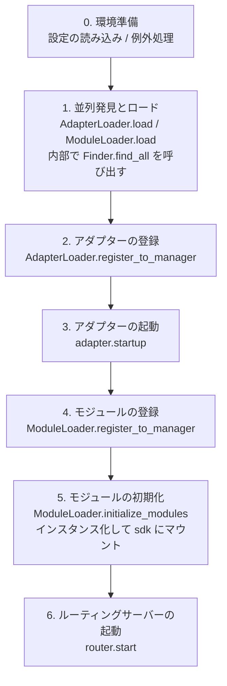

対応するコアコンポーネント:

| 層 | コンポーネント | 役割 |
|----|------|------|
| 発見 | `AdapterFinder` / `ModuleFinder` | エントリポイントから**発見**する（インストール済みパッケージ内） |
| ロード | `AdapterLoader` / `ModuleLoader` | 発見 + インポート + メタデータの読み込み + 启用/無効の判断、オブジェクトのリストを返す |
| 登録 | `*Loader.register_to_manager` | オブジェクトを対応するマネージャーに登録する |
| 管理 | `sdk.adapter` / `sdk.module` | アダプター/モジュールのインスタンスを維持し、起動/停止のインターフェースを提供する |
| 初期化 | `ModuleLoader.initialize_modules` | モジュールのインスタンスを作成し、`sdk` にマウントする（依存関係のトポロジカルソートを処理） |
| ルーティング | `sdk.router` | HTTP / WebSocket サーバー |

> **重要**: `Finder` と `Loader` は 2 層です。`Loader` は内部で**すでに** `Finder` を保持しています（`AdapterLoader` は `AdapterFinder` を、`ModuleLoader` は `ModuleFinder` を持っています）。ほとんどの場合、`Loader` を使用するだけで十分です。"インポートしない"でリストアップする必要がある場合にのみ、`Finder` を個別に使用します。

## 各ステップの詳細説明

### 1. 発見層: Finder

Finder は、"どのパッケージがアダプター/モジュールを提供しているか"を**検索する**だけです。インポートやインスタンス化は行いません。

```python
from ErisPulse.finders import AdapterFinder, ModuleFinder

adapter_finder = AdapterFinder()
module_finder = ModuleFinder()

# すべてのインストール済みアダプター/モジュールのエントリポイントを検索
adapter_entries = adapter_finder.find_all()    # list[EntryPoint]
module_entries = module_finder.find_all()      # list[EntryPoint]

# 名前で個別に検索
entry = module_finder.find_by_name("MyModule")  # EntryPoint | None
```

各 `EntryPoint` は `.load()` で対応するクラスを得ることができますが、通常は手動で呼び出す必要はありません。`Loader` が行います。

### 2. ロード層: Loader

Loader は、Finder の上に「インポート + メタデータの読み取り + 启用/無効の判断」を行います。

```python
from ErisPulse.loaders import AdapterLoader, ModuleLoader
from ErisPulse import sdk

adapter_loader = AdapterLoader()
module_loader = ModuleLoader()

# load() 内部: finder.find_all() を呼び出す → 各エントリポイントを処理 → 3 つのタプルを返す
adapter_objs, enabled_adapters, disabled_adapters = await adapter_loader.load(sdk.adapter)
module_objs, enabled_modules, disabled_modules = await module_loader.load(sdk.module)
```

`load()` が返す 3 つのタプル:

| 戻り値 | 意味 |
|--------|------|
| `objs` (`dict`) | 名称 → オブジェクト（アダプタークラス / モジュールラッパー） |
| `enabled` (`list[str]`) | 启用された名称（設定で無効化されていない） |
| `disabled` (`list[str]`) | 無効化された名称 |

#### ロード失敗時の診断情報

モジュール/アダプターがロードまたは初期化段階で例外を送出した場合、フレームワークはそのコンポーネントをスキップして他のコンポーネントのロードを継続し、**ユーザーのコードのフレームの要約**を出力します。これにより、デフォルトの INFO レベルでもエラー箇所を特定でき、手動で DEBUG モードを有効にする必要がありません:

```
[ERROR] [ModuleLoader] entry-point からモジュール MyModule をロードできませんでした。スキップしました: 'NoneType' object has no attribute 'platform'
  → MyModule/Core.py:42 in on_load
      adapter = sdk.platform
  → AttributeError: 'NoneType' object has no attribute 'platform'
  → ヒント: ログレベルを DEBUG に上げて完全なスタックを確認する。モジュール MyModule の実装コードを確認する
```

診断情報は `ErisPulse.runtime.diagnostics` モジュールで生成され、フレームワーク内部のフレームを自動的にフィルタリングし、ユーザーのコードフレームのみを残します。カスタムロードロジックで再利用する場合は:

```python
from ErisPulse.runtime import log_diagnostic

try:
    risky_init()
except Exception as e:
    log_diagnostic(e)  # 自動的にユーザーのコードフレームを抽出して ERROR ログに記録
```

このモジュールには、`extract_user_frame()`（構造化されたフレーム情報を返す）と `format_diagnostic_block()`（複数行のテキストを返す）という 2 つの低レベル関数も提供されています。

### 3. 登録層: register_to_manager

Loader が生成したオブジェクトをマネージャーに登録し、`sdk.adapter` / `sdk.module` がそれらを認識できるようにします。

```python
# アダプターの登録（すべて成功した場合は True を返す）
await adapter_loader.register_to_manager(enabled_adapters, adapter_objs, sdk.adapter)

# モジュールの登録
await module_loader.register_to_manager(enabled_modules, module_objs, sdk.module)
```

登録後、アダプターはアダプター管理マネージャーに登録され、モジュールはモジュール管理マネージャーに登録されますが、**まだ起動/インスタンス化されていません**。

### 4. アダプターの起動

```python
# すべての登録済みアダプターを起動
await sdk.adapter.startup()
# または特定のプラットフォームを指定
await sdk.adapter.startup("yunhu")
await sdk.adapter.startup(["yunhu", "telegram"])
```

> 登録 ≠ 起動。`register_to_manager` は単に登録するだけです。`startup` はアダプターの `start()` を呼び出し、プラットフォームとの接続を確立します。

### 5. モジュールの初期化

モジュールはアダプターに比べて 1 つ追加のステップがあります。**インスタンス化**して `sdk` にマウントする必要があります（これにより `sdk.MyModule.xxx` で呼び出せるようになります）。このステップでは、モジュール間の依存関係の宣言とトポロジカルソートも処理されます。

```python
success = await module_loader.initialize_modules(
    enabled_modules, module_objs, sdk.module, sdk
)
```

インスタンス化が成功すると、モジュールは `sdk.<ModuleName>` に表示されます。

### 6. ルーティングサーバーの起動

```python
await sdk.router.start(
    host="0.0.0.0",
    port=8000,
    ssl_certfile=None,
    ssl_keyfile=None,
)
```

ルーティングサーバーは、アダプターの Webhook / WebSocket コールバックを受信する役割を担います。これを起動しないと、サーバーモードのアダプターはメッセージを受信できません。

## 完全な手動起動例

次のコードは `await sdk.init()` のコアフローと**等価**ですが、各ステップが公開されており、任意の段階でカスタムロジックを挿入できます:

```python
import asyncio
from ErisPulse import sdk
from ErisPulse.loaders import AdapterLoader, ModuleLoader

async def manual_startup():
    # 0. 環境準備（設定の読み込み、グローバル例外処理の登録）
    #    _prepare_environment は init() 内部の前置ステップです。手動フローでも先に呼び出す必要があります。
    #    そうしないと、Loader は設定を読めず、すべてのアダプター/モジュールを誤って無効化します。
    if not await sdk._prepare_environment():
        print("環境準備に失敗しました")
        return False

    # 1. ローダーの作成（内部でそれぞれ Finder を保持）
    adapter_loader = AdapterLoader()
    module_loader = ModuleLoader()

    # 2. 並列発見とロード（init() 内部と同じ gather を使用）
    (adapter_objs, enabled_adapters, disabled_adapters), \
    (module_objs, enabled_modules, disabled_modules) = await asyncio.gather(
        adapter_loader.load(sdk.adapter),
        module_loader.load(sdk.module),
    )

    # 3. アダプターの登録
    await adapter_loader.register_to_manager(
        enabled_adapters, adapter_objs, sdk.adapter
    )

    # 4. アダプターの起動
    if enabled_adapters:
        await sdk.adapter.startup()

    # 5. モジュールの登録
    await module_loader.register_to_manager(
        enabled_modules, module_objs, sdk.module
    )

    # 6. モジュールの初期化（インスタンス化 + sdk にマウント）
    if enabled_modules:
        await module_loader.initialize_modules(
            enabled_modules, module_objs, sdk.module, sdk
        )

    # 7. ルーティングサーバーの起動
    await sdk.router.start(host="0.0.0.0", port=8000)

    print("手動起動完了")
    return True

async def main():
    ok = await manual_startup()
    if ok:
        # 阻塞して実行を維持（手動フローでは自動的に阻塞しない）
        await asyncio.Event().wait()

if __name__ == "__main__":
    asyncio.run(main())
```

### 手動起動が必要な場合

ほとんどの場合、**手動起動は必要ありません**。`await sdk.run()` は上記すべてを処理しています。手動起動は、以下の場面でのみ価値があります:

- **部分的ロード**: 指定されたアダプター/モジュールのみをロードし、他のものをスキップ
- **動的登録**: 実行時に条件に応じて新しいアダプター/モジュールを登録
- **カスタム順序**: デフォルトのロード順序を変更する必要がある場合（例: あるモジュールを起動後にアダプターを起動）
- **戦略の注入**: Loader にカスタムの厳密モードマネージャー、ロード戦略などを注入
- **デバッグ/診断**: ある段階で失敗した際に、手動で駆動して問題を特定する

## 実行時細粒度制御

`sdk.run()` を使用して起動した後でも、再起動せずに各サブシステムを個別に制御することができます。

### アダプターのホット起動/停止

```python
# アダプターのホットリスタート（接続を修復し、他のプラットフォームに影響を与えない）
await sdk.adapter.shutdown("yunhu")
await sdk.adapter.startup("yunhu")

# 実行中に新しいプラットフォームを起動
await sdk.adapter.startup("telegram")

# 一時的にプラットフォームをオフラインにする
await sdk.adapter.shutdown("telegram")
```

> `adapter.startup()` はアダプターが**管理マネージャーに登録されている**ことを要求します。登録は `init()` / `run()` 内部で行われるため、これは起動**後の**細粒度制御です。

### ルーティングサーバー

```python
# 一時的に webhook サーバーをオフラインにする
await sdk.router.stop()

# 例えばポートを変更して再起動する
await sdk.router.start(host="0.0.0.0", port=9000)
```

### モジュールのオンデマンドロード

```python
# モジュールを手動でロードする（おそらく遅延ロードのモジュール）
await sdk.load_module("MyModule")
```

## エレガントなシャットダウン

2.7.0 以降、`sdk.shutdown()` は**プログラム的なエレガントなシャットダウン**を提供します: シャットダウンイベントを設定し、`await sdk.run(keep_running=True)` で待機中のメインループが戻るようになり、`uninit()` がトリガーされてリソースのクリーンアップが行われます。

```python
# 任意のコルーチンで呼び出すことで、エレガントな終了をトリガー（run() は待機を戻し、自動 uninit を行う）
sdk.shutdown()
```

典型的な用途:

```python
async def shutdown_after_idle():
    await asyncio.sleep(3600)
    sdk.shutdown()  # 空き 1 時間後にエレガントに終了
```

**シグナル処理**: `run()` 内部では `SIGTERM` / `SIGHUP` ハンドラが登録され、システムシグナルをエレガントなシャットダウンに変換します—コンテナオーケストレーション（Docker `docker stop`）や `systemd` でサービスを停止する場合、プロセスは強制終了ではなく `uninit()` のクリーンアップを完了します。

- Windows は `loop.add_signal_handler` をサポートしていないため、シグナルハンドラは自動的にスキップされます（ただし `sdk.shutdown()` または Ctrl+C でシャットダウンは可能です）
- `sdk.shutdown()` を繰り返し呼び出すことは安全です（イベントが設定された後は無操作になります）

## アンロードフロー

起動の逆操作は `await sdk.uninit()` で、反対の順序でクリーンアップを行います:

1. すべてのアダプターを閉じる（`adapter.shutdown()`）
2. すべてのモジュールをアンロードする
3. すべてのイベントハンドラをクリーンアップする
4. マネージャーと SDK 上のモジュール属性をクリーンアップする

手動起動の場合は、終了前に `uninit()` を呼び出してエレガントなシャットダウンを保証してください:

```python
try:
    await asyncio.Event().wait()   # 実行を維持
finally:
    await sdk.uninit()
```

## リスタート

SDK は 2 通りのリスタート方法を提供しており、いずれも自分自身でアンロードする必要はありません—フレームワークが自動的に処理します:

| 方法 | 呼び出し | 行動 | 適用場面 |
|------|------|------|----------|
| ホットリスタート | `await sdk.restart()` | 同一プロセス内で**コンポーネント層のコードレベルのホットリロード**: 全てのモジュールとアダプターは統一されたリロードパイプラインを実行（構文検証 / スナップショットロールバック / アイデンティティ確認）、`uninit()` / `init()` を行いません | pip でコンポーネントをアップグレードした後にコードを有効にする、モジュールのホットアップデート |
| ハードリスタート | `await sdk.hard_restart()` | `uninit()` の後に**終了コード 42**でプロセスを終了し、外部監視者が新しいプロセスを起動します | メモリ/リソースリークが疑われる場合、完全にクリーンなリスタートが必要な場合 |

```python
# ホットリスタート: コンポーネント層のコードレベルのホットリロード（最も一般的）
await sdk.restart()

# ハードリスタート: プロセスを終了し、外部監視者が起動します（下記「監視者ガイド」参照）
await sdk.hard_restart()
```

> **2 つの注意点**:
> 1. これらのメソッドはバックグラウンドタスクで実行されるため、**リスタートのタスクがスケジュールされたことを示す `True` を即座に返します**、リスタートが完了したことを示すわけではありません。実際のリスタートはバックグラウンドで行われ、現在のイベントチェーンを中断しません。
> 2. `hard_restart()` の仕組みは: アンロードして設定を書き込み、**終了コード 42**（`HARD_RESTART_EXIT_CODE`）でプロセスを終了します—**自身で新しいプロセスを起動するわけではありません**。外部監視者が終了コード 42 を検知した後に再起動する必要があります。`python main.py` で直接実行し、監視者がいない場合は、終了コード 42 でプロセスが終了した後、**自動的に再起動しません**（フレームワークは警告を出力します）。

### ハードリスタートを使うべき時

ハードリスタートは単に「より完全なリスタート」ではなく、以下の場面ではハードリスタートの方が適切で、場合によってはより効率的です:

- **バイナリライブラリ（C 拡張）の副作用**: ホットリスタートは同一プロセス内で行われるため、C 拡張、開かれたファイルディスクリプター、スレッドなどのプロセスレベルのリソースを解放できません。ハードリスタートは新しいプロセスを起動するため、これらの副作用は完全にクリアされます。
- **リソースリークの診断**: メモリやハンドルのリークが疑われる場合、ハードリスタートでクリーンな環境を取得できます。
- **頻繁なリスタートに性能が敏感な場合**: ハードリスタートは同一プロセス内のアンロード→再ロードのオーバーヘッドを省くため、実際にはホットリスタートよりも効率的です。

> ダッシュボード管理パネルの「フレームワークリスタート」機能は、`hard_restart()` を呼び出しています。

### 終了コード 42 の契約

ハードリスタートはプロセス間の協力です: **SDK が終了（コード 42）し、監視者が再起動**します。

| 角色 | 行動 |
|------|------|
| SDK（ハードリスタートされるとき） | `uninit()` → 設定を書き込む → `os._exit(42)` |
| 監視者 | 子プロセスの終了コードが 42 であるかを検出 → 同じコマンドで再起動 |

> `sdk.is_supervised()` は、現在のプロセスが監視者によって起動されたかどうかを検出します（環境変数 `ERISPULSE_SUPERVISED` を検出）。CLI `run` コマンドが子プロセスを起動する際、このマーカーを自動的に注入します。systemd / Docker などの外部監視者は注入しないため、`is_supervised()` は `False` を返し、このときハードリスタート後に「監視者が検出されない」という警告が表示されます。

### 監視者ガイド

適切な監視者を選択し、ハードリスタートを有効にします:

#### 1. CLI run コマンド（開発/簡単なデプロイ、推奨）

`epsdk run main.py` には内部監視ループが含まれており、子プロセスの終了コードを検出し、42 の場合はすぐに再起動します。他の異常終了コードは指数退避で自動的に再試行します。`Ctrl+C` はまず子プロセスをエレガントに終了します（コード 0 は正常終了と見なされ、再起動されません）。

```bash
epsdk run main.py
```

#### 2. systemd（Linux サーバー）

`RestartForceExitStatus=42` で終了コード 42 も再起動をトリガーします（デフォルトの `on-failure` は非ゼロコードのみ有効）:

```ini
[Service]
ExecStart=/usr/bin/python3 /opt/mybot/main.py
Restart=on-failure
RestartForceExitStatus=42
RestartSec=2
User=mybot
```

#### 3. Docker / docker-compose

コンテナ内の PID 1 はアプリケーションプロセスであり、終了コード 42 でコンテナが終了します—`restart` サイクルを使って自動的に再起動します:

```yaml
services:
  bot:
    build: .
    restart: unless-stopped   # 42 を含むすべての終了で再起動
```

#### 4. PM2（Node 生態系の運用）

```bash
pm2 start main.py --name mybot --interpreter python3
# 42 は終了コードとして扱われ、PM2 はデフォルトで再起動します。再起動の遅延を設定
pm2 set mybot.restart_delay 2000
```

#### 5. supervisord

```ini
[program:mybot]
command=python3 /opt/mybot/main.py
autorestart=true
exitcodes=0,2,42    # 42 も「正常終了」として再起動
```

#### 6. 純粋な Python 自作監視者

```python
import subprocess, sys, time

while True:
    p = subprocess.Popen([sys.executable, "main.py"])
    code = p.wait()
    if code == 42:          # ハードリスタート要求
        time.sleep(0.5)
        continue
    if code == 0:           # 正常終了
        break
    time.sleep(3)           # 異常終了、退避して再試行
```

> **監視者がいない場合の動作**: `python main.py` で直接実行し、`hard_restart()` を呼び出すと、プロセスはコード 42 で終了し、再起動しません。このとき、上記のいずれかの監視者を接続する必要があります。


====
技术标准
====


### 会话类型标准

# ErisPulse セッションタイプ標準

このドキュメントでは、ErisPulse がサポートするセッションタイプ標準を定義します。これには、受信イベントタイプと送信ターゲットタイプが含まれます。

## 1. 核心概念

### 1.1 受信タイプ && 送信タイプ

ErisPulse は、2 種類のセッションタイプを区別します：

- **受信タイプ（Receive Type）**：受信するイベントの `detail_type` フィールド
- **送信タイプ（Send Type）**：メッセージを送信する際の `Send.To()` メソッドの対象タイプ

### 1.2 タイプのマッピング関係

```
受信タイプ (detail_type)     送信タイプ (Send.To)
─────────────────        ────────────────
private                 →        user
group                   →        group
channel                 →        channel
guild                   →        guild
thread                  →        thread
user                    →        user
```

**重要な点**：
- `private` は受信時のタイプであり、送信時には必ず `user` を使用する必要があります
- `group`、`channel`、`guild`、`thread` は受信時と送信時のタイプが同じです
- システムは自動的にタイプ変換を行います。手動での処理は不要です（つまり、取得した受信タイプをそのまま送信に使用できます）。実際には、これらのことを気にする必要はありません。Event のラッパークラスが存在するため、`event.reply()` メソッドを使用するだけで、タイプ変換を気にする必要はありません。

## 2. 標準的な会話タイプ

### 2.1 OneBot12 標準タイプ

#### private
- **受信タイプ**: `private`
- **送信タイプ**: `user`
- **説明**: 1対1のプライベートチャットメッセージ
- **IDフィールド**: `user_id`
- **対応プラットフォーム**: プライベートチャットをサポートするすべてのプラットフォーム

#### group
- **受信タイプ**: `group`
- **送信タイプ**: `group`
- **説明**: グループチャットメッセージ。Telegram supergroup などのさまざまな形式のグループを含む
- **IDフィールド**: `group_id`
- **対応プラットフォーム**: グループチャットをサポートするすべてのプラットフォーム

#### user
- **受信タイプ**: `user`
- **送信タイプ**: `user`
- **説明**: ユーザータイプ。一部のプラットフォーム（例: Telegram）では、プライベートチャットを `private` ではなく `user` として表示する
- **IDフィールド**: `user_id`
- **対応プラットフォーム**: Telegram など

### 2.2 ErisPulse 拡張タイプ

#### channel
- **受信タイプ**: `channel`
- **送信タイプ**: `channel`
- **説明**: チャンネルメッセージ。複数ユーザーへのブロードキャスト形式のメッセージをサポート
- **IDフィールド**: `channel_id`
- **対応プラットフォーム**: Discord, Telegram, Line など

#### guild
- **受信タイプ**: `guild`
- **送信タイプ**: `guild`
- **説明**: サーバー/コミュニティメッセージ。通常は Discord Guild レベルのイベントに使用
- **IDフィールド**: `guild_id`
- **対応プラットフォーム**: Discord など

#### thread
- **受信タイプ**: `thread`
- **送信タイプ**: `thread`
- **説明**: トピック/サブチャンネルメッセージ。コミュニティ内のサブディスカッションエリアに使用
- **IDフィールド**: `thread_id`
- **対応プラットフォーム**: Discord Threads, Telegram Topics など

## 3. プラットフォームの型マッピング

### 3.1 マッピングの原則

アダプターは、プラットフォームのネイティブ型を ErisPulse 標準型にマッピングします：

```
プラットフォームのネイティブ型 → ErisPulse 標準型 → 送信型
```

### 3.2 一般的なプラットフォームのマッピング例

#### Telegram
```
Telegram 型            ErisPulse 受信型      送信型
─────────────────      ────────────────       ───────────
private                private                user
group                  group                  group
supergroup             group                  group  # group にマッピング
channel                channel                channel
```

#### Discord
```
Discord 型            ErisPulse 受信型      送信型
─────────────────      ────────────────       ───────────
Direct Message         private               user
Text Channel           channel               channel
Guild                  guild                 guild
Thread                 thread                thread
```

#### OneBot11
```
OneBot11 型          ErisPulse 受信型      送信型
─────────────────      ────────────────       ───────────
private              private               user
group                group                 group
discuss              group                 group  # group にマッピング
```

## 4. 自定义型の拡張

### 4.1 自定义型の登録

アダプターは、独自のセッション型を登録することができます。

```python
from ErisPulse.Core.Event import register_custom_type

# 自定义型の登録
register_custom_type(
    receive_type="my_custom_type",
    send_type="custom",
    id_field="custom_id",
    platform="MyPlatform"
)
```

### 4.2 自定义型の使用

登録後、システムは自動的にその型の変換と推論を行います。

```python
# 自动推论
receive_type = infer_receive_type(event, platform="MyPlatform")
# 戻り値: "my_custom_type"

# 送信型への変換
send_type = convert_to_send_type(receive_type, platform="MyPlatform")
# 戻り値: "custom"

# 対応するIDの取得
target_id = get_target_id(event, platform="MyPlatform")
# 戻り値: event["custom_id"]
```

### 4.3 自定义型の解除登録

```python
from ErisPulse.Core.Event import unregister_custom_type

unregister_custom_type("my_custom_type", platform="MyPlatform")
```

## 5. 自動型推論

イベントに明確な `detail_type` フィールドがない場合、システムは存在する ID フィールドに基づいて型を自動的に推論します。

> [!NOTE]
> **2.7.0+ の動作変更**：`detail_type` は**既知の会話タイプ**（標準またはカスタム）である場合にのみ直接採用されます。notice/request イベントの `detail_type`（例：`group_member_increase`、`friend_increase`）は**意味論的サブタイプ**であり、会話タイプではなく、ID フィールドに基づいて正しい会話タイプを推論します。

### 5.1 推論の優先度

```
優先度（高い順）：
1. group_id     → group
2. channel_id   → channel
3. guild_id     → guild
4. thread_id    → thread
5. user_id      → private
```

### 5.2 使用例

```python
# イベントには group_id だけがある
event = {"group_id": "123", "user_id": "456"}
receive_type = infer_receive_type(event)
# 戻り値: "group"（group_id を優先的に使用）

# イベントには user_id だけがある
event = {"user_id": "123"}
receive_type = infer_receive_type(event)
# 戻り値: "private"

# notice イベントの detail_type は意味論的サブタイプであり、2.7.0+ では ID フィールドから推論される
event = {"type": "notice", "detail_type": "group_member_increase", "group_id": "123"}
receive_type = infer_receive_type(event)
# 戻り値: "group"（"group_member_increase" ではなく）
```

## 6. API 使用例

### 6.1 メッセージの送信

```python
from ErisPulse import adapter

# ユーザーに送信
await adapter.myplatform.Send.To("user", "123").Text("Hello")

# グループに送信
await adapter.myplatform.Send.To("group", "456").Text("Hello")

# 自動変換 private → user（推奨されない、互換性の問題が発生する可能性がある）
await adapter.myplatform.Send.To("private", "789").Text("Hello")
# 内部で自動的に Send.To("user", "789") に変換される # 会話タイプとして user を直接使用するのがより良い選択です
```

### 6.2 イベントの返信

```python
from ErisPulse.Core.Event import Event

# Event.reply() は自動的に型変換を処理する
await event.reply("返信内容")
# 内部で正しい送信タイプが自動的に使用される
```

### 6.3 コマンド処理

```python
from ErisPulse.Core.Event import command

@command(name="test")
async def handle_test(event):
    # システムが自動的に会話タイプを処理する
    # group_id か user_id を手動で判断する必要はない
    await event.reply("コマンドの実行に成功しました")
```

## 7. コア API リファレンス

### 7.1 タイプ変換

```python
from ErisPulse.Core.Event import convert_to_send_type, convert_to_receive_type

# 受信タイプ → 送信タイプ
convert_to_send_type("private")  # → "user"
convert_to_send_type("group")    # → "group"

# 送信タイプ → 受信タイプ
convert_to_receive_type("user")   # → "private"
convert_to_receive_type("group")  # → "group"
```

### 7.2 ID フィールドの取得

```python
from ErisPulse.Core.Event import get_id_field, get_receive_type

get_id_field("group")    # → "group_id"
get_id_field("private")  # → "user_id"

get_receive_type("group_id")  # → "group"
get_receive_type("user_id")   # → "private"
```

### 7.3 送信情報の取得

```python
from ErisPulse.Core.Event import get_send_type_and_target_id

event = {"detail_type": "private", "user_id": "123"}
send_type, target_id = get_send_type_and_target_id(event)
# send_type = "user", target_id = "123"

# Send.To() に直接使用
await adapter.Send.To(send_type, target_id).Text("Hello")
```

### 7.4 目標IDの取得

```python
from ErisPulse.Core.Event import get_target_id

event = {"detail_type": "group", "group_id": "456"}
get_target_id(event)  # → "456"
```

## 8. ユーティリティメソッド

```python
from ErisPulse.Core.Event import (
    is_standard_type,
    is_valid_send_type,
    get_standard_types,
    get_send_types,
    clear_custom_types,
)

is_standard_type("private")     # True
is_standard_type("custom_type") # False

is_valid_send_type("user")      # True
is_valid_send_type("invalid")   # False

get_standard_types()  # {"private", "group", "channel", "guild", "thread", "user"}
get_send_types()      # {"user", "group", "channel", "guild", "thread"}

clear_custom_types()                # 全てのカスタムタイプをクリア
clear_custom_types(platform="discord")  # 指定したプラットフォームのカスタムタイプのみをクリア
```

## 9. 最善の実践

### 7.1 アダプタ開発者

1. **標準マッピングの使用**：可能な限り、新しい型を作成するのではなく、標準型にマッピングする。
2. **正しい変換**：送信型と受信型のマッピング関係が正しくなるようにする。
3. **元のデータの保持**：`{platform}_raw` に元のイベント型を保持する。
4. **ドキュメントの説明**：アダプタのドキュメントに型のマッピング関係を説明する。

### 7.2 モジュール開発者

1. **ツールメソッドの使用**：`get_send_type_and_target_id()` などのツールメソッドを使用する。
2. **ハードコーディングの回避**：`if group_id else "private"` のようなコードを書かない。
3. **すべての型を考慮する**：コードは、private/group だけでなく、すべての標準型をサポートするようにする。
4. **柔軟な設計**：イベントラッパーのメソッドを使用する、または直接フィールドにアクセスしないようにする。

### 7.3 型推論

- **`detail_type` を優先する**：明確なフィールドがある場合は、推論を行わない。
- **推論の適切な使用**：明確な型がない場合にのみ使用する。
- **優先順位に注意する**：推論の優先順位を理解し、意図しない結果を避ける。

## 10. よくある質問

### Q1: 送信時に private を user に変換する必要があるのはなぜですか？

A: これは OneBot12 標準の要件です。`private` は受信時の概念であり、送信時には `user` を使用することで意味がより明確になります。

### Q2: 新しい会話タイプをサポートするにはどうすればよいですか？

A: `register_custom_type()` を使用してカスタムタイプを登録するか、または標準タイプの `channel`、`guild` を直接使用します。

### Q3: イベントに detail_type がない場合はどうすればよいですか？

A: システムは存在する ID フィールドに基づいて自動的に推定します。優先順位は以下の通りです：group > channel > guild > thread > user。

### Q4: どのようにアダプターが Telegram supergroup をマッピングしますか？

A: アダプターの変換ロジック内で、`supergroup` を標準の `group` タイプにマッピングします。

### Q5: 電子メールなどの特殊なプラットフォームはどのように扱いますか？

A: 一般的でない、またはプラットフォーム固有のタイプについては、`{platform}_raw` と `{platform}_raw_type` を使用して元のデータを保持し、アダプターで独自に処理します。

## 11. 関連ドキュメント

- [イベント変換規格](event-conversion.md) - イベント変換に関する完全な規格
- [送信メソッド規格](send-method-spec.md) - Send クラスのメソッド命名およびパラメータの規格
- [アダプタ開発ガイド](../developer-guide/adapters/) - アダプタ開発に関する完全なガイド


====
生态模块
====


### ErisPulse-App 安装与使用

# ErisPulse-App

[ErisPulse-App](https://github.com/ErisPulse/ErisPulse-App) は、ErisDev が直接管理する **公式のマルチプラットフォームクライアント**（Android / Windows / Linux / macOS に対応）で、完全にネイティブのグラフィカル管理インターフェースを提供します。スマートフォンやパソコン上で複数のボットインスタンスを作成、実行、管理でき、ターミナルも不要で、個別の Python 環境のインストールも不要です。

> [!IMPORTANT]
> ErisPulse-App は**独立してインストールされるクライアントプログラム**であり、`epsdk install` でインストールされるモジュールではありません。Python 実行環境と ErisPulse SDK が内蔵されており、インストール後すぐに使用できます。**スマートフォンでも直接実行可能です**。

## 機能の概要

- **複数インスタンス管理**：複数のインスタンスを作成 / 起動 / 停止 / 削除、ポートとアクセストークンは自動割り当て、新規環境または既存環境のクローンが可能
- **概要ダッシュボード**：アダプター / モジュール / オンラインのロボット / イベント総数の統計、CPU / メモリ使用量のアラート色変更
- **モジュールストア**：検索とタグによる絞り込み、ワンクリックでのインストール / アップグレード / アンインストール、指定バージョンのインストール、pipのミラーソースとGitパッケージのサポート
- **イベントストリーム + イベントビルダー**：リアルタイムのイベント表示、可視化されたテストイベントの構築とアダプターへの送信
- **監視**：ログ / ライフサイクル / 審計の三合一ビュー
- **コマンド管理**：プレフィックスとエイリアスなどのグローバル設定、起動 / 停止とプラットフォームのホワイトリスト / ブラックリスト
- **ロボットの概要 / 設定 / ファイル管理**：ネイティブインターフェースでインスタンスを直接操作
- **バックグラウンド常駐**：Androidのフォアグラウンドサービスによる保活；Windowsではシステムトレイに最小化、ウィンドウを閉じてもインスタンスを中断しない
- **モジュール動的ウィンドウ**：モジュールが登録したページは自動的にサイドナビゲーションに表示（ダッシュボードと同じグループ）、クリックで直ちにアクセス

## サポート対象プラットフォーム

すべてのプラットフォームのインストーラーは [GitHub Releases](https://github.com/ErisPulse/ErisPulse-App/releases) からダウンロードできます。必要に応じて選択してください：

| プラットフォーム | インストールパッケージ | 説明 |
|------|--------|------|
| Android | `online-*.apk` / `offline-*.apk` | **スマートフォンで直接実行**、PCは不要 |
| Windows | `windows-x64-setup.exe` / `windows-x64.zip` | インストール版 / インストール不要版 |
| Linux | `linux-x64.tar.gz` | 解凍後すぐに使用可能 |
| macOS | `macos-arm64.zip` | Apple Silicon（arm64） |

Flutter コードベースで全プラットフォームをカバーしています。

## インストール方法（Android / スマートフォンで直接実行）

GitHub Releases から APK をダウンロードしてインストールしてください。2 種類のビルドがあります。

| ビルド | 実行時イメージ | 適用場面 |
|------|-----------|---------|
| `erispulse-app-online-*.apk` | 初回起動時にダウンロード | インストールパッケージが小さく、ネットワーク環境が良い場合に適しています |
| `erispulse-app-offline-*.apk` | APK に事前にパッケージ化 | オフラインで自己完結、インストール後にインターネット接続が不要です |

どちらのビルドもインストール手順は同じです。

1. APK をダウンロードしてインストールし、起動時に通知権限を許可してください（バックグラウンドサービスの維持に使用します）
2. ホーム画面に初期化の横長バナーが表示されたら、実行をクリックして最初の初期化を実行してください（進行状況とログの表示が可能です）
3. インスタンスを作成して起動します
4. App 内の管理画面でアダプタとモデルの API キーを設定します

> オフラインパッケージは自己完結型です。インストール後はネットワーク接続が不要です。初回起動時のダウンロードが遅いまたは不安定な場合は、設定ページでダウンロードソースをミラー（ghfast / gh-proxy）に切り替えてください。

### インストール方法（デスクトップ版：Windows / Linux / macOS）

1. [GitHub Releases](https://github.com/ErisPulse/ErisPulse-App/releases) から対応するプラットフォーム用のインストールパッケージをダウンロードしてください。
   （Windows は `setup.exe` または無印の `zip`、Linux は `tar.gz`、macOS は `zip`）
2. インストールして起動します
3. ウェルカムページでインストールする ErisPulse SDK のバージョンを選択してください（デフォルトは最新版です）
4. インスタンスを作成して起動します

---

## 動作原理

```
┌────────────────────────────────────────────────────┐
│  ErisPulse-App (Flutter)                            │
│                                                    │
│  ネイティブ UI ── Dashboard REST / WS API          │
│       │                                            │
│       ├── Android：フォアグラウンドサービス + proot + Ubuntu rootfs│
│       │        + Python + ErisPulse インスタンス     │
│       └── デスクトップ版：内蔵 Python + 直接プロセス管理 │
└────────────────────────────────────────────────────┘
```

- **Android**：インスタンスは、フォアグラウンドサービス（background isolate）によってホストされる proot（ユーザースペース chroot）内で実行されます。UI が閉じても、ロボットは継続的に動作し、クラッシュした場合は自動的に再起動します。
- **デスクトップ版**：インスタンスは、App の直接の子プロセスとして実行されます。Windows では、システムトレイに最小化して常駐（ウィンドウを閉じてもインスタンスは中断されません）。App の再起動後は、まだ実行中のインスタンスの管理を自動的に復元し、終了時にはすべてのインスタンスを一括して停止します。
- すべてのプラットフォームのネイティブ UI は、`127.0.0.1:<port>/Dashboard/*` の REST / WebSocket API を介してインスタンスと通信し、[ErisPulse-Dashboard](dashboard.md) と同じ API を共有します。

## SDKとの関係

- Appに埋め込まれたErisPulse SDK：Android用はUbuntuイメージにパッケージ化され、デスクトップ用はPyPIからインストールされます
  （歓迎ページでバージョンを選択可能、デフォルトは最新版）
- App内のインスタンスとコマンドライン`epsdk`で作成されたインスタンスは同等であり、同じモジュール/アダプタを使用できます
- モジュール開発者は[Dashboardウィンドウ登録API](dashboard.md)を使用してカスタムページを登録できます：
  ウィンドウは自動的にAppのサイドナビゲーションに表示され（Dashboardと同じグループに分類）、クリックすると対応するページがレンダリングされます

---


### Dashboard 使用与视窗注册

# ErisPulse-Dashboard

[ErisPulse-Dashboard](https://pypi.org/project/ErisPulse-Dashboard/) は、ErisDev が直接管理する **Web 管理パネルモジュール** であり、ErisPulse に視覚的な実行時管理インターフェースを提供します。モジュールの起動・停止、設定の編集、ログの表示、イベントストリームの監視などが可能です。

> [!IMPORTANT]
> Dashboard は **ErisPulse フレームワークの組み込み機能ではなく**、個別にインストールする必要があります：
>
> ```bash
> epsdk install Dashboard
> ```

Dashboard は、他の ErisPulse モジュールがサイドバーにカスタム管理ページを登録することもサポートしています。登録後、ユーザーは Dashboard でそのモジュールの専用ウィンドウページに切り替えることができ、追加のフロントエンド開発を必要としません。

> [!NOTE]
> ウィンドウの登録は**オプション機能**です。
>
> - Dashboard モジュールが**インストールされていない**、または**ロードされていない**場合、`sdk.Dashboard.register_view()` を呼び出すと例外が発生します
> - 他のモジュール機能に影響を与えないように、登録コードを `try/except` で囲むことを推奨します
> - 登録前に Dashboard の利用可能性を確認することを推奨します：`hasattr(sdk, 'Dashboard') and sdk.Dashboard`

## 動作原理

```
モジュール on_load()
  → sdk.Dashboard.register_view(...) を呼び出す
  → Dashboard は後端にウィンドウ情報を保存
  → WebSocket でフロントエンドに通知
  → フロントエンドは動的にサイドバーのナビゲーション項目とページコンテナを作成
  → ユーザーがクリックするとモジュールのウィンドウが表示される
```

---

## APIの登録

```python
sdk.Dashboard.register_view(
    id="MyModule",                    # 必須、一意な識別子
    title="私のモジュール",            # 中文名
    title_en="My Module",             # 英文名
    icon_svg='<svg>...</svg>',        # サイドバーのアイコン SVG
    html_content='<div>...</div>',     # ページ HTML 内容
    js_content='function xxx() {}',    # ページ JavaScript ロジック
    css_content='.my-style {}',        # オプションのカスタム CSS
    iframe_url='',                     # iframe モードの URL（html_content と二択）
    loader="loadMyModuleView",         # このページに切り替わる際に呼び出される JS 関数名
    group="group_extensions",          # サイドバーのグループ
    group_title="",                    # カスタムグループの中文名
    group_title_en="",                 # カスタマグループの英文名
)
```

### パラメータの説明

| パラメータ | 型 | 必須 | 説明 |
|------|------|------|------|
| `id` | `str` | はい | ウィンドウの一意な識別子、モジュール名を使用することを推奨 |
| `title` | `str` | いいえ | 中文表示名、デフォルトは `id` を使用 |
| `title_en` | `str` | いいえ | 英文表示名、デフォルトは `title` を使用 |
| `icon_svg` | `str` | いいえ | サイドバーのアイコンの完全な SVG 文字列 |
| `html_content` | `str` | いいえ* | インジェクションモードのページ HTML 内容 |
| `js_content` | `str` | いいえ | ページ JavaScript コード |
| `css_content` | `str` | いいえ | ページのカスタム CSS スタイル |
| `iframe_url` | `str` | いいえ* | iframe モードの URL、設定すると `html_content` は無視される |
| `loader` | `str` | いいえ | ページがアクティブになった際に自動的に呼び出される JS 関数名 |
| `group` | `str` | いいえ | サイドバーのグループ識別子、デフォルトは `group_extensions` |
| `group_title` | `str` | いいえ | カスタムグループの中文タイトル |
| `group_title_en` | `str` | いいえ | カスタムグループの英文タイトル |

> *`html_content` と `iframe_url` のどちらか一方は必ず提供する必要がある。両方指定しない場合、ページは空白になる。

---

## 2 種の注入モード

### モード 1：HTML/JS 注入（推奨）

HTML、JS、CSS の文字列を直接提供し、Dashboard がページに内容を注入します。このモードでは Dashboard のスタイルと完全に一致し、Dashboard が提供する CSS クラス名の使用が推奨されます。

```python
sdk.Dashboard.register_view(
    id="HelloPage",
    title="こんにちはページ", title_en="Hello",
    icon_svg='<svg viewBox="0 0 24 24" fill="none" stroke="currentColor" stroke-width="2"><circle cx="12" cy="12" r="10"/></svg>',
    html_content='<h1 class="page-title">Hello World</h1><div class="card"><div class="card-body">これはサンプルページです</div></div>',
    group="group_tools",
)
```

> API ルート、JS によるインタラクションなどを含む、完全な天気モジュールの例は、下記の [完全なモジュールの例](#完全なモジュールの例) を参照してください。

### モード 2：iframe 埋め込み

独自の HTML ページの URL を提供し（独自にルートを登録する必要があります）、Dashboard が iframe で埋め込みます。完全に独立した UI または複雑なインタラクションが必要な場合に適しています。

```python
sdk.Dashboard.register_view(
    id="MyVisualizer",
    title="データ可視化", title_en="Data Visualizer",
    iframe_url="/MyVisualizer/view",
    group="group_tools",
)
```

> iframe モードでは、認証のために URL に `token` パラメータが自動的に追加されます。

## サイドバーのグループ化

モジュールは、ウィンドウが所属するサイドバーのグループを指定できます。Dashboard には、以下のグループが内蔵されています：

| グループ識別子 | 中文名 | 位置 |
|---------|--------|------|
| `group_overview` | 概観 | 第1グループ |
| `group_events` | イベント | 第2グループ |
| `group_extensions` | 拡張機能 | 第3グループ（デフォルト） |
| `group_system` | システム | 第4グループ |
| `group_tools` | ツール | 第5グループ |

内蔵されたグループ名を指定すると、モジュールのウィンドウはそのグループの末尾に追加されます：

```python
group="group_tools"  # "ツール"グループに追加
```

`group_` で始まらないカスタムグループ名を使用することもできます。Dashboard は自動的に新しいグループを作成します：

```python
group="my_group",
group_title="私のグループ",
group_title_en="My Group",
```

---

## 一般的 CSS クラス名

モジュールウィンドウで HTML インジェクションモードを使用する場合、ダッシュボードで既に用意されている CSS クラス名を使用することで、視覚的な一貫性を保つことができます。

| クラス名 | 用途 |
|------|------|
| `page-title` | ページタイトル、例: `<h1 class="page-title">タイトル</h1>` |
| `card` | カードコンテナ |
| `card-header` | カードのタイトルバー |
| `card-body` | カードのコンテンツ領域 |
| `grid-2` | 2 列のグリッドレイアウト |
| `grid-3` | 3 列のグリッドレイアウト |
| `btn` | 基本ボタン |
| `btn-primary` | 主なボタン（青色） |
| `btn-secondary` | 次要なボタン |
| `btn-icon` | アイコン付きボタン |
| `btn-danger` | 危険な操作を表すボタン |

ダッシュボードは CSS 変数を使ってテーマカラーを制御しており、モジュールウィンドウでも直接参照することができます。

| CSS 変数 | 用途 |
|----------|------|
| `var(--bg-p)` | 主な背景色 |
| `var(--bg-s)` | 次の背景色 |
| `var(--bg-t)` | 3 番目の背景色（カードなど） |
| `var(--tx-p)` | 主な文字色 |
| `var(--tx-s)` | 次の文字色 |
| `var(--tx-t)` | 補助的な文字色 |
| `var(--bd)` | ボーダー色 |
| `var(--accent)` | 強調色 |
| `var(--ok-c)` | 成功色 |
| `var(--er-c)` | エラーカラー |

これらの変数は、ダッシュボードのライト/ダークテーマに応じて自動的に切り替えられ、モジュール側で追加の処理は不要です。

## 認証と API 呼び出し

モジュールウィンドウの JS で、モジュール自身の API を呼び出す際には、Dashboard のトークンを付けて認証を行う必要があります：

```javascript
var token = localStorage.getItem('__ep_tk__');
var resp = await fetch('/YourModule/api/data', {
    headers: { 'Authorization': 'Bearer ' + token }
});
var data = await resp.json();
```

モジュールの API エンドポイントは、トークンの検証を行うかどうかを独自に決定できます。検証が必要な場合は、リクエストヘッダーから抽出できます：

```python
async def _api_data(self, request):
    token = request.headers.get("Authorization", "").replace("Bearer ", "")
    if not token:
        return {"error": "Unauthorized"}, 401
    return {"data": "hello"}
```

## 完全なモジュールの例

以下は、ウィンドウの登録、APIデータの提供、およびアンロード時にリソースをクリーンアップする方法を示す、完全な天気モジュールの例です。

```python
from ErisPulse import sdk
from ErisPulse.Core.Bases import BaseModule
from ErisPulse.Core.Event import command


class Main(BaseModule):
    def __init__(self):
        self.sdk = sdk
        self.logger = sdk.logger.get_child("Weather")
        self.config = self._load_config()

    @staticmethod
    def get_load_strategy():
        from ErisPulse.loaders import ModuleLoadStrategy
        return ModuleLoadStrategy(lazy_load=False, priority=50)

    async def on_load(self, event):
        self._register_routes()
        self._register_dashboard_view()
        self.logger.info("天気モジュールがロードされました")

    async def on_unload(self, event):
        self._unregister_routes()
        if hasattr(self.sdk, 'Dashboard') and self.sdk.Dashboard:
            self.sdk.Dashboard.unregister_view("Weather")
        self.logger.info("天気モジュールがアンロードされました")

    def _load_config(self):
        config = self.sdk.config.getConfig("Weather")
        if not config:
            default = {"city": "北京", "api_key": ""}
            self.sdk.config.setConfig("Weather", default)
            return default
        return config

    def _register_routes(self):
        r = self.sdk.router
        r.register_http_route("Weather", "/api/current",
                              handler=self._api_current, methods=["GET"])

    def _unregister_routes(self):
        r = self.sdk.router
        try:
            r.unregister_http_route("Weather", "/api/current")
        except Exception:
            pass

    async def _api_current(self, request):
        return {
            "city": self.config.get("city", "北京"),
            "temp": 25,
            "humidity": 60,
        }

    def _register_dashboard_view(self):
        try:
            dashboard = self.sdk.Dashboard
            dashboard.register_view(
                id="Weather",
                title="天気", title_en="Weather",
                icon_svg='<svg viewBox="0 0 24 24" fill="none" stroke="currentColor" stroke-width="2"><circle cx="12" cy="12" r="5"/><line x1="12" y1="1" x2="12" y2="3"/><line x1="12" y1="21" x2="12" y2="23"/><line x1="4.22" y1="4.22" x2="5.64" y2="5.64"/><line x1="18.36" y1="18.36" x2="19.78" y2="19.78"/><line x1="1" y1="12" x2="3" y2="12"/><line x1="21" y1="12" x2="23" y2="12"/><line x1="4.22" y1="19.78" x2="5.64" y2="18.36"/><line x1="18.36" y1="5.64" x2="19.78" y2="4.22"/></svg>',
                html_content='''
                    <h1 class="page-title">天気照会</h1>
                    <p style="color:var(--tx-s);margin-bottom:16px">現在の天気情報を表示します</p>
                    <div class="grid-2">
                        <div class="card">
                            <div class="card-header">現在の天気</div>
                            <div class="card-body">
                                <div id="weather-info" style="font-size:14px;color:var(--tx-s)">クリックして更新</div>
                            </div>
                        </div>
                        <div class="card">
                            <div class="card-header">操作</div>
                            <div class="card-body">
                                <button class="btn btn-primary" onclick="refreshWeather()">更新</button>
                            </div>
                        </div>
                    </div>
                ''',
                js_content='''
                    async function loadWeatherView() { await refreshWeather(); }
                    async function refreshWeather() {
                        var el = document.getElementById('weather-info');
                        if (!el) return;
                        el.textContent = '読み込み中...';
                        try {
                            var resp = await fetch('/Weather/api/current', {
                                headers: { 'Authorization': 'Bearer ' + localStorage.getItem('__ep_tk__') }
                            });
                            var data = await resp.json();
                            el.innerHTML = '<p>都市: ' + (data.city || '--') + '</p>' +
                                           '<p>温度: ' + (data.temp || '--') + '°C</p>' +
                                           '<p>湿度: ' + (data.humidity || '--') + '%</p>';
                        } catch (e) {
                            el.textContent = '読み込み失敗: ' + e.message;
                        }
                    }
                ''',
                loader="loadWeatherView",
                group="group_tools",
            )
        except Exception as e:
            self.logger.warning(f"Dashboardウィンドウの登録に失敗しました: {e}")
```

---

## 視窗の登録解除

モジュールのアンロード時に、`unregister_view()` を呼び出して登録済みの視窗をクリーンアップする必要があります。

```python
async def on_unload(self, event):
    if hasattr(self.sdk, 'Dashboard') and self.sdk.Dashboard:
        self.sdk.Dashboard.unregister_view("Weather")
```

登録解除後、Dashboard のフロントエンドは WebSocket を介してサイドバーのナビゲーション項目とページコンテンツをリアルタイムに削除します。ユーザーによるリフレッシュは不要です。

## 注意事項

1. **ロード順序** — Dashboard のロード優先度は `99999`（高優先度）です。あなたのモジュールの優先度はこの値より低くする必要があります（例：`50`）。これにより、Dashboard が先にロード完了するようにします。
2. **防御的プログラミング** — Dashboard モジュールがインストールされていない、またはロードされていない可能性があるため、ウィンドウを登録する際には `try/except` で囲んでください。
3. **リソースのクリーンアップ** — `on_unload` で `unregister_view()` を呼び出し、登録されたウィンドウを削除します。
4. **ID の一意性** — `id` パラメータは、Dashboard 全体で一意である必要があります。モジュール名を直接使用することを推奨します。
5. **SVG アイコン** — `icon_svg` は完全な `<svg>` タグである必要があります。推奨サイズは `viewBox="0 0 24 24"` です。`stroke="currentColor"` を使用して、Dashboard のテーマ色を継承します。
6. **JS 関数名** — `js_content` 内の関数名は一意である必要があります（例：`loadWeatherView`）。他のモジュールとの衝突を避けるためです。
7. **動的更新** — モジュールがウィンドウを登録または解除した後、Dashboard のフロントエンドは WebSocket を使用してサイドバーをリアルタイムに更新します。ページをリフレッシュする必要はありません。


### Cron 定时任务

# ErisPulse-Cron

[ErisPulse-Cron](https://github.com/wsu2059q/ErisPulse-Cron) は ErisPulse エコシステムの**スケジュールタスクモジュール**です。他のモジュールに統一されたスケジュールタスク API を提供します。1回限りのスケジュール、間隔ループ、Cron 表現式の3種類のタスクタイプをサポートし、コールバックにパラメータを渡すことができます。SQLite を用いた永続化により、再起動してもタスクが失われることはありません。

> [!IMPORTANT]
> Cron は ErisPulse フレームワークの組み込み機能ではなく、個別にインストールする必要があります：
>
> ```bash
> epsdk install Cron
> ```

インストール後は `sdk.Cron` を使ってすべてのインターフェースにアクセスできます。

## 機能速覧

- **3 種類のタイミング設定**：1 回限り (`once`)、間隔によるループ (`interval`)、Cron 式 (`cron`)
- **コールバック引数**：`callback_data` を作成時に渡すことで、トリガー時に元のデータを返却し、タスクの元を識別可能
- **永続化**：SQLite に保存 (`sdk.storage`) され、フレームワークの再起動後も自動的に復元
- **遅れ対応戦略**：即時実行 / 飛ばす / 再スケジューリング、タスクごとに選択可能
- **タスク管理**：一時停止、再開、キャンセル、手動実行、期限切れタスクのクリーンアップ
- **Dashboard 連携**：[ErisPulse-Dashboard](dashboard.md) をインストールしている場合、管理ウィンドウが自動的に登録される

## 速習

```python
from ErisPulse import sdk

# 1. コールバックハンドラの登録
@sdk.Cron.on_trigger
async def handle_trigger(info):
    data = info["callback_data"]
    print(f"タスクがトリガーされました: {info['task_id']}, データ: {data}")

# 2. タイマーの作成
task_id = sdk.Cron.once(
    delay=60,
    callback_data={"type": "reminder", "msg": "水分補給の時間です"},
)
```

---

## API 概要

### タスクの作成

```python
# 一回限り：600 秒遅延してトリガー
sdk.Cron.once(delay=600, callback_data={"order_id": "123"}, label="注文のタイムアウト通知")

# 間隔ループ：300 秒ごとにトリガー、最大 100 回
sdk.Cron.interval(interval_seconds=300, callback_data={"monitor": "server-1"}, max_runs=100)

# Cron 式：平日の毎日 9:30
sdk.Cron.cron(expression="30 9 * * 1-5", callback_data={"type": "daily_report"})

# 一般的なオプションパラメータ：trigger_at（絶対タイムスタンプ）、delay（最初の遅延）、timezone、
# max_runs（0=無限）、label、source（作成者モジュール名）、missed_policy（遅れ時のポリシー）
```

一般的な Cron 式：`*/5 * * * *`（5 分ごと）、`0 8 * * *`（毎日 8 時）、`30 9 * * 1-5`（平日の 9:30）、`0 0 1 * *`（毎月 1 日）。

### コールバック

```python
@sdk.Cron.on_trigger
async def my_handler(info):
    # info には task_id / task_type / callback_data / label / source /
    # run_count / max_runs / created_at / last_run / trigger_time が含まれる
    ...
```

複数のハンドラを登録可能で、すべて順次実行され、1 つのハンドラの例外は他のハンドラに影響しない。

### タスクの管理

```python
sdk.Cron.cancel(task_id)                  # キャンセル
sdk.Cron.pause(task_id)                   # 一時停止
sdk.Cron.resume(task_id)                  # 再開（reschedule=True で次回トリガーを再計算）
await sdk.Cron.trigger_now(task_id)       # 手動で即時トリガー（元のスケジュールには影響しない）
sdk.Cron.get_task(task_id)                # 1 つのタスクを取得
sdk.Cron.list_tasks(source="MyModule")    # タスク一覧（source/status/task_type によるフィルタリング可能）
sdk.Cron.delete_task(task_id)             # タスク記録を削除
sdk.Cron.cleanup()                        # 7 日前に完了/キャンセルされたタスクをクリーンアップ
```

### 遅れ時のポリシー（missed_policy）

フレームワークの再起動後に、トリガー時間に遅れたタスクに対して：

| ポリシー | 行為 |
|------|------|
| `fire_immediately` | 即時トリガー（デフォルト） |
| `skip` | 今回のトリガーをスキップし、次回を待つ |
| `reschedule` | 現在時刻から次回トリガーを再計算 |

## モジュールのアンロード時の動作

Cron のタスクデータは**永続化されたアセット**です。タスクを作成したモジュールがアンロードまたは無効化されても、既に作成されたタスクは削除されません。ただし、そのモジュールが登録したコールバックハンドルはクリーンアップされます。所有権システムに基づく[外部クリーンアップフック](../advanced/ownership.md#ツールモジュールガイド-他のモジュールのハンドルを管理する)により、Cron が他のモジュールのコールバックを管理する場合、自動的に所有者を記録します。その他のモジュールがアンロードまたは無効化された際に、そのコールバックハンドルは自動的に破棄され、他のモジュールのインスタンスが正常にリサイクルされることが保証されます。

- タスク作成元のモジュールが**再ロード**された後、`on_trigger` を再び実行することで、再びトリガーを受け取ることができます。
- 使用しなくなったタスクは `sdk.Cron.cancel(task_id)` / `delete_task(task_id)` を使用してクリーンアップできます。


### Takumi 图片渲染

# ErisPulse-Takumi

[ErisPulse-Takumi](https://pypi.org/project/ErisPulse-Takumi/) は ccd2s が維持する **サードパーティの画像レンダリングモジュール** です。[takumi-py](https://github.com/BalconyJH/takumi-py) をベースに、Bot が HTML、ノードツリー、Jinja テンプレート、SVG、アニメーションを画像にレンダリングできるようにします。モジュールには **中英文字体**（Noto Sans SC / Roboto / Source Code Pro）が内蔵されており、追加の設定は不要です。

> [!IMPORTANT]
> Takumi は ErisPulse フレームワークの組み込み機能ではなく、個別にインストールする必要があります：
>
> ```bash
> epsdk install Takumi
> ```

利用シーン：

- データや統計情報をカード画像にレンダリングする
- Markdown / 長文をレイアウトが安定した画像にレンダリングし、プラットフォームのスタイル差異を回避する
- SVG / アニメーションを生成して、動的な視覚効果を実現する
- 中英混排の图文（内蔵フォントで即座に使用可能）

## インストールと有効化

```bash
epsdk install Takumi
```

インストール後、モジュールは自動的に読み込まれます。設定ファイルで有効化を確認してください：

```toml
[Takumi]
enabled = true
```

---

## 快速上手

モジュールが自動的にロードされた後、モジュールマネージャーから取得するか、`sdk` のショートカットを使用します。

```python
from ErisPulse import sdk

takumi = sdk.module.get("Takumi")
# 等価な書き方: takumi = sdk.Takumi
```

### HTML のレンダリング

```python
png = takumi.render_html(
    """
    <div class="card">
      <h1>你好，ErisPulse</h1>
      <p>由 Takumi 渲染</p>
    </div>
    """,
    stylesheets=["""
    .card {
      width: 800px;
      padding: 48px;
      color: white;
      background: #111827;
      font-family: "Noto Sans SC";
    }
    """],
    width=800,
    height=None,   # 内容に応じて高さを自動調整
    lang="zh-CN",
)
```

### ノードツリーのレンダリング

```python
png = takumi.render_node(
    {
        "type": "text",
        "text": "中文和 English 都可直接渲染",
        "style": {"fontSize": 48, "color": "#111827"},
    },
    width=800,
    height=None,
    lang="zh-CN",
)
```

`png` は `bytes` であり、`event.reply(png, method="Image")` を使用して送信できます（詳細は [レンダリング結果の送信](#发送渲染结果) を参照してください）。

## レンダリング API

`sdk.Takumi` は、下層の `takumi_py.Renderer` のすべての機能をラップしています。すべてのレンダリング、測定、SVG、アニメーション、テンプレートメソッドは、`sdk.Takumi` で直接呼び出すことができます。これらのメソッドに対して、モジュールは呼び出し時に**自動的に組み込みのフォントフォールバックスタック**（`takumi.families`）を注入します。`font_families` を手動で渡す必要はありません。明示的に渡した場合は、呼び出し元の設定を尊重します。

### メソッド一覧

| カテゴリ | メソッド | 戻り値 | 説明 |
|------|------|------|------|
| 静的レンダリング | `render_html(html, ...)` | `bytes` | HTML文字列をレンダリング |
| | `render_node(node, ...)` | `bytes` | ノードツリー（dict）をレンダリング |
| | `render_template(name, ctx, ...)` | `bytes` | Jinjaテンプレートをレンダリング |
| | `render_compiled(node, ...)` | `bytes` | 事前コンパイルされたノードをレンダリング |
| SVG出力 | `render_svg_html(html, ...)` | `str` | SVGを出力（HTML入力） |
| | `render_svg_node(node, ...)` | `str` | SVGを出力（ノードツリー入力） |
| | `render_svg_template(name, ctx, ...)` | `str` | SVGを出力（テンプレート入力） |
| | `render_svg_compiled(node, ...)` | `str` | SVGを出力（事前コンパイル入力） |
| アニメーション | `render_animation(scenes, ...)` | `bytes` | 複数フレームアニメーションをエンコード |
| | `render_sequence_at_time(scenes, time_ms, ...)` | `bytes` | シーケンスの特定時間のフレームを取得 |
| 測定 | `measure_node(node, ...)` | `dict` | ノードツリーのレイアウトを測定 |
| | `measure_html(html, ...)` | `dict` | HTMLのレイアウトを測定 |
| | `measure_compiled(node, ...)` | `dict` | 事前コンパイルされたノードを測定 |
| コンパイル | `compile_node(node)` | `CompiledNode` | ノードツリーをコンパイル |
| | `compile_html(html, ...)` | `CompiledNode` | HTMLをコンパイル |
| フォント | `register_font(font)` | `list[str]` | 自定義フォントを登録し、familyリストを返す |
| | `register_fonts(fonts)` | `list[str]` | フォントを一括登録 |

> `CompiledNode` は `resource_urls()` メソッドを公開しており、HTTP(S) 画像参照を事前に検出できるため、リソースの事前準備が可能です。

### 一般的パラメータ

以下のパラメータは、静的レンダリングおよびSVGメソッドに適用されます（アニメーションメソッドには `fps` などがあります。対応する例を参照してください）：

| パラメータ | 型 | デフォルト値 | 説明 |
|------|------|--------|------|
| `stylesheets` | `list[str]` | `None` | ドキュメントレベルのCSS文字列リスト。インラインの `style` はHTMLとともに解析されます |
| `width` | `int \| None` | `1200` | ビューポートの幅（ピクセル）。`None` の場合はレイアウトに基づいて推定されます |
| `height` | `int \| None` | `630` | 画布の高さ（ピクセル）。`None` の場合は内容に応じて自動的に高さが設定されます（[ビューポートと出力形式](#ビューポートと出力形式)を参照） |
| `lang` | `str \| None` | `None` | BCP-47言語タグ（例：`zh-CN`）。テキスト整形と改行に影響します |
| `font_families` | `list[str]` | 自動注入 | フォントフォールバックスタック。便利なメソッドでは組み込みフォントが自動的に注入されます |
| `format` | `str` | `"png"` | 出力形式（[ビューポートと出力形式](#ビューポートと出力形式)を参照） |
| `device_pixel_ratio` | `float` | `1.0` | デバイスピクセル比。出力解像度を制御します |
| `time_ms` | `int` | `0` | アニメーションのサンプリング時刻（ミリ秒） |
| `dithering` | `str` | `"none"` | ドイジングアルゴリズム：`none` / `ordered-bayer` / `floyd-steinberg` |
| `quality` | `int \| None` | `None` | 有損圧縮の品質 |
| `lossless` | `bool \| None` | `None` | 無損圧縮を行うかどうか |
| `images` | `list` | `None` | 今回のレンダリングに使用する画像リソース（`ImageResource` または `(src, bytes)` タプル） |
| `keyframes` | `Mapping` | `None` | 構造化されたキーフレーム。`@keyframes` に記述する必要はありません |
| `options` | `RenderOptions` | — | `RenderOptions(...)` でパラメータをまとめて渡す。上表のフィールドと一致します |

完全なフィールド定義は `takumi_py.RenderOptions` を参照してください。

### ノードツリーの例

```python
png = takumi.render_node(
    {
        "type": "container",
        "style": {"padding": "32px", "backgroundColor": "#111827"},
        "children": [
            {"type": "text", "text": "タイトル", "style": {"fontSize": 32, "color": "white"}},
            {"type": "text", "text": "本文", "style": {"fontSize": 18, "color": "#9ca3af"}},
        ],
    },
    width=800,
    height=None,
    lang="zh-CN",
)
```

### Jinjaテンプレートの例

```python
png = takumi.render_template(
    "card.html.jinja",
    {"title": "Takumi", "subtitle": "Jinja to image"},
    stylesheets=["""
    .card {
      width: 800px;
      padding: 48px;
      color: white;
      background: #111827;
    }
    """],
    width=800,
    height=None,
    lang="zh-CN",
)
```

> `filters={...}` を使用してカスタムJinjaフィルターを注入したり、`environment=...` で完全な `jinja2.Environment` を渡すことができます。テンプレートディレクトリと環境設定は、[takumi-pyのテンプレートドキュメント](https://github.com/BalconyJH/takumi-py/blob/main/docs/guides/templates.md)を参照してください。

### SVG出力の例

```python
svg = takumi.render_svg_html(
    '<div class="card">Hello</div>',
    stylesheets=[".card { width: 800px; color: black; }"],
    width=800,
    height=None,
)
```

### アニメーションの例

```python
from takumi_py import AnimationScene

webp = takumi.render_animation(
    [
        AnimationScene(
            {"type": "container", "style": {"width": "100%", "height": "100%", "backgroundColor": "black"}},
            duration_ms=100,
        ),
        AnimationScene(
            {"type": "container", "style": {"width": "100%", "height": "100%", "backgroundColor": "white"}},
            duration_ms=100,
        ),
    ],
    width=64,
    height=64,
    fps=20,
    format="webp",
)
```

> 各フレームは `AnimationScene(node, duration_ms=...)` で構成され、`duration_ms` は正数でなければなりません。

## ビューポートと出力形式

### 出力形式

| 場合 | `format` の値 |
|------|---------------|
| 静的画像 | `png`（デフォルト） / `jpeg` / `jpg` / `webp` / `ico` / `raw` |
| アニメーション | `webp`（デフォルト） / `apng` / `gif` |

`format="raw"` は、行優先の RGBA バイトストリームを返し、ピクセル単位でのカスタム処理に使用します。

### width と height について

`width` と `height` の役割は非対称です：

- `width` は**ビューポートの幅**であり、テキストとレイアウトはこれに基づいて改行や再レイアウトを行います。**具体的な数値（例：`800`）で固定する必要があります**。そうでないと、画布は内容の自然な幅に引き伸ばされ、テキストが改行せず、サイズが制御不能になります。
- `height` は**画布の高さ**で、内容に応じて伸びます。`height` のデフォルト値は `630` です。`height=None` を渡すと、Takumi は**内容に応じて画布の高さを自動的に伸ばします**（自動ビューポート）。

> [!TIP]
> **推奨の組み合わせ：`width` を固定 + `height=None`**。固定サイズの画布や切り抜き効果が必要な場合にのみ、具体的な `height` を渡してください。

> [!NOTE]
> `width` / `height` のいずれかは技術的に `None` を渡すことで、レイアウトに応じて推定させることも可能です（例：ノードが自身でサイズを宣言している場合）。両方とも渡した場合、出力サイズは確定値になります。

## フォント

### 内蔵フォント

| フォント | family | カテゴリ |
|------|--------|------|
| Noto Sans SC | `Noto Sans SC` | sans-serif |
| Roboto | `Roboto` | sans-serif |
| Roboto Italic | `Roboto` | sans-serif（italic） |
| Source Code Pro | `Source Code Pro` | monospace |
| Source Code Pro Italic | `Source Code Pro` | monospace（italic） |

モジュール属性：

| 属性 | 说明 |
|------|------|
| `takumi.fonts` | 内蔵フォントのファイル名リスト |
| `takumi.families` | 登録済みのフォント family リスト |

### 自動注入

`sdk.Takumi` のすべての描画、測定、SVG、アニメーション、テンプレートメソッドは、`takumi.families` をフォントのフォールバックスタックとして自動的に注入します。直接 `takumi.renderer`（元のインスタンス）を呼び出す場合、または `create_renderer()` で作成された独立したインスタンスを使用する場合は、`font_families=takumi.families` を手動で渡す必要があります。

### 自定義フォント

```python
from takumi_py import FontResource

families = takumi.renderer.register_font(
    FontResource(
        font_bytes,
        name="MyFont",
        weight=400,
        style="normal",
        generic_family="sans-serif",
    )
)
```

`register_font` は登録された family 名のリストを返し、後続の描画時に `font_families` として渡すことができます。

## レンダラーアン instance

### ネイティブレンダラー

`takumi.renderer` は、元の `takumi_py.Renderer` インスタンスです。直接呼び出す場合は、`font_families` を手動で渡す必要があります：

```python
png = takumi.renderer.render_html(
    "<div>你好</div>",
    font_families=takumi.families,
    lang="zh-CN",
)
```

### 独立レンダラー

フォント / 画像 / リソースのキャッシュを分離する必要がある場合（長寿命のプロセス、マルチテナント環境など）、独立した `Renderer` を作成できます。この場合、内蔵フォントは自動的に登録されます：

```python
renderer = takumi.create_renderer(cache_max_bytes=64 * 1024 * 1024)

png = renderer.render_html(
    "<div>独立 Renderer</div>",
    font_families=takumi.families,
    width=800,
    height=None,
    lang="zh-CN",
)
```

`create_renderer()` は `takumi_py.Renderer` のコンストラクター引数を受け取ります：

| 引数 | 型 | デフォルト値 | 説明 |
|------|------|--------|------|
| `load_default_fonts` | `bool` | `False` | takumi-py に付属するフォントをロードするかどうか（内蔵フォントは常にロードされます） |
| `fonts` | `list[FontResource]` | `None` | 追加で登録するカスタムフォント |
| `cache_max_bytes` | `int \| None` | `None` | リソースキャッシュの上限（バイト）；`0` で無効化 |
| `persistent_images` | `list` | `None` | 永続化する画像リソース |

> 独立インスタンスはモジュールのプロキシを経由しないため、統一された内蔵フォントのフォールバックスタックを保持するには、`font_families=takumi.families` を明示的に渡す必要があります。`font_families` を明示的に渡した場合、モジュールは呼び出し元の設定を尊重し、デフォルトのフォールバックスタックを挿入しません。`RenderOptions(font_families=...)` でも同様です。

## レンダリング結果の送信

レンダリングされた画像は `bytes` 形式で取得でき、イベントの返信として直接送信することができます。

```python
from ErisPulse import sdk

takumi = sdk.Takumi
png = takumi.render_html("<div>hello</div>", lang="zh-CN")

# 方法1：Imageメソッドで返信
await event.reply(png, method="Image")

# 方法2：OneBot12メッセージセグメントで返信
from ErisPulse.Core.Event import MessageBuilder
await event.reply_ob12(
    MessageBuilder().image(png).build()
)
```

> 画像の異なるプラットフォームへのラッピングはアダプターによって統一的に処理されます。詳しくは [MessageBuilderの詳細](../advanced/message-builder.md) および [送信メソッドの規格](../standards/send-method-spec.md) を参照してください。

## 設定

```toml
[Takumi]
enabled = true
```

---


====
平台概览
====


### 平台特性与 SendDSL 通用语法

# ErisPulse PlatformFeatures ドキュメント

> 基準プロトコル: [OneBot12](https://12.onebot.dev/)  
> 本文書は**プラットフォーム固有の機能ガイド**であり、以下を含む：
> - 各アダプタがサポートするSendメソッドの連鎖呼び出し例
> - プラットフォーム固有のイベント/メッセージフォーマットの説明
> 
> 一般的な使用方法は以下のドキュメントを参照してください：
> - [基本概念](../getting-started/basic-concepts.md)
> - [イベント変換基準](../standards/event-conversion.md)  
> - [APIレスポンス規格](../standards/api-response.md)

---

## プラットフォーム固有の機能

このセクションは、各アダプタの開発者が維持・更新するものであり、OneBot12標準との差異や拡張機能を説明するためのものです。以下の各プラットフォームの詳細ドキュメントを参照してください：

- [維持説明](maintain-notes.md)

- [雲湖プラットフォームの特徴](yunhu.md)
- [雲湖ユーザープラットフォームの特徴](yunhu_user.md)
- [Telegramプラットフォームの特徴](telegram.md)
- [OneBot11プラットフォームの特徴](onebot11.md)
- [OneBot12プラットフォームの特徴](onebot12.md)
- [SnowLumaプラットフォームの特徴](snowluma.md)
- [メールプラットフォームの特徴](email.md)
- [Kook(開黒啦)プラットフォームの特徴](kook.md)
- [Matrixプラットフォームの特徴](matrix.md)
- [QQ公式ロボットプラットフォームの特徴](qqbot.md)
- [花楓コーヒーハウス](ideaura.md)
- [Discord](discord.md)
- [Webhookプロトコルブリッジ](webhook.md)
- [WeChat公式アカウント](wechatmp.md)

> また、`sandbox`アダプタもありますが、このアダプタにはプラットフォーム固有のドキュメントを維持する必要はありません。

---

## 一般的なインターフェース

### Send 鏈式呼び出し

すべてのアダプタは以下の標準的な呼び出し方法をサポートしています：

> **注意:** ドキュメント内の `{AdapterName}` は実際のアダプタ名（例: `yunhu`、`telegram`、`onebot11`、`email` など）に置き換える必要があります。

1. タイプとIDを指定: `To(type,id).Func()`
   ```python
   # アダプタインスタンスを取得
   my_adapter = adapter.get("{AdapterName}")
   
   # メッセージを送信
   await my_adapter.Send.To("user", "U1001").Text("Hello")
   
   # 例:
   yunhu = adapter.get("yunhu")
   await yunhu.Send.To("user", "U1001").Text("Hello")
   ```
2. IDのみを指定: `To(id).Func()`
   ```python
   my_adapter = adapter.get("{AdapterName}")
   await my_adapter.Send.To("U1001").Text("Hello")
   
   # 例:
   telegram = adapter.get("telegram")
   await telegram.Send.To("U1001").Text("Hello")
   ```
3. 送信アカウントを指定: `Using(account_id)`
   ```python
   my_adapter = adapter.get("{AdapterName}")
   await my_adapter.Send.Using("bot1").To("U1001").Text("Hello")
   
   # 例:
   onebot11 = adapter.get("onebot11")
   await onebot11.Send.Using("bot1").To("U1001").Text("Hello")
   ```
4. 直接呼び出し: `Func()`
   ```python
   my_adapter = adapter.get("{AdapterName}")
   await my_adapter.Send.Text("Broadcast message")
   
   # 例:
   email = adapter.get("email")
   await email.Send.Text("Broadcast message")
   ```

#### 非同期送信と結果処理

Send DSLのメソッドは`asyncio.Task`オブジェクトを返すため、結果を即座に待つか、後で待つかを選択できます：

```python
# アダプタインスタンスを取得
my_adapter = adapter.get("{AdapterName}")

# 結果を待たずにバックグラウンドでメッセージを送信
task = my_adapter.Send.To("user", "123").Text("Hello")

# 送信結果が必要な場合は、後で待つ
result = await task
```

#### 送信ルールデコレータ

実際の開発では、送信が成功した後に後続の処理を実行したい、失敗時に自動でリトライしたい、タイムアウトでキャンセルしたい、送信の進行状況を監視したいなどの要望があります。Send DSLには、これらの要望に応えるための送信ルールデコレータが組み込まれており、送信メソッドの前にチェーンでルールを追加できます：

| メソッド | 説明 |
|--------|------|
| `.Hook(callback)` | 送信が成功した後に実行されるコールバック（複数回呼び出せる） |
| `.Retry(times=1)` | 失敗時にリトライをN回（初回含む、合計N+1回） |
| `.Timeout(seconds)` | 単回送信のタイムアウト、タイムアウトでキャンセル（Retryと組み合わせ可） |
| `.Defer(seconds)` | 送信を遅延（プロセス内での単純な遅延、永続化はしない） |
| `.OnProgress(callback)` | 各段階の進行状況をコールバック、SendContextを渡す |
| `.OnError(callback)` | 最終的に失敗した際のエラーコールバック（1回のみ発動） |

```python
yunhu = adapter.get("yunhu")

# 送信成功後にポイントを減らす
await (yunhu.Send.To("user", "123")
       .Hook(lambda r: deduct_points("123"))
       .Text("消費成功"))

# 失敗リトライ + タイムアウトキャンセル + 進行状況の監視
def on_progress(ctx):
    print(f"段階: {ctx.stage}, 試行: {ctx.attempt + 1}/{ctx.max_attempts}")

task = (yunhu.Send.To("user", "123")
        .Retry(3)              # 最大3回リトライ
        .Timeout(10)           # 10秒でタイムアウト
        .OnProgress(on_progress)
        .OnError(lambda ctx: notify_admin(ctx.error))
        .Text("重要通知"))
```

ルールメソッドは`self`を返すため、送信メソッド（Text/Imageなど）の前に呼び出す必要があります。`SendContext`には`stage`（pending/sending/retrying/success/failed/timeout）、`attempt`、`elapsed`、`error`、`result`などのフィールドが含まれ、モニタリングに便利です。

#### バッチ構築モード（Build）

1つのチェーンで複数の送信メソッドを構築し、最後にまとめて実行します。これは「一気に複数のメッセージを送信する」ような場面に適しています：

```python
yunhu = adapter.get("yunhu")

# 複数のメッセージを構築し、まとめて送信
results = await (yunhu.Send.To("user", "123")
                .Build()                     # 構築モードに入る
                .Text("通知一")
                .Image("pic.jpg")
                .Text("通知二")
                .send_all())                 # まとめて実行
# results = [Textの結果, Imageの結果, Textの結果]
```

`.send_all()`はデフォルトで**並列**実行（並行送信、効率的）です。順序を保証したい場合は`.Sequential()`で**直列**実行します：

```python
# 直列実行（順序を保証）+ 失敗リトライ
await (yunhu.Send.To("group", "456")
       .Build()
       .Sequential()                # 送信順序を保証
       .Retry(2)                     # 失敗した項目はそれぞれリトライ
       .Text("第一条").Text("第二条")
       .send_all())
```

バッチ実行では**失敗継続**戦略を採用しています：1つのメッセージが失敗しても他のメッセージは中断されず、失敗したメッセージは自動でリトライされます。バッチ実行では、全メッセージが成功した後に発動する`Hook`、失敗した場合に発動する`OnError`、進行状況を監視する`OnProgress`もサポートしています。

> さらに詳細なルールとバッチ構築の説明は [SendDSL 詳解](../developer-guide/adapters/send-dsl.md) を参照してください。

### イベント監視

3種類のイベント監視方法があります：

1. プラットフォーム固有のイベント監視：
   ```python
   from ErisPulse.Core import adapter, logger
   
   @adapter.on("event_type", raw=True, platform="{AdapterName}")
   async def handler(data):
       logger.info(f"受信した{AdapterName}プラットフォームのイベント: {data}")
   ```

2. OneBot12標準イベント監視：
   ```python
   from ErisPulse.Core import adapter, logger

   # OneBot12標準イベントを監視
   @adapter.on("event_type")
   async def handler(data):
       logger.info(f"受信した標準イベント: {data}")

   # 特定プラットフォームの標準イベントを監視
   @adapter.on("event_type", platform="{AdapterName}")
   async def handler(data):
       logger.info(f"受信した{AdapterName}プラットフォームの標準イベント: {data}")
   ```

3. Eventモジュールによるイベント監視：
    `Event`のイベントは`adapter.on()`関数に基づいているため、`Event`が提供するイベントフォーマットはOneBot12標準イベントです。

    ```python
    from ErisPulse.Core.Event import message, notice, request, command

    message.on_message()(message_handler)
    notice.on_notice()(notice_handler)
    request.on_request()(request_handler)
    command("hello", help="挨拶メッセージを送信", usage="hello")(command_handler)

    async def message_handler(event):
        logger.info(f"受信したメッセージ: {event}")
    async def notice_handler(event):
        logger.info(f"受信した通知: {event})
    async def request_handler(event):
        logger.info(f"受信したリクエスト: {event})
    async def command_handler(event):
        logger.info(f"受信したコマンド: {event})
    ```

この中で、最も推奨されるのは`Event`モジュールによるイベント処理です。`Event`モジュールは豊富なイベントタイプとイベント処理メソッドを提供しているためです。

---

## 標準フォーマット
参考のため、ここにイベントフォーマットの簡単な例を示します。詳細情報が必要な場合は、上記のリンクを参照してください。

> **注意:** 以下のフォーマットは基本的なOneBot12標準フォーマットであり、各アダプタはこの上に拡張フィールドを追加する可能性があります。具体的な内容は、各アダプタの特定機能の説明を参照してください。

### 標準イベントフォーマット
すべてのアダプタが実装するイベント変換フォーマット：
```json
{
  "id": "event_123",
  "time": 1752241220,
  "type": "message",
  "detail_type": "group",
  "platform": "example_platform",
  "self": {"platform": "example_platform", "user_id": "bot_123"},
  "message_id": "msg_abc",
  "message": [
    {"type": "text", "data": {"text": "你好"}}
  ],
  "alt_message": "你好",
  "user_id": "user_456",
  "user_nickname": "ExampleUser",
  "group_id": "group_789"
}
```

### 標準レスポンスフォーマット
#### メッセージ送信成功
```json
{
  "status": "ok",
  "retcode": 0,
  "data": {
    "message_id": "1234",
    "time": 1632847927.599013
  },
  "message_id": "1234",
  "message": "",
  "echo": "1234",
  "{platform}_raw": {...}
}
```

#### メッセージ送信失敗
```json
{
  "status": "failed",
  "retcode": 10003,
  "data": null,
  "message_id": "",
  "message": "必要なパラメータが不足しています",
  "echo": "1234",
  "{platform}_raw": {...}
}
```

---

## 貢献の参加

開発者の方々からのさらなる貢献を歓迎します！以下の手順に従って、貢献を提出してください：
1. [ErisPulse](https://github.com/ErisPulse/ErisPulse) リポジトリをForkします。
2. `docs/platform-features/` ディレクトリにMarkdownファイルを作成し、`<プラットフォーム名>.md`という形式で命名します。
3. 本`README.md`ファイルに、ご自身が貢献したアダプタへのリンクと、関連する公式ドキュメントを追加します。
4. Pull Requestを提出します。

ご支援ありがとうございます！

