以下是 ErisPulse SDK 模块开发文档（知识库）。请基于文档内容回答；
文档未覆盖的 API 以 SDK 源码 docstring 为准，不要编造不存在的接口或行为。


---


================
ErisPulse 模块开发指南
================


====
框架理解
====


### 架构概览

# アーキテクチャ概要

> [!TIP]
> **この記事を読むタイミング**：フレームワークが背後で何をしているのか、1 つのメッセージがどのように流れるのか、モジュールがどのような順序で初期化されるのか、ホットリロード時に何が起こるのか、または「フレームワークがなぜそのように振る舞うのか」を理解したいときに読んでください。ハンドラを書くだけなら [イベント処理の入門](getting-started/event-handling.md) で十分です。必要なければ飛ばしてください。

ユーザーが送信したメッセージがロボットに返信されるまで、メッセージはアダプタ変換、ミドルウェア、スコープフィルタリング、優先度スケジューリングといった数段階を経ます。モジュールも起動時にすべて読み込まれるわけではありません。この記事では、このチェーンを図で明確に描き、各段階で何ができるかを説明します。

## SDK のコアアーキテクチャ

下図は、SDK のコアモジュールの構成とその関係を示しています：


### コアモジュールの説明

| モジュール | 説明 |
|------|------|
| **Event** | イベントシステム。command / message / notice / request / meta の 5 種類のイベント処理と、Conversation 多輪対話機能を提供します。|
| **Adapter** | アダプタマネージャー。複数のプラットフォーム用アダプタの登録、起動、停止を管理します。|
| **Module** | モジュールマネージャー。プラグインの登録、ロード、アンロードを管理し、依存関係の宣言とトポロジカルソートをサポートします。|
| **Lifecycle** | ライフサイクルマネージャー。イベント駆動のライフサイクルフックを提供します。|
| **Storage** | SQLite を基にしたキー値ストレージシステム。一般的な SQL チェーン式クエリをサポートします。|
| **Config** | TOML 形式の設定ファイルを管理します。|
| **Logger** | モジュール化されたログシステム。サブロガーをサポートします。|
| **Router** | HTTP/WebSocket ルーティング管理。抽象層を介して下層バックエンド（現在は FastAPI + Uvicorn）をカプセル化し、デコレータールーティング、ミドルウェア、グループ、リクエスト制限、CORS をサポートします。|
| **Client** | 統一 HTTP/WS クライアント（2.8.0 以前は `HttpClient` で、互換性のエイリアスを保持）。抽象層を介して下層リクエストライブラリ（現在は aiohttp）をカプセル化し、リクエスト統計、リトライ、ログ、WebSocket クライアント、ErisPulse の例外体系等功能を提供します。クライアントとサーバーの WebSocket は `WebSocketConnectionBase` 基底クラスを共有します。|

## 初期化の流れ

下図は `sdk.init()` の完全な初期化プロセスを示しています：

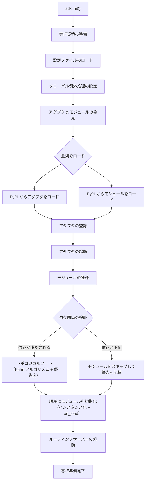

### 初期化段階の詳細

> 完全な初期化の流れを分解した（Finder / Loader / Manager / Router）、下層のエントリーポイント（`init()` / `init_task()` / `init_sync()`）と手動での完全起動については [起動プロセスと手動制御](advanced/startup.md) を参照してください。

## イベント処理の流れ

下図は、プラットフォームからハンドラまでのメッセージの完全な流れを示しています：

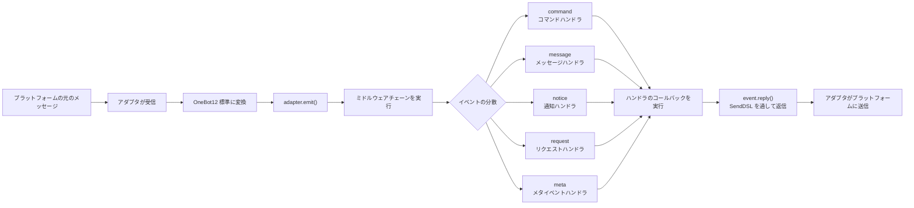

### イベント処理のチェーンの詳細

上記の図は「結果」です。下に `adapter.emit()` の後でフレームワークが**背後で何をしたか**を分解します。これは 3 層の分散チェーンです：

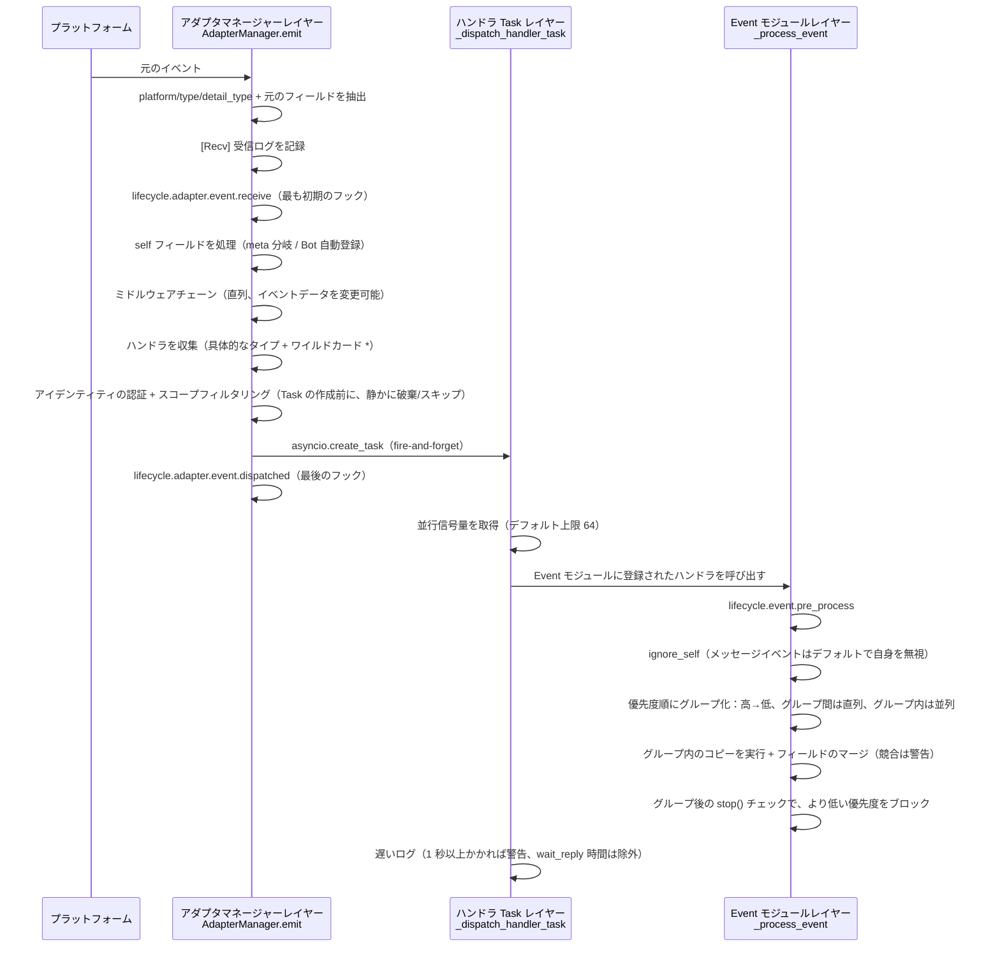

**各ステップでフレームワークが何をしたか、そして何を干预できるか：**

| ステージ | フレームワークが何をしたか | あなたが干预できる |
|------|-------------|-----------|
| 受信 | 標準フィールドを抽出し、`{platform}_raw` の元のデータを保持。`[Recv]` ログを記録 | `adapter.event.receive` を監視して初期イベントを取得 |
| self フィールド | meta イベントは connect/disconnect/heartbeat 分岐を処理。通常のイベントは Bot を自動登録し、`adapter.bot.online` をトリガー | `adapter.bot.online` / `bot.offline` を監視 |
| ミドルウェア | **直列**で実行。戻り値が None でなければイベントデータを置き換える | ミドルウェアを登録してイベントを変更/ブロック |
| 分発と収集 | 具体的なタイプのハンドラを先に取得し、次に `*` ワイルドカードハンドラを取得 | — |
| アイデンティティ次元 | 分発の入口はユーザー > 会話 > Bot > アダプタの順に判定し、イベントを受け取るかどうかを決定（`scope.is_identity_allowed`）。**拒否された場合はイベントは完全に破棄される** | `ErisPulse.scope.identity` をバインド |
| スコープフィルタリング | モジュールの所有者に応じて `scope.is_allowed` を判定（会話レベル > Bot レベル > プラットフォームレベル）。**不通過の場合は静かにスキップ** | スコープのホワイトリスト/ブラックリストを設定 |
| スケジューリング | 各マッチするハンドラは独立した `asyncio.Task` で実行される。`emit()` はハンドラの完了を待たずに即座に返却される | — |
| 優先度 | 高優先度のグループが先に実行される。**グループ間は直列、グループ内は並列**（グループ内の各ハンドラはイベントのコピーを持ち、フィールドをマージし、競合は WARNING として警告）。 | `@command(..., priority=N)` / 登録時に priority を指定 |
| ブロッキング | 各グループの処理後、`event.is_stopped()` をチェックし、マッチした場合は**より低い優先度は実行されない** | `event.mark_processed(stop=True)` / `event.done()` |

> **よくある誤解**：
> 1. **スコープフィルタリングは静かに実行される**— フィルターされたハンドラはエラーもレスポンスも出さず、TRACE ログレベルでのみ表示される（`core.scope.denied`）。"私のモジュールにメッセージが届かない"場合は、まずスコープのバインドを確認してください。
> 2. **ハンドラは天然並列**— フレームワークは各ハンドラに独立した Task を作成しており、**自分で `asyncio.create_task` をラップする必要はない**。
> 3. **同じ優先度のグループ内ではブロッキングされない**— `mark_processed(stop=True)` は、より低い優先度のグループをブロックするだけで、同じグループ内で並行実行中のハンドラは途中で中断されない。
> 4. **遅いログの閾値は固定の 1 秒**— ハンドラの処理時間が 1 秒を超えると、ログに WARNING が出る（`wait_reply` の待機時間は処理時間から除外される）が、実行は中断されない。

> スコープのモジュール次元の 3 級バインド、アイデンティティ次元の認証と出力アクション制限の詳細は [スコープ（scope）](advanced/scope.md) を参照してください。イベントスコープのテキストフィルタリングとコマンドユーザー ACL は [イベント処理の入門](getting-started/event-handling.md) を参照してください。並列上限の設定は [設定ガイド](user-guide/configuration.md#フレームワーク設定) を参照してください。

## ライフサイクルイベント

下図はフレームワーク各コンポーネントのライフサイクルイベントの発生順序を示しています：

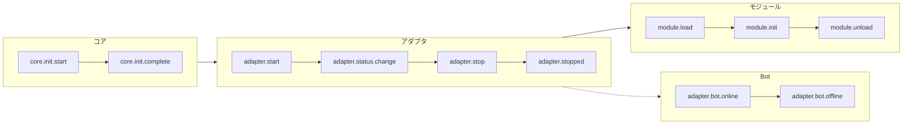

### ライフサイクルイベントの監視

> 完全なイベント監視方法（`lifecycle.on()` / `once()` / `has_handlers()`）、すべてのライフサイクルイベントリストとデータ形式は [ライフサイクル管理](advanced/lifecycle.md) を参照してください。

## モジュールのロード戦略

ErisPulse は 3 つのモジュールロード戦略をサポートし、`get_load_strategy()` が返す `ModuleLoadStrategy` によって宣言されます：

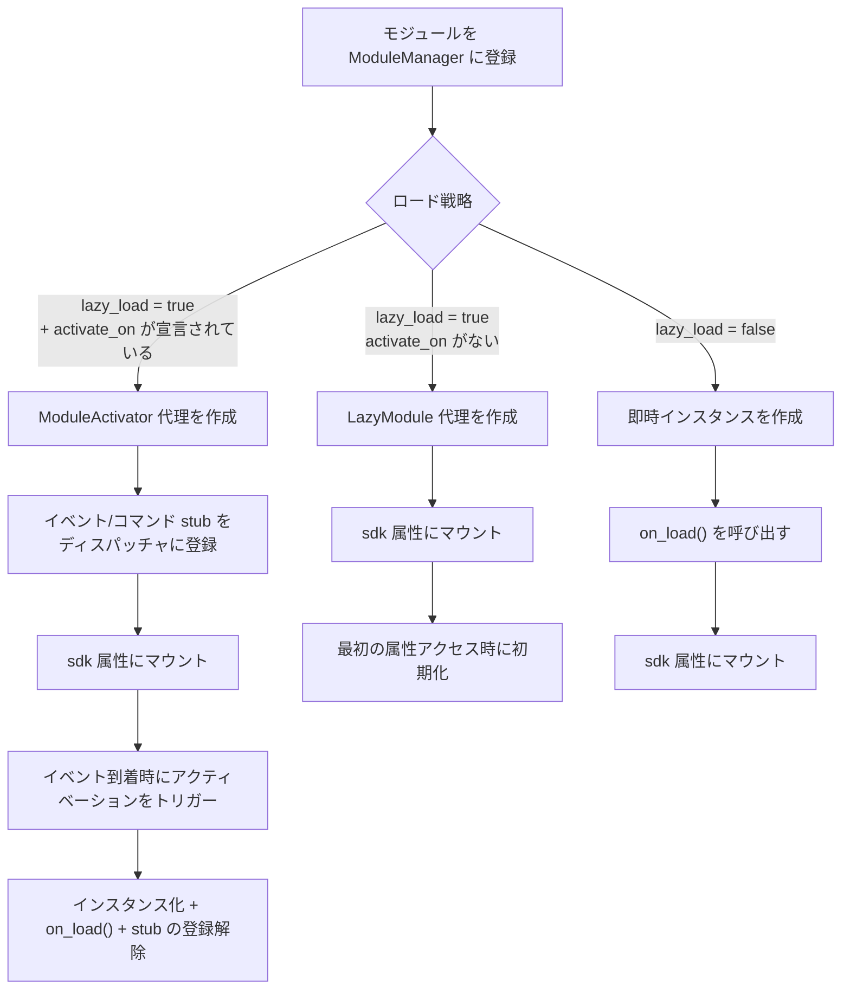

> 詳細は [遅延ロードシステム](advanced/lazy-loading.md)、[ライフサイクル管理](advanced/lifecycle.md) およびモジュールのドキュメントを参照してください。

### イベント駆動遅延アクティベーション（`activate_on`）のトリガーアーキテクチャ

> [!NOTE]
> この機能は ErisPulse **2.8.0+** が必要です。

`activate_on` を使用すると、モジュールは**最初のマッチするイベント/コマンドが到着した時点で**初めてロードされ、常駐メモリを避けることができ、同時にイベントのロスも防げます：

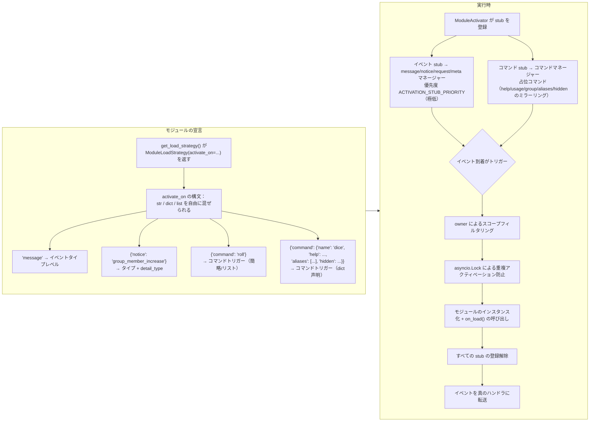

**トリガの意味の要点：**

> 完全な `activate_on` 構文（str / dict / list）、コマンド dict 声明、占位コマンド help のフォールバックチェーン、スコープフィルタリング、失敗の意味については [遅延ロードシステム](advanced/lazy-loading.md#イベント駆動遅延アクティベーションactivate_on) を参照してください。

## 本地プラグインフォルダのアーキテクチャ

> [!NOTE]
> この機能は ErisPulse **2.8.0+** が必要です。

ローカルプラグイン（`plugins/` ディレクトリ）は、パッケージ化して公開する必要がなく、フレームワークの起動時に自動的に発見され、ロードされます：

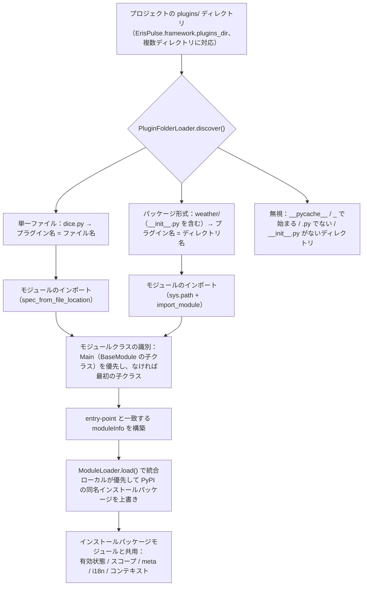

**約束と特性：**

- プラグイン名の由来：単一ファイルはファイル名、パッケージ形式はディレクトリ名
- ローカルプラグイン `moduleInfo.meta.source == "plugin_folder"` で、PyPI インストールパッケージモジュールとシームレスに共存
- 同名の場合はローカルが優先（ローカルの上書きデバッグに便利）、無効化された場合は同名の entry-point 条目も削除

## モジュールのホットリロードアーキテクチャ

ホットリロードは**すべてのモジュールソース**に対して一貫しています：ローカルプラグイン（`plugins/` ディレクトリ）、実行時登録（`sdk.module.register()`）、PyPI インストールパッケージモジュールはすべて `sdk.reload_module()` / `sdk.module.reload()` でホットリロードできます。**デフォルトは全量リロード**（トップレベルパッケ名で import キャッシュをクリアし、依存者コードを再インポート、`full=False` は軽量の逃生門）；`sdk.reload_all_modules()` / `sdk.module.reload_all()` で登録済みのすべてのモジュールを一度に全量リロードできます（pip で一括アップデート後に呼び出すことですべてが有効になります）：

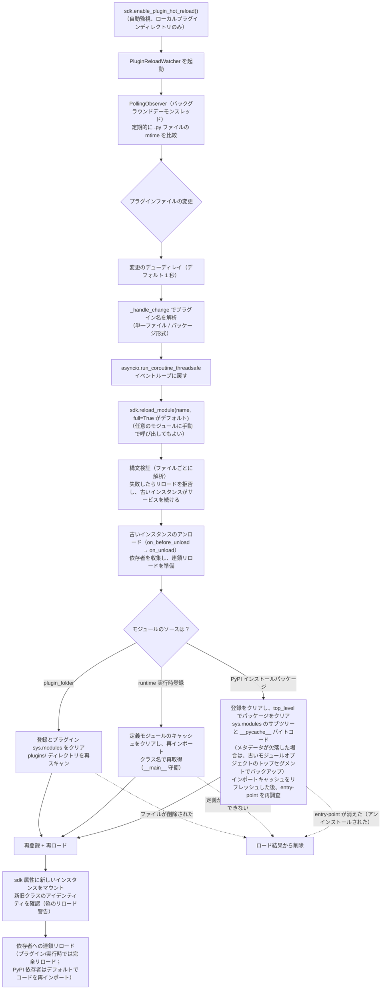

**3 つのソースの違いは発見段階のみ**、検証、アンロード、連鎖リロードは完全に同じです：

- **ローカルプラグイン**（`moduleInfo.meta.source == "plugin_folder"`）：`sys.modules` をクリアした後、`plugins/` ディレクトリを再スキャンします。ファイルが削除された場合は、ロード結果から削除されます。
- **実行時登録**（`source == "runtime"`）：定義モジュールを再インポートし、クラス名で再取得して再登録します。`__main__` に定義されている、またはソースファイルのないクラスは再インポートを拒否します（守衛アラート、エントリースクリプトの再実行を防ぎます）。
- **PyPI インストールパッケージ**：`meta.top_level` に基づいて、`sys.modules` のサブツリーをクリアし、インポートキャッシュをリフレッシュします（entry-point 60 秒キャッシュを突破）。再調査して再インポートします。entry-point が消えた（pip でアンインストールされた）場合は、ロード結果から削除されます。

**デフォルトの意味と信頼性の保証（2.11）：**

- **reload は全量リロード**：デフォルトで、トップレベルパッケージ名に基づいて `sys.modules` をクリアし、依存者コードを再インポートします。`full=False` は、メタデータに基づいてクリアし、PyPI 依存者は直接再インスタンス化するだけです（巨大な依存ツリーのパフォーマンスのための逃生門）。
- **構文検証のゲート**：アンロードのプロセスに入る前に、ファイルごとに構文解析を行い、失敗した場合はリロードを拒否します。古いインスタンスはアンロードされず、サービスを継続します。構文エラーは、モジュールを「半死」状態にすることがありません（巨大なパッケージでファイル数上限を超えた場合は、検証をスキップします）。
- **キャッシュのバックアップ**：`top_level` メタデータが欠落した場合は、「旧モジュールオブジェクト `__name__` 前方一致 → モジュールクラス `__module__` 前方一致」の 2 段階でクリア範囲を推定します。リロードの際には、ソースファイルのバイトコードキャッシュ（`__pycache__`）もクリアし、秒単位で長さが同じ小さな変更でも有効になります。
- **アイデンティティの確認**：リロードが成功した後、新旧のクラスアイデンティティが変化しているかをアサーションし、変化していない場合（C 拡張など、キャッシュがクリアできない場合）は明示的に警告し、`module.reload` イベントに `identity_changed: false` を含めます。`module.get_info()` は `running_identity` / `stale` フィールドで「登録されたバージョン ≠ 実行中のバージョン」を公開します。
- **失敗の確認**：load 失敗の現場（例外 + traceback）は、`module.last_error(名前)` / `get_info()["last_error"]` から直接確認できます。失敗したパスは、そのモジュールの import キャッシュをクリアします。「コードを変更してから再 reload する」ことで、必ず新しいコードを読み込むことができます。
- 重載は、もともと遅延ロードのモジュールを強制的にアクティブにします（明示的なログ）。`reload_all_modules()` は、遅延ロードの戦略を維持し、重載前に既にロード済みのモジュールを再アクティブにし、スリープ（休眠）中のモジュールはスリープのままにします。
- `reload_all_modules()` は依存関係のトポロジカル順序で再ロードし、単一モジュールの失敗は診断を記録してスキップします（全体のロールバックはしない—on_unload の副作用は取り消せないため、単一モジュールのホットリロードのベストエフォートの意味と一致）。重載失敗でロールバックされた状況も同様で、ログには明確に旧インスタンスが終了済みであることが示されます。

## アダプタのホットリロードアーキテクチャ

アダプタのコードレベルのホットリロード（2.11）は、モジュールのパイプラインと同構造です：`sdk.adapter.reload(プラットフォーム名)` / `sdk.reload_adapter(プラットフォーム名)` は、**ローカルプラグイン**と **PyPI インストールパッケージ**の 2 つのソースに対して実行されます：


**モジュールのパイプラインとの違い：**

- アダプタには遅延ロードや依存の連鎖リロードがない：リロードは**依存する他のアダプタには連鎖しない**（警告のみ—依存先は登録表を間接的に消費しており、インスタンスの連鎖的な意味はない）。
- 起動は非同期のチェーン（`startup` は `_run_adapter` で発行され、依存のスキップと指数的バックオフリトライを含む）：起動の一時的な失敗は**リロードの失敗とは見なされない**（コードはすでに新しいものに変わっているため）、結果は `adapter.status.change` で通知される。
- `register()` のインスタンスの再利用の落とし穴（同じオブジェクトは旧インスタンスが再利用される）は、「pyc クリア + sys.modules クリア + アイデンティティの確認」の 3 つの手段でバックアップされる。
- ライフサイクルイベント：`adapter.reload`（payload に `adapter_name` / `success` / `full` / `duration_ms` / `identity_changed` / `version_old→new` / `was_started` / `source` を含む）

## 次に進むべきこと

- **起動/終了を手動で制御したい**：[起動プロセスと手動制御](advanced/startup.md) を参照してください。初期化の各段階を分解し、個別にアダプタやルーティングを起動・停止できます。
- **遅延ロードとスリープを理解したい**：[遅延ロードシステム](advanced/lazy-loading.md) を参照してください。`activate_on` イベント駆動遅延アクティベーションの完全な構文が含まれています。
- **モジュールを書くときにライフサイクルを上手く使う**：[ライフサイクル管理](advanced/lifecycle.md) を参照してください。すべてのライフサイクルイベントと監視方法が含まれています。


====
快速上手
====


### 快速开始

# 速習

> **これが最初の一歩です。** 5 分でゼロから ErisPulse ロボットを起動しましょう。まずは効果を見て、その後各ステップを詳しく説明します。

## 60 秒効果：まずロボットが 1 文だけ返信するようにする

**1. インストール**（Python >= 3.10）：

```bash
pip install ErisPulse
```

**2. プロジェクトの初期化**。ウィザードがプロジェクト名の設定、プラットフォームアダプターの選択、および設定の完了を促し、`main.py` と `config/config.toml` を生成します：

```bash
epsdk init
```

**3. `main.py` を開き、以下の 9 行のコードに置き換えます**：

```python
from ErisPulse import sdk
from ErisPulse.Core.Event import command

@command("ping", help="ロボットがオンラインかどうかをテストする")
async def ping_handler(event):
    await event.reply("Pong！ロボットは正常に動作しています。")

if __name__ == "__main__":
    import asyncio
    asyncio.run(sdk.run(keep_running=True))
```

**4. 実行**：

```bash
epsdk run main.py
```

ターミナルには、フレームワークの起動ログとアダプターの接続情報が出力されます。この時点で、接続したプラットフォームでロボットに `/ping` を送信すると、以下のように返信されます：

> Pong！ロボットは正常に動作しています。

この返信が見られれば、フレームワーク、アダプター、イベント処理の連携が確立されたことを意味します。連携がうまくいかない場合は、文末の[問題が発生した場合](#問題が発生した場合)を参照してください。うまくいく場合は、各ステップの選択肢についても以下に説明します。

## ErisPulse のインストール：3 つの方法

上記では最も直接的な pip を使用しています。環境に応じて選択してください。

### pip を使用したインストール

Python のバージョンが 3.10 以上であることを確認し、pip を使用してインストールします：

```bash
pip install ErisPulse
```

既に [uv](https://github.com/astral-sh/uv) をインストールしている場合は、`uv pip install ErisPulse` を使用して、より高速にインストールできます。

プロジェクト環境を汚染せずに `epsdk` コマンドラインツールをグローバルにインストールしたい場合は、`uv tool install` を推奨します：

```bash
uv tool install ErisPulse
```

インストール後、`epsdk` はグローバルに利用可能になります。プロジェクトディレクトリ内で実行すると、プロジェクトの `.venv` を自動的に感知し、`epsdk install` でプロジェクト環境にインストールし、`epsdk run` でプロジェクト環境で実行されます。フレームワーク本体はツール環境から提供されます。詳しくは[インストールの参考](user-guide/installation.md)を参照してください。

### 1 つでインストールするスクリプト（新規環境に推奨）

インストールスクリプトは、環境（Docker、Python、uv）を自動検出し、最適なインストール方法を選択するよう誘導します。多言語（中国語/English/日本語/Русский/繁体中国語）に対応しています。

Windows (PowerShell):
```powershell
irm https://get.erisdev.com/install.ps1 -OutFile install.ps1; powershell -ExecutionPolicy Bypass -File install.ps1
```

macOS / Linux:
```bash
curl -fsSL https://get.erisdev.com/install.sh -o install.sh && chmod +x install.sh && ./install.sh
```

スクリプトは以下を完了するよう誘導します：

- **Docker インストール**（Docker が検出された場合に推奨）：イメージソース（Docker Hub / GHCR）、バージョンチャネル（安定版 / プレビュー版）、Dashboard 管理パネルの設定、ポートの設定を選択
- **グローバル CLI インストール（uv tool、推奨）**：`epsdk` をグローバルコマンドとしてインストールし、仮想環境を必要とせず、uv が Python を自動管理します（システムのバージョンが低くても可能です）；プロジェクトディレクトリ内で実行すると、プロジェクトの `.venv` を自動的に感知します
- **従来のインストール**：自動的に仮想環境を作成し、ErisPulse のバージョンを選択し、オプションで Dashboard 管理パネルモジュールをインストールできます

### Docker を使用する

Docker イメージには、ErisPulse フレームワークと Dashboard 管理パネルが事前インストールされており、`linux/amd64` および `linux/arm64` アーキテクチャをサポートしています。

```bash
# docker-compose.yml をダウンロード
curl -O https://raw.githubusercontent.com/ErisPulse/ErisPulse/main/docker-compose.yml

# Dashboard トークンを設定して起動
ERISPULSE_DASHBOARD_TOKEN=your-token docker compose up -d
```

<details>
<summary>Docker Hub が利用できない場合？</summary>

GitHub Container Registry のイメージを使用する場合は、`docker-compose.yml` の image を次のように変更します：

```yaml
image: ghcr.io/erispulse/erispulse:latest
```

</details>

起動後、`http://<host>:8000/Dashboard` にアクセスし、設定したトークンでログインします。

## プロジェクトの初期化

### インタラクティブな初期化（推奨）

```bash
epsdk init
```

これにより、インタラクティブなガイドが起動し、以下の手順をガイドします：
- プロジェクト名の設定
- ログレベルの設定
- サーバー設定（ホストとポート）
- アダプターの選択と設定
- プロジェクト構造の作成

### ファスト初期化

```bash
# プロジェクト名を指定する高速モード
epsdk init -q -n my_bot

# または、プロジェクト名のみを指定
epsdk init -n my_bot
```

### 手動でのプロジェクト作成

手動でプロジェクトを作成したい場合は：

```bash
mkdir my_bot && cd my_bot
epsdk init
```

## モジュールのインストール

### CLI によるインストール

```bash
epsdk install Yunhu AIChat
```

### 利用可能なモジュールの確認

```bash
epsdk list-remote
```

### インタラクティブなインストール

パッケージ名を指定しない場合、インタラクティブなインストール画面に移行します。

```bash
epsdk install
```

## プロジェクトの実行

```bash
# 通常実行
epsdk run main.py

# ホットリロードモード（開発時に推奨）
epsdk run main.py --reload
```

## IDE補完の有効化（オプション）

ErisPulse はモジュール/アダプターを動的に発見するため、IDE はデフォルトではプラットフォーム固有のメソッドを補完できません。  
以下のコマンドを実行して型のスタブを生成してください：

```bash
epsdk types
```

生成後、インポートした型を変数の型ヒントとして使用することで、正確な補完が得られます（詳細は [IDE補完ガイド](./getting-started/ide-completion.md) を参照してください）：

```python
from _ep_types import Yunhu
from ErisPulse import sdk

adapter: Yunhu = sdk.adapter.get("yunhu")
await adapter.Send.To("group", "123").Board(...)  # プラットフォーム固有のメソッドの補完
```

## プロジェクト構造

初期化後のプロジェクト構造：

```
my_bot/
├── config/
│   └── config.toml          # 設定ファイル
└── main.py                  # エントリーファイル

```

## 設定ファイル

基本的な `config.toml` 設定：

```toml
[ErisPulse.server]
host = "0.0.0.0"
port = 8000

[ErisPulse.logger]
level = "INFO"

[Yunhu_Adapter]
# アダプターの設定
```

## 次のステップ

ロボットが起動したら、目的に応じて選択してください：

### グループ用ロボットを作りたい（メッセージ処理、グループ管理、通知）

- [イベント処理の入門](getting-started/event-handling.md) — メッセージ、通知、リクエストイベントの書き方
- [一般的なタスクの例](getting-started/common-tasks.md) — ストレージ、定期タスク、権限制御

### 自分のモジュール / アダプターを書きたい

- [基本概念](getting-started/basic-concepts.md) — アダプター / モジュール / イベントの設計を理解する
- [モジュール開発の入門](developer-guide/modules/getting-started.md)
- [アダプター開発の入門](developer-guide/adapters/getting-started.md)
- [アーキテクチャ概要](architecture.md) — 可視化されたアーキテクチャ図

### ロボットを長期的に動かしたい

- [デプロイガイド](user-guide/deployment.md)
- [設定ファイルの説明](user-guide/configuration.md)

### 問題に遭遇した場合

- [最初のロボットを作成する](getting-started/first-bot.md) — 最初のロボットの詳細な手順
- [起動プロセスと手動制御](advanced/startup.md) — モジュール / アダプターのロード失敗の診断
- [CLIコマンドリファレンス](user-guide/cli-reference.md) — `epsdk` のすべてのサブコマンド


### 创建第一个机器人

# 最初のロボットを作成する

> [!TIP]
> **この記事を読むタイミング**：ロボットが動作している状態で、最初の `/hello` コマンドハンドラを実装し、`sdk.run` とコマンドデコレータがそれぞれ何をしているのかを理解したい場合。まだ ErisPulse をインストールしておらず、プロジェクトを初期化していない場合は、まず [5 分間クイックスタート](../quick-start.md) の「インストール」「プロジェクトの初期化」「プロジェクトの実行」の 3 ステップを完了してください。必要ない場合はスキップしてください。

クイックスタートを実行したのは第一歩です。この記事では、最初のコマンドハンドラを実装し、フレームワーク内で各行のコードが何を行っているのかを解説します。

## 最初のステップ：最初のコマンドを記述する

`main.py` を開き、シンプルなコマンドハンドラを記述します。

```python
from ErisPulse import sdk
from ErisPulse.Core.Event import command

@command("hello", help="挨拶メッセージを送信します")
async def hello_handler(event):
    """hello コマンドを処理します"""
    user_name = event.get_user_nickname() or "友達"
    await event.reply(f"こんにちは、{user_name}！私は ErisPulse ロボットです。")

@command("ping", help="ロボットがオンラインかどうかをテストします")
async def ping_handler(event):
    """ping コマンドを処理します"""
    await event.reply("Pong！ロボットは正常に動作しています。")

async def main():
    """メインエントリーポイント関数"""
    print("ErisPulse を起動しています...")
    
    # keep_running=True（デフォルト）：フレームワークはブロックして実行を維持し、終了信号（例：Ctrl+C）が受信されるまで待ちます
    await sdk.run(keep_running=True)

if __name__ == "__main__":
    import asyncio
    asyncio.run(main())
```

### `keep_running` パラメータ

`sdk.run(keep_running)` は、フレームワークがブロックして実行を維持するかどうかを制御します。

- **`keep_running=True`（デフォルト）**：`run()` はブロックし続け、終了信号（例：Ctrl+C）が受信されるまで待ちます。これは純粋な bot アプリケーションに適しています。
- **`keep_running=False`**：`run()` は初期化後に即座に返ります。**フレームワークはアンロードされません**——起動されたアダプタ/モジュールはバックグラウンドタスクとしてメッセージイベントの処理を続けます。その後、独自のロジックを実行し、イベントループが終了するまでフレームワークは閉じられません。例：

```python
async def main():
    await sdk.run(keep_running=False)   # 初期化後に即座に返ります
    # フレームワークはバックグラウンドで実行中です。ここでは他の処理を続行できます
    while True:
        await asyncio.sleep(3600)
        print("1時間ごとにチェックします")
```

> `run()` の2つのモードに加えて、`init()`/`uninit()` を使用したライフサイクルの手動制御、個別のアダプタ/ルーティングの起動/停止など、より細かい制御方法もあります。詳細は [起動プロセスと手動制御](../advanced/startup.md) を参照してください。

## 第二ステップ：ロボットの実行

```bash
# 通常実行
epsdk run main.py

# 開発モード（ホットリロードをサポート）
epsdk run main.py --reload
```

## 第三段階：ロボットのテスト

チャットプラットフォームで次のコマンドを送信します：

```
/hello
```

これで、ロボットからの返信が届くはずです。

## コード説明

### コマンドデコレータ

```python
@command("hello", help="挨拶メッセージを送信")
```

- `hello`：コマンド名。ユーザーは `/hello` で呼び出します。
- `help`：コマンドのヘルプ説明。`/help` コマンドで表示されます。

### イベントパラメータ

```python
async def hello_handler(event):
```

`event` パラメータは Event オブジェクトであり、以下を含みます：
- メッセージ内容：`event.get_text()`
- 送信者情報：`event.get_user_id()`、`event.get_user_nickname()`
- プラットフォーム情報：`event.get_platform()`
- グループ情報：`event.get_group_id()`
- 元のデータ：`event.get_raw()`

> 完全な Event オブジェクトのメソッドについては、[Event 包装クラスの詳細](../developer-guide/modules/event-wrapper.md) を参照してください。

### レスポンスの送信

```python
await event.reply("レスポンスの内容")
```

`event.reply()` は、送信者にメッセージを送信するための便利なメソッドです。

## 拡張機能：追加の機能を追加

ErisPulse は、豊富なイベント処理とデータ処理機能を提供します：

- **メッセージの監視**：`@message.on_message()` を使用して、さまざまなメッセージを監視します → [イベント処理の入門](event-handling.md)
- **通知の監視**：`@notice.on_friend_add()` などの通知を監視します → [イベント処理の入門](event-handling.md)
- **データの保存**：`sdk.storage.get/set` を使用してデータを永続化します → [一般的なタスクの例](common-tasks.md)

## よくある質問

### コマンドが反応しない？

1. アダプタが正しく設定されているか確認し、`config/config.toml` 内のアダプタの `status` が `true` であることを確認します。
2. ターミナルのログ出力を確認し、エラー情報（特に `ERROR` レベルのログ）がないか確認します。
3. コマンドのプレフィックスが正しいか確認します（デフォルトは `/` です）。設定ファイルの `[ErisPulse.event.command]` 部分で確認できます。
4. コマンド名のスペルが正しいか、大文字小文字の区別が正しく設定されているか確認します。

### コマンドのプレフィックスを変更するには？

`config.toml` に以下を追加します：

```toml
[ErisPulse.event.command]
prefix = "!"
case_sensitive = false
```

### 複数のプラットフォームをサポートするには？

ErisPulse は OneBot12 標準を用いて、異なるプラットフォームのイベント形式を統一しています。`@command` および `@message` で登録されたハンドラは、すべてのプラットフォームからのイベントを自動的に受け取ります。イベントの元プラットフォームを区別するには、`event.get_platform()` を使用します：

```python
@command("hello")
async def hello_handler(event):
    platform = event.get_platform()
    
    if platform == "yunhu":
        await event.reply("你好！来自云湖")
    elif platform == "telegram":
        await event.reply("Hello! From Telegram")
    else:
        await event.reply("你好！")
```

> 詳細な多プラットフォーム対応のテクニックについては、[よくあるタスクの例](common-tasks.md#多プラットフォーム適応) を参照してください。

## 次のステップ

- **学習の流れに従って進む**：[基本概念](basic-concepts.md)を読んで、コマンドプロセッサの背後でフレームワークが何をしているかを理解する
- **より多くのメッセージタイプに対応したい**：[イベント処理の入門](event-handling.md)、メッセージ / 通知 / 要求 / メタイベントのハンドラの書き方
- **実用的な機能を追加したい**：[一般的なタスクの例](common-tasks.md)、永続化、定時タスク、権限制御の既製コード


### 基础概念

# 基礎概念

> [!NOTE]
> **L1 核心必読**——ドキュメントのトップページ「L1 核心五篇」の第 2 篇（モジュール開発の入門 → **基礎概念** → Event 包装クラス → 設定ファイルの説明 → エラーのキャッチ）。

ユーザーがメッセージを送信してからロボットが応答するまで、どのようなコンポーネントが関与しているのか？アダプターとモジュールはそれぞれ何を担当しているのか？このページを読めば、ハンドラを書く際に遭遇する設計上の問題を、サンプルをコピーするだけではなく自分で答えられるようになるでしょう。

## イベント駆動アーキテクチャ

ErisPulse はイベント駆動アーキテクチャを採用しており、すべてのやり取りはイベントを通じて行われます。

### イベントの流れ

```
ユーザーがメッセージを送信
      │
      ▼
プラットフォームが受信
      │
      ▼
アダプターがプラットフォームのネイティブイベントを受信
      │
      ▼
OneBot12 標準イベントに変換
      │
      ▼
イベントシステムに送信
      │
      ▼
登録されたハンドラに配信
      │
      ▼
モジュールがイベントを処理
      │
      ▼
アダプターを通じて応答を送信
      │
      ▼
プラットフォームがユーザーに表示
```

### OneBot12 標準

ErisPulse は OneBot12 をコアのイベント標準として使用しています。OneBot12 は、統一されたイベント形式を定義する一般的なチャットボットアプリケーションのインターフェース標準です。

すべてのアダプターは、プラットフォーム固有のイベントを OneBot12 形式に変換することで、コードの一貫性を保証します。

## コアコンポーネント

### 1. SDK オブジェクト

SDK はすべての機能の統一されたエントリーポイントであり、コアコンポーネントへのアクセスを提供します。

```python
from ErisPulse import sdk

# コアモジュールへのアクセス
sdk.storage    # ストレージシステム
sdk.config     # 設定システム
sdk.logger     # ログシステム
sdk.adapter    # アダプターシステム
sdk.module     # モジュールシステム
sdk.router     # ルーティングシステム
sdk.client     # HTTPクライアント
sdk.lifecycle  # ライフサイクルシステム
```

> [!WARNING]
> **ルートからのインポートを統一する**：`from ErisPulse.Core import adapter` / `import ErisPulse.Core.adapter`
> これらの書き方は、**マネージャーインスタンス**（`AdapterManager` シングルトン）をバインドするものであり、サブモジュールではなく、`ErisPulse.Core`
> パッケージの re-export は同名のサブモジュールを覆い隠します。テスト、patch、またはモジュールオブジェクト自体が必要な場合は、一律に
> `from ErisPulse import sdk` ルートインポート（`sdk.adapter` はマネージャーインスタンス）を使用してください。

### 2. Event オブジェクト

Event オブジェクトはイベントデータをラップし、便利なアクセスメソッドを提供します。

```python
@command("info")
async def info_handler(event):
    # イベント情報の取得
    event_id = event.get_id()
    user_id = event.get_user_id()
    platform = event.get_platform()
    text = event.get_text()
    
    # 応答の送信
    await event.reply(f"ユーザー: {user_id}, プラットフォーム: {platform}")
```

### 3. アダプター

アダプターは ErisPulse と外部プラットフォームの間の橋渡し役です。

**役割：**
- プラットフォームのネイティブイベントを受信
- OneBot12 標準形式に変換
- 標準形式のイベントをプラットフォームに送信

**例：**
- Yunhu アダプター：雲湖プラットフォームとの通信
- Telegram アダプター：Telegram Bot API との通信
- OneBot11 アダプター：OneBot11 互換アプリとの通信
- Email アダプター：メールの送受信処理

### 4. モジュール

モジュールは機能拡張の基本単位であり、以下を実現できます：

- イベントハンドラの登録
- ビジネスロジックの実装
- アダプターを呼び出してメッセージを送信
- コアモジュールが提供するサービスを使用

#### モジュール発見メカニズム

ErisPulse は Python の `importlib.metadata.entry_points` を使用して、インストール済みのモジュールを発見します。モジュールは `pyproject.toml` でエントリーポイントを宣言します：

```toml
[project.entry-points."erispulse.module"]
MyModule = "my_package:Main"
```

SDK の初期化時に、`erispulse.module` グループのすべてのエントリーポイントをスキャンし、モジュールクラスを `ModuleManager` に登録し、依存関係に基づいてトポロジカルソートした後に順次初期化します。

#### 最小限のモジュール

```python
from ErisPulse.Core.Bases import BaseModule
from ErisPulse import sdk

class Main(BaseModule):
    def __init__(self):
        self.sdk = sdk
        self.logger = sdk.logger.get_child("MyModule")

    async def on_load(self, event):
        self.logger.info("モジュールがロードされました")

    async def on_unload(self, event):
        self.logger.info("モジュールがアンロードされました")
```

#### モジュールのライフサイクル

- **登録**：SDK がモジュールクラスを発見し、マネージャーに登録
- **ロード**：モジュールインスタンスを作成し、`on_load(event)` を呼び出す（`event = {"module_name": "MyModule"}`）
- **アンロード**：`on_unload(event)` を呼び出し、リソースのクリーンアップ

#### ロード戦略

`get_load_strategy()` でモジュールのロード動作を宣言します：

```python
from ErisPulse.loaders import ModuleLoadStrategy

class Main(BaseModule):
    @staticmethod
    def get_load_strategy():
        return ModuleLoadStrategy(
            lazy_load=True,   # ラグジュアリーなロードかどうか（デフォルトは True）
            priority=0        # ロードの優先度、数値が大きいほど先に初期化される
        )
```

- **`lazy_load=True`（デフォルト）**：`sdk.MyModule` に初めてアクセスしたときにモジュールを初期化し、起動時間を短縮
- **`lazy_load=False`**：SDK の起動時に即座に初期化、ライフサイクルイベントの監視やタイマー処理を行うモジュールに適している
- **`priority`**：同じ優先度のモジュールは登録順にロード、数値が大きいほど先に初期化される

> 詳細なラグジュアリーなロードの仕組みについては [ラグジュアリーなロードシステム](../advanced/lazy-loading.md) を参照してください。

## イベントの種類

ErisPulse は 5 種類のイベントをサポートしています：

| イベントの種類 | デコレータ | 説明 |
|---------|--------|------|
| メッセージイベント | `@message.on_message()` | ユーザーが送信したすべてのメッセージ（プライベートチャット、グループチャット） |
| コマンドイベント | `@command("name")` | コマンドプレフィックスで始まるメッセージ（例：`/hello`） |
| 通知イベント | `@notice.on_friend_add()` など | システム通知（友達追加、グループメンバーの変更など） |
| 要求イベント | `@request.on_friend_request()` など | ユーザーの要求（友達リクエスト、グループ招待） |
| メタイベント | `@meta.on_connect()` など | システムイベント（接続、切断、ハートビート） |

> 各イベントの詳細な使い方とコード例については [イベント処理の入門](event-handling.md) を参照してください。

## コアモジュールの説明

### Storage（ストレージ）

SQLite をベースにしたキー/値形式のストレージシステムで、永続化データを管理します。

```python
# 値の設定
sdk.storage.set("key", "value")

# 値の取得
value = sdk.storage.get("key", "default_value")

# バッチ操作
sdk.storage.set_multi({
    "key1": "value1",
    "key2": "value2"
})

# トランザクション
with sdk.storage.transaction():
    sdk.storage.set("key1", "value1")
    sdk.storage.set("key2", "value2")
```

### Config（設定）

TOML 形式の設定ファイルを管理します。

```python
# 設定の取得
config = sdk.config.getConfig("MyModule", {})

# 設定の設定
sdk.config.setConfig("MyModule", {"key": "value"})

# 嵌套された設定の読み取り
value = sdk.config.getConfig("MyModule.subkey", "default")
```

### Logger（ログ）

モジュール化されたログシステムです。

```python
# ログの記録
sdk.logger.info("これは情報です")
sdk.logger.warning("これは警告です")
sdk.logger.error("これはエラーです")

# サブログレコーダーの取得
child_logger = sdk.logger.get_child("submodule")
child_logger.info("サブモジュールのログ")
```

**属性アクセスの糖衣構文**

`get_child()` メソッドの代わりに、**属性アクセス**を使ってサブloggerを作成することもできます。これはより簡潔な**糖衣構文**です：

```python
# 属性アクセスでサブloggerを作成
sdk.logger.mymodule.info("モジュールメッセージ")

# 嵌套アクセスもサポート
sdk.logger.mymodule.database.info("データベースメッセージ")
```

### Router（ルーティング）

HTTP および WebSocket のルーティング管理、FastAPI + Uvicorn をベースにしています。デコレータルーティング、ミドルウェア、グループ、リクエスト制限、CORS をサポートしています。

```python
from ErisPulse.Core import HttpRequest

@sdk.router.get("MyModule", "/api")
async def handler(request: HttpRequest):
    data = await request.json()
    return {"status": "ok"}
```

> 完全なルーティング API（WebSocket、ミドルウェア、リクエスト制限、CORS など）については [ルーティングマネージャー](../advanced/router.md) を参照してください。

### Client（ネットワーククライアント）

統一されたネットワーククライアントで、HTTP リクエスト、WebSocket 接続、接続プール管理、自動リトライ、タイムアウト制御、リクエスト統計、ライフサイクルイベントの統合を提供します。

```python
from ErisPulse.Core import client

# HTTP リクエスト
resp = await client.get("https://api.example.com/users")
data = await resp.json()

# リトライとタイムアウト付き
resp = await client.get(url, timeout=30, max_retries=3)

# WebSocket 接続
ws = await client.ws_connect("wss://example.com/ws")
async for text in ws.iter_text():
    await ws.send_text(f"Echo: {text}")
```

> 完全なネットワーククライアント API については [ネットワーククライアント](../advanced/http-client.md) を参照してください。

## SendDSL メッセージ送信

アダプターはメソッドチェーンによるメッセージ送信インターフェースを提供します。

### 基本的な送信

```python
# アダプターインスタンスの取得
yunhu = sdk.adapter.get("yunhu")

# メッセージの送信
await yunhu.Send.To("user", "U1001").Text("Hello")

# 送信アカウントの指定
await yunhu.Send.Using("bot1").To("group", "G1001").Text("グループメッセージ")
```

### チェーン修飾

```python
# @ユーザー
await yunhu.Send.To("group", "G1001").At("U2001").Text("@メッセージ")

# メッセージへの返信
await yunhu.Send.To("group", "G1001").Reply("msg123").Text("返信")

# @全員
await yunhu.Send.To("group", "G1001").AtAll().Text("公告")
```

### Event の返信メソッド

Event オブジェクトには便利な返信メソッドが提供されています：

```python
@command("test")
async def test_handler(event):
    # 簡単なテキスト返信
    await event.reply("返信内容")
    
    # 画像の送信
    await event.reply("http://example.com/image.jpg", method="Image")
    
    # 音声の送信
    await event.reply("http://example.com/voice.mp3", method="Voice")
```

## ラグジュアリーなロードシステム

ErisPulse はデフォルトでモジュールのラグジュアリーなロードを有効にしており、`sdk.MyModule` に初めてアクセスしたときにモジュールが初期化され、起動速度が大幅に向上します。

```python
from ErisPulse.loaders import ModuleLoadStrategy

class Main(BaseModule):
    @staticmethod
    def get_load_strategy():
        return ModuleLoadStrategy(
            lazy_load=True,   # ラグジュアリーなロードを有効にする（デフォルト）
            priority=0        # ロードの優先度、数値が大きいほど先に初期化される
        )
```

**ラグジュアリーなロードを無効にする必要がある状況（`lazy_load=False`）：**
- ライフサイクルイベントを監視するモジュール（例：`core.init.complete`）
- 起動時のタイマー処理やバックグラウンドサービスを実行するモジュール
- 他のモジュールのロード前に初期化を完了させる必要があるモジュール

> 詳細なラグジュアリーなロードの仕組みと注意事項については [ラグジュアリーなロードシステム](../advanced/lazy-loading.md) を参照してください。

## 次に進む

- **L1 パスに従って**：次は [Event 包装クラス](../developer-guide/modules/event-wrapper.md)、イベントオブジェクトのすべての読み書きメソッドを習得
- **実践しながら学びたい**：[イベント処理の入門](event-handling.md) では、イベントの種類ごとに直接コピーできるハンドラの書き方を提供；[一般的なタスクの例](common-tasks.md) では、永続化、タイマー処理、権限制御などの一般的な機能をカバー


### 事件处理入门

# イベント処理入門

> [!TIP]
> **このドキュメントを読むべきタイミング**：ボットにメッセージ、コマンド、通知、リクエストへ応答させたい場合や、返信の待機 / マルチターン会話の実装、「コマンドがトリガーされないのはなぜか」のトラブルシューティングが必要なときに読んでください。フレームワークの設計だけを知りたい場合は、[基本概念](basic-concepts.md) を参照すれば十分です。必要なければスキップしてください。

イベントハンドラーとは、ボットがユーザーの意図を「理解」して反応する場です。このドキュメントでは、5種類のイベントごとにそのままコピーして使える実装例を示し、パラメータ解析、権限、スロットリング、マルチターン対話といった実践的なシナリオも網羅します。

## イベントタイプの概要

ErisPulse は以下のイベントタイプをサポートしています：

| イベントタイプ | 説明 | 適用場面 |
|---------|------|---------|
| メッセージイベント | ユーザーが送信したすべてのメッセージ | チャットボット、コンテンツフィルタ |
| コマンドイベント | コマンド接頭辞で始まるメッセージ | コマンド処理、機能入口 |
| 通知イベント | システム通知（友達追加、グループメンバー変更など） | メッセージ歓迎、ステータス通知 |
| 要求イベント | ユーザーの要求（友達リクエスト、グループ招待） | 要求の自動処理 |
| 元イベント | システムレベルのイベント（接続、ハートビート） | 接続監視、ステータスチェック |

## メッセージイベントの処理

> **ヒント**: IDEの自動補完と型チェックのサポートを得るために、イベントハンドラで `Event` タイプ注釈を使用することを推奨します。

```python
from ErisPulse.Core.Event import Event  # 注釈に使用するイベントタイプをインポート
```

### すべてのメッセージを監視

```python
from ErisPulse.Core.Event import message, Event

@message.on_message()
async def message_handler(event: Event):
    text = event.get_text()
    user_id = event.get_user_id()
    sdk.logger.info(f"{user_id} からのメッセージ: {text}")
```

### プライベートメッセージを監視

```python
@message.on_private_message()
async def private_handler(event: Event):
    user_id = event.get_user_id()
    await event.reply(f"こんにちは，{user_id}！これはプライベートメッセージです。")
```

### グループメッセージを監視

```python
@message.on_group_message()
async def group_handler(event: Event):
    group_id = event.get_group_id()
    user_id = event.get_user_id()
    sdk.logger.info(f"グループ {group_id} で {user_id} がメッセージを送信しました")
```

### @メッセージを監視

```python
@message.on_at_message()
async def at_handler(event: Event):
    # @されたユーザーのリストを取得
    mentions = event.get_mentions()
    await event.reply(f"あなたは以下のユーザーを@しました: {mentions}")
```

### ワイルドカードと正規表現の監視

4つのメッセージデコレータ（`on_message` / `on_private_message` / `on_group_message` /
`on_at_message`）は `pattern`（glob ワイルドカード）と `regex`（正規表現）をサポートし、一致しないメッセージは**ハンドラをトリガーしません**：

```python
# glob ワイルドカード：* 任意の文字列、? 単一文字、[seq] 文字集合
@message.on_message(pattern="签到*")
async def signin_handler(event: Event):
    await event.reply("签到成功")

# 正規表現：金額をマッチ
@message.on_message(regex=r"\d+\s*元")
async def price_handler(event: Event):
    await event.reply(f"受信金額：{event.get_text()}")

# pattern と regex が両方指定された場合 → 両方一致する必要がある
@message.on_message(pattern="*元", regex=r"\d+\s*元")
async def combined_handler(event: Event):
    pass
```

`wait_reply` もこの2つのパラメータをサポートします（[返信待ち機能](../developer-guide/modules/event-wrapper.md#返信待ち機能)を参照）。

## コマンドイベント処理

### 基本コマンド

```python
from ErisPulse.Core.Event import command

@command("help", help="ヘルプ情報を表示")
async def help_handler(event):
    help_text = """
利用可能なコマンド：
/help - ヘルプを表示
/ping - 接続をテスト
/info - 情報を表示
    """
    await event.reply(help_text)
```

### コマンドエイリアス

```python
@command(["help", "h"], aliases=["帮助"], help="ヘルプ情報を表示")
async def help_handler(event):
    await event.reply("ヘルプ情報...")
```

ユーザーは以下のいずれかの方法で呼び出すことができます：
- `/help`
- `/h`
- `/帮助`

### コマンド引数

```python
@command("echo", help="メッセージを返す")
async def echo_handler(event):
    # コマンド引数を取得
    args = event.get_command_args()
    
    if not args:
        await event.reply("返信するメッセージを入力してください")
    else:
        await event.reply(f"あなたが言った: {' '.join(args)}")
```

引数はユーザー入力の元の大文字小文字を保持します（設定が大文字小文字無視であっても、コマンド名の一致は正規化されますが、引数の内容には影響しません）。

### 宣言的引数とオプション（args= / options=）

手動で引数を解析するには、自分で型変換とエラーメッセージを処理する必要があります。`args=` / `options=` を宣言すると、フレームワークは権限チェックを通過した後にコマンド引数を自動的に解析し、**名前でハンドラに注入**します。ユーザーが入力ミスをした場合、自動的にローカライズされたエラーメッセージと使い方を返し（例外が発生してクラッシュすることはありません）、`/help <コマンド>` でも自動的に使い方が表示されます：

```python
@command(
    "roll",
    args="<count:int> [sides:int=6]",
    options={"verbose": "-v/--verbose", "label": "--label"},
    help="サイコロを振る",
)
async def roll_handler(event, count: int, sides: int = 6, verbose: bool = False, label: str = ""):
    total = sum(random.randint(1, sides) for _ in range(count))
    await event.reply(f"{count}回 {sides}面サイコロを振った、合計点数：{total}")
```

`args=` 位置引数の構文：`<count:int>` 必須、`[sides:int=6]` 省略可能（デフォルト値付き）。サポートされる型：

| 型 | 例 | 説明 |
|------|---------|------|
| `str` | `hello` | テキスト（デフォルト型） |
| `int` / `float` | `3` / `0.5` | 数値 |
| `bool` | `はい` / `yes` / `はい` / `да` / `true` / `no` / `取消` | ブール値、イベント確認（`Event.confirm()`）の確認語リストを再利用 |
| `literal` | `<mode:literal=fast|slow>` | 列挙、指定された値のみを受け入れる；省略形はデフォルトで最初のものを取る |
| `duration` | `90s`、`1h30m`、`1d` | 時間、秒に換算してfloatで返す |
| `rest` | `<text:rest>` | 残りのすべてのテキスト（最後に位置する必要がある） |

`options=` オプションは辞書形式で宣言：キーはハンドラの引数名、値はフラグ形式（複数のエイリアスは `/` で区切る）。注釈が `bool` の引数はブールフラグ（存在すれば `True`）；それ以外（デフォルトは `str`）は値付きオプションで、`--label hello` と `--label=hello` の両方の形式がサポートされ、型はハンドラの注釈に従う。オプションは最初に認識されて除外され、残りのトークンは `args=` に従って解析される（`rest` はオプションを除外した後の残りのテキストをカバーする）。

**動作の要点**：

- 権限チェックは引数解析より先に実行される——権限のないユーザーは解析をトリガーしない
- 解析失敗（型が合わない / 必須引数が足りない / 引数が多すぎる / 未知のオプション）は自動的にローカライズされたエラーと使い方を返し、コマンドは引き継がれる
- 宣言された引数名はハンドラのシグネチャに存在しなければならない、さもなければ登録時に `ValueError` を投げる
- `args=` / `options=` を宣言しないコマンドは動作がまったく変わらない（後方互換性）

### コマンド管理（cooldown= / rate_limit= / usage_limit= / deprecated=）

手動でクールダウン、リミット、使用制限、非推奨メッセージを宣言で置き換え、これらは任意に組み合わせることができる。

**クールダウン**——時間の書式は `args=` の `duration` 型と同じ（例：`"30s"`、`"1h30m"`、`"1d"`）：

```python
@command("daily", cooldown="1d", cooldown_key="user", cooldown_reply="今日のサインイン済み")
async def daily_handler(event):
    await event.reply("サインイン成功！")
```

**リミット**——スライディングウィンドウの宣言 `"回数/ウィンドウ"`（例：`"5/minute"`、`"10/s"`、`"3/2m"`）：

```python
@command("search", rate_limit="5/minute", rate_limit_key="user")
async def search_handler(event):
    await event.reply("検索結果")
```

**制限**——周期内での総回数上限（例：`"100/day"`、`"10/hour"`、`"500/30d"`）、上限を超えると実行を拒否する：

```python
@command("translate", usage_limit="100/day", usage_limit_key="user",
         usage_limit_reply="今日の翻訳回数が上限に達しました")
async def translate_handler(event):
    ...
```

クールダウン / リミットとは異なり、制限のカウントは**永続化されたストレージに保存**される（KVキー `erispulse.usage.<key>`、再起動しても失われない）：
ストレージが利用できない場合は自動的にメモリ内カウントに退化し、警告を出力する（この場合、制限は再起動でリセットされる）。カウントは制限周期の切り替えごとに自動的にリセットされ、モジュールのアンロード時にクリアされる。

**非推奨**——呼び出し時に自動的に非推奨の文を返し、`deprecated_reject=True` で実行を拒否する：

```python
@command("oldcmd", deprecated="代わりに /newcmd を使用してください", deprecated_reject=True)
async def old_handler(event): ...
```

キーの粒度（`cooldown_key=` / `rate_limit_key=`）：`"user"`（デフォルト、同一ユーザーが共有）、
`"session"`（同一セッションが共有、同じグループ内）、`"global"`（すべてのユーザーとセッションが共有）。

**動作の要点**：

- クールダウン / リミット / 制限がヒットした場合、デフォルトでは**静かに破棄**される（作用域の静かさに対応）；`cooldown_reply=` / `rate_limit_reply=` / `usage_limit_reply=` を宣言した場合、ヒットしたらその文を返す
- コマンドがヒットした時点で認識される——管理がヒットしたコマンドは低優先度のメッセージハンドラに漏れることはない
- 管理の判定はすべての権限チェックと引数解析が通過し、実際の実行の直前に行われる：権限のないユーザーはトリガーされず、引数エラーは消費されない
- クールダウンとリミットを同時に宣言した場合、クールダウンが先に判定される（クールダウンがヒットしてもリミットのウィンドウは消費されない）；制限はクールダウン / リミットの判定の後に行われる
- `deprecated=` はデフォルトで返信文を返した後に**実行を続ける**；`deprecated_reject=True` で実行を拒否する（`command.executed` フックは `success=False, error="deprecated"` として記録される）
- `/help` のリストと単一コマンドのヘルプは自動的に非推奨マークと文を表示する
- クールダウンとリミットの状態はプロセス内メモリに保存され、モジュールのアンロード時に自動的にクリアされる；プロセス間共有 / 再起動時の永続化は含まれない（**usageの制限カウントのみ**——ストレージに永続化されている、上記参照）
- 宣言は登録時に検証される（fail-fast）：書式が不正、キーの粒度がホワイトリスト外、replyが主宣言と組み合わされていない場合、すべて `ValueError` を投げる

### ハンドラのスロットリング（throttle=）とデバウンス（debounce=）

メッセージハンドラのスパム防止宣言——同じキーのイベントは間隔内に1件のみ処理され、残りは静かに破棄される：

```python
from ErisPulse import sdk

@sdk.message.on_message(throttle="2s", throttle_key="user")
async def handler(event): ...
```

デバウンスとスロットリングは補完的です：**ウィンドウ内では最後の1件のみ実行**され、前の実行中のタスクは自動的にキャンセルされる（例：「入力停止後に処理する」検索連想などに適しています）：

```python
@sdk.message.on_message(debounce="2s", debounce_key="user")
async def search(event): ...
```

`on_message` / `on_private_message` / `on_group_message` / `on_at_message`
はすべてサポートされます；`throttle_key=` / `debounce_key=` はコマンド管理と同じキーの粒度
（user / session / global）で、時間の書式は `duration` と同じです。スロットリングと `pattern=` /
`regex=` などの既存の条件は重複して効果を発揮します（すべて満たす場合にのみトリガー）；間隔内に破棄されたイベントはTRACEログとして記録されます；
宣言は登録時に検証されます；`throttle=` と `debounce=` は意味的に排他的です（両方宣言すると `ValueError` を投げる）。

> **デバウンスは途中で業務を中断しない**：待機ウィンドウを越えていない未実行タスクはキャンセルされる；すでに越えて実行中のハンドラは新しいイベントによってキャンセルされない（任意の await 点で部分副作用が発生するのを避ける）。

### 依存注入（Depends）

共通の依存（データベースセッション、設定の読み取りなど）は依存関数として抽出し、ハンドラは
`Depends(依存関数)` をパラメータのデフォルト値として宣言し、フレームワークは呼び出し前にコンテキストオブジェクトを使って依存関数を自動的に呼び出し、名前で注入する：

```python
from ErisPulse.Core import Depends

async def get_session(event):
    return await sdk.module.call("DB", "get_session")

@command("admin")
async def admin_handler(event, db=Depends(get_session)):
    ...
```

デフォルトで**リクエストレベルのキャッシュ**が有効です：1回のイベント配信内では、同じ依存関数は1回しか解析されず、すべての注入ポイントで結果を共有します（`get_db` は1回のイベント内で1回だけデータベースセッションを確立します）；リクエスト間では自動的に再利用されません。`Depends(get_db, use_cache=False)` を使用して1つの依存のキャッシュを無効にできます。

フレームワークのすべての注入ポイントをオーバーライドします——コマンドハンドラ、イベントハンドラ（`message.on_message()` など）、ライフサイクルフック（`sdk.lifecycle.on`）、SSEルートハンドラ。依存関数の最初のパラメータは注入ポイントのコンテキストオブジェクト（イベントの場合は `Event`、ライフサイクルの場合はイベント `data`、ルートの場合は `HttpRequest` / `SseEmitter`）です；同期および非同期の依存関数を宣言できます。

**他のモジュールのサービスを宣言する**（糖衣構文）：

```python
@command("query")
async def query_handler(event, session=Depends.module("DB", "get_session")):
    ...
```

`Depends.module(モジュール名, メソッド名, *固定引数)` は、依存関数内で `sdk.module.call(...)` を呼び出すのと同等です。モジュールのインスタンス化（`__init__`）は対象外です——インスタンス化時にはコンテキストオブジェクトがありません；FastAPIでホストされるHTTPルートはFastAPIの原生 `fastapi.Depends` を使用してください。

**動作の要点**：

- 宣言は登録時に検証される（fail-fast）：依存が呼び出せない、または `args=` / `options=` パラメータと重複する場合、`ValueError` を投げる
- 依存関数が投げた例外は、ハンドラ自身の例外と同じ方法で処理される（コマンドはエラーを自動的に返す）
- `Depends` を宣言しないハンドラはゼロオーバーヘッド（配信時に反射は一切行わない）
- FastAPIでホストされるHTTPルートは、FastAPIの原生 `fastapi.Depends` を使用してください

### コマンドグループ

```python
@command("admin.reload", group="admin", help="モジュールを再読み込み")
async def reload_handler(event):
    await event.reply("モジュールを再読み込みしました")

@command("admin.stop", group="admin", help="ロボットを停止")
async def stop_handler(event):
    await event.reply("ロボットを停止しました")
```

`group` パラメータはヘルプリストの分類にのみ使用されます；上記の例では `admin.reload` は**全体のコマンド名**（ドットは命名スタイルに過ぎず、ユーザーは `/admin.reload` を入力する必要があります）です。

### サブコマンド

コマンド名は**スペース区切りの複数トークン形式**をサポートし、`/admin add`、`/admin user ban` などのサブコマンドを実現します：

```python
@command("admin", help="管理コマンド")
async def admin_handler(event):
    await event.reply("使い方：/admin add | /admin remove")

@command("admin add", help="管理者を追加")
async def admin_add_handler(event):
    target = event.get_command_args()[0]
    await event.reply(f"{target} を追加しました")

@command("admin remove", aliases=["a remove"], help="管理者を削除")
async def admin_remove_handler(event):
    await event.reply("管理者を削除しました")
```

マッチングルール（**最長接頭辞マッチ**）：

- `/admin add x` は `admin add` に優先的にマッチし、`event.get_command_args()` は `["x"]` を返す（サブコマンド名以降の引数）
- `admin` だけが登録されている場合、`/admin add x` は `admin` にマッチし、`get_command_args()` は `["add", "x"]` を返す（従来の動作は変更なし）
- エイリアスは複数トークン形式（`a remove`）をサポートし、単一トークンエイリアス（`a`）もサブコマンドに指定できる
- 親子コマンドが同時に登録されている場合、登録されていないサブコマンドの入力（例：`/admin list x`）は親コマンドに降格される

**権限の継承**：サブコマンドが `permission` を宣言していない場合、直近に権限を宣言した祖先コマンドを自動的に継承する——`/admin` を保護すれば、その下のすべてのサブコマンドも自動的に保護される；サブコマンド自身が宣言した権限が優先される：

```python
def is_admin(event):
    return event.get_user_id() in {"user123"}

@command("admin", permission=is_admin, help="管理コマンド")
async def admin_handler(event):
    ...

# permissionを再宣言する必要はない、is_adminを自動的に継承する
@command("admin add", help="管理者を追加")
async def admin_add_handler(event):
    ...
```

注意：`master=True` と `hidden` は**継承されない**、必要であればサブコマンドで個別に宣言する必要がある；ユーザーACL（ホワイトリスト/ブラックリスト）はコマンドの完全名でマッチし、globルール（例：`"admin*"`）はサブコマンド全体をカバーできる。

`/help` のコマンド概要では、サブコマンドは表示可能な親コマンドに自動的にインデントして表示される
（`admin` → `admin add` は1段階インデント、`admin user` → `admin user ban` は2段階インデント）。

### コマンドの権限とアクセス制御

コマンドの権限は3層に分かれ、上から下へ順に判定される（**上層が拒否すると下層は見ない**）：

```python
# ① コマンドの権限ACL（ユーザー側設定）：コマンドのユーザーホワイトリスト/ブラックリスト、拒否時は「権限不足」を返す
# ② master=True —— フレームワークのオーナーのみ実行可能（フレームワークが自動的にチェック、拒否時は「権限不足」を返す）
@command("restart", master=True, help="モジュールを再起動")
async def restart_handler(event):
    await event.reply("モジュールを再起動しました")

# ③ permission=呼び出し関数 —— コマンド自身の制御ロジック（Trueを返す場合のみ実行）
def is_admin(event):
    return event.get_user_id() in {"user123", "user456"}

@command("panel", permission=is_admin, help="管理パネル")
async def panel_handler(event):
    await event.reply("管理パネルへようこそ")
```

**コマンドのユーザーACL**（`ErisPulse.event.command.acl`）：ユーザーは任意のコマンドにユーザーホワイトリスト/ブラックリストを設定でき、コマンド名は正確なマッチとglobパターン（例：`"roll*"`）をサポートし、拒否時は「権限不足」を返す：

```toml
# config.toml —— restartコマンドは123456のみ実行可能；666は一律拒否
[ErisPulse.event.command.acl.restart]
allow = ["onebot11:123456"]
deny = ["onebot11:666"]
```

判定順序：`deny` がヒット → 拒否；`allow` が空でないかつヒットしない → 拒否；ACLが設定されていない場合は
`event.command.default_allow`（`false` = 严格モード、ACLがないと拒否；`true` は開発者側のデフォルト
`master=True` / `permission` に任せる）に従う。実行時API（コマンド名はglobをサポート）：

```python
from ErisPulse.Core.Event import command

command.allow_user("restart", "onebot11", "123456")   # 允許リスト
command.deny_user("restart", "onebot11", "666")       # 拒否リスト
command.remove_acl("restart")                          # ホワイトリスト/ブラックリストを削除
command.get_acl("restart")                             # 現在のリストを取得
```

> コマンドハンドラはイベントパッケージからインポートする：`from ErisPulse.Core.Event import command`；
> またはSDKイベントパッケージからアクセスすることもできる：`sdk.Event.command`（両者は同一のシングルトン）。
> モジュール内では通常、コマンドデコレータからインポートされている（`from ErisPulse.Core.Event import command`）。

コマンド間 / ユーザー間の**イベントレベル**のアクセス制御（特定のユーザー / グループ / Botのメッセージを受信するかどうか）
は作用域**アイデンティティ次元**（`scope.identity`）を通じて行う；**モジュールレベル**の可用性（どのモジュールが使えるか）
は作用域**モジュール次元**（`scope.platforms / bots / sessions`）を通じて行う。
詳細は[作用域（scope）](../advanced/scope.md)を参照してください。

> 建議：コマンド内部でビジネスロジックを連動させる場合は `master=True` / `permission` を使用する；ユーザー / グループごとのアクセス制御を行う場合は作用域アイデンティティ次元を使用する；モジュールの可用性を制御する場合は作用域モジュール次元を使用する。

### コマンドの優先度

```python
# 優先度の数値が大きいほど、実行が早くなる
@message.on_message(priority=10)
async def high_priority_handler(event):
    await event.reply("高優先度ハンドラ")

@message.on_message(priority=1)
async def low_priority_handler(event):
    await event.reply("低優先度ハンドラ")
```

### 並列イベント処理

ErisPulseのイベントシステムは**同優先度で並列、異なる優先度で直列**のスケジューリングモデルを採用しています：

```
イベント到着
    ↓
priority=10 組: [ハンドラC || ハンドラD] 並列 → 結果を結合
    ↓ (中断しない場合)
priority=0 組: [ハンドラA || ハンドラB] 並列 → 結果を結合
    ↓
...
```

- **同優先度で並列**：優先度が同じ複数のハンドラは同時に実行され、スループットを向上させる
- **異なる優先度で直列**：異なる優先度のグループは順番に実行される（数値が大きいほど先に実行）、高優先度ハンドラが先に実行されることを保証する
- **Copy-On-Write**：ハンドラが変更しない場合はコピーを作成せず、ゼロオーバーヘッドを確保する
- **競合処理**：同優先度の複数ハンドラが同じフィールドを変更した場合、最後に変更された値を使用し、警告ログを記録する
- **中断メカニズム**：任意のハンドラが `event.done()`（デフォルト）または `event.done(claim=False)` を呼び出した後、以降の低優先度グループはスキップされる。認領とブロッキングの違いは下記の[「リンク制御：認領とブロッキング」](#リンク制御認領とブロッキング)を参照してください。

```python
# 例：同優先度ハンドラが並列に実行される
@message.on_message(priority=0)
async def handler_a(event):
    # タスクAを処理
    event['result_a'] = process_a()

@message.on_message(priority=0)
async def handler_b(event):
    # handler_aと並列に実行される
    event['result_b'] = process_b()

# 異なる優先度で直列に実行される
@message.on_message(priority=10)
async def handler_c(event):
    # 最も優先度が高い、最初に実行される
    pass
```

> **並列上限**：すべてのマッチするハンドラのTaskは**即座に作成**されるが、シグナルマネージャーによって**同時に実行される数**を制限し、デフォルト上限は **64**（`ErisPulse.framework.handler_max_concurrency`、ホットアップデート可能）。上限を超えたTaskはシグナルマネージャー上でキューに並び、前の処理が完了してから実行される。イベントの洪水時にこれが「圧力緩和弁」になる。
>
> **遅延ログ**：単一ハンドラの処理時間が**1秒**を超える場合、フレームワークはログにWARNINGを出力する（`handler_slow`）。`wait_reply`の待機時間は処理時間から除外され、「返信を待つ」ことで誤って遅延と判定されない。

## ミドルウェア：配分前に変更または拒否

ミドルウェアはイベント配分**の前に**順序実行され、ファイアウォール、レート制限、イベントの脱敏などの正統な実装ポイントである：

```python
from ErisPulse.Core import adapter

@adapter.middleware
async def firewall(data):
    if _is_banned(data.get("user_id")):
        return False          # 拒否：イベントは破棄され、どのハンドラにも渡されず、出力の副作用もない
    data["checked"] = True    # 戻り値が dict の場合：イベントの負荷を変更して配分を続ける
    # 戻り値が None の場合：放行、負荷は変更されない（歴史的な動作）
    return data
```

| 戻り値 | 行動 |
|--------|------|
| `False` | **拒否**：イベントは即座に破棄され、どのハンドラにも渡されない |
| `dict` | イベントの負荷を変更して配分を続ける |
| `None` | 放行、負荷は変更されない |

拒否した場合、フレームワークは TRACE ログを出力し、`adapter.event.blocked` ライフサイクルフックをトリガー（ミドルウェア名と完全なイベント）し、イベントがなぜ応答しなかったかを監査する。

## コマンド配信の決定チェーン：なぜコマンドが発動しなかったのか

1 つのコマンドメッセージは次のように順次処理されます：**コマンドテキストの判定 → コマンド名/別名の一致（一致しなければスペルチェックの提案あり）→ 一致即ち認領 → スコープ → ユーザー ACL → オーナー → 権限 → クールダウン/リクエスト制限 → 使用量制限（usage）→ 廃棄（deprecated、notice/rejected）→ パラメータ解析 → 実行**（ミドルウェアはイベント層で否決することも可能、前節参照）。いずれかのステップで条件を満たさない場合、処理はそこで終了します。配信制限（クールダウン/リクエスト制限/使用量制限）はデフォルトで静かに無視され、権限に関する拒否はユーザーに返信されます。廃棄は宣言通りに返信または拒否されます。

テスト環境の `ErisPulse-Testing` では、`dispatch()` がこの決定チェーン（`DispatchTrace`、`trace.explain()` で各ステップの因果関係を出力）を直接返します。本番環境では `ErisPulse.Core.Event.start_dispatch_trace()` を使用して同様の記録を収集できます。

さらに `ErisPulse.runtime` は、2 組のトラブルシューティング用 API を提供しています：`explain_module(モジュール名)` は「なぜモジュールがロードされなかったのか」を回答します（未登録 / 遅延ロード / 設定による無効化 / 依存関係の欠如 / SDK バージョンが満たさない、各項目に原因を明示）、`explain_event(イベント)` は「なぜイベントが応答されなかったのか」を回答します（アダプタ未登録 / 身元ブラックリスト / モジュールのセッション遮断 / コマンドが一致しない）；併せて `format_report()` を使用して人間が読みやすい形式に整形できます。

## 作用域フィルタ：なぜ私のモジュールがメッセージを受け取らないのか

イベントが到着した後、2つの**静か**なフィルタがある（どちらも返信せず、エラーも出さない）：

1. **アイデンティティ次元**（`ErisPulse.scope.identity`）：イベントが配分エントランスに到着した時点で、ユーザー > グループ > Bot > アダプターの順に判定し、受け取るかどうかを決める。
   拒否された**イベント全体**は破棄され、どのハンドラ（コマンドディスパッチャーを含む）もトリガーされない。
2. **モジュール次元**（`ErisPulse.scope`）：イベントが特定のモジュールのハンドラ/コマンドに到着した時点で、セッション > Bot > プラットフォームの順に判定し、
   このモジュールが利用可能かどうかを確認し、**通過しない場合は静かにスキップ**する。

```toml
# 例1：あるグループのすべてのメッセージを伝播しない
[ErisPulse.scope.identity.sessions.onebot11."group_123"]
deny = true

# 例2：MyModuleを特定のBotにブロック
[ErisPulse.scope.bots.onebot11."123456"]
blocked = ["MyModule"]
```

この場合、そのグループのメッセージが到着したときに、`MyModule` のコマンドとイベントハンドラは**すべてスケジュールされない**。これはバグではなく、フィルタリング機構である——「モジュールが反応しない」の原因を調査するときは、まず作用域のアイデンティティとモジュールのバインディングを確認する。

- フィルタリングのログは **TRACE** 級にのみ表示される（`core.scope.identity_denied` / `core.scope.denied`）、デフォルトの INFO では痕跡は見えない
- フレームワークのハンドラ（コマンドディスパッチャー `scope_exempt=True`）は**モジュール次元**の影響を受けないが、**アイデンティティ次元**の影響を受ける（イベント全体が破棄されている）
- コマンド実行前の第三のフィルタは、コマンドのユーザー ACL（拒否された場合は「権限不足」を返す、上節参照）
- 第四のフィルタは**イベントオーバーライド**（次節参照）

> [!NOTE]
> **作用域フィルタとイベント認領（claim）の関係**：2つの静かのフィルタはハンドラ
> **スケジュールの前**に発生する——フィルタでスキップされたハンドラは実行されず、当然
> `event.done()` / `mark_processed()` の認領ステータスにも参加しない。イベントが
> 認領されたかどうかは、**実行された**ハンドラ（コマンドが認領された、返信が認領された、明示的に呼び出された）によって決定される；
> 作用域拒否自体は認領もブロックもしない（静かにスキップし、メッセージは残りの配分チェーンを完了する）。

> 作用域の設定、マッチングの構文、実行時 API は [作用域（scope）](../advanced/scope.md)を参照。

## イベントオーバーライド：モジュールのコードを変更せずに、任意のイベントタイプの動作をオーバーライド

> [!NOTE]
> この機能は ErisPulse **2.8.0+** が必要。

イベントハンドラが登録時に宣言したパラメータ（`pattern` / `regex` / `master` / `hidden` など）は**開発者のデフォルト**に過ぎない。
統一オーバーライドシステムは、ユーザーが**イベントタイプ**ごとに任意のモジュールの動作をオーバーライドできるようにする——OneBot12標準タイプ
（meta / message / notice / request）と ErisPulse 拡張タイプ（command）それぞれに固有のオーバーライド可能なパラメータがある：

| イベントタイプ | オーバーライド可能なパラメータ | 作用 |
|---------|-----------|------|
| `message` | `pattern` / `regex` / `detail_types` | テキストトリガー条件 + メッセージサブタイプホワイトリスト |
| `notice` | `detail_types` / `pattern` / `regex` | 通知サブタイプホワイトリスト + テキスト条件 |
| `request` | `detail_types` / `pattern` / `regex` | リクエストサブタイプホワイトリスト + テキスト条件 |
| `meta` | `detail_types` | メタイベントサブタイプホワイトリスト（connect / heartbeat など） |
| `command` | `master` / `hidden` / `aliases` / `prefix` / `help` / `usage` | コマンド実装パラメータ（ユーザー優先） |
| `acl`（command専用） | `allow` / `deny` | コマンドのユーザーホワイトリスト/ブラックリスト（コマンド名 glob） |

```toml
# message：テキストトリガー条件をオーバーライド（コード内の条件と AND）
[ErisPulse.event.overrides.message.ChatModule]
pattern = "闲聊*"

# notice：特定の通知サブタイプのみを応答
[ErisPulse.event.overrides.notice.MyModule]
detail_types = ["group_increase"]

# command：実装パラメータをオーバーライド（ユーザー優先——制限または開放できる）
[ErisPulse.event.overrides.command.MyModule.restart]
master = true
hidden = true

# acl：コマンドのユーザーホワイトリスト/ブラックリスト（コマンド名 glob）
[ErisPulse.event.overrides.acl."roll*"]
allow = ["onebot11:u_vip"]

# ACLのデフォルト（false = シャープモード：ACLがない場合は拒否）
acl_default_allow = true
```

実行時 API（`from ErisPulse.Core.Event import overrides` または `sdk.Event.overrides`，
**タイプサブネームスペース**——各タイプに対称的な `set` / `get` / `delete` 三件セット）：

```python
from ErisPulse.Core.Event import overrides

overrides.message.set("ChatModule", pattern="闲聊*")   # messageのテキスト条件
overrides.notice.set("MyModule", detail_types=["group_increase"])
overrides.command.set("MyModule", "restart", master=True)  # コマンドパラメータ
overrides.acl.set("roll*", deny=["onebot11:u_bad"])    # コマンドのユーザーブラックリスト

overrides.message.get("ChatModule")     # {"pattern": "闲聊*"}
overrides.message.delete("ChatModule")  # 開発者のデフォルトに戻す
```

- オーバーライド条件とハンドラコード内の条件は**同時に有効**（ANDの意味）；`command`のパラメータは開発者の宣言と**深くマージ**（オーバーライドが優先）
- `detail_types`：イベントに `detail_type` がない場合は通過（未知のイベントを誤って破棄しない）
- `pattern` / `regex`：テキストのないイベント（connect / heartbeat など）は制約を受けず、直接通過
- `command`のオーバーライドキー `master` は同期的にストレージキー `must_master` にマッピング；コマンドの禁止はすべて `acl` deny で行う
- **キー名のマッピング説明**：`overrides.command.set("My", "restart", master=True)` のパラメータ名
  `master` は設定の別名に過ぎず、実際のストレージキーと `get()` の返り値のキー名は統一して **`must_master`**
  （`get()` は `{"must_master": true}` を返す）——実行時判定はストレージキーを読み取るため、`master` キー名で読み取らないでください
- 設定は変更すると即座に有効（ホットアップデート）、形式検証の警告（未知のパラメータ / 不正な項目は無視）

## リンク制御：認領とブロック

> [!NOTE]
> `event.done()` / `event.mark_processed()` の `claim=` / `stop=` パラメータはこの機能には ErisPulse **2.7.1+** が必要。

ErisPulse は「認領」と「ブロック」の2つの正交的な意味を分離し、`event.done()` で統一的に制御することで、コマンド処理の周囲にログ、監査、権限などの観察層を重ねることができる。

**2つの概念の正確な定義**：

- **認領（claim）**：イベントがこのハンドラによって処理されたことをマークする（`_processed` に書き込む）。コマンドディスパッチャーは認領されたイベントを見ると**重複処理を防ぐ**——同じメッセージが複数のコマンドハンドラに重複して処理されない。典型的な場面：コマンドがマッチした後に認領し、コマンドディスパッチャーが介入しないようにする。
- **ブロック（stop）**：イベントが**より低い優先度**のハンドラに伝播しないようにする（`_propagation_stopped` に書き込む）。低優先度のハンドラはこのイベントを見ない。典型的な場面：高優先度のハンドラがイベントを完全に処理した後、低優先度のハンドラが実行されないようにする。

| `event.done(...)` | 認領 | ブロック | 場面 |
|-------------------|------|------|------|
| `event.done()` | ✔ | ✔ | コマンド / ハンドラ処理完了の標準的なやり方 |
| `event.done(stop=False)` | ✔ | ✘ | 認領のみ、低優先度の観察者（ログ / 統計）は引き続き見る |
| `event.done(claim=False)` | ✘ | ✔ | ブロックのみ（ファイアウォール / レート制限）、認領はしない |

`event.done(claim=, stop=)` は `event.mark_processed(claim=, stop=)` の別名であり、パラメータと動作は完全に等価。

```python
@command("help")
async def help_cmd(event):
    event.done()            # 認領 + ブロック（コマンド処理完了の標準的なやり方）

@message.on_message(priority=50)
async def observer(event):
    event.done(stop=False)  # 認領のみ：低優先度は引き続き実行（ログ / 統計）

@message.on_message(priority=100)
async def firewall(event):
    if denied(event):
        event.done(claim=False)  # ブロックのみ：低優先度は実行しない、認領はしない
```

### コマンドと返信の block 設定

**コマンドがマッチした時点で認領**：メッセージが登録されたコマンド名（サブコマンド/エイリアスを含む）にマッチした場合、権限や判定の結果に関係なく、認領され、デフォルトでブロックされる——権限拒否されたコマンドは低優先度のメッセージハンドラに漏れない（「コマンドが拒否された後に on_message がもう一度反応する」二重反応を防ぐ）。

ブロックを解除して、低優先度の観察者（ログ / 監査 / 権限）がこれらのメッセージを見られるようにすることができる：

```toml
[ErisPulse.event.command]
block = false   # コマンドメッセージは低優先度のハンドラに流れる（認領は影響しない、重複消費はしない）

[ErisPulse.event.wait_reply]
block = false   # wait_reply で消費された返信は低優先度のハンドラに流れる
```

> 注意：`block` は**ブロック**（stop）だけを制御し、**認領**（claim）には影響しない——マッチしたコマンドは決してメッセージハンドラに重複消費されない；コマンドにマッチしなかったメッセージは通常通りメッセージハンドラに流れる。

## 通知イベントの処理

### 友達追加

```python
from ErisPulse.Core.Event import notice

@notice.on_friend_add()
async def friend_add_handler(event):
    user_id = event.get_user_id()
    nickname = event.get_user_nickname() or "新朋友"
    await event.reply(f"欢迎添加我为好友，{nickname}！")
```

### グループメンバーの増加

```python
@notice.on_group_increase()
async def member_increase_handler(event):
    group_id = event.get_group_id()
    user_id = event.get_user_id()
    await event.reply(f"欢迎新成员 {user_id} 加入群 {group_id}")
```

### グループメンバーの減少

```python
@notice.on_group_decrease()
async def member_decrease_handler(event):
    group_id = event.get_group_id()
    user_id = event.get_user_id()
    await event.reply(f"成员 {user_id} 离开了群 {group_id}")
```

## 要求イベントの処理

### 友達リクエスト

```python
from ErisPulse.Core.Event import request

@request.on_friend_request()
async def friend_request_handler(event):
    user_id = event.get_user_id()
    comment = event.get_comment()
    
    sdk.logger.info(f"收到好友请求: {user_id}, 附言: {comment}")
    
    # 适配器 API でリクエストを処理することができる
    # 具体的な実装は各适配器のドキュメントを参照
```

### グループ招待リクエスト

```python
@request.on_group_request()
async def group_request_handler(event):
    group_id = event.get_group_id()
    user_id = event.get_user_id()
    
    await event.reply(f"收到群 {group_id} 的邀请，来自 {user_id}")
```

## 元イベントの処理

### 接続イベント

```python
from ErisPulse.Core.Event import meta

@meta.on_connect()
async def connect_handler(event):
    platform = event.get_platform()
    sdk.logger.info(f"{platform} 平台已连接")

@meta.on_disconnect()
async def disconnect_handler(event):
    platform = event.get_platform()
    sdk.logger.warning(f"{platform} 平台已断开连接")
```

### ハートビートイベント

```python
@meta.on_heartbeat()
async def heartbeat_handler(event):
    platform = event.get_platform()
    sdk.logger.debug(f"{platform} 心跳检测")
```

### Bot 状態の照会

适配器が meta イベントを送信した後、フレームワークは自動的に Bot 状態を追跡し、いつでも照会できる：

```python
from ErisPulse import sdk

# 特定の Bot がオンラインかどうかをチェック
if sdk.adapter.is_bot_online("telegram", "123456"):
    telegram = sdk.adapter.get("telegram")
    await telegram.Send.To("user", "123456").Text("Bot 在线")

# 現在のすべてのオンライン Bot をリストアップ
bots = sdk.adapter.list_bots()
for platform, bot_list in bots.items():
    for bot_id, info in bot_list.items():
        print(f"{platform}/{bot_id}: {info['status']}")

# 完全な状態サマリーを取得
summary = sdk.adapter.get_status_summary()
```

## 対話処理

### reply メソッドを使用して返信を送信

`event.reply()` メソッドは、@、返信などの機能をサポートするさまざまな修飾パラメータを提供します：

```python
# 簡単な返信
await event.reply("你好")

# 異なるタイプのメッセージを送信
await event.reply("http://example.com/image.jpg", method="Image")  # 画像
await event.reply("http://example.com/voice.mp3", method="Voice")  # 音声

# @単一ユーザー
await event.reply("你好", at_users=["user123"])

# @複数ユーザー
await event.reply("大家好", at_users=["user1", "user2", "user3"])

# 返信
await event.reply("回复内容", reply_to="msg_id")

# @全員
await event.reply("公告", at_all=True)

# 組み合わせ：@ユーザー + 返信メッセージ
await event.reply("内容", at_users=["user1"], reply_to="msg_id")
```

### ユーザーの返信を待つ

```python
@command("ask", help="询问用户")
async def ask_handler(event):
    await event.reply("请输入你的名字:")
    
    # ユーザーの返信を待つ、タイムアウト時間 30 秒
    reply = await event.wait_reply(timeout=30)
    
    if reply:
        name = reply.get_text()
        await event.reply(f"你好，{name}！")
    else:
        await event.reply("等待超时，请重新输入。")
```

> [!TIP]
> **待機中もコマンドは使用可能**（2.8.3+）：コマンド接頭辞で始まり、登録されたコマンドに一致する
> メッセージ（例：`/cancel`）は**コマンドとして実行**され、返信として扱われず、待機は継続する——
> ユーザーはいつでもキャンセル/切り替えでき、コマンド実行後も返信を続けることができる。旧来の「すべてのテキストを待機中に吸収する」
> 行動が必要な場合は：設定 `ErisPulse.event.wait_reply.cmdpass = true`、または単回
> `wait_reply(cmdpass=True)`。

### 認証付きの待機返信

```python
@command("age", help="询问年龄")
async def age_handler(event):
    def validate_age(event_data):
        """年齢が有効かどうかを認証"""
        try:
            age = int(event_data.get_text())
            return 0 <= age <= 150
        except ValueError:
            return False
    
    await event.reply("请输入你的年龄 (0-150):")
    
    reply = await event.wait_reply(
        timeout=60,
        validator=validate_age
    )
    
    if reply:
        age = int(reply.get_text())
        await event.reply(f"你的年龄是 {age} 岁")
    else:
        await event.reply("输入无效或超时")
```

### コールバック付きの待機返信

```python
@command("confirm", help="确认操作")
async def confirm_handler(event):
    async def handle_confirmation(reply_event):
        text = reply_event.get_text().lower()
        
        if text in ["是", "yes", "y"]:
            await event.reply("操作已确认！")
        else:
            await event.reply("操作已取消。")
    
    await event.reply("确认执行此操作吗？(是/否)")
    
    await event.wait_reply(
        timeout=30,
        callback=handle_confirmation
    )
```

### 確認対話 (confirm)

ユーザーの確認または否定を待つ、自動的に組み込みの中英確認語を認識する：

```python
@command("confirm", help="确认操作")
async def confirm_handler(event):
    if await event.confirm("确定要执行此操作吗？"):
        await event.reply("已确认，执行中...")
    else:
        await event.reply("已取消")

# 自定義確認語
if await event.confirm("继续吗？", yes_words={"go", "继续"}, no_words={"stop", "停止"}):
    pass
```

### 選択メニュー (choose)

ユーザーは選択番号または選択肢のテキストを返信できる：

```python
@command("choose", help="选择")
async def choose_handler(event):
    choice = await event.choose(
        "请选择颜色：",
        ["红色", "绿色", "蓝色"]
    )
    
    if choice is not None:
        colors = ["红色", "绿色", "蓝色"]
        await event.reply(f"你选择了：{colors[choice]}")
    else:
        await event.reply("超时未选择")
```

**マージモード**：`merge_prompt=True` の場合、オプションをプロンプトにマージし、指定された `method` で1つのメッセージとして送信する：

```python
# Markdown でマージされたプロンプト + オプションを送信
choice = await event.choose(
    "## 请选择颜色\n{options}\n请回复编号",
    ["红色", "绿色", "蓝色"],
    method="Markdown",
    merge_prompt=True,
)
```

> `{options}` プレースホルダはオプションの挿入位置を制御する；書かなければプロンプトの末尾に追加される。
> `placeholder` パラメータでプレースホルダをカスタマイズできる（例：`placeholder="[choices]"`）。
> `options_format="auto"`（デフォルト）は method に応じて自動的にスタイルを選択する：Markdown→箇条書き、Html→番号付きリスト、その他の→純粋なテキストリスト。
> テキスト系メソッド（Text/Markdown/Html など）はデフォルトでオプションを末尾にマージする；非テキスト系メソッド（Image など）はデフォルトで2つのメッセージに分割する。

### フォームの収集 (collect)

複数ステップでユーザー入力を収集する：

```python
@command("register", help="注册")
async def register_handler(event):
    data = await event.collect([
        {"key": "name", "prompt": "请输入姓名："},
        {"key": "age", "prompt": "请输入年龄：", 
         "validator": lambda e: e.get_text().isdigit()},
        {"key": "email", "prompt": "请输入邮箱："}
    ])
    
    if data:
        await event.reply(f"注册成功！\n姓名：{data['name']}\n年龄：{data['age']}\n邮箱：{data['email']}")
    else:
        await event.reply("注册超时或输入无效")
```

### 任意イベントの待機 (wait_for)

特定の条件を満たす任意のイベントを待つ、同一ユーザーに限らない：

```python
@command("wait_member", help="等待新成员")
async def wait_member_handler(event):
    await event.reply("等待群成员加入...")
    
    evt = await event.wait_for(
        event_type="notice",
        condition=lambda e: e.get_detail_type() == "group_member_increase",
        timeout=120
    )
    
    if evt:
        await event.reply(f"欢迎新成员：{evt.get_user_id()}")
    else:
        await event.reply("等待超时")
```

### 連続対話 (conversation)

インタラクティブな連続対話コンテキストを作成する：

```python
@command("survey", help="问卷调查")
async def survey_handler(event):
    conv = event.conversation(timeout=60)
    
    await conv.say("欢迎参与问卷调查！")
    
    while conv.is_active:
        reply = await conv.wait()
        
        if reply is None:
            await conv.say("对话超时，再见！")
            break
        
        text = reply.get_text()
        
        if text == "退出":
            await conv.say("再见！")
            break
        
        await conv.say(f"你说了：{text}，继续输入或回复'退出'结束")
```

### 組み込みの確認語

ErisPulse は中英の確認語の集合を内蔵しています：

- **確認語** (`CONFIRM_YES_WORDS`): 是、yes、y、确认、确定、好、好的、ok、true、对、嗯、行、同意、没问题...
- **否定語** (`CONFIRM_NO_WORDS`): 否、no、n、取消、不、不要、不行、cancel、false、错、拒绝、不可以...

## イベントデータのアクセス

### Event オブジェクトの一般的なメソッド

```python
@command("info")
async def info_handler(event):
    # 基本情報
    event_id = event.get_id()
    event_time = event.get_time()
    event_type = event.get_type()
    detail_type = event.get_detail_type()
    
    # 送信者情報
    user_id = event.get_user_id()
    nickname = event.get_user_nickname()
    
    # メッセージ内容
    message_segments = event.get_message()
    alt_message = event.get_alt_message()
    text = event.get_text()
    
    # グループ情報
    group_id = event.get_group_id()
    
    # ロボット情報
    self_id = event.get_self_user_id()
    self_platform = event.get_self_platform()
    
    # 原始データ
    raw_data = event.get_raw()
    raw_type = event.get_raw_type()
    
    # プラットフォーム情報
    platform = event.get_platform()
    
    # メッセージタイプの判定
    is_private = event.is_private_message()
    is_group = event.is_group_message()
    is_at = event.is_at_message()
    
    # コマンド情報
    if event.is_command():
        cmd_name = event.get_command_name()
        cmd_args = event.get_command_args()
        cmd_raw = event.get_command_raw()
```

### プラットフォーム拡張メソッド

ビルトインメソッドに加えて、各プラットフォームアダプターはプラットフォーム固有のメソッドを登録し、プラットフォーム特有のデータに簡単にアクセスできます。

```python
from ErisPulse.Core.Event import message

@message.on_message()
async def handle_message(event):
    platform = event.get_platform()

    # プラットフォームに応じて固有メソッドを呼び出す
    if platform == "telegram":
        chat_type = event.get_chat_type()      # Telegram 固有メソッド
    elif platform == "email":
        subject = event.get_subject()           # メール固有メソッド
```

どのプラットフォームがどのメソッドを登録したかわからない場合は、特定のプラットフォームが登録したメソッドを照会できます：

```python
from ErisPulse.Core.Event import get_platform_event_methods

methods = get_platform_event_methods("telegram")
# ["get_chat_type", "is_bot_message", ...]
```

> 各プラットフォームが登録した固有メソッドは、対応する [プラットフォームドキュメント](../platform-guide/) を参照してください。

## イベント処理のベストプラクティス

### 1. エラーハンドリング

```python
@command("process")
async def process_handler(event):
    try:
        # ビジネスロジック
        result = await do_some_work()
        await event.reply(f"結果: {result}")
    except ValueError as e:
        # 予期されたビジネスエラー
        await event.reply(f"パラメータエラー: {e}")
    except Exception as e:
        # 予期されないエラー
        sdk.logger.error(f"処理失敗: {e}")
        await event.reply("処理失敗、後で再試行してください")
```

### 2. ログ記録

```python
@message.on_message()
async def message_handler(event):
    user_id = event.get_user_id()
    text = event.get_text()
    
    sdk.logger.info(f"メッセージを処理: {user_id} - {text}")
    
    # モジュール独自のログを使用
    from ErisPulse import sdk
    logger = sdk.logger.get_child("MyHandler")
    logger.debug(f"詳細なデバッグ情報")
```

### 3. 条件処理

```python
@message.on_message(priority=0)
async def conditional_handler(event):
    """条件処理 - ハンドラ内で判定"""
    # 特定ユーザーのメッセージだけを処理
    if event.get_user_id() in ["bot1", "bot2"]:
        return
    
    # 特定キーワードを含むメッセージだけを処理
    if "关键词" not in event.get_text():
        return
    
    await event.reply("条件が満たされた、メッセージを処理します")
```

## 次のステップ

- **イベントオブジェクトそのものを操作したい**：[Event ラッパークラス詳解](../developer-guide/modules/event-wrapper.md) を参照してください。Event の全メソッドに関する権威あるリファレンスです
- **より複雑なメッセージを送りたい**：[プラットフォーム特性ガイド](../platform-guide/README.md) では、SendDSL によるチェーン送信、送信ルール、一括構築について詳しく解説しています。[よくあるタスクの例](common-tasks.md) には、リトライ / タイムアウト / 一括処理のすぐに使えるコードが用意されています
- **機能を実装し終えたら設定とデプロイ**：[ユーザーガイド](../user-guide/) に進みましょう。設定ファイルと CLI の管理はすべてそこにあります


### IDE 补全

# 型スタブ生成（IDE 補完）

> [!TIP]
> **このドキュメントを読むべきケース**：IDE の補完にアダプターのプラットフォーム固有メソッド（例：云湖の `Board`）やモジュールのカスタムメソッドが表示されない場合は、`epsdk types` コマンドを 1 回実行して型スタブを生成すれば解決します。不要であれば読み飛ばしてください。

ErisPulse は entry-points を通じてモジュール/アダプターを動的に検出するため、エントリーポイントからは静的な段階でユーザークラスの具体的な型を知ることができません。
`epsdk types` コマンドは、インストール済みのモジュール/アダプターをスキャンして型スタブファイルを生成します。これにより、ユーザーはこれらの型を変数アノテーションとして使用できるようになり、IDE 補完を受けられます。

## 核心設計原則

スタブファイルは**型のみをエクスポート**し、実行時のインスタンスは一切提供しません。

- すべてのインポートは ``TYPE_CHECKING`` の下で行われ、**実行時のオーバーヘッドはゼロ、動作の変更も一切ありません**
- クラス名はエントリーポイント名の PascalCase 形式を採用します（例: ``yunhu`` → ``Yunhu``）。これは ``sdk.adapter.get()`` / ``sdk.module.get()`` に渡す名前に対応しています
- ユーザーはコード内で通常通り ``sdk.module.get(...)`` / ``sdk.adapter.get(...)`` を使用してインスタンスを取得しますが、インポートされた型は**変数の型注釈**にのみ使用します

## 基本的な使い方

プロジェクトのルートディレクトリで実行します：

```bash
epsdk types
```

現在のディレクトリに `_ep_types.py` が生成され、インストール済みのすべてのモジュール/アダプタの型が含まれます。

## コード内での使用方法

```python
from _ep_types import MyModule, Yunhu
from ErisPulse import sdk

# 導入された型を変数の型ヒントとして使用することで、IDE がそのクラスのメソッドを補完します
my_mod: MyModule = sdk.module.get("MyModule")
my_mod.hello()                  # ← IDE が hello を補完

my_adapter: Yunhu = sdk.adapter.get("yunhu")
await my_adapter.Send.To("group", "123").Board(...)   # ← プラットフォーム固有のメソッドを補完
```

## 動作原理

1. `erispulse.adapter` / `erispulse.module` entry-points のスキャン
2. サブプロセスを介して、対象の Python 環境内でインスペクションを行い、各アダプタ/モジュールの実際のクラス情報を収集（モジュールパスと限定名を含む）
3. `.py` ファイルを生成し、以下を含む：
   - `TYPE_CHECKING` の下ではすべての ``from xxx import Yyy as Zzz`` が有効
   - ``Zzz`` は entry-point 名の PascalCase 形式
4. IDE は ``TYPE_CHECKING`` 部分を読み取り、補完を提供する。実行時にはコードは一切実行されない

生成されたスタブの例：

```python
# _ep_types.py（自動生成）
from typing import TYPE_CHECKING

if TYPE_CHECKING:
    # アダプタ
    from MyAdapter.Core import MyAdapter as MyAdapter
    from YunhuAdapter.Core import YunhuAdapter as Yunhu

    # モジュール
    from MyModule.Core import Main as MyModule

    __all__ = ['MyAdapter', 'Yunhu', 'MyModule']
```

## コマンドオプション

| オプション | 説明 |
|------|------|
| `-o, --output PATH` | 出力ファイルのパスを指定します（デフォルト: `./_ep_types.py`） |
| `--force` | 既存のスタブファイルを上書きします |
| `--adapters-only` | アダプターのみをスキャンします |
| `--modules-only` | モジュールのみをスキャンします |

## 再生成のタイミング

- 新しいモジュールやアダプターをインストール/アンインストールした後
- モジュール/アダプターが公開 API を更新した後
- IDEの補完が機能しない、または型が期限切れになった場合

## SendDSL 標準メソッドとの関係

`SendDSL` 基底クラスには、標準の送信メソッド（Text/Image/Voice/Video/File）が既に組み込まれており、どのような方法で取得した `SendDSL` インスタンスでも、これらのメソッドが補完されます。  
`types` コマンドは主に、**プラットフォーム固有のメソッド**（例：雲湖の `Board`、沙盒の `Dice`）および**モジュール固有のメソッド**を補完するために使用されます。

## 次のステップ

- **どの送信メソッドがすべてのプラットフォームで共通して使えるか知りたい**：[SendDSL 詳解](../developer-guide/adapters/send-dsl.md) をご覧ください。Text / Image / Voice などの標準メソッドの権威ある説明が載っています
- **独自のアダプターを開発している場合**：[アダプター開発入門](../developer-guide/adapters/getting-started.md) からアダプタープロジェクトの作成を始めましょう


====
模块开发
====


### 模块开发入门

# モジュール開発入門

> [!NOTE]
> **L1 コア必読**——トップページの「学習パス」に含まれる5本のコアドキュメントの1つで、モジュール開発に必須です。


このドキュメントに沿って進めると、`/hello` コマンドに応答できる実行可能なモジュールが完成し、モジュールのプロジェクト構造、登録方法、ロード/アンロードフックについても理解できるようになります。以降のすべてのモジュールドキュメントは、この骨組みの上に成り立っています。

## プロジェクト構造

標準的なモジュール構造：

```
MyModule/
├── pyproject.toml
├── README.md
├── LICENSE
└── MyModule/
    ├── __init__.py
    └── Core.py
```

## pyproject.toml 設定

```toml
[project]
name = "ErisPulse-MyModule"
version = "1.0.0"
description = "モジュール機能の説明"
readme = "README.md"
requires-python = ">=3.10"
license = { file = "LICENSE" }
authors = [ { name = "yourname", email = "your@mail.com" } ]
dependencies = []

[project.urls]
"homepage" = "https://github.com/yourname/MyModule"

[project.entry-points."erispulse.module"]
"MyModule" = "MyModule:Main"
```

## __init__.py

```python
from .Core import Main
```

## Core.py - 基本モジュール

```python
from ErisPulse import sdk
# ルートインポート推奨（2.10+）：よく使うシンボルはルートパッケージから直接インポートでき、深いパスも引き続き互換
from ErisPulse import BaseModule, command

class Main(BaseModule):
    def __init__(self, sdk):
        self.sdk = sdk
        self.logger = sdk.logger.get_child("MyModule")
        self.storage = sdk.storage
    
    @staticmethod
    def get_load_strategy():
        """モジュールのロード戦略を返します"""
        from ErisPulse.loaders import ModuleLoadStrategy
        return ModuleLoadStrategy(
            lazy_load=True,
            priority=0,
            depends=[],  # 任意：依存する他のモジュールのリスト
            # 任意：イベント駆動の遅延アクティベーション——トリガーを宣言すると、最初に一致するイベント/コマンドが到着した時点で自動ロードされます
            # activate_on=[{"command": {"name": "hello", "help": "挨拶を送る"}}],
        )
    
    async def on_load(self, event):
        """モジュールのロード時に呼び出されます"""
        @command("hello", help="挨拶を送る")
        async def hello_command(event):
            name = event.get_user_nickname() or "友達"
            await event.reply(f"こんにちは、{name}さん！")
        
        self.logger.info("モジュールがロードされました")
    
    async def on_unload(self, event):
        """モジュールのアンロード時に呼び出されます"""
        self.logger.info("モジュールがアンロードされました")
```

> **設定の読み取り**：上記の基本例では設定を使用していません。設定を読み取る必要がある場合は、ネストした `ConfigClass` を宣言し、`self.cfg` 経由でリアルタイムに読み取る方法が推奨されます（[モジュールのコアコンセプト](core-concepts.md#宣言的設定の推奨) を参照）。`_load_config()` を手動で呼び出す旧来の書き方は非推奨（廃止予定）です。

## モジュールのテスト

### ローカルテスト

```bash
# プロジェクトディレクトリでモジュールをインストール
epsdk install ./MyModule

# プロジェクトを実行
epsdk run main.py --reload
```

### コマンドのテスト

コマンドを送信してテストします：

```
/hello
```

## コアコンセプト

### BaseModule 基底クラス

すべてのモジュールは `BaseModule` を継承する必要があり、以下のメソッドを提供します：

| メソッド | 説明 | 必須 |
|------|------|------|
| `__init__(self, sdk)` | コンストラクタ（フレームワークが `sdk` インスタンスを渡します） | いいえ |
| `get_load_strategy()` | ロード戦略を返します | いいえ |
| `get_meta()` | モジュール紹介のメタ情報を返します（任意） | いいえ |
| `on_load(self, event)` | モジュールのロード時に呼び出されます | はい |
| `on_unload(self, event)` | モジュールのアンロード時に呼び出されます | はい |

### モジュール紹介 meta

> [!NOTE]
> この機能には ErisPulse **2.8.0+** が必要です。

`get_meta()` を通じて、モジュールの紹介メタ情報（このモジュールが何をするものか、どのカテゴリに属するかなど）を宣言します。
メタ情報はモジュールの**汎用的な紹介データ**であり、help モジュール、Dashboard のモジュール一覧、モジュールストアなど、各種インターフェース/エコシステムモジュールから利用されます。

`get_load_strategy()` が `ModuleLoadStrategy` を返すのと同様に、**`ModuleMeta` 設定クラスのインスタンスを返すことが推奨されます**（属性の型付け、IDE 補完のメリットがあります）。dict を直接返すことにも対応しています：

```python
class MyModule(BaseModule):
    @staticmethod
    def get_meta() -> ModuleMeta:
        return ModuleMeta(
            name="天気",               # 表示名（デフォルトの登録名）
            description="都市の天気を照会",  # モジュールの概要
            version="1.0.0",
            author="ErisDev",
            group="ツール",               # 機能グループ
            tags=["天気", "照会"],
        )
```

互換書式（dict）：

```python
class MyModule(BaseModule):
    @staticmethod
    def get_meta() -> dict:
        return {
            "name": "天気",
            "description": "都市の天気を照会",
            "version": "1.0.0",
            "author": "ErisDev",
            "group": "ツール",
            "tags": ["天気", "照会"],
        }
```

- `module.get_meta("MyModule")` は解決済みのメタ情報を読み取ります（クラス宣言 > 登録 info の優先順位で、当該モジュールのコマンド名が自動補完されます）。
- `module.get_commands_overview()` は「モジュール meta + 登録済みコマンド（エイリアス/グループ/ヘルプ）」を集約した、モジュールごとに整理されたコマンドの一覧を提供します。
- コマンドの所属モジュールは `cmd_info["owner"]` で取得できます（登録時にコンテキストシステムが自動的に注入します）。

#### meta フィールドの i18n サポート

メタ情報のフィールド値には、プレーンな文字列、または i18n 辞書 `{"i18n": "key.path", "default": "フォールバックテキスト"}`（設定の `description` と同じ規約）が使えます。
翻訳キーは `I18nClass` で宣言して登録し、`module.get_meta()` が読み取る際に現在の言語のテキストへ自動的に解決されます：

```python
class MyModule(BaseModule):
    class I18nClass(BaseI18n):
        meta_description: I18nKey = I18nKey(
            default="Weather lookup",
            zh_CN="都市の天気を照会",
            en="Weather lookup",
        )

    @staticmethod
    def get_meta() -> ModuleMeta:
        return ModuleMeta(
            name="天気",
            description={"i18n": "MyModule.meta_description", "default": "Weather lookup"},
        )
```

### SDK オブジェクト

`sdk` オブジェクトを通じてコア機能にアクセスします：

```python
from ErisPulse import sdk

sdk.storage    # ストレージシステム
sdk.config     # 設定システム
sdk.logger     # ログシステム
sdk.adapter    # アダプターシステム
sdk.router     # ルーティングシステム
sdk.lifecycle  # ライフサイクルシステム
```

## 次のステップ

### 学習パスの続き

- [モジュールのコアコンセプト](core-concepts.md) - モジュールアーキテクチャを深く理解する
- [Event ラッパークラス詳解](event-wrapper.md) - Event オブジェクトを学ぶ

### 実装完了後

- [モジュールのベストプラクティス](best-practices.md) - 高品質なモジュールを開発する


### 模块核心概念

# モジュールのコア概念

> [!NOTE]
> **L1 コア必読**——トップページの「学習パス」にある 5 本のコアドキュメントの 1 つで、モジュール開発に必須です。


このドキュメントでは、モジュールのロードからアンロードまでの完全なライフサイクル、宣言的設定とストレージの使い方を解説します。フレームワークが自動で行うことは何で、自分で書くべきことは何か——読み終えれば全体がつかめます。

## モジュールのライフサイクル

### ロード戦略

```python
from ErisPulse.Core.Bases import BaseModule
from ErisPulse.loaders import ModuleLoadStrategy

class MyModule(BaseModule):
    @staticmethod
    def get_load_strategy():
        """モジュールのロード戦略を返します"""
        return ModuleLoadStrategy(
            lazy_load=True,   # 遅延ロードするか即時ロードするか
            priority=0,       # ロード優先度（数値が大きいほど先にロードされる）
            depends=["OtherModule"]  # 任意：依存する他のモジュールを宣言
        )
```

> `depends` で宣言されたモジュールが未登録の場合、現在のモジュールはスキップされ、警告が記録されます。ロード順序はトポロジカルソートで決定され、同一階層内では `priority` の降順に従います。

> [!NOTE]
> **カスケードアンロード / カスケードリロード**（ErisPulse **2.8.0+**）：他のモジュールから依存されているモジュールをアンロードすると、それに依存するモジュールが**先にカスケードアンロードされます**（ログにカスケードチェーンが記録されます）。任意のモジュール（ローカルプラグイン / ランタイム登録 / PyPI インストールパッケージ）をホットリロードする際も、それに依存するモジュールは同様に**カスケードリロード**され、依存モジュールが無効になったインスタンス参照を保持したまま動作し続けることを防ぎます。循環依存を宣言している場合は、ロード時に `RuntimeError` で拒否されます。
>
> **reload は全量リロード**（ErisPulse **2.11.0+**）：`reload()` はデフォルトでトップレベルパッケージ名に基づいて import キャッシュをクリーンアップし、依存モジュールのコードを再インポートします。アンロード前に自動的に構文プレチェックを行い（失敗時はアンロードを拒否し、旧インスタンスがサービスを継続）、成功後はコードの同一性を検証します（偽リロードの警告 / `stale` マーク）。load 失敗時の状況は `sdk.module.last_error(名前)` で直接照会できます（traceback を含む）。

### on_load メソッド

モジュールのロード時に呼び出され、リソースの初期化とイベントハンドラの登録を行います：

```python
async def on_load(self, event):
    # イベントハンドラを登録
    @command("hello", help="挨拶コマンド")
    async def hello_handler(event):
        await event.reply("こんにちは！")
    
    # SDK 内蔵 HTTP クライアントを使用（接続プールは自動管理、session を手動で作成する必要なし）
    # sdk.client 経由でリクエストを送信できます
```

### on_unload メソッド

モジュールのアンロード時に呼び出され、リソースのクリーンアップを行います：

```python
async def on_unload(self, event):
    # カスタムリソースをクリーンアップ
    # sdk.client はフレームワークが管理するため、手動でクローズする必要なし
    
    # イベントハンドラの解除（フレームワークが自動的に処理）
    self.logger.info("モジュールがアンロードされました")
```

> バックグラウンドタスクの作成とクリーンアップ（`self.spawn()` / フレームワークによるフォールバックキャンセル）の詳細は、[ライフサイクル管理](../../advanced/lifecycle.md#バックグラウンドタスクの帰属と自動キャンセル) を参照してください。

### on_before_unload メソッド

> [!NOTE]
> このフックには ErisPulse **2.11.0+** が必要です。

アンロードパイプラインの**最初のステップ**（`on_unload` およびリソース回収の前に実行）でトリガーされるオプションのフックです。この時点ではモジュールのリソースはすべて無傷のため、アンロード / 休眠 / リロードの前に状態を `sdk.storage` に保存し、次回の `on_load` で復元するのに適しています（遅延ロードによる休眠状態の引き継ぎはまさにこれに基づいています）：

```python
async def on_before_unload(self, event):
    # event["reason"] は呼び出しの理由を示します：unload / reload / disable / cascade / dormant
    if event["reason"] in ("reload", "dormant"):
        await self.sdk.storage.aset(f"{self._module_name}:state", self.collect_state())
```

フックが失敗した場合は警告が出るだけで、アンロードの流れはブロックされません。このフックを宣言していないモジュールの動作は変わりません。休眠 / 復帰のセマンティクスの詳細は、[遅延ロード休眠](../../advanced/lazy-loading.md#遅延ロード休眠dormant_after) を参照してください。

### アンロードと完全アンロード（purge）

> [!NOTE]
> この機能には ErisPulse **2.8.0+** が必要です。

`unload()` はデフォルトでは**ロード解除**のみを行い（インスタンスとリソースをアンロード）、登録スタブ（モジュールクラスとメタ情報）を保持します。モジュールは引き続き discover で再発見でき、`load()` で再インスタンス化でき、再度 `register()` する必要はありません。

**完全アンロード**（モジュールクラスへの参照を解放し、`sys.modules` をクリーンアップして、プラグインとその専用依存関係を GC で回収可能にする）が必要な場合は、`purge=True` を渡します：

```python
# ロード解除のみ：登録スタブを保持し、いつでも再ロード（load()）可能
await sdk.module.unload("MyModule")

# 完全アンロード：登録スタブの削除 + sys.modules のクリーンアップ（プラグインソース）
await sdk.module.unload("MyModule", purge=True)
```

| セマンティクス | `unload()` デフォルト | `unload(purge=True)` |
|------|-----------------|----------------------|
| インスタンスとリソースのアンロード（イベント/task/ルート/lifecycle/i18n） | ✅ | ✅ |
| 登録スタブの保持（モジュールクラスとメタ情報） | ✅ | ❌ 削除 |
| `sys.modules` のクリーンアップ（プラグインフォルダソースのみ） | ❌ | ✅ |
| モジュールクラスが GC で回収可能 | ❌ | ✅ |
| 再ロード | `load()` で直接可能 | 先に `register()` + `load()` が必要 |

> `purge=True` の場合、カスケードアンロードされる依存モジュールも同様に purge されます。アンロード後、フレームワークは `gc.collect()` を実行し、モジュールクラス/インスタンスが回収可能かどうかを確認します。残存参照がある場合はログに警告が出力されます（参照元を含む、DEBUG レベル）。

### ライフサイクルの全体像

上記のメソッドをつなぎ合わせると、フレームワークがモジュールのロード・アンロード時に**裏で行ってくれるすべての処理**は次のようになります：

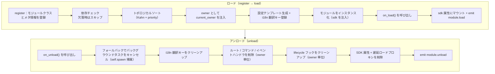

**ロード時にフレームワークが行ってくれること**（`on_load` を書くだけで、残りは自動的に完了します）：

| ステップ | フレームワークが自動で行うこと |
|------|-------------|
| owner 注入 | インスタンス化の間、モジュール名を `owner_scope` でラップします——`on_load` 内で登録したコマンド/イベント/フック/バックグラウンドタスクは**自動的にこのモジュールに帰属**し、アンロード時には owner 単位で一括クリーンアップできます |
| 設定テンプレート | `ConfigClass` を宣言したモジュールでは、フレームワークが自動で `ErisPulse.<ModuleName>` 設定セクションを生成/入力します |
| i18n 翻訳キー | `I18nClass` を宣言したモジュールでは、翻訳キーが自動登録されます（アンロード時に自動解除） |
| 依存トポロジ | `depends` の宣言に基づいてソートし、依存されるモジュールが先にロードされることを保証します。循環依存は `RuntimeError` で拒否されます |
| SDK マウント | インスタンス化後に `sdk.<ModuleName>` にマウントされるため、`sdk.MyModule.xxx` でアクセスできます |

**アンロード時にフレームワークがクリーンアップしてくれるもの**（上の U1→U7 に対応）：`on_unload` の実行後にフォールバックとしてクリーンアップを行います——バックグラウンドタスクの強制キャンセル（`self.spawn` で作成されたもの。グレースフルな終了処理は `on_unload` 内で自身で行ってください）、i18n キー、ルート、コマンド/イベントハンドラ、lifecycle フック、そして最後に SDK 属性の削除です。`purge=True` の場合はさらに登録スタブの削除 + `sys.modules` のクリーンアップが行われます。

> これらの自動クリーンアップこそが、「`on_load`/`on_unload` だけ書けば手動で unregister する必要がない」という安心感の根拠です——フレームワークは owner 帰属の仕組みによって、「登録した者がクリーンアップする」をワンステップで実現しています。

## SDK オブジェクト

### コアモジュールへのアクセス

```python
from ErisPulse import sdk

# sdk オブジェクトを通じてすべてのコアモジュールにアクセス
sdk.logger.info("ログ")
sdk.storage.set("key", "value")
config = sdk.config.getConfig("MyModule")
```

### モジュール間通信

```python
# 他のモジュールにアクセス
other_module = sdk.OtherModule
result = await other_module.some_method()
```

## アダプターの送信メソッド照会

新しい標準仕様では、フォールバック送信メカニズムを実現するために `__getattr__` メソッドをオーバーライドすることが求められるため、`hasattr` メソッドを使ってメソッドの存在を確認することができなくなりました。`2.3.5` 以降、送信メソッドを照会する機能が新たに追加されました。

### サポートされている送信メソッドの一覧

```python
# プラットフォームがサポートするすべての送信メソッドを一覧表示
methods = sdk.adapter.list_sends("onebot11")
# 戻り値: ["Text", "Image", "Voice", "Markdown", ...]
```

### メソッドの詳細情報の取得

```python
# 特定のメソッドの詳細情報を取得
info = sdk.adapter.send_info("onebot11", "Text")
# 戻り値:
# {
#     "name": "Text",
#     "parameters": [
#         {"name": "text", "type": "str", "default": null, "annotation": "str"}
#     ],
#     "return_type": "Awaitable[Any]",
#     "docstring": "テキストメッセージを送信します..."
# }
```

## 設定管理

### 宣言的設定（推奨）

v2.5.2 以降、モジュールは `ConfigClass` で設定クラスを宣言でき、アダプターと同一の設定 Schema システムを使用します。設定は `self.cfg` を通じてリアルタイムに読み取られ、変更は直ちに反映されます：

```python
from dataclasses import dataclass, field
from ErisPulse.Core.Bases import BaseModule
from ErisPulse.Core.Bases import BaseConfig

@dataclass
class MyModuleConfig(BaseConfig):
    api_key: str = field(
        default="",
        metadata={
            "description": {"i18n": "my_module.api_key", "default": "API キー"},
            "required": True,
            "secret": True,
            "ui": {"widget": "password", "group": "basic", "order": 1},
        },
    )
    timeout: int = field(
        default=30,
        metadata={
            "description": {"i18n": "my_module.timeout", "default": "タイムアウト（秒）"},
            "ui": {"widget": "number", "group": "advanced", "order": 2},
        },
    )

class MyModule(BaseModule):
    ConfigClass = MyModuleConfig

    def __init__(self, sdk):
        self.sdk = sdk
        self.logger = sdk.logger.get_child("MyModule")

    async def on_load(self, event):
        self.logger.info("モジュールがロードされました")

    async def on_unload(self, event):
        pass

    async def do_something(self):
        cfg = self.cfg  # リアルタイムに読み取り、型安全
        api_key = cfg.api_key
        timeout = cfg.timeout
```

`BaseConfig` は汎用の設定基底クラスで、アダプター、モジュール、外部プロジェクトなどあらゆるシーンに適用できます。設定フィールドは i18n による多言語説明をサポートしています（詳細は [i18n ドキュメント](../../advanced/i18n.md#設定フィールドの多言語) を参照）。

> [!NOTE]
> モジュール（アダプターを含む）のロード、アンロード、起動・停止などのライフサイクルはフレームワークが一元管理します（`module manager` / `scope` が照会・制御 API を提供します）。`ConfigClass` はビジネスパラメータのみを担うべきであり、モジュール内部で「自分を起動すべきかどうか」を再度ネストして判断するロジックは不要です。

設定 Schema システムはさらに以下もサポートしています（v2.8.0+。詳細は [アダプター core-concepts](../adapters/core-concepts.md#metadata-規約) を参照）：

- **docstring によるフィールド説明の自動生成**：metadata `description` が宣言されていない場合、docstring の `:ivar フィールド: 説明` または `Attributes:` セクションから自動的にフォールバック抽出します
- **ネスト dataclass 設定**：フィールド型がネスト dataclass の場合、schema/テンプレート/バリデーションが再帰的に処理され、WebUI ではネストされたグループとしてレンダリングされます
- **`example` 非永続化フィールド**：`metadata={"example": True}` のフィールドは config.toml に書き込まれず、`config.full.example` にのみ記録されます（冗長でほとんど変更しない高度な設定項目に適しています）。ユーザーが手動で設定した後は通常どおり永続化されます

### 宣言的翻訳キー（v2.7.0+）

v2.7.0 以降、モジュールは `ConfigClass` を宣言するのと同様に、ネストクラス `I18nClass` によって翻訳キーを一元的に宣言できます。フレームワークはロード時に宣言されたすべての翻訳キーを**自動登録**するため、`i18n.register()` を手動で呼び出す必要はありません。また、登録のタイミングは設定テンプレートの生成より前であるため、設定の説明で参照される i18n キーが確実に利用可能です。

```python
from ErisPulse.Core.Bases import BaseConfig, BaseI18n, I18nKey

class MyModule(BaseModule):
    # 設定クラス（任意）
    @dataclass
    class ConfigClass(BaseConfig):
        welcome_msg: str = field(
            default="ようこそ",
            metadata={
                "description": {"i18n": "mymodule.welcome_msg", "default": "ようこそメッセージ"},
            },
        )

    # 翻訳キーコレクションクラス（任意）
    class I18nClass(BaseI18n):
        # 属性名から完全なキーパスが自動的に構築されます：<モジュール名>.<属性名>
        welcome_msg: I18nKey = I18nKey(
            default="Welcome Message",   # 言語に依存しないフォールバック
            zh_CN="ようこそメッセージ",
            zh_TW="歡迎訊息",
            en="Welcome Message",
            ja="ウェルカムメッセージ",
            ru="Приветственное сообщение",
        )
        hello: I18nKey = I18nKey(
            default="Hello, {name}!",
            zh_CN="こんにちは、{name}！",
            zh_TW="你好，{name}！",
            en="Hello, {name}!",
            ja="こんにちは、{name}！",
            ru="Привет, {name}!",
        )
```

詳細は [i18n 推奨記法](../../advanced/i18n.md#推奨記法i18nclassによる翻訳キーの宣言-v270) を参照してください。

### 手動での設定読み取り（非推奨）

> **非推奨**：代わりに [宣言的設定](#宣言的設定推奨) と `self.cfg` によるリアルタイム読み取りを使用してください。

```python
class MyModule(BaseModule):
    def __init__(self, sdk):
        self.sdk = sdk

    def _load_config(self):
        config = self.sdk.config.getConfig("MyModule")
        if not config:
            self.sdk.config.setConfig("MyModule", {"api_key": "", "timeout": 30})
            return {"api_key": "", "timeout": 30}
        return config
```

## ストレージシステム

### 基本的な使い方

```python
# データを保存
sdk.storage.set("user:123", {"name": "山田太郎"})

# データを取得
user = sdk.storage.get("user:123", {})

# データを削除
sdk.storage.delete("user:123")
```

### トランザクションの使い方

```python
# トランザクションを使用してデータの一貫性を確保
with sdk.storage.transaction():
    sdk.storage.set("key1", "value1")
    sdk.storage.set("key2", "value2")
    # いずれかの操作が失敗した場合、すべての変更がロールバックされます
```

## イベント処理

### イベントハンドラの登録

```python
from ErisPulse.Core.Event import command, message

# コマンドを登録
@command("info", help="情報を取得")
async def info_handler(event):
    await event.reply("これは情報です")

# メッセージハンドラを登録
@message.on_group_message()
async def group_handler(event):
    sdk.logger.info(f"グループメッセージを受信: {event.get_text()}")
```

### イベントハンドラのライフサイクル

フレームワークがイベントハンドラの登録と解除を自動的に管理するため、`on_load` 内で登録するだけで済みます。

## 遅延ロード機構

### 動作原理

```python
# モジュールは初回アクセス時にのみ初期化されます
result = await sdk.my_module.some_method()
# ↑ ここでモジュールの初期化がトリガーされます
```

### 即時ロード

即時初期化が必要なモジュール（リスナー、タイマーなど）の場合：

```python
@staticmethod
def get_load_strategy():
    return ModuleLoadStrategy(
        lazy_load=False,  # 即時ロード
        priority=100
    )
```

## エラー処理

### 例外の捕捉

```python
async def handle_event(self, event):
    try:
        # ビジネスロジック
        await self.process_event(event)
    except ValueError as e:
        self.logger.warning(f"パラメータエラー: {e}")
        await event.reply(f"パラメータエラー: {e}")
    except Exception as e:
        self.logger.error(f"処理に失敗しました: {e}")
        raise
```

### ログ出力

```python
# 異なるログレベルを使用
self.logger.debug("デバッグ情報")    # 詳細なデバッグ情報
self.logger.info("実行状態")      # 通常の実行情報
self.logger.warning("警告情報")  # 警告情報
self.logger.error("エラー情報")    # エラー情報
self.logger.critical("致命的エラー") # 致命的エラー
```


### Event 包装类详解

# Event ラッパークラス詳解

> [!NOTE]
> **L1 コア必読**——トップページの「学習パス」に含まれる5つのコアドキュメントの1つで、モジュール開発に必須です。


ハンドラー内の `event` パラメータが直接 `.get_text()` / `.reply()` / `.wait_reply()` を呼び出せるのは、Event ラッパークラスのおかげです。本ドキュメントはその完全なメソッド一覧です——イベントハンドラーを書く際に必要に応じて参照してください。メソッドのシグネチャと動作は、ここに記載の内容が正となります。

## event パラメータに型注釈を追加する

イベントハンドラの `event` パラメータは **Event 包装クラス**（dict のサブクラス）です。このパラメータに型注釈を付けることを強く推奨します：

```python
from ErisPulse.Core.Event import Event

@message.on_private_message()
async def handler(event: Event):
    text = event.get_text()   # IDE が便利なメソッドをすべて自動補完
    await event.reply(text)   # 静的チェック時に誤字が発見される
```

型注釈を付けない場合、IDE は Event 上のメソッド（`get_text()` / `reply()` / `wait_reply()` / プラットフォーム拡張メソッドなど）を認識できず、すべて手動で記憶して入力する必要があります。

> **注意**：イベントハンドラのコールバックの `event` は **Event 包装クラス**（注釈は `Event`）です。一方、モジュールのライフサイクルメソッド `on_load` / `on_unload` の `event` は普通の **dict**（注釈は `dict`）です。これらは混同しないでください。

## 核心特性

- **完全互換性**：Event は dict を継承しています
- **便利なメソッド**：多数の便利なメソッドを提供しています
- **プロパティアクセス**：イベントフィールドにドット演算子でアクセスできます
- **後方互換性**：すべてのメソッドはオプションです

## 核心フィールドメソッド

```python
from ErisPulse.Core.Event import command

@command("info")
async def info_command(event: Event):
    event_id = event.get_id()
    platform = event.get_platform()
    time = event.get_time()
    print(f"ID: {event_id}, プラットフォーム: {platform}, 時間: {time}")
```

## メッセージイベントメソッド

```python
from ErisPulse.Core.Event import message

@message.on_private_message()
async def private_handler(event: Event):
    text = event.get_text()
    user_id = event.get_user_id()
    nickname = event.get_user_nickname()
    await event.reply(f"こんにちは、{nickname}！")
```

## メッセージタイプの判断

```python
from ErisPulse.Core.Event import message

@message.on_group_message()
async def group_handler(event: Event):
    is_private = event.is_private_message()
    is_group = event.is_group_message()
    is_at = event.is_at_message()
    await event.reply(f"タイプ: {'プライベートチャット' if is_private else 'グループチャット'}")
```

## 回答機能

```python
from ErisPulse.Core.Event import command

@command("ask")
async def ask_command(event: Event):
    await event.reply("あなたの名前を入力してください:")
    reply = await event.wait_reply(timeout=30)
    if reply:
        name = reply.get_text()
        await event.reply(f"こんにちは、{name}！")

@command("price")
async def price_command(event: Event):
    await event.reply("金額を入力してください（例：5元）:")
    # 回答が正規表現に一致しない場合、タイムアウトするまで待機し続ける
    reply = await event.wait_reply(timeout=30, regex=r"\d+\s*元")
    if reply:
        await event.reply(f"金額を受け取りました: {reply.get_text()}")
```

## インタラクティブな会話の高度な機能

> [!NOTE]
> 本機能は ErisPulse **2.8.0+** が必要です。

```python
# 会話の定期的なリマインダー：5 分間返信がない場合にリマインダーを送信し、ユーザーが返信すると自動的にキャンセル
reminder = event.remind(300, "まだですか？話したくない場合は「退出」を入力してください")
reminder.cancel()  # 手動でキャンセルすることも可能です

# タイムアウトによる昇格：時間経過後に必ず通知（返信によってキャンセルされない）、例えば長時間未処理の通知を主人に通知
event.escalate(1800, lambda e: notify_master("工単がタイムアウトしました"))

# 複数ルートの待機：「同意」および「拒否」のいずれかを同時に待機し、先に到着したものを優先
which, reply = await event.select(
    event.expect(pattern="同意*", user="10001"),
    event.expect(pattern="拒绝*", user="10002"),
    timeout=60,
)
if which is None:
    await event.reply("承認がタイムアウトしました")

# 会話レベルの待機：同じグループ内の誰からの返信でも対象になります（グループ協力）
reply = await event.wait_reply(session=True, prompt="誰か回答していただけますか？")

# 会話の受信箱：現在の会話における最新の 20 件のメッセージ（ロボット、AI のコンテキスト / リピート防止の基盤を含む）
messages = await event.history(20)

# メッセージトランザクション：例外が発生した場合、トランザクション内で送信されたメッセージを自動的に撤回
async with event.message_tx():
    await event.reply("処理中です、少々お待ちください...")
    result = await do_something()
    await event.reply(f"完了：{result}")
```

## コマンド情報の取得

```python
from ErisPulse.Core.Event import command

@command("cmdinfo")
async def cmdinfo_command(event: Event):
    cmd_name = event.get_command_name()
    cmd_args = event.get_command_args()
    await event.reply(f"コマンド: {cmd_name}, 引数: {cmd_args}")
```

## 通知イベントメソッド

```python
from ErisPulse.Core.Event import notice

@notice.on_friend_add()
async def friend_add_handler(event: Event):
    await event.reply("友達追加してくれてありがとう！")
```

## 方法速查表

### 核心方法

#### 事件基础信息
- `get_id()` - イベントIDを取得
- `get_time()` - イベントのタイムスタンプ（Unix秒単位）を取得
- `get_type()` - イベントのタイプ（message/notice/request/meta）を取得
- `get_detail_type()` - イベントの詳細タイプ（private/group/friend等）を取得
- `get_platform()` - プラットフォーム名を取得

#### ロボット情報
- `get_self_platform()` - ロボットのプラットフォーム名を取得
- `get_self_user_id()` - ロボットのユーザーIDを取得
- `get_self_account_id()` - ロボットのアカウントID（複数Botモード）を取得
- `get_self_info()` - ロボットの完全な情報辞書を取得

#### 会話識別子
- `get_target_id()` - 統一されたターゲットIDを取得（グループチャットは `group_id`、チャンネルは `channel_id`、プライベートチャットは `user_id` を返す。group → channel → guild → thread → userの順に最初の非空値を返す）
- `get_session_id()` - セッションの唯一の識別子を取得、形式は `{platform}:{detail_type}:{target_id}`

### メッセージイベントメソッド

#### メッセージ内容
- `get_message()` - メッセージセグメントの配列を取得（OneBot12形式）
- `get_alt_message()` - メッセージの代替テキストを取得
- `get_text()` - 純粋なテキスト内容を取得（`get_alt_message()`のエイリアス）
- `get_message_text()` - 純粋なテキスト内容を取得（`get_alt_message()`のエイリアス）

#### 送信者情報
- `get_user_id()` - 送信者のユーザーIDを取得
- `get_user_nickname()` - 送信者のニックネームを取得
- `get_sender()` - 送信者の完全な情報辞書を取得

#### グループ/チャンネル情報
- `get_group_id()` - グループIDを取得（グループメッセージ）
- `get_channel_id()` - チャンネルIDを取得（チャンネルメッセージ）
- `get_guild_id()` - サーバーIDを取得（サーバーメッセージ）
- `get_thread_id()` - トピック/サブチャンネルIDを取得（トピックメッセージ）

#### @メッセージ関連
- `has_mention()` - @ロボットが含まれているか
- `get_mentions()` - すべての@されたユーザーIDのリストを取得

### メッセージタイプ判断

#### 基礎判断
- `is_message()` - メッセージイベントであるか
- `is_private_message()` - プライベートチャットメッセージか
- `is_group_message()` - グループチャットメッセージか
- `is_at_message()` - @メッセージか（`has_mention()`のエイリアス）

### 通知イベントメソッド

#### 通知操作者
- `get_operator_id()` - 操作者のIDを取得
- `get_operator_nickname()` - 操作者のニックネームを取得

#### 通知タイプ判断
- `is_notice()` - 通知イベントであるか
- `is_group_member_increase()` - グループメンバー増加イベント
- `is_group_member_decrease()` - グループメンバー減少イベント
- `is_friend_add()` - 友達追加イベント（`detail_type == "friend_increase"`に一致）
- `is_friend_delete()` - 友達削除イベント（`detail_type == "friend_decrease"`に一致）

### 要求イベントメソッド

#### 要求情報
- `get_comment()` - 要求の付言を取得

#### 要求タイプ判断
- `is_request()` - 要求イベントであるか
- `is_friend_request()` - 友達要求か
- `is_group_request()` - グループ要求か

### 返信機能

#### 基礎返信
- `reply(content, method="Text", at_sender=False, quote=False, at_users=None, reply_to=None, at_all=False, via=None, **kwargs)` - 一般的な返信メソッド
  - `content`: 送信内容（テキスト、URLなど）
  - `method`: 送信方法、デフォルトは "Text"、"Image"/"Voice"/"Video"/"File" など
  - `at_sender`: 送信者を@するか（自動的に user_id を抽出）
  - `quote`: 現在のメッセージを引用して返信するか（自動的に message_id を抽出）
  - `at_users`: @するユーザーIDのリスト、例: `["user1", "user2"]`
  - `reply_to`: 手動で返信するメッセージIDを指定
  - `at_all`: 全員を@するか
  - `**kwargs`: 余分なパラメータ（例: Mentionメソッドの user_id）

- `reply_ob12(message)` - OneBot12メッセージセグメントを使って返信
  - `message`: OneBot12メッセージセグメントのリストまたは辞書、MessageBuilderを使って構築

#### プラットフォーム機能の確認
- `supports(method)` - 現在のプラットフォームが特定の送信方法（例: `"Image"`、`"Voice"`）をサポートしているか確認、`bool`を返す
- `available_methods()` - 現在のプラットフォームで利用可能な送信方法の一覧を取得、メソッド名のリストを返す

#### 転送機能

> **注意**: 転送機能はアダプターのSend DSLによって実装される必要があり、Eventラッパークラス自体は直接の転送メソッドを提供しない。

```python
# メッセージをグループに転送
adapter = sdk.adapter.get(event.get_platform())
target_id = event.get_group_id()  # または他のグループIDを指定
await adapter.Send.To("group", target_id).Text(event.get_text())
```

### 返信待ち機能

- `wait_reply(prompt=None, timeout=60.0, callback=None, validator=None, method="Text", pattern=None, regex=None)` - ユーザーからの返信を待つ
  - `prompt`: プロンプトメッセージ、提供された場合ユーザーに送信される
  - `timeout`: 待ち時間のタイムアウト（秒）、デフォルトは60秒
  - `callback`: 返信を受け取ったときに実行されるコールバック関数
  - `validator`: 返信が有効かどうかを検証する関数
  - `method`: プロンプトメッセージの送信方法、デフォルトは "Text"
  - `pattern`: globワイルドカード（`*` / `?` / `[seq]`）、返信テキストが一致する必要がある、一致しない場合は待機を続ける
  - `regex`: 正規表現、返信テキストが一致する必要がある（`pattern` と `regex` のどちらか一方を選択）、一致しない場合は待機を続ける
  - ユーザーの返信のEventオブジェクトを返す、タイムアウト時は`None`を返す

#### 交互メソッド

- `confirm(prompt=None, timeout=60.0, yes_words=None, no_words=None, method="Text", hint=False)` - 確認対話
  - `True`（確認）/ `False`（否定）/ `None`（タイムアウト）を返す
  - 内部的に中英語の確認語を自動認識し、カスタム語集を指定可能
  - `method`: 送信方法、デフォルトは "Text"、"Image"/"Markdown" などの非テキスト方式もサポート
  - `hint`: プロンプトの末尾に自動的に確認語のヒント（例: "（はい/いいえ）"）を追加するか、デフォルトは`False`

- `choose(prompt, options, timeout=60.0, method="Text", options_format="auto", merge_prompt=False, placeholder="{options}")` - 選択メニュー
  - `options`: 選択肢のテキストリスト
  - 選択肢のインデックス（0ベース）を返す、タイムアウト時は`None`を返す
  - `method`: 送信方法、デフォルトは "Text"、テキスト系メソッド (Text/Markdown/md/Html/h5) はデフォルトで選択肢を末尾にマージ
  - `options_format`: 選択肢のフォーマット（デフォルト: "auto"、methodに応じて自動的に組み込みスタイルを選択）
    - `"auto"`: Markdown→箇条書き（`- 1.選択肢`）、Html→順序付きリスト（`<ol>`）、その他の場合は純粋なテキストリスト
    - `"list"`: 各行に1つずつ、例: ``1. 選択肢A\n2. 選択肢B``
    - `"inline"`: 1行に表示、例: ``1.A | 2.B``
    - `"md"`: Markdownの箇条書き
    - `"html"`: Htmlの順序付きリスト
    - `callable`: 自作の関数、``list[str]``を受け取り``str``を返す
  - `merge_prompt`: 強制的に1つのメッセージにマージして送信するか、デフォルトは`False`
    - `False`（デフォルト）: テキスト系メソッドは自動的にマージ、非テキスト系メソッドはまずpromptを送信してからTextの選択肢を送信
    - `True`: どんなmethodでも1つのメッセージにマージしてユーザーが指定したmethodで送信
  - `placeholder`: 選択肢を挿入する占位符、デフォルトは`{options}`、promptにこのマーカーが含まれる場所に選択肢のテキストを置き換え、空文字に設定すると常に末尾に追加

- `collect(fields, timeout_per_field=60.0)` - フォーム収集
  - `fields`: フィールドのリスト、各項目には`key`、`prompt`、オプション`validator`、オプション`method`が含まれる
  - `{key: value}`の辞書を返す、いずれかのフィールドがタイムアウトすると`None`を返す
  - 各フィールドは`method`キーで送信方法を指定可能、例: 画像を収集する場合 ``{"key": "avatar", "prompt": "プロフィール画像を送ってください", "method": "Image"}``
  - 各フィールドは`options`キー（リスト）をオプションで提供可能、提供された場合、該当フィールドは選択問題になる（`choose`のロジックを自動的に呼び出す）
  - 各フィールドは`options_format`、`merge_prompt`、`placeholder`キーをオプションで提供可能、選択肢のフォーマット、メッセージのマージ動作、占位符を制御

- `wait_for(event_type="message", condition=None, timeout=60.0)` - 任意のイベントを待つ
  - `condition`: 条件関数、`True`を返した場合に一致する
  - 一致するEventオブジェクトを返す、タイムアウト時は`None`を返す

- `conversation(timeout=60.0)` - 複数回対話コンテキストを作成
  - `Conversation`オブジェクトを返す、`say()`/`wait()`/`confirm()`/`choose()`/`collect()`/`stop()`がサポートされる
  - `is_active`属性は対話がアクティブかどうかを示す

#### 交互メソッドの例

**confirm() - 確認対話:**

```python
@command("delete", help="データを削除")
async def delete_handler(event: Event):
    if await event.confirm("すべてのデータを削除してもよろしいですか？"):
        sdk.storage.delete("all_data")
        await event.reply("データを削除しました")
    else:
        await event.reply("キャンセルしました")
```

**confirm() - ヒント付き:**

```python
# hint=True はプロンプトの末尾に "（はい/いいえ）" を追加
if await event.confirm("続行してもよろしいですか？", hint=True):
    await event.reply("続行しました")
# ユーザーが表示する: 続行してもよろしいですか？（はい/いいえ）
```

**choose() - 選択メニュー:**

```python
@command("color", help="色を選択")
async def color_handler(event: Event):
    choice = await event.choose("色を選択してください：", ["赤", "緑", "青"])
    if choice is not None:
        colors = ["赤", "緑", "青"]
        await event.reply(f"選択した色は：{colors[choice]}")
```

**choose() - 選択肢のフォーマットとメッセージのマージ:**

```python
# inline形式：選択肢を1行に表示
choice = await event.choose("選択してください：", ["A", "B", "C"], options_format="inline")
# 出力: 1.A | 2.B | 3.C

# 自作のフォーマット
choice = await event.choose("選択してください：", ["猫", "犬"],
    options_format=lambda opts: " / ".join(opts))
# 出力: 猫 / 犬

# options_format="auto"（デフォルト）：methodに応じて自動的に組み込みスタイルを選択
# Markdown → 箇条書き
choice = await event.choose(
    "## 選択してください", ["猫", "犬"],
    method="Markdown",  # autoは自動的にmdリストを認識
)
# 出力:
# ## 選択してください
# - 1. 猫
# - 2. 犬

# Html → 順序付きリスト
choice = await event.choose(
    "<h2>選択してください</h2>", ["猫", "犬"],
    method="Html", merge_prompt=True,  # autoは自動的にhtmlリストを認識
)
# 出力:
# <h2>選択してください</h2>
# <ol><li>1. 猫</li><li>2. 犬</li></ol>

# マージモード + 占位符
choice = await event.choose(
    "## 選択してください\n{options}\n番号を返信してください",
    ["猫", "犬"],
    method="Markdown", merge_prompt=True,
)

# 自作の占位符
choice = await event.choose(
    "選択してください: [choices]",
    ["猫", "犬"],
    placeholder="[choices]",
)
```

**collect() - フォーム収集:**

```python
@command("register", help="登録")
async def register_handler(event: Event):
    data = await event.collect([
        {"key": "name", "prompt": "お名前を入力してください："},
        {"key": "age", "prompt": "年齢を入力してください：",
         "validator": lambda e: e.get_text().isdigit()},
    ])
    if data:
        await event.reply(f"登録完了！{data['name']}、{data['age']}歳")
```

**非テキストメソッドのreply:**

```python
await event.reply("http://example.com/img.jpg", method="Image")
await event.reply("http://example.com/audio.mp3", method="Voice")

from ErisPulse.Core.Event import MessageBuilder
segments = MessageBuilder.text("この画像を見てください：").image("http://example.com/img.jpg").build()
await event.reply_ob12(segments)
```

> 完全なConversation多回対話の使い方は[Conversation多回対話](../../advanced/conversation.md)を参照してください。

### コマンド情報

#### コマンド基礎
- `get_command_name()` - コマンド名を取得
- `get_command_args()` - コマンド引数のリストを取得
- `get_command_raw()` - コマンドの元のテキストを取得
- `get_command_info()` - 完全なコマンド情報の辞書を取得
- `is_command()` - コマンドか

### 元データ

- `get_raw()` - プラットフォームの元のイベントデータを取得
- `get_raw_type()` - プラットフォームの元のイベントタイプを取得

### プラットフォーム拡張メソッド

アダプターはEventラッパークラスにプラットフォーム固有のメソッドを登録できる。メソッドは対応するプラットフォームのEventインスタンスでのみ利用可能で、他のプラットフォームでアクセスすると`AttributeError`が発生する。

プラットフォームメソッドは`Event.__getattribute__`により、内蔵メソッドよりも優先して有効になるため、`confirm`、`choose`、`collect`、`wait_reply`などの内蔵インタラクティブメソッドを覆い、プラットフォーム特有の実装（例: ボタン、カードなど）を提供できる。内蔵実装は`_builtin_*`関数としてエクスポートされ、覆い書き側で利用可能。

```python
# メールイベント - メールメソッドのみ
event = Event({"platform": "email", "email_raw": {"subject": "Hello"}})
event.get_subject()      # ✅ "Hello"を返す
event.get_chat_type()    # ❌ AttributeError

# Telegramイベント - Telegramメソッドのみ
event = Event({"platform": "telegram", "telegram_raw": {"chat": {"type": "private"}}})
event.get_chat_type()    # ✅ "private"を返す
event.get_subject()      # ❌ AttributeError

# 内蔵メソッドは常に利用可能
event.get_text()         # ✅ どのプラットフォームでも
event.reply("hi")        # ✅ どのプラットフォームでも
```

### 登録されたメソッドの照会

```python
from ErisPulse.Core.Event import get_platform_event_methods

methods = get_platform_event_methods("email")
# ["get_subject", "get_from", ...]
```

### `hasattr` と `dir` のサポート

```python
hasattr(event, "get_subject")   # platform="email"のときのみTrueを返す
"get_subject" in dir(event)     # 同上
```

### 跨プラットフォーム拡張（ワイルドカード）

`register_event_method`と`register_event_mixin`はプラットフォーム名として`"*"`を渡すことができ、登録されたメソッドは**すべてのプラットフォーム**のEventインスタンスで利用可能になる。AI対話、コンテキスト管理など、跨プラットフォームで再利用可能な機能に適している。

```python
from ErisPulse.Core.Event.wrapper import register_event_method

@register_event_method("*")
async def ai_chat(self, prompt: str):
    # selfはEventインスタンス、イベントデータと内蔵メソッドにアクセス可能
    await self.reply(f"AI: {prompt}")
```

登録後、どのプラットフォームのイベントハンドラでも`event.ai_chat(...)`を呼び出すことができる。

メソッドの優先順位（高い順）: プラットフォーム固有メソッド → ワイルドカードメソッド → 内蔵メソッド → 辞書キーアクセス。

> アダプター開発者が拡張メソッドを登録する方法は[イベントシステムAPI - 跨プラットフォーム拡張ワイルドカード](../../api-reference/event-system.md#跨平台扩展通配符)を参照してください。


### 模块开发最佳实践

# モジュール開発ベストプラクティス

> [!TIP]
> **いつこのドキュメントを読むべきか**：最初のモジュールを書き終えた後に読むことを推奨（エンジニアリングのベストプラクティス）。必要なければスキップしても、他の機能の利用には影響しません。


ここでは、モジュール開発におけるエンジニアリング上の作法をまとめています：非同期操作はイベントループをブロックしない、設定は宣言的に、他のモジュールのリソースを管理する場合はアンロード時に解放する——これに従って書けば、メモリリーク、バックグラウンドタスクの残存、ホットリロードの失効といったモジュール開発で最もよくある落とし穴を回避できます。

## モジュール設計

### 1. 単一責任の原則

各モジュールは1つのコア機能のみを担当すべきです：

```python
# 良い設計：各モジュールは1つの機能のみを担当
class WeatherModule(BaseModule):
    """天気照会モジュール"""
    pass

class NewsModule(BaseModule):
    """ニュース照会モジュール"""
    pass

# 悪い設計：1つのモジュールが複数の無関係な機能を担当
class UtilityModule(BaseModule):
    """天気、ニュース、ジョークなど複数の機能を含む"""
    pass
```

### 2. モジュール命名規則

```toml
[project]
name = "ErisPulse-ModuleName"  # ErisPulse- プレフィックスを使用
```

### 3. 明確な設定管理

宣言的設定（`ConfigClass` + `BaseConfig`）の使用を推奨します。型安全性、自動テンプレート生成、WebUI フォーム対応などの機能が得られます：

```python
from dataclasses import dataclass, field
from ErisPulse.Core.Bases import BaseConfig

@dataclass
class MyModuleConfig(BaseConfig):
    api_url: str = field(default="https://api.example.com", metadata={
        "description": {"i18n": "my_module.api_url", "default": "API アドレス"},
    })
    timeout: int = field(default=30, metadata={
        "description": {"i18n": "my_module.timeout", "default": "タイムアウト時間（秒）"},
    })
    cache_ttl: int = field(default=3600, metadata={
        "description": {"i18n": "my_module.cache_ttl", "default": "キャッシュ生存時間（秒）"},
    })

class MyModule(BaseModule):
    ConfigClass = MyModuleConfig

    async def do_something(self):
        cfg = self.cfg  # 型安全、リアルタイム読み取り
        await self._fetch(cfg.api_url, timeout=cfg.timeout)
```

手動方式で設定ストレージの読み書きを行うことも引き続き可能です（[モジュールのコア概念](core-concepts.md#設定管理)を参照）。

### 宣言的翻訳キー（v2.7.0+）

モジュールは `I18nClass` を通じて翻訳キーを一元的に宣言でき、フレームワークが自動的に i18n システムへ登録するため、手動で `i18n.register()` を呼び出す必要はありません。

```python
from ErisPulse.Core.Bases import BaseI18n, I18nKey

class MyModule(BaseModule):
    class I18nClass(BaseI18n):
        # プレースホルダー付きのビジネス翻訳キー
        welcome: I18nKey = I18nKey(
            default="Welcome, {name}!",
            zh_CN="欢迎你，{name}！",
            zh_TW="歡迎你，{name}！",
            en="Welcome, {name}!",
            ja="ようこそ、{name}！",
            ru="Добро пожаловать, {name}!",
        )
        # 設定フィールド説明の翻訳
        api_url: I18nKey = I18nKey(
            default="API URL",
            zh_CN="API 地址",
            zh_TW="API 位址",
            en="API URL",
            ja="API URL",
            ru="API URL",
        )
```

詳細な使い方は [i18n ドキュメント](../../advanced/i18n.md#推奨される書き方i18nclass-による翻訳キーの宣言v270) を参照してください。

## 非同期プログラミング

### 1. 非同期ライブラリの使用

```python
# SDK 組み込み HTTP クライアントの使用を推奨（非同期、ログと統計を自動取得）
from ErisPulse.Core import client

class MyModule(BaseModule):
    async def fetch_data(self, url):
        resp = await client.get(url)
        return await resp.json()

# sdk.client 経由でも使用可能（効果は同じ）
from ErisPulse import sdk

class MyModule(BaseModule):
    async def fetch_data(self, url):
        resp = await sdk.client.get(url)
        return await resp.json()

# aiohttp を直接インポートしない（フレームワークによる一元管理ができない）
import aiohttp

class MyModule(BaseModule):
    async def fetch_data(self, url):
        async with aiohttp.ClientSession() as session:
            async with session.get(url) as response:
                return await response.json()

# requests は使用しない（同期のためイベントループをブロックする）
import requests

class MyModule(BaseModule):
    def fetch_data(self, url):
        return requests.get(url).json()  # イベントループをブロックする
```

### 2. 正しい非同期操作

```python
from ErisPulse.Core.Event import Event  # event: Event アノテーションで IDE 補完が得られる

async def handle_command(self, event: Event):
    # 結果を待つ必要のある時間のかかる操作：直接 await（ライフサイクルが明確）
    result = await self._long_operation()

async def on_load(self, event: dict):
    # バックグラウンドタスク（ポーリング/タイマー/fire-and-forget）：self.spawn() を使用。
    # モジュールのアンロード時、フレームワークが on_unload の後にフォールバックでキャンセルするため、
    # self を保持することによるリークを回避できる
    self.spawn(self._poll())
```

> [!NOTE]
> バックグラウンドタスクには `self.spawn()` を推奨します（ErisPulse **2.8.0+**）。**2.8.3 以降**は、素の `asyncio.create_task`
> も自動的にモジュールへ暗黙的に帰属します（Task Factory が自動登録し、アンロード時にフォールバックでキャンセル、`self` 参照はリークしなくなります）。
> `self.spawn()` が引き続き推奨の書き方です——非メインループのスレッドからメインループへのスケジューリングや、明示的な `owner=` 指定をサポートします。
> **2.8.3 より前**のバージョンでは、素のタスクは帰属せず `self` 参照を保持し続けるためモジュールインスタンスが回収できなくなり
> （ホットリロード時のリーク）、`self.spawn()` を使う必要があります。詳細は [ライフサイクル管理](../../advanced/lifecycle.md#バックグラウンドタスクの帰属と自動キャンセル) を参照。

### 3. リソース管理

```python
async def on_load(self, event):
    # SDK クライアントは接続プールを自動管理するため、手動で session を作成する必要なし
    pass
    
async def on_unload(self, event):
    # カスタムクライアントが必要な場合は、リソースのクリーンアップを忘れずに
    pass
```

## イベント処理

### 1. Event ラッパークラスの使用

```python
# Event ラッパークラスの便利メソッドを使用
@command("info")
async def info_command(event: Event):
    user_id = event.get_user_id()
    nickname = event.get_user_nickname()
    await event.reply(f"こんにちは、{nickname}！")

# 辞書へ直接アクセスするのではなく
@command("info")
async def info_command(event: Event):
    user_id = event["user_id"]  # わかりにくく、間違いやすい
```

### 2. 遅延ロードの適切な使用

```python
# 低頻度コマンドモジュール：activate_on トリガーを宣言し、最初に一致するコマンドが到着した時点で自動アクティブ化（遅延ロードを維持）
class CommandModule(BaseModule):
    @staticmethod
    def get_load_strategy():
        return ModuleLoadStrategy(lazy_load=True, activate_on=[
            {"command": {"name": "dice", "help": "サイコロを1つ振る", "aliases": ["d"]}},
        ])

# 低頻度リスナーモジュール：イベントトリガーを宣言し、イベント到着時に自動アクティブ化
class ListenerModule(BaseModule):
    @staticmethod
    def get_load_strategy():
        return ModuleLoadStrategy(lazy_load=True, activate_on=[
            {"notice": "group_member_increase"},
        ])

# 高頻度トリガー（すべてのメッセージを処理する必要がある）や起動時に即時準備が必要なモジュール：即時ロード
class HotListenerModule(BaseModule):
    @staticmethod
    def get_load_strategy():
        return ModuleLoadStrategy(lazy_load=False)

# ユーティリティモジュールは遅延ロードが適している
class UtilityModule(BaseModule):
    @staticmethod
    def get_load_strategy():
        return ModuleLoadStrategy(lazy_load=True)
```

> `activate_on` の完全な構文（イベントの3形式 / コマンド略記と dict 宣言 / help フォールバックチェーン）については
> [遅延ロードモジュールシステム](../../advanced/lazy-loading.md#イベント駆動の遅延アクティベーションactivate_on) を参照してください。

### 3. イベントハンドラーの登録

```python
async def on_load(self, event):
    # on_load 内でイベントハンドラーを登録
    @command("hello")
    async def hello_handler(event: Event):
        await event.reply("こんにちは！")
    
    @message.on_group_message()
    async def group_handler(event: Event):
        self.logger.info("グループメッセージを受信しました")
    
    # 手動で登録解除する必要はなく、フレームワークが自動的に処理する
```

## ユーティリティモジュール：他のモジュールのものを預かる時は「アンロード通知」を受け止める

**いつ必要か**：あなたのモジュールが他のモジュールの代わりにものを管理している場合（タイマーコールバック、サブスクライバー、接続、キャッシュエントリなど）。これらの参照を、相手モジュールのアンロード後も捨てずに保持し続けると、相手のインスタンスは永遠に回収されません——これがユーティリティモジュールで最もよくあるメモリリークの原因です。

```python
from ErisPulse.Core.Bases import BaseModule
from ErisPulse.runtime import off_cleanup, on_cleanup

class MyToolModule(BaseModule):
    def __init__(self):
        self._entries = {}  # {モジュール名: 管理しているもの}

    def register(self, entry):
        owner = on_cleanup(self._drop)   # ① 登録時にクリーンアップチェーンへ登録し、呼び出し元を自動識別
        self._entries.setdefault(owner, []).append(entry)

    def _drop(self, owner: str):
        self._entries.pop(owner, None)   # ② 相手のアンロード時にフレームワークが自動呼び出し：相手のものを破棄

    async def on_unload(self, event):
        off_cleanup(self._drop)          # ③ 自身のアンロード前にフックを解除
```

たったこれだけで、フレームワークが保証します：

- 相手モジュールが**アンロード / 無効化**される（またはアダプターが終了する）とき、`_drop("相手モジュール名")` が必ず呼び出される
- **呼び出し元の識別は全自動**：相手が `on_load` 内で直接 `sdk.MyToolModule.register(...)` を呼び出しても、`sdk.module.call("MyToolModule", "register", ...)` 経由で呼び出しても、誰が呼び出したのかを正しく識別できる
- タイミングを気にする必要なし——フックはフレームワークのクリーンアップチェーン内でトリガーされ、リーク診断より前に実行されるため、誤検出されない

組み込まない場合の結果：相手が `purge` で完全アンロードされるときにインスタンスを回収できず（リーク診断が「回収不可」と報告）、相手自身も `on_unload` 内であなたへの登録解除を行わなければ、リークは恒久的なものになります。

**通常のモジュール（他のモジュールのものを管理しない）はこれを気にする必要ありません**——フレームワークリソース（コマンド / ハンドラー / ルート / バックグラウンドタスクなど）のアンロード時のクリーンアップは全自動です。

> トリガータイミング、呼び出し元識別ルール、タイムアウトとフォールトトレランスなどの詳細は
> [所有権システム · ユーティリティモジュールガイド](../../advanced/ownership.md#ユーティリティモジュールガイド他のモジュールのハンドルを管理する) を参照してください。

## エラー処理

### 1. 例外の分類処理

```python
from ErisPulse.Core.Bases.errors import ClientError

async def handle_event(self, event: Event):
    try:
        result = await self._process(event)
    except ValueError as e:
        # 予期されるビジネスエラー
        self.logger.warning(f"ビジネス警告: {e}")
        await event.reply(f"パラメータエラー: {e}")
    except ClientError as e:
        # ネットワークエラー（sdk.client の基盤となる aiohttp 例外は自動変換済み）
        self.logger.error(f"ネットワークエラー {e.method} {e.url}: {e}")
        await event.reply("ネットワークリクエストに失敗しました。しばらくしてから再試行してください")
    except Exception as e:
        # 予期しないエラー
        self.logger.error(f"不明なエラー: {e}", exc_info=True)
        await event.reply("処理に失敗しました。管理者に連絡してください")
        raise
```

### 2. タイムアウト処理

```python
# SDK 組み込みクライアントの使用を推奨（タイムアウトとリトライを内蔵）
from ErisPulse.Core import client
from ErisPulse.Core.Bases.errors import ClientTimeoutError

async def fetch_with_timeout(self, url, timeout=30):
    try:
        resp = await client.get(url, timeout=timeout)
        return await resp.json()
    except ClientTimeoutError:
        self.logger.warning(f"リクエストタイムアウト: {url}")
        raise
```

## ストレージシステム

### 1. トランザクションの使用

```python
# トランザクションを使用してデータの一貫性を確保
async def update_user(self, user_id, data):
    with self.sdk.storage.transaction():
        self.sdk.storage.set(f"user:{user_id}:profile", data["profile"])
        self.sdk.storage.set(f"user:{user_id}:settings", data["settings"])

# ❌ トランザクションを使わないとデータ不整合が起こる可能性
async def update_user(self, user_id, data):
    self.sdk.storage.set(f"user:{user_id}:profile", data["profile"])
    # ここでエラーが発生すると、上の設定はロールバックできない
    self.sdk.storage.set(f"user:{user_id}:settings", data["settings"])
```

### 2. バッチ操作

```python
# バッチ操作でパフォーマンスを向上
def cache_multiple_items(self, items):
    self.sdk.storage.set_multi({
        f"item:{k}": v for k, v in items.items()
    })

# ❌ 何度も呼び出すと効率が悪い
def cache_multiple_items(self, items):
    for k, v in items.items():
        self.sdk.storage.set(f"item:{k}", v)
```

## ロギング

### 1. ログレベルの適切な使用

```python
# DEBUG: 詳細なデバッグ情報（開発時のみ）
self.logger.debug(f"入力パラメータ: {params}")

# INFO: 正常動作の情報
self.logger.info("モジュールがロードされました")
self.logger.info(f"リクエストを処理中: {request_id}")

# WARNING: 警告情報、主要機能には影響しない
self.logger.warning(f"設定項目 {key} が未設定のため、デフォルト値を使用します")
self.logger.warning("API の応答が遅く、最適化が必要な可能性があります")

# ERROR: エラー情報
self.logger.error(f"API リクエスト失敗: {e}")
self.logger.error(f"イベント処理失敗: {e}", exc_info=True)

# CRITICAL: 致命的エラー、即時対応が必要
self.logger.critical("データベース接続に失敗し、ボットが正常に動作できません")
```

### 2. 構造化ログ

```python
# 構造化ログを使用すると解析しやすい
self.logger.info(f"リクエスト処理: request_id={request_id}, user_id={user_id}, duration={duration}ms")

# ❌ 非構造化ログを使用
self.logger.info(f"ユーザー {user_id} からのリクエストを処理しました。所要時間 {duration} ミリ秒")
```

## パフォーマンス最適化

### 1. キャッシュの使用

```python
class MyModule(BaseModule):
    def __init__(self):
        self._cache = {}
        self._cache_lock = asyncio.Lock()
    
    async def get_data(self, key):
        async with self._cache_lock:
            if key in self._cache:
                return self._cache[key]
            
            # データベースから取得
            data = await self._fetch_from_db(key)
            
            # データをキャッシュ
            self._cache[key] = data
            return data
```

### 2. ブロッキング操作の回避

```python
# 非同期操作を使用
async def process_message(self, event: Event):
    # 非同期処理
    await self._async_process(event)

# ❌ ブロッキング操作
async def process_message(self, event: Event):
    # 同期操作、イベントループをブロックする
    result = self._sync_process(event)
```

## セキュリティ

### 1. 機密データの保護

```python
# 機密データは設定に保存（宣言的 ConfigClass、secret フィールドはログ/エクスポートに入らない）
from dataclasses import dataclass, field
from ErisPulse.Core.Bases import BaseModule, BaseConfig

@dataclass
class MyModuleConfig(BaseConfig):
    api_key: str = field(
        default="",
        metadata={"description": "API キー", "secret": True},
    )

class MyModule(BaseModule):
    ConfigClass = MyModuleConfig

    def check_api_key(self):
        if not self.cfg.api_key or self.cfg.api_key == "YOUR_API_KEY_HERE":
            raise ValueError("config.toml で有効な API キーを設定してください")

# ❌ 機密データのハードコード
class MyModule(BaseModule):
    API_KEY = "sk-1234567890"  # こんなことをしてはいけない！
```

### 2. 入力検証

```python
# ユーザー入力を検証
async def process_command(self, event: Event):
    user_input = event.get_text()
    
    # 入力長を検証
    if len(user_input) > 1000:
        await event.reply("入力が長すぎます。入力し直してください")
        return
    
    # 入力形式を検証
    if not re.match(r'^[a-zA-Z0-9]+$', user_input):
        await event.reply("入力形式が正しくありません")
        return
```

## テスト

### 1. ユニットテスト

```python
import pytest
from ErisPulse.Core.Bases import BaseModule

class TestMyModule:
    def test_config_defaults(self):
        """設定のデフォルト値をテスト"""
        config = MyModule.ConfigClass()
        assert config.timeout == 30
```

### 2. 結合テスト

```python
@pytest.mark.asyncio
async def test_command_handling():
    """コマンド処理をテスト"""
    module = MyModule()
    await module.on_load({})
    
    # コマンドイベントをシミュレート
    event = create_test_command_event("hello")
    await module.handle_command(event)
```

## デプロイ

### 1. バージョン管理

```toml
[project]
name = "ErisPulse-MyModule"
version = "1.0.0"
```

セマンティックバージョニングに従う：
- MAJOR.MINOR.PATCH
- メジャーバージョン：互換性のない API 変更
- マイナーバージョン：後方互換のある機能追加
- パッチバージョン：後方互換のある問題修正

### 2. README ヘッダー

`epsdk create` が生成する README には ErisPulse ヘッダー識別（ロゴ + バッジ行）が組み込まれています。推奨される2つのパターン：

**パターン A — ErisPulse ロゴのみ（デフォルト）：**

```markdown
<div align="center">


# MyModule

**一言説明**

<p>
  <a href="https://pypi.org/project/ErisPulse-MyModule/"></a>
  <a href="https://pypi.org/project/ErisPulse-MyModule/"></a>
  <a href="./LICENSE"></a>
  <a href="https://github.com/ErisPulse/ErisPulse"></a>
</p>

</div>
```

**パターン B — モジュールアイコン × ErisPulse ロゴ（カスタムアイコンがある場合）：**

```markdown
<div align="center">


<span style="font-size:44px;color:#c8c8c8;margin:0 18px;vertical-align:middle;">×</span>


# MyModule
（バッジ行は上に同じ）
</div>
```

必要に応じて GitHub Stars、Downloads などのバッジを追加できます。ロゴをプロジェクトのローカル（`.github/assets/ErisPulseLogo.png`）にダウンロードして、相対パス参照に変更することもできます。


### 数据模型层（ORM）

# データモデル層（ORM）

> [!TIP]
> **この記事を読むタイミング**：データモデル、自動テーブル作成、関連マッピングが必要な場合。不要であれば飛ばしても、他の機能の使用に影響はありません。

2.9.0 から、フレームワークに宣言型のデータモデル層が内蔵されました。`Model` を継承し、`Field` を使ってフィールドを宣言するだけで、自動テーブル作成と CRUD 機能が得られます。モデルは、内蔵されたストレージ層（SQLite / MySQL / PostgreSQL）の上に直接構築されています。ストレージのバックエンドは `ErisPulse.storage.backend` で設定され、**バックエンドの切り替えに伴いモデルのコードを変更する必要はありません**。

## モデルの宣言

```python
from ErisPulse.Core.Bases import Model, Field

class User(Model):
    id: int = Field(primary_key=True, autoincrement=True)
    name: str = Field(max_length=64)
    age: int = Field(default=0, ge=0, le=150)
    role: str = Field(default="user", choices=["user", "admin"])
    tags: list = Field(default_factory=list)          # JSON 列、読み書き時に自動的にシリアライズ
    bio: str = Field(default="", description={"i18n": "user.bio", "default": "自己紹介"})
```

- テーブル名はデフォルトでクラス名を snake_case に変換（`UserProfile → user_profile`）し、`__tablename__ = "xxx"` で上書き可能
- `Field` の制約語は宣言型設定クラスと同じ（`choices` / `ge` / `le` / `max_length`、`description` は i18n 辞書もサポート）；バリデータエンジンは設定検証と同じソース

## フィールドパラメータ

| パラメータ | 説明 |
|------|------|
| `default` | 既定値（提供されていない場合、かつ自動増分でない → NOT NULL が必須） |
| `default_factory` | 変更可能な既定値の工場（例: `list`） |
| `primary_key` | 主キー |
| `autoincrement` | 自動増分主キー（暗黙の主キー、`create` 後に自動で戻り値を埋め込む） |
| `max_length` | 文字列の最大長さ（生成される `VARCHAR(n)`、書き込み時の検証） |
| `nullable` | NULL を許可するかどうか（デフォルトは False） |
| `index` | 普通のインデックスを生成 |
| `unique` | 一意制約 |
| `choices` / `ge` / `le` | 列挙 / 数値範囲（書き込み時の検証） |
| `description` | 説明（i18n ディクショナリ、構成クラスと同じ形式） |
| `column_type` | SQL 列の型定義を上書き |

## 建表と CRUD

```python
await User.create_table()                      # 幂等（IF NOT EXISTS）

user = await User.create(name="Alice", age=20) # 挿入（自動増分主キーは自動的に戻り値として返される）
got = await User.get(id=user.id)               # 等値検索で最初の1件を取得

users = await User.where(User.age > 18).order_by("-age").limit(10).all()
first = await User.where(User.name == "Alice").first()
total = await User.count(User.age > 18)

user.age = 21
await user.save()                              # 主キーに基づいて更新（事前制約検証）；主キーが存在しない場合は挿入に降格（自動増分主キーもインスタンスに戻り値として返される）
await user.delete()                            # 主キーに基づいて削除

await User.update_all(User.age > 18, role="adult")  # バッチ更新
await User.delete_all(User.age > 100)               # バッチ削除
```

クエリ式は `> >= < <= == !=`、`in_([...])`、`&`（AND）/ `|`（OR）による組み合わせをサポートします：

```python
await User.where((User.age > 18) & User.name.in_(["Alice", "Bob"])).all()
```

## トランザクション

ORM の読み書きとフレームワークのストレージ層は、同じトランザクションルーティングを使用します。`storage.atransaction()` 環境のトランザクション内では、`create` / `save` / `delete` とクエリは自動的にトランザクション接続を再利用し、トランザクションに合わせて一括でコミットまたはロールバックされます。個別にコミットされることはありません。

```python
async with storage.atransaction():
    await User.create(name="Alice")
    ...  # ブロック内で例外が発生した場合、上記の INSERT もロールバックされます
```

## 宣言式構成クラスとの関係

モデルの宣言と `ConfigClass`（`@dataclass + field(metadata=...)`）は**同じ基底を共有**しています。制約辞書、検証エンジン（`validate_field_constraints`）、型カテゴリ登録表（`python_type_category`）などです。ただし、クラスの基盤は意図的に分離されています。構成フィールドは普通の値（TOMLの往復、一度のロードによるホット更新）であり、モデルフィールドは列記述子（クラスアクセス = クエリ式、行ごとのインスタンス）です。同じ宣言構文を用い、それぞれ異なる役割を持つ2つの基盤です。

### どちらの宣言を使うべきか

| 維度 | 構成クラス `field(metadata=...)` | モデルフィールド `Field()` |
|------|------------------------------|---------------------|
| 適用場面 | モジュールの動作パラメータ（少数、人間が読みやすい、ホット更新が必要） | 業務データのレコード（複数行、プログラムによる読み書き、クエリが必要） |
| ストレージ形態 | `config.toml`（コメントを保持、TOMLの往復） | データベーステーブル（自動作成、SQL方言） |
| 値の形態 | 普通の値（`dataclass`の属性として直接アクセス） | 記述子（クラスアクセス = 列式、インスタンスアクセス = 行値） |
| 制約の宣言 | `metadata={"choices": ..., "min": ..., "max": ...}` | `Field(choices=..., ge=..., le=..., max_length=...)` |
| 共有基底 | 検証エンジン + 制約辞書 + 型カテゴリ登録表（同一のもの） | 同左 |

経験則として：**「モジュールがどのように動作するか」は構成クラスを使い、「ユーザーがどのようなデータを生成したか」はモデルを使う**。

## 辺界と注意事項

- バックエンドはグローバルなストレージ設定によって決定されます。モデルは `__storage__` クラス属性を用いて、カスタムの `BaseStorage` インスタンスに上書きすることができます（テスト用の注入に使用）。
- `list` / `dict` フィールド（パラメータ化されたジェネリック、例えば `list[int]`、`dict[str, int]`）は、コンテナの種類に応じて JSON テキストとして列に格納され、読み書き時に自動的にシリアライズされます。
- `create` / `save` の前に自動的に制約検証が実行され、失敗した場合は `ValueError`（ローカライズされたメッセージ）が送出されます。
- 自動マイグレーションは**追加の列**の場面に対して提供されています（下記を参照）；列の型の変更や列の削除は手動で処理する必要があります。
- ストレージ接続の失敗が発生した際の動作は、ストレージ層と一致します：フレームワークはクラッシュせず、冷却後に自動的に再接続されます。

## 自動マイグレーション（フェーズ2）

`create_table()` は、テーブルが既に存在する場合、既存の列とモデルフィールドを自動的に比較します。**追加されたフィールド**は、`ALTER TABLE ADD COLUMN`（マイグレーションで `NOT NULL` 制約を削除し、既存の行に NULL を挿入）を自動的に実行し、`index=True` を宣言した新しいフィールドは同期的にインデックスが作成されます。手動でマイグレーションスクリプトを書く必要はありません。

```python
# v1リリース後にモデルを進化させ、email / bioフィールドを追加
class User(Model):
    __tablename__ = "orm_users"

    id: int = Field(primary_key=True, autoincrement=True)
    name: str = Field(max_length=64)
    age: int = Field(default=0)
    email: str = Field(default="")     # 新規追加：次回の create_table() で自動的に ADD COLUMN が実行される
    bio: str = Field(default="")

await User.create_table()              # 再帰的：追加された列のみマイグレーションが実行される
```

**制限事項**：追加列のみをサポートしています。主キーの変更、列の型の変更、列の削除は手動で処理する必要があります（破壊的な ALTER による誤操作を避けるため）。

## 外部キー（リレーションマッピングの基礎）

`foreign_key="テーブル.列"` は、列レベルの外部キー制約を宣言し、DDL 生成時に `REFERENCES` 子句を生成します。

```python
class Post(Model):
    __tablename__ = "posts"

    id: int = Field(primary_key=True, autoincrement=True)
    author: int = Field(foreign_key="orm_users.id")

    content: str = Field(max_length=255)
```

## 関係マッピング（relationship）

モデルクラス内で `relationship()` をクラス属性として宣言することで、**外キー列がどのテーブルに宣言されているかによって自動的に方向が判定されます**：

```python
from ErisPulse.Core.Bases import Model, Field, relationship

class User(Model):
    __tablename__ = "orm_users"

    id: int = Field(primary_key=True, autoincrement=True)
    name: str = Field(max_length=64)

    posts = relationship("Post", foreign_key="author")   # 外キーが相手のテーブルにある → has-many

class Post(Model):
    __tablename__ = "posts"

    id: int = Field(primary_key=True, autoincrement=True)
    author: int = Field(foreign_key="orm_users.id")
    content: str = Field(max_length=255)

    writer = relationship("User", foreign_key="author")  # 外キーがこのテーブルにある → belongs-to
```

**has-many**：インスタンス属性はクエリセットを返し、`QuerySet` の全チェイン機能が利用可能で、`create` は自動的に本テーブルの主キーを相手の外キー列に埋め込みます：

```python
alice = await User.get(name="Alice")

posts = await alice.posts.all()                          # このユーザーの全記事
latest = await alice.posts.order_by("-id").first()
total = await alice.posts.count()
hot = await alice.posts.where(Post.content != "").all()  # 相手のテーブルのフィールド条件を追加
await alice.posts.delete()                               # このユーザーのものだけ削除

new_post = await alice.posts.create(content="hi")        # author は自動的に alice.id に設定
```

**belongs-to**：`await` を直接実行すると相手のインスタンスが得られます（一致するものがない場合や外キーが NULL の場合は `None` を返します）：

```python
post = await Post.get(id=1)
writer = await post.writer          # User インスタンスまたは None
await writer.posts.count()          # 双方向にアクセス可能
```

**ポイント**：

- `related` にはクラス名の文字列（モデルクラス名の登録表を惰性で解析）または直接モデルクラスを渡すことができます。
- 関係のクエリと相手のモデルはそれぞれ独自のストレージバックエンドを使用します（バックエンド間の JOIN はサポートされていません。関係のクエリは独立した 2 つの SQL です）。
- 関係のクエリはキャッシュされず、アクセスするたびに即時クエリが実行されます。`User.where(...)` を使用して任意のカスタムクエリを行うことも可能です。

## 次のステップ

### データベースの変更やクラウドデータベースへのデプロイが必要な場合

- [ストアバックエンド](../advanced/storage-backends.md) — SQLite / MySQL / PostgreSQL の設定と切り替え、モデルコードに変更なし

### テーブル構造は不要で、いくつかのキーと値だけを保存したい場合

- [モジュールのコアコンセプト - ストレージシステム](modules/core-concepts.md#ストレージシステム) — モデルを宣言せずに軽量なキー/値ストアの使い方


=====
发布与工具
=====


### 发布模块到模块商店

# リリースとモジュールストアガイド

> [!TIP]
> **いつこのドキュメントを読むべきか**：作品を PyPI / モジュールストアにリリースする場合。必要なければスキップしても、他の機能の利用には影響しません。


開発したモジュールやアダプターを ErisPulse モジュールストアにリリースすることで、他のユーザーが簡単に発見・インストールできるようになります。

## モジュールストアの概要

ErisPulse モジュールストアは集中型のモジュールレジストリであり、ユーザーは CLI ツールを使ってコミュニティが提供するモジュールやアダプターを閲覧・検索・インストールできます。

### 閲覧と検索

```bash
# リモートで利用可能なすべてのパッケージを一覧表示
epsdk list-remote

# モジュールのみ表示
epsdk list-remote -t modules

# アダプターのみ表示
epsdk list-remote -t adapters

# リモートパッケージリストを強制更新
epsdk list-remote -r
```

[ErisPulse 公式サイト](https://www.erisdev.com/#market) にアクセスして、オンラインでモジュールストアを閲覧することもできます。

### サポートされている提出タイプ

| タイプ | 説明 | Entry-point グループ |
|------|------|----------------|
| モジュール (Module) | ボット機能の拡張、ビジネスロジックの実装 | `erispulse.module` |
| アダプター (Adapter) | 新しいメッセージプラットフォームへの接続 | `erispulse.adapter` |

## クイックリリース

全体のプロセスは 3 つのステップのみです：プロジェクトの設定 → PyPI へのリリース → モジュールストアへの提出。

### 1. pyproject.toml の設定

プロジェクトディレクトリに `pyproject.toml` と `README.md` が含まれていることを確認し、タイプに応じて entry-points を設定します：

#### モジュール

```toml
[project]
name = "ErisPulse-MyModule"
version = "1.0.0"
description = "モジュール機能の説明"
requires-python = ">=3.10"
license = { text = "MIT" }
authors = [ { name = "yourname" } ]
dependencies = [
    "ErisPulse>=2.0.0",
]

[project.entry-points."erispulse.module"]
"MyModule" = "MyModule:Main"
```

#### アダプター

```toml
[project]
name = "ErisPulse-MyAdapter"
version = "1.0.0"
description = "アダプター機能の説明"
requires-python = ">=3.10"

[project.entry-points."erispulse.adapter"]
"myplatform" = "MyAdapter:MyAdapter"
```

> **注意**：パッケージ名は `ErisPulse-` で始めることを推奨します。ユーザーが識別しやすくなります。Entry-point のキー名（例：`"MyModule"`）は、SDK 内でモジュールにアクセスする際の名前として使用されます。

### 2. PyPI へのリリース

```bash
# ビルド + リリース（PyPI アカウントが必要）
pip install build twine
python -m build
python -m twine upload dist/*
```

リリースが成功したら、インストールを検証します：

```bash
pip install ErisPulse-MyModule
```

### 3. モジュールストアへの提出

[ErisPulse モジュールストア](https://www.erisdev.com/#market) にアクセスし、「モジュールを提出」をクリックして、ログイン後にモジュール情報を入力するだけです。

サポートされているログイン方式：**GitHub**、**Codeberg**、**云湖**、いずれかを選択できます。

記入のポイント：
- モジュール名、説明、リポジトリ URL
- 最低 SDK バージョン：不明な場合は、[ErisPulse 最新リリース](https://pypi.org/project/ErisPulse/) のバージョン番号を記入すれば OK です

提出後すぐに有効になり、ユーザーはモジュールソースからインストールできます。モジュールは「未検証」としてマークされ、メンテナーによる審査が通ると「検証済み」に変わります。

> **検証ステータスについて**：
> - 「未検証」は公式審査をまだ受けていないことを示すだけで、モジュールに問題があることを意味しません
> - ユーザーが `epsdk install` で未検証モジュールをインストールする際にはリスク警告が表示され、確認後にインストールを続行できます

### 4. リリース済みモジュールの管理

モジュールストアで「モジュールを提出」をクリックしてログインすると、「マイモジュール」タブに切り替えて、以下の操作ができます：

- **編集** — モジュールの説明、リポジトリ URL、タグなどの情報を変更。バージョン番号は PyPI から自動同期されます
- **削除** — モジュールストアからモジュールを削除（取り消し不可）

> 提出したばかりのモジュールが「マイモジュール」リストに表示されるまで、数分かかる場合があります。

## リリース済みモジュールの更新

1. `pyproject.toml` の `version` を更新
2. 再ビルドしてアップロード：`python -m build && python -m twine upload dist/*`
3. モジュールストアは PyPI 上の最新バージョンを自動同期します

ユーザーは `epsdk upgrade MyModule` でアップグレードできます。

## リリース前チェックリスト

PyPI にプッシュする前に、以下の項目を一つずつ確認してください：

### コード品質

- [ ] すべての公開 API に型アノテーションがある（関数シグネチャと戻り値）
- [ ] すべての公開メソッドに docstring がある（`"""..."""` 形式、`:param` / `:return` / `:raises` を含む）
- [ ] `ruff check` に合格（警告なし）
- [ ] テストカバレッジ ≥ 80%
- [ ] `pytest` の全テストケースに合格

### 互換性

- [ ] `pyproject.toml` で最低 SDK バージョンを宣言している：`dependencies = ["ErisPulse>=x.y.z"]`
- [ ] モジュールが `get_meta()` の `ModuleMeta(min_sdk_version="x.y.z")` で実行時の最低 SDK バージョンを宣言している（アダプターはクラス属性 `min_sdk_version` を使用）——ユーザー環境の SDK バージョンが低すぎる場合、フレームワークがロード時に明確なエラーを出してスキップし、原因を特定しにくいランタイム例外を発生させないようにするため
- [ ] Python 3.10 / 3.11 / 3.12 / 3.13 でテストした
- [ ] 対象 OS でテストした（Windows / Linux / macOS、該当する場合）
- [ ] 循環インポート依存がない

### 設定

- [ ] 宣言的設定（`ConfigClass` + `BaseConfig` / `BotAccountConfig`）を使用する場合、設定フィールドに `description`（i18n 形式を推奨）と `ui` メタデータがある
- [ ] i18n 翻訳キーを登録した場合、すべての 5 言語（zh-CN / zh-TW / en / ja / ru）をカバーしている
- [ ] 機密フィールドに `secret=True` をマークしている

### ドキュメント

- [ ] `README.md` にインストール手順と基本的な使用例がある
- [ ] `README.md` に設定方法が記載されている（設定ファイル例 + 環境変数）
- [ ] `CHANGELOG.md` にすべての変更が記録されている
- [ ] アダプターのプラットフォーム機能ドキュメントを更新した（対応する Send タイプ、イベントタイプなど）

### リリース

- [ ] `pyproject.toml` のバージョン番号を更新した
- [ ] ビルドに合格：`python -m build`
- [ ] PyPI にプッシュ済み：`python -m twine upload dist/*`
- [ ] インストール検証に合格：`pip install ErisPulse-xxx && epsdk run`

## 開発モードでのテスト

正式なリリース前に、編集可能モード（editable mode）でローカルテストができます：

```bash
epsdk install -e /path/to/MyModule
# または
pip install -e /path/to/MyModule
```

## よくある質問

### パッケージ名は必ず `ErisPulse-` で始める必要がありますか？

必須ではありませんが、強く推奨します。ユーザーが PyPI 上で ErisPulse エコシステムのパッケージを識別しやすくなります。

### 1 つのパッケージで複数のモジュールを登録できますか？

できます。`entry-points` に複数のキーと値のペアを設定するだけです：

```toml
[project.entry-points."erispulse.module"]
"ModuleA" = "MyPackage:ModuleA"
"ModuleB" = "MyPackage:ModuleB"
```

### 審査にはどのくらい時間がかかりますか？

通常 1〜3 営業日以内に完了します。モジュールストアの「マイモジュール」で検証ステータスを確認できます。

## Docker イメージによるアプリの配布

アプリが PyPI へのリリースに適さない場合（プライベート依存関係を含む、事前設定済み環境が必要など）、**GitHub Container Registry (GHCR)** で Docker イメージを公開することで、他のユーザーが `docker pull` でワンクリック起動できるようになります。

### 適用シナリオ

- **完全なボットアプリケーション**（モジュール + 設定 + エントリースクリプト）があり、ワンクリックで配布したい
- モジュール/アダプターが**プライベートパッケージ**に依存していたり、特殊なインストール手順があり、PyPI に適さない
- **すぐに使える**デプロイソリューションを提供し、ユーザーの利用ハードルを下げたい

### 1. Dockerfile の作成

ErisPulse 公式イメージをベースにビルドし、自分のモジュールを追加するだけです：

```dockerfile
FROM erispulse/erispulse:latest

LABEL org.opencontainers.image.title="ErisPulse-MyModule" \
      org.opencontainers.image.description="モジュールの説明" \
      org.opencontainers.image.url="https://github.com/yourname/ErisPulse-MyModule" \
      org.opencontainers.image.source="https://github.com/yourname/ErisPulse-MyModule"

COPY pyproject.toml README.md ./
COPY MyModule/ ./MyModule/

RUN uv pip install --system -e .
```

モジュールに追加のシステム依存関係（SSH クライアントなど）が必要な場合は、`RUN uv pip install` の後に追加します：

```dockerfile
RUN apt-get update && apt-get install -y --no-install-recommends \
    openssh-client \
    && rm -rf /var/lib/apt/lists/*
```

> `erispulse/erispulse:latest` には ErisPulse、ErisPulse-Dashboard、Python ランタイム、uv が既に含まれているため、再インストールは不要です。

### 2. GitHub Actions ワークフローの作成

`.github/workflows/docker-publish.yml` に作成します：

```yaml
name: Docker イメージの公開

on:
  workflow_dispatch:
  push:
    branches:
      - main
    tags:
      - "v*"

permissions:
  contents: read
  packages: write

env:
  REGISTRY: ghcr.io
  IMAGE_NAME: ${{ github.repository_owner }}/my-bot

jobs:
  docker-publish:
    runs-on: ubuntu-latest

    steps:
      - name: コードのチェックアウト
        uses: actions/checkout@v4

      - name: QEMU のセットアップ（マルチアーキテクチャ対応）
        uses: docker/setup-qemu-action@v3

      - name: Docker Buildx のセットアップ
        uses: docker/setup-buildx-action@v3

      - name: GitHub Container Registry へのログイン
        uses: docker/login-action@v3
        with:
          registry: ${{ env.REGISTRY }}
          username: ${{ github.actor }}
          password: ${{ secrets.GITHUB_TOKEN }}

      - name: Docker メタデータの抽出
        id: meta
        uses: docker/metadata-action@v5
        with:
          images: ${{ env.REGISTRY }}/${{ env.IMAGE_NAME }}
          tags: |
            type=semver,pattern={{version}}
            type=semver,pattern={{major}}.{{minor}}
            type=raw,value=latest

      - name: Docker イメージのビルドとプッシュ
        uses: docker/build-push-action@v6
        with:
          context: .
          file: ./Dockerfile
          platforms: linux/amd64,linux/arm64
          push: true
          tags: ${{ steps.meta.outputs.tags }}
          labels: ${{ steps.meta.outputs.labels }}
          cache-from: type=gha
          cache-to: type=gha,mode=max
```

> `GITHUB_TOKEN` は GitHub Actions が自動的に提供するため、手動でシークレットを作成する必要はありません。

### 3. ビルドのトリガー

コードをプッシュするか、タグを打つだけで自動ビルドされます：

```bash
# main ブランチへのプッシュでトリガー
git push origin main

# またはタグを打ってトリガー
git tag v1.0.0
git push origin v1.0.0
```

GitHub リポジトリの **Actions** ページから手動でトリガーすることもできます。

### 4. イメージを公開設定にする

GHCR イメージはデフォルトで **private** です。GitHub で Public に設定しないと、他のユーザーはログインなしでプルできません：

1. リポジトリに入る → **Packages** → 該当する Package をクリック
2. **Package settings** → **Danger Zone** → **Change visibility** → **Public**

### 5. ユーザーの使用

ビルドが完了すると、ユーザーは `docker run` の 1 行で起動できます：

```bash
docker run -d \
  --name my-bot \
  -p 8000:8000 \
  -v $(pwd)/config:/app/config \
  -e TZ=Asia/Shanghai \
  -e ERISPULSE_DASHBOARD_TOKEN=your-token \
  --restart unless-stopped \
  ghcr.io/<your-username>/my-bot:latest
```

または `docker-compose.yml` を使用：

```yaml
services:
  my-bot:
    image: ghcr.io/<your-username>/my-bot:latest
    container_name: my-bot
    ports:
      - "8000:8000"
    volumes:
      - ./config:/app/config
    environment:
      - TZ=Asia/Shanghai
      - ERISPULSE_DASHBOARD_TOKEN=${ERISPULSE_DASHBOARD_TOKEN:-}
    restart: unless-stopped
```

### Docker Hub への同時公開

ワークフローを拡張し、ログインステップの前に Docker Hub ログインを追加し、`images` に Docker Hub アドレスを追加します：

```yaml
      - name: Docker Hub へのログイン
        uses: docker/login-action@v3
        with:
          registry: docker.io
          username: ${{ secrets.DOCKERHUB_USERNAME }}
          password: ${{ secrets.DOCKERHUB_TOKEN }}

      - name: Docker メタデータの抽出
        id: meta
        uses: docker/metadata-action@v5
        with:
          images: |
            docker.io/<your-dockerhub-username>/my-bot
            ghcr.io/${{ github.repository_owner }}/my-bot
```

> リポジトリの **Settings → Secrets** に `DOCKERHUB_USERNAME` と `DOCKERHUB_TOKEN` を追加する必要があります。

### Docker イメージ vs PyPI リリース

| 特徴 | Docker イメージ (GHCR) | PyPI リリース |
|------|---------------------|-----------|
| 配布方法 | `docker pull` でワンクリック実行 | `pip install` + 手動設定 |
| 適用範囲 | 完全なアプリ/ソリューション | 単一のモジュール/アダプター |
| プライベート依存関係 | 標準で対応 | プライベート PyPI ソースが必要 |
| モジュールストア | 対象外 | モジュールストアに提出可能 |
| マルチアーキテクチャ | amd64/arm64 対応 | アーキテクチャに依存しない |

2 つの方法は競合しません——PyPI 経由でモジュールをモジュールストアにリリースすると同時に、GHCR 経由ですぐに使える Docker イメージを提供することもできます。

## 次のステップ

### リリース前に品質を確保する

- [モジュールテスト（ErisPulse-Testing）](testing.md) — 自動テストで上記のチェックリストを先に一通り実行
- [モジュールのベストプラクティス](modules/best-practices.md) / [アダプターのベストプラクティス](adapters/best-practices.md) — リリース前のエンジニアリング仕上げ

### リリース後にユーザーが使えるようにする

- [CLI コマンド](../user-guide/cli-reference.md) — ユーザー側の `epsdk install` / `epsdk upgrade` の動作
- [プラットフォーム機能ガイド](../platform-guide/README.md) — アダプター作者がプラットフォームドキュメントを整備するための参照先


### 模块测试（ErisPulse-Testing）

# モジュールテスト（ErisPulse-Testing）

> [!TIP]  
> **この記事を読むタイミング**：独自のモジュールに自動テストを書くとき。不要であれば飛ばしても、他の機能に影響はありません。

[ErisPulse-Testing](https://github.com/ErisPulse/ErisPulse-Testing) は公式のテストツールキットです。  
`TestBot`、テストイベントファクトリー、出力メッセージのキャプチャとアサーション機能を提供し、モジュールのテストを通常の pytest と同じように簡単に実現します。

```bash
pip install ErisPulse-Testing
```

> フレームワークの開発期にのみ使用するツールであり、実行時には一切介入しません。実際のアダプタープラットフォームでの冒煙テストは、フレームワークリポジトリの `tests/devs/test_adapter.py` を使用してください。

## 快速开始

```python
import pytest
from ErisPulse.Core.Event.command import command
from ErisPulse_Testing import TestBot, create_command_event

async def test_daily(make_testbot):
    async with make_testbot(prefix="/") as bot:
        @command("daily", cooldown="1d", cooldown_reply="今天已签到")
        async def daily(event):
            await event.reply("签到成功！")

        await bot.dispatch(create_command_event("daily", user_id="123"))
        assert bot.last_reply.text == "签到成功！"

        await bot.dispatch(create_command_event("daily", user_id="123"))
        bot.assert_reply_contains("今天已签到")   # 第二次命中冷却
```

`TestBot` は `async with` を推奨して使用してください：起動時に MockAdapter を登録し、すべての出力メッセージをキャプチャし、イベントの重複防止を無効化し、設定の上書きを適用します。終了時にはフレームワークのグローバル状態を自動的にクリーンアップし、テストケース間の相互汚染を防ぎます。

pytest fixtures として自動的に利用可能です（インストール後）：

- `testbot`：function レベルの標準 TestBot（platform=`test`、接頭辞 `/`）
- `make_testbot(**kwargs)`：カスタムパラメータのファクトリー（`prefix` / `config` / `platform` / `bot_id` ...）

テストプロジェクトの設定で `asyncio_mode = "auto"`（`[tool.pytest.ini_options]`）を推奨します。  
または、テストケースに `@pytest.mark.asyncio` を追加してください。

## 事件工厂

| 関数 | 説明 |
|------|------|
| `create_message_event(text, user_id=..., group_id=None, ...)` | メッセージイベント；`group_id` が空の場合はプライベートチャット |
| `create_command_event("roll 3", prefix="/")` | コマンドメッセージ（自動的に接頭辞を追加、既に接頭辞が付いている場合は重複しない） |
| `create_notice_event(type, ...)` | 通知イベント（例：`friend_add`） |
| `create_request_event(type, ...)` | 要求イベント（例：友達申請） |
| `create_meta_event("connect", ...)` | meta イベント（`connect` で Bot をオンラインにできる） |

すべてのイベントは uuid を用いた一意の `id` を持つため、フレームワークのイベント重複防止を自然に回避します。

注意：合成イベントには**プラットフォームの元の報文は含まれません**（`event.get_raw()` は空の dict を返します）。グループチャット / プライベートチャットなどの状況を判断するには、`event.is_group_message()` / `event.get_detail_type()` / `event.get_group_id()` などのアクセサを使用してください。raw を直接読んではいけません。

## TestBot API

### 分发

```python
trace = await bot.dispatch(event)          # ディスパッチし、ハンドラが実行されるまで待機し、返り値は処理の決定チェーン
await bot.dispatch(event, drain=False)     # 交互作用の最初のメッセージ：待機しない（wait_reply ハンドラは長時間待機）
await bot.send_message("你好")             # メッセージのディスパッチのショートカット
await bot.reply_as("18", user_id="u1")     # wait_reply ユーザーの返信をシミュレート（自動で waiter が準備されるまで待機）
```

`dispatch()` は emit 後、すべての処理中の Task を gather し、返り値が返る時点で処理が完了します。**テストでは sleep は不要です**。

### 出站断言

```python
bot.replies                # 全ての出力メッセージ（SentMessage のリスト）
bot.last_reply.text        # 最後の返信のテキスト
bot.replies_to("123")      # 目標でフィルタリング
bot.clear_replies()        # テスト間の出力メッセージを隔離
bot.assert_replied()                       # 出力メッセージが存在する
bot.assert_replied(contains="签到", to="123")
bot.assert_not_replied()                   # 何も出力メッセージがない
bot.assert_reply_contains("签到成功")       # 指定テキストを含む出力メッセージが存在する
await bot.wait_for_reply(timeout=2)        # 異步返信の出現を待つ
```

`SentMessage` のフィールド：`text`（最初のテキストセグメント）、`segments`（完全なメッセージセグメント）、`target_type` / `target_id` / `bot_id`（送信のコンテキスト）、`has_modifier("at")` など。

### 模块加载

```python
await bot.load_module("MyModule")   # 登録済みのモジュール名（`sdk.init()` で entry-point 発見が完了している必要がある）
await bot.load_module(MyModule)     # または BaseModule のサブクラス（自動 register + load、推奨）
await bot.unload_module("MyModule")
```

`on_load` で登録されたコマンド / イベントハンドラはモジュールに属し、アンロード時に自動的にクリーンアップされます。これにより、"アンロード後にコマンドが無効になる"ことを直接アサーションできます。  
注意：文字列形式では**entry-point スキャンは行われません**（TestBot はフレームワークの発見プロセスを初期化しません）。依存モジュールをテストする場合は、直接クラスオブジェクトを渡すか、`module.register` した後に名前を渡してください。

### 依赖替换（EP>=2.9.0-dev 以降）

```python
with bot.patch_dependency(get_session, fake_session) as mock:
    await bot.dispatch(create_command_event("query"))
    assert mock.called
```

コマンド登録表の `Depends(get_session)` で宣言された関数を置換します。`with` が終了すると自動的に元に戻ります。

### 配置覆写

```python
bot = TestBot(prefix="//", config={
    "ErisPulse.event.command.case_sensitive": False,
    "MyModule.api_key": "test-key",     # モジュールの設定（self.cfg で読める）
})
```

設定はメモリ層に注入され、コマンド接頭辞などは即座に更新されます。2点注意があります：

1. **ファイルへの書き込み**：覆写はフレームワークの遅延書き込み戦略（デフォルトで約5秒）に従って cwd の `config/config.toml` に書き込まれます。テスト対象のプロジェクトリポジトリでは、`config/` を `.gitignore` に追加してください。
2. **モジュール実行時の設定書き戻しとの競合（既知の制限）**：テスト対象のモジュールが設定を節単位で書き戻す（`self.cfg = ...`、例：購読リスト）場合、この点分覆写と並存すると、ConfigManager の読み書きの一貫性の問題が発生します。モジュールが節単位で設定を読み取る場合、覆写値が見えない可能性があります。また、覆写値が節単位の書き戻しによって上書きされる可能性もあります（ErisPulse 2.9.0-dev.2 で修正済み、2.8.x では影響を受けます）。"実行時の設定書き戻し"を含むテストケースでは、2.8.x では fixture で節単位の書き戻しで設定をリセットすることを推奨します。

## 分发决策链（"コマンドがなぜ実行されなかったか"を調査する場合；EP>=2.9.0-dev 以降）

`dispatch()` は `DispatchTrace` を返します。これは、今回のディスパッチが経過した各判定ポイントの因果チェーンです。

```python
trace = await bot.dispatch(create_command_event("dailyx", user_id="123"))

trace.verdict        # executed / rejected / dropped / failed / no_match / passed
trace.explain()      # 逐行の因果説明（現在の言語）
trace.command        # 命中したコマンド名（未命中の場合は None）
trace.steps("cooldown")  # 階段ごとに判定記録をフィルタリング

trace.assert_executed("daily")  # 実行されたことをアサーション（失敗時は因果チェーンを含む）
trace.assert_rejected()         # 権限系判定で拒否されたことをアサーション
trace.assert_dropped()          # クールダウンなどで静かにドロップされたことをアサーション
trace.assert_no_match()         # コマンドが命中しなかったことをアサーション
```

判定のカバレッジ：コマンドテキスト判定、コマンド命中（未命中の場合はスペル補正を含む）、作用域、ユーザー ACL、オーナーチェック、権限関数、クールダウンによる静かなドロップ、パラメータ解析、実行結果、ミドルウェアによる否決。

本番環境でも、フレームワーク内蔵の `ErisPulse.Core.Event.trace`（`start_dispatch_trace()` / `format_dispatch_trace()`）を使用して、決定チェーンの収集とレンダリングが可能です。


### CLI 命令参考

# CLI コマンドリファレンス

> [!TIP]
> **このドキュメントを読むタイミング**：`epsdk` コマンドの引数を忘れてしまったとき、またはスクリプトにコンポーネント管理を組み込みたい場合、あるいは `run` / `stop` / `restart` の動作を制御したいときに参照してください。通常は `init` / `install` / `run` のみを使用する場合は、`epsdk <コマンド> --help` という1つのコマンドを覚えておくだけで十分です。いつでも引数の説明を確認できますので、このドキュメントを全文読む必要はありません。

`epsdk` は ErisPulse のコマンドラインツールです。プロジェクトの初期化、モジュールやアダプタのインストール / アップグレード、コンポーネントの対話的設定、ロボットの起動と停止、環境の診断など、すべてをこの1つのコマンドで行います。

> **ヒント**：`epsdk`（コマンドなし）のヘルプはカテゴリ別にグループ化されて表示されます：**プロジェクト**（init / create / run）、**コンポーネント管理**（install / uninstall / upgrade / list / list-remote / types）、**設定と診断**（config / doctor / i18n）、**その他**（self-update / version）。

## パッケージ管理コマンド

| コマンド | 別名 | パラメータ | 説明 |
|------|------|------|------|
| `install` | `i`, `add` | `[package]... [--upgrade/-U] [--pre] [-e PATH] [--user] [--no-deps] [-t DIR] [--index-url URL] [--extra-index-url URL] [--no-cache-dir] [-r FILE] [-c FILE] [--force-reinstall] [--ignore-installed] [--compile/--no-compile] [--prefix DIR] [--src DIR] [--config-settings SETTINGS] [--no-binary FORMAT] [--only-binary FORMAT] [--prefer-binary] [--build-isolation/--no-build-isolation] [--upgrade-strategy {eager,only-if-needed,to-satisfy-only}] [--break-system-packages] [--no-uv]` | モジュール/アダプタのインストール |
| `uninstall` | `rm`, `remove` | `<package>... [--no-uv]` | モジュール/アダプタのアンインストール |
| `upgrade` | `up` | `[package]... [--force/-f] [--pre] [--no-uv]` | 指定したモジュールまたはすべてをアップグレード |
| `self-update` | `su`, `update` | `[version] [--pre] [--force/-f] [--no-uv]` | SDK 自体の更新 |

## 診断コマンド

| コマンド | 別名 | パラメータ | 説明 |
|------|------|------|------|
| `doctor` | `diag` | `[--verbose] [--fix]` | 環境を診断し、健全性レポートを出力します。`--fix` は自動的に修正を試みます |

### install

ErisPulse モジュールまたはアダプタパッケージをインストールします。パッケージ名を指定しない場合は、対話形式のインストールインターフェースに移行します。

**別名：** `i`, `add`

**パラメータ：**

| パラメータ | 短パラメータ | 説明 |
|------|--------|------|
| `[package]...` | | インストールするパッケージ名、複数指定可能 |
| `--upgrade` | `-U` | インストール時に最新バージョンにアップグレード |
| `--pre` | | プレリリース版のインストールを許可 |
| `--editable` | `-e` | 編集可能なモードでインストール（パスを指定する必要あり） |
| `--user` | | ユーザーの site-packages ディレクトリにインストール |
| `--no-deps` | | 依存関係をインストールしない |
| `--target` | `-t` | 指定したディレクトリにインストール |
| `--index-url` | | PyPI ミラーサーバーのURLを指定 |
| `--extra-index-url` | | 余分な PyPI ミラーサーバーのURL（複数指定可能） |
| `--no-cache-dir` | | キャッシュを無効化 |
| `--requirement` | `-r` | requirements ファイルからインストール |
| `--constraint` | `-c` | 制約ファイルからインストール |
| `--force-reinstall` | | 強制的に再インストール |
| `--ignore-installed` | | 既にインストールされたパッケージを無視 |
| `--compile` | | インストール後に .pyc ファイルをコンパイル |
| `--no-compile` | | インストール後に .pyc ファイルをコンパイルしない |
| `--prefix` | | 指定したプレフィックスディレクトリにインストール |
| `--src` | | 編集可能なインストール時に使用するソースコードディレクトリ |
| `--config-settings` | | ビルドバックエンドに渡す設定（複数指定可能） |
| `--no-binary` | | 二進位パッケージの使用を制限（`:all:` の形式） |
| `--only-binary` | | 二進位パッケージのみを使用する（`:all:` の形式） |
| `--prefer-binary` | | 二進位パッケージを優先 |
| `--build-isolation` | | ビルド隔離を有効化 |
| `--no-build-isolation` | | ビルド隔離を無効化 |
| `--upgrade-strategy` | | インストール戦略：`eager`、`only-if-needed`、`to-satisfy-only` |
| `--break-system-packages` | | システムパッケージマネージャーが管理する Python パッケージを変更を許可 |
| `--no-uv` | | uv の代わりに pip を使用 |

**例：**

```bash
# 単一モジュールのインストール
epsdk install Weather

# 複数モジュールのインストール
epsdk install Yunhu Weather

# ミラーからインストールしてアップグレード
epsdk install Weather -U --index-url https://pypi.tuna.tsinghua.edu.cn/simple

# 編集可能なモードでインストール（開発モード）
epsdk install -e ./my-adapter
```

### uninstall

インストール済みの ErisPulse モジュールまたはアダプタパッケージをアンインストールします。パッケージ名を指定しない場合は、対話形式のアンインストールインターフェースに移行します。

**別名：** `rm`, `remove`

**パラメータ：**

| パラメータ | 説明 |
|------|------|
| `<package>...` | アンインストールするパッケージ名、複数指定可能 |
| `--no-uv` | uv の代わりに pip を使用 |

**例：**

```bash
# 単一モジュールのアンインストール
epsdk uninstall Weather

# 複数モジュールのアンインストール
epsdk uninstall Yunhu Weather
```

### upgrade

インストール済みの ErisPulse コンポーネントをアップグレードします。パッケージ名を指定しない場合は、対話形式で全アップグレードを行います。

**別名：** `up`

**パラメータ：**

| パラメータ | 短パラメータ | 説明 |
|------|--------|------|
| `[package]...` | | アップグレードするパッケージ名、複数指定可能 |
| `--force` | `-f` | 強制アップグレード、確認をスキップ |
| `--pre` | | プレリリース版へのアップグレードを許可 |
| `--no-uv` | | uv の代わりに pip を使用 |

**例：**

```bash
# 全てのパッケージをアップグレード
epsdk upgrade

# 指定パッケージをアップグレード
epsdk upgrade Weather

# 強制アップグレード（確認をスキップ）
epsdk upgrade -f
```

### self-update

ErisPulse SDK 自体を最新バージョンに更新します。

**別名：** `su`, `update`

**パラメータ：**

| パラメータ | 短パラメータ | 説明 |
|------|--------|------|
| `[version]` | | 更新するターゲットバージョンを指定 |
| `--pre` | | プレリリース版への更新を許可 |
| `--force` | `-f` | 強制更新、確認をスキップ |
| `--no-uv` | | uv の代わりに pip を使用 |

**例：**

```bash
# 最新の安定版に更新
epsdk self-update

# 指定バージョンに更新
epsdk self-update 1.2.3

# プレリリース版を許可
epsdk self-update --pre

# 強制更新
epsdk self-update -f
```

> [!NOTE]
> `uv tool install ErisPulse` でインストールする場合、このコマンドは自動的に `uv tool upgrade ErisPulse`（バージョン指定時は `uv tool install ErisPulse==<バージョン> --force`）に変更されます。直接 pip でツール環境をアップグレードすると、uv のリストアによってツール環境のファイルが上書きされます。
> Windows での更新は新しいコマンドプロンプトウィンドウで行われます：現在の CLI はツール環境のファイルの使用を解除するために終了する必要があります。ウィンドウのプロンプトが完了したら、ターミナルを再起動してください。

---

## 情報照会コマンド

| コマンド | 別名 | パラメータ | 説明 |
|------|------|------|------|
| `list` | `l`, `ls` | `[--type/-t {modules,adapters,all}] [--outdated/-o]` | インストール済みのコンポーネントを一覧表示 |
| `list-remote` | `lsr` | `[--type/-t {modules,adapters,all}] [--refresh/-r]` | リモートで利用可能なコンポーネントを一覧表示 |
| `version` | `ver` | | SDK と Python のバージョン情報を表示（`-V` と同等） |

### list

ErisPulse モジュールとアダプタを一覧表示します。

**別名：** `l`, `ls`

**パラメータ：**

| パラメータ | 短パラメータ | 説明 |
|------|--------|------|
| `--type` | `-t` | 指定するタイプ：`modules`、`adapters`、`all`（デフォルト） |
| `--outdated` | `-o` | アップグレード可能なパッケージのみ表示 |

**例：**

```bash
# インストール済みのすべてのコンポーネントを一覧表示
epsdk list

# モジュールのみを一覧表示
epsdk list -t modules

# アダプタのみを一覧表示
epsdk list -t adapters

# アップグレード可能なパッケージのみを表示
epsdk list -o
```

### list-remote

リモートリポジトリで利用可能な ErisPulse モジュールとアダプタを一覧表示します。

**別名：** `lsr`

**パラメータ：**

| パラメータ | 短パラメータ | 説明 |
|------|--------|------|
| `--type` | `-t` | 指定するタイプ：`modules`、`adapters`、`all`（デフォルト） |
| `--refresh` | `-r` | リモートパッケージリストのキャッシュを強制的に更新 |

**例：**

```bash
# リモートで利用可能なすべてのコンポーネントを一覧表示
epsdk list-remote

# リモートのモジュールのみを一覧表示
epsdk list-remote -t modules

# キャッシュを強制的に更新して表示
epsdk list-remote -r
```

---

## 設定コマンド

| コマンド | 別名 | パラメータ | 説明 |
|------|------|------|------|
| `config` | `cfg`, `conf` | `[name] [--list/-l] [--json]` | アダプタ/モジュールの宣言的設定項目を対話形式で設定 |

### config

アダプタ/モジュールの宣言的設定項目を対話形式で設定します。アダプタ/モジュールが宣言した設定クラス（`ConfigClass` / `AccountConfigClass`）によって、自動的にフォームが生成され、検証が行われます。`config.toml` を手動で書く必要はありません。

アダプタは追加で、複数のアカウント（botアカウント）の管理をサポートしています：アカウントの追加/編集/削除、および有効化/無効化のスイッチ。

**別名：** `cfg`, `conf`

**パラメータ：**

| パラメータ | 短パラメータ | 説明 |
|------|--------|------|
| `[name]` | | 対象の名前（アダプタのプラットフォーム名またはモジュール名）、空欄の場合は対話形式で選択 |
| `--list` | `-l` | 対象の設定状態を一覧表示し、対話形式に入らない |
| `--json` | | 全ての対象とその設定状態を JSON 形式で出力（CI / スクリプト用）、対話形式に入らない |

**例：**

```bash
# すべてのアダプタ/モジュールの設定状態を表示
epsdk config --list

# 設定状態を JSON 形式で出力（CI / スクリプト用）
epsdk config --json

# 対話形式で対象を選択して設定
epsdk config

# 指定アダプタを直接設定
epsdk config yunhu

# 指定モジュールを直接設定
epsdk config MyModule
```

**説明：**

- 設定状態は4段階に分類されます：`完了`（検証通過）、`未完了`（必須項目が欠落または検証失敗）、`未設定`（未生成）、`無設定`（設定クラスが宣言されていない）
- フィールド値にはソースが表示されます：既に設定されている場合は `（現在:値）`、未設定の場合は schema のデフォルト値 `（デフォルト:値）` が表示されます。直接 Enter すると、その値が保持されます。
- シークレットフィールド（`secret` と宣言）は、入力時に表示されず、Enter で既存の値を保持します。
- 対話形式で選択した場合、1つのフォームが終了すると状態が更新され、選択メニューに戻り、複数の対象を連続して設定できます。空欄で終了します。
- グローバルフォームの検証が失敗し、再入力を放棄した場合、今回の対話は中止され、設定は一切書き込まれません（「有効化されているが設定が不完全」の半完成状態を避けるため）。
- 保存後、`config/config.toml` に即時書き込まれ、ダッシュボードと実行中の SDK で確認できます。実行中のアダプタが新しいアカウントの設定を適用するには、プロセスを再起動する必要があります。
- `epsdk install`（対話形式のインストール）または `epsdk init` でアダプタをインストールした後、設定宣言が検出された場合、自動的に本対話形式の設定に誘導されます。コマンドラインで直接パッケージ名を指定してインストールした場合、設定の提示のみ表示されます。

---

## 実行コントロールコマンド

> [!TIP]
> `epsdk run` は、プロジェクトディレクトリ内の `.venv` 仮想環境を自動的に検出して、その環境でロボットを実行します。
> （または `ERISPULSE_PYTHON` 環境変数を使って解釈器を明示的に指定することもできます。）`epsdk install` /
> `uninstall` / `upgrade` / `list` も同様に、プロジェクトの仮想環境に対して作用します。

| コマンド | 別名 | パラメータ | 説明 |
|------|------|------|------|
| `run` | `r` | `[script] [--reload] [--strict/--no-strict]` | 指定されたスクリプトまたは SDK を実行します。|
| `stop` | — | `[--force] [--pid PID]` | `epsdk run` によって起動された実行中のインスタンスを停止します。|
| `restart` | — | `[--force] [--pid PID]` | 実行中のインスタンスを再起動します（停止後、元のパラメータで再起動します）。|

### run

ErisPulse プロジェクトのスクリプトを実行するか、SDK を直接起動します。ホットリロードモードをサポートしています。

**別名：** `r`

**パラメータ：**

| パラメータ | 説明 |
|------|------|
| `[script]` | 実行するスクリプトファイル。指定しない場合は SDK を実行します。|
| `--reload` | ホットリロードモードを有効にします。ファイルの変更を監視し、コンポーネントレベルのコードのホットリロードを自動的にトリガーします（ホットリロードシステムと連動し、プロセス全体の再起動は不要です）。|
| `--strict` / `--no-strict` | 一時的に厳格モードを有効または無効にします（本次のみ有効、設定ファイルには書き込まれません）。デフォルトは `ErisPulse.framework.strict_mode` に従います。|

**例：**

```bash
# SDK を直接実行します
epsdk run

# 指定したスクリプトファイルを実行します
epsdk run main.py

# ホットリロードモードで実行します（ファイルの変更でコードレベルのホットリロードが自動的にトリガーされます）
epsdk run main.py --reload

# SDK のホットリロードモード
epsdk run --reload

# 一時的な厳格モード：起動前の自己検証に失敗した場合、即座に終了します。フレームワークの厳格レベルを今回の実行で少なくとも 1 に上げます
epsdk run main.py --strict

# 一時的な緩和モード（設定で strict_mode が有効になっているが、今回は先に実行したい場合）
epsdk run main.py --no-strict
```

**起動前の自己検証：** `run` は起動前に `config/config.toml` の解析性と、インストール済みのコンポーネントの必須設定の完全性を迅速にチェックします。厳格性はデフォルトで `ErisPulse.framework.strict_mode` に従います（0 でない場合、チェックに失敗すると終了し、0 の場合は警告のみで継続します）。設定ファイルが欠落している場合は、正常な初期起動と見なし、警告のみを表示して失敗とは判定しません。`--strict` で一時的に厳格モードを有効にすると、事前チェックに失敗した場合に即座に終了し、フレームワークの厳格レベルを今回の実行で少なくとも 1 に上げます（不適合なコンポーネントはスキップし、`ERISPULSE_FRAMEWORK_STRICT_MODE` 環境変数を通じて実行プロセスに伝達され、設定ファイルには書き込まれません）。`--no-strict` はその逆で、一時的に緩和されます。自己検証自体が異常な場合は自動的にスキップされ、ネットワークの探査は含まれず、起動をブロックすることはありません。

### stop

`epsdk run` によって起動され、同じプロジェクトディレクトリで実行された ErisPulse インスタンスを停止します。
`run` は、監督プロセスの PID、現在のフレームワークの子プロセスの PID、および元の起動コマンドを
`.erispulse/runtime.json` に書き込みます。`stop` は、このファイルに基づいてインスタンスを特定します。

**停止順序：** POSIX 環境では、監督プロセスに SIGINT を送信します（Ctrl+C と同じ優雅な終了経路——
finally チェーンが自動的にフレームワークの子プロセスを終了します）。タイムアウトが発生した場合は、SIGTERM / SIGKILL に段階的に昇格します。Windows 環境では、プロセス信号の意味論がないため、まずフレームワークの子プロセスを終了し、次に監督プロセスを終了します（監督者が強制終了をクラッシュと誤認して再起動しないようにします）。

**パラメータ：**

| パラメータ | 説明 |
|------|------|
| `--force` | 優雅な停止をスキップし、強制的に終了します。|
| `--pid PID` | 直接ターゲットプロセスの PID を指定します（実行状態ファイルを上書きし、非標準の起動方法に使用します）。|

**例：**

```bash
# 現在のプロジェクトの実行インスタンスを停止します
epsdk stop

# 強制的に終了します
epsdk stop --force
```

### restart

実行中の ErisPulse インスタンスを再起動します。`stop` の意味に従って停止した後、状態ファイルに記録された
**元の起動コマンド**で再起動します（フォアグラウンドで現在のターミナルを引き継ぎ、新しいインスタンスは新しい実行状態ファイルを書き込みます）。

**パラメータ：** `stop` と同じ（`--force` / `--pid PID`）。

**例：**

```bash
# 優雅に再起動します（pip でアダプタ/モジュールをアップグレードした後にコードの変更を反映する場合；実行中のモジュールは
# sdk.reload_module / sdk.adapter.reload でコードレベルのホットリロードも可能で、再起動は不要です）
epsdk restart
```

> [!NOTE]
> `python main.py` など、`epsdk run` を経由しない起動方法では実行状態ファイルが書き込まれません。このような
> プロセスは、システムツールで管理するか、`epsdk stop --pid <PID>` を使って PID を指定してください。

## プロジェクト管理コマンド

| コマンド | 別名 | パラメータ | 説明 |
|------|------|------|------|
| `init` | — | `[path] [--project-name/-n <name>] [--path <dir>] [--adapter/-a <name>] [--quick/-q] [--force/-f] [--here] [--no-uv] [--no-venv]` | ErisPulse プロジェクトを初期化 |
| `create` | — | `{module,adapter,pack} [--name/-n <name>] [--description/-d <desc>] [--author/-a <name>] [--email/-e <mail>] [--homepage <url>] [--output/-o <dir>] [--force/-f] [--local]` | モジュール/アダプタのフットスタジアムを作成；`pack` はローカルプラグインを公開可能なプロジェクトに変換します |

### init

新しい ErisPulse プロジェクトを初期化します。対話形式とクイックモードをサポートし、2.8.4 以降は `pyproject.toml`（依存関係リスト）、任意のディレクトリに作成可能な仮想環境 `.venv` の生成とフレームワークおよびアダプタのインストールをサポートします。

**パラメータ：**

| パラメータ | 短パラメータ | 説明 |
|------|--------|------|
| `[path]` | | 目標パス（親ディレクトリを含む可能性あり、例：`../apps/mybot`；純粋な名前は `--project-name` と同等） |
| `--project-name` | `-n` | プロジェクト名 |
| `--path` | | プロジェクトの親ディレクトリ（`-n` と組み合わせて作成位置を指定） |
| `--adapter` | `-a` | 事前にインストールするアダプタ（複数指定可能、またはカンマ区切りで指定）、指定した場合はアダプタの問い合わせと選択をスキップ |
| `--quick` | `-q` | クイックモード、対話形式のガイドをスキップ（デフォルトで `.venv` を作成し、依存関係をインストール） |
| `--force` | `-f` | 既存の設定ファイルを上書き |
| `--here` | | 現在のディレクトリで初期化し、サブディレクトリを作成しない |
| `--no-uv` | | uv の代わりに pip を使用 |
| `--no-venv` | | 仮想環境の作成と依存関係のインストールをスキップ |

**例：**

```bash
# 対話形式で初期化
epsdk init

# クイックモードで初期化（現在のディレクトリに `my_bot/` を作成し、`pyproject.toml` + `.venv` を含む）
epsdk init -q -n my_bot

# クイックモードで初期化し、事前にアダプタをインストール（対話形式をスキップ、スクリプト / CI 環境）
epsdk init -q -n my_bot --adapter yunhu,telegram

# 任意のディレクトリで初期化（`../apps/mybot`）
epsdk init ../apps/mybot

# 親ディレクトリとプロジェクト名を組み合わせて指定
epsdk init -n my_bot --path ../apps

# 既存の設定ファイルを上書き
epsdk init -f

# 現在のディレクトリで初期化
epsdk init --here -n my_bot

# プロジェクト構造のみを作成し、仮想環境を作成しない
epsdk init --no-venv -n my_bot
```

init の成果物：`main.py`、`pyproject.toml`（依存関係リスト）、`config/config.toml` + `config.full.example`、`config/ssl/`、`logs/`、`.gitignore`、`README.md`；仮想環境を作成した場合は `.venv` を生成し、`erispulse` と選択したアダプタをその中にインストールします。

> [!NOTE]
> `.gitignore` はグループ形式のテンプレートです：Python のバイトコードとビルド成果物、仮想環境と `.env`、ツールのキャッシュ、エディタとシステムファイル、そして**`config/` と `logs/` の実行時ディレクトリを全体的に除外**します。`config.toml` にはアダプタのトークンなどの機密情報が含まれているため、リポジトリに含めるべきではありません。共有する設定の骨格は `config.full.example` を使用してください。

> [!WARNING]
> **`uv run epsdk run` を使用してロボットを実行しないでください**。`uv run` は `pyproject.toml` がないディレクトリで実行すると**一時的な隔離環境**を作成します。その中で `epsdk install` でインストールしたアダプタは永続化されません。プロジェクトディレクトリ内で `epsdk run` を使用してください（自動的にプロジェクトの `.venv` を使用し、または仮想環境をアクティベートしてから実行してください）。

### create

ErisPulse モジュールまたはアダプタのフットスタジアムプロジェクトを作成します。`pack` サブコマンドはローカルプラグイン（`plugins/` ディレクトリ）を公開可能な標準プロジェクトに変換します。

**パラメータ：**

| パラメータ | 短パラメータ | 説明 |
|------|--------|------|
| `{module,adapter,pack}` | | 作成するタイプ：`module` / `adapter` / `pack`（プラグインをプロジェクトに変換） |
| `--name` | `-n` | プロジェクト名（PascalCase） |
| `--description` | `-d` | プロジェクトの説明 |
| `--author` | `-a` | 作者名 |
| `--email` | `-e` | 作者のメールアドレス |
| `--homepage` | | プロジェクトのホームページ URL |
| `--output` | `-o` | 出力ディレクトリ（デフォルトは現在のディレクトリ） |
| `--force` | `-f` | 既存のディレクトリを上書き |
| `--local` | | ローカルプラグインを作成（`module` / `adapter` で使用可能）：`plugins/<name>/` パッケージ構造を生成し、パッケージ化せずにインストール可能 |

**例：**

```bash
# 対話形式で作成（タイプの選択と情報を入力するガイド）
epsdk create

# Module プロジェクトを直接作成
epsdk create module -n MyModule

# ローカルプラグインを作成（プロジェクトの `plugins/` ディレクトリに配置し、起動時に自動的に検出される）
epsdk create module -n MyModule --local

# ローカルアダプタプラグインを作成（同上、パッケージ化せずに開発可能）
epsdk create adapter -n MyAdapter --local

# Adapter プロジェクトを直接作成
epsdk create adapter -n MyAdapter

# ローカルプラグインを公開可能なプロジェクトに変換（対話形式でプラグインを選択 → 元情報の補完 → 標準プロジェクトの生成）
epsdk create pack

# 完全なパラメータ
epsdk create module -n MyModule -d "モジュールの説明" -a "作者" -e "mail@example.com"

# 出力ディレクトリを指定
epsdk create module -n MyModule -o ./projects

# 既存のディレクトリを上書き
epsdk create module -n MyModule -f
```

---

## 言語コマンド

| コマンド | 別名 | パラメータ | 説明 |
|------|------|------|------|
| `i18n` | `language`, `lang` | `[lang] [--list/-l]` | CLI の表示言語を確認または切り替え |

### i18n

現在の CLI 言語を確認、サポートされている言語の一覧を表示、表示言語を切り替えます。パラメータを指定しない場合は、対話形式の選択画面に移行します。

**別名：** `language`, `lang`

**パラメータ：**

| パラメータ | 短パラメータ | 説明 |
|------|--------|------|
| `[lang]` | | 切り替える言語コード（例：`zh-CN`、`en`、`ja`、`ru`） |
| `--list` | `-l` | すべてのサポートされている言語を一覧表示 |

**例：**

```bash
# 対話形式で言語を選択
epsdk i18n

# 英語に切り替え
epsdk i18n en

# 日本語に切り替え
epsdk i18n ja

# すべてのサポートされている言語を一覧表示
epsdk i18n --list
```

---

## タイプストアブコマンド

| コマンド | 別名 | パラメータ | 説明 |
|------|------|------|------|
| `types` | `t`, `stub` | `[--output/-o <path>] [--force] [--adapters-only] [--modules-only]` | IDE の補完と型チェックを有効にするため、タイプストアブファイルを生成 |

### types

インストール済みの ErisPulse モジュールとアダプタをスキャンし、`.pyi` タイプストアブファイルを生成します。これにより、IDE で正確なコード補完と型チェックが可能になります。

**別名：** `t`, `stub`

**パラメータ：**

| パラメータ | 短パラメータ | 説明 |
|------|--------|------|
| `--output` | `-o` | 出力パス（デフォルトは現在のディレクトリの `ep-stubs/`） |
| `--force` | | 既存のストアブファイルを上書き |
| `--adapters-only` | | アダプタのタイプストアブのみを生成 |
| `--modules-only` | | モジュールのタイプストアブのみを生成 |

> **注意：** `--adapters-only` と `--modules-only` は排他的です。両方指定した場合、後者（`--modules-only`）が優先されます。

**例：**

```bash
# すべてのインストール済みのモジュールとアダプタにタイプストアブを生成
epsdk types

# アダプタのストアブのみを生成
epsdk types --adapters-only

# 指定ディレクトリに出力
epsdk types -o ./typings

# 既存のファイルを上書き
epsdk types --force
```

---

## グローバルパラメータ

以下のパラメータはすべてのコマンドに適用されます：

| パラメータ | 短パラメータ | 説明 |
|------|--------|------|
| `--help` | `-h` | ヘルプ情報を表示 |
| `--version` | `-V` | バージョン情報を表示 |
| `--verbose` | `-v` | 詳細出力を表示（`-vv`/`-vvv` で重ねる） |
| `--no-color` | | 色付き出力を無効化（CI / ログ収集に適しています） |
| `--no-banner` | | スタートバナーをスキップ（スクリプト化呼び出し / CI 環境；非対話端末と `ERISPULSE_NO_BANNER=1` では自動的に静音） |
| `--yes` | `-y` | すべての対話的プロンプトを自動的に確認（非対話実行） |

---

## 環境診断

### doctor

> [!NOTE]
> このコマンドは ErisPulse **2.7.0+** が必要です。

現在の CLI 実行環境を診断し、健全性レポートを出力します。"なぜインストールできない / 接続できないか" などの問題を診断するのに使用します。

| パラメータ | 説明 |
|------|------|
| `--verbose` | 詳細な診断情報を表示 |
| `--fix` | 診断後に自動的に修正可能な問題を修正します |

**チェック項目：**
- **Python**：解釈器のバージョンとパス
- **インストールバックエンド**：`uv` または `pip` を使用
- **ターゲット解釈器**：パッケージが実際にインストールされる Python 環境
- **設定ファイル**：`config/config.toml` が存在するか
- **コンポーネント設定**：インストール済みコンポーネントの宣言的設定の完全性（"インストールは完了したが起動できない"の多くは必須項目が欠落しているため）
- **PyPI 接続性**：PyPI にアクセスできるか（発見されたコンポーネント数を表示）
- **システムプロキシ**：プロキシが検出されているか

**自動修正（`--fix`）**：
- `config.toml` が欠落 → 現在の言語に応じた初期設定ファイルを生成（`init` でプロジェクトを作成するのと同じソース）
- コンポーネントの設定が「未完了」→ 1つずつ対話形式の設定向導を起動し、必須項目を補完（非対話環境では `epsdk config <名称>` を使用するよう提示）
- Python バージョンが低すぎる、PyPI にアクセスできないなどの人為介入が必要な問題 → 修正のための行動提案のみを出力

```bash
# 実行環境の診断
epsdk doctor

# 別名を使用
epsdk diag

# 診断して自動的に修正を試みる
epsdk doctor --fix
```

---

## 対話形式でのインストール

`epsdk install` をパッケージ名を指定せずに実行すると、対話形式のインストールに移行します：

```bash
epsdk install
```

対話インターフェースは以下の内容を提供します：
1. アダプタの選択
2. モジュールの選択
3. 自由なインストール

## 一般的な使い方

### モジュールのインストール

```bash
# 単一モジュールのインストール
epsdk install Weather

# 複数モジュールのインストール
epsdk install Yunhu Weather

# モジュールのアップグレード
epsdk install Weather -U
```

### コンポーネントの一覧表示

```bash
# すべてのコンポーネントを一覧表示
epsdk list

# アダプタのみを一覧表示
epsdk list -t adapters

# アップグレード可能なコンポーネントのみを一覧表示
epsdk list -o

# リモートで利用可能なコンポーネントを一覧表示
epsdk list-remote
```

### コンポーネントのアンインストール

```bash
# 単一コンポーネントのアンインストール
epsdk uninstall Weather

# 複数コンポーネントのアンインストール
epsdk uninstall Yunhu Weather
```

### コンポーネントの設定

```bash
# 設定状態を表示
epsdk config --list

# 対話形式で対象を選択して設定
epsdk config

# 指定アダプタを直接設定
epsdk config yunhu
```

### コンポーネントのアップグレード

```bash
# すべてのコンポーネントをアップグレード
epsdk upgrade

# 指定コンポーネントをアップグレード
epsdk upgrade Weather

# 強制アップグレード
epsdk upgrade -f
```

### プロジェクトの実行

```bash
# 普通に実行
epsdk run main.py

# ホットリロードモードで実行（ファイル変更で自動的に再起動）
epsdk run main.py --reload
```

### 言語の切り替え

```bash
# 対話形式で言語を選択
epsdk i18n

# 英語に直接切り替え
epsdk i18n en

# 利用可能な言語を一覧表示
epsdk i18n --list
```

### タイプストアブの生成

```bash
# すべてのタイプストアブを生成
epsdk types

# モジュールのタイプストアブのみを生成
epsdk types --modules-only
```

### プロジェクトの初期化

```bash
# 対話形式で初期化
epsdk init

# クイックモードで初期化
epsdk init -q -n my_bot
```

### フットスタジアムの作成

```bash
# 対話形式で作成（タイプの選択と情報を入力するガイド）
epsdk create

# Module プロジェクトを直接作成
epsdk create module -n MyModule

# Adapter プロジェクトを直接作成
epsdk create adapter -n MyAdapter

# 完全なパラメータ
epsdk create module -n MyModule -d "モジュールの説明" -a "作者" -e "mail@example.com"

# 既存のディレクトリを上書き
epsdk create module -n MyModule -f
```

## 次のステップ

- **コンポーネントのインストール後、設定を記入する必要があります**：`epsdk config` によるインタラクティブなガイドを使用するか、[設定ファイルの説明](configuration.md)を参照して手動で編集してください。
- **コードを書き終えて IDE の補完が欲しい場合**：`epsdk types` を実行し、[型のスタブ生成](../getting-started/ide-completion.md)を参照してください。
- **ロボットが起動しない場合**：まず `epsdk doctor` を実行して環境を診断してください（[環境診断](#環境診断)を参照）。長期的なデプロイが必要な場合は、[デプロイガイド](deployment.md)をご覧ください。


======
API 参考
======


### 核心模块 API

# コアモジュール API

> [!TIP]
> **この記事を読むべきタイミング**：ストレージ、設定、ログ、モジュール管理、ルーティング、HTTP クライアントなどのコア機能を使用する際、メソッドのシグネチャが思い出せない場合に、この記事をすばやく参照してください。必要ない場合はスキップしてください。

このドキュメントは、ErisPulse コアモジュールの API の速見リファレンスを提供します。各モジュールの「完全なドキュメント」リンクをクリックして、詳細な使用方法と例をご覧ください。

## Storage モジュール

設定可能なバックエンド（SQLite/MySQL/PostgreSQL）に基づくキー/値ストレージシステムで、汎用的な SQL チェーンクエリがサポートされています。バックエンドは設定によって簡単に切り替えられます。詳細は [ストレージバックエンド](../advanced/storage-backends.md) を参照してください。

### 基本操作

```python
from ErisPulse import sdk

sdk.storage.set("key", "value")
value = sdk.storage.get("key", default_value)
keys = sdk.storage.keys()
sdk.storage.delete("key")
```

### バッチ操作

```python
sdk.storage.set_multi({"key1": "val1", "key2": "val2"})
values = sdk.storage.get_multi(["key1", "key2"])
sdk.storage.delete_multi(["key1", "key2"])
```

### トランザクション操作

```python
with sdk.storage.transaction():
    sdk.storage.set("key1", "value1")
    sdk.storage.set("key2", "value2")
```

### 属性アクセス

```python
sdk.storage.my_key          # sdk.storage.get("my_key") と同等
sdk.storage.my_key = "val"  # sdk.storage.set("my_key", "val") と同等
```

### SQL チェーンクエリ

Storage モジュールはチェーン呼び出しスタイルの汎用 SQL クエリビルダーを提供し、カスタムテーブルの CRUD 操作がサポートされています。

```python
sdk.storage.CreateTable("users", {
    "id": "INTEGER PRIMARY KEY AUTOINCREMENT",
    "name": "TEXT NOT NULL",
})

sdk.storage.Table("users").Insert({"name": "Alice"}).Execute()
rows = sdk.storage.Table("users").Select("name").Where("id > ?", 0).Execute()
```

> 完全なチェーンクエリ API（Select/Insert/Update/Delete/Where/OrderBy/Limit、AlterTable、トランザクションなど）は [SQL クエリビルダー](../advanced/sql-builder.md) を参照してください。

### ストレージバックエンド抽象

`StorageManager` は `BaseStorage` 抽象基底クラスを継承し、Redis、MySQL などの他のストレージメディアを拡張可能です。

```python
from ErisPulse.Core.Bases.storage import BaseStorage, BaseQueryBuilder
```

### 非同期インターフェース

Storage と Config モジュールは非同期メソッド（接頭辞 `a`）を提供しています。**非同期はネイティブの主インターフェースで、同期メソッドは互換性層**（バックグラウンドのイベントループに橋渡し）です。既存の同期コードは変更する必要がありません。非同期ハンドラでは、非同期メソッドを優先的に使用してください。

```python
# 非同期ストレージ
value = await sdk.storage.aget("key")
await sdk.storage.aset("key", "value")
await sdk.storage.adelete("key")
keys = await sdk.storage.aget_all_keys()
await sdk.storage.aclear()

# 非同期バッチ操作
values = await sdk.storage.aget_multi(["k1", "k2"])
await sdk.storage.aset_multi({"k1": "v1", "k2": "v2"})
await sdk.storage.adelete_multi(["k1", "k2"])

# 非同期設定
value = await sdk.config.agetConfig("MyModule.key")
await sdk.config.asetConfig("MyModule.key", "value")
await sdk.config.aforce_save()
await sdk.config.areload()
```

## Config モジュール

TOML 形式の設定ファイル管理で、ドット区切りのキー経路がサポートされています。

### API 概要

| メソッド | 説明 |
|------|------|
| `getConfig(key, default)` | 設定を読み込み、ドット経路 `"MyModule.subkey"` などもサポート |
| `getAllConfig()` | 全量設定スナップショット（深いコピー、未保存の待機値も含む） |
| `setConfig(key, value, immediate=False)` | 設定を書き込み。`immediate=True` の場合、ファイルに即座に保存 |
| `delConfig(key, immediate=False)` | 設定キーを削除（空にすることとは異なり、ファイルから削除）；`config.set` イベントをトリガー（`new_value=None`） |
| `force_save()` | メモリ内の設定をファイルに強制的に書き込む |
| `reload()` | ファイルから設定を再読み込み |
| `agetConfig(key, default)` | 非同期で設定を読み込む |
| `agetAllConfig()` | 非同期で全量設定スナップショットを取得 |
| `asetConfig(key, value, immediate)` | 非同期で設定を書き込む |
| `adelConfig(key, immediate)` | 非同期で設定キーを削除（`delConfig` と同じ動作） |
| `aforce_save()` | 非同期で強制保存 |
| `areload()` | 非同期で再読み込み |

### 例

```python
config = sdk.config.getConfig("MyModule", {})
value = sdk.config.getConfig("MyModule.timeout", 30)

snapshot = sdk.config.getAllConfig()          # 全量スナップショット（深いコピー）
sdk.config.delConfig("MyModule.deprecated")  # キーを削除（遅延書き込み）

sdk.config.setConfig("MyModule", {"key": "value"})
sdk.config.setConfig("MyModule.timeout", 60, immediate=True)

# 非同期インターフェース（非同期ハンドラでは優先的に使用）
snapshot = await sdk.config.agetAllConfig()
await sdk.config.adelConfig("MyModule.deprecated")  # 非同期でキーを削除
```

> `setConfig` はデフォルトで遅延書き込み（5秒ごとのバッチ保存）を使用し、`immediate=True` で即座に設定ファイルに永続化できます。設定の変更は `config.set` ライフサイクルイベントをトリガーします。  
> `delete` は遅延書き込みと `config.set` イベント（`new_value=None`）をサポートし、既存の `on_config_update` 監視者は変更なしで削除を感知できます。

## Logger モジュール

モジュールベースのログシステムで、Rich による出力がサポートされ、サブロガーとモジュールレベルの制御が可能です。

### 基本的な使用法

```python
sdk.logger.debug("デバッグ情報")
sdk.logger.info("実行情報")
sdk.logger.warning("警告情報")
sdk.logger.error("エラー情報")
sdk.logger.critical("致命的エラー")
```

### サブロガー

```python
child_logger = sdk.logger.get_child("MyModule")
child_logger.info("サブモジュールのログ")

child_logger.get_child("utils")  # ネストもサポート
```

### ログレベルの制御

```python
sdk.logger.set_level("DEBUG")                          # グローバルレベル
sdk.logger.set_module_level("MyModule", "DEBUG")       # モジュールレベル

# 支持されるレベル（低い順）：
# TRACE, DEBUG, INFO, WARNING, ERROR, CRITICAL
# TRACE は最低レベルで、イベントの配信、ルーティング登録などのフレームワーク内部の詳細なデバッグ情報を出力
sdk.logger.set_level("TRACE")                          # 全てのログを有効にする
```

### ログのサブスクリプション（プッシュ型）

Dashboard などのモジュールが構造化されたログをリアルタイムに受信できるようにし、レベルのフィルタリングや履歴の補填が可能です。

> **低レベルログの明示的なサブスクリプション**：サブスクライバの `min_level` はグローバルのログレベルより低く設定できます。この場合、低レベルのログは**マッチするサブスクライバにのみプッシュされ**、コンソールには出力されず、メモリにも記録されません。これにより、メインのログストリームが汚染されることを防ぎます。
>
> ```python
> # グローバルが INFO でも、独自に DEBUG ログをサブスクライブ可能
> @sdk.logger.handler("debug-tracer", min_level="DEBUG")
> def on_debug(log_data: dict): ...
> ```

```python
# デコレータ方式
@sdk.logger.handler("my-handler", min_level="INFO")
def on_log(log_data: dict):
    # log_data = {
    #     "timestamp": "2026-06-29T22:00:00.123456",
    #     "level": "WARNING", "level_num": 30,
    #     "module": "ErisPulse.Core.adapter",
    #     "message": "厳密モード：...",
    # }
    pass

# 直接呼び出し方式
sdk.logger.handler("my-handler", min_level="INFO")(on_log)
sdk.logger.remove_handler("my-handler")
```

| メソッド | 説明 |
|------|------|
| `handler(id, *, min_level)(func)` | デコレータ/直接呼び出しの両方に対応。`id` が空の場合は関数名を使用。`min_level` はグローバルレベルより低く設定可能（サブスクライバにのみ送信、コンソール/メモリには出力されない）。登録時に履歴ログが自動的に補填される |
| `remove_handler(id)` | サブスクライバを削除 |

### 出力制御

```python
sdk.logger.set_output_file("app.log")
sdk.logger.save_logs("log.txt")
sdk.logger.get_logs("MyModule")
sdk.logger.set_memory_limit(1000)
```

## Adapter モジュール

アダプタマネージャーで、複数プラットフォームのアダプタの登録、起動、停止を管理します。

### API 概要

| メソッド | 説明 |
|------|------|
| `get(platform)` | アダプタのインスタンスを取得 |
| `exists(platform)` | アダプタが登録されているか確認 |
| `enable(platform)` / `disable(platform)` | アダプタを有効化/無効化 |
| `is_enabled(platform)` | 有効化されているか確認 |
| `startup(platforms)` / `shutdown(platforms)` | アダプタを起動/停止 |
| `is_running(platform)` | アダプタが実行中か確認 |
| `list_running()` | 実行中のアダプタをすべてリスト |
| `platforms` | すべてのプラットフォーム名のリストを取得 |
| `get_info(platform)` | アダプタの登録情報（json-safe：meta + クラス名） |
| `get_meta(platform, resolve_i18n=True)` | アダプタの紹介メタ情報（`module.get_meta` と同期、i18n 解析をサポート） |

### アダプタイベント

```python
@sdk.adapter.on("message")
async def handle_message(event):
    pass

@sdk.adapter.on("message", platform="yunhu")
async def handle_yunhu_message(event):
    pass
```

### Bot 状態の照会

```python
sdk.adapter.get_bot_info("telegram", "123456")
sdk.adapter.list_bots("telegram")
sdk.adapter.is_bot_online("telegram", "123456")
sdk.adapter.get_status_summary()
```

> 完全なアダプタ管理 API は [アダプタシステム API](adapter-system.md) を参照してください。

## Module モジュール

モジュールマネージャーで、プラグインの登録、ロード、アンロードを管理します。

### API 概要

| メソッド | 説明 |
|------|------|
| `get(name)` | モジュールのインスタンスまたは遅延ロードプロキシを取得（登録済みだがロードされていない場合はプロキシを返す） |
| `exists(name)` | 登録されているか確認 |
| `is_loaded(name)` | ロードされているか確認 |
| `is_enabled(name)` | 有効化されているか確認 |
| `enable(name)` / `disable(name)` | モジュールを有効化/無効化 |
| `load(name)` / `unload(name)` | モジュールをロード/アンロード |
| `call(module, method, *args, timeout=None, **kwargs)` | ターゲットモジュールのサービスメソッドを呼び出す（プロトコル化された RPC） |
| `list_registered()` | 登録済みモジュールをすべてリスト |
| `list_loaded()` | ロード済みモジュールをすべてリスト |
| `get_info(name)` | モジュール情報を取得 |
| `get_status_summary()` | モジュールの状態サマリーを取得 |

### 属性アクセス

```python
module = sdk.module.get("ModuleName")
module = sdk.module.ModuleName
module = sdk.ModuleName  # 等価なショートカット
```

### モジュール間呼び出し（RPC）

```python
# プロトコル化された呼び出し：型付けされたエラー / 遅延モジュールの自動起動 / owner の帰属 / タイムアウトの意味
result = await sdk.module.call("Chat", "get_history", session_id, n=20)
```

サービス側の裸属性アクセス `sdk.module.Chat.get_history(...)` との違い：

| | `module.call()` | 裸属性アクセス |
|---|---|---|
| ターゲットが未登録/無効 | `ModuleNotAvailableError` を投げる | `AttributeError` を投げる |
| 遅延ロードモジュール | 自動起動 | 非同期初期化で `RuntimeError` を投げる |
| `current_owner` | ターゲットモジュールに帰属する | 呼び出し元のまま |
| タイムアウト | デフォルト 30s、オーバーライド可能 | なし |
| scope 審査 | `actions.<呼び出し元>.call` | なし |

### サービス契約（meta.services）

サービス側は `get_meta()` の `services` フィールドで公開ホワイトリストを宣言（`commands` と対称）、宣言後は呼び出し側の制限が厳しくなる：

```python
class ChatModule(BaseModule):
    @staticmethod
    def get_meta() -> ModuleMeta:
        return ModuleMeta(services=["get_history", "translate"])

    async def get_history(self, session_id, n=20): ...
```

- **デフォルト = 開発者に影響なし**：`services` を宣言していない場合、任意の**公開**メソッドが呼び出せる（後方互換性）、アンダースコア付きの私的メソッドは常に禁止される；制限の主な制御権はユーザー側の scope 設定にある
- 宣言後：ホワイトリスト内のメソッドのみ呼び出せる、越境すると `ServiceNotProvidedError` を投げる
- 呼び出し側の制限：`scope.set_action("CallerModule", "call", deny="Chat.get_history")`

**サービス紹介（description）**：`services` は各サービスに紹介を宣言できる dict 形態もサポート（純文字列または i18n ディクショナリ）、サービスディレクトリ / AI 呼び出し点の説明に利用できる：

```python
return ModuleMeta(
    services=[
        "get_history",                              # 簡単な形態：紹介はメソッドの docstring 首行から自動取得
        {"name": "translate", "description": "テキストを指定の言語に翻訳する"},
        {"name": "summarize", "description": {"i18n": "Chat.meta.svc.summarize", "default": "会話の要約"}},
    ],
)
```

紹介の解析優先順位：**明示的な description（i18n は現在の言語に解析）> メソッドの docstring 首行 > 空文字列**。

### サービスディレクトリ（services）

```python
sdk.module.services()
# {'Chat': [{'name': 'get_history', 'signature': '(session_id, n=20)',
#            'description': '会話履歴を取得'}]}

sdk.module.services("Chat")  # 指定モジュールのみ照会
```

`meta.services` を**明示的に宣言した**モジュールのみをリストし、各サービスにはメソッドのシグネチャ文字列と紹介テキストが付いており、MCP 化（AI に呼び出し点を公開）のためのデータ基盤となる。

> 定向イベント送信はライフサイクル層に属する：`lifecycle.emit(event, data, to="ModuleName")`、[モジュール間通信](../advanced/module-communication.md) を参照してください。

## Lifecycle モジュール

イベント駆動のライフサイクルマネージャーで、イベントの提出と監視機能を提供します。

### API 概要

| メソッド | 説明 |
|------|------|
| `on(event, priority=0)` | イベントハンドラを登録するデコレータ、ドットマッチとワイルドカード `*` をサポート |
| `register(event, handler, priority=0)` | 関数形式でハンドラを登録 |
| `unregister(event, handler=None)` | ハンドラを削除 |
| `emit(event, data, to=None)` | 非同期でイベントをトリガー；`to` に owner を指定すると対象モジュールに送信 |
| `emit_sync(event, data, to=None)` | 同期でイベントをトリガー（非同期ハンドラでは create_task でスケジュール） |
| `submit_event(event_type, msg, data, source, to=None)` | 標準形式のイベントを提出（旧版と互換） |
| `start_timer(id)` / `stop_timer(id)` | パフォーマンス計測タイマー |

### 例

```python
@sdk.lifecycle.on("module.init")
async def handle_module_init(event_data):
    print(f"モジュール初期化: {event_data}")

@sdk.lifecycle.on("module")
async def handle_any_module_event(event_data):
    print(f"モジュールイベント: {event_data}")

await sdk.lifecycle.emit("custom.event", {"key": "value"})

# 対象送信：Chat モジュールに登録されたフックにのみ配信
await sdk.lifecycle.emit("message_received", {"text": "hi"}, to="Chat")
```

> 完全な標準イベントリストと詳細な使用法は [ライフサイクル管理](../advanced/lifecycle.md) を参照してください。

## Router モジュール

HTTP/WebSocket ルーティングマネージャーで、FastAPI + Uvicorn をベースにし、デコレータルーティング、ミドルウェア、グループ化、リクエスト制限、CORS をサポートします。

> 完全なルーティング API ドキュメント（デコレータルーティング、WebSocket、ミドルウェア、リクエスト制限、CORS、セキュリティヘッダーなど）は [ルーティングマネージャー](../advanced/router.md) を参照してください。

### 速見リファレンス

```python
# HTTP ルーティング
@sdk.router.get("MyModule", "/api")
async def handler(request: HttpRequest):
    return {"status": "ok"}

# WebSocket ルーティング
@sdk.router.ws("MyModule", "/ws")
async def ws_handler(ws: WebSocketConnection):
    async for text in ws.iter_text():
        await ws.send_text(f"Echo: {text}")

# ルーティンググループ
group = sdk.router.group("MyModule", prefix="/v1")
@group.get("/users")
async def list_users(request: HttpRequest):
    return {"users": []}
```

## HTTP Client モジュール

統一されたネットワーククライアントで、HTTPリクエスト、WebSocket接続、接続プール管理、自動リトライ、リクエスト統計、ライフサイクルイベント統合を統合します。

> 完全なネットワーククライアントドキュメント（リクエストメソッド、レスポンスオブジェクト、WebSocketクライアント、例外体系など）は [ネットワーククライアント](../advanced/http-client.md) を参照してください。

### 速見リファレンス

```python
from ErisPulse.Core import client

# HTTPリクエスト
resp = await client.get("https://api.example.com/users")
data = await resp.json()

# WebSocket
ws = await client.ws_connect("wss://example.com/ws")
async for text in ws.iter_text():
    await ws.send_text(f"Echo: {text}")
```

## SDK デバッグ

### dump_state()

フレームワークの現在の実行状態をスナップショットとしてエクスポートし、デバッグや診断に使用します。

```python
import json
state = sdk.dump_state()
print(json.dumps(state, indent=2, ensure_ascii=False, default=str))
```

返却される構造には以下のサブシステムの状態が含まれます：

| フィールド | 説明 |
|------|------|
| `sdk` | SDK初期化状態、Pythonバージョン、実行プラットフォーム、タイムスタンプ |
| `adapters` | 登録済み/起動済みのアダプタリスト、各プラットフォームのBotオンライン状態 |
| `modules` | 登録済み/有効化済み/無効化済み/遅延ロード済みのモジュールリスト |
| `events` | 各種イベントハンドラ数（message/notice/request/meta/commands） |
| `router` | サーバーの実行状態、HTTP/WebSocketルーティング数 |

> [!NOTE]
> ErisPulse **2.5.2+** で追加

## Interaction 交互会話

wait_replyの待機とセッション排他リース（`sdk.interaction`）を管理します。

### 一般的なメソッド

```python
# セッションのタイムアウトリマインダー：5分以内に返信がなければリマインダー、ユーザーの返信で自動キャンセル
reminder = event.remind(300, "まだいますか？")
reminder.cancel()  # 手動キャンセル

# タイムアウトのアップグレード：時間内に必ず到達（返信でキャンセルされない）
event.escalate(1800, lambda e: notify_master("30分未処理"))

# 複数ルートの待機：先着順
which, reply = await event.select(
    event.expect(pattern="同意*", user="A"),
    event.expect(pattern="拒否*", user="B"),
    timeout=60,
)

# セッションレベルの待機：同じグループの誰かの返信で応答
reply = await event.wait_reply(session=True, prompt="誰か答えてくれませんか？")

# セッションの現在の所有者を照会（誰がこのユーザーと対話しているか）
owner = sdk.interaction.get_owner_of(event)

# セッション排他リースの宣言（占有されていたら None を返す）
lease = sdk.interaction.acquire(event)
if lease:
    try:
        ...  # 独占対話
    finally:
        lease.release()

# コンテキストマネージャー形式（占有されていたら SessionOccupiedError を投げる）
with sdk.interaction.hold(event) as lease:
    ...

# セッションの待機統計
sdk.interaction.counts()  # {'waits': 2, 'leases': 1, 'timers': 3, 'owners': {'Chat': 3}}
```

モジュールのアンロード / アダプタの停止時に、その待機とタイマーは自動的にキャンセルされます（待機者は即座に `None` を返す）、返信がヒットした際には、スコープ権限を再確認します（ユーザーがブラックリストに追加 / モジュールが解除された場合、待機を終了する）。

> [!NOTE]
> 本節の機能は ErisPulse **2.8.0+** で追加

## Transcript 会話受信箱

各セッションの最近のメッセージストリームを自動的に記録・照会する（`sdk.transcript`）、AI対話、重複防止などのコンテキスト記憶型モジュールの共通ベースとして使用されます。

### 一般的なメソッド

```python
# 便利な照会（推奨）：現在のセッションの最近20件（ユーザーとロボットの両方、時間昇順）
messages = await event.history(20)
for m in messages:
    print(m["role"], ":", m["text"])

# マネージャーAPI
sdk.transcript.append(event, "user", "テキスト")
sdk.transcript.get(event, n=20)
sdk.transcript.clear(event)
```

設定（`ErisPulse.transcript`）：`enabled`（デフォルトで有効）、`max_per_session`（各セッションの上限、デフォルト 50）、`ttl_hours`（グローバルの有効期限、デフォルト 168 時間）。データは独立した SQLite テーブルに保存され、上限/期限を超えたものは惰性でクリーンアップされます。

> [!NOTE]
> 本節の機能は ErisPulse **2.8.0+** で追加


### 事件系统 API

# イベントシステム API

> [!TIP]
> **このドキュメントを読むべきタイミング**：コマンドの登録、メッセージ/通知/リクエストイベントのリッスン、または `event.reply()` / `wait_reply()` / `confirm()` などのイベントインタラクションメソッドを使用する必要がある場合に、本文を参照してください。不要であればスキップしてください。

本ドキュメントでは、ErisPulse イベントシステムの API について詳しく説明します。

イベントシステムは、プラットフォームイベントをタイプごとに 5 種類のハンドラーへディスパッチします：

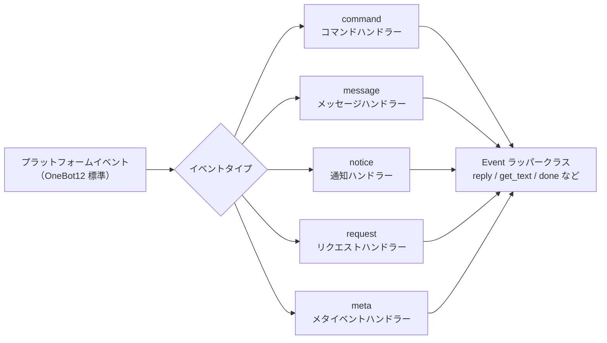

## Command コマンドモジュール

### コマンドの登録

```python
from ErisPulse.Core.Event import command

# 基本コマンド
@command("hello", help="挨拶を送る")
async def hello_handler(event):
    await event.reply("こんにちは！")

# エイリアス付きコマンド
@command(["help", "h"], aliases=["ヘルプ"], help="ヘルプを表示")
async def help_handler(event):
    pass

# 権限付きコマンド
def is_admin(event):
    return event.get("user_id") in admin_ids

@command("admin", permission=is_admin, help="管理者コマンド")
async def admin_handler(event):
    pass

# 非表示コマンド
@command("secret", hidden=True, help="シークレットコマンド")
async def secret_handler(event):
    pass

# コマンドグループ
@command("admin.reload", group="admin", help="モジュールを再読み込み")
async def reload_handler(event):
    pass

# サブコマンド（スペース区切りの複数トークンからなるコマンド名）
# マッチングには最長プレフィックスを採用：/admin add x は admin add に優先的にヒット（args は ["x"]）。
# サブコマンドで permission が宣言されていない場合、親チェーン上で最も近い位置で権限を宣言している祖先コマンドを継承します
@command("admin add", help="管理者を追加")
async def admin_add_handler(event):
    pass
```

**命名競合ルール**：コマンド名はエイリアスよりも優先されます。既存のコマンドと同名のエイリアスを登録した場合、そのエイリアスは無効となり警告が出力されます。既存のエイリアスと同名のコマンドを登録した場合はコマンド名が優先して有効となり、無効となったエイリアスは自動的に削除されます——いずれの競合の場合も WARNING ログが出力され、サイレントに乗っ取られることはありません。

### コマンド情報

すべてのコマンド照会 API はオプションの**セッションコンテキスト**をサポートしています：`event=`（Event または dict）を渡すか、明示的に `platform=` / `bot_id=` / `session_id=` を渡します（event と併用した場合は明示的パラメータが優先されます）。これにより、スコープモジュールの次元で現在のセッションにおいて利用不可のモジュールのコマンドがフィルタリングされます（詳細は advanced/scope.md を参照）。すべてオプションのキーワード引数であり、渡さない場合は従来通りの全量動作が維持されます。

```python
# コマンドヘルプを取得
help_text = command.help()

# セッション認識ヘルプ：現在のセッションで利用可能なコマンドのみを一覧表示
help_text = command.help(event=event)

# 特定のコマンドを取得（マージ・オーバーライド後の有効なパラメータを返す。セッションで利用不可の場合は None を返す）
cmd_info = command.get_command("admin")
cmd_info = command.get_command("admin", event=event)

# すべてのコマンドを取得（セッション認識時は利用不可モジュールのコマンドをフィルタリング）
all_commands = command.get_commands()
all_commands = command.get_commands(event=event)

# コマンドグループ内のすべてのコマンドを取得（セッション認識フィルタリングに対応）
admin_commands = command.get_group_commands("admin")
admin_commands = command.get_group_commands("admin", event=event)

# すべての可視コマンドを取得
visible_commands = command.get_visible_commands()

# セッション認識の可視コマンド（event または明示的キーワードのいずれかで可）
visible_commands = command.get_visible_commands(event=event)
visible_commands = command.get_visible_commands(
    platform=event.get("platform"),
    bot_id=event.get_self_account_id(),
    session_id=event.get_session_id(),
)
```

### 返信を待つ

```python
# ユーザーの返信を待つ
@command("ask", help="ユーザー情報を尋ねる")
async def ask_command(event):
    reply = await command.wait_reply(
        event,
        prompt="お名前を入力してください:",  # すでに上で送信済み
        timeout=30.0
    )
    
    if reply:
        name = reply.get_text()
        await event.reply(f"こんにちは、{name}さん！")

# 検証付きの返信待ち
def validate_age(event_data):
    try:
        age = int(event_data.get_text())
        return 0 <= age <= 150
    except ValueError:
        return False

@command("age", help="ユーザーの年齢を尋ねる")
async def age_command(event):
    await event.reply("年齢を入力してください:")
    
    reply = await command.wait_reply(
        event,
        timeout=60,
        validator=validate_age
    )
    
    if reply:
        age = int(reply.get_text())
        await event.reply(f"あなたの年齢は {age} 歳です")

# コールバック付きの返信待ち
async def handle_confirmation(reply_event):
    text = reply_event.get_text().lower()
    if text in ["はい", "yes", "y"]:
        await event.reply("操作が確認されました！")
    else:
        await event.reply("操作はキャンセルされました。")

@command("confirm", help="操作を確認")
async def confirm_command(event):
    await command.wait_reply(
        event,
        prompt="'はい'または'いいえ'を入力してください:",
        callback=handle_confirmation
    )
```

## Message メッセージモジュール

### メッセージイベント

```python
from ErisPulse.Core.Event import message

# すべてのメッセージをリッスン
@message.on_message()
async def message_handler(event):
    sdk.logger.info(f"メッセージを受信: {event.get_text()}")

# プライベートメッセージをリッスン
@message.on_private_message()
async def private_handler(event):
    user_id = event.get_user_id()
    sdk.logger.info(f"プライベートチャットから: {user_id}")

# グループメッセージをリッスン
@message.on_group_message()
async def group_handler(event):
    group_id = event.get_group_id()
    sdk.logger.info(f"グループチャットから: {group_id}")

# @メッセージをリッスン
@message.on_at_message()
async def at_handler(event):
    mentions = event.get_mentions()
    sdk.logger.info(f"メンションされたユーザー: {mentions}")
```

### 条件付きリッスン

```python
# 優先度を使用して実行順序を制御
@message.on_message(priority=10)  # 数値が大きいほど優先度が高い
async def high_priority_handler(event):
    pass

# ハンドラー内部で条件フィルタリングを実装
@message.on_message()
async def filtered_handler(event):
    if "キーワード" not in event.get_text():
        return
    # キーワードを含むメッセージを処理
    pass
```

## Notice 通知モジュール

### 通知イベント

```python
from ErisPulse.Core.Event import notice

# フレンド追加
@notice.on_friend_add()
async def friend_add_handler(event):
    user_id = event.get_user_id()
    await event.reply("フレンド追加ありがとうございます！")

# フレンド削除
@notice.on_friend_remove()
async def friend_remove_handler(event):
    user_id = event.get_user_id()
    sdk.logger.info(f"フレンド削除: {user_id}")

# グループメンバーの追加
@notice.on_group_increase()
async def member_increase_handler(event):
    user_id = event.get_user_id()
    await event.reply(f"新しいメンバーを歓迎します！")

# グループメンバーの減少
@notice.on_group_decrease()
async def member_decrease_handler(event):
    user_id = event.get_user_id()
    sdk.logger.info(f"グループメンバーが退出: {user_id}")
```

## Request リクエストモジュール

### リクエストイベント

```python
from ErisPulse.Core.Event import request

# フレンドリクエスト
@request.on_friend_request()
async def friend_request_handler(event):
    user_id = event.get_user_id()
    comment = event.get_comment()
    sdk.logger.info(f"フレンドリクエスト: {user_id}, コメント: {comment}")

# グループ招待リクエスト
@request.on_group_request()
async def group_request_handler(event):
    group_id = event.get_group_id()
    user_id = event.get_user_id()
    sdk.logger.info(f"グループ招待: {group_id}, 送信者: {user_id}")
```

## Meta メタイベントモジュール

### メタイベント

```python
from ErisPulse.Core.Event import meta

# 接続イベント
@meta.on_connect()
async def connect_handler(event):
    platform = event.get_platform()
    sdk.logger.info(f"プラットフォーム {platform} が正常に接続されました")

# 切断イベント
@meta.on_disconnect()
async def disconnect_handler(event):
    platform = event.get_platform()
    sdk.logger.info(f"プラットフォーム {platform} が切断されました")

# ハートビートイベント
@meta.on_heartbeat()
async def heartbeat_handler(event):
    sdk.logger.debug("ハートビートを受信")
```

### Bot ステータス照会

アダプターがメタイベントを送信すると、フレームワークは自動的に Bot のステータスを追跡します。照会 API とライフサイクルイベントのリッスンについては、[アダプターシステム API - Bot ステータス管理](adapter-system.md#bot-ステータス管理) を参照してください。

## Event ラッパークラス

Event モジュールのイベントハンドラーは、Event ラッパークラスのインスタンスを受け取ります。これは dict を継承し、便利なメソッドを提供します。メソッドの完全な一覧、パラメータシグネチャ、および動作の詳細については [Event ラッパークラス詳解](../developer-guide/modules/event-wrapper.md) を参照してください。このセクションでは概要のみを紹介します。

### 機能概要

- **イベント基本情報**：`get_id()` / `get_time()` / `get_type()` / `get_detail_type()` / `get_platform()`
- **ボット情報**：`get_self_platform()` / `get_self_user_id()` / `get_self_account_id()` / `get_self_info()`
- **セッション識別**：`get_target_id()`（統一ターゲット ID。`group_id` → `channel_id` → `guild_id` → `thread_id` → `user_id` の順で最初の空でない値を取得）；`get_session_id()`（形式は `{platform}:{detail_type}:{target_id}`、例：`"telegram:private:12345"`）
- **メッセージ内容と送信者**：`get_message()` / `get_alt_message()` / `get_text()` / `get_user_id()` / `get_sender()` / `get_group_id()` など
- **メッセージタイプ判定**：`is_message()` / `is_private_message()` / `is_group_message()` / `is_at_message()` / `has_mention()` / `get_mentions()`
- **返信**：`reply(content, method=..., at_sender=..., quote=..., at_users=..., reply_to=..., at_all=..., via=...)` / `reply_ob12()`；プラットフォーム機能の照会 `supports()` / `available_methods()`；自由送信チェーン `send_chain()` は [SendDSL 詳解](../developer-guide/adapters/send-dsl.md#方法2eventsend_chain) を参照
- **コマンド情報**：`get_command_name()` / `get_command_args()` / `is_command()` など
- **インタラクティブセッション**：`wait_reply()` / `confirm()` / `choose()` / `collect()` / `wait_for()` / `conversation()`
- **ツール**：`to_dict()`（内部キーをフィルタリング）/ `get_raw()` / `get_raw_type()`

> 各メソッドの完全なパラメータ説明と例については [Event ラッパークラス詳解](../developer-guide/modules/event-wrapper.md) を参照してください。マルチターン対話の高度な内容は [Conversation マルチターン対話](../advanced/conversation.md) を参照してください。

### チェーン制御

`event.done(claim=, stop=)` は「クレーム（claim）」と「ブロック（stop）」という 2 つの直交するセマンティクスを統一的に制御します：

- **クレーム（claim）**：イベントが処理済みであることをマークし（`_processed`）、コマンドディスパッチャーはこれに基づいて重複排除をスキップします
- **ブロック（stop）**：低優先度ハンドラーへの伝播を阻止します（`_propagation_stopped`）

```python
# クレーム + ブロック（デフォルト）
event.done()

# クレームのみ、ブロックなし（低優先度のオブザーバーも引き続き確認できる）
event.done(stop=False)

# ブロックのみ、クレームなし（ファイアウォール / レート制限など）
event.done(claim=False)

# mark_processed が本体メソッド、done はそのエイリアス
event.mark_processed()             # event.done() と同等
event.mark_processed(stop=False)   # event.done(stop=False) と同等

# ステータスの照会
event.is_processed()  # クレーム済みかどうか
event.is_stopped()    # 伝播がブロック済みかどうか
```

### プラットフォーム拡張メソッド

アダプターは Event にプラットフォーム固有のメソッドを登録でき、そのメソッドは対応するプラットフォームのインスタンスでのみ利用できます。

#### ユーザー：プラットフォーム拡張メソッドの利用

アダプターがプラットフォーム固有のメソッドを登録すると、イベントハンドラー内で直接呼び出せるようになります。メソッドはプラットフォームごとに異なるため、対応する [プラットフォームドキュメント](../platform-guide/) を参照してください。

```python
from ErisPulse.Core.Event import message

@message.on_message()
async def handle_message(event):
    platform = event.get_platform()

    # プラットフォームに応じて固有メソッドを呼び出す
    if platform == "email":
        subject = event.get_subject()           # メール固有
        attachments = event.get_attachments()   # メール固有
```

#### プラットフォームに登録済みのメソッドの照会

```python
from ErisPulse.Core.Event import get_platform_event_methods

# 特定のプラットフォームに登録されているメソッドを確認
methods = get_platform_event_methods("email")
# ["get_subject", "get_from", "get_attachments", ...]

# 動的に判定して呼び出す
for method_name in get_platform_event_methods(event.get_platform()):
    method = getattr(event, method_name)
    print(f"{method_name}: {method()}")
```

#### プラットフォームメソッドの分離

異なるプラットフォームで登録されたメソッドは互いに干渉しません：

```python
# メールイベント - メールのメソッドのみ
event = Event({"platform": "email", "email_raw": {"subject": "Hello"}})
event.get_subject()      # ✅ "Hello"
event.get_chat_type()    # ❌ AttributeError

# Telegram イベント - Telegram のメソッドのみ
event = Event({"platform": "telegram", "telegram_raw": {"chat": {"type": "private"}}})
event.get_chat_type()    # ✅ "private"
event.get_subject()      # ❌ AttributeError
```

#### `hasattr` / `dir` のサポート

```python
hasattr(event, "get_subject")   # platform="email" の場合のみ True を返す
"get_subject" in dir(event)     # 同様
```

### アダプター：プラットフォーム拡張メソッドの登録

アダプターはデコレーターを通じて Event にプラットフォーム固有のメソッドを登録できます。メソッドの最初のパラメータは `self`（Event インスタンス）で、イベントデータに自由にアクセスできます。

#### 単一メソッドの登録

```python
from ErisPulse.Core.Event import register_event_method

@register_event_method("email")
def get_subject(self):
    """メールの件名を取得"""
    return self.get("email_raw", {}).get("subject", "")

@register_event_method("email")
def get_from(self):
    """送信者を取得"""
    return self.get("email_raw", {}).get("from", {})
```

#### 一括登録（Mixin クラス）

メソッドが多い場合は、Mixin クラスによる一括登録が推奨されます：

```python
from ErisPulse.Core.Event import register_event_mixin

class EmailEventMixin:
    def get_subject(self):
        return self.get("email_raw", {}).get("subject", "")

    def get_from(self):
        return self.get("email_raw", {}).get("from", {})

    def get_attachments(self):
        return self.get("email_raw", {}).get("attachments", [])

# すべてのメソッドを一度に登録
register_event_mixin("email", EmailEventMixin)
```

#### 戻り値の規約

| シナリオ | 戻り値 | ユーザーの使用方法 |
|------|--------|------------|
| データを返す（テキスト、辞書など） | 値をそのまま返す | `subject = event.get_subject()` |
| 操作を実行する（メッセージ送信など） | `asyncio.Task` を返す | `task = event.do_something()` `await` は任意 |

> **推奨**：データを返さないメソッドは `asyncio.Task` を返すようにしてください。そうすることで、`await` するかどうかをユーザーが自由に決定でき、`await` しなかった場合でも操作は最後まで実行されます。

```python
@register_event_method("email")
def forward_email(self, to_address: str):
    """メールを転送する — Task を返し、ユーザーが await するかどうかを自由に決定できる"""
    import asyncio
    return asyncio.create_task(
        self._do_forward(to_address)
    )

# ユーザーは await で結果を待つことができる
await event.forward_email("user@example.com")

# await しない場合でも、操作はバックグラウンドで実行される
event.forward_email("user@example.com")
```

#### メソッドの登録解除

```python
from ErisPulse.Core.Event import unregister_event_method, unregister_platform_event_methods

# 単一メソッドの登録解除
unregister_event_method("email", "get_subject")

# 特定プラットフォームの全メソッドの登録解除（アダプターの shutdown 時に呼び出す）
unregister_platform_event_methods("email")
```

#### 組み込みメソッドのオーバーライド

`register_event_mixin` / `register_event_method` は、Event の組み込みメソッド（`confirm`、`choose`、`collect`、`wait_reply`、`reply` など）のオーバーライドをサポートしています。登録されたプラットフォームメソッドは `Event.__getattribute__` を経由して組み込みメソッドより優先的に有効になるため、アダプターはプラットフォーム特有のインタラクション実装を提供できます。

組み込み実装は `_builtin_*` 関数としてエクスポートされており、オーバーライド側はこれらをフォールバックとして呼び出せます：

```python
from ErisPulse.Core.Event import register_event_mixin, _builtin_choose

class YunhuEventMixin:
    async def choose(self, prompt, options, timeout=60, method="Text"):
        # Yunhu プラットフォームではボタンコンポーネントを使用
        buttons = [[{"text": opt} for opt in options]]
        await self.reply(prompt)
        # ...ボタンコールバックまたはテキスト返信を待つ...
        # 組み込みロジックへフォールバック
        return await _builtin_choose(self, None, options, timeout, "Text")

register_event_mixin("yunhu", YunhuEventMixin)
```

## クロスプラットフォーム拡張（ワイルドカード）

`register_event_method` と `register_event_mixin` は、プラットフォーム名として `"*"` を渡すことをサポートしており、登録されたメソッドは**すべてのプラットフォーム**の Event インスタンスで利用できます。AI 対話、コンテキスト管理など、クロスプラットフォームでの再利用が必要な機能モジュールに適しています。

### クロスプラットフォームメソッドの登録

```python
from ErisPulse.Core.Event.wrapper import register_event_method

@register_event_method("*")
async def ai_chat(self, prompt: str):
    """self は Event インスタンスであり、イベントデータや組み込みメソッドに自由にアクセスできる"""
    await self.reply(f"AI: {prompt}")
```

登録後、すべてのプラットフォームのイベントハンドラーから呼び出せます：

```python
from ErisPulse.Core.Event import message

@message.on_message()
async def handler(event):
    await event.ai_chat(event.get_text())
```

### メソッド解決の優先順位

属性アクセスで Event メソッドを取得する際の解決順序は次の通りです：

1. **プラットフォーム固有メソッド**（現在のプラットフォームのオーバーライド）
2. **ワイルドカードメソッド**（`"*"` で登録されたクロスプラットフォームメソッド）
3. **組み込みメソッド**（`reply`、`confirm` など）
4. **辞書キーとしてのアクセス**

> そのため、ワイルドカードメソッドは組み込みメソッド（`reply` など）をオーバーライドできますが、同名のプラットフォーム固有メソッドがあればさらにそちらが優先されます。

## 優先度システム

イベントハンドラーは優先度をサポートしており、数値が大きいほど優先度が高くなります：

```python
# 高優先度のハンドラーが先に実行される
@message.on_message(priority=10)
async def high_priority_handler(event):
    pass

# 低優先度のハンドラーが後に実行される
@message.on_message(priority=0)
async def low_priority_handler(event):
    pass
```


====
高级主题
====


### Conversation 多轮对话

# Conversation 多輪対話

> [!TIP]
> **このドキュメントを読む必要があるのはいつですか**：多輪対話のステートマシンとチェックポイントの復元が必要な場合です。必要ない場合はスキップしても、他の機能の使用には影響しません。

1 つのコマンドで複数の質問をユーザーに連続して求める必要がある場合（登録時の情報収集、アンケート、設定のガイドなど）、`Conversation` を使用して、同じセッション内で「質問 → 回答を待つ → 検証 → 次のステップ」をつなげます。タイムアウトや再起動後も、チェックポイントから復元できます。

## 対話の作成

`Event` オブジェクトの `conversation()` メソッドを使用して作成します：

```python
from ErisPulse.Core.Event import command

@command("quiz")
async def quiz_handler(event):
    conv = event.conversation(timeout=30)

    await conv.say("🎮 知識クイズへようこそ！")

    answer = await conv.choose("第1問：Pythonの生みの親は誰ですか？", [
        "Guido van Rossum",
        "James Gosling",
        "Dennis Ritchie",
    ])

    if answer is None:
        await conv.say("タイムアウトしました。また次回お試しください！")
        return

    if answer == 0:
        await conv.say("正解です！")
    else:
        await conv.say("不正解です。正解は Guido van Rossum です")

    conv.stop()
```

## コア API

### say(content, **kwargs)

メッセージを送信し、`self` を返してメソッドチェーンを可能にします：

```python
await conv.say("1行目").say("2行目").say("3行目")
```

送信方法を指定することもできます：

```python
await conv.say("https://example.com/image.jpg", method="Image")
```

### wait(prompt=None, timeout=None)

ユーザーからの返信を待機し、`Event` オブジェクトまたは `None`（タイムアウト）を返します：

```python
# 単純な待機
resp = await conv.wait()
if resp:
    text = resp.get_text()

# プロンプトを送信して待機
resp = await conv.wait(prompt="名前を入力してください：")

# カスタムタイムアウトを使用（対話のデフォルトタイムアウトを上書き）
resp = await conv.wait(prompt="10秒以内に返信してください：", timeout=10)
```

### confirm(prompt=None, **kwargs)

ユーザーの確認（はい/いいえ）を待機し、`True` / `False` / `None`（タイムアウト）を返します：

```python
result = await conv.confirm("すべてのデータを削除してもよろしいですか？")
if result is True:
    await conv.say("削除しました")
elif result is False:
    await conv.say("キャンセルしました")
else:
    await conv.say("タイムアウトしました")
```

内蔵の確認用語：`はい/yes/y/確認/確定/好/ok/true/対/うん/行/同意/問題ない/可能/当然...`

内蔵の否定用語：`否/no/n/キャンセル/不/不要/行かない/cancel/false/間違った/間違った/別/拒否...`

### choose(prompt, options, **kwargs)

ユーザーが選択肢から選ぶのを待機し、選択肢のインデックス（0ベース）または `None` を返します：

```python
choice = await conv.choose("色を選択してください：", ["赤", "緑", "青"])
if choice is not None:
    colors = ["赤", "緑", "青"]
    await conv.say(f"選択した色は {colors[choice]} です")
```

ユーザーは番号（`1`/`2`/`3`）または選択肢のテキスト（`赤`）を入力して選択できます。

`options_format="auto"`（デフォルト）は、method に応じて自動的に内蔵のスタイルを選択します：Markdown→無序リスト、Html→順序付きリスト、その他→純粋なテキストリスト。
また、`"list"`、`"inline"`、`"md"`、`"html"`、またはカスタム関数もサポートします。

`merge_prompt=True` を使用して、プロンプトと選択肢を1つのメッセージに統合することもできます。また、オプション挿入位置を制御するプレースホルダ（デフォルトは `{options}`、`placeholder` でカスタマイズ可能）もサポートします：

```python
choice = await conv.choose(
    "## 選択してください\n{options}",
    ["オプションA", "オプションB"],
    method="Markdown",
    merge_prompt=True,
)

# カスタムプレースホルダ
choice = await conv.choose(
    "選択してください: [choices]",
    ["オプションA", "オプションB"],
    placeholder="[choices]",
)
```

### collect(fields, **kwargs)

複数ステップで情報を収集し、データ辞書または `None` を返します：

```python
data = await conv.collect([
    {"key": "name", "prompt": "名前を入力してください"},
    {"key": "age", "prompt": "年齢を入力してください",
     "validator": lambda e: e.get("alt_message", "").strip().isdigit(),
     "retry_prompt": "年齢は数字でなければなりません。再度入力してください"},
    {"key": "city", "prompt": "都市を入力してください"},
])

if data:
    await conv.say(f"登録完了！\n名前: {data['name']}\n年齢: {data['age']}\n都市: {data['city']}")
else:
    await conv.say("登録が中断されました")
```

フィールドの設定：

| パラメータ | 説明 | デフォルト値 |
|------|------|--------|
| `key` | フィールドのキー名（必須） | - |
| `prompt` | プロンプトメッセージ | `"{key} を入力してください"` |
| `validator` | 関数、Event を受け取り、bool を返す | なし |
| `retry_prompt` | 検証失敗時の再試行プロンプト | `"入力が無効です。再度入力してください"` |
| `max_retries` | 最大再試行回数 | 3 |
| `condition` | 関数、既に収集されたデータの辞書を受け取り、bool を返す | なし |

**条件付きフィールド**：`condition` を使用して、条件が満たされた場合にのみフィールドを収集する動的フォームを実現できます：

```python
data = await conv.collect([
    {"key": "has_car", "prompt": "車をお持ちですか？（はい/いいえ）"},
    {"key": "car_brand", "prompt": "車のブランドを入力してください",
     "condition": lambda d: d.get("has_car", "").lower() in ("はい", "yes", "y")},
])
```

### stop()

手動で対話を終了し、`is_active` を `False` に設定します：

```python
conv.stop()
```

### is_active

対話がアクティブかどうかを返します：

```python
if conv.is_active:
    await conv.say("対話はまだ進行中です")
```

## アクティブ状態の管理

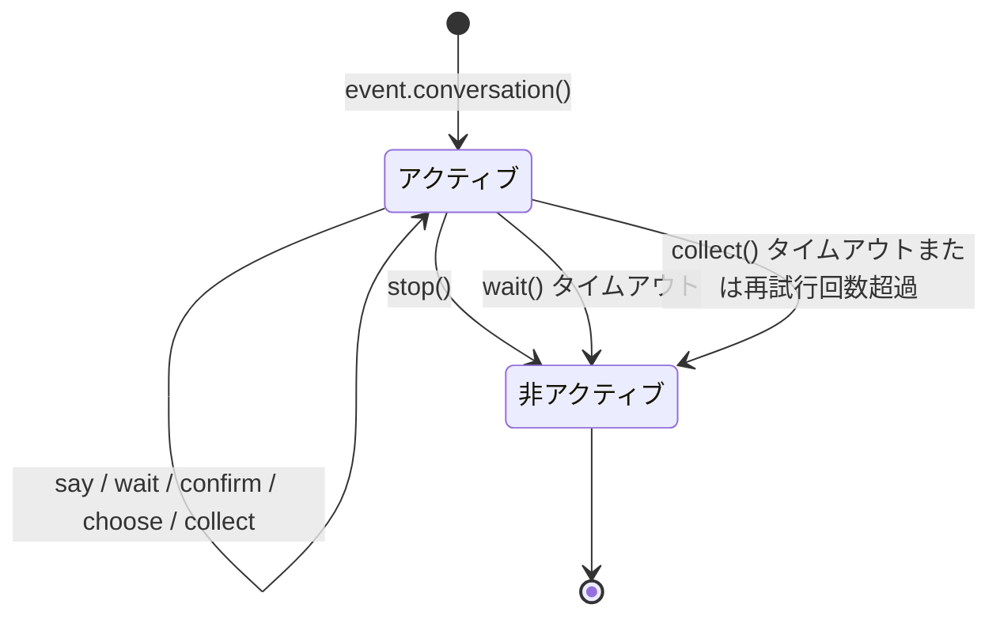

以下の状況で対話は自動的に非アクティブになります：

1. `stop()` メソッドを呼び出す
2. `wait()` がタイムアウトして `None` を返す
3. `collect()` がステップのタイムアウトまたは再試行回数超過で `None` を返す

非アクティブになった後、`wait`/`confirm`/`choose`/`collect` のすべてのインタラクションメソッドは即座に `None` を返し、ユーザーからの入力を待続しません。

## 分岐とジャンプ

### @conv.branch(name) デコレータ

`branch()` を使用して対話の分岐を登録し、`goto()` で分岐間をジャンプします：

```python
@command("menu")
async def menu_handler(event):
    conv = event.conversation(timeout=60)

    @conv.branch("main")
    async def main_menu():
        await conv.say("=== メインメニュー ===\n1. 本人情報\n2. 設定\n3. 終了")
        resp = await conv.wait()
        if resp is None:
            return
        text = resp.get_text().strip()
        if text == "1":
            await conv.goto("profile")
        elif text == "2":
            await conv.goto("settings")
        elif text == "3":
            await conv.say("さようなら！")
            conv.stop()

    @conv.branch("profile")
    async def profile():
        await conv.say("=== 本人情報 ===\n名前: Alice\n0. 戻る")
        resp = await conv.wait()
        if resp and resp.get_text().strip() == "0":
            await conv.goto("main")

    @conv.branch("settings")
    async def settings():
        await conv.say("=== 設定 ===\n1. 通知のオン/オフ\n0. 戻る")
        resp = await conv.wait()
        if resp and resp.get_text().strip() == "0":
            await conv.goto("main")

    await conv.start()  # 最初に登録された分岐から開始
```

### conv.start(name=None)

対話を開始し、デフォルトでは最初に登録された分岐から開始します：

```python
await conv.start()          # 最初の分岐から開始
await conv.start("settings") # 指定された分岐から開始
```

## コンテキストと永続化

### conv.context

各対話インスタンスには、分岐間で状態を共有するための `context` 辞書が内蔵されています：

```python
@conv.branch("step1")
async def step1():
    conv.context["username"] = resp.get_text().strip()
    await conv.goto("step2")

@conv.branch("step2")
async def step2():
    name = conv.context.get("username", "未知")
    await conv.say(f"こんにちは、{name}！")
```

### save() / resume() / clear_saved()

対話は永続化をサポートし、タイムアウトや中断後に復元できます：

```python
# 対話状態を保存する（通常は手動で呼び出す必要はありません、下記の「自動チェックポイント」を参照）
await conv.save()

# ... その後、同じセッションで復元する ...
conv2 = event.conversation()
if await conv2.resume():
    await conv2.say("お帰りなさい！以前の対話を続けましょう")
else:
    await conv2.say("以前の対話は見つかりませんでした")

# 保存された対話を削除する
await conv.clear_saved()
```

ストレージキーにはターゲットの次元が含まれます（`conversation:{platform}:{user_id}:{target_id}`）、同じユーザーの異なるセッション間の対話は互いに上書きされません。`resume()` 時に、ターゲットを含まない旧形式のアーカイブは自動的に移行されます。

## 自動チェックポイントと再起動時の復元

### 自動アーカイブ

フレームワークは以下のタイミングで自動的にチェックポイントを管理します。通常、`save()` を手動で呼び出す必要はありません：

| 時機 | 行動 |
|------|------|
| `goto()` / `start()` で分岐をジャンプする | 自動保存（現在の分岐 + context） |
| `stop()` / `wait()` タイムアウト / `collect()` 失敗 | 自動削除（対話の終端状態） |

### チェックポイント TTL

アーカイブにはタイムスタンプが付いており、`ErisPulse.interaction.checkpoint_ttl`（デフォルト 24 時間）を超えるアーカイブはクリーンアップされます：

- **惰性削除**：復元時にアーカイブが期限切れであることが判明した場合、自動的に削除されます
- **バックグラウンドの自動クリーンアップ**：フレームワークには定期的な GC タスクがあり、最初にチェックポイントを使用した後に惰性で起動され、期限切れのアーカイブを列挙して削除し、長期稼働時にストレージ内の期限切れのチェックポイントが無限に蓄積されることを防ぎます。自動的にクリーンアップされたアーカイブは、その後会話メッセージを受け取った場合、"チェックポイントなし"として扱われます

```toml
[ErisPulse.interaction]
checkpoint_ttl = 86400  # 秒
```

### 再起動時の自動復元

フレームワークが再起動した後、メモリ内の待機中のコルーチンは失われますが、チェックポイントは残ります。`register_resume_handler` を使用して**復元ファクトリ**を登録することで、フレームワークは再起動後にその会話の最初のメッセージを受け取ったときに自動的に対話を継続します：

```python
from ErisPulse.Core.Event.wrapper import Conversation

@Conversation.register_resume_handler()  # platform="onebot11" を渡すことでプラットフォームを限定することも可能
def make_conversation(event) -> Conversation:
    # ファクトリの役割：対話を再構築し、すべての分岐を再登録する
    conv = event.conversation(timeout=60)

    @conv.branch("menu")
    async def menu(conv, event):
        ...

    return conv
```

登録後、`menu` 分岐にあったユーザーが再起動前に最初のメッセージを送信した場合、フレームワークは自動的に：コンテキストを復元 → そのメッセージを認証 → 保存された分岐から対話を継続します。ファクトリを登録していない場合、このメカニズムは無駄なコストがかかりません。

### 復元は即座に引き継ぎ

`resume()` が成功した場合、フレームワークは自動的に2つのことを完了します：

1. **セッションの引き継ぎ**：自動的にそのセッションの排他リースを取得します——他のモジュールは `sdk.interaction.get_owner_of(event)` を使用して「このユーザーが対話で占有されている」ことを感知できます；セッションが他のモジュールによって占有されている場合、復元は失敗（False を返す）し、2つの対話が競合することを防ぎます
2. **履歴の持ち込み**：会話の受信箱から最近の10件のメッセージを `conv.recent_history` に取り込みます（AI モジュールが復元された後、LLM のコンテキストが途切れません）；`resume(with_history=0)` でこの機能をオフにできます

```python
if await conv.resume(with_history=20):
    for m in conv.recent_history:
        print(m["role"], ":", m["text"])
```

### 手動復元（自動メカニズムを使用しない場合）

```python
@command("continue")
async def continue_handler(event):
    conv = event.conversation()
    # ... 分岐を登録する ...
    if await conv.resume():
        conv.goto(conv.get_current_branch())
```

## 代表的なフロー・パターン

### ガイド付き登録

```python
@command("register")
async def register_handler(event):
    conv = event.conversation(timeout=60)

    await conv.say("ようこそ、登録へ！")

    data = await conv.collect([
        {"key": "username", "prompt": "ユーザー名を入力してください（3-20文字）",
         "validator": lambda e: 3 <= len(e.get_text().strip()) <= 20},
        {"key": "email", "prompt": "メールアドレスを入力してください",
         "validator": lambda e: "@" in e.get_text() and "." in e.get_text(),
         "retry_prompt": "メールアドレスの形式が正しくありません。再度入力してください"},
    ])

    if not data:
        await event.reply("登録がキャンセルされました")
        return

    confirmed = await conv.confirm(
        f"登録情報を確認しますか？\nユーザー名: {data['username']}\nメールアドレス: {data['email']}"
    )

    if confirmed:
        await conv.say("✅ 登録完了！")
    else:
        await conv.say("❌ 登録がキャンセルされました")
```

### ループ対話

```python
@command("chat")
async def chat_handler(event):
    conv = event.conversation(timeout=120)
    await conv.say("対話モードに入りました。「終了」で終了します")

    while conv.is_active:
        resp = await conv.wait()
        if resp is None:
            await conv.say("タイムアウトしました。対話は終了します")
            break

        text = resp.get_text().strip()

        if text == "終了":
            await conv.say("さようなら！")
            conv.stop()
        elif text == "help":
            await conv.say("利用可能なコマンド：終了、help、status")
        elif text == "status":
            await conv.say("対話はアクティブです")
        else:
            await conv.say(f"あなたが言ったのは：{text}")
```


### 交互会话系统

# 交互会話システム

> [!TIP]
> **この記事を読むのはいつか**：wait_reply、多輪対話、定時リマインダー、セッション排他、およびトレースIDが必要な場合。不要な場合は飛ばしても、他の機能の使用には影響しません。

> **この記事を読んだ後でわかる**：wait_replyの全パラメータの使い方とキャンセル理由、.got()による宣言的多輪対話チェーン、
> セッションタイマー（remind / escalate）、多路待ち（expect / select）とセッション排他リース。
>
> **この記事で取り扱わない**：多輪対話の分岐ステートマシンと再開/復元（[Conversation 多輪対話](conversation.md)を参照）；
> 受信箱の保持戦略のスイッチと実行時の上書き（[会話受信箱](transcript.md)を参照）。

> [!NOTE]
> 本章の内容はErisPulse **2.8.0+** が必要です。

ErisPulseは「ユーザーとの継続的な対話」をフレームワークレベルのインフラとして実装しています。1つのwait_replyから、定時リマインダー、多路待ち、セッション排他、再起動時の復元まで、すべては統一された
**インタラクティブセッションマネージャー**（`Core/Event/interaction.py`、`sdk.interaction`）によってスケジュールされます。

{!--< tips >!--}
本文で取り扱う各機能には**所有者（owner）**が付いています：インタラクティブ待ち、リース、タイマーはすべて登録時のモジュール名を記録し、モジュールのアンロードまたはアダプターの停止時にフレームワークが自動的にクリーンアップし、待機側は即座に通知を受け取ります。これは、所有権システムがインタラクションの次元に拡張されたものです（[所有権システム](ownership.md)を参照）。
{!--< /tips >!--}

## レプライ待ち：wait_reply

**一言で**：現在のコルーチンを中断して、対象ユーザーからの次のメッセージを待機し、一致すれば返信イベントを返し、タイムアウトまたはキャンセルされた場合は`None`を返します。`pattern` / `regex` / `validator`で不適切な返信をフィルタリングできます。

`wait_reply`はインタラクティブセッションの基盤です。現在のコルーチンを中断し、ユーザーが次のメッセージで「返信」することを待ちます。

```python
from ErisPulse.Core.Event import command

@command("ask")
async def ask_command(event):
    reply = await event.wait_reply(prompt="あなたの名前を入力してください:", timeout=30)
    if reply is None:
        await event.reply("タイムアウトしました")
        return
    await event.reply(f"こんにちは、{reply.get_text()}さん！")
```

### 全パラメータ一覧

| パラメータ | 説明 | デフォルト |
|------|------|------|
| `prompt` | 待機前に送信するプロンプトメッセージ | None |
| `timeout` | 待機のタイムアウト（秒） | 60 |
| `pattern` | globフィルター（`*` / `?` / `[seq]`）、一致しない場合は待機を続ける | None |
| `regex` | 正規表現フィルター（patternと同時に指定する場合は両方一致する必要がある）、一致しない場合は待機を続ける | None |
| `validator` | 検証関数（Eventを受け取り、boolを返す）、失敗した場合は待機を続ける | None |
| `callback` | レプライを受け取ったときのコールバック（戻り値方式の代わりの書き方） | None |
| `method` | promptの送信方法 | "Text" |
| `session` | **セッションレベルの待ち**：同じセッション（グループ/チャンネル）内の誰の返信でも一致する | False |

```python
# 数値金額のみを受け入れ、そうでなければ待機を続ける
reply = await event.wait_reply("金額を入力してください:", regex=r"\d+\s*元", timeout=30)

# セッションレベルの待ち：グループ協力の場面で、グループ内の誰かが返信してもOK
reply = await event.wait_reply(session=True, prompt="誰かが答えてくれますか？")
```

### 待ちとコマンドの境界（コマンド透過）

待機中に**登録済みのコマンド**（例：`/cancel`）が送信された場合、デフォルトではコマンドディスパッチャーに渡され、
レプライとして消費されません（設定項目`ErisPulse.event.wait_reply.cmdpass`、`True`にすると逆転する—
メッセージはすべてレプライとして扱われる）。判定のテキスト口径はコマンドディスパッチャーと同じ：`alt_message`が優先され、
存在しない場合はメッセージセグメントの結合（2.10.1以降、純粋なmessageセグメントアダプターでも同様に有効）。

### 待ちがいつキャンセルされるか

待ちが「タイムアウトするまで待つ」だけではない—以下の状況で待ちが**即座に終了**（`wait_reply`が`None`を返す）し、
呼び出し側がタイムアウトまで待つ必要がなくなります。

| 触発 | キャンセル理由（`InteractionCancelled.reason`） | 説明 |
|------|------|------|
| 所有モジュールがアンロード / 禁止 | `owner_unload` | 所有権のクリーンアップ：誰が登録した待ちも、誰が消えた時に一緒に回収される |
| アダプターが停止 / 再起動 | `platform_stop` | そのプラットフォームで中断された待ちはすべてキャンセルされる |
| 同セッションで新しい待ち / リースに置き換えられた | `conflict` | 下記「セッション仲裁」を参照 |
| レプライ者がブロックされた / 所有モジュールが解除された | `revoked` | レプライが一致した**権限再確認**：scopeの身元次元 + モジュール次元 |
| ユーザーのレプライが一致した | —— | 正常経路、レプライイベントを返す |

下層の例外は`InteractionCancelled`（`InteractionError`例外体系に属する）で、
`wait_reply`はそれを`None`を返すように変換しています。理由が必要な呼び出し側は、
`sdk.interaction.register()`の低層APIを使用できます。

### レプライが一致する完全な判定チェーン

レプライメッセージが到着した際、インタラクションマネージャーは以下の順序で判定します（コマンドマッチの**前**に実行され、
対話の連続性が優先される—たとえメッセージが他の高優先度のプロセッサーに認知されたとしても、中断された対話は完了します）：

```
セッションキーが一致する（正確なuser次元 → セッションレベルの戻りにフォールバック）
  → pattern / regexテキストフィルター（一致しない場合は待機を続ける）
  → validator検証（失敗した場合は待機を続ける）
  → 権限再確認（scope身元次元 + ownerモジュール次元、失敗した場合は待ちを終了）
  → 待ち側をウォーキング + イベントを認領（mark_processed）
```

## 宣言的多輪対話：`.got()`チェーン（2.11+）

`@command`は**多輪対話コントローラーのプロキシ**を返し、`.got()`を使って段階的に収集ステップを宣言します。ステップ関数はパラメータ名に従って収集された値を受け取ります（コマンドエントリのパラメータも含む）、型は`type=` / 注釈に従って自動解析されます。下層ではConversationにコンパイルされ、各ステップが1つの分岐、ジャンプは自動的にチェックポイントを保存します。**再起動後、ユーザーのレプライは保存されたステップから継続されます**（復元工場は装飾時に自動的に登録され、モジュールのアンロードに伴って自動的に登録解除されます）。

```python
@command("weather")
async def weather(event):
    pass  # エントリ：最初の.gotのプロンプトが自動的に送信され、手動で質問する必要はありません

@weather.got("city", prompt="都市名を直接返信してください")
async def weather_city(event, city: str):
    await event.reply(f"{city}：晴れ、25℃")

@weather.got("days", prompt="何日間の予報ですか？", type=int, retry_prompt="数字を入力してください")
async def weather_days(event, city: str, days: int):
    await event.reply(f"{city} 未来 {days} 日間……")
```

### パラメータ説明

| パラメータ | 説明 |
|------|------|
| `name` | 収集値の名前（後続のステップ関数のパラメータ名として注入される；プロセス内で一意、重複宣言は登録時にエラーを出す） |
| `prompt` | このステップに入るときに自動的に送信される質問 |
| `timeout` | 単一ステップの待機タイムアウト（秒数または"90s" / "1h30m"の時長文字列、デフォルトは60s） |
| `type` | 値の型（`int` / `float` / `str`…；解析失敗した場合は`retry_prompt`を再送信し、最大`max_retries`回まで） |
| `validator` / `pattern` / `regex` | レプライのフィルタリングと検証（`wait_reply`と同様の意味） |
| `session` | セッションレベルの待ち（同じセッション内の誰でも一致する） |
| `cmdpass` | コマンド通過三態（デフォルトでは`/cancel`などのコマンドは待機中に通常通り実行される） |

### 意味と境界

- **いずれかのステップがタイムアウト / 中断された場合 → 全体のプロセスが終了**し、チェックポイントはクリアされます（`wait_reply`の意味と一致）。
  ステップ関数内ではいつでも`event.reply(...)`を使って中間結果を出力できます。
- **同じユーザーは同時に1つの中断対話しか持てない**—2番目のプロセスの待ちは前のものを上書きします
  （`InteractionCancelled("conflict")`）；排他を提示するには
  [セッションリース](#セッション排他acquire--hold--get_owner_of)を併用してください。
- 収集された値はプロセス内にのみ存在します。再起動後に複雑なステータスを保持したい場合は、
  [Conversation](conversation.md)（`context` + `branch/goto` + 手動チェックポイント）を使用してください。
- `@command`はプロキシオブジェクトを返します：呼び出しの動作、`__name__`、docstring、カスタム属性
  は元の関数と完全に一致します；`command.unregister(プロキシ)`は自動的に展開されます。

## セッションタイマー：remind / escalate

「タイムアウト」を戻り値から編集可能な原語にします。タイマーはインタラクティブセッションに紐づき、
モジュールのアンロード / アダプターの停止に伴って自動的にキャンセルされます。1セッションあたりのアクティブremindの上限は5個です。

### remind：返信がなければリマインダー

```python
@command("ticket")
async def ticket_command(event):
    await event.reply("チケットを提出しました。処理結果はここに通知されます")
    # 5分間返信がなければ優しくリマインダーを送信；ユーザーの返信はすべて自動的にキャンセルされます
    event.remind(300, "まだいますか？結果が出たらすぐにご連絡します")
    reply = await event.wait_reply(timeout=3600)
    ...
```

- `event.remind(delay, text=None, *, callback=None)`：期限が来たら現在のセッションに`text`
  （または`callback(event)`を実行、同期/非同期対応）を送信します。**強制チェック**：`text` と
  `callback`はどちらか一方を指定しなければなりません（両方指定しない場合は`ValueError`を送出）
- 戻り値は`Reminder`ハンドル：`reminder.cancel()`で手動でキャンセル、`reminder.expired`で状態を確認
- ユーザーがこのセッションで**返信した後は自動的にキャンセル**されます—これが「リマインダー」の意味です：
  リマインダーはユーザーが沈黙しているときにのみ表示されます
- `Conversation`内でも同様に使用できます：`conv.remind(120, "まだ検討中ですか？")`

### escalate：期限に必ず届くアップグレード

```python
event.escalate(1800, lambda e: notify_master(f"チケット30分未処理：{event.get_command_args()}"))
```

`remind`との唯一の違いは：**ユーザーの返信でキャンセルされない**—アップグレードアクション（管理者に通知、人間への転送）
は「タイムアウトに必ず届く」約束であり、`cancel()` / モジュールのアンロード / アダプターの停止でのみキャンセルされます。

| | `remind` | `escalate` |
|---|---|---|
| 到期行動 | テキストを送信 / callbackを実行 | callbackを実行 |
| ユーザーの返信 | **自動的にキャンセル** | 影響を受けない |
| 所有権のクリーンアップ（アンロード / プラットフォーム停止） | キャンセル | キャンセル |
| セッションごとの上限 | 5 | なし（所有権のクリーンアップで補完） |

## 多路待ち：expect + select

**一言で**：`expect`は期待を記述するだけで登録はせず、`select`は複数の期待を統一して待機し、いずれかが先に一致したら返す `(インデックス, レプライイベント)`、一致しなかったら自動的にクリーンアップ。

複数の期待を同時に待機し、**先着順**—典型的な場面：管理者の承認を待っている間にユーザーの撤回を待つ、
多人数の協力による投票。

```python
which, reply = await event.select(
    event.expect(pattern="同意*", user="10001"),
    event.expect(pattern="拒否*", user="10002"),
    event.expect(validator=lambda e: e.get_text() == "搁置", session=True),
    timeout=60,
)
if which is None:
    await event.reply("60秒以内に承認結果がありませんでした")
elif which == 0:
    await event.reply("承認しました")
elif which == 1:
    await event.reply("拒否しました")
```

- `event.expect(...)`は**期待の記述**（待ちの登録はしない）を構築します：`pattern` / `regex` / `validator` / `user`（返信者を限定）/ `session`（誰でも返信可能）がサポートされます
- `event.select(*expectations, timeout=60)`：一括して登録 → いずれかが一致したら返す
  `(インデックス, レプライイベント)` → 一致しなかった待ちは自動的にクリーンアップ；すべてがタイムアウトしたら`(None, None)`を返す。**強制チェック**：少なくとも1つのexpectationを渡さなければ、`ValueError`を送出
- 一致したイベントはフレームワークによって認領（`mark_processed`）され、他のプロセッサーによって重複消費されることはありません

{!--< tips >!--}
`select`は多スレッド`asyncio.wait`による手動編集と比べて：期待が一致しなかった場合の自動クリーンアップ、
一致したイベントの自動認領、権限再確認と所有権のクリーンアップがすべて有効—Futureを自分で管理する必要はありません。
{!--< /tips >!--}

> [!NOTE]
> 2.10.1以降、`select`は**集約待ち**：すべての期待を1つの項目に統合し、独自の一致判定を行う、
> 同キーの多路待ち（同じuserに異なるpatternを2つ設定するなど）は互いにキャンセルされず、
> いずれかのルートが先に一致したら返す。返信テキストの判定口径は`alt_message`が優先され、
> メッセージセグメントが戻る（コマンドディスパッチャーと同じ）。
>
> 境界説明：`event.wait_for(...)`はアダプターイベントの総線に直接接続され、**中間件や**
> `detail_type`条件フィルタリング（身元認証はディスパッチャーのエントリでカバー）は経由しない。
> 完全なパイプラインが必要な待ちの場合は`wait_reply` / `select`を使用してください。

## セッション排他：acquire / hold / get_owner_of

所有権が「リソース」から「セッション」へと移行—「このユーザーが現在誰に占有されているか」が第一のクエリになります。

```python
# クエリ：このセッションは誰と対話中ですか？（空きならNoneを返す）
owner = sdk.interaction.get_owner_of(event)
if owner and owner != "MyModule":
    return  # 他のモジュールが対話中なので、干渉しない

# 排他リース：セッションを独占（deny戦略、占有中ならNoneを返す）
lease = sdk.interaction.acquire(event)          # デフォルトTTLは1時間、ttl=で渡すことも可能
if lease is None:
    return  # 既に占有されています
try:
    ...  # 独占対話
finally:
    lease.release()
```

コンテキストマネージャー形式（取得失敗時は`SessionOccupiedError`を送出）：

```python
with sdk.interaction.hold(event) as lease:
    ...  # 終了時に自動リリース
```

リースは`renew(ttl)`で更新可能；TTLは惰性で期限切れ—期限切れのリースは次回アクセス時に自動的にクリーンアップされます。

`Conversation.resume()`が対話を復元する際、フレームワークは自動的にリースを取得します（[Conversation 多輪対話](conversation.md)の「復元即占有」を参照）—
復元された対話は天然にセッションを保持し、他のモジュールは挿入できません。

## セッション受信箱：event.history

> 保持戦略（7日間 / 条数上限）と実行時の上書きAPI、リスクと監査は[セッション受信箱](transcript.md)の専門記事を参照してください。

各セッションの最近のメッセージストリームを統一的に記録（ユーザーとロボットの両方）し、AIコンテキスト、
重複防止、行動分析系モジュールの**共有事実のベース**として使用します—各モジュールは個別に履歴を保存する必要がありません。

```python
messages = await event.history(20)   # 現在のセッションで最近20件、時系列昇順
for m in messages:
    print(m["role"], ":", m["text"])  # role: "user" / "bot"
```

- 自動記録：入力メッセージ（role=user）+ ロボットの出力テキスト（role=bot）
- ストレージ：独立したSQLiteテーブル、保持戦略 = 各セッションの上限（デフォルト50）+ グローバルTTL（デフォルト7日）
- 書き込み方法：メモリバッファ + バックグラウンドバッチ書き込み（遅延最大1秒）、クエリインターフェースは未書き込みのバッファ行を自動的に結合する—同じプロセスで「あなたの書き込みを読む」影響は受けない；通常の終了（`sdk.uninit` / プロセス終了）時に自動的に書き込み。**ハードクラッシュ / 強制終了の際、約1秒の記録が失われる可能性がある**：このベースは最近のコンテキストキャッシュとして位置づけられており、監査用の永続化には適していません
- 設定：`ErisPulse.transcript = {enabled = true, max_per_session = 50, ttl_hours = 168}`
- マネージャーアプリ：`sdk.transcript.append() / get() / clear()`、`aflush()` / `flush()`で手動書き込み

## メッセージトランザクション：message_tx

トランザクション内のすべての出力送信は自動的に記帳されます。**例外が発生した場合、逆順に自動的に送信済みメッセージを撤回**（アダプターが`delete_message`を実装していない場合はスキップし、トランザクションログは正常に記録される）。

```python
async with event.message_tx():
    await event.reply("処理中です、少々お待ちください")
    result = await do_something()          # ここで例外が発生 →
    await event.reply(f"完了: {result}")   # 以前の「処理中」が自動的に撤回される
```

トランザクション外で送信されたものは記帳されません（ゼロオーバーヘッド）；`get_send_receipts()`で現在のトランザクションで送信されたレシートを確認できます。

## トレースID：trace-id

各入力イベントには自動的にトレースID（`event["id"]`を再利用、存在しない場合は生成）が割り当てられ、以下を貫きます：

- handlerコンテキスト（`get_current_trace_id()`で読み取り）
- 出力送信（`[Send]`ログ行に`[trace:...]`を追加、`message.sending/sent`フックの`trace_id`フィールド）
- ライフサイクルフックデータ（dictに自動的に`_trace_id`を追加）
- 定向イベント（`lifecycle.emit(..., to=...)`）とメッセージトランザクションのレシート

1つのメッセージが複数のモジュールによって処理された場合、全経路で同一のIDで連携できます（ログ / スロークエリ / 監査）。

## 他のシステムとの関係

- **所有権**：待ち / リース / タイマーはすべてownerを記録し、アンロード時に回収（[所有権システム](ownership.md)を参照）
- **スコープ**：レプライの一致は身元 + モジュール次元で再確認；モジュール間呼び出しの監査は出力次元を出ます（[スコープ](scope.md)を参照）
- **Conversation**：多輪対話はインタラクティブセッションの上に立つ分岐ステートマシン（[Conversation](conversation.md)を参照），
  その待ちも本ページのすべてのキャンセル / 再確認 / 所有権の意味を享受します


### 模块间通信

# モジュール間通信

> [!TIP]
> **この記事を読むタイミング**：RPCによるモジュール間呼び出し、サービス契約、宛先指定イベント、またはコールドスタート時のイベントリプレイが必要な場合。必要なければ飛ばしても、他の機能の使用に影響はありません。

> **この記事を読んだ後には**：3層通信モデル（RPC / 宛先指定イベント / ブロードキャスト）の選択のコツ、`meta.services` によるサービス契約とサービスディレクトリ、出向き監査の設定方法、およびラグドウォーキングとコールドスタート時のイベントリプレイについて理解できます。
>
> **この記事では扱いません**：ライフサイクルイベントシステム自体の登録 / 発火 / 優先度のメカニズム（[ライフサイクル管理](lifecycle.md)を参照）；ラグドロードの設定と activate_on の宣言（[ラグドロードシステム](lazy-loading.md)を参照）。

> [!NOTE]
> 本章の内容は ErisPulse **2.8.0+** が必要です。

ErisPulse では、モジュール間には**3層の通信モデル**が存在し、「点対点 → 宛先指定 → ブロードキャスト」の順序で構成されています：

| 層 | API | 意味 | 代表的なシナリオ |
|---|---|---|---|
| **RPC** | `await sdk.module.call("Chat", "get_history", ...)` | 点対点のリクエスト-レスポンス、契約 / 監査 / タイムアウト付き | 他のモジュールの機能を呼び出す（履歴の取得、翻訳、返金など） |
| **宛先指定イベント** | `await lifecycle.emit("message_received", {...}, to="Chat")` | 指定されたモジュールが登録したライフサイクルフックにのみ配信 | 上流の状態変化を下流に通知する（「新しいメッセージを受け取りました」など） |
| **ブロードキャスト** | `await lifecycle.emit("config.updated", {...})` | フレームワーク全体で見えるライフサイクルイベント | 設定のホットアップデート、モジュールの起動 / 終了 |

{!--< tips >!--}
選択のコツ：**返り値が必要な場合は `call` を使い、特定のモジュールのフックに通知したい場合は `emit(..., to=...)` を使い、全員に通知したい場合は `emit(...)` を使う**。
{!--< /tips >!--}

## RPC: module.call

```python
result = await sdk.module.call("Chat", "get_history", session_id, n=20)
```

`sdk.module.Chat.get_history(...)`（変更なし）の属性アクセスとの違いは以下の通りです：

| | `module.call()` | 属性アクセス |
|---|---|---|
| 目標が登録されていない / 有効になっていない | `ModuleNotAvailableError` をスロー | `AttributeError` をスロー |
| ラグジュアリーなモジュール | **自動的に起動**（イベント駆動モジュールはアクティベーションロックを通過） | 非同期初期化モジュールは `RuntimeError` をスロー |
| `current_owner` | **ターゲットモジュール**に帰属（内部の wait_reply / 送信 / ログは正しい帰属） | 呼び出し元に保持 |
| タイムアウト | 30秒（`timeout=` で上書き、None でタイムアウトなし） | なし |
| scope 審査 | 呼び出し元が出口のゲートを通過 `actions.<呼び出し元>.call` | なし |
| 契約検証 | `meta.services` のホワイトリスト | なし |

### エラー体系

```
ModuleError                      # モジュールシステムのエラー基底クラス
└── ModuleCallError              # 跨モジュール呼び出しの基底クラス（module / method 属性を含む）
    ├── ModuleNotAvailableError  # 目標が登録されていない / 有効になっていない / 起動に失敗
    ├── ServiceNotProvidedError  # メソッドが services ホワイトリストにない / 私的メソッド / 存在しない
    └── ModuleCallTimeoutError   # クロージャー関数がタイムアウト
```

すべて `ErisPulseError` 体系に属し、`from ErisPulse.Core import ModuleCallError` でキャッチ可能です。

## サービス契約: meta.services

サービス提供者は `get_meta()` で公開するホワイトリストを宣言します（`commands` と対称）：

```python
from ErisPulse.Core.Bases import BaseModule, ModuleMeta

class ChatModule(BaseModule):
    @staticmethod
    def get_meta() -> ModuleMeta:
        return ModuleMeta(
            name="チャット",
            services=[
                "get_history",                                       # 簡単な形
                {"name": "translate", "description": "テキストを指定された言語に翻訳する"},  # 説明付き
            ],
        )

    async def get_history(self, session_id, n=20): ...
    async def translate(self, text, target_lang): ...
    def _internal_helper(self): ...   # 下線付きメソッドは外部から呼び出し禁止
```

**開発者は無感覚なデフォルト**：

- `services` を宣言していない → **公開**メソッドはすべて `module.call()` で呼び出せる（属性アクセスと同様）、宣言は不要
- 宣言後 → ホワイトリストに絞られ、越境呼び出しは `ServiceNotProvidedError` をスロー——「これが外部に約束したメソッド」を明示する
- 制限の**主制御権はユーザー側**：`scope.actions` の設定が「誰が誰を呼び出せるか」を決定（後述の審査参照）、モジュール作者の `services` はサービス面の宣言に過ぎず、2つの層は互いに置換不可能

**サービス紹介**：各サービスに人間 / AI が読める説明を付ける——不要なら何も書かなくてよい、説明は**メソッドの docstring 首行**（フレームワークは docstring 形式を要求している）から自動取得：

```python
async def translate(self, text, target_lang):
    """テキストを指定された言語に翻訳する"""    # ← この行がサービス紹介として自動取得される
    ...
```

**パラメータ提示**：呼び出し元（特に AI エージェント）は各パラメータの意味を知る必要がある。不要なら何も書かなくてよい、提示はメソッドの docstring の **`:param:` 行**から自動取得：

```python
async def render_card(self, html, width=800, height=0):
    """HTMLを画像ファイルにレンダリングする

    :param html: レンダリングするHTMLテキスト          ← 自動的にパラメータ提示として取得される
    :param width: 画布の幅ピクセル、0は内容に応じて自動調整
    :param height: 画布の高さピクセル、0は内容に応じて自動調整
    """
```

微調整が必要な場合（docstring を上書き / 多言語対応）は dict 形式で `description` と `parameters` を宣言（両方とも i18n 辞書に対応；`parameters` は**パラメータ**と docstring をマージし、docstring が優先、宣言されたが存在しないパラメータはフィルタリングされる）：

```python
services=[
    {"name": "translate", "description": "テキストを指定された言語に翻訳する"},
    {"name": "summarize", "description": {"i18n": "Chat.meta.svc.summarize", "default": "会話の要約"}},
    {
        "name": "render_card",
        "description": "HTMLを画像ファイルにレンダリングする",
        "parameters": {"html": "HTMLテキスト", "width": "幅ピクセル、0は自動調整"},
    },
]
```

## サービスディレクトリ: services()

```python
sdk.module.services()
# {'Chat': [{'name': 'get_history', 'signature': '(session_id, n=20)',
#            'description': 'テキストを指定された言語に翻訳する',
#            'parameters': {'session_id': 'セッションID', 'n': '返却件数'}}]}

sdk.module.services("Chat")   # 指定されたモジュールのみを照会
```

- **明示的に `meta.services` を宣言したモジュール**のみをリストアップ（宣言していないモジュールはディレクトリに表示されない）
- 各サービスにはメソッドのシグネチャ文字列（`inspect.signature` から抽出）、説明文、パラメータ提示が付く
- **ラグジュアリーなモジュールもディレクトリに表示される**（サービス発見はロードより先に発生）——呼び出し元はこれにより、`call()` でターゲットモジュールを起動するかを判断できる
- トポロジーにも反映される：`sdk.module.get_topology()` の各モジュール項目に `services` フィールドが含まれる

{!--< tips >!--}
**MCP 化の道筋**：サービスディレクトリ（名前 + シグネチャ + 説明 + パラメータ提示）は MCP tool の形状に相当する——各サービスは自然に ``{"name", "description", "parameters"}`` になる。将来、フレームワークは ``services()`` を直接 MCP サーバエンドポイントとして公開し、AI がモジュールの能力を発見して呼び出せるようにする。また、``scope.actions.call`` 審査は AI 呼び出しのセキュリティゲートとして自然に機能する。
{!--< /tips >!--}

## 出力審査: 誰が誰を呼び出せるか

`module.call()` は**呼び出し元モジュール**の立場で scope の出力ゲートを通過する：

```toml
[ErisPulse.scope.actions.CallerModule.call]
deny = ["Chat.get_history"]        # CallerModule が Chat の get_history を呼び出すことを禁止
# allow = ["Chat.get_*"]           # またはホワイトリスト：get で始まるサービスのみを許可
```

- `name` の形式は `<ターゲットモジュール>.<メソッド名>`、正確な一致 / glob / `re:` 正規表現が可能
- フレームワーク層の呼び出し（owner コンテキストがない、例：起動スクリプト）は審査制約を受けない
- 拒否された呼び出しは `ModuleCallError` をスロー（TRACE ログ `core.module.call_denied`）

設定方法は [作用域（scope）](scope.md) の出力側の詳細を参照。

## 指定イベント: lifecycle.emit の to パラメータ

ライフサイクルイベントは指定送信をサポート：`to` でターゲット所有者（owner）を指定すると、イベントはその owner として登録されたフックにのみ配信される（`on_load` 内で登録されたフックは自動的に本モジュールに帰属）、他のモジュールやワイルドカード `*` ハンドラは感知しない。

```python
from ErisPulse.Core.lifecycle import lifecycle

# 投递元：イベントは Chat モジュールが登録したフックにのみ投递される
await lifecycle.emit("message_received", {"text": "hi", "from": "u1"}, to="Chat")

# 訂閱元（Chat モジュール内）：同名のフックを登録し、owner は登録時に自動的に記録される
@lifecycle.on("message_received")
async def on_message_received(data): ...

@lifecycle.on("message")          # 点式の親前缀も同様に有効（owner でフィルタリング）
async def on_any(data): ...
```

意味の詳細：

- ターゲット owner に登録されたフックがない → イベントは**静かに破棄**（**存在しない場所には送らない**）、`lifecycle.has_handlers("message_received")` で事前に検出可能
- `data` が dict の場合、`_trace_id` が自動的に付与される（既存値を上書きしない）、全トラッキングと連携
- ブロードキャストと指定は同じフック登録を共有：`emit(...)` に `to` を指定しないと全フレームワークにブロードキャスト、`to` を指定すると同一イベントはターゲットモジュールにのみ見える
- `emit_sync` / `submit_event`（互換 API）も `to=` パラメータをサポート

> [!NOTE]
> 指定イベントは軽量な通知であり、**ターゲットの検証やラグジュアリーな起動は行わない**；ターゲットの存在性検証、契約審査、または返り値が必要な場合は、[RPC: module.call](#rpcmodulecall) を使用してください。

## ラグジュアリーなモジュールと呼び出し

`module.call()` はラグジュアリーなモジュールに対して**透明な起動**を行う：

- イベント駆動ラグジュアリーなモジュール（`activate_on` で宣言）→ 活性化ロック `_activate()` を通る、活性化後はトリガースタブが自動的に登録解除
- 通常のラグジュアリーなモジュール → 同期初期化または通常のロード経路（冪等）
- 起動に失敗 → `ModuleNotAvailableError`

つまり：**呼び出し元はターゲットモジュールがロードされているかどうかを気にする必要はない**、また、ターゲットを起動するために特定のイベントを待つ必要もない。

指定イベント（`lifecycle.emit(..., to=...)`）はラグジュアリーな起動を行わない——ターゲットがロードされていないとフックが存在しない、イベントは静かに破棄される；確実に送信したい場合は `module.call()` を使用してください。

## クールスタート時の再再生

新規インストール / 再起動のモジュールは一部のチャットを逃した——`get_load_strategy(replay=...)` により、フレームワークはモジュールが準備された後、会話の受信箱に含まれる最近のメッセージを**再再生**してモジュール自身に送る：

```python
from ErisPulse.loaders import ModuleLoadStrategy

class MyAIModule(BaseModule):
    @staticmethod
    def get_load_strategy():
        return ModuleLoadStrategy(
            lazy_load=False,
            priority=100,
            replay="5m",        # 最近の5分間を再再生（"1h" / "300"秒の形式も可）
        )

    async def on_load(self, event):
        @message.on_message()
        async def handle(e):
            if e.get("replayed"):
                # 合成イベント：コンテキストの補完のみ、送信などの副作用は発生しない
                ...
```

意味の詳細：

- データソースは[会話の受信箱](interaction.md#会話受信箱eventhistory)（`sdk.transcript.recent()`）であり、モジュールのロード完了後にバックグラウンドで実行され、起動をブロックしない
- 合成イベントには `replayed: True` フラグ、`platform / detail_type / user_id / alt_message` が含まれ、**本モジュールのハンドラにのみ分発される**——他のモジュールには再再生の影響を受けない
- 受信箱が有効 / 記録がない / 時間の宣言が不正（`replay_invalid` 警告）の場合は静かにスキップされる

## イベントの冪等性と重複除去

プラットフォームの websocket 再接続後に同じイベントが重複送信されることがよくある（同じ `event["id"]`）——配信エントリは id に基づいて LRU で重複除去（容量 4096）、同じ id のイベントは1回しか配信されない。

```toml
[ErisPulse.framework]
event_dedupe = true   # 既定で有効；テスト環境で固定 id の合成イベントを生成する場合は無効化可能
```

アダプターが**登録**（新接続のライフサイクルの起点）されたときに、自動的に重複除去キャッシュがリセットされる。


### MessageBuilder 详解

# MessageBuilder 详解

> [!TIP]
> **この記事を読む必要があるのは**：複雑な / 複数のメッセージセグメントを構築する場合です。必要ない場合は飛ばしても、他の機能の使用に影響はありません。

`MessageBuilder` は ErisPulse が提供する OneBot12 標準のメッセージセグメント構築ツールであり、構造化されたメッセージ内容を構築するために使用します。`Send.Raw_ob12()` と併用します。

## 導入方法

`MessageBuilder` は以下の2つの導入方法をサポートしています（効果は同じで、1つ目の方法を推奨します）：

```python
from ErisPulse.Core.Event import MessageBuilder        # 推奨、パッケージからのエクスポート
from ErisPulse.Core.Event.message_builder import MessageBuilder  # モジュールを直接インポート
```

## 雙モードメカニズム

MessageBuilder は、Python の descriptor メカニズム（`__get__`）を用いて、クラスレベルとインスタンスレベルの異なる動作を実現する 2 つの使用モードを提供します。クラスからメソッドを呼び出す場合、`__get__` は静的メソッドの実行結果を返します。インスタンスから呼び出す場合、`self` を返すことで、メソッドチェーン（連鎖呼び出し）をサポートします。

### チェーン呼び出しモード（インスタンス）

`MessageBuilder()` をインスタンス化して使用し、各メソッドは `self` を返すため、連鎖呼び出し（メソッドチェーン）が可能で、最後に `.build()` を用いてメッセージセグメントのリストを取得します。

```python
from ErisPulse.Core.Event.message_builder import MessageBuilder

segments = (
    MessageBuilder()
    .text("你好！")
    .image("https://example.com/photo.jpg")
    .build()
)
# [
#     {"type": "text", "data": {"text": "你好！"}},
#     {"type": "image", "data": {"file": "https://example.com/photo.jpg"}}
# ]
```

### 快速構築モード（静的）

クラスから直接メソッドを呼び出すことで、各メソッドは直接メッセージセグメントのリストを返し、単一のメッセージセグメント構築に適しています。

```python
# build() を必要とせず、直接 list[dict] を返します
segments = MessageBuilder.text("你好！")
# [{"type": "text", "data": {"text": "你好！"}}]
```

## メッセージセグメントの種類

| メソッド | タイプ | データパラメータ | 説明 |
|------|------|---------|------|
| `text(text)` | text | `text` | テキストメッセージ |
| `image(file)` | image | `file` | 画像メッセージ |
| `audio(file)` | audio | `file` | 音声メッセージ |
| `video(file)` | video | `file` | 動画メッセージ |
| `file(file, filename?)` | file | `file`, `filename` | ファイルメッセージ |
| `mention(user_id, user_name?)` | mention | `user_id`, `user_name` | ユーザーを@でメンション |
| `at(user_id, user_name?)` | mention | `user_id`, `user_name` | `mention` の別名 |
| `reply(message_id)` | reply | `message_id` | メッセージへの返信 |
| `at_all()` | mention_all | - | 全員を@でメンション |
| `custom(type, data)` | 自定義 | 自定義 | 自定義メッセージセグメント |

## Send との連携

構築されたメッセージセグメントのリストは、`Send.Raw_ob12()` を使用して送信されます：

```python
from ErisPulse import sdk
from ErisPulse.Core.Event.message_builder import MessageBuilder

# チェーンで構築 + 送信
segments = (
    MessageBuilder()
    .mention("user123", "張三")
    .text(" こちらの画像をご覧ください")
    .image("https://example.com/photo.jpg")
    .build()
)
await sdk.adapter.myplatform.Send.To("group", "group456").Raw_ob12(segments)
```

### Event との連携（返信）

```python
from ErisPulse.Core.Event import command

@command("report")
async def report_handler(event):
    await event.reply_ob12(
        MessageBuilder()
        .text("📊 日報集計\n")
        .text("本日完了したタスク: 5\n")
        .text("進行中のタスク: 3")
        .build()
    )
```

## ツールメソッド

### copy()

現在のビルダーをコピーし、同じ基礎内容に基づいて複数のメッセージバリエーションを作成します：

```python
base = MessageBuilder().text("基礎内容").mention("admin")

# 同じプレフィックスに基づいて異なるメッセージを構築
msg1 = base.copy().text(" 変体A").build()
msg2 = base.copy().text(" 変体B").image("img.jpg").build()
```

### clear()

追加されたメッセージセグメントをクリアし、同じビルダーを再利用します：

```python
builder = MessageBuilder()

for user_id in ["user1", "user2", "user3"]:
    builder.clear()
    msg = builder.mention(user_id).text(" 你好！").build()
    await adapter.Send.To("user", user_id).Raw_ob12(msg)
```

### len() / bool()

```python
builder = MessageBuilder()
print(bool(builder))   # False

builder.text("Hello")
print(len(builder))    # 1
print(bool(builder))   # True
```

## 自定义メッセージセグメント

`custom()` メソッドを使用してプラットフォーム拡張メッセージセグメントを追加します：

```python
# プラットフォーム固有のメッセージセグメントを追加
segments = (
    MessageBuilder()
    .text("フォームに記入してください：")
    .custom("yunhu_form", {"form_id": "12345"})
    .build()
)
```

> 自定义メッセージセグメントは、対応するプラットフォームのアダプターでのみ有効であり、他のアダプターは認識できないメッセージセグメントを無視します。

## 完整例

### 複数要素のメッセージ

```python
segments = (
    MessageBuilder()
    .reply(event.get_id())                    # 元のメッセージに返信
    .mention(event.get_user_id())             # 送信者を@する
    .text(" これはあなたのクエリ結果です：\n")             # テキスト
    .image("https://example.com/chart.png")   # 画像
    .text("\n詳細データは添付ファイルをご覧ください：")
    .file("https://example.com/data.csv", filename="data.csv")
    .build()
)
await event.reply_ob12(segments)
```

### 静的ファクトリ + チェーン混合

```python
# 単一のメッセージセグメントを迅速に構築
simple_msg = MessageBuilder.text("シンプルなテキスト")

# チェーンで複雑なメッセージを構築
complex_msg = (
    MessageBuilder()
    .at_all()
    .text(" 📢 お知らせ：")
    .text("今日の午後3時に会議があります")
    .build()
)
```


### HTTP 客户端

# ネットワーククライアント

> [!TIP]
> **この記事を読む必要があるのは**：出力（outbound）の HTTP / WebSocket リクエストが必要な場合。必要ない場合はスキップしても、他の機能への影響はありません。

ErisPulse は、HTTP リクエスト、WebSocket 接続、および接続プール管理を統合した一貫したネットワーククライアントを提供しています。モジュールやアダプタは、**このクライアントを優先的に使用する必要があります**。`aiohttp` / `httpx` / `requests` などの外部ライブラリを直接インポートしてはいけません。

## 概要

ネットワーククライアントの主な機能は以下の通りです：

- **統一されたインターフェース**：`get` / `post` / `put` / `delete` / `patch` / `request` メソッドを提供
- **WebSocketクライアント**：`ws_connect` でクライアントWebSocket接続を確立
- **自動ログ**：すべてのリクエストに対して自動的にログと統計情報を記録
- **ライフサイクル統合**：リクエストごとに `client.request` ライフサイクルイベントがトリガーされ、WS接続は `client.ws.connect` イベントを発生
- **リトライサポート**：自動リトライの回数と間隔を設定可能
- **タイムアウト制御**：接続タイムアウトとリクエストタイムアウトを個別に設定
- **接続プールの再利用**：aiohttp.ClientSession に基づく接続プール管理
- **例外体系**：aiohttpの例外をErisPulseの例外（ClientError体系）に自動変換

## 速習

### HTTPリクエスト

```python
from ErisPulse.Core import client

# GETリクエスト
resp = await client.get("https://httpbin.org/get")
data = await resp.json()
print(resp.status)  # 200

# POSTリクエスト
resp = await client.post(
    "https://httpbin.org/post",
    json={"key": "value"},
)
data = await resp.json()
```

### WebSocket接続

```python
from ErisPulse import client   # 2.10+ からのルートインポート（ErisPulse.Core.client は深階層でも互換性あり）

ws = await client.ws_connect("wss://example.com/ws")

async for text in ws.iter_text():
    await ws.send_text(f"Echo: {text}")
```

#### 出力接続の自動プール登録（2.10+）

`ws_connect` で確立された接続は**デフォルトでフレームワークの接続プールに登録**されます（`track=False` で無効化可能）：
`connections.list(owner=...)` で確認でき、その接続にブロードキャストが可能。接続が閉じられたり、リモートが切断された場合、自動的に登録解除されます。
**モジュールのアンロード / アダプターの停止時に、フレームワークがその名下のすべての出力接続を一括で閉じる**ため、リークを防ぎます。

```python
from ErisPulse import client, connections

ws = await client.ws_connect("wss://example.com/ws")
print(ws.id, ws.owner)   # 登録済み：接続IDと所有者

# ownerコンテキストが使用できない場合（例：ツールスレッドのコールバック）は、明示的に所有者を指定し、アンロード時に自動回収されるようにする：
ws2 = await client.ws_connect("wss://example.com/ws2", owner="MyAdapter")
```

接続プールとブロードキャストの詳細は[接続プールとブロードキャスト](connections.md)を参照してください。

## HttpResponse

すべてのリクエストメソッドは `HttpResponse` オブジェクトを返します：

```python
from ErisPulse.Core import client

resp = await client.get("https://httpbin.org/get")

resp.status       # int - HTTPステータスコード (例: 200, 404)
resp.reason       # str | None - ステータス説明 (例: "OK")
resp.headers      # レスポンスヘッダー (大文字小文字を区別しない)
resp.content_type # str | None - Content-Type
resp.url          # 最終URL (リダイレクトにより変更される可能性がある)
resp.raw          # 低レベルの元のレスポンスオブジェクト (現在は aiohttp.ClientResponse)

# レスポンスボディの読み取り
body = await resp.read()       # bytes
text = await resp.text()       # str
data = await resp.json()       # JSONを解析
text = await resp.text("gbk")  # 指定したエンコーディング
```

## リクエストメソッド

### GET

```python
from ErisPulse.Core import client

resp = await client.get(
    "https://api.example.com/users",
    params={"page": "1", "limit": "10"},
    headers={"Authorization": "Bearer token"},
)
```

### POST

```python
from ErisPulse.Core import client

# JSONリクエストボディ
resp = await client.post(
    "https://api.example.com/users",
    json={"name": "Alice", "age": 30},
)

# フォームリクエストボディ
resp = await client.post(
    "https://api.example.com/login",
    data={"username": "admin", "password": "123"},
)

# バイナリデータ
resp = await client.post(
    "https://api.example.com/upload",
    data=b"raw bytes",
    headers={"Content-Type": "application/octet-stream"},
)

# ファイルアップロード (filesパラメータを使用、aiohttpをインポートする必要はない)
# 形式: {フィールド名: ファイルオブジェクト/bytes/(filename, file)/(filename, file, content_type)}
resp = await client.post(
    "https://api.example.com/upload",
    data={"description": "プロフィール画像"},            # 任意: 通常のフォームフィールドも同時に送信可能
    files={
        "file": ("photo.png", open("photo.png", "rb"), "image/png"),
    },
)

# 簡略化された書き方: ファイルオブジェクトを直接渡す
resp = await client.post(
    "https://api.example.com/upload",
    files={"file": open("photo.png", "rb")},
)

# メモリ内のデータを直接アップロード (ファイルに落とす必要はない)
import io

resp = await client.post(
    "https://api.example.com/upload",
    files={"file": ("data.txt", io.BytesIO(b"file content"), "text/plain")},
)
```

### PUT / DELETE / PATCH

```python
from ErisPulse.Core import client

resp = await client.put("https://api.example.com/users/1", json={"name": "Bob"})
resp = await client.delete("https://api.example.com/users/1")
resp = await client.patch("https://api.example.com/users/1", json={"age": 31})
```

### 一般的なrequest

```python
from ErisPulse.Core import client

resp = await client.request(
    "OPTIONS",
    "https://api.example.com/resource",
    headers={"Origin": "https://example.com"},
)
```

## パラメータの説明

### HTTPリクエストパラメータ

| パラメータ | 型 | 説明 |
|------|------|------|
| `url` | `str` | リクエストURL |
| `params` | `dict[str, str]` | クエリパラメータ (オプション) |
| `headers` | `dict[str, str]` | 追加のリクエストヘッダー (オプション) |
| `data` | `Any` | リクエストボディ (フォームまたはバイナリデータ) (オプション) |
| `json` | `Any` | JSONリクエストボディ (オプション) |
| `files` | `dict[str, Any]` | ファイルアップロードフィールド (オプション、multipart/form-dataを自動構築) |
| `timeout` | `float` | 今回のリクエストのタイムアウト (秒) (オプション、デフォルト値を上書き) |
| `max_retries` | `int` | 今回の最大リトライ回数 (オプション、デフォルト値を上書き) |

### ws_connect パラメータ

| パラメータ | 型 | 説明 |
|------|------|------|
| `url` | `str` | WebSocketサーバーのURL |
| `headers` | `dict[str, str]` | 追加のリクエストヘッダー (オプション) |
| `heartbeat` | `float` | ハートビートの間隔 (秒) (オプション) |

## タイムアウトとリトライ

```python
from ErisPulse.Core import Client

# タイムアウトを設定したクライアントを作成
client = Client(
    timeout=60,           # リクエスト全体のタイムアウト 60秒
    connect_timeout=5,    # 接続のタイムアウト 5秒
    max_retries=3,        # 失敗時に自動リトライ 3回
    retry_delay=2,        # リトライ間隔 2秒
)

# 単一のリクエストでタイムアウトを上書き
resp = await client.get("https://slow-api.example.com/data", timeout=120)
```

> [!NOTE]
> クライアントクラスは 2.8.0 から `Client` に名前が変更されました（`sdk.client` の属性名は変更されません）；`HttpClient` は旧名として互換性の別名として残されています。古いコードは変更する必要はありません。

## デフォルトヘッダーのカスタマイズ

```python
client = Client(
    headers={
        "Authorization": "Bearer token",
        "X-App-Id": "my-app",
    },
    user_agent="MyBot/1.0",
)
```

## リクエスト統計

```python
from ErisPulse.Core import client

# 統計情報の取得
stats = client.stats
# {"total_requests": 42, "total_errors": 1, "total_bytes_sent": 0, "total_bytes_received": 0}

# 統計情報のリセット
client.reset_stats()
```

## ライフサイクルイベント

### HTTPリクエストイベント

リクエストが完了するたびに `client.request` イベントがトリガーされ、監視に使用できます：

```python
from ErisPulse.Core import lifecycle

@lifecycle.on("client.request")
async def on_request(event_data):
    print(f"{event_data['method']} {event_data['url']} -> {event_data['status']} ({event_data['elapsed']}s)")
```

### WebSocket接続イベント

WebSocket接続が確立されたたびに `client.ws.connect` イベントがトリガーされます：

```python
from ErisPulse.Core import lifecycle

@lifecycle.on("client.ws.connect")
async def on_ws_connect(event_data):
    print(f"WS接続: {event_data['url']}")
```

## コンテキストマネージャー

```python
# コンテキストマネージャーとして使用し、セッションを自動的に閉じる
async with Client(timeout=30) as client:
    resp = await client.get("https://httpbin.org/get")
    data = await resp.json()
```

## WebSocketクライアント

`client.ws_connect()` を使用して WebSocketクライアント接続を確立し、`ClientWebSocket` オブジェクトを返します。クライアントとサーバーの WebSocket は `WebSocketConnectionBase` 基底クラスを共有し、send/receive/iter のインターフェースは完全に一致します。

### 基本的な使い方

```python
from ErisPulse.Core import client

ws = await client.ws_connect("wss://example.com/ws", heartbeat=30)

await ws.send_text("Hello")
await ws.send_bytes(b"\x00\x01\x02")
await ws.send_json({"type": "ping"})
```

### メッセージの受信

#### 高レベルメソッド（推奨）

メッセージの種類を自動的にフィルタリングし、切断時に `WebSocketDisconnect` をスローします：

```python
from ErisPulse.Core import client
from ErisPulse.Core.Bases.errors import WebSocketDisconnect

ws = await client.ws_connect("wss://example.com/ws")

# 単一のメッセージ受信
text = await ws.receive_text()    # str
data = await ws.receive_bytes()   # bytes
obj = await ws.receive_json()     # dict / list

# 繰り返し受信 (切断時に自動的に停止)
async for text in ws.iter_text():
    print(text)

async for data in ws.iter_bytes():
    print(data)

async for obj in ws.iter_json():
    print(obj)
```

#### 低レベルメソッド

`receive()` と `iter_messages()` を使用して、原始メッセージの種類を処理し、TEXT / BINARY / CLOSE / ERROR を区別できます：

```python
from ErisPulse.Core import client
from ErisPulse.Core.Bases.websocket import WSMessage

ws = await client.ws_connect("wss://example.com/ws")

# 単一の原始メッセージ受信
msg = await ws.receive()
# msg.type  -> WSMessage.TEXT / WSMessage.BINARY / WSMessage.CLOSE / WSMessage.ERROR
# msg.data  -> str | bytes | None

# 繰り返し原始メッセージ受信 (CLOSE/ERROR で自動的に停止)
async for msg in ws.iter_messages():
    if msg.type == WSMessage.TEXT:
        print(f"テキスト: {msg.data}")
    elif msg.type == WSMessage.BINARY:
        print(f"バイナリ: {len(msg.data)} bytes")
```

### WSMessage

`WSMessage` は、低レベルライブラリに依存しない統一された WebSocketメッセージ型です：

| 属性 | 型 | 説明 |
|------|------|------|
| `type` | `str` | メッセージの種類: `WSMessage.TEXT` / `WSMessage.BINARY` / `WSMessage.CLOSE` / `WSMessage.ERROR` |
| `data` | `Any` | メッセージデータ |

### ClientWebSocket 属性

| 属性 | 型 | 説明 |
|------|------|------|
| `url` | `URL` | 接続URL |
| `headers` | `Headers` | レスポンスヘッダー |
| `closed` | `bool` | 接続が閉じられているか |
| `raw` | `object` | 低レベルの元のオブジェクト (aiohttp.ClientWebSocketResponse) |

### ライフサイクルフック

`サービス側 WebSocketConnection` と同様に、`on_disconnect` と `on_error` のコールバックがサポートされています：

```python
from ErisPulse.Core import client

ws = await client.ws_connect("wss://example.com/ws")

@ws.on_disconnect
async def handle_disconnect(ws, reason="unknown"):
    print(f"接続が切断されました: {reason}")

@ws.on_error
async def handle_error(ws, error=""):
    print(f"接続エラー: {error}")
```

### 接続の閉じ方

```python
await ws.close(code=1000, reason="正常な切断")
```

## 例外体系

ErisPulse は、統一された例外階層を定義し、`sdk.client` からリクエストを発行すると、aiohttpの例外がErisPulseの例外に自動的に変換されます。

> **後方互換性**：`aiohttp.ClientSession` を直接使用する古いモジュール/アダプターは完全に影響を受けません。例外変換は `sdk.client` からリクエストを発行する場合にのみ有効で、aiohttpを直接使用するコードは `aiohttp.ClientError` などの元の例外をキャッチします。2つの方法は共存可能です。

### 例外階層

```
ErisPulseError
├── ClientError                  # HTTP/WSクライアントリクエスト例外の基底クラス
│   ├── ClientConnectionError    # 接続失敗 (DNS解決失敗、接続拒否、ネットワーク不可)
│   ├── ClientTimeoutError       # 接続タイムアウトまたはリクエストタイムアウト
│   └── HTTPStatusError          # HTTP 4xx/5xxステータスコードエラー
└── WebSocketError               # WebSocket例外の基底クラス
    └── WebSocketDisconnect      # WebSocket接続切断 (クライアントとサーバー共通)
```

### 例外のキャッチ

```python
from ErisPulse.Core import client
from ErisPulse.Core.Bases.errors import (
    ClientError,
    ClientConnectionError,
    ClientTimeoutError,
    HTTPStatusError,
    WebSocketDisconnect,
    WebSocketError,
)

# HTTPリクエストの例外処理
try:
    resp = await client.get("https://api.example.com/data")
    data = await resp.json()
except ClientConnectionError:
    print("サーバーに接続できません")
except ClientTimeoutError:
    print("リクエストがタイムアウトしました")
except ClientError as e:
    print(f"リクエストが失敗しました: {e}")

# WebSocketの例外処理
try:
    ws = await client.ws_connect("wss://example.com/ws")
    async for text in ws.iter_text():
        await ws.send_text(f"Echo: {text}")
except WebSocketDisconnect as e:
    print(f"接続が切断されました: code={e.code}, reason={e.reason}")
except WebSocketError as e:
    print(f"WebSocketエラー: {e}")
```

### 統一的なキャッチ

`ClientError` を使用して、HTTP/WSクライアントリクエストのすべての例外を統一的にキャッチします：

```python
from ErisPulse.Core.Bases.errors import ClientError

try:
    resp = await client.get("https://api.example.com/data")
except ClientError as e:
    print(f"クライアントエラー: {e}")
```

### HTTPStatusError

リクエスト後にステータスコードをチェックして例外をスローする必要がある場合、手動で使用できます：

```python
from ErisPulse.Core.Bases.errors import HTTPStatusError

resp = await client.get("https://api.example.com/data")
if resp.status >= 400:
    raise HTTPStatusError(resp.status, await resp.text())
```

## アダプターでの使用

アダプターは、グローバルクライアントまたは独自のクライアントインスタンスを使用してプラットフォームAPIリクエストを送信できます：

```python
from ErisPulse.Core import client
from ErisPulse.Core.Bases import BaseAdapter
from ErisPulse.Core.Bases.errors import ClientError

class MyAdapter(BaseAdapter):
    async def call_api(self, endpoint, **params):
        try:
            resp = await client.post(
                f"https://api.platform.com/{endpoint}",
                json=params,
                headers={"Authorization": f"Bearer {self.token}"},
            )
            return await resp.json()
        except ClientError as e:
            self.logger.error(f"API呼び出しに失敗しました: {e}")
            raise
```

> `from ErisPulse import sdk` を使用して `sdk.client` を使うことも可能で、効果は同じです。

## 最適な実践

1. **グローバルクライアントの優先使用**：`from ErisPulse.Core import client` を使用してグローバルシングルトンを取得し、フレームワークによる統一管理と監視を容易にする
2. **直接 aiohttp のインポートを避ける**：`client` を使用して `aiohttp.ClientSession` を置き換え、将来の下層実装の変更に伴うコード変更を必要としないようにする。古いコードは直接 aiohttp を使用しても正常に動作し、2つの方法は共存可能
3. **ErisPulse例外体系の使用**：`sdk.client` からのリクエストでは `aiohttp.ClientError` ではなく `ClientError` をキャッチし、特定のHTTPライブラリに依存しないコードを保証する。直接 aiohttp を使用する古いコードは影響を受けない
4. **適切なタイムアウトの設定**：APIの応答速度に応じて適切なタイムアウト時間を設定し、長時間のブロッキングを避ける
5. **リトライメカニズムの使用**：不安定なAPIにはリトライを有効にして、信頼性を高める
6. **リクエスト統計の監視**：`sdk.client.stats` または `client.request` ライフサイクルイベントを使用してリクエスト状況を監視する
7. **WebSocketの高レベルメソッドの使用**：`iter_text` / `iter_json` などの高レベルメソッドを優先し、メッセージの種類を区別する必要がある場合にのみ `iter_messages` を使用する


### SQL 查询构建器

# SQL クエリビルダ

> [!TIP]
> **このドキュメントを読むタイミング**：チェーン式の SQL クエリやカスタムストレージバックエンドが必要な場合。不要な場合はスキップしても、他の機能の使用に影響はありません。

ErisPulse の Storage モジュールは、チェーン式の呼び出しスタイルを採用した汎用的な SQL クエリビルダを提供し、カスタムテーブルの作成、クエリ、更新、削除操作をサポートしています。

## 架構設計

```
Bases/storage.py                    Core/storage.py
┌─────────────────────┐             ┌──────────────────────────┐
│  BaseStorage (ABC)  │◄────────────│  StorageManager          │
│  BaseQueryBuilder   │             │  (backend dispatch:      │
│    (ABC)            │             │   sqlite/mysql/postgres) │
└─────────────────────┘             │  SQLiteQueryBuilder      │
                                    │  AlterTableBuilder       │
                                    └──────────────────────────┘
```

- `BaseStorage` / `BaseQueryBuilder` は抽象基底クラスで、統一されたインターフェースを定義します。フレームワークには、SQLite / MySQL / PostgreSQL の 3 種類の実装が内蔵されています（カスタムバックエンドもこの方式で拡張可能です。詳しくは[ストレージバックエンド](storage-backends.md)をご覧ください）。
- `StorageManager` は `ErisPulse.storage.backend` 設定に従って具体的なバックエンドをスケジュールします。デフォルトは SQLite で、完全に後方互換性があります。

## 導入

```python
from ErisPulse import sdk
# または
from ErisPulse.Core import storage

# ABC 基底クラス（型注釈またはカスタム実装用）
from ErisPulse.Core.Bases.storage import BaseStorage, BaseQueryBuilder
```

## テーブル管理

### テーブル作成

```python
sdk.storage.CreateTable("users", {
    "id": "INTEGER PRIMARY KEY AUTOINCREMENT",
    "name": "TEXT NOT NULL",
    "age": "INTEGER DEFAULT 0",
    "email": "TEXT"
})
```

### テーブルの存在確認

```python
if sdk.storage.HasTable("users"):
    print("users テーブルは既に存在しています")
```

### テーブル削除

```python
sdk.storage.DropTable("users")
```

### テーブル構造の変更

```python
# 列の追加
sdk.storage.AlterTable("users").AddColumn("email", "TEXT").Execute()

# テーブル名の変更
sdk.storage.AlterTable("users").RenameTo("members").Execute()

# 連鎖的な複数操作
sdk.storage.AlterTable("users") \
    .AddColumn("phone", "TEXT") \
    .AddColumn("address", "TEXT") \
    .Execute()
```

## チェーン呼び出しによるクエリ

### データの挿入

```python
# 単一行挿入（辞書を渡す）
sdk.storage.Table("users").Insert({"name": "Alice", "age": 30}).Execute()

# バッチ挿入（辞書のリストを渡す）
sdk.storage.Table("users").InsertMulti([
    {"name": "Bob", "age": 25},
    {"name": "Charlie", "age": 35},
    {"name": "Dave", "age": 40}
]).Execute()
```

### データの取得

> **重要**：`Select()` は `list[tuple]`（タプルのリスト）を返します。辞書ではなく、列の順序に従ってインデックスでアクセスする必要があります。

```python
# 全列を取得
rows = sdk.storage.Table("users").Select().Execute()
# rows: [(1, "Alice", 30), (2, "Bob", 25), ...]

# 指定列を取得
rows = sdk.storage.Table("users").Select("name", "age").Execute()
# rows: [("Alice", 30), ("Bob", 25), ...]

# インデックスで値を取得
for row in rows:
    name = row[0]   # "Alice"
    age = row[1]    # 30
```

#### タプルを辞書に変換

`ToDict()` をチェーン内で呼び出すことを推奨します。SELECT の結果は自動的に辞書で返されます（列名 → 値）：

```python
# ToDict チェーン：結果は list[dict] で、列名はクエリメタデータから自動取得（SELECT * に対しても同様）
rows = sdk.storage.Table("users").Select("name", "age").ToDict().Execute()
# rows: [{"name": "Alice", "age": 30}, {"name": "Bob", "age": 25}, ...]

for row in rows:
    print(row["name"], row["age"])

# ExecuteOne でも同様に有効
row = sdk.storage.Table("users").Select("name", "age") \
    .Where("id = ?", 1) \
    .ToDict() \
    .ExecuteOne()
# row: {"name": "Alice", "age": 30} または None
```

> `ToDict()` はチェーン呼び出しのマーカー（self を返す）です：`ToDict()` を呼び出さないチェーンは元の `list[tuple]` の振る舞いを保ち、完全に後方互換性があります。`copy()` はこのマーカーを保持します。

手動で zip を使用する方法（ToDict と同等、チェーンを変更できない場合に適しています）：

```python
columns = ["id", "name", "age"]
rows = sdk.storage.Table("users").Select(*columns).Execute()

# 方法1：ループ内で zip
for row in rows:
    record = dict(zip(columns, row))
    print(record["name"], record["age"])

# 方法2：一度に辞書のリストに変換
records = [dict(zip(columns, row)) for row in rows]
```

#### 単一行の取得

```python
row = sdk.storage.Table("users").Select("name", "age") \
    .Where("id = ?", 1) \
    .ExecuteOne()

# row は tuple または None
if row is not None:
    name = row[0]  # "Alice"
    age = row[1]   # 30
```

### 条件フィルタ

> `Where(condition, *params)` は、複数のパラメータを渡すことで、複数の `?` プレースホルダに対応します。

```python
# 単一条件（1つのプレースホルダ、1つのパラメータ）
rows = sdk.storage.Table("users").Select("name") \
    .Where("age > ?", 18) \
    .Execute()

# 1つの Where で複数のプレースホルダを使用
rows = sdk.storage.Table("users").Select("name") \
    .Where("age > ? AND age < ?", 20, 40) \
    .Execute()

# Where を複数回呼び出す（AND で連結）
rows = sdk.storage.Table("users").Select("name") \
    .Where("age > ?", 20) \
    .Where("age < ?", 40) \
    .Execute()
```

### ソート、ページング

```python
# 昇順
rows = sdk.storage.Table("users").Select("name", "age") \
    .OrderBy("name") \
    .Execute()

# 降順
rows = sdk.storage.Table("users").Select("name") \
    .OrderBy("age", desc=True) \
    .Execute()

# ページング
rows = sdk.storage.Table("users").Select("name") \
    .OrderBy("id") \
    .Limit(10) \
    .Offset(20) \
    .Execute()
```

### データの更新

```python
# 条件付き更新
sdk.storage.Table("users") \
    .Update({"age": 31}) \
    .Where("name = ?", "Alice") \
    .Execute()

# 全件更新
sdk.storage.Table("users") \
    .Update({"status": "active"}) \
    .Execute()
```

### データの削除

```python
# 条件付き削除
sdk.storage.Table("users") \
    .Delete() \
    .Where("name = ?", "Bob") \
    .Execute()

# 全件削除
sdk.storage.Table("users").Delete().Execute()
```

### カウントと存在確認

```python
# カウント
count = sdk.storage.Table("users").Count()
count = sdk.storage.Table("users").Where("age > ?", 18).Count()

# 存在確認
exists = sdk.storage.Table("users").Where("name = ?", "Alice").Exists()
```

## クエリ条件の再利用

`copy()` を使用してビルダーを深くコピーし、基本条件を再利用します：

```python
base = sdk.storage.Table("users").Where("age > ?", 20)

# 同じ条件に基づいてクエリを実行
rows = base.copy().Select("name").OrderBy("name").Limit(5).Execute()

# 同じ条件に基づいてカウント
count = base.copy().Count()

# 同じ条件に基づいて存在確認
exists = base.copy().Where("name = ?", "Alice").Exists()
```

## ビルダーのリセット

```python
builder = sdk.storage.Table("users").Select("name").Where("age > ?", 18)
builder.clear()

# クエリを再構築
builder.Select("name", "age").Where("name = ?", "Alice")
rows = builder.Execute()
```

## トランザクションでの使用

チェーン呼び出しはトランザクションを完全にサポートします：

```python
# トランザクションをコミット
with sdk.storage.transaction():
    sdk.storage.Table("users").Insert({"name": "Eve", "age": 22}).Execute()
    sdk.storage.Table("users").Update({"age": 23}).Where("name = ?", "Eve").Execute()

# ロールバックの例
try:
    with sdk.storage.transaction():
        sdk.storage.Table("users").Delete().Where("name = ?", "Alice").Execute()
        raise Exception("force rollback")
except Exception:
    pass
# Alice のレコードは依然として存在します
```

## 非同期のネイティブ API

2.8.0 以降、ストレージ層は非同期をネイティブの主インターフェースとしています。すべての終端メソッドには、`a` が付いた非同期版が用意されており、非同期ハンドラ内ではイベントループのブロッキングを避けるために推奨されます：

```python
# 非同期トランザクション
async with sdk.storage.atransaction():
    await sdk.storage.aset("key1", "value1")
    await sdk.storage.aset("key2", {"nested": True})

# 非同期チェーンクエリ
rows = await sdk.storage.Table("users").Select("name", "age").ToDict().aExecute()
row = await sdk.storage.Table("users").Select("*").Where("id = ?", 1).aExecuteOne()
total = await sdk.storage.Table("users").Where("age > ?", 18).aCount()
exists = await sdk.storage.Table("users").Where("name = ?", "Alice").aExists()

# 非同期 KV
await sdk.storage.aset("app.name", "MyApp")
value = await sdk.storage.aget("app.name")
keys = await sdk.storage.aget_all_keys()
```

| 同期（互換層） | 非同期ネイティブ |
|------|------|
| `get` / `set` / `delete` | `aget` / `aset` / `adelete` |
| `get_all_keys` / `clear` | `aget_all_keys` / `aclear` |
| `get_multi` / `set_multi` / `delete_multi` | `aget_multi` / `aset_multi` / `adelete_multi` |
| `transaction()` | `atransaction()` |
| `CreateTable` / `DropTable` / `HasTable` | `aCreateTable` / `aDropTable` / `aHasTable` |
| `Execute` / `ExecuteOne` / `Count` / `Exists` | `aExecute` / `aExecuteOne` / `aCount` / `aExists` |

## 戻り値の説明

| 操作 | 戻り値の型 | 説明 |
|------|---------|------|
| `Select().Execute()` | `list[tuple]` | タプルのリスト、列の順序で並べ替え |
| `Select().ExecuteOne()` | `tuple \| None` | 単一行のタプルまたは None |
| `Insert().Execute()` | `int` | 受影響された行数 |
| `InsertMulti().Execute()` | `int` | 挿入された行数 |
| `Update().Execute()` | `int` | 受影響された行数 |
| `Delete().Execute()` | `int` | 受影響された行数 |
| `Count()` | `int` | 一致する行数 |
| `Exists()` | `bool` | 存在するか |

### 戻り値の処理例

```python
# Select はタプルを返し、インデックスで値を取得します
rows = sdk.storage.Table("users").Select("name", "age").Execute()
first_name = rows[0][0]  # 最初の行、最初の列 name
first_age = rows[0][1]   # 最初の行、2番目の列 age

# 推奨：列名リスト + zip を使って辞書に変換、コードの可読性が向上
cols = ["name", "age"]
rows = sdk.storage.Table("users").Select(*cols).Execute()
for row in rows:
    d = dict(zip(cols, row))
    print(d["name"], d["age"])

# ExecuteOne は単一行のタプルまたは None を返します
row = sdk.storage.Table("users").Select("name").Where("id = ?", 1).ExecuteOne()
name = row[0] if row else None

# Insert/Update/Delete は影響された行数を返します
affected = sdk.storage.Table("users").Delete().Where("age < ?", 18).Execute()
print(f"削除されたレコード数: {affected}")
```

## パラメータ化されたクエリ

すべての WHERE パラメータは `?` プレースホルダを使用し、パラメータは `Where()` の追加引数として渡します（**タプルやリストではありません**）：

```python
# 正しい ✓ — 複数のパラメータを個別に渡す
sdk.storage.Table("users").Where("age > ? AND name = ?", 18, "Alice").Execute()

# 正しい ✓ — Where を複数回呼び出す
sdk.storage.Table("users").Where("age > ?", 18).Where("name = ?", "Alice").Execute()

# 間違っている ✗ — タプルを渡さないでください
sdk.storage.Table("users").Where("age > ? AND name = ?", (18, "Alice")).Execute()
# これはタプル全体を最初のプレースホルダの値として扱います

# 間違っている ✗ — SQL インジェクションのリスクがあります
sdk.storage.Table("users").Where(f"name = '{user_input}'").Execute()
```

### Where パラメータの渡し方

```python
# Where(condition: str, *params: Any)
# params は可変引数で、個別に渡します

# 単一パラメータ
.Where("name = ?", "Alice")

# 複数パラメータ
.Where("age > ? AND age < ?", 18, 60)

# LIKE クエリ
.Where("name LIKE ?", "A%")

# IN クエリ（プレースホルダを手動で構築する必要があります）
.Where("name IN (?, ?, ?)", "Alice", "Bob", "Charlie")
```

## カスタムストレージバックエンド

2.8.0 以降、抽象層は**非同期メソッドをネイティブ契約**としています：`BaseStorage` を継承して非同期抽象メソッドを実装し、同期 `get/set/Execute` などは基底クラスが自動的にブリッジで提供します：

```python
from ErisPulse.Core.Bases.storage import BaseStorage, BaseQueryBuilder

class MyQueryBuilder(BaseQueryBuilder):
    async def aExecute(self):
        # 実際の実行ロジックを実装
        ...

    async def aExecuteOne(self):
        ...

    async def aCount(self):
        ...

    async def aExists(self):
        ...


class MyStorage(BaseStorage):
    async def aget(self, key, default=None):
        ...

    async def aset(self, key, value):
        ...

    # 他の非同期抽象メソッドとトランザクション接続のフックを実装 ...
    def Table(self, table_name):
        return MyQueryBuilder(self, table_name)
```

> [!TIP]
> トランザクション接続ルーティング（`conn` キーワード引数）を実装したくない場合は、クラス属性を
> `_SUPPORTS_CONN_ROUTING = False`（デフォルト）のままにしておけば、トランザクション機能は使用可能ですが、隔離性は制限されます。
> 純粋な SQL バックエンドの場合は、`Core/Bases/sql_base.py` の `SQLStorageBase` +
> `SQLQueryBuilder` を直接継承し、接続管理と方言の実行フーニャーを提供するだけで済みます。詳しくは
> [ストレージバックエンド](storage-backends.md)を参照してください。


### 路由系统

# ルーティングマネージャー

> [!TIP]
> **この記事を読むタイミング**：HTTP / WebSocket / SSE ルーティング（接続プールによるブロードキャスト含む）が必要な場合。不要であればスキップしても、他の機能の使用に影響はありません。

ErisPulse ルーティングマネージャーは、HTTP および WebSocket ルーティングを統一的に管理し、複数のアダプターによるルーティング登録とライフサイクル管理をサポートします。下層では抽象化レイヤーを介してカプセル化されており（現在は FastAPI + Uvicorn）、

## 概要

ルーティングマネージャーの主な機能：

- **デコレータによるルーティング**：`@http` / `@get` / `@post` / `@put` / `@delete` / `@ws` デコレータによる高速登録
- **自動注入**：ルーティングハンドラは FastAPI クラスをインポートする必要がなく、フレームワークが自動的に抽象オブジェクトを注入
- **ルーティンググループ**：プレフィックスとバージョン番号付きの `RouteGroup` をサポート
- **ルーティングミドルウェア**：glob パターンマッチングによるリクエストのインターセプト
- **レート制限**：スライディングウィンドウによるリクエスト制限
- **CORS 支援**：簡単にクロスオリジンリソース共有を有効化
- **セキュリティヘッダー**：自動的にセキュリティレスポンスヘッダーを追加
- **自動ドキュメント**：OpenAPI に基づくインタラクティブなドキュメント
- **WebSocket 支援**：WebSocket 接続の完全な管理、カスタム認証、ライフサイクルフック
- **ライフサイクル統合**：ErisPulse ライフサイクルシステムとの深く統合
- **SSL/TLS 支援**：HTTPS および WSS セキュア接続をサポート
- **ホームエントリ**：モジュールをルートルート `/` に登録し、インターナショナル化をサポートするショートカットボタンを提供

## 抽象型

ErisPulse はサーバーサイド用の抽象型を提供し、モジュールが FastAPI に直接依存しないようにします：

| 抽象型 | FastAPI 対応 | 説明 |
|---------|-------------|------|
| `HttpRequest` | `fastapi.Request` | HTTP リクエストのラッピング、インターフェースは完全に互換性がある |
| `WebSocketConnection` | `fastapi.WebSocket` | WebSocket 接続のラッピング、ライフサイクルフックを追加 |
| `WebSocketDisconnect` | `fastapi.WebSocketDisconnect` | WebSocket 接続切断の例外 |

> `WebSocketConnection` は `WebSocketConnectionBase` を継承し、クライアント側の WebSocket (`ClientWebSocket`) と同じ send/receive/iter/close インターフェースを共有します。クライアントおよびサーバーサイドの WebSocket は同じビジネスロジックコードを使用できます。
>
> `.raw` 属性を使用して、下層の FastAPI ネイティブオブジェクトにアクセスできます。FastAPI クラスを直接使用するコードも完全に互換性があります。

## デコレータルーティング（推奨）

### 登録形態：単引数（推奨）と二引数

デコレータルーティングは二つの形態をサポートしますが、**単引数を推奨**します。これはコマンド/イベントトリガーと一致し、名前空間は自動的に現在のモジュールに所属します：

```python
from ErisPulse import router

# 単引数（推奨）：自動的に 模塊名/hello → 実際のパス /my_module/hello
@router.get("/hello")
async def hello():
    return {"ok": True}

# 単引数 WebSocket：@ws("chat") → /my_module/chat
@router.ws("chat")
async def chat(ws):
    ...

# 二引数：明示的にモジュール名を指定（ルールは変わらず、モジュール間/ツールコードの登録時に使用）
@router.get("other_module", "/info")
async def get_info(request):
    return {"method": request.method, "path": str(request.url)}
```

> [!NOTE]
> 単引数の形態は、モジュール/アダプタの**ロードコンテキスト**内で登録する必要があります（ロード時にフレームワークが所属を注入）；
> 所属コンテキストがない場所で呼び出すと `ValueError` を投げ、明示的にモジュール名を渡すよう通知します。

### HTTP デコレータ

```python
from ErisPulse import router, HttpRequest

# 抽象型を明示的に指定することもできます
@router.post("/data")
async def post_data(request: HttpRequest):
    data = await request.json()
    return {"received": data}

@router.put("/data/{item_id}")
async def update_data(request):
    return {"updated": True}

@router.delete("/data/{item_id}")
async def delete_data(request):
    return {"deleted": True}
```

> **自動注入ルール**：ハンドラの最初の引数が `request` または `req` で、FastAPI 型の注釈がない場合、フレームワークは自動的に `HttpRequest` を注入します。引数がなく、またはリクエスト引数名でないハンドラには影響しません。

#### レスポンス戻り値の約束（2.10+）

ハンドラの戻り値は**タプルの約束**（推奨の書き方、明確にステータスコードを制御）をサポートし、dict/str/Response は従来通りです：

```python
@router.post("/login")
async def login(request):
    if not check_token(request):
        # (body, status_code) → 401 JSON
        return {"error": "unauthorized", "message": "token が無効です"}, 401
    # (body, status_code, headers) でレスポンスヘッダーも追加可能
    return {"user_id": 1}, 200, {"X-Request-Cost": "12ms"}

# または respond() ヘルパー関数の使用（message はレスポンスボディに自動的にマージされます）
from ErisPulse import respond

@router.get("/me")
async def me():
    return respond({"user_id": 1}, status_code=200, message="ok")
```

パス/クエリパラメータは FastAPI のネイティブ注釈（`item_id: int`、`page: int = 1`）を使用します。
ミドルウェアは[ルーティングミドルウェア](#ルーティングミドルウェア)の節を参照してください。

### WebSocket デコレータ

```python
from ErisPulse import WebSocketConnection, WebSocketDisconnect

# 基本的な WebSocket（単引数の形態）
@router.ws("ws")
async def websocket_handler(ws):
    async for msg in ws.iter_text():
        await ws.send_text(f"Echo: {msg}")

# ライフサイクルフック付きの WebSocket
@router.ws("/ws/chat")
async def chat(ws: WebSocketConnection):
    @ws.on_disconnect
    async def on_disconnect(ws, reason="unknown"):
        print(f"ユーザー切断: {reason}")

    @ws.on_error
    async def on_error(ws, error=""):
        print(f"接続エラー: {error}")

    async for msg in ws.iter_text():
        await ws.send_text(f"Echo: {msg}")

# 認証付きの WebSocket
async def ws_auth(ws: WebSocketConnection) -> bool:
    token = ws.query_params.get("token")
    return token == "secret"

@router.ws("secure_ws", auth_handler=ws_auth)
async def secure_ws_handler(ws):
    while True:
        data = await ws.receive_text()
        await ws.send_text(f"Echo: {data}")
```

> **注意**：WebSocket ハンドラと認証ハンドラも自動注入をサポートします。引数の注釈なしでも `WebSocketConnection` を取得できます。`fastapi.WebSocket` を注釈してもネイティブオブジェクトを渡すことができますが、抽象型を使用することを推奨します。

### 接続の自動登録（接続プール、2.10+）

`@ws` / `@sse` で確立された接続は**デフォルトでフレームワークの接続プールに自動登録**されます（`track=False` でオフにできます）：
ハンドラ内では `ws.id` / `ws.join_group(...)` が使用でき、任意のモジュールは `connections.list(namespace=...)` を使用して本モジュールの接続を確認し、グループにブロードキャストできます。
[接続プールとブロードキャスト](connections.md)を参照してください。

## 伝統的な登録方法

```python
async def hello_handler(request):
    return {"message": "Hello World"}

# 基本的な登録
router.register_http_route(
    module_name="my_module",
    path="/hello",
    handler=hello_handler,
    methods=["GET"],
)

# レート制限とドキュメント情報付き
router.register_http_route(
    module_name="my_module",
    path="/api/data",
    handler=data_handler,
    methods=["POST"],
    rate_limit="10/minute",
    summary="データインターフェース",
    tags=["API"],
)
```

### WebSocket 登録

```python
from ErisPulse.Core import WebSocketConnection

async def websocket_handler(ws: WebSocketConnection):
    async for msg in ws.iter_text():
        await ws.send_text(f"Echo: {msg}")

# 基本的な登録
router.register_websocket(
    module_name="my_module",
    path="/ws",
    handler=websocket_handler,
)

# 認証付きの登録（推奨）
async def auth_handler(ws: WebSocketConnection) -> bool:
    token = ws.query_params.get("token")
    return token == "secret"

router.register_websocket(
    module_name="my_module",
    path="/secure_ws",
    handler=websocket_handler,
    auth_handler=auth_handler,
)
```

**パラメータの説明：**

| パラメータ | 説明 | デフォルト値 |
|------|------|--------|
| `module_name` | モジュール名（必須） | - |
| `path` | WebSocket パス | - |
| `handler` | ハンドラ関数 | - |
| `auth_handler` | 認証関数、False を返すと自動的に接続を閉じる | `None` |
| `auto_accept` | 自動的に `accept()` するかどうか | `True` |

> **推奨**：`auth_handler` を使用して接続を確認するよう設定してください。`auto_accept=False` に設定するのは、接続フローを完全に制御する必要がある場合のみです。

## WebSocket ライフサイクルフック

`WebSocketConnection` は切断とエラーのコールバックを登録するためのメソッドを提供し、手動の try/catch は不要です：

```python
from ErisPulse.Core import WebSocketConnection

@router.ws("my_module", "/ws")
async def my_ws(ws: WebSocketConnection):
    # デコレータ方式で登録
    @ws.on_disconnect
    async def on_close(ws, reason="unknown"):
        print(f"切断原因: {reason}")

    # 直接呼び出すこともできます
    async def on_err(ws, error=""):
        print(f"エラー: {error}")
    ws.on_error(on_err)

    # 通常のビジネスロジック
    async for msg in ws.iter_text():
        await ws.send_text(f"Echo: {msg}")
```

## ルーティンググループ

```python
# プレフィックス付きのルーティンググループを作成
group = router.group("my_module", prefix="/v1")

@group.get("/users")
async def list_users(request):
    return {"users": []}

@group.post("/users")
async def create_user(request):
    return {"created": True}

# 実際のパス: /my_module/v1/users
```

## ルーティングミドルウェア

ミドルウェアは glob パターンマッチングによるパスをサポートします：

```python
@router.middleware("/my_module/*")
async def auth_middleware(request, call_next):
    token = request.headers.get("Authorization")
    if not token:
        return {"error": "Unauthorized"}
    return await call_next(request)

@router.middleware("/my_module/admin/*")
async def admin_middleware(request, call_next):
    return await call_next(request)
```

## リクエスト関連ID（X-Request-ID）

2.7.0 以降、各 HTTP リクエストには `X-Request-ID` 関連IDが付与され、ログ/トレース連携に使用されます：

- **生成ルール**：まず、クライアントが送信した `X-Request-ID` リクエストヘッダーを優先して使用します（分散トレースの場面）；なければ、UUID を生成します
- **レスポンスヘッダー**：レスポンスに `X-Request-ID` を戻し、クライアントがリクエストとログを対応させるのを容易にします
- **ライフサイクルイベント**：`server.request` および `server.response` イベントのデータに `request_id` フィールドが追加されます

```python
# モジュール内でリクエストイベントをリッスンし、request_id でリクエスト-レスポンスを連動させる
@sdk.lifecycle.on("server.request")
async def on_request(data):
    print(f"[{data['request_id']}] {data['method']} {data['path']}")

@sdk.lifecycle.on("server.response")
async def on_response(data):
    print(f"[{data['request_id']}] -> {data['status_code']}")
```

クライアントはトレースに使用するため、ID をカスタマイズできます：

```bash
curl -H "X-Request-ID: my-trace-id" http://localhost:8080/my_module/health
```

## レート制限

ルーティングにスライディングウィンドウアルゴリズムを使用したリクエスト制限を適用します：

```python
@router.get("my_module", "/limited", rate_limit="10/minute")
async def limited_endpoint(request):
    return {"ok": True}

@router.post("my_module", "/submit", rate_limit="5/minute")
async def submit_data(request):
    return {"submitted": True}
```

レート制限の形式は `{回数}/{時間ウィンドウ}` で、例えば `10/minute`、`100/hour` です。

## CORS 設定

```python
router.setup_cors(
    allow_origins=["https://example.com"],
    allow_methods=["GET", "POST"],
    allow_headers=["*"],
)
```

`config.toml` で設定することもできます：

```toml
[router.cors]
allow_origins = ["https://example.com"]
allow_methods = ["GET", "POST"]
allow_headers = ["*"]
```

## セキュリティヘッダー

```python
router.setup_security_headers()
```

自動的に `X-Content-Type-Options`、`X-Frame-Options`、`X-XSS-Protection` などのセキュリティヘッダーを追加します。

`config.toml` で設定することもできます：

```toml
[router.security]
enabled = true
```

## 自動ドキュメント

Router はデフォルトで OpenAPI インタラクティブドキュメントを有効にします：

```python
# ドキュメントを無効化
router.disable_docs()

# ドキュメント情報をカスタマイズ
router.set_docs_info(
    title="My API",
    description="API ドキュメント",
    version="1.0.0"
)
```

## パス処理

ルーティングパスは自動的にモジュール名をプレフィックスとして追加し、衝突を回避します：

```python
# モジュール "my_module" にパス "/api" を登録
# 実際にアクセスするパスは "/my_module/api" になります
router.register_http_route("my_module", "/api", handler)
```

> [!WARNING]
> ルーティングパス（モジュール名プレフィックスを含む）は**大文字小文字を区別**します。登録時のモジュール名の大小文字が何であれ、実際のパスはその通りです：モジュール名が `Test` の場合、`/api` を登録した実際のパスは `/Test/api` になります。`/test/api` にアクセスすると 404 が返されます。

## システムルーティング

ルーティングマネージャーは以下のシステムルーティングを自動的に提供します：

### ヘルスチェック

```
GET /health
# 返却:
{"status": "ok", "service": "ErisPulse Router"}
```

### ホームページ

```
GET /
# 返却 ErisPulse ブランドページ
```

ルートルート `/` には ErisPulse ブランドページが表示され、ダッシュボードの可用性を自動的に検出し、エントリーボタンを追加します。

## ホームエントリ

ルーティングマネージャーは外部モジュールがルートルート `/` にショートカットエントリーボタンを登録できるようにし、ユーザーがモジュールの管理ページに素早くアクセスできるようにします。

### エントリの登録

```python
# 簡単な登録
router.register_home_entry(
    name="私のパネル",
    url="/mymodule/admin",
)

# イコン付きの登録（SVG）
router.register_home_entry(
    name="コンソール",
    url="/console",
    icon_svg='<svg width="18" height="18" viewBox="0 0 24 24" fill="none" stroke="currentColor" stroke-width="1.8"><path d="M4 17l6-6-6-6"/><path d="M12 19h8"/></svg>',
)

# 国際化をサポートする登録（i18n ディクショナリ形式）
router.register_home_entry(
    name={"i18n": "mymodule.home.entry", "default": "私のパネル"},
    url="/mymodule/admin",
)
```

**パラメータの説明：**

| パラメータ | 型 | 説明 | 必須 |
|------|------|------|------|
| `name` | `str` / `dict` | ボタンの表示テキスト；`{"i18n": "key", "default": "テキスト"}` ディクショナリを渡すと国際化を使用 | はい |
| `url` | `str` | ボタンのリンクアドレス | はい |
| `icon_svg` | `str` | オプションの SVG イコンマーク | いいえ |

### ダッシュボードの自動登録

`sdk.Dashboard` が利用可能な場合、ルーティングマネージャーはダッシュボードのボタンをエントリーリストの先頭に自動的に追加し、手動登録は不要です。

## ライフサイクル統合

```python
from ErisPulse.Core import lifecycle

@lifecycle.on("server.start")
async def on_server_start(event):
    print(f"サーバーが起動しました: {event['data']['base_url']}")

@lifecycle.on("server.stop")
async def on_server_stop(event):
    print("サーバーが停止しています...")
```

## ベストプラクティス

1. **抽象型を優先使用する**： `fastapi.Request` / `fastapi.WebSocket` の代わりに `HttpRequest` / `WebSocketConnection` を使用し、ハードな依存を避ける
2. **自動注入の活用**： ハンドラーの最初の引数を `request` または `req` と名付ければ、型アノテーションなしで `HttpRequest` を取得できる
3. **単一引数形式を優先**： モジュール読み込みコンテキストでは単一引数形式を優先する（自動的に名前空間に帰属）。モジュール間/ユーティリティコードでの登録時は明示的にモジュール名を渡す
4. **ルートグループの使用**： 同一モジュールの複数ルートは `group()` で整理する
5. **セキュリティへの配慮**： 機密性の高い操作には認証機構とセキュリティヘッダーを実装する
6. **適切なレート制限**： 高頻度で呼び出されるインターフェースにはレート制限を設定する
7. **ライフサイクルフックの使用**： `@ws.on_disconnect` / `@ws.on_error` で WebSocket の例外を処理し、手動の try/catch を避ける


### 生命周期管理

# ライフサイクル管理

> [!TIP]
> **この記事を読むタイミング**：フレームワークのライフサイクルイベント（起動 / 加載 / 状態変化）をサブスクライブする必要がある場合。必要ない場合はスキップしても、他の機能の使用に影響はありません。

> **この記事を読むことでわかる内容**：ライフサイクルイベントの登録 / 発動 / 特定の送信メカニズム、4つのトリガーAPIの違いと選択方法、フレームワークが事前に埋め込んだすべてのフックの断点（core / module / adapter / server / messageなど）のそれぞれのデータ形式。
>
> **この記事では扱わない内容**：モジュール自身が実装するライフサイクルメソッド（`on_load` / `on_unload`、[モジュール開発ガイド](../developer-guide/modules/getting-started.md)を参照）；起動プロセスの各段階の経緯（[起動フローと手動制御](startup.md)を参照）。

モジュールの加載失敗、設定の変更、メッセージの送信、コマンド実行などのノードで通知を受け取り、自身のロジックを実行したい場合（監査、統計、アラート、連携など）は、フレームワークのライフサイクルイベントをサブスクライブするだけでよい。フレームワークは各重要なノードにフックの断点を事前に埋め込んでおり、`@sdk.lifecycle.on("イベント名")` と一行で接続できる。本文末尾には、すべての断点の一覧が付属している。

システムは3種類のトリガー方式をサポートしています：
- `await lifecycle.emit("event", data)` — 精簡版、任意のデータを渡す（`to="Owner"`の場合は特定の送信）
- `lifecycle.emit_sync("event", data)` — 同期版（非非同期コンテキストで使用）
- `await lifecycle.submit_event("event", ...)` — 旧バージョンと互換性があり、標準のイベント形式を自動的に構築する

## イベント処理メカニズム

### ハンドラの登録

```python
from ErisPulse import sdk

# デコレーターモード
@sdk.lifecycle.on("module.load")
async def on_module_load(data):
    print(f"モジュールのロード: {data}")

# プログラミング登録
sdk.lifecycle.register("module.load", on_module_load, priority=10)

# 登録解除
sdk.lifecycle.unregister("module.load", on_module_load)

# 所有者ごとに一括登録解除（モジュール/アダプターのアンロード時にフレームワークが自動的に呼び出す）
removed = sdk.lifecycle.unregister_by_owner("MyModule")
print(f"クリーンアップしたライフサイクルフック数: {removed}")
```

### 優先度

ハンドラは `priority` パラメータをサポートし、数値が大きいほど先に実行されます（モジュールローダーと同じ）：

```python
@sdk.lifecycle.on("adapter.event.receive", priority=10)  # 最初に実行
async def first_handler(data):
    pass

@sdk.lifecycle.on("adapter.event.receive", priority=0)  # 後に実行
async def second_handler(data):
    pass
```

### ポイント構造イベント

具体的なイベントをトリガーする際、その親イベントもトリガーされます：
- `module.load` をトリガーすると、`module` もトリガーされます
- `adapter.event.receive` をトリガーすると、`adapter.event` と `adapter` もトリガーされます

### ワイルドカード

`*` を登録してすべてのイベントをキャッチできます：

```python
@sdk.lifecycle.on("*")
async def on_anything(data):
    print(f"イベントを受け取りました: {data}")
```

### 定向送信（emit to=）

> [!NOTE]
> この機能は ErisPulse **2.8.0+** が必要です。

`emit()` に `to` パラメータを指定すると、定向送信モードになります：イベントは、その所有者（owner）として登録されたハンドラにのみ配信されます（モジュールが `on_load` 内で登録したフックは自動的に本モジュールに所属します）、他のモジュールやワイルドカード `*` ハンドラは感知しません。

```python
# 送信元：イベントは Chat モジュールが登録したフックにのみ送信されます
await sdk.lifecycle.emit("message_received", {"text": "hi"}, to="Chat")

# 受信元（Chat モジュール内）：同名のフックを登録し、owner は登録時に自動的に記録されます
@sdk.lifecycle.on("message_received")
async def on_message_received(data): ...

@sdk.lifecycle.on("message")   # ポイント構造の親プレフィックスも同様に有効（owner でフィルタリング）
async def on_any(data): ...
```

- 目標の owner に登録されたフックがない場合 → イベントは**消費されません**（`has_handlers()` で事前に検出可能）
- `data` が dict の場合、自動的に `_trace_id` を追加します（既存の値を上書きしません）
- `emit_sync` / `submit_event` でも `to=` パラメータをサポート
- モジュール間通信の3層モデル（RPC / 定向 / ブロードキャスト）は
  [モジュール間通信](module-communication.md) を参照

### 一回限りの登録（once）

2.7.0 から、`lifecycle.once()` で登録されたハンドラは**一度実行後、自動的に登録解除**されます。これは「初回準備完了」のような一回限りのフックに適しています：

```python
@sdk.lifecycle.once("core.init.complete")
async def on_first_ready(data):
    print("初回準備完了、以降はトリガーされません")
```

- `on()` と同じ優先度パラメータの意味（`priority` 数値が大きいほど先に実行）
- 自動的に登録解除、手動での `unregister` は不要
- 同期/非同期ハンドラの両方をサポート

### 監視者確認（has_handlers）

ホットパスの短絡処理では、`has_handlers()` を使って監視者が存在するかを事前に確認し、不要なイベントのループやタスクのスケジューリングを避けることができます：

```python
if sdk.lifecycle.has_handlers("message.sending"):
    await sdk.lifecycle.emit("message.sending", send_ctx)
```

- 精確なイベント名、ワイルドカード `*`、親イベントの3種類のマッチをカバー
- 監視者がいない場合は `False` を返し、`emit` を安全にスキップできます

## フックのブレークポイント一覧

プラットフォームからフレームワークにメッセージが届き、処理が完了するまでの典型的なライフサイクルイベントの時系列は以下の通りです。

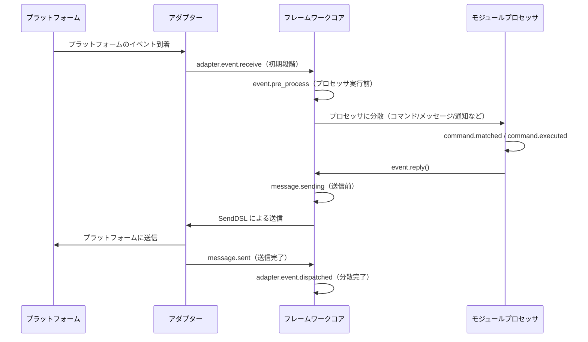

フレームワークは以下のフックのブレークポイントを内蔵しており、`@sdk.lifecycle.on()` で任意のブレークポイントを監視してカスタムロジックを実装できます。

### コア初期化

| フック名 | 発生タイミング | データ |
|---------|---------|------|
| `core.init.start` | SDKの初期化開始 | `{}` |
| `core.init.stage` | 初期化の各段階開始（バックグラウンドで発生） | `{"stage": str}`、値は `discovery` / `adapter_register` / `adapter_start` / `module_register` / `module_init` / `adapter_start_deferred` / `router_start` |
| `core.init.complete` | SDKの初期化完了 | `{"duration": float, "success": bool, "stages": {stage: float}, "adapters": {"enabled": [str], "disabled": [str]}, "modules": {"enabled": [str], "disabled": [str]}, "error": str(失敗時のみ)}` |
| `core.uninit.complete` | SDKの逆初期化完了 | `{"duration": float, "success": bool, "adapters_closed": int, "modules_unloaded": int, "module_properties_cleared": int, "module_properties_to_clear": [str], "error": str(失敗時のみ)}` |

**例：起動進捗表示**

```python
@sdk.lifecycle.on("core.init.stage")
def show_stage(data):
    print(f"[起動] 階段に到達: {data['stage']}")
```

### 設定変更

| フック名 | 発生タイミング | データ |
|---------|---------|------|
| `config.set` | 設定項目が変更された | `{"key": str, "old_value": Any, "new_value": Any}` |
| `config.updated` | 外部で config.toml を編集した後にツリー全体の変更が検出された | `{"old_config": dict, "new_config": dict, "config_file": str}` |

**例：設定監査**

```python
@sdk.lifecycle.on("config.set")
def audit_config(data):
    print(f"[監査] {data['key']}: {data['old_value']} -> {data['new_value']}")
```

### モジュールのライフサイクル

| フック名 | 発生タイミング | データ |
|---------|---------|------|
| `module.register` | モジュールクラスがマネージャーに登録された | `{"module_name": str, "success": bool}` |
| `module.load` | モジュールのロードが完了した（インスタンス化成功）；失敗時は `payload` に追加で `"error": str, "traceback": str`（失敗時の現場は `module.last_error(名前)` でも取得可能） | `{"module_name": str, "success": bool}` |
| `module.init` | モジュールの初期化が完了した（遅延ロード含む） | `{"module_name": str, "success": bool}` |
| `module.before_unload` | アンロードの最初のステップ（`on_unload` とリソース回収の前；モジュールインスタンスフック `on_before_unload` が同期的に発生） | `{"module_name": str, "reason": str}`；`reason` の値は `unload` / `reload` / `disable` / `cascade` / `dormant` |
| `module.sleep` | モジュールの休眠が完了した（遅延ロードの休眠：リソースは解放され、アクセス時に自動的に復活） | `{"module_name": str, "success": bool}` |
| `module.unload` | モジュールのアンロードまたは無効化（`disable` と `unload` は依存関係に通知するため同等；`on_dependency_lost` の契約には「無効化」が含まれる） | `{"module_name": str, "success": bool}` |
| `module.reload` | モジュールのホットリロードが完了した（依存モジュールも含む） | `{"module_name": str, "success": bool, "full": bool, "duration_ms": int}`；単一モジュールの場合、`"identity_changed": bool`（False = プロセス内で古いコードが実行されている可能性あり、C拡張のキャッシュなど）、`"version_old": str, "version_new": str` を追加で持つ；全量リロード（`reload_all`）の場合は `module_name` が `"All"` になり、`payload` に `"results": dict[str, bool]` を追加で持つ |

> **モジュールインスタンスフック `on_before_unload`**：`module.before_unload` イベントに対応するオプションのライフサイクルメソッド——`event["reason"]` に理由が記載され、リソース解放前に `sdk.storage` に状態を保存し、復活/リロード後に `on_load` で復元するのに適している（遅延ロードの休眠の状態継続はこれに基づく）。フックの失敗は警告のみで、アンロードプロセスをブロックしない。

### アダプターのライフサイクル

| フック名 | 発生タイミング | データ |
|---------|---------|------|
| `adapter.load` | アダプターの登録が完了した | `{"platform": str, "success": bool}` |
| `adapter.reload` | アダプターのコードレベルでのホットリロードが完了した | `{"adapter_name": str, "success": bool, "full": bool, "duration_ms": int, "identity_changed": bool, "version_old": str, "version_new": str, "was_started": bool, "source": str}`；`identity_changed=False` = プロセス内で古いコードが実行されている可能性あり |
| `adapter.start` | アダプターの起動 | `{"platforms": [str]}` |
| `adapter.status.change` | アダプターの状態が変化した | `{"platform": str, "status": str, "retry_count": int, "error": str(失敗時のみ)}`；status の完全な値は：`starting` / `started` / `start_failed` / `stopping` / `stopped` / `stop_failed` / `skipped-dependency` / `disabled` |
| `adapter.stop` | アダプターの停止 | `{"platforms": [str]}` |
| `adapter.stopped` | アダプターの停止が完了した | `{"platforms": [str]}` |
| `adapter.bot.online` | Botのオンライン | `{"platform": str, "bot_id": str, "info": dict, "status": str}` |
| `adapter.bot.offline` | Botのオフライン | `{"platform": str, "bot_id": str, "status": str}` |

### イベントの受信と処理

| フック名 | 発生タイミング | データ |
|---------|---------|------|
| `adapter.event.receive` | 外部プラットフォームイベントを受信した（初期段階） | `{"platform": str, "event_type": str, "raw_event_type": str}` |
| `adapter.event.blocked` | ミドルウェアがイベントを拒否した（`False` を返した、イベントは破棄されプロセッサに渡らない） | `{"middleware": str, "platform": str, "event_type": str, "detail_type": str, "event": dict, "_trace_id": str}` |
| `adapter.event.dispatched` | イベントの分散が完了した | `{"platform": str, "event_type": str, "raw_event_type": str, "onebot_handlers_count": int}` |
| `event.pre_process` | イベントプロセッサが実行される直前 | `{"event_type": str, "platform": str, "detail_type": str}` |

**例：イベント統計**

```python
event_counter = {}

@sdk.lifecycle.on("adapter.event.receive")
def count_events(data):
    platform = data["platform"]
    event_counter[platform] = event_counter.get(platform, 0) + 1

@sdk.lifecycle.on("adapter.event.dispatched")
def log_unhandled(data):
    if data["onebot_handlers_count"] == 0:
        print(f"[未処理] {data['platform']}/{data['event_type']}")
```

### メッセージの送信

| フック名 | 発生タイミング | データ |
|---------|---------|------|
| `message.sending` | メッセージが送信される直前 | `{"platform": str, "method": str, "detail_type": str, "target_id": str, "bot_id": str}` |
| `message.sent` | メッセージの送信が完了した | `{"platform": str, "method": str, "detail_type": str, "target_id": str, "bot_id": str}` |

**例：メッセージ送信監査**

```python
@sdk.lifecycle.on("message.sending")
def log_sending(data):
    print(f"[送信] -> {data['platform']}/{data['detail_type']}/{data['target_id']} via {data['method']}")
```

### コマンドシステム

| フック名 | 発生タイミング | データ |
|---------|---------|------|
| `command.matched` | コマンドがマッチし、実行される直前 | `{"command": str, "args": list[str], "platform": str, "user_id": str}` |
| `command.executed` | コマンドの実行が完了した | `{"command": str, "args": list[str], "platform": str, "user_id": str, "success": bool, "error": str(失敗時のみ)}` |

**例：コマンド統計**

```python
@sdk.lifecycle.on("command.matched")
def count_commands(data):
    print(f"[コマンド] /{data['command']} from {data['user_id']}@{data['platform']}")
```

### HTTPルーティング

| フック名 | 発生タイミング | データ |
|---------|---------|------|
| `server.request` | HTTPリクエストが受信された | `{"method": str, "path": str, "client_ip": str, "request_id": str}` |
| `server.response` | HTTPレスポンスが送信された | `{"method": str, "path": str, "status_code": int, "client_ip": str, "request_id": str}` |

> `request_id` は [X-Request-ID リクエスト連絡ID](router.md#リクエスト連絡-idx-request-id)：クライアントリクエストヘッダーを優先して使用し、なければUUIDを生成する。これによりリクエストとレスポンスを関連付けることができる。

**例：リクエストログ**

```python
@sdk.lifecycle.on("server.response")
def log_http(data):
    print(f"[HTTP] {data['method']} {data['path']} -> {data['status_code']}")
```

### WebSocket

| フック名 | 発生タイミング | データ |
|---------|---------|------|
| `server.start` | ルーティングサーバーが起動した | `{"base_url": str, "host": str, "port": int, "success": bool, "error": str(失敗時のみ)}` |
| `server.stop` | ルーティングサーバーが停止した | `{}` |
| `server.websocket.connect` | WebSocket接続が確立した | `{"path": str, "module_name": str, "client_ip": str}` |
| `server.websocket.disconnect` | WebSocket接続が切断された | `{"path": str, "module_name": str, "reason": str, "error": str(異常時のみ)}` |

**例：WebSocket接続監視**

```python
@sdk.lifecycle.on("server.websocket.connect")
def on_ws_connect(data):
    print(f"[WS] 接続: {data['path']} from {data['client_ip']}")

@sdk.lifecycle.on("server.websocket.disconnect")
def on_ws_disconnect(data):
    print(f"[WS] 切断: {data['path']} ({data['reason']})")
```

### ストレージ接続状態

ストレージバックエンドの接続プールの確立、障害、および復旧（すべてバックグラウンドで発生し、ストレージ操作をブロックしない）：

| フック名 | 発生タイミング | データ |
|---------|---------|------|
| `storage.ready` | ストレージバックエンドの接続プールが準備完了（各イベントループで最初のプール確立に成功した） | `{"backend": str}` |
| `storage.unreachable` | 重試回数が尽き、クールダウン期間に入る（この間は操作が即座に失敗する） | `{"backend": str, "error": str, "cooldown": float}` |
| `storage.recovered` | クールダウンが終了し、再接続に成功し、ストレージが再び利用可能になった | `{"backend": str}` |

**例：ストレージ障害アラート**

```python
@sdk.lifecycle.on("storage.unreachable")
def alert_storage_down(data):
    print(f"[アラート] ストレージバックエンド {data['backend']} に到達不可: {data['error']}、{data['cooldown']}秒後に自動的に再接続されます")

@sdk.lifecycle.on("storage.recovered")
def notify_storage_back(data):
    print(f"[復旧] ストレージバックエンド {data['backend']} が再び利用可能になりました")
```

### HTTPクライアント

`sdk.client` のリクエストと接続イベント（すべてバックグラウンドで発生）：

| フック名 | 発生タイミング | データ |
|---------|---------|------|
| `client.request.success` | HTTPリクエストが成功した | `{"method": str, "url": str, "status": int, "elapsed": float}` |
| `client.request.failed` | HTTPリクエストの再試行が尽き、最終的に失敗した | `{"method": str, "url": str, "error": str, "attempts": int, "elapsed": float}` |
| `client.ws.connect` | WebSocket接続が確立した | `{"url": str}` |

### 国際化

| フック名 | 発生タイミング | データ |
|---------|---------|------|
| `i18n.language.changed` | フレームワークの言語が切り替わった（`i18n.set_language`） | `{"language": str, "previous": str}` |

## 標準イベント定義

```python
STANDARD_EVENTS = {
    "core": ["init.start", "init.stage", "init.complete", "uninit.complete"],
    "module": ["load", "before_unload", "init", "sleep", "unload", "register", "reload"],
    "adapter": [
        "load", "start", "status.change", "reload", "stop", "stopped",
        "event.receive", "event.blocked", "event.dispatched",
        "bot.online", "bot.offline",
    ],
    "server": [
        "start", "stop",
        "request", "response",
        "websocket.connect", "websocket.disconnect",
    ],
    "event": ["pre_process"],
    "message": ["sending", "sent"],
    "command": ["matched", "executed"],
    "config": ["set", "updated"],
    "storage": ["ready", "unreachable", "recovered"],
    "client": ["request.success", "request.failed", "ws.connect"],
    "i18n": ["language.changed"],
}
```

## 完全な API リファレンス

### 登録と解除

| メソッド | 説明 |
|------|------|
| `@lifecycle.on(event, *, priority=0)` | デコレータによるハンドラの登録 |
| `lifecycle.register(event, handler, *, priority=0)` | プログラム的な登録 |
| `lifecycle.unregister(event, handler=None)` | 登録の解除（handler=None の場合はそのイベントの全ハンドラを解除） |

### 発火

| メソッド | 説明 |
|------|------|
| `await lifecycle.emit(event, data=None, *, to=None)` | 非同期で発火し、ハンドラは**並列実行**（互いにブロックせず、返却時に全て完了）、返り値が None でない場合、優先度順に data をチェーンで置き換え返す；`to` に owner を指定すると、特定のオブジェクトに投递 |
| `lifecycle.fire(event, data=None, *, to=None)` | **バックグラウンド発火（投げっぱなし）**：ハンドラはバックグラウンドタスクで並列実行され、待機せず、返り値なし；リスナーがいない場合はオーバーヘッドゼロ。高頻度のホットパスや純粋な観測イベントに適している（`server.request` / `storage.ready`）；順序に敏感な処理（`config.set`）やシャットダウンシーケンスは `emit` を使用すること |
| `lifecycle.emit_sync(event, data=None, *, to=None)` | 同期で発火、非同期ハンドラは create_task でスケジュール |
| `await lifecycle.submit_event(event_type, *, source, msg, data, to=None, background=False)` | 旧版との互換性、標準イベント形式を自動構築；`background=True` の場合、`fire` のバックグラウンド発火経路を使用 |

**4種類の発火 API の対照表**：

| メソッド | 呼び出し形態 | ハンドラの完了を待つか | 代表的な使用場面 |
|------|---------|------------------|---------|
| `emit` | `await`（非同期） | **待つ**——ハンドラは並列実行、返却時に全て完了、返り値は優先度順に data をチェーンで置き換え返す | 通常の発火；順序に敏感な消費（`config.set`）やシャットダウンシーケンスには必ずこれを使用 |
| `fire` | 直接呼び出し（同期で返却） | **待たない**——バックグラウンドタスクで並列実行、返り値なし；リスナーがいない場合はオーバーヘッドゼロ | 高頻度のホットパスや純粋な観測イベント（`server.request` / `storage.ready`） |
| `emit_sync` | 直接呼び出し（同期） | 同期ハンドラは即時完了；非同期ハンドラは `create_task` でスケジュール（返り値は返却できない） | 非同期コンテキスト外（同期コード）でイベントを発火する場合 |
| `submit_event` | `await`（非同期） | 待つ（`background=True` の場合は `fire` と同じ待たない） | 旧版との互換性：自動で標準イベント形式（`source` / `msg` / `timestamp`）を構築 |

### ユーティリティ

| メソッド | 説明 |
|------|------|
| `lifecycle.start_timer(timer_id)` | タイマーを開始 |
| `lifecycle.get_duration(timer_id)` | 経過時間を取得（秒） |
| `lifecycle.stop_timer(timer_id)` | タイマーを停止し、経過時間を返す |
| `lifecycle.list_hooks()` | 登録済みの全てのフックとハンドラ数をリストアップ |
| `lifecycle.clear()` | 全てのハンドラとタイマーをクリア |

## モジュールでの使用例

```python
from ErisPulse.Core.Bases import BaseModule
from ErisPulse import sdk

class Main(BaseModule):
    async def on_load(self, event):
        # 簡単なメッセージ数カウントの実装
        self.msg_count = 0
        
        @sdk.lifecycle.on("adapter.event.receive")
        async def count(data):
            if data["event_type"] == "message":
                self.msg_count += 1
        
        # すべてのコマンドを監視
        @sdk.lifecycle.on("command.matched")
        async def log_cmd(data):
            sdk.logger.info(f"コマンド実行: /{data['command']} by {data['user_id']}")
        
        # 設定変更の監査
        @sdk.lifecycle.on("config.set")
        def audit(data):
            sdk.logger.info(f"設定変更: {data['key']} = {data['new_value']}")
```

## バックグラウンドタスクの所有者と自動キャンセル

> [!NOTE]
> この機能は ErisPulse **2.8.0+** が必要です。

モジュールが作成した asyncio バックグラウンドタスクが `on_unload` でキャンセルされない場合、`self` の参照が保持され、モジュールインスタンスの回収ができなくなります（ホットリロード後に古いインスタンスが残存）。フレームワークは以下のバックアップメカニズムを提供します：

- **`self.spawn(coro)`**（モジュール内で推奨）：タスクはモジュール名に自動的に所属し、モジュールのアンロード時にフレームワークが `on_unload` **後に**未終了のタスクをキャンセルし、警告を記録します
- **`spawn_background(coro)`**（`ErisPulse.runtime`）：現在の `owner_scope` コンテキストを自動的にキャプチャします；`cancel_owner_tasks(owner)` で所属をキャンセル、`cancel_all_background_tasks()` は `sdk.uninit()` のバックアップ用
- **アダプター**：停止時にプラットフォーム名の下のバックグラウンドタスクもバックアップでキャンセル

```python
async def on_load(self, event):
    # 推奨：バックグラウンドタスクは self.spawn() を使用し、アンロード時にフレームワークがバックアップでキャンセル
    self.spawn(self._poll())

async def on_unload(self, event):
    # 精密制御の場合は、手動でキャンセルし、終了処理を待機する必要があります
    if self._poll_task:
        self._poll_task.cancel()
        await asyncio.gather(self._poll_task, return_exceptions=True)

async def _poll(self):
    while True:
        await asyncio.sleep(60)
        ...
```

> [!IMPORTANT]
> フレームワークのバックアップは**強制キャンセル**（`cancel_owner_tasks`）で、`on_unload` の返り値の後に行われます。したがって、優雅な終了処理が必要なタスク（バッファのフラッシュ、状態の永続化、接続の閉鎖）は**必ず**`on_unload` で `cancel()` + `await` で完了する必要があります — バックアップが終了処理を保持することを期待しないでください。フレームワークは「`self` を保持するタスクが残らないように」することを保証しますが、「優雅」を保証するわけではありません。`await` の結果が必要なタスクは直接 `await` してください、バックグラウンドタスクに投げないでください。

## 注意事項

1. **ハンドラは同期または非同期**：システムが自動的に識別し、正しく呼び出します
2. **データの渡し方**：`emit()` モードでは、ハンドラが `None` 以外の値を返すと、後続のハンドラに渡される `data` を変更します
3. **イベント名の命名規則**：点構造のイベント名を使用することを推奨します、親イベントの監視が容易になります
4. **エラーの隔離**：ハンドラの1つが例外を発生しても、他のハンドラの実行に影響しません
5. **同期トリガーの制限**：`emit_sync()` では、非同期ハンドラは fire-and-forget 方式でスケジュールされ、返り値は回伝できません
6. **ライフサイクルのクリーンアップ**：`sdk.uninit()` を呼び出すと、すべての登録されたハンドラとタイマーがクリーンアップされます
7. **ロード優先性**：フレームワークの初期化段階でイベントをサブスクライブしたい場合は、高優先度を設定し、遅延ロードを無効化することを推奨します


### 懶加载系统

# ラグロードモジュールシステム

> [!TIP]  
> **この記事を読む必要があるタイミング**：ラグロードモジュールを使用する場合、または activate_on イベント駆動型のアクティベーションを使用する場合。それ以外の場合はスキップしても、他の機能の使用に影響はありません。

ErisPulse SDK のラグロードモジュールシステムは、モジュールの初期化を**実際にアクセスされたタイミングまで遅らせます**。起動フェーズではプレースホルダーエージェントのみを登録し、使用されなかったモジュールは起動時間やメモリを占有しません。

## 概要

ErisPulse のコア機能の 1 つである遅延ロードモジュールシステムは、以下の方法で動作します。

- **遅延初期化**：モジュールは、初めてアクセスされたときにのみ実際に読み込まれ、初期化されます。
- **透明な使用**：開発者にとって、遅延ロードモジュールは通常のモジュールと使用上ほとんど違いがありません。
- **自動依存管理**：モジュールの依存関係は、使用されるときに自動的に初期化されます。
- **ライフサイクルサポート**：`BaseModule` を継承したモジュールに対しては、ライフサイクルメソッドが自動的に呼び出されます。

## 動作原理

### LazyModule クラス

ラグジュアリー・ロード・システムの中心となるのが `LazyModule` クラスです。これは、最初にアクセスされたときにのみモジュールを実際に初期化するラッパーです。

### 初期化プロセス

モジュールが初めてアクセスされたとき、`LazyModule` は以下の操作を実行します：

1. モジュールクラスの `__init__` パラメータ情報を取得します
2. パラメータに基づいて `sdk` リファレンスを渡すかどうかを決定します
3. モジュールの `moduleInfo` 属性を設定します
4. `BaseModule` を継承したモジュールの場合、`on_load` メソッドを呼び出します
5. `module.init` ライフサイクルイベントをトリガーします

## イベント駆動型遅延起動（activate_on）

> [!NOTE]
> この機能は ErisPulse **2.8.0+** が必要です。

`lazy_load=True` のモジュールはデフォルトで**最初の属性アクセス時**にのみロードされます。モジュールがコマンド/イベントハンドラを登録している場合、従来の方法では `lazy_load=False` として即時ロードするしかありませんでした。`activate_on` は第三の選択肢を提供します：**トリガを宣言し、最初の一致するイベント/コマンドが到着した時点でモジュールを自動的にアクティブ化する**——メモリに常駐させることなく、トリガのエントリポイントを失うこともありません。

```python
from ErisPulse.loaders import ModuleLoadStrategy

class MyModule(BaseModule):
    @staticmethod
    def get_load_strategy():
        return ModuleLoadStrategy(
            lazy_load=True,
            activate_on=[
                # ---- イベントトリガ（受動的到着、ユーザーの意識を必要としない）----
                "message",                                    # タイプレベル：任意のメッセージイベント
                {"notice": "group_member_increase"},          # タイプ + 単一 detail_type
                {"message": ["private", "group"]},            # タイプ + 複数 detail_type

                # ---- コマンドトリガ（能動的入力、Help に表示されるプレースホルダーコマンド）----
                {"command": "roll"},                          # 簡易表記：コマンド名
                {"command": ["roll", "dice"]},                # コマンド名リスト
                {"command": {                                 # dict 形式で宣言（name は必須）
                    "name": "dice",
                    "help": "サイコロを振る",
                    "usage": "/dice",
                    "group": "娯楽",
                    "aliases": ["d"],
                    "hidden": False,
                }},
            ],
        )
```

### コマンド dict 形式の宣言パラメータ

dict 形式は `@command()` デコレータのユーザーレベルのパラメータを反映し、モジュールのロード前にプレースホルダーコマンドを登録するのに使用されます。

| パラメータ | 型 | デフォルト | 説明 |
|------|------|------|------|
| `name` | `str` | **必須** | コマンド名；`on_load` での `@command(name)` と一致する必要がある。一致しない場合、アクティブ化後にプレースホルダーが削除され、コマンドは存在しなくなる |
| `help` | `str` | フォールバックチェーン | Help に表示される説明；未宣言の場合、フォールバックチェーンから値を取得する（以下参照） |
| `usage` | `str` | 自動生成 | 使用法行；デフォルトは `{prefix}{name}` |
| `group` | `str` | `None` | コマンドグループ |
| `aliases` | `list[str]` | `[]` | 別名を同時に登録し、**別名の入力でもトリガとして機能する** |
| `hidden` | `bool` | `False` | `True` の場合、プレースホルダーコマンドも非表示（アクティブ化後の実際のコマンドの非表示の意味と一致）；コマンド名を知っているユーザーの入力でもトリガとして機能する |

**サポートされていない** `priority` / `permission` / `master`：プレースホルダーコマンドの役割はトリガの起動だけであり、権限チェックはアクティブ化後の実際のコマンドが実行する（プレースホルダー段階で権限チェックを行うと、「コマンド入力による起動」が無効になる）。

### 占位コマンドの Help フォールバックチェーン

モジュールがロードされていない場合、Help に表示されるコマンドの説明は以下の順序で取得されます（最初に見つかった値を使用）：

1. dict 形式で宣言されたコマンドレベルの `help`（最も正確）
2. モジュールの `get_meta()` の `description`
3. モジュールの `__description__` 属性
4. パッケージのメタデータの `Summary`（PyPI パッケージの概要）
5. 一般的なメッセージ：「このコマンドは遅延ロードモジュール X から来ています。初めて使用すると、モジュールが自動的にロードされます」

### トリガの意味

- **イベントスタブ**：対応するイベントマネージャーに非常に低い優先度（`ACTIVATION_STUB_PRIORITY`）で登録され、すべての通常のハンドラの後にバックアップとしてトリガされる。アクティブ化後、現在のイベントはモジュールの実際のハンドラに転送される
- **コマンドスタブ**：プレースホルダーコマンドを登録する。アクティブ化後、プレースホルダーは削除され、実際のコマンドがトリガを引き継ぐ
- **再入防止**：`asyncio.Lock` を使用して、並行トリガ時に一度だけアクティブ化されるように保証する
- **スコープフィルタリング**：スタブにはモジュールの所有者アイデンティティが含まれ、モジュールが Bot / セッション / プラットフォームに対して有効化されていない場合はトリガされない
- **失敗時の処理**：アクティブ化に失敗した場合はクールダウン期間（`ACTIVATE_RETRY_COOLDOWN_SECS`、30秒）に入る。クールダウン中はイベントが短絡的に処理され、繰り返し試行されない。クールダウン後に再トリガされると、自動的に再試行され、スタブは全期間保持される
- **重複排除**：同名のコマンドが簡易表記と dict 形式で混在して宣言された場合、重複は排除され（dict が優先される）。dict で `name` が欠落している、またはイベントの `detail_type` が dict として誤って記述された場合は警告が表示され、無視される

> アーキテクチャ図と完全な意味については、[アーキテクチャ概要](../architecture.md#イベント駆動型遅延起動activate_onトリガアーキテクチャ)を参照してください。

## 懒惰ロードの休眠（dormant_after）

> [!NOTE]
> この機能は ErisPulse **2.11.0+** が必要です。

長期間使用されていない遅延ロードモジュールに対して、フレームワークはその**休眠**を可能にします。これにより、実行時のリソース（タスク、接続、イベントの登録など）を解放しますが、遅延ロードプロキシと登録のスタブは保持されます。モジュールは「登録済みだがロードされていない」状態に戻り、次回の属性アクセス、`module.call`、`activate_on` イベントによって**透明に再起動**されます（再インスタンス化され、`on_load` が実行されます）。再起動のための API は一切不要です。休眠後のシステムの状態は、「一度も起動されていない」場合と完全に同一です。

### 宣言方法

```python
@staticmethod
def get_load_strategy():
    return ModuleLoadStrategy(
        lazy_load=True,
        dormant_after="30m",   # 30 分間の無使用で自動的に休眠；宣言しない場合は休眠しない（デフォルト）
    )
```

時間の指定は、コマンド管理の `cooldown` と同じ形式です（`90s` / `1h30m` / `1d`）。スクリーナーは固定間隔（60 秒）でスキャンを行い、実際の休眠時刻は閾値 + 最大でスキャン間隔分のずれがあります。また、手動で休眠させることも可能です：`await sdk.module.sleep("モジュール名")`。明示的な `unload` は完全なアンロード（遅延プロキシも削除）になります。

### 状態の継続

休眠前にフレームワークは `on_before_unload(reason="dormant")` をトリガーします（アンロードの最初のステップ、リソースはまだ有効）。モジュールは `sdk.storage` に状態を保存します。再起動後は `on_load` で状態を復元します：

```python
async def on_before_unload(self, event):
    if event["reason"] in ("dormant", "reload", "disable"):
        await self.sdk.storage.aset(f"{self._module_name}:counter", self._count)

async def on_load(self, event):
    self._count = await self.sdk.storage.aget(f"{self._module_name}:counter") or 0
```

### 意味と境界

- **依存先の安全性**：遅延モジュールの依存先は、永続的なプロキシ（`sdk.<Name>`）または `module.call` を通じてアクセスします。休眠前後で動作は一貫しています。直接に実際のインスタンスの参照を持つことは反パターンです（監査ツールで漏れが確認できます）。
- **イベントの到達**：休眠中のモジュールはイベントを受け取らなくなります。イベントによって再起動が必要なモジュールは、`activate_on` を同時に宣言してください（イベントが先に再起動し、その後転送されます）。「コマンドが反応しない」問題を調査する際は、モジュールが休眠状態にあるかどうかを確認してください。
- **再起動失敗時の自己修復**：再起動（再初期化）に失敗した場合、30 秒間のクールダウンに入り、クールダウン後に再びアクセスすると自動的に再試行されます。永久的に失敗することはありません。

## 懒惰ロードの設定

### グローバル設定

設定ファイルでグローバルな遅延ロードを有効または無効にします：

```toml
[ErisPulse.framework]
enable_lazy_loading = true  # true=遅延ロードを有効にする(デフォルト), false=遅延ロードを無効にする
```

### モジュールレベルの制御

モジュールは `get_load_strategy()` 静的メソッドを実装することで、ロード戦略を制御できます：

```python
from ErisPulse.Core.Bases import BaseModule
from ErisPulse.loaders import ModuleLoadStrategy

class MyModule(BaseModule):
    @staticmethod
    def get_load_strategy():
        """モジュールのロード戦略を返す"""
        return ModuleLoadStrategy(
            lazy_load=False,  # Falseを返すと即時ロード
            priority=100      # ロードの優先度、数値が大きいほど優先度が高い
        )
```

## ラグロードモジュールの使用

### 基本的な使い方

開発者にとって、ラグロードモジュールは通常のモジュールと使用方法にほとんど違いはありません：

```python
# SDKを介してラグロードモジュールにアクセス
from ErisPulse import sdk

# 以下のようにアクセスするとモジュールのラグロードがトリガーされます
result = await sdk.my_module.my_method()
```

### モジュールの取得の統一されたエントリーポイント

SDK属性、モジュールマネージャー属性を通じてアクセスする場合でも、`module.get()`で検索する場合でも、
「登録済みだがまだロードされていない」ラグロードモジュールに対しては、すべて同じラグロードプロキシが返り、
そのプロパティにアクセスすることで初めてモジュールの初期化がトリガーされます：

```python
# 3つの方法で取得できるのはすべてラグロードプロキシです（モジュールがロードされていない場合）、動作は一貫しており、ユーザーには透明です
sdk.my_module          # ロードをトリガーするエントリーポイント
sdk.module.my_module   # 同様にラグロードプロキシを返します
sdk.module.get("my_module")  # これもラグロードプロキシを返します。この操作自体はロードをトリガーしません

# プロキシの任意の属性にアクセスすることで、モジュールの初期化が実際に行われます
result = await sdk.my_module.my_method()
```

`module.get()`は**検索**用のインターフェースであり、ロードをトリガーしません：
- モジュールが既にロード済み → 実際のインスタンスを返します
- モジュールが登録済みだが未ロード → ラグロードプロキシを返します（プロパティにアクセスしたときに初期化されます）
- モジュールが未登録 → `None`を返します

明示的にロードをトリガーするには、`await sdk.load_module("my_module")`を使用してください。

### 非同期初期化

非同期初期化が必要なモジュールについては、まず明示的にロードすることを推奨します：

```python
# まずモジュールを明示的にロード
await sdk.load_module("my_module")

# その後モジュールを使用
result = await sdk.my_module.my_method()
```

### 同期初期化

非同期初期化を必要としないモジュールについては、直接アクセスできます：

```python
# 直接アクセスすると自動的に同期初期化されます
result = sdk.my_module.some_sync_method()
```

## 最佳実践

ロード戦略を選択する際は、以下の決定フローを参考にしてください。

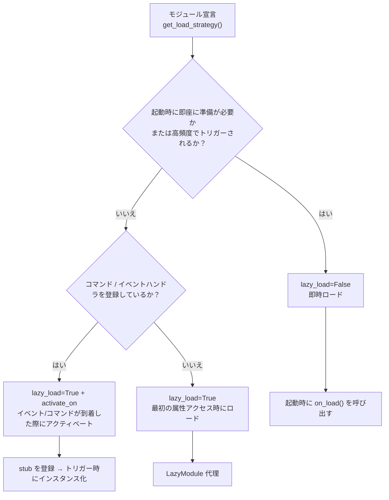

### 懒惰ロード（lazy_load=True）を使用することを推奨する場面

- 他のモジュールによって呼び出されるだけの受動的なユーティリティモジュール（例：データクエリモジュール、フォーマット変換器など）
- コマンド/イベントハンドラを登録しているが高頻度で使用されないモジュール — `activate_on` を使ってトリガを宣言し、最初の一致するイベント/コマンドが到着した際に自動的にアクティベートする。これにより、lazy_loadを放棄せずに済む。

### 懒惰ロードを禁止することを推奨する場面（lazy_load=False）

- 起動時に即座に準備が必要なモジュール（他のモジュールに基礎サービスを提供するコアモジュールなど）
- 高頻度でトリガーされるリスナー（各メッセージごとに処理が必要） — `activate_on` による転送には1回のアクティベートオーバーヘッドがあるため、高頻度の場面では即時ロードした方が直接的
- タイマータスクモジュール
- アプリケーション起動時に初期化が必要なモジュール

> `priority` パラメータは、即時ロードされるモジュール間の初期化順序を制御します。数値が大きいほど先に初期化されます。同じ優先度のモジュールは登録順にロードされます。

## 注意事項

1. モジュールが遅延ロードを使用している場合、ErisPulse内で他のモジュールによって一度も呼び出されない場合、そのモジュールは決して初期化されません。
2. モジュール内にEventの監視など、他のモジュールを積極的に監視するモジュールが含まれている場合、2つの選択肢があります：`activate_on` トリガーを宣言して遅延ロードを維持し、イベントが到達したときに自動的にアクティブ化するか、または即時ロードを必要とすることを宣言する（`lazy_load=False`）か、さもなければモジュールの正常な業務に影響を及ぼす可能性があります。
3. 特殊な要望がない限り、遅延ロードを無効にすることは推奨しません。そうしないと、依存管理やライフサイクルイベントなどの問題が生じる可能性があります。
4. `activate_on` のコマンド dict 声明において、`name` はモジュールの `on_load` で `@command()` によって登録された実際のコマンド名と一致する必要があります。一致しない場合、モジュールがアクティブ化された後にプレースホルダーコマンドが解除され、宣言と実装が一致しないコマンドは存在しません。


### 国际化（i18n）系统

# 国際化 (i18n) システム

> [!TIP]
> **この記事を読む必要があるのは**：多言語の文案、翻訳の登録、言語の検出が必要な場合です。必要ない場合は、他の機能の使用に影響を与えることなく、この記事は飛ばしてください。

ErisPulse v2.5.0 以降、完全な国際化 (i18n) 機能が内蔵されています。フレームワークのコアおよび CLI インターフェースは、システム言語に応じて表示されるテキストを自動的に切り替えることができ、外部モジュールが独自の翻訳を登録することもサポートしています。

## 支援言語

| 言語 | コード | 説明 |
|------|------|------|
| 简体中文 | `zh-CN` | デフォルト言語（フレームワークの原生言語） |
| 繁體中文 | `zh-TW` | 繁体中文（香港/澳门/台湾） |
| English | `en` | 英文（一般的フォールバック言語） |
| 日本語 | `ja` | 日本語 |
| Русский | `ru` | ロシア語 |

## 早速体験

### 環境変数による切り替え

```bash
# Windows PowerShell
$env:ERISPULSE_LANG = "en"
epsdk run

# macOS / Linux
ERISPULSE_LANG=ja epsdk run
```

### 設定ファイルによる切り替え

`config/config.toml` に以下を追加します：

```toml
[ErisPulse.i18n]
language = "zh-TW"
```

`"auto"`（デフォルト値）に設定すると、システム言語を自動検出します。

### コード内で手動で切り替え

```python
from ErisPulse import i18n

# 言語を手動で設定
i18n.set_language("en")
print(i18n.get_language())  # "en"

# 自動検出に戻す
i18n.reset_language()
```

## 言語検出メカニズム

フレームワークは、以下の優先順位でユーザーの言語を検出します：

1. **環境変数 `ERISPULSE_LANG`** — 最も高い優先順位で、テストや一時的な切り替えに使用
2. **Windows API** — `GetUserDefaultLocaleName`（Windowsに限定、Git Bashなどのツールが `LANG` を上書きする影響を受けない）
3. **環境変数** — `LANGUAGE` > `LC_ALL` > `LC_MESSAGES` > `LANG`（Unix/macOSの標準）
4. **システムロケール** — `locale.getlocale()` / `locale.getdefaultlocale()`
5. **デフォルト** — en（英語）

### 近接マッピング原則

検出された言語が正確に一致しない場合、サポートされている言語に近接する原則でマッピングされます：

- `zh-TW`, `zh-HK`, `zh-MO`, `zh-Hant` → **繁体中国語**
- その他のすべての `zh-*`（例: `zh-CN`, `zh-SG`）→ **簡体中国語**
- `en-US`, `en-GB`, `en-AU` など → **英語**
- `ja-JP` → **日本語**
- `ru-RU` → **ロシア語**
- その他の未認識の言語 → **簡体中国語（デフォルト）**

## モジュールでの i18n の使用

独自のモジュールに翻訳テキストを登録することで、多言語をサポートできます。

### 推奨方法：I18nClass を使って翻訳キーを宣言する（v2.7.0+）

v2.7.0 以降、モジュールやアダプターは `ConfigClass` を宣言するのと同じように、ネストされたクラス `I18nClass` を使って翻訳キーを宣言できます。フレームワークはロード時に**自動的に**宣言されたすべての翻訳キーを登録します。手動で `i18n.register()` を呼び出す必要はありません。

```python
from dataclasses import dataclass, field

from ErisPulse.Core.Bases import BaseConfig, BaseI18n, BaseModule, I18nKey


class MyModule(BaseModule):
    # 設定クラス（オプション）
    @dataclass
    class ConfigClass(BaseConfig):
        welcome_msg: str = field(
            default="欢迎",
            metadata={
                # ここでは i18n キー mymodule.welcome_msg を参照
                "description": {"i18n": "mymodule.welcome_msg", "default": "欢迎消息"},
            },
        )

    # 翻訳キー集合クラス（オプション）
    # 宣言されたキーはフレームワークによって自動的に登録され、
    # ConfigClass がデフォルト設定を生成するよりも優先されます
    class I18nClass(BaseI18n):
        # 属性名が自動的に結合されて完全なキー経路 <モジュール名>.<属性名> になります
        welcome_msg: I18nKey = I18nKey(
            default="Welcome Message",   # 言語に依存しないデフォルト値、どの言語にも登録されません
            zh_CN="欢迎消息",
            en="Welcome Message",
            ja="ウェルカムメッセージ",
            ru="Приветственное сообщение",
            zh_TW="歡迎訊息",
        )
        # 业务で使用する他の翻訳キー
        hello: I18nKey = I18nKey(
            default="Hello, {name}!",
            zh_CN="你好，{name}！",
            zh_TW="你好，{name}！",
            en="Hello, {name}!",
            ja="こんにちは、{name}！",
            ru="Привет, {name}!",
        )

        # 完全なキー経路を明示的に指定することもできます（属性名の結合を使わない）
        custom: I18nKey = I18nKey(
            key="mymodule.deep.nested.key",
            default="Default text",
            zh_CN="默认文本",
            zh_TW="預設文本",
            en="Default text",
            ja="デフォルトテキスト",
            ru="Текст по умолчанию",
        )
```

#### なぜ I18nClass が推奨されるのか？

| シナリオ | 手動 i18n.register() | I18nClass 宣言式 |
|------|-----------------------|------------------|
| 設定の説明に参照される i18n キー | 手動で登録する必要があり、設定生成前に登録する必要がある | フレームワークが設定生成前に自動的に登録する |
| 多言語翻訳の宣言 | on_load() 内に散在する | クラス内で一括して宣言され、一目瞭然 |
| キー名の命名の一貫性 | 拼写ミスが発生しやすい | 属性名がキー名の接尾辞として使用され、IDE による補完が可能 |
| アンロード時のクリーンアップ | 手動で unregister_domain() を呼び出す必要がある | フレームワークが統一されたドメインで登録する |

#### I18nClass のキー経路ルール

- **デフォルト**：``<モジュール登録名>.<属性名>`` を完全なキー経路として使用
  - 例：モジュール名が ``MyModule``、属性 ``welcome`` → キー経路 ``MyModule.welcome``
- **明示的**：``I18nKey(key="...")`` パラメータを使って任意のドット区切り経路を指定
  - 深層ネストされたキー名（例：``mymodule.config.basic.token``）に適している

#### アダプターでの使用

アダプターも `I18nClass` をサポートしており、使用方法は完全に同じです：

```python
from ErisPulse.Core import BaseAdapter
from ErisPulse.Core.Bases import BaseConfig, BaseI18n, I18nKey


class MyAdapter(BaseAdapter):
    @dataclass
    class ConfigClass(BaseConfig):
        endpoint: str = field(
            default="",
            metadata={
                # 設定の説明は adapter.MyAdapter.endpoint キーを参照
                "description": {"i18n": "MyAdapter.endpoint", "default": "API 地址"},
            },
        )

    class I18nClass(BaseI18n):
        # 集中して設定の説明に参照されるキーとその他の業務用キーの多言語訳を宣言
        endpoint: I18nKey = I18nKey(
            default="API Endpoint",
            zh_CN="API 地址",
            zh_TW="API 位址",
            en="API Endpoint",
            ja="APIアドレス",
            ru="API адрес",
        )
```

アダプターの `I18nClass` は `__init__` 階段（つまり設定テンプレート生成の前）に自動的に登録され、設定の説明に参照される i18n キーが利用可能になります。

### 手動でカスタム翻訳を登録する（旧方法）

`I18nClass` を使用しない場合、`i18n.register()` を直接呼び出して翻訳テキストを登録することもできます。

```python
from ErisPulse import i18n

# 中文翻訳を登録
i18n.register("zh-CN", {
    "my_module.welcome": "欢迎使用我的模块！",
    "my_module.goodbye": "再见！",
    "my_module.hello": "你好，{name}！",
}, domain="my_module")

# 英文翻訳を登録
i18n.register("en", {
    "my_module.welcome": "Welcome to my module!",
    "my_module.goodbye": "Goodbye!",
    "my_module.hello": "Hello, {name}!",
}, domain="my_module")
```

### 翻訳の使用

```python
from ErisPulse import i18n

# 簡単な翻訳
i18n.t("my_module.welcome")  # 現在の言語が自動的に使用されます

# フォーマットパラメータ付き
i18n.t("my_module.hello", name="Alice")

# デフォルト値を指定（翻訳キーが存在しない場合に返される）
i18n.t("my_module.unknown_key", default="默认文本")
```

### モジュールクラスでの使用

```python
from dataclasses import dataclass, field
from ErisPulse import i18n
from ErisPulse.Core.Bases import BaseConfig, BaseModule

@dataclass
class MyModuleConfig(BaseConfig):
    welcome_msg: str = field(
        default="欢迎",
        metadata={
            "description": {"i18n": "my_module.welcome_msg", "default": "欢迎消息"},
            "ui": {"widget": "text", "group": "basic", "order": 1},
        },
    )

class MyModule(BaseModule):
    ConfigClass = MyModuleConfig

    async def on_load(self, event):
        # 実時で設定を読み取る（各アクセスで最新値が反映される）
        self.logger.info(self.cfg.welcome_msg)
        self.logger.info(i18n.t("my_module.welcome"))

    @command("hello")
    async def hello_handler(self, event):
        name = event.get_user_nickname() or "friend"
        await event.reply(i18n.t("my_module.hello", name=name))

    async def on_unload(self, event):
        pass
```

### 翻訳のアンロード

```python
# ドメイン全体の翻訳をアンロード
i18n.unregister_domain("my_module")
```

---

## 設定フィールドの多言語対応

v2.5.2 以降、設定の Schema は i18n を全面的にサポートします。ユーザーが見られるすべてのテキストフィールドは i18n キーを参照でき、WebUI およびその他の消費者は、現在の言語に応じて自動的に対応するテキストに解析します。

### 対応する i18n フィールド

| フィールド | 位置 | 説明 |
|------|------|------|
| `description` | field metadata | フィールドの説明 |
| `options[].label` | `ui.options` | select コントロールのオプションラベル |
| `placeholder` | `ui.placeholder` | 入力欄のプレースホルダー |
| `group_labels` | `_schema_meta` | グループ表示名（Dashboard のセクションタイトル） |

すべての i18n フィールドは `{"i18n": "key", "default": "テキスト"}` の形式を採用し、純粋な文字列はそのまま透過されます（後方互換性を保つため）。

### i18n フィールドの宣言

すべてのユーザーが見られるテキストフィールドは i18n をサポートします：

```python
from dataclasses import dataclass, field
from ErisPulse.Core.Bases import BaseConfig

@dataclass
class MyAdapterConfig(BaseConfig):
    # description i18n
    token: str = field(
        default="",
        metadata={
            "description": {"i18n": "my_adapter.token", "default": "プラットフォーム Token"},
            "required": True,
            "secret": True,
            "ui": {
                "widget": "password",
                "group": "basic",
                "order": 1,
                # placeholder i18n
                "placeholder": {"i18n": "my_adapter.token.ph", "default": "Token を入力してください"},
            },
        },
    )
    # options label i18n
    mode: str = field(
        default="a",
        metadata={
            "description": {"i18n": "my_adapter.mode", "default": "実行モード"},
            "ui": {
                "widget": "select",
                "group": "basic",
                "order": 2,
                "options": [
                    {"label": {"i18n": "my_adapter.mode.a", "default": "モードA"}, "value": "a"},
                    {"label": {"i18n": "my_adapter.mode.b", "default": "モードB"}, "value": "b"},
                ],
            },
        },
    )

    # group_labels i18n（グループ表示名）
    _schema_meta = {
        "group_labels": {
            "basic": {"i18n": "my_adapter.group.basic", "default": "基本設定"},
        }
    }
```

`default` はバックアップテキストです。翻訳が登録されていない場合、または検索に失敗した場合に表示されます。

### secret 脱敏と設定検証

`"secret": True` とマークされたフィールドは、2.7.0 以降、**脱敏保護**が自動で適用されます：

- **テンプレート生成時の脱敏**：`dataclass_to_toml_with_comments()` が設定テンプレートを生成する際、secret フィールドの実際の値はファイルに書き込まれません（空のプレースホルダーとして表示され、機密情報がディスク上に残らないようにします）。
- **一般的な脱敏ツール**：`redact_secret(value)` は非空値を `***` に置き換え、空値はそのまま返します。これはログ出力などの場面で使用できます。

```python
from ErisPulse.Core.Bases.config_schema import redact_secret

redact_secret("sk-xxxxxx")  # '***'
redact_secret("")           # ''
```

**設定検証**（`validate_config()`）は、`required` の非空チェックに加えて、2.7.0 以降、以下の検証もサポートします：

| 検証項目 | メタデータ | 例 |
|--------|--------|------|
| 型の一致 | フィールドの宣言型 | `int` 型のフィールドに文字列を渡すとエラーになります |
| 列挙制約 | `ui.options` またはトップレベルの `options` | 値は許可されたオプションに属している必要があります |
| 数値範囲 | トップレベルの `min` / `max` | `metadata={"min": 1, "max": 65535}` |

```python
from ErisPulse.Core.Bases.config_schema import validate_config

@dataclass
class C(BaseConfig):
    mode: str = field(default="a", metadata={"ui": {"widget": "select", "options": ["a", "b"]}})
    port: int = field(default=80, metadata={"min": 1, "max": 65535})

errors = validate_config(C(mode="x", port=70000))  # 2つのエラー：列挙制約と範囲制約
```

### 設定の翻訳登録

設定フィールドの i18n キーは、通常の翻訳キーと同じように `i18n.register()` を使って登録できます：

```python
from ErisPulse import i18n

# 登録する中国語（default と同じでも、異なるものでも可）
i18n.register("zh-CN", {
    "my_adapter.token": "プラットフォーム Token",
}, domain="my_adapter")

# 登録する英語
i18n.register("en", {
    "my_adapter.token": "Platform Token",
}, domain="my_adapter")
```
> **推奨方法**：`I18nClass` を使って翻訳キーを宣言し、フレームワークが自動的に登録します（上記「推奨方法」の章を参照）。  
> 手動で `i18n.register()` や `register_config_i18n()` を呼び出す必要はありません。

また、便利な関数 `register_config_i18n()` も提供されており、設定クラスからキーを自動的に抽出して登録できます：

```python
from ErisPulse.Core.Bases.config_schema import register_config_i18n

# 自動的に description.default を zh-CN の翻訳として登録
register_config_i18n(MyAdapterConfig, "zh-CN")

# 手動で英語の翻訳を提供
register_config_i18n(MyAdapterConfig, "en", {
    "my_adapter.token": "Platform Token",
})
```

### WebUI での消費方法

`get_config_schema()` が返す schema では、i18n ディクショナリはそのまま透過されます。WebUI のフロントエンドは、現在の言語に応じて `i18n.t()` を呼び出して解析できます。

i18n をサポートしないフロントエンドに直接文字列を返す必要がある場合、`resolve_config_schema()` を使用します。この関数は、`description`、`options[].label`、`placeholder`、`group_labels` をすべて現在の言語の文字列に解析します：

```python
from ErisPulse.Core.Bases.config_schema import resolve_config_schema

# すべての i18n フィールドが現在の言語の文字列に解析されています
schema = resolve_config_schema(MyAdapterConfig)
print(schema["fields"]["token"]["description"])    # "プラットフォーム Token" または "Platform Token"
print(schema["fields"]["token"]["placeholder"])   # "Token を入力してください" または "Enter Token"
print(schema["fields"]["mode"]["options"][0]["label"])  # "モードA" または "Mode A"
print(schema["group_labels"]["basic"])             # "基本設定" または "Basic"
```

> `BaseConfig`、`BotAccountConfig`、`register_config_i18n()`、`resolve_config_schema()`  
> などの型とツール関数の実際の定義は `ErisPulse.Core.Bases.config_schema` にあります。  
> `ErisPulse.runtime.config_schema` は互換性のための shims として残されています。  
> **推奨は `ErisPulse.Core.Bases` から一括でインポートすること**（i18n 翻訳キーに関連する型は例外で、`ErisPulse.Core.Bases.i18n_schema` にあります）。

## API リファレンス

### I18nManager

#### 核心メソッド

| メソッド | 説明 |
|------|------|
| `t(key, default=None, **kwargs)` | 翻訳テキストを取得する（`gettext()` はエイリアス） |
| `set_language(lang)` | 手動で言語を設定する |
| `get_language()` | 現在の言語を取得する |
| `reset_language()` | 自動検出にリセットし、環境を再検出する |
| `get_supported_languages()` | すべてのサポート言語のリストを取得する |
| `has_translation(key, lang=None)` | 翻訳キーが存在するか確認する |
| `register(lang, translations, domain)` | 自定義翻訳を登録する |
| `unregister_domain(domain)` | 指定されたドメインのすべての翻訳をアンロードする |
| `reload()` | 内部翻訳を再読み込みし、言語を再検出する |

#### `t()` メソッドの詳細

```python
def t(self, key, /, default=None, **kwargs):
```

- `key` — 翻訳キー（位置引数のみ、`**kwargs` の `key=` と衝突しない）
- `default` — 翻訳が存在しない場合に返すデフォルト値、デフォルトは `None`（キー名そのものを返す）
- `**kwargs` — 翻訳値中の `{placeholder}` を埋め込むためのフォーマットパラメータ

例：

```python
# 翻訳定義: "greeting": "你好，{name}！欢迎来到{place}。"
i18n.t("greeting", name="Alice", place="ErisPulse")
# 戻り値: "你好，Alice！欢迎来到ErisPulse。"
```

### BaseI18n / I18nKey（宣言的翻訳キー）

v2.7.0 から、`ErisPulse.Core.Bases` はクラス属性に基づく翻訳キーの宣言ツールを提供しています（`ErisPulse.Core.Bases` から統一的にインポートすることを推奨します）：

> ``I18nKey.default`` は**言語に依存しないデフォルトテキスト**であり、どの言語にも登録されません。  
> 翻訳を有効にするには、少なくとも1つの言語パラメータ（``zh_CN=`` / ``en=`` / ``ja=`` など）を明示的に渡す必要があります。  
> これにより、各国の開発者は `default` を自分の母国語で自由に記入でき、フレームワークはその内容を一切仮定しません。

| 名称 | 説明 |
|------|------|
| `I18nKey(default, *, key=None, zh_CN, zh_TW, en, ja, ru)` | 単一の翻訳キーの宣言、`default` は言語に依存しないデフォルト |
| `BaseI18n` | 翻訳キー集合の基底クラス（`BaseConfig` と命名を揃える）、子クラスはクラス属性で複数の `I18nKey` を宣言する |
| `BaseI18n.register(prefix="", domain="app")` | クラスメソッド：宣言されたすべてのキーを i18n システムに登録する |
| `key` | `I18nKey` のエイリアス（より簡潔な書き方） |

使用例：

```python
from ErisPulse.Core.Bases import BaseI18n, key

class MyKeys(BaseI18n):
    # 簡潔なエイリアス書き方
    hello = key(
        default="Hello",
        zh_CN="你好",
        zh_TW="你好",
        en="Hello",
        ja="こんにちは",
        ru="Привет",
    )
    bye = key(
        default="Bye",
        zh_CN="再见",
        zh_TW="再見",
        en="Bye",
        ja="さようなら",
        ru="До свидания",
    )

# 独立使用（手動で登録）
MyKeys.register(prefix="myapp.", domain="myapp")
```

### SDK インスタンスからのアクセス

```python
from ErisPulse import sdk

# sdk.i18n は直接インポートした i18n と同じオブジェクト
sdk.i18n.set_language("en")
print(sdk.i18n.t("core.sdk.init.starting"))
```

## 実行時設定

### 設定APIを介してi18n設定を読み取る

```python
from ErisPulse.Core.Bases import I18nConfig
from ErisPulse.runtime import get_i18n_config

config = get_i18n_config()
print(config["language"])  # "auto" または具体的な言語コード

# I18nConfig は dataclass であり、設定テンプレートの生成に使用可能
schema = I18nConfig.__dataclass_fields__
```

### 設定項目の説明

`config/config.toml` の `[ErisPulse.i18n]` 部分で：

```toml
[ErisPulse.i18n]
# 表示言語。選択可能な値:
# - "auto"      — システム言語を自動検出（デフォルト）
# - "zh-CN"     — 簡体字中国語
# - "zh-TW"     — 繁体字中国語
# - "en"        — 英語
# - "ja"        — 日本語
# - "ru"        — ロシア語
language = "auto"
```

---

## 最佳実践

### 翻訳キーの命名

ドットで区切られた名前空間形式の命名を推奨します：

```
<モジュール名>.<カテゴリ>.<説明>
```

例：`my_module.command.hello_desc`、`core.adapter.start_failed`

### 多言語のカバー

すべての言語の翻訳を一度に提供する必要はありません。不足している言語は自動的に英語にフォールバックされ、英語もなければキー名そのものが表示されます。

### 動的コンテンツ

ユーザー名、数値などの動的に生成されるコンテンツについては、`{placeholder}` 形式でフォーマットします：

```python
# 翻訳定義
"user_count": "現在オンラインのユーザー：{count} 人"

# 使用
i18n.t("user_count", count=len(users))
```

### ログメッセージ

モジュールがフレームワークの Logger を使用している場合、これらのメッセージも自動的に現在の言語で表示されます：

```python
self.logger.info(i18n.t("my_module.startup"))
```

## CLI i18n との関係

CLI には**独立**した国際化モジュール (`ErisPulse.CLI.i18n`) があり、フレームワークのコアの国際化モジュールとは完全に分離されています。

- **Core i18n** — フレームワークのコアモジュールで使用され、外部モジュールは翻訳を登録できます。
- **CLI i18n** — コマンドラインインターフェース内で使用され、Core と翻訳データを共有しません。

この設計により、CLI の翻訳の変更がフレームワークのコアの安定性に影響を与えることがありません。


### 统一控制面（scope）

# スコープ（scope）

> [!TIP]
> **この記事を読むべきタイミング**：モジュールの可用性、イベントの受信制限、または出力アクションの制限を制御する必要がある場合。不要な場合は飛ばしても、他の機能の使用に影響はありません。

> **読了後は**：3つのスコープ次元（モジュールの可用性 / イベント受信 / 出力アクション）それぞれの設定経路、判定優先順位と拒否時の挙動、実行時のAPIの使い方、およびブロッキングがどのように可視化されるか（`scope.blocked` イベント）を理解できます。
>
> **本記事では対象外**：リソースの所有権と解放回収（[所有権（owner）システム](ownership.md)を参照）；コマンドACLとイベントの上書き（[イベント処理入門](../getting-started/event-handling.md)を参照）。

> [!NOTE]
> この機能は ErisPulse **2.8.0+** が必要です。

スコープは4つの質問に答える：**どのモジュールが使えるか、どのイベントを受け取るか、特定のモジュールがどのようなテキストを処理するか、モジュールが外部にどのようなアクションを実行できるか**。制御権はすべてユーザーに委ねられます。モジュール / アダプタ / プロセッサ / 出力呼び出しの登録時に**上層**（設定 `ErisPulse.scope` または実行時 `sdk.scope`）で一括して宣言し、イベントパイプラインはエントリ、プロセッサフィルタ、出力ゲートで自動的に読み取り、実行します。

| 次元 | 制御対象 | 拒否時の挙動 | 設定経路 |
|------|---------|---------|---------|
| **① モジュール** | どのモジュールが使えるか（プラットフォーム / Bot / セッションの3段階） | フィルタリングされたモジュールはトリガーされず、返信もされません（`scope.blocked` イベントをブロッキング）。対象となるコマンドは既に認証済みで、ブロックされます。 | `scope.platforms / bots / sessions` |
| **② 身分** | イベントを受け取るかどうか（アダプタ / Bot / セッション / ユーザーの4段階） | エントリで完全に破棄されます（`scope.blocked` イベントをブロッキング）。 | `scope.identity.*` |
| **③ 出力** | モジュールがどのような出力呼び出し（メッセージ / API / リクエスト、メソッドレベルの白黒リスト）を実行できるか | 失敗応答（`retcode=34601`）が返されます。 | `scope.actions` |

> **関連システム**：コマンドは特別なメッセージイベントハンドラであり、そのユーザーの白黒リスト（ACL）と実装パラメータの上書きはコマンドシステムが独自に保持します（`ErisPulse.event.command`）。[イベント処理入門](../getting-started/event-handling.md)と[設定ガイド](../user-guide/configuration.md)を参照してください。

{!--< tips >!--}
1. `from ErisPulse.Core import scope` でシングルトンをインポート（`sdk.scope` は同じオブジェクト）
2. 判定：`scope.is_allowed(...)` / `scope.is_identity_allowed(...)` / `scope.is_action_allowed(...)` は、それぞれ①②③の3つのゲートに対応します
3. 読み書き：次元化されたパラメータメソッド（IDEで補完可能）—— `scope.set_module(...)` / `scope.set_identity(...)` / `scope.set_action(...)`；また、辞書式のバックアップとして `scope.get(path)` / `scope.set(path, v)` / `scope.delete(path)` もあります
4. イベントハンドラのテキスト条件の上書きは、[イベント処理入門 · イベントの上書き](../getting-started/event-handling.md#イベントの上書き-モジュールコードを改ざんせず任意のイベントタイプの挙動を上書き)を参照してください；コマンドACL / パラメータの上書きは[イベント処理入門](../getting-started/event-handling.md)を参照してください
{!--< /tips >!--}

## マッチングエントリの構文（全システムで統一）

スコープのすべての「名前リスト」（モジュール名、身元キー、出力エントリ）は、同一のマッチング構文（`ErisPulse.Core.text_match`）を使用します：

| 構文 | 例 | 説明 |
|------|------|------|
| 精確名 | `"Chat"` | 全値比較、**大文字小文字は区別しない** |
| glob | `"Tool*"`、`"spam_*"` | `*` 任意の文字列 / `?` 1文字 / `[seq]` 文字集合、大文字小文字は区別しない |
| 正規表現 | `"re:^Danger.*"` | `re:` で始まる宣言、正規表現 `search` で一致、デフォルトは大文字小文字は区別しない |

- 不正な正規表現は**静かに無効化**される（エラーは発生せず、クラッシュもしない）
- デコレータのパラメータ（`pattern=` / `regex=`）は固定された意味を持つ：`pattern` は glob、`regex` は正規表現のソースコード（`re:` プレフィックスは付けない）；スコープの設定内の正規表現エントリは**必ず** `re:` プレフィックスを付ける必要がある

## グローバルバックアップ：`default_allow`

`default_allow` は**唯一のグローバルバックアップ**スイッチ（デフォルト `true`）で、2つの判定次元に一括して効果を及ぼします：

- **モジュール次元**：どのバインディングにも一致しない → `default_allow` で許可 / 拒否を決定
- **身元次元**：どの戦略にも一致しない → `default_allow` で許可 / 拒否を決定

`false` に設定すると「暗黙の拒否」厳密モードが有効になり、ホワイトリスト方式で管理されるため、**明示的に許可されていないものはすべて拒否**されます。

> **例外**：③ 出力次元は**`default_allow`の影響を受けない**——これは独立した絞り込みスイッチであり、デフォルトはすべて許可され、明示的なルールでのみ制限される（フレームワーク層の owner が空の呼び出しは常に許可される）。このように厳密なグローバルモードでも、すべてのモジュールのメッセージ返信が意図せず遮断されることはない。コマンド ACL には独立した `ErisPulse.event.command.default_allow` バックアップがあり、互いに影響しない。

## 設定ファイル

```toml
[ErisPulse.scope]
default_allow = true        # グローバルバックアップ（false = 暗黙の拒否厳密モード）
cache_size = 1024           # LRUキャッシュサイズ

# ── ① モジュール次元（優先度：セッション > Bot > プラットフォーム）──
[ErisPulse.scope.platforms.onebot11]
modules = ["Chat", "Tool*"]   # ホワイトリスト：正確な名前 / glob / re: 正規表現
blocked = ["re:^Danger"]
[ErisPulse.scope.bots.onebot11."123456"]
modules = ["Chat"]
merge = true                  # プラットフォームレベルのバインディングに追加（デフォルトは全体を上書き）
[ErisPulse.scope.sessions.onebot11."789012345"]
modules = ["Chat"]

# ── ② 身元次元（優先度：ユーザー > セッション > Bot > アダプタ）──
[ErisPulse.scope.identity.adapters.onebot11]
deny = true                   # アダプタ全体のイベントを完全に破棄
[ErisPulse.scope.identity.bots.onebot11."123456"]
deny = true
[ErisPulse.scope.identity.sessions.onebot11."g_blocked"]
deny = true
[ErisPulse.scope.identity.users.onebot11]
allow = ["u_admin"]           # ユーザー鍵は glob / re: 正規表現をサポート
deny = ["u_bad", "spam_*"]

# ── ③ 出力次元（デフォルトはすべて許可され、明示的な絞り込みのみ制限）──
[ErisPulse.scope.actions.MyModule]
send = { deny = true }                                    # 送信を完全に禁止
api = { allow = ["get_*"] }                               # クエリ系の標準APIのみ許可
request = { deny = true }                                 # リクエスト処理を禁止
```

## ① モジュール次元

**一言で言うと**：プラットフォーム / Bot / セッションの3段階でバインド制御を行い、"このコンテキストでどのモジュールが有効か"を制御します。フィルタリングされたモジュールはトリガされず、応答もしません（一致したコマンドは引き続き認領され、ブロックされます）。

「あるコンテキストで、どのモジュールが有効か」を回答します。デフォルトではすべて開放です。バインドを設定した場合にフィルタリングが開始され、**モジュールとアダプタは一切変更不要です**。

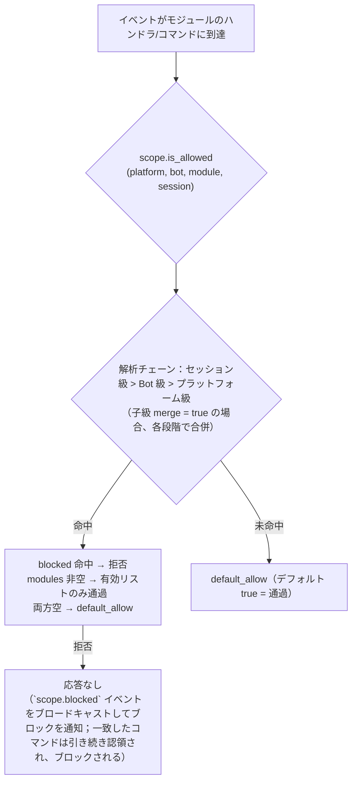

- **解析優先度**：セッション級 > Bot 級 > プラットフォーム級、高優先度のバインドは低優先度を**全体的に上書き**します。  
  子級バインドに `merge = true` を指定した場合は、低優先度と**各項目ごとに合併**されます（`modules` / `blocked` はそれぞれ独立に合併され、`merge` 自体は項目としてカウントされません）。
- **デフォルトの意味**：フィルタリングされたモジュールのコマンドやハンドラはトリガされず、応答もしません。TRACE レベルのログで確認可能（`core.scope.denied`）。  
  同時に `scope.blocked` ライフサイクルイベントをブロードキャストして、誰がブロックされたか、なぜブロックされたかを観測できます。  
  一致した**コマンド**は引き続き認領され、ブロックされます——コマンドのテキストは低優先度のメッセージハンドラに漏れることなく、二重応答の混乱を解消します。
- **フレームワークレベルのハンドラ**（`scope_exempt=True` または owner が空）は影響を受けません。モジュール名が空（フレームワーク層のリソース）の場合は常に通過します。
- **セッション感知のヘルプとコマンド照会**：コマンド照会 API（`command.help` / `get_command` / `get_commands` / `get_group_commands` / `get_visible_commands`、および `module.get_commands_overview`）は、任意の `event=` または明示的な `platform=` / `bot_id=` / `session_id=` キーワードをサポートします。  
  現在のセッションで無効なモジュールのコマンドは結果に含まれません（`get_command` は None を返し、単一コマンドのヘルプは「未登録」として扱われ、デフォルトの意味と一致します）。  
  コンテキストを渡さない場合は、全量の動作を維持します。

### バインドの継承（merge）

デフォルトでは、全体的な上書きの意味が明確で予測可能です。上級バインドに**追加**したい場合は、子級に `merge = true` を指定します：

```toml
[ErisPulse.scope.platforms.onebot11]
modules = ["Chat", "Tool"]      # プラットフォーム級：Chat、Tool を有効

[ErisPulse.scope.bots.onebot11."123456"]
modules = ["Music"]
merge = true                    # この Bot の実効値 = ["Chat", "Tool", "Music"]
```

- 合併ルール：`modules` と `blocked` はそれぞれ**合併**されます。バインド内では `blocked` が `modules` より優先されます。
- 鏈式合併：プラットフォーム → Bot → セッションの順に段階的に追加され、各段階で `merge` または上書きを独立して決定します。

## ② 身元次元（イベント受容）

**一言で言うと**：ユーザー／セッション／Bot／アダプターの4段階の戦略に基づき、イベント配信の入口で「受容すべきでないイベント」を完全に破棄し、deny は allow より優先されます。

「どのユーザーのイベントを受け入れるか」を決定します。拒否されたイベントは**配信の入口で完全に破棄**されます——ミドルウェアや任意のハンドラ（フレームワークレベルを含む）には一切渡らず、TRACE レベルのログ（`core.scope.identity_denied`）でのみ確認できます。

- **解析優先度**：ユーザー > セッション > Bot > アダプター。最も具体的に設定された戦略を採用します。deny は allow より優先されます。
- 各段階のバインディングは二元的な戦略です：`{ allow = true }` または `{ deny = true }`
- ユーザーのキーには glob / 正規表現（例：`"spam_*"` で一括してスパムユーザーをブロック）が使用可能です。
- 代表的な使い方——上位階層で deny し、個別のユーザーに対して allow を設定することで「例外的に許可」を実現します：

```toml
[ErisPulse.scope.identity.adapters.onebot11]
deny = true
[ErisPulse.scope.identity.users.onebot11]
allow = ["u_admin"]   # アダプター階層で拒否されていても、u_admin のイベントは許可されます
```

## ③ 出站次元（制限モジュールが発信する呼び出し）

**一言で言うと**：メソッド単位のホワイトリスト・ブラックリストによって、モジュールが発信するメッセージ / API / リクエスト呼び出しを制限し、拒否された呼び出しはネットワークリクエストを一切行わず、直接 `retcode=34601` を返します。

制限されるモジュールの**発信アクション**：メッセージ送信 / 標準APIアクション / リクエスト操作。  
3つのアクションはそれぞれ下層DSLに対応します：`Event.reply` と `Send`（send）、`Api` / `call_api`（api）、`Request` の accept/reject（request）。イベントハンドラ実行中にモジュールが発信する出站呼び出しは、モジュールのオーナーを含み、この次元で一括して判定されます。

### 規則の形態（インライン表）

各アクションのルールはインライン表です：`{ allow = [...], deny = true|[...] }`。  
同一アクションには1つのルールしか設定できません（TOMLのキーは重複不可、全禁止と細粒度のどちらか1つを選択）：

```toml
[ErisPulse.scope.actions.MyModule]
send = { deny = true }                                  # 送信を全禁止（Event.reply / Send DSL）
# またはメソッド単位の細粒度設定：send = { allow = ["Text", "Image*"], deny = ["File"] }
api = { allow = ["get_*"] }                             # 限定的に取得系標準APIを許可
# またはアクション単位のブラックリスト：api = { deny = ["set_*", "leave_*"] }
request = { deny = true }                               # リクエストのaccept/reject処理を禁止
```

- `send` の項目は**送信メソッド名**（`Text` / `Image` / `File` ...）に一致する
- `api` の項目は**標準アクション名**（`get_group_info` / `set_group_name` ...）に一致する
- 項目は正確な名前 / glob / `re:` 正規表現（全システムと統一された構文で、大文字小文字は区別しない）
- `allow` に1つの文字列を記述することは、1つの項目のリストと同義です：`send = { allow = "Text" }`

### 判定の意味

**デフォルトは全許可**——設定がなければ、またはオーナーが空（フレームワーク層の内部呼び出し）であれば許可されます。  
ルールが設定された場合、以下の順序で判定されます：

1. `deny = true` → 拒否
2. `deny` リストに呼び出し名が一致 → 拒否
3. `allow` リストが空でなく、呼び出し名が一致しない（または呼び出しに名前がない）→ 拒否
4. その他の場合 → 許可

拒否された呼び出しはネットワークリクエストを一切行わず、標準の失敗レスポンスを直接返します（`retcode = 34601`、[api-response §5.3](../standards/api-response.md#53-フレームワーク拡張返却コード34xxx-プラットフォームエラーセグメントの下3桁カスタマイズ)を参照）。  
3つのアクションは互いに独立しており、1つだけを制限することも可能です。

```python
# 実行時API
sdk.scope.set_action("MyModule", "send", deny=True)              # 送信を全禁止
sdk.scope.set_action("MyModule", "send", allow=["Text"])         # 送信はテキストのみ許可
sdk.scope.is_action_allowed("MyModule", "send", name="Image")    # False
sdk.scope.is_action_allowed("MyModule", "api", name="get_user_info")  # 規則に従って判定
sdk.scope.delete_action("MyModule", "send")                      # 許可を復元
sdk.scope.get_action("MyModule", "send")                         # そのアクションの現在のルール
```

## 実行時API

スコープの実行時APIは3つの層に分かれています：**判定**（3つの質問）、**次元ごとの読み書き**（各次元の `set` / `get` / `delete` パラメータ化メソッド、署名はすべて型注釈付き、IDEで補完可能）、**辞書式バックアップ**（ドット区切りのパスで任意の節に直接アクセス）。

```python
from ErisPulse import sdk

scope = sdk.scope
```

### 判定（3つの質問）

```python
scope.is_allowed("onebot11", "123456", "Chat")                 # ① モジュール次元
scope.is_allowed("onebot11", "123456", "Chat", "789012345")    # セッションレベルを含む
scope.is_allowed("onebot11", "123456", None)                   # フレームワーク層のリソース -> True

scope.is_identity_allowed("onebot11", "123456", "group_9", "u1")   # ② 身元次元

scope.is_action_allowed("MyModule", "send")                    # ④ 出力次元
scope.is_action_allowed("MyModule", "send", name="Image")      # メソッドレベルの細粒度
```

### ① モジュール次元

```python
# バインディング（パラメータによって階層が決まります：session_id > bot_id > プラットフォームレベル）
scope.set_module("onebot11", bot_id="123456", modules=["Chat", "Tool*"])
scope.set_module("onebot11", blocked=["re:^Danger"])                       # プラットフォームレベル
scope.set_module("onebot11", bot_id="123456", session_id="g9", modules=["Chat"])  # セッションレベル
scope.set_module("onebot11", bot_id="123456", modules=["Music"], merge=True)      # 現在のバインディングと並列に結合
scope.set_module("onebot11", bot_id="123456", modules=["Chat"], persist=False)    # 実行時のみ

# 読み取り / 削除
scope.get_module("onebot11", bot_id="123456")   # {"modules": ["Chat"], "blocked": []}
scope.delete_module("onebot11", bot_id="123456")
```

> `merge=True` は**書き込み時に並列に結合**（現在のバインディングとエントリを結合）です；階層間の解析時の `merge = true` 設定は上記の[バインディング継承](#バインディング継承merge)をご覧ください——これらは独立したメカニズムです。

> **実行時バインディング（`persist=False`）の意味**：実行時バインディングは独立したオーバーライド層に保存され、**任意の後続の設定書き込み / 設定ファイルのホットアップデートでも削除されません**（設定ツリーが再構築された後に、書き込み順に自動的に再実行されます、実行時削除も含みます）。これらは永続化されず、プロセスの再起動後に失われます；モジュールのアンロード時に、そのモジュールが書き込んだ実行時バインディングはバックアップでクリーンアップされます。その後、同一のパスで `persist=True` を実行すると、ユーザー永続化の意味で実行時ルールが上書きされます。

### ② 身元次元

```python
# 戦略のバインディング（パラメータによって階層が決まります：user > session > bot > adapter；allow / deny のどちらか一方）
scope.set_identity("onebot11", user_id="u_bad", deny=True)
scope.set_identity("onebot11", user_id="spam_*", deny=True)    # キーは glob / re: 正規表現をサポート
scope.set_identity("onebot11", bot_id="123456", session_id="g9", allow=True)

# 読み取り / 削除
scope.get_identity("onebot11", user_id="u_bad")   # {"deny": True}
scope.delete_identity("onebot11", user_id="u_bad")
```

### ③ 出力次元

```python
# 制限ルールの設定（allow: str|list；deny: bool|str|list；ルール全体の置換）
scope.set_action("MyModule", "send", deny=True)                    # 送信を完全に禁止
scope.set_action("MyModule", "send", allow=["Text"])               # テキスト送信のみ許可
scope.set_action("MyModule", "api", deny=["set_*", "leave_*"])     # 管理系APIを禁止

# 読み取り / 削除
scope.get_action("MyModule", "send")       # {"allow": ["Text"]} 元のルール
scope.delete_action("MyModule", "send")    # 個別のアクションを削除
scope.delete_action("MyModule")            # モジュールのすべてのアクション制限を削除
```

### 一般的な操作

```python
scope.get("platforms")   # 辞書式バックアップ：ドット区切りのパスで任意の節を読み取り
scope.topology()         # 全設定ツリー（ダッシュボード用）
scope.stats()
# {"module_calls": .., "module_filtered": .., "identity_checks": .., "identity_denied": ..,
#  "action_checks": .., "action_denied": .., "cache_hits": .., "cache_misses": ..}
scope.reset_stats()
scope.clear()           # 全設定をクリア（メモリ上でのみ有効）
```

### 高度な操作：辞書式ドット区切りパスバックアップ

次元化されたメソッドは日常的なシナリオをカバーします；任意のノード（または将来追加される次元）に直接アクセスする必要がある場合、**辞書式API**を使用できます——`get` / `set` / `delete` はドット区切りのパスを受け取り（dictの深さのマージ、書き込み後すぐに読み取り可能）、`scope[path]` / `scope[path] = v` / `del scope[path]` / `path in scope` プロトコルも提供します：

```python
scope.set("bots.onebot11.123456", {"modules": ["Chat"], "blocked": []})
scope.set("identity.users.onebot11.u_bad", {"deny": True})
scope.get("actions.MyModule.send")

scope["platforms.onebot11"]        # 読み取り（存在しない場合はKeyErrorを送出）
scope["platforms.onebot11"] = {...}  # 書き込み
del scope["platforms.onebot11"]      # 削除
"actions.MyModule" in scope          # 存在確認
```

## 拦截の可視化：`scope.blocked` イベント

スコープのフィルタリング（モジュールのフィルタ / 身元の拒否）が発生すると、**`scope.blocked`** というライフサイクルイベントがブロードキャストされ、"誰がブロックされたか、どのレベルでブロックされたか"をサブスクライブ、統計、ダッシュボードで表示可能になります——ブロックはデフォルトで返信されませんが、不可知のブラックボックスではありません。

| フィールド | 説明 |
|------|------|
| `dimension` | `"module"`（モジュール次元のフィルタ）/ `"identity"`（身元の受信拒否） |
| `module` | フィルタされたモジュール名（モジュール次元のみ） |
| `platform` / `bot_id` / `session_id` / `user_id` | ブロックが発生したソースコンテキスト |

```python
from ErisPulse.Core.lifecycle import lifecycle

@lifecycle.on("scope.blocked")
def on_blocked(data):
    print(f"ブロックされた：{data['dimension']} {data.get('module') or data.get('user_id')}")
```

- イベントは `fire` でバックグラウンドでブロードキャストされます（リスナーがいない場合はオーバーヘッドがなく、ホットパスを遅らせません）
- キャッシュヒットによる重複のブロックは**再ブロードキャストされません**——同じ組み合わせはキャッシュが失効するたびに1回だけブロードキャストされます
- `adapter.event.blocked`（ミドルウェアによる拒否）とは区別されます：これはイベントレベルの破棄であり、本イベントはスコープの受信ゲートのモジュール / 身元フィルタリングです

## キャッシュとホットアップデート

- `is_allowed` / `is_identity_allowed` / `is_action_allowed` の結果は**LRUキャッシュ**（`scope.cache_size` で調整可能）が付いており、`set` / `delete` / 設定のホットアップデート（`config.updated` / `config.set`）で自動的に失効します
- すべての次元の設定は**即座に有効**になります、再起動は不要です
- スコープは**イベントごとの判断**であり、イベント間で状態を記憶しません：設定が変わると、次のイベントは新しいルールに従います

## 設定フォーマットの検証

ロード時 / ホットアップデート時に各セクションの設定フォーマットを検証します：型の間違ったセクション（例：`platforms` が文字列に設定されている）、不正な出力ルール（例：`allow` が数値に設定されている）、未知のアクション名、未知のトップレベルのキー（例：`alow` というスペルミス）は **WARNING** として出力され、対応するセクション / 条目は無視され、他の合法な設定は正常に有効になります——間違った設定は静かに失効するのではなく、警告されます。

## 一般的な問題と注意事項

### 1. 設定の階層と上書き

- モジュール次元：セッションレベル > Botレベル > プラットフォームレベル、**全体的に上書き**（子レベルで `merge = true` の場合は各エントリを並列に結合）。プラットフォームで `Chat` を許可し、Bot で `Music` を追加したい場合は、Bot レベルで `merge = true` を書くか、両方をリストに書く
- 身元次元：ユーザー > セッション > Bot > アダプタ、**最も具体的な**設定された戦略を取ります（例外許可ができます）
- コマンドのユーザーブラックリスト/ホワイトリスト：正確なコマンド名が glob キーに優先されます（`event.command.acl` を参照）

### 2. モジュール/コマンドが反応しない

まず作用域が原因かどうかを疑います：

```python
from ErisPulse import sdk

print(sdk.scope.is_allowed(event.get_platform(), bot_id, "MyModule", session_id))
print(sdk.scope.is_identity_allowed(event.get_platform(), bot_id, session_id, user_id))
print(sdk.scope.stats())   # module_filtered / identity_denied > 0 なら、ブロック記録がある
```

フィルタされた場合、デフォルトでは返信されません（モジュール次元と身元次元、ルールを暴露しないように）；`scope.blocked` ライフサイクルイベントをブロードキャストし、統計は継続的に蓄積されます；ACL で拒否されたコマンドは「権限不足」の返信を表示します。

### 3. 出力アクションが拒否されたときのトラブルシューティング

```python
from ErisPulse import sdk

print(sdk.scope.get("actions.MyModule"))
print(sdk.scope.stats())   # action_denied > 0 なら、呼び出しがブロックされている
```

ブロックは**明示的**です：拒否された呼び出しは `retcode = 34601` の標準の失敗レスポンスを返し、ネットワークリクエストは発生しません。

### 4. セッション識別子のプラットフォーム間隔離

`(platform, session_id)` 組み合わせが唯一の識別子です。`scope.sessions.onebot11."789"` は onebot11 でのみ作用し、telegram 上で同じ `789` のセッションには影響しません。身元次元のユーザーキーも同様です。

## 拓撲ツリーアプリケーションプログラミングインターフェース

`ModuleManager.get_topology()` と `AdapterManager.get_topology()` は、モジュール/アダプタの所属関係データを提供します。`sdk.get_topology()` は、作用域 `scope` を含む一括集約を行います：

```python
from ErisPulse import sdk

topology = sdk.get_topology()
# {
#   "modules": {                                   # モジュール → 持有するリソース
#     "Chat": {
#       "loaded": True, "enabled": True,
#       "commands": ["chat", "translate"],
#       "handlers": {"message": 2, "notice": 1},
#       "routes": {"http": ["/Chat/api"], "ws": [], "sse": []},
#       "lifecycle_hooks": 3,
#     }
#   },
#   "adapters": {                                  # アダプタ → Bot → 作用域
#     "onebot11": {
#       "status": "started", "enabled": True,
#       "bots": {"123456": {"status": "online", "scope": {...}}},
#       "scope": {"modules": [...], "blocked": [...]},
#     }
#   },
#   "scope": {                                     # 作用域（モジュール / 身元 / 出力アクション）
#     "platforms": {...}, "bots": {...}, "sessions": {...},
#     "identity": {"adapters": {...}, "bots": {...}, "sessions": {...}, "users": {...}},
#     "actions": {...},
#   },
# }
```

- モジュールのトポロジーは、登録されたコマンド、イベントハンドラ、HTTP/WS/SSEルート、ライフサイクルフックを統合し、モジュールリソースツリーを描画するのに便利です。
- アダプタのトポロジーは、各アダプタの状態、下位のBotの状態、およびプラットフォーム/Botレベルの作用域バインディング（モジュール次元）を統合します。
- **JSON安全出力**：`get_topology(json_safe=...)` はデフォルトで `True` であり、返された構造は直接 `json.dumps` できます——モジュール `info` は純粋なデータの `meta` サブテーブルのみ保持されます（`module_class` / `strategy` などの実行時オブジェクトは除外）、その他のノード（アダプタ作者が Bot `info` に挿入した任意のオブジェクトを含む）もバックアップで浄化されます（クラスオブジェクトは `__name__` を取得し、シリアライズできないオブジェクトは `str()` に退化します）。ダッシュボード / WebUI は直接シリアライズして返すことができます；原始オブジェクトが必要な場合は `json_safe=False` を渡します。


### 归属权（owner）系统

# 所有権（owner）システム

> [!TIP]
> **この文書を読むべき場面**：リソースリークの調査、アンロード時のクリーンアップフローの理解、または帰属リソースの宣言を行うとき。必要なければ読み飛ばしても、他の機能の利用には影響しません。

> **読み終えるとわかること**：owner コンテキストがどのようにリソースを自動帰属させるか、帰属リソースの一覧表、アンロード/無効化時の
> クリーンアップチェーンの完全な時系列、そしてどのリソースがアンロード時にクリーンアップされないか（設計上の境界）。
>
> **この文書の対象外**：リソースが「いつ有効になるか」の権限判定（[スコープ](scope.md)を参照）；
> バックグラウンドタスクの推奨される書き方と強制キャンセルの境界（[ライフサイクル管理 · バックグラウンドタスクの帰属と自動キャンセル](lifecycle.md#バックグラウンドタスクの帰属と自動キャンセル)を参照）。


所有権はモジュールの「プラグアンドプレイ」を支える礎です：モジュールがロード中に登録したすべてのフレームワークリソースは自動的に記名され、
アンロード/無効化時には記名に基づいて一括回収されます——モジュール作者はリソースを宣言するだけで、クリーンアップロジックを手書きする必要はありません。

> **関連システム**：スコープはイベント配信時に「リソースが有効かどうか」を決定し、
> 所有権はライフサイクルにおいて「リソースが誰に帰属し、誰のアンロード時に回収されるか」を決定します。
> スコープの詳細は[統一コントロールプレーン](scope.md)を、バックグラウンドタスクの詳細は
> [ライフサイクル管理](lifecycle.md#バックグラウンドタスクの帰属と自動キャンセル)を参照してください。

{!--< tips >!--}
1. 帰属は**登録の瞬間**に `current_owner` に基づいて自動記録され、モジュールコードの変更は一切不要
2. アンロード/無効化は同一のクリーンアップチェーン（`_cleanup_module_registrations`）を共用し、各ステップの失敗は警告のみで中断しない
3. ユーザー設定セマンティクスのリソース（永続化オーバーライド / scope ルール / コマンド ACL）はモジュールのアンロード時にクリーンアップ**されない**
4. ユーティリティモジュールが管理する外部ハンドルは `on_cleanup(cb)` でクリーンアップチェーンに組み込め、相手モジュールのアンロード時に自動コールバックされる（[ユーティリティモジュールガイド](#ユーティリティモジュールガイド他モジュールのハンドル管理)を参照）
{!--< /tips >!--}

## owner コンテキストの仕組み

owner はコンテキスト変数 `current_owner` で伝播します（`ErisPulse.runtime.context`）：

```python
from ErisPulse.runtime import owner_scope, get_current_owner

with owner_scope("MyModule"):
    # この区間内で登録されたすべてのリソースは自動的に MyModule に帰属する
    assert get_current_owner() == "MyModule"
```

フレームワークは以下のタイミングで owner を自動注入します（モジュール/アダプターコードで手動ラップは不要）：

| タイミング | owner の値 | 場所 |
|------|----------|------|
| モジュール `load()` | モジュール名 | インスタンス化 + `on_load` の全工程 |
| アダプター `start()` / `restart()` | プラットフォーム名 | アダプター起動の全工程 |
| `activate_on` 遅延ロード stub 登録 | モジュール名 | プレースホルダーコマンド/ハンドラーの登録 |
| イベントハンドラー実行中 | ハンドラーの帰属先モジュール名 | handler / コマンドエントリーでの再注入 |

実行期の再注入とは：モジュールが `on_load` 内で宣言したコマンドハンドラーが**実行中**に
登録型 API（`sdk.adapter.on()`、`overrides.*.set(persist=False)` など）を呼び出した場合も、
同様に自動的に当該モジュールに帰属することを意味します。

## 帰属リソース一覧

モジュールがロードコンテキスト内で登録した以下のリソースはすべて帰属が記録され、アンロード/無効化時に自動回収されます：

| リソース | 登録方法 | クリーンアップ呼び出し |
|------|----------|----------|
| コマンド | `@command()` / コマンド dict 宣言 | `command.unregister_by_owner()` |
| イベントハンドラー | `@message` / `@notice` / `@request` / `@meta` | `handler.unregister_by_owner()` |
| アダプターイベントリスナー | `sdk.adapter.on()` / `raw=True` | `adapter.unregister_handlers_by_owner()` |
| アダプターミドルウェア | `@sdk.adapter.middleware` | 同上 |
| ルーティング（HTTP/WS/SSE） | `router.http()` / `websocket()` / `sse()` | ネームスペース別 + owner 別の二重フォールバック |
| ルーティングミドルウェア | `@router.middleware()` / `add_middleware()` | `router.unregister_all_by_owner()` |
| Dashboard ホームエントリー | `router.register_home_entry()` | `unregister_home_entries_by_owner()` |
| カスタムセッションタイプ | `register_custom_type()` | `unregister_custom_types_by_owner()` |
| プラットフォームイベントメソッド注入 | `register_event_method()` / `register_event_mixin()` | `unregister_event_methods_by_owner()`（モジュールアンロード時に自動回収、旧クロージャーのリークなし） |
| バックグラウンドタスク | `self.spawn()` | `cancel_owner_tasks()` |
| 外部帰属クリーンアップフック（ユーティリティモジュール預かり） | `runtime.on_cleanup(cb)` | `run_owner_cleanups()`（アンロード/無効化/アダプター終了チェーン内で発火） |
| ライフサイクルフック | `lifecycle.register()` | `lifecycle.unregister_by_owner()` |
| マスター識別プロバイダー | `master.provider` | `master.unregister_by_owner()` |
| i18n 翻訳キー | `I18nClass` 宣言（domain=モジュール名） | `i18n.unregister_domain()` |
| イベントオーバーライド（ランタイム） | `overrides.*.set(persist=False)` | `overrides.unregister_by_owner()` |
| 対話セッション（wait_reply 待機 / リース） | `event.wait_reply()` / `sdk.interaction.acquire()` | `interaction.cancel_by_owner()`（待機側は即座にキャンセルを受け取る） |
| コンテキストデータ | `runtime/context` が owner ごとに記録 | モジュール単位で精密にクリーンアップ |

アダプター側の対応リソース（プラットフォーム名を owner とする）は、アダプターの `shutdown()` / `restart()` 時に
`_cleanup_adapter_resources` によって回収されます。さらに以下を含みます：

| リソース | クリーンアップ呼び出し |
|------|----------|
| アダプター自身の `on()` ハンドラーとミドルウェア | `adapter.unregister_handlers_by_owner(platform)` |
| プラットフォームイベントメソッド拡張（`EventMixin`） | `unregister_platform_event_methods(platform)` |
| カスタムセッションタイプ | `unregister_custom_types_by_owner(platform)` |
| 対話セッション（当該プラットフォームで保留中の wait_reply / リース） | `interaction.cancel_by_platform(platform)` |
| i18n 翻訳ドメイン（domain=設定キー） | `i18n.unregister_domain(設定キー)` |
| 細粒度ネームスペースルーティング | `router.unregister_all_by_owner(platform)` |

## アンロード/無効化クリーンアップシーケンス

`unload()` と `disable()` は同一のクリーンアップチェーンを共用します（各ステップは独立した try/except で、
失敗はログに記録されるだけで**後続のクリーンアップは中断しません**）：

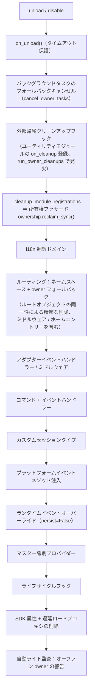

`sdk.uninit()` の終了時には別途グローバルなフォールバックがあります：全アダプター shutdown → 全モジュール unload →
`router.stop()`（ルーティング/ミドルウェア/ホームエントリーのクリア）→ `cancel_all_background_tasks()` →
イベントハンドラーとフックのクリア。

## 所有権統一ファサード（ownership）

クリーンアップチェーンの 16 ステップは、所有権統一ファサード `ErisPulse.Core.ownership` に集約されています。
4 つの動詞が「登録解除、カウント、スキャン、監査」をカバーします——サブシステムごとの `*_by_owner` 登録解除関数は
そのまま維持され、ファサードの内部実装として機能します：

| 動詞 | 用途 |
|------|------|
| `ownership.reclaim(owner)` | owner 名義の下にある全リソースを一括登録解除（タスクキャンセル → クリーンアップフック → 登録系リソース；非同期の完全版） |
| `ownership.reclaim_sync(owner)` | 登録系リソースの登録解除（同期版、同期アンロードパス用） |
| `ownership.counts(owner=None)` | owner の在籍リソースを読み取り専用で集計（None は全 owner） |
| `ownership.orphans()` | オーファンスキャン：リソースは在籍しているが owner は登録解除済み（リーク確定リスト） |
| `ownership.audit(owner, deep=)` | リーク監査レポート（カウント + オーファン + 任意の gc インスタンス全数調査） |

```python
from ErisPulse.Core import ownership

ownership.reclaim_sync("MyModule")       # {'commands': 1, 'routes_http': 2, ...}
ownership.counts("MyModule")             # 在籍リソースのカウント
ownership.orphans()                      # [{"owner": "ghost", "total": 2, ...}]
```

**監査エントリー**：

- アンロード / リロード後の**自動ライト監査**：オーファン owner リソースを検出したら WARNING 警告（ゼロオーバーヘッドのカウントスキャン）
- `sdk.module.audit(name, deep=True)`：モジュールインスタンスの gc 全数調査——インスタンスが回収不能な場合、
  参照元の型を提示（「誰が旧インスタンスを掴んでいるか」を特定）；グローバルな一時停止のオーバーヘッドがあるため、明示的なトラブルシューティングのみに使用
- 深い全数調査は明示的な操作であり、設定キーを設けず、自動修復も行いません

## ホットリロード失敗時のロールバック

ホットリロードは「**アンロード前スナップショット → 失敗時自動リストア**」に変更されました：新バージョンの構文エラー、依存関係の欠落、
ロード失敗時には、旧インスタンスと登録状態（レジストリエントリー、sdk 属性、sys.modules エントリー）が
自動的に復元され、サービスは中断せず、ログに「旧インスタンスへロールバックしサービスを継続しています」と表示されます。

ベストエフォートのセマンティクス（ドキュメント化された境界）：

- `on_unload` が実行済みの副作用（切断済みの接続、キャンセル済みのタスク）は取り消せません——
  復元後の旧インスタンスは「後片付け済み」の状態にあり、再度ロードをトリガーしないと完全には利用できません
- サードパーティが実行時に手動でキャッシュした旧インスタンスへの参照は復元対象外です
- 対象パッケージが既にアンロードされている場合（entry-point が消失）はアンロード成功とみなし、ロールバックしません

## 設計上の境界：アンロード時にクリーンアップされないリソース

所有権が回収するのは**モジュールコードが登録したランタイムリソース**のみです。以下のリソースは**ユーザー設定のセマンティクス**
（制御権はユーザーにあり、意図的な設定である可能性がある）に属し、モジュールのアンロード後も設定と共に永続的に保持されます：

| リソース | セマンティクス | 説明 |
|------|------|------|
| `overrides.*.set(persist=True)` | 永続化オーバーライド | 設定ファイルに書き込まれ、再起動を跨いで有効；モジュールのアンロードでは削除されない（ユーザーの明示的な設定） |
| `scope.set_action()` などのスコープルール | 権限コントロールプレーン | ユーザー/Dashboard が管理し、モジュールをアンロードしてもルールは回収されない |
| `overrides.acl.set(persist=True)` | コマンド ACL | 同上 |
| Conversation `save()` 永続化 | 複数回対話のアーカイブ | データ資産はクリーンアップされない |

ランタイムの一時書き込み（`persist=False`）は owner と共に回収されます——**永続化するかどうかが
「ユーザー資産」と「モジュールのランタイム状態」の境界線です**。

## 内部実装：帰属の仕組み

**ひとことで言うと**：アトリビューションチェーン（contextvar の伝播）が「誰の頭に記録されるか」を決め、
キャンセルチェーン（タスク登録表）が「アンロード時にキャンセル可能か」を決めます——2 つのチェーンは独立して動作しており、
リソースを正しくクリーンアップするには両方が揃う必要があります。

帰属システムは**2 つの独立したチェーン**で構成されており、その分担を理解することが帰属問題のトラブルシューティングの前提となります：

### アトリビューションチェーン（contextvar の伝播）

`runtime/context.py` の `current_owner` などの ContextVar は**アトリビューション**を担います——
「今まさにこのコードが登録したリソース/発行した呼び出しが誰の頭に記録されるか」。伝播ルールは Python の
contextvars のセマンティクスに従います：

| 実行パス | context は伝播するか | アトリビューション結果 |
|---------|----------------|---------|
| 同期呼び出しチェーン / `await` チェーン | ✅ 伝播 | 正しく帰属 |
| `owner_scope` 内の `asyncio.create_task` | ✅ 伝播（task は作成時点の context をコピー） | タスク**内部**のフレームワーク呼び出しは正しく帰属 |
| `run_in_executor` / 素のスレッド | ❌ 非伝播 | アトリビューション喪失 |
| 独立イベントループ | ❌ 非伝播 | アトリビューション喪失 |

> アトリビューション ≠ 登録：context の伝播は「誰の頭に記録されるか」にのみ影響し、リソースがクリーンアップ可能かどうかは
> 後述のキャンセルチェーンに入っているかどうかで決まります。

### キャンセルチェーン（タスク登録表）

`runtime/tasks.py` の `_owner_tasks` 登録表は**ライフサイクル**を担います——
「owner 名義の下にどの未完了タスクがあり、アンロード時に一括キャンセルされるか」。タスクが登録表に入る経路：

1. **明示的なスケジューリング**：`spawn_background()` / `self.spawn()` → 作成時に
   `current_owner`（または明示的な `owner=` 引数）をキャプチャ → 登録表に記載；
2. **Task Factory 自動登録**（2.8.3）：`install_owner_task_factory()` がフレームワーク起動時に
   メインイベントループへインストール——**あらゆる**タスク作成（サードパーティライブラリ内部の
   `create_task` を含む）がファクトリーを通過する際に `current_owner` を読み取り、非 None であれば登録。

登録表は自己クリーンアップします：各タスクは `done_callback` を持ち、完了と同時に表から削除されるため、リークはありません。

### キャンセル時系列（モジュールアンロード）

```
module.unload()
  → on_unload(event)                    # モジュール自身のクリーンアップ（フォールバックのタイムアウト保護）
  → フレームワークが当該 owner のコマンド/イベント/フック/ルーティングを登録解除
  → cancel_owner_tasks(owner)           # タスク登録表によるフォールバックキャンセル
      → task.cancel() を一件ずつ実行    # キャンセル処理を実行中のタスク自身は除外
      → await gather(pending, timeout)  # 回収を待機（タイムアウト時はそれ以上ブロックしない）
```

### トラブルシューティングの考え方

- **リソースがクリーンアップされない** → 登録表を確認：`get_owner_tasks("MyModule")` に当該タスクが含まれているか；
  含まれていなければ登録パスが帰属チェーンを経由していない（import 時 / スレッド / 独立ループ）。上記の表と照らし合わせて特定してください。
- **アトリビューションが誤っている** → エラー発生時点の `get_current_owner()` の値を確認；非同期の遅延実行
  （コールバック/タスク）のアトリビューションは実行時ではなく作成時点の context から取得されます。

## モジュール作者ガイド

### 推奨される書き方

```python
from ErisPulse import sdk
from ErisPulse.Core.Event import command
from ErisPulse.runtime import owner_scope, spawn_background

class MyModule(BaseModule):
    async def on_load(self, event):
        # フレームワークリソース：自動帰属、手動クリーンアップ不要
        self.task = self.spawn(self.polling())      # バックグラウンドタスク
        sdk.router.register_home_entry("私のモジュール", "/my")  # ホームエントリー

        # モジュール固有リソース：owner_scope で包めば帰属体系に組み込まれる
        with owner_scope("MyModule"):
            self.client.on_event(self._handle)      # 仮想のカスタム登録

    async def on_unload(self, event):
        # フレームワークリソースは自動回収済み。owner_scope の及ばない固有リソースだけをクリーンアップ
        await self.client.close()
```

### 注意点

- **import 時の登録は帰属しない**：モジュールのトップレベル（import 時）で登録されたフック/ハンドラーは
  `owner_scope` の前に発生するため、フレームワークレベルのリソース（owner=None）とみなされ**クリーンアップされません**。
  すべて `on_load()` 内で登録してください。
- **カスタム domain の i18n 登録**：`i18n.register(domain=...)` の domain が
  モジュール名と異なる場合、自動回収されません。domain=モジュール名を維持してください。
- **バックグラウンドタスクには `self.spawn()` を推奨**：2.8.3 以降、素の `asyncio.create_task` も**自動的に暗黙帰属**します
  （Task Factory が自動登録し、アンロード時にフォールバックキャンセル）；ただし `self.spawn()` が依然として推奨の書き方です——
  非メインループのスレッドからメインループへのスケジューリング、明示的な `owner=` 指定、fire-and-forget の GC 防止をサポートします。
  **2.8.3 より前**のバージョンでは素のタスクは帰属しないため、必ず `self.spawn()` を使用してください。
- クリーンアップチェーンは「失敗時は警告のみ」：単一ステップのクリーンアップで例外が発生しても、他のリソースの回収は妨げられません。ログは
  DEBUG/WARNING レベルで確認でき、トラブルシューティング時には TRACE を有効にしてください。

### 登録タイミング → 帰属結果の対照表

| 登録シナリオ | 帰属結果 | 説明 |
|---------|---------|------|
| `on_load()` 内でフレームワーク API（コマンド/イベント/lifecycle/ルーティングのデコレーター）経由で登録 | モジュールに帰属 | アンロード時に自動登録解除 |
| モジュールのトップレベル（import 時）に登録 | **帰属なし**（owner=None） | クリーンアップされないため使用しないでください |
| `self.spawn()` で作成したバックグラウンドタスク | モジュールに帰属 | アンロード時に自動キャンセル |
| `owner_scope("Name")` 内でサードパーティ API 経由で登録 | モジュールに帰属 | サードパーティのコールバックが scope 内で同期的に実行されることに依存 |
| 素の `asyncio.create_task`（`loop.create_task` / `ensure_future` を含む） | **自動帰属**（Task Factory、2.8.3+） | 作成の瞬間に `current_owner` を読み取り、owner コンテキスト内では自動登録・アンロード時にフォールバックキャンセル；詳細は後述の[内部実装](#内部実装帰属の仕組み)を参照 |
| サードパーティライブラリの非同期コールバック（aiohttp / APScheduler など）内部で作成されたタスク | **自動帰属**（Task Factory、2.8.3+） | コールバック実行時に `current_owner` が注入済み（フレームワークハンドラー実行中など）であれば、タスクは自動登録 |
| `run_in_executor`（スレッドプール） | **帰属なし**（非 asyncio.Task） | スレッドはタスクファクトリーの管轄外のため、ライフサイクルは自己管理が必要 |
| 独立イベントループ（自前の loop）内の登録 | **帰属なし** | Task Factory はメインループにのみインストール；contextvars もイベントループを跨いで伝播しません |

> 原則：**帰属は登録の瞬間の `current_owner` コンテキストに従います**；あらゆる非同期の遅延実行、
> スレッドプール、独立ループはこのコンテキストから外れます——帰属させたい場合は明示的に `owner_scope` に入ってください。

## ユーティリティモジュールガイド：他モジュールのハンドル管理

**シナリオ**：定時タスク、レジストリ、コネクションプールといった「ユーティリティモジュール」は、他のモジュールに代わってものを預かります——
相手が `on_load` 内で `sdk.Cron.on_trigger(handler)` を呼び出すと、あなたのコンテナには相手のインスタンスを指す
コールバックが保存されます。フレームワークは相手が登録したすべてのフレームワークリソースを自動クリーンアップしますが、
**あなたのプライベートコンテナ内の参照**まではクリーンアップできません：相手がアンロードされた後もあなたのコンテナがそのインスタンスを
握り続けると、GC で回収できなくなります（メモリリーク。`purge` のリーク診断では「回収不可」と報告されます）。

**解決策**：相手のものを登録するのと同じ関数内で `on_cleanup()` を呼び出せば、
フレームワークが相手のアンロード / 無効化時にあなたのクリーンアップ関数を自動コールバックします：

```python
from ErisPulse.Core.Bases import BaseModule
from ErisPulse.runtime import off_cleanup, on_cleanup

class CronModule(BaseModule):
    def __init__(self):
        self._entries = {}  # {モジュール名: そのモジュールが預けたコールバックのリスト}

    def on_trigger(self, handler):
        # 呼び出し元モジュール名を自動識別（on_load からの直接呼び出し / module.call 経由のどちらも正しく）、
        # 戻り値は解決済みの owner で、記名キーとしてそのまま使用可能
        owner = on_cleanup(self._drop)
        self._entries.setdefault(owner, []).append(handler)

    def _drop(self, owner: str):
        """相手モジュールがアンロード/無効化された際にフレームワークから自動呼び出し：そのハンドルを破棄するだけ"""
        self._entries.pop(owner, None)

    async def on_unload(self, event):
        off_cleanup(self._drop)  # ③ 自身のアンロード前にフックを登録解除し、フック表が self を保持するのを防ぐ
```

フレームワークが保証する動作：

| 項目 | 動作 |
|--------|------|
| 発火タイミング | 相手モジュールの unload / disable、またはアダプターのシャットダウン——いずれもフレームワークのクリーンアップチェーン内で発火し、purge のリーク診断より前に実行 |
| 呼び出し元の識別 | 直接呼び出しでは `current_owner` を取得；`module.call()` 経由の呼び出しでは呼び出し元（`current_caller`）を取得；`on_cleanup(cb, owner="モジュール名")` での明示指定も可能。**強制検証**：owner を解決できない場合（3 つの取得元がすべて欠落）は `ValueError` をスロー——プライベートユーティリティモジュールは自身のロードコンテキスト内でフックを登録すべき |
| コールバックシグネチャ | `cb(owner: str)`、同期 / 非同期どちらも可；非同期にはタイムアウト保護付き（`CLEANUP_CALLBACK_TIMEOUT_SECS`、デフォルト 10 秒） |
| 耐障害性 | 単一のコールバックの例外 / タイムアウトはログへの記録のみで、他のフックとクリーンアップチェーンには影響しない |
| 重複登録 | 同一 `(owner, callback)` は冪等に重複排除 |

**必要ない場合**：相手が登録したのがフレームワークリソース（コマンド、イベントハンドラー、ルーティング、
バックグラウンドタスクなど）であれば、フレームワークがすでに完全自動でクリーンアップします（上記の[帰属リソース一覧](#帰属リソース一覧)を参照）。
`on_cleanup` が必要なのは、あなたのプライベートコンテナ内に保持している相手のハンドルだけです。
モジュール開発者視点のクイックリファレンス版は
[ベストプラクティス · ユーティリティモジュール](../developer-guide/modules/best-practices.md#ユーティリティモジュール他者のものを預かるときはアンロード通知を受け止める)を参照してください。


### 影子模块与灰度转正

# シャドウモジュールとカナリア昇格

> [!TIP]
> **このドキュメントを読むべきタイミング**：カナリアリリース——新バージョンの並行トライアル実行、動作比較、昇格・ロールバックが必要なとき。不要であればスキップしても、他の機能の利用には影響しません。

> **読み終えるとわかること**：シャドウモジュールの5つの分離ゲート、動作 diff のアライメント方法、
> `promote` による昇格と失敗時のロールバック手順、そしてフレームワークでは防げない誠実な限界。
>
> **このドキュメントでは扱わないこと**：通常モジュールのホットリロードとオーナーのクリーンアップに関する汎用メカニズム
> （[オーナー（owner）システム](ownership.md) を参照）。


シャドウ = 同一モジュールの**新バージョン**であり、独立した owner（例：`roll_shadow`）として本番の旧バージョンと
共存しながらトライアル実行します：実際のイベントの**コピー**を受け取り、そのアウトバウンドは本当に送信されるのではなく
**傍受して記録**されます——`shadow_diff` で2つのバージョンの動作を比較し、無害であることを確認したら `promote` で
ワンクリック昇格、`dismiss` でいつでも破棄できます。**モジュールコードは一切変更不要、全工程がランタイム API 駆動**：
`load / unload / reload` と同種の運用アクションであり、Dashboard / カスタム管理モジュールから直接
呼び出せ、書くべき設定項目は一切ありません。

{!--< tips >!--}
1. 起動：``await sdk.module.shadow_start("roll", source="path/to/v2")``
   ——新バージョンのコードは独立した owner（デフォルトはパス名）として旧バージョンと共存
2. シャドウは実際のディスパッチと依存グラフには参加しません：同名コマンドはシャドウのカタログに入り、ルートは登録のみでマウントせず、
   ライフサイクルブロードキャストはサイレント、`module.call` と依存解決は引き続き v1 を指します
3. 昇格は常に人間が確認します：``await sdk.module.promote_shadow("roll")``、失敗時は
   自動ロールバックで旧インスタンスがサービスを継続；``dismiss_shadow`` でいつでも破棄
{!--< /tips >!--}

## クイックスタート

```python
# v2 コード：通常のモジュールの書き方、シャドウを一切意識しない（任意のディレクトリ、例：downloads/roll_v2/）
```

```python
# 本番ボット内で（Dashboard / 管理モジュールから呼び出し）、1行でカナリアを起動：
await sdk.module.shadow_start("roll", source="downloads/roll_v2")
# → シャドウは独立した owner "roll_v2" として v1 と共存し、アウトバウンドは傍受・記録される

# トライアル実行中に動作を比較：
report = sdk.module.shadow_diff("roll")
# {"shadow_owner": "roll_v2", "count": 3, "aligned": [...]}
```

- **v1 の実際の送信**：受信箱（transcript）からの bot タイムライン
- **v2 の送信意図**：シャドウ台帳（アウトバウンドゲートが記録した「送りたかったもの」）
- 両者は `trace_id` で整列されます——同じメッセージについて、2つのバージョンがそれぞれなぜ発火した/しなかった、
  何を送りたかった/実際に送ったのかが一目瞭然

問題ないことを確認したら昇格：

```python
await sdk.module.promote_shadow("roll")   # 昇格、失敗時は自動的に v1 へロールバック
await sdk.module.dismiss_shadow("roll")   # または：シャドウを破棄
```

## 5つの分離ゲート

| ゲート | メカニズム |
|----|------|
| イベントコピー | シャドウハンドラーはイベントの**独立したコピー**を受け取る（`shadow` マーク付き）——シャドウによる改変 / 引き取り / 伝播停止はコピーにのみ作用し、元のイベントチェーンには影響しない |
| アウトバウンドゲート | シャドウの `Send` DSL と `Api` 呼び出しはすべて傍受して記録（成功形状のフェイクレスポンスを返却）、実際には送信しない——シャドウが重複して返信することはない |
| ストレージオーバーレイ | シャドウの KV 書き込みはメモリ上のオーバーレイに入り、実DBへの永続化は破棄；読み取りはまずオーバーレイを確認し、ミスなら実DBへ透過（カナリアは実際のデータに対して実行）；削除はトゥームストーンとして記録 |
| ルートブロック | シャドウの HTTP/WS/SSE ルートは登録のみでマウントしない；同名コマンドはシャドウのコマンドカタログに入り、プラットフォームイベントメソッドの注入は禁止 |
| ライフサイクルサイレント | シャドウは自身のライフサイクルイベントをブロードキャストせず、エコシステムの依存グラフに参加しない（`module.call` と依存解決は引き続き v1 を指し、未完成品が依存されるのを回避） |

設定の継承：シャドウはデフォルトで**元モジュールの設定セクションを継承**します（そうでないとカナリアの結果が歪みます）。昇格後は設定がそのまま有効になります。

## 誠実な限界（防げないもの）

- フレームワーク経由の送信 / API / KV ストレージ / 統一 HTTP クライアントは**すべて傍受可能**；
  モジュールがフレームワークを迂回して生の `aiohttp` を起動したり、スレッドを立てて外部システムへ書き込むことは——フレームワークでは防げません
- **ORM の読み書きはオーバーレイのセマンティクス外**です（行単位の overlay は SQL レイヤーではクリーンに実装できない）——
  シャドウ期間中は ORM 書き込み分離への依存を避けることを推奨
- **シャドウソースはローカルパス**：新バージョンのコードはパスからインポートされ、独立した owner としてロード；同一 PyPI パッケージは
  同一インタプリタ内では `sys.modules` の単一キー制限を受け、新旧2バージョンの共存は不可能
- リーク監査器（`sdk.module.audit`）はシャドウリソースの帰属を可視化；フレームワークを迂回した副作用も、
  少なくとも無音のままにはなりません

## 昇格とロールバック

`promote` の流れ：現在のバージョンをスナップショット（カスケード依存モジュールを含む）→ 完全アンロード → シャドウを本名で登録・
ロード → いずれかのステップが失敗すれば自動ロールバック、旧インスタンスがサービスを継続（ベストエフォートのセマンティクス：`on_unload` で
既に実行された副作用は取り消し不可、ロールバック後の旧インスタンスは終了処理済みの状態）。昇格成功後、シャドウのリソースは
回収され、バインドは解除；元モジュールの設定セクションがそのまま有効になります。

**永続化の注意**：promote はランタイムでの切り替えです——再起動後も v2 で動作し続けるには、新バージョンを
**永続的にインストール**する必要があります（`pip install -U` で新バージョンを導入 / プラグインファイルを差し替え）。
ランタイムでの切り替えはパッケージ管理を代行しません。


### 启动流程与手动控制

# スタートアップフローと手動制御

> [!TIP]  
> **この記事を読むべきタイミング**：手動でスタートアップのフローを駆動する必要がある場合、起動順序をカスタマイズする場合、または起動失敗をトラブルシューティングする場合。それ以外の場合はスキップしても、他の機能の使用に影響はありません。

ErisPulse の `await sdk.run()` / `await sdk.init()` は、一連のスタートアップフローを「一行のコード」にラップしています。しかし、部分的なロード、動的登録、ホットプラグ、カスタムロード戦略の注入など、完全にカスタムのスタートアップフローが必要な場合は、このフローの内部で何が起こっているのか、そして各ステップを手動で駆動する方法を理解する必要があります。

本文では、スタートアップフローを独立したステップに分解し、それぞれの役割と呼び出し順序を説明し、手動で完全な起動の例を示します。

> 本文では、すでに [最初のロボット](../getting-started/first-bot.md) を実行し、`sdk.run(keep_running=True/False)` の2つのモードを理解していることを前提としています。本文は `init()` **内部**のフローの分解、および `init()` / `init_task()` / `init_sync()` などのより下層のエントリポイントに焦点を当てています。

## SDKのトップレベルエントリ一覧

`run()` の2つの `keep_running` モードに加えて、SDK にはいくつかのより下層の初期化エントリが提供されており、**非同期性、戻り値、および例外のラッピングの有無**で区別されます。

| エントリ | 非同期性 | 戻り値 | 例外処理 | 適用場面 |
|------|--------|--------|----------|----------|
| `await sdk.run(True)` | async、ブロッキング | `None`（終了時に自動 `uninit`） | モジュール/アダプターのエラーはキャッチされ、プロセスをクラッシュさせない | ロボットアプリケーション |
| `await sdk.run(False)` | async、ブロッキングしない | `None`（自動アンロードしない） | 同上 | 初期化後にカスタムロジックを実行する |
| `await sdk.init()` | async、awaitが必要 | `bool` | 内部でコンポーネントの例外をキャッチし、失敗時は `False` を返す | ライフサイクルを手動で制御する場合（`uninit()` と併用） |
| `sdk.init_task()` | async、Taskを返す | `asyncio.Task` | `init()` と同じ | 別の初期化を並行実行する、またはイベントループが起動していない場合 |
| `sdk.init_sync()` | **同期**、現在のスレッドをブロッキング | `bool` | `init()` と同じ | コマンドラインスクリプト、イベントループのない同期エントリ |

> **よくある誤解**：`await sdk.init()` は `await sdk.run(keep_running=False)` と**等価ではない**。2つの違いがある：① `init()` は `bool` を返す（失敗時は `False`）、`run()` は `None` を返す；② `init()` は初期化のみを行い、**自動的にアンロードしない**、`run()` はイベントループが終了したときに自動的に `uninit()` を実行する。したがって、手動でアンロードやカスタムライフサイクルを制御する必要がある場合は、`init()` + `uninit()` を使用する。

## スタートアップフローの概要

`sdk.init()`（正確にはその内部の `Initializer.init()`）は、以下のようにフレームワーク全体を起動する：

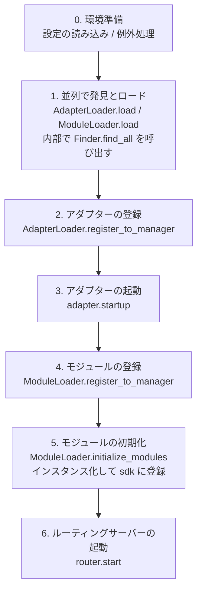

対応するコアコンポーネント：

| 層 | コンポーネント | 役割 |
|----|------|------|
| 発見 | `AdapterFinder` / `ModuleFinder` | エントリポイントから**アダプター/モジュールを発見**する |
| ロード | `AdapterLoader` / `ModuleLoader` | 発見 + インポート + メタデータの読み込み + 有効/無効の判定、オブジェクトのリストを返す |
| 登録 | `*Loader.register_to_manager` | オブジェクトを対応するマネージャーに登録する |
| 管理 | `sdk.adapter` / `sdk.module` | アダプター/モジュールのインスタンスを維持し、起動/停止のインターフェースを提供する |
| 初期化 | `ModuleLoader.initialize_modules` | モジュールのインスタンスを作成して `sdk` に登録する（依存関係のトポロジカルソートを処理） |
| ルーティング | `sdk.router` | HTTP / WebSocket サーバー |

> **重要**：`Finder` と `Loader` は2つの層です。`Loader` は内部で `Finder` を保持しています（`AdapterLoader` は `AdapterFinder` を、`ModuleLoader` は `ModuleFinder` を持っています）。ほとんどの場合、`Loader` を使い、`Finder` は「インポートしないでリストアップする」場合にのみ直接使います。

## 各ステップの詳細

### 1. 発見層：Finder

Finder は「どのパッケージがアダプター/モジュールを提供しているか」を発見するだけです。インポートもインスタンス化もしません。

```python
from ErisPulse.finders import AdapterFinder, ModuleFinder

adapter_finder = AdapterFinder()
module_finder = ModuleFinder()

# すべてのインストール済みアダプター/モジュールのエントリポイントを検索
adapter_entries = adapter_finder.find_all()    # list[EntryPoint]
module_entries = module_finder.find_all()      # list[EntryPoint]

# 名前で1つ検索
entry = module_finder.find_by_name("MyModule")  # EntryPoint | None
```

各 `EntryPoint` は `.load()` を呼び出すことで対応するクラスを得られますが、通常は手動で呼び出す必要はありません。`Loader` が処理します。

### 2. ロード層：Loader

Loader は Finder の上に「インポート + メタデータの読み込み + 有効/無効の判定」を行います。

```python
from ErisPulse.loaders import AdapterLoader, ModuleLoader
from ErisPulse import sdk

adapter_loader = AdapterLoader()
module_loader = ModuleLoader()

# load() 内部：finder.find_all() を呼び出す → 各エントリポイントを処理 → 3タプルを返す
adapter_objs, enabled_adapters, disabled_adapters = await adapter_loader.load(sdk.adapter)
module_objs, enabled_modules, disabled_modules = await module_loader.load(sdk.module)
```

`load()` が返す3タプル：

| 戻り値 | 意味 |
|--------|------|
| `objs` (`dict`) | 名称 → オブジェクト（アダプタークラス / モジュールのラッパー） |
| `enabled` (`list[str]`) | 有効化された名称（設定で無効化されていない） |
| `disabled` (`list[str]`) | 無効化された名称 |

#### ロード失敗時の診断情報

モジュール/アダプターがロードまたは初期化の段階で例外を発生させた場合、フレームワークはそのコンポーネントをスキップして他のコンポーネントのロードを継続し、**ユーザーのコードのフレームを要約して**、デフォルトの INFO レベルでエラー位置を特定できるようにします。DEBUG レベルを上げる必要はありません。

```
[ERROR] [ModuleLoader] entry-point からモジュール MyModule のロードに失敗し、スキップしました: 'NoneType' object has no attribute 'platform'
  → MyModule/Core.py:42 in on_load
      adapter = sdk.platform
  → AttributeError: 'NoneType' object has no attribute 'platform'
  → ヒント: ログレベルを DEBUG に上げて詳細なスタックトレースを確認する；モジュール MyModule の実装コードを確認する
```

診断情報は `ErisPulse.runtime.diagnostics` モジュールによって生成され、フレームワークの内部フレームは自動的にフィルタされ、ユーザーのコードフレームのみが残ります。カスタムロードロジックで再利用するには：

```python
from ErisPulse.runtime import log_diagnostic

try:
    risky_init()
except Exception as e:
    log_diagnostic(e)  # 自動的にユーザーのコードフレームを抽出して ERROR ログに書き込む
```

このモジュールには `extract_user_frame()`（構造化されたフレーム情報を返す）と `format_diagnostic_block()`（複数行のテキストを返す）の2つの低レベル関数もあります。

### 3. 登録層：register_to_manager

Loader が出力したオブジェクトをマネージャーに登録し、`sdk.adapter` / `sdk.module` がそれらを認識できるようにします。

```python
# アダプターの登録（戻り値は bool、すべて成功したかを示す）
await adapter_loader.register_to_manager(enabled_adapters, adapter_objs, sdk.adapter)

# モジュールの登録
await module_loader.register_to_manager(enabled_modules, module_objs, sdk.module)
```

登録後、アダプターはアダプター管理マネージャーに登録され、モジュールはモジュール管理マネージャーに登録されますが、**まだ起動/インスタンス化されていません**。

### 4. アダプターの起動

```python
# すべての登録済みアダプターを起動
await sdk.adapter.startup()
# または特定のプラットフォームを指定
await sdk.adapter.startup("yunhu")
await sdk.adapter.startup(["yunhu", "telegram"])
```

> 登録 ≠ 起動。`register_to_manager` は登録するだけです；`startup` はアダプターの `start()` を呼び出し、プラットフォームとの接続を確立します。

### 5. モジュールの初期化

モジュールはアダプターに比べて1ステップ多く、**インスタンス化**して `sdk` に登録する必要があります（これで `sdk.MyModule.xxx` を呼び出せるようになります）。このステップではモジュール間の依存宣言とトポロジカルソートも処理されます。

```python
success = await module_loader.initialize_modules(
    enabled_modules, module_objs, sdk.module, sdk
)
```

インスタンス化が成功すると、モジュールは `sdk.<ModuleName>` に登録されます。

### 6. ルーティングサーバーの起動

```python
await sdk.router.start(
    host="0.0.0.0",
    port=8000,
    ssl_certfile=None,
    ssl_keyfile=None,
)
```

ルーティングサーバーはアダプターの Webhook / WebSocket コールバックを受信します。起動しないと、サーバーモードのアダプターはメッセージを受け取れません。

## 完全な手動起動の例

以下のコードは `await sdk.init()` のコアフローと**等価**ですが、各ステップが公開されており、任意の段階でカスタムロジックを挿入できます：

```python
import asyncio
from ErisPulse import sdk
from ErisPulse.loaders import AdapterLoader, ModuleLoader

async def manual_startup():
    # 0. 環境準備（設定の読み込み、グローバル例外処理の登録）
    #    _prepare_environment は init() 内部の前置ステップ；手動フローでも先に呼び出す必要がある。
    #    そうでないと Loader は設定を読めず、すべてのアダプター/モジュールを誤って無効化してしまう。
    if not await sdk._prepare_environment():
        print("環境準備に失敗しました")
        return False

    # 1. ローダーの作成（内部でそれぞれ Finder を保持）
    adapter_loader = AdapterLoader()
    module_loader = ModuleLoader()

    # 2. 並列で発見とロード（init() 内部と同じ gather を使用）
    (adapter_objs, enabled_adapters, disabled_adapters), \
    (module_objs, enabled_modules, disabled_modules) = await asyncio.gather(
        adapter_loader.load(sdk.adapter),
        module_loader.load(sdk.module),
    )

    # 3. アダプターの登録
    await adapter_loader.register_to_manager(
        enabled_adapters, adapter_objs, sdk.adapter
    )

    # 4. アダプターの起動
    if enabled_adapters:
        await sdk.adapter.startup()

    # 5. モジュールの登録
    await module_loader.register_to_manager(
        enabled_modules, module_objs, sdk.module
    )

    # 6. モジュールの初期化（インスタンス化 + sdk に登録）
    if enabled_modules:
        await module_loader.initialize_modules(
            enabled_modules, module_objs, sdk.module, sdk
        )

    # 7. ルーティングサーバーの起動
    await sdk.router.start(host="0.0.0.0", port=8000)

    print("手動起動が完了しました")
    return True

async def main():
    ok = await manual_startup()
    if ok:
        # ブロッキングして実行を維持（手動フローでは自動的にブロッキングしない）
        await asyncio.Event().wait()

if __name__ == "__main__":
    asyncio.run(main())
```

### 手動起動が必要なタイミング

ほとんどの場合、**手動起動は不要**です。`await sdk.run()` はすでに上記のすべてを処理しています。手動起動は以下の場面でのみ価値があります：

- **部分的なロード**：指定されたアダプター/モジュールのみをロードし、他の部分をスキップする
- **動的登録**：実行時に条件に応じて新しいアダプター/モジュールを登録する
- **カスタム順序**：デフォルトのロード順序を変更する必要がある（例：特定のモジュールを起動してからアダプターを起動する）
- **戦略の注入**：Loader にカスタムの厳格モードマネージャー、ロード戦略などを注入する
- **デバッグ/診断**：特定の段階で失敗した場合、手動で駆動して問題を特定する

## 実行時の細粒度制御

`sdk.run()` で起動した後でも、再起動せずに各サブシステムを個別に制御することができます：

### アダプターのホットリスタート

```python
# 特定のアダプターをホットリスタート（接続を修復し、他のプラットフォームには影響しない）
await sdk.adapter.shutdown("yunhu")
await sdk.adapter.startup("yunhu")

# 実行中に新しいプラットフォームを起動
await sdk.adapter.startup("telegram")

# 一時的に特定のプラットフォームをオフラインにする
await sdk.adapter.shutdown("telegram")
```

> `adapter.startup()` はアダプターが**マネージャーに登録されている**必要がある。登録は `init()` / `run()` 内部で行われるため、これは起動**後の**細粒度制御です。

### ルーティングサーバー

```python
# 一時的に webhook サーバーをオフラインにする
await sdk.router.stop()

# 再起動（例：ポートを変更した場合）
await sdk.router.start(host="0.0.0.0", port=9000)
```

### モジュールのオンデマンドロード

```python
# 手動でモジュールをロードする（おそらく遅延ロードのモジュール）
await sdk.load_module("MyModule")
```

## エレガントなシャットダウン

2.7.0 以降、`sdk.shutdown()` は**プログラムによるエレガントなシャットダウン**を提供します：シャットダウンイベントを設定し、`await sdk.run(keep_running=True)` で待機しているメインループが返り、`uninit()` がリソースのクリーンアップをトリガーします。

```python
# 任意のコルーチンで呼び出すことで、エレガントな終了をトリガー（run() は返り、uninit() が自動的に実行される）
sdk.shutdown()
```

典型的な用途：

```python
async def shutdown_after_idle():
    await asyncio.sleep(3600)
    sdk.shutdown()  # 空き1時間後にエレガントに終了
```

**シグナル処理**：`run()` 内部では `SIGTERM` / `SIGHUP` ハンドラが登録され、システムシグナルをエレガントなシャットダウンに変換します——コンテナ編成（Docker `docker stop`）や `systemd` でサービスを停止する場合、プロセスは強制終了ではなく `uninit()` を完了します。

- Windows は `loop.add_signal_handler` をサポートしていないため、シグナルハンドラは自動的にスキップされます（`sdk.shutdown()` または Ctrl+C で終了をトリガーできます）
- `sdk.shutdown()` を繰り返し呼び出しても安全です（イベントが設定された後は無操作になります）

## アンロードフロー

起動の逆操作は `await sdk.uninit()` で、反対の順序でクリーンアップされます：

1. すべてのアダプターを閉じる（`adapter.shutdown()`）
2. すべてのモジュールをアンロードする
3. すべてのイベントハンドラをクリーンアップする
4. マネージャーと SDK 上のモジュール属性をクリーンアップする

手動起動の場合は、終了前に `uninit()` を呼び出してエレガントなシャットダウンを保証してください：

```python
try:
    await asyncio.Event().wait()   # 実行を維持
finally:
    await sdk.uninit()
```

## リスタート

SDK は2つのリスタート方法を提供しており、自分でアンロードする必要はありません——フレームワークが自動的に処理します：

| 方法 | 呼び出し | 行動 | 適用場面 |
|------|------|------|----------|
| ホットリスタート | `await sdk.restart()` | 同一プロセス内で**コンポーネントレベルのコードリロード**：すべてのモジュールが統一されたリロードパイプラインを実行（全体的な構文検査 / スナップショットロールバック / アイデンティティ確認）、アダプターは**エントリポイントの再発見**（実行中に新しくインストール/アンインストールされたアダプターも即座に有効化）された後、個別にコードリロードされる | pip でコンポーネントをアップグレードまたはインストールした後にコードを有効化する、モジュールのホットアップデート |
| ハードリスタート | `await sdk.hard_restart()` | `uninit()` の後、**終了コード 42** でプロセスを終了し、外部の監視者が新しいプロセスを起動する | フレームワーク自体のアップグレード（アップグレード後のフレームワークコードは新しいプロセスでのみ有効）、C 拡張の副作用、リソースリークを疑う場合 |

```python
# ホットリスタート：コンポーネントレベルのコードリロード（最も一般的；pip で新しくインストールされたアダプターも起動される）
await sdk.restart()

# ハードリスタート：プロセスを終了し、外部監視者が再起動する（下記「監視者ガイド」を参照）
await sdk.hard_restart("sdk self-update")  # オプションの理由、監視者が表示する
```

> **2点注意**：
> 1. これらのメソッドはバックグラウンドタスクでリスタートを実行するため、**即座に「リスタートタスクがスケジュールされた」を返す**、リスタートが完了したことを示すものではない。実際のリスタートはバックグラウンドで実行され、現在のイベントフローを中断しない。
> 2. `hard_restart()` の原理は：アンロードして設定を書き込んだ後、**終了コード 42**（`HARD_RESTART_EXIT_CODE`）でプロセスを終了する——**自身で新しいプロセスを起動しない**。外部監視者が終了コード 42 を検知して再起動する必要がある。`python main.py` で直接実行し、監視者がいない場合、終了コード 42 でプロセスが終了し、**自動的に再起動しない**（フレームワークは警告を出す）。

> **ホットリスタートの排他とマージ**（2.11.1 以降）：すべてのホットリロード操作（単一モジュールのリロード / 全体のリロード / アダプターのリロード / 睡眠）は完全に排他的に実行される——保存の嵐下で連続したトリガーは並行して交差しない。進行中の restart に新しいリクエストが届いた場合は自動的にマージされ、完了後に最大1ラウンドを補う。保存時に構文エラーのあるファイルを保存した場合、全体のリロードはアンロード前に**集中的な構文検査**で拒否される（エラーのあるファイルと行番号を一括で表示）、すべての古いインスタンスはサービスを継続する。

### ハードリスタートが必要なタイミング

ホットリスタートは、pip でコンポーネントをアップグレード/インストール、モジュールコードのホットアップデート、**実行中に新しくインストールされたアダプター**を含む、ほとんどの場面をカバーしている。以下の場面でハードリスタートが必要です：

- **フレームワーク自体のアップグレード**：ErisPulse 本体をアップグレードした後、新しいフレームワークコードは新しいプロセスでのみ有効になる（Python は既にロードされたフレームワークコードを再インポートしない）。
- **バイナリライブラリ（C拡張）の副作用**：ホットリスタートは同一プロセス内で実行され、C拡張、開かれたファイルディスクリプタ、スレッドなどのプロセスレベルのリソースを解放できない。ハードリスタートは新しいプロセスを起動し、これらの副作用を完全にクリアする。
- **リソースリークの調査**：メモリやハンドルのリークが疑われる場合、ハードリスタートはきれいな環境を取得できる。

> ダッシュボード管理パネルの「フレームワークリスタート」機能は、`hard_restart()` を呼び出している。

### 終了コード 42 の契約

ハードリスタートはプロセス間の協力：**SDK が終了（コード 42）、監視者が再起動**。

| 角色 | 行動 |
|------|------|
| SDK（ハードリスタートされるとき） | `uninit()` → 設定を書き込む → 硬リスタートのマーキング（理由 / PID、監視者が表示）→ `os._exit(42)` |
| 監視者 | 子プロセスの終了コードが 42 かを検出 → 硬リスタートの理由を表示 → 同じコマンドで再起動 |

> `sdk.is_supervised()` は、現在のプロセスが監視者によって起動されたかを確認する（環境変数 `ERISPULSE_SUPERVISED` を検出）。CLI `run` コマンドが起動する子プロセスには自動的にこのマーキングが注入される；systemd / Docker などの外部監視者は注入しないため、`is_supervised()` は `False` を返し、ハードリスタート後に「監視者を検出できなかった」と警告が出る。

### 監視者ガイド

自分に合った監視者を選択して、ハードリスタートを有効にする：

#### 1. CLI run コマンド（開発/簡単なデプロイ、推奨）

`epsdk run main.py` には監視ループが内蔵されている：子プロセスの終了コードを検出し、42 の場合はすぐに再起動（硬リスタートの理由を表示）；他の異常終了コードは指数退避で自動リトライ；`Ctrl+C` はまず子プロセスをエレガントに終了（コード 0 は正常終了と見なし、再起動しない）。

```bash
epsdk run main.py
```

`epsdk run --reload`（開発用のホットリロードモード、2.11.1 以降）は同様に「監視プロセス + 重載ワーカー子プロセス」の構造を使う：ワーカー内では `.py` ファイルが保存されると**コンポーネントレベルのホットリロード**（フレームワークの再起動はしない）が発生する；ハードリスタートは監視プロセスが新しいワーカーを再起動し、フレームワークをアップグレードした後、新しいコードが即座に有効になる。

#### 2. systemd（Linux サーバー）

`RestartForceExitStatus=42` で、終了コード 42 も再起動をトリガーする（デフォルトの `on-failure` は非ゼロコードのみ有効）：

```ini
[Service]
ExecStart=/usr/bin/python3 /opt/mybot/main.py
Restart=on-failure
RestartForceExitStatus=42
RestartSec=2
User=mybot
```

#### 3. Docker / docker-compose

コンテナ内の PID 1 はアプリケーションプロセスであり、終了コード 42 でコンテナが終了する——`restart` ポリシーを使って自動的に再起動させる：

```yaml
services:
  bot:
    build: .
    restart: unless-stopped   # 42 を含むすべての終了で再起動
```

#### 4. PM2（Node 生態系の運用）

```bash
pm2 start main.py --name mybot --interpreter python3
# 42 は終了コードとして扱われ、PM2 はデフォルトで再起動；restart_delay を設定してデバウンス
pm2 set mybot.restart_delay 2000
```

#### 5. supervisord

```ini
[program:mybot]
command=python3 /opt/mybot/main.py
autorestart=true
exitcodes=0,2,42    # 42 も「正常終了として再起動」
```

#### 6. 純 Python でカスタム監視者

```python
import subprocess, sys, time

while True:
    p = subprocess.Popen([sys.executable, "main.py"])
    code = p.wait()
    if code == 42:          # ハードリスタート要求
        time.sleep(0.5)
        continue
    if code == 0:           # 正常終了
        break
    time.sleep(3)           # 異常終了、退避して再試行
```

> **監視者がいない場合の動作**：`python main.py` で直接実行し、`hard_restart()` を呼び出すと、プロセスはコード 42 で終了し、再起動しない。この場合は、上記のいずれかの監視者を接続する必要がある。


====
技术标准
====


### 会话类型标准

# ErisPulse セッションタイプ標準

> [!TIP]
> **このドキュメントを読むべきケース**：アダプターでプラットフォームのネイティブセッションを標準タイプ（private/group/channel/guild/thread）にマッピングする場合や、モジュールで `Send.To()` にどのターゲットタイプを渡せばよいかわからない場合、`event.reply()` の自動変換を把握したい場合に本ドキュメントを参照してください。不要な場合はスキップしてください。

このドキュメントでは、受信イベントタイプと送信ターゲットタイプを含む、ErisPulse がサポートするセッションタイプの標準を定義します。

## 1. 基本概念

### 1.1 受信タイプ && 送信タイプ

ErisPulse は2種類のセッションタイプを区別します：

- **受信タイプ（Receive Type）**：受信するイベントの `detail_type` フィールド
- **送信タイプ（Send Type）**：メッセージ送信時に `Send.To()` メソッドへ渡すターゲットタイプ

### 1.2 タイプマッピング関係

```
受信タイプ (detail_type)     送信タイプ (Send.To)
─────────────────        ────────────────
private                 →        user
group                   →        group
channel                 →        channel
guild                   →        guild
thread                  →        thread
user                    →        user
```

**重要なポイント**：
- `private` は受信時のタイプであり、送信時の標準タイプは `user` です
- `group`、`channel`、`guild`、`thread` は受信時と送信時でタイプが同じです
- **推奨パス**：`event.reply()` を直接使用する——タイプ変換とターゲット推論が自動的に行われ、手動処理は不要です（`private` → `user` の自動変換はここで行われます）
- **手動送信時**：送信タイプを直接渡してください（例：`Send.To("user", ...)`）。手動で `Send.To("private", ...)` のように受信タイプを渡しても自動変換されますが、推奨されません（§6.1 参照）

## 2. 標準セッションタイプ

### 2.1 OneBot12 標準タイプ

#### private
- **受信タイプ**：`private`
- **送信タイプ**：`user`
- **説明**：一対一のプライベートチャットメッセージ
- **ID フィールド**：`user_id`
- **対応プラットフォーム**：プライベートチャットをサポートするすべてのプラットフォーム

#### group
- **受信タイプ**：`group`
- **送信タイプ**：`group`
- **説明**：グループチャットメッセージ。各種形式のグループ（Telegram の supergroup など）を含みます
- **ID フィールド**：`group_id`
- **対応プラットフォーム**：グループチャットをサポートするすべてのプラットフォーム

#### user
- **受信タイプ**：`user`
- **送信タイプ**：`user`
- **説明**：ユーザータイプ。一部のプラットフォーム（Telegram など）では、プライベートチャットを private ではなく user として表現します
- **ID フィールド**：`user_id`
- **対応プラットフォーム**：Telegram などのプラットフォーム

### 2.2 ErisPulse 拡張タイプ

#### channel
- **受信タイプ**：`channel`
- **送信タイプ**：`channel`
- **説明**：チャンネルメッセージ。複数ユーザーへのブロードキャスト形式のメッセージをサポートします
- **ID フィールド**：`channel_id`
- **対応プラットフォーム**：Discord、Telegram、Line など

#### guild
- **受信タイプ**：`guild`
- **送信タイプ**：`guild`
- **説明**：サーバー/コミュニティメッセージ。通常、Discord の Guild レベルのイベントに使用されます
- **ID フィールド**：`guild_id`
- **対応プラットフォーム**：Discord など

#### thread
- **受信タイプ**：`thread`
- **送信タイプ**：`thread`
- **説明**：トピック/サブチャンネルメッセージ。コミュニティ内のサブディスカッションに使用されます
- **ID フィールド**：`thread_id`
- **対応プラットフォーム**：Discord Threads、Telegram Topics など

## 3. プラットフォームタイプマッピング

### 3.1 マッピングの原則

アダプターは、プラットフォームのネイティブタイプを ErisPulse 標準タイプにマッピングする役割を担います：

```
プラットフォームネイティブタイプ → ErisPulse 標準タイプ → 送信タイプ
```

### 3.2 一般的なプラットフォームのマッピング例

#### Telegram
```
Telegram タイプ         ErisPulse 受信タイプ   送信タイプ
─────────────────      ────────────────       ───────────
private                private                 user
group                  group                   group
supergroup             group                   group  # group にマッピング
channel                channel                 channel
```

#### Discord
```
Discord タイプ         ErisPulse 受信タイプ   送信タイプ
─────────────────      ────────────────       ───────────
Direct Message         private                user
Text Channel           channel                channel
Guild                  guild                  guild
Thread                 thread                 thread
```

#### OneBot11
```
OneBot11 タイプ       ErisPulse 受信タイプ   送信タイプ
─────────────────      ────────────────       ───────────
private                private                user
group                  group                  group
discuss                group                  group  # group にマッピング
```

## 4. カスタムタイプの拡張

### 4.1 カスタムタイプの登録

アダプターはカスタムセッションタイプを登録できます：

```python
from ErisPulse.Core.Event import register_custom_type

# カスタムタイプの登録
register_custom_type(
    receive_type="my_custom_type",
    send_type="custom",
    id_field="custom_id",
    platform="MyPlatform"
)
```

### 4.2 カスタムタイプの使用

登録後、システムは自動的にこのタイプの変換と推論を処理します：

```python
# 自動推論
receive_type = infer_receive_type(event, platform="MyPlatform")
# 戻り値: "my_custom_type"

# 送信タイプへの変換
send_type = convert_to_send_type(receive_type, platform="MyPlatform")
# 戻り値: "custom"

# 対応する ID の取得
target_id = get_target_id(event, platform="MyPlatform")
# 戻り値: event["custom_id"]
```

### 4.3 カスタムタイプの登録解除

```python
from ErisPulse.Core.Event import unregister_custom_type

unregister_custom_type("my_custom_type", platform="MyPlatform")
```

## 5. 自動タイプ推論

イベントに明示的な `detail_type` フィールドがない場合、システムは存在する ID フィールドに基づいてタイプを自動推論します：

> [!NOTE]
> **2.7.0+ での動作変更**：`detail_type` は、**既知のセッションタイプ**（標準またはカスタム）である場合にのみ直接採用されます。notice/request イベントの `detail_type`（`group_member_increase`、`friend_increase` など）は**セマンティックサブタイプ**でありセッションタイプではないため、代わりに ID フィールドに基づいて正しいセッションタイプが推論されます。

### 5.1 推論の優先順位

```
優先順位（高い順）：
1. group_id     → group
2. channel_id   → channel
3. guild_id     → guild
4. thread_id    → thread
5. user_id      → private
```

### 5.2 使用例

```python
# イベントに group_id のみがある場合
event = {"group_id": "123", "user_id": "456"}
receive_type = infer_receive_type(event)
# 戻り値: "group"（group_id を優先使用）

# イベントに user_id のみがある場合
event = {"user_id": "123"}
receive_type = infer_receive_type(event)
# 戻り値: "private"

# notice イベントの detail_type はセマンティックサブタイプであり、2.7.0+ では ID フィールドから推論されます
event = {"type": "notice", "detail_type": "group_member_increase", "group_id": "123"}
receive_type = infer_receive_type(event)
# 戻り値: "group"（"group_member_increase" ではなく）
```

## 6. API 使用例

### 6.1 メッセージ送信

```python
from ErisPulse import adapter

# ユーザーに送信
await adapter.myplatform.Send.To("user", "123").Text("Hello")

# グループに送信
await adapter.myplatform.Send.To("group", "456").Text("Hello")

# 自動変換 private → user：受信タイプを手動で渡すのは非推奨の書き方です（互換性の問題が生じる可能性があります）
await adapter.myplatform.Send.To("private", "789").Text("Hello")
# 内部で自動変換されます: Send.To("user", "789")
# 推奨される方法：手動送信時は送信タイプ user を直接使用するか、event.reply() で自動変換を利用してください（6.2 参照）
```

### 6.2 イベントへの返信

```python
from ErisPulse.Core.Event import Event

# Event.reply() は自動的にタイプ変換を処理します（推奨パス）
await event.reply("返信内容")
# 内部で正しい送信タイプが自動的に使用されます（private → user などの変換はここで自動的に行われます）
```

### 6.3 コマンド処理

```python
from ErisPulse.Core.Event import command

@command(name="test")
async def handle_test(event):
    # システムが自動的にセッションタイプを処理します
    # group_id か user_id かを手動で判断する必要はありません
    await event.reply("コマンドが正常に実行されました")
```

## 7. コア API リファレンス

### 7.1 タイプ変換

```python
from ErisPulse.Core.Event import convert_to_send_type, convert_to_receive_type

# 受信タイプ → 送信タイプ
convert_to_send_type("private")  # → "user"
convert_to_send_type("group")    # → "group"

# 送信タイプ → 受信タイプ
convert_to_receive_type("user")   # → "private"
convert_to_receive_type("group")  # → "group"
```

### 7.2 ID フィールドの照会

```python
from ErisPulse.Core.Event import get_id_field, get_receive_type

get_id_field("group")    # → "group_id"
get_id_field("private")  # → "user_id"

get_receive_type("group_id")  # → "group"
get_receive_type("user_id")   # → "private"
```

### 7.3 ワンステップで送信情報を取得

```python
from ErisPulse.Core.Event import get_send_type_and_target_id

event = {"detail_type": "private", "user_id": "123"}
send_type, target_id = get_send_type_and_target_id(event)
# send_type = "user", target_id = "123"

# Send.To() に直接使用
await adapter.Send.To(send_type, target_id).Text("Hello")
```

### 7.4 ターゲット ID の取得

```python
from ErisPulse.Core.Event import get_target_id

event = {"detail_type": "group", "group_id": "456"}
get_target_id(event)  # → "456"
```

## 8. ユーティリティメソッド

```python
from ErisPulse.Core.Event import (
    is_standard_type,
    is_valid_send_type,
    get_standard_types,
    get_send_types,
    clear_custom_types,
)

is_standard_type("private")     # True
is_standard_type("custom_type") # False

is_valid_send_type("user")      # True
is_valid_send_type("invalid")   # False

get_standard_types()  # {"private", "group", "channel", "guild", "thread", "user"}
get_send_types()      # {"user", "group", "channel", "guild", "thread"}

clear_custom_types()                # すべてクリア
clear_custom_types(platform="discord")  # 指定したプラットフォームのみクリア
```

## 9. ベストプラクティス

### 7.1 アダプター開発者

1. **標準マッピングを使用**：新しいタイプを作成するのではなく、可能な限り標準タイプにマッピングしてください
2. **正しい変換**：受信タイプと送信タイプのマッピング関係が正しいことを確認してください
3. **元データの保持**：`{platform}_raw` に元のイベントタイプを保持してください
4. **ドキュメントでの説明**：アダプターのドキュメントでタイプマッピング関係を説明してください

### 7.2 モジュール開発者

1. **ユーティリティメソッドを使用**：`get_send_type_and_target_id()` などのユーティリティメソッドを使用してください
2. **ハードコーディングを避ける**：`if group_id else "private"` のようなコードを書かないでください
3. **すべてのタイプを考慮**：コードは private/group だけでなく、すべての標準タイプをサポートする必要があります
4. **柔軟な設計**：フィールドに直接アクセスするのではなく、イベントラッパーのメソッドを使用してください

### 7.3 タイプ推論

- **detail_type を優先使用**：明示的なフィールドがある場合は推論を行いません
- **推論の適切な使用**：明示的なタイプがない場合にのみ使用してください
- **優先順位に注意**：推論の優先順位を理解し、予期しない結果を避けてください

## 10. よくある質問

### Q1: 送信時に private を user に変換するのはなぜですか？

A: これは OneBot12 標準の要件です。`private` は受信時の概念であり、送信時には `user` を使用する方がセマンティクスに適しています。

### Q2: 新しいセッションタイプをサポートするには？

A: `register_custom_type()` でカスタムタイプを登録するか、標準タイプの `channel`、`guild` などを直接使用してください。

### Q3: イベントに detail_type がない場合は？

A: システムは存在する ID フィールドに基づいて自動的に推論します。優先順位は group > channel > guild > thread > user です。

### Q4: アダプターは Telegram の supergroup をどのようにマッピングしますか？

A: アダプターの変換ロジックで、`supergroup` を標準の `group` タイプにマッピングしてください。

### Q5: メールなどの特殊なプラットフォームはどのように処理しますか？

A: 汎用性のないタイプやプラットフォーム固有のタイプについては、`{platform}_raw` と `{platform}_raw_type` を使用して元データを保持し、アダプター側で処理してください。

## 11. 関連ドキュメント

**アダプター向け（マッピングと変換）**：
- [イベント変換標準](event-conversion.md) - 完全なイベント変換仕様
- [送信メソッド仕様](send-method-spec.md) - Send クラスのメソッド命名とパラメータ仕様
- [アダプター開発ガイド](../developer-guide/adapters/) - アダプター開発の完全ガイド

**モジュール向け（タイプ変換を手動で処理したくない場合）**：
- `event.reply()` を使用するだけで、タイプ変換とターゲット推論が自動的に行われます。詳細は [Event ラッパークラス解説](../developer-guide/modules/event-wrapper.md) を参照してください


====
生态模块
====


### ErisPulse-App 安装与使用

# ErisPulse-App

> [!TIP]
> **このドキュメントを読むべきとき**：スマートフォンやパソコン上でグラフィカルインターフェースを使ってボットインスタンスの作成・実行・管理を行いたい場合——ターミナルに触れず、Python 環境も別途インストールせずに済むようにしたいときに読んでください。不要な場合はスキップしてください。

[ErisPulse-App](https://github.com/ErisPulse/ErisPulse-App) は ErisDev が直接メンテナンスしている**公式マルチプラットフォームクライアント**（Android / Windows / Linux / macOS すべてリリース済み）です。
完全にネイティブなグラフィカル管理インターフェースを提供し、スマートフォンやパソコン上で複数のボットインスタンスを作成・実行・管理できます。
ターミナルも、Python 環境の別途インストールも不要です。

> [!IMPORTANT]
> ErisPulse-App は**スタンドアロンでインストールするクライアントプログラム**であり、`epsdk install` でインストールするモジュールではありません。
> Python ランタイムと ErisPulse SDK が内蔵されており、インストールするだけで使用可能——**スマートフォン上でも直接実行できます**。

## 機能の概要

- **複数インスタンス管理**：複数のインスタンスを作成 / 起動 / 停止 / 削除、ポートとアクセストークンは自動割り当て、新規環境または既存環境のクローンが可能
- **概要ダッシュボード**：アダプター / モジュール / オンラインのロボット / イベント総数の統計、CPU / メモリ使用量のアラート色変更
- **モジュールストア**：検索とタグによる絞り込み、ワンクリックでのインストール / アップグレード / アンインストール、指定バージョンのインストール、pipのミラーソースとGitパッケージのサポート
- **イベントストリーム + イベントビルダー**：リアルタイムのイベント表示、可視化されたテストイベントの構築とアダプターへの送信
- **監視**：ログ / ライフサイクル / 審計の三合一ビュー
- **コマンド管理**：プレフィックスとエイリアスなどのグローバル設定、起動 / 停止とプラットフォームのホワイトリスト / ブラックリスト
- **ロボットの概要 / 設定 / ファイル管理**：ネイティブインターフェースでインスタンスを直接操作
- **バックグラウンド常駐**：Androidのフォアグラウンドサービスによる保活；Windowsではシステムトレイに最小化、ウィンドウを閉じてもインスタンスを中断しない
- **モジュール動的ウィンドウ**：モジュールが登録したページは自動的にサイドナビゲーションに表示（ダッシュボードと同じグループ）、クリックで直ちにアクセス

## サポート対象プラットフォーム

すべてのプラットフォームのインストーラーは [GitHub Releases](https://github.com/ErisPulse/ErisPulse-App/releases) からダウンロードできます。必要に応じて選択してください：

| プラットフォーム | インストールパッケージ | 説明 |
|------|--------|------|
| Android | `online-*.apk` / `offline-*.apk` | **スマートフォンで直接実行**、PCは不要 |
| Windows | `windows-x64-setup.exe` / `windows-x64.zip` | インストール版 / インストール不要版 |
| Linux | `linux-x64.tar.gz` | 解凍後すぐに使用可能 |
| macOS | `macos-arm64.zip` | Apple Silicon（arm64） |

Flutter コードベースで全プラットフォームをカバーしています。

## インストール方法（Android / スマートフォンで直接実行）

GitHub Releases から APK をダウンロードしてインストールしてください。2 種類のビルドがあります。

| ビルド | 実行時イメージ | 適用場面 |
|------|-----------|---------|
| `erispulse-app-online-*.apk` | 初回起動時にダウンロード | インストールパッケージが小さく、ネットワーク環境が良い場合に適しています |
| `erispulse-app-offline-*.apk` | APK に事前にパッケージ化 | オフラインで自己完結、インストール後にインターネット接続が不要です |

どちらのビルドもインストール手順は同じです。

1. APK をダウンロードしてインストールし、起動時に通知権限を許可してください（バックグラウンドサービスの維持に使用します）
2. ホーム画面に初期化の横長バナーが表示されたら、実行をクリックして最初の初期化を実行してください（進行状況とログの表示が可能です）
3. インスタンスを作成して起動します
4. App 内の管理画面でアダプタとモデルの API キーを設定します

> オフラインパッケージは自己完結型です。インストール後はネットワーク接続が不要です。初回起動時のダウンロードが遅いまたは不安定な場合は、設定ページでダウンロードソースをミラー（ghfast / gh-proxy）に切り替えてください。

### インストール方法（デスクトップ版：Windows / Linux / macOS）

1. [GitHub Releases](https://github.com/ErisPulse/ErisPulse-App/releases) から対応するプラットフォーム用のインストールパッケージをダウンロードしてください。
   （Windows は `setup.exe` または無印の `zip`、Linux は `tar.gz`、macOS は `zip`）
2. インストールして起動します
3. ウェルカムページでインストールする ErisPulse SDK のバージョンを選択してください（デフォルトは最新版です）
4. インスタンスを作成して起動します

---

## 動作原理

```
┌────────────────────────────────────────────────────┐
│  ErisPulse-App (Flutter)                            │
│                                                    │
│  ネイティブ UI ── Dashboard REST / WS API          │
│       │                                            │
│       ├── Android：フォアグラウンドサービス + proot + Ubuntu rootfs│
│       │        + Python + ErisPulse インスタンス     │
│       └── デスクトップ版：内蔵 Python + 直接プロセス管理 │
└────────────────────────────────────────────────────┘
```

- **Android**：インスタンスは、フォアグラウンドサービス（background isolate）によってホストされる proot（ユーザースペース chroot）内で実行されます。UI が閉じても、ロボットは継続的に動作し、クラッシュした場合は自動的に再起動します。
- **デスクトップ版**：インスタンスは、App の直接の子プロセスとして実行されます。Windows では、システムトレイに最小化して常駐（ウィンドウを閉じてもインスタンスは中断されません）。App の再起動後は、まだ実行中のインスタンスの管理を自動的に復元し、終了時にはすべてのインスタンスを一括して停止します。
- すべてのプラットフォームのネイティブ UI は、`127.0.0.1:<port>/Dashboard/*` の REST / WebSocket API を介してインスタンスと通信し、[ErisPulse-Dashboard](dashboard.md) と同じ API を共有します。

## SDKとの関係

- Appに埋め込まれたErisPulse SDK：Android用はUbuntuイメージにパッケージ化され、デスクトップ用はPyPIからインストールされます
  （歓迎ページでバージョンを選択可能、デフォルトは最新版）
- App内のインスタンスとコマンドライン`epsdk`で作成されたインスタンスは同等であり、同じモジュール/アダプタを使用できます
- モジュール開発者は[Dashboardウィンドウ登録API](dashboard.md)を使用してカスタムページを登録できます：
  ウィンドウは自動的にAppのサイドナビゲーションに表示され（Dashboardと同じグループに分類）、クリックすると対応するページがレンダリングされます

---

## 次のステップ

- **デスクトップ / サーバー上でブラウザを使って管理**：[ErisPulse-Dashboard](dashboard.md)（App と同一の API とウィンドウグループを共有）
- **最初のプラットフォームに接続**：App 内蔵の管理画面で設定が完了でき、各プラットフォームの詳細は[プラットフォーム特性一覧](../platform-guide/README.md)を参照
- **コマンドラインに慣れている方へ**：App 内のインスタンスは `epsdk` で作成したものと完全に同等です。[クイックスタート](../quick-start.md)から始めてください


### Dashboard 使用与视窗注册

# ErisPulse-Dashboard

> [!TIP]
> **このドキュメントを読むべきとき**：Web画面でボットを視覚的に管理したい場合（モジュールの有効化・無効化、設定編集、ログ閲覧、イベントストリームの監視など）、または自分のモジュール用のDashboard管理ページを登録したい場合にお読みください。必要ない場合はスキップして構いません。

[ErisPulse-Dashboard](https://pypi.org/project/ErisPulse-Dashboard/) はErisDevが直接メンテナンスする**Web管理パネルモジュール**で、ErisPulseに視覚的なランタイム管理インターフェースを提供します：モジュールの有効化・無効化、設定編集、ログ閲覧、イベントストリーム監視など。

> [!IMPORTANT]
> DashboardはErisPulseフレームワークの**内蔵機能ではありません**。別途インストールが必要です：
>
> ```bash
> epsdk install Dashboard
> ```

Dashboardは、他のErisPulseモジュールがカスタム管理ページをサイドバーに登録することもサポートしています。登録後、ユーザーはDashboard内で直接そのモジュール専用のビューページに切り替えることができ、独立したフロントエンドを別途開発する必要はありません。

> [!NOTE]
> ビュー登録は**オプション機能**です。
>
> - Dashboardモジュールが**未インストール**または**未ロード**の場合、`sdk.Dashboard.register_view()` を呼び出すと例外がスローされます
> - モジュール自体の他の機能に影響が及ばないよう、登録コードは必ず `try/except` で囲んでください
> - 登録前にDashboardが利用可能かどうかを確認することをお勧めします：`hasattr(sdk, 'Dashboard') and sdk.Dashboard`

---

## 動作原理

```
モジュールの on_load()
  → sdk.Dashboard.register_view(...) を呼び出し
  → Dashboardバックエンドがビュー情報を保存
  → WebSocketでフロントエンドに通知
  → フロントエンドがサイドバーナビ項目 + ページコンテナを動的に作成
  → ユーザーがクリックしてモジュールのビューを表示
```

---

## 登録API

```python
sdk.Dashboard.register_view(
    id="MyModule",                    # 必須、一意の識別子
    title="マイモジュール",             # 中国語名
    title_en="My Module",             # 英語名
    icon_svg='<svg>...</svg>',        # サイドバーアイコンSVG
    html_content='<div>...</div>',     # ページのHTMLコンテンツ
    js_content='function xxx() {}',    # ページのJavaScriptロジック
    css_content='.my-style {}',        # 任意のカスタムCSS
    iframe_url='',                     # iframeモードのURL（html_contentとどちらか一方を指定）
    loader="loadMyModuleView",         # このページに切り替えた際に呼び出されるJS関数名
    group="group_extensions",          # サイドバーグループ
    group_title="",                    # カスタムグループの中国語名
    group_title_en="",                 # カスタムグループの英語名
)
```

### パラメータ説明

| パラメータ | 型 | 必須 | 説明 |
|------|------|------|------|
| `id` | `str` | はい | ビューの一意識別子、モジュール名の使用を推奨 |
| `title` | `str` | いいえ | 中国語表示名、デフォルトは `id` を使用 |
| `title_en` | `str` | いいえ | 英語表示名、デフォルトは `title` を使用 |
| `icon_svg` | `str` | いいえ | サイドバーアイコンの完全なSVG文字列 |
| `html_content` | `str` | いいえ* | インジェクションモードのページHTMLコンテンツ |
| `js_content` | `str` | いいえ | ページのJavaScriptコード |
| `css_content` | `str` | いいえ | ページのカスタムCSSスタイル |
| `iframe_url` | `str` | いいえ* | iframeモードのURL、設定すると `html_content` は無視されます |
| `loader` | `str` | いいえ | ページアクティブ時に自動的に呼び出されるJS関数名 |
| `group` | `str` | いいえ | サイドバーグループ識別子、デフォルトは `group_extensions` |
| `group_title` | `str` | いいえ | カスタムグループの中国語タイトル |
| `group_title_en` | `str` | いいえ | カスタムグループの英語タイトル |

> *`html_content` と `iframe_url` のうち少なくとも一方を指定する必要があります。そうでない場合、ページは空白になります。

---

## 2つのインジェクションモード

### モード1：HTML/JSインジェクション（推奨）

HTML、JS、CSSの文字列を直接提供すると、Dashboardがその内容をページに注入します。このモードはDashboardのスタイルと完全に一致しており、Dashboardが提供するCSSクラス名の使用を推奨します。

```python
sdk.Dashboard.register_view(
    id="HelloPage",
    title="ハローページ", title_en="Hello",
    icon_svg='<svg viewBox="0 0 24 24" fill="none" stroke="currentColor" stroke-width="2"><circle cx="12" cy="12" r="10"/></svg>',
    html_content='<h1 class="page-title">Hello World</h1><div class="card"><div class="card-body">これはサンプルページです</div></div>',
    group="group_tools",
)
```

> APIルートやJSインタラクションなどを含む完全な天気モジュールの例は、下記の[完全なモジュール例](#完全なモジュール例)を参照してください。

### モード2：iframe埋め込み

モジュールが独自のHTMLページURLを提供し（ルートの登録は自身で行う必要があります）、Dashboardがiframeとして埋め込みます。完全に独立したUIや複雑なインタラクションが必要なシナリオに適しています。

```python
sdk.Dashboard.register_view(
    id="MyVisualizer",
    title="データ可視化", title_en="Data Visualizer",
    iframe_url="/MyVisualizer/view",
    group="group_tools",
)
```

> iframeモードでは、認証用の `token` パラメータがURLに自動的に追加されます。

---

## サイドバーグループ

モジュールはビューが属するサイドバーグループを指定できます。Dashboardには以下の組み込みグループがあります：

| グループ識別子 | 中国語名 | 位置 |
|---------|--------|------|
| `group_overview` | 概要 | 第1グループ |
| `group_events` | イベント | 第2グループ |
| `group_extensions` | 拡張 | 第3グループ（デフォルト） |
| `group_system` | システム | 第4グループ |
| `group_tools` | ツール | 第5グループ |

組み込みグループ名を指定すると、モジュールのビューはそのグループの末尾に追加されます：

```python
group="group_tools"  # "ツール"グループに追加
```

カスタムグループ名（`group_` で始まらない名前）を使用することもでき、Dashboardが自動的に新しいグループを作成します：

```python
group="my_group",
group_title="マイグループ",
group_title_en="My Group",
```

---

## よく使うCSSクラス名

モジュールのビューでHTMLインジェクションモードを使用する場合、視覚的一貫性を保つためにDashboardの既存のCSSクラス名を直接使用できます：

| クラス名 | 用途 |
|------|------|
| `page-title` | ページタイトル、例：`<h1 class="page-title">タイトル</h1>` |
| `card` | カードコンテナ |
| `card-header` | カードのタイトルバー |
| `card-body` | カードのコンテンツ領域 |
| `grid-2` | 2カラムグリッドレイアウト |
| `grid-3` | 3カラムグリッドレイアウト |
| `btn` | 基本ボタン |
| `btn-primary` | メインボタン（青） |
| `btn-secondary` | サブボタン |
| `btn-icon` | アイコンボタン |
| `btn-danger` | 危険な操作用ボタン |

DashboardはCSS変数でテーマカラーを制御しており、モジュールのビュー内で直接参照できます：

| CSS変数 | 用途 |
|----------|------|
| `var(--bg-p)` | メイン背景色 |
| `var(--bg-s)` | サブ背景色 |
| `var(--bg-t)` | 第3背景色（カードなど） |
| `var(--tx-p)` | メインテキスト色 |
| `var(--tx-s)` | サブテキスト色 |
| `var(--tx-t)` | 補助テキスト色 |
| `var(--bd)` | ボーダー色 |
| `var(--accent)` | アクセントカラー |
| `var(--ok-c)` | 成功色 |
| `var(--er-c)` | エラー色 |

これらの変数はDashboardのライト/ダークテーマに応じて自動的に切り替わるため、モジュール側で追加の処理は不要です。

---

## 認証とAPI呼び出し

モジュールのビューのJSからモジュール独自のAPIを呼び出す際は、認証のためにDashboardのトークンを付ける必要があります：

```javascript
var token = localStorage.getItem('__ep_tk__');
var resp = await fetch('/YourModule/api/data', {
    headers: { 'Authorization': 'Bearer ' + token }
});
var data = await resp.json();
```

モジュールのAPIエンドポイントがトークンを検証するかどうかは自由に決定できます。検証が必要な場合は、リクエストヘッダーから抽出できます：

```python
async def _api_data(self, request):
    token = request.headers.get("Authorization", "").replace("Bearer ", "")
    if not token:
        return {"error": "Unauthorized"}, 401
    return {"data": "hello"}
```

---

## 完全なモジュール例

以下は完全な天気モジュールの例で、ビューの登録方法、APIデータの提供方法、アンロード時のリソースクリーンアップ方法を示しています：

```python
from ErisPulse import sdk
from ErisPulse.Core.Bases import BaseModule
from ErisPulse.Core.Event import command


class Main(BaseModule):
    def __init__(self):
        self.sdk = sdk
        self.logger = sdk.logger.get_child("Weather")
        self.config = self._load_config()

    @staticmethod
    def get_load_strategy():
        from ErisPulse.loaders import ModuleLoadStrategy
        return ModuleLoadStrategy(lazy_load=False, priority=50)

    async def on_load(self, event):
        self._register_routes()
        self._register_dashboard_view()
        self.logger.info("天気モジュールがロードされました")

    async def on_unload(self, event):
        self._unregister_routes()
        if hasattr(self.sdk, 'Dashboard') and self.sdk.Dashboard:
            self.sdk.Dashboard.unregister_view("Weather")
        self.logger.info("天気モジュールがアンロードされました")

    def _load_config(self):
        config = self.sdk.config.getConfig("Weather")
        if not config:
            default = {"city": "北京", "api_key": ""}
            self.sdk.config.setConfig("Weather", default)
            return default
        return config

    def _register_routes(self):
        r = self.sdk.router
        r.register_http_route("Weather", "/api/current",
                              handler=self._api_current, methods=["GET"])

    def _unregister_routes(self):
        r = self.sdk.router
        try:
            r.unregister_http_route("Weather", "/api/current")
        except Exception:
            pass

    async def _api_current(self, request):
        return {
            "city": self.config.get("city", "北京"),
            "temp": 25,
            "humidity": 60,
        }

    def _register_dashboard_view(self):
        try:
            dashboard = self.sdk.Dashboard
            dashboard.register_view(
                id="Weather",
                title="天気", title_en="Weather",
                icon_svg='<svg viewBox="0 0 24 24" fill="none" stroke="currentColor" stroke-width="2"><circle cx="12" cy="12" r="5"/><line x1="12" y1="1" x2="12" y2="3"/><line x1="12" y1="21" x2="12" y2="23"/><line x1="4.22" y1="4.22" x2="5.64" y2="5.64"/><line x1="18.36" y1="18.36" x2="19.78" y2="19.78"/><line x1="1" y1="12" x2="3" y2="12"/><line x1="21" y1="12" x2="23" y2="12"/><line x1="4.22" y1="19.78" x2="5.64" y2="18.36"/><line x1="18.36" y1="5.64" x2="19.78" y2="4.22"/></svg>',
                html_content='''
                    <h1 class="page-title">天気検索</h1>
                    <p style="color:var(--tx-s);margin-bottom:16px">現在の天気情報を表示</p>
                    <div class="grid-2">
                        <div class="card">
                            <div class="card-header">現在の天気</div>
                            <div class="card-body">
                                <div id="weather-info" style="font-size:14px;color:var(--tx-s)">「更新」をクリックして読み込み</div>
                            </div>
                        </div>
                        <div class="card">
                            <div class="card-header">操作</div>
                            <div class="card-body">
                                <button class="btn btn-primary" onclick="refreshWeather()">更新</button>
                            </div>
                        </div>
                    </div>
                ''',
                js_content='''
                    async function loadWeatherView() { await refreshWeather(); }
                    async function refreshWeather() {
                        var el = document.getElementById('weather-info');
                        if (!el) return;
                        el.textContent = '読み込み中...';
                        try {
                            var resp = await fetch('/Weather/api/current', {
                                headers: { 'Authorization': 'Bearer ' + localStorage.getItem('__ep_tk__') }
                            });
                            var data = await resp.json();
                            el.innerHTML = '<p>都市: ' + (data.city || '--') + '</p>' +
                                           '<p>温度: ' + (data.temp || '--') + '°C</p>' +
                                           '<p>湿度: ' + (data.humidity || '--') + '%</p>';
                        } catch (e) {
                            el.textContent = '読み込み失敗: ' + e.message;
                        }
                    }
                ''',
                loader="loadWeatherView",
                group="group_tools",
            )
        except Exception as e:
            self.logger.warning(f"Dashboardビューの登録に失敗しました: {e}")
```

---

## ビューの登録解除

モジュールのアンロード時には `unregister_view()` を呼び出して、登録済みのビューをクリーンアップする必要があります：

```python
async def on_unload(self, event):
    if hasattr(self.sdk, 'Dashboard') and self.sdk.Dashboard:
        self.sdk.Dashboard.unregister_view("Weather")
```

登録解除後、DashboardのフロントエンドはWebSocketを通じてサイドバーナビ項目とページコンテンツをリアルタイムで削除するため、ユーザーがページを再読み込みする必要はありません。

---

## 注意事項

1. **ロード順序** — Dashboardのロード優先度は `99999`（高優先度）です。あなたのモジュールの優先度はこれより低い値（例：`50`）にし、Dashboardが先にロードを完了するようにしてください
2. **防御的プログラミング** — Dashboardモジュールが未インストールまたは未ロードの可能性があるため、ビュー登録時は `try/except` で囲んでください
3. **リソースクリーンアップ** — `on_unload` 内で `unregister_view()` を呼び出し、登録済みのビューを削除してください
4. **IDの一意性** — `id` パラメータはDashboard全体で一意である必要があります。モジュール名をそのまま使用することを推奨します
5. **SVGアイコン** — `icon_svg` は完全な `<svg>` タグである必要があります。サイズは `viewBox="0 0 24 24"` を使用し、`stroke="currentColor"` でDashboardのテーマカラーを継承することを推奨します
6. **JS関数の命名** — `js_content` 内の関数名は一意なもの（例：`loadWeatherView`）にし、他のモジュールとの衝突を避けてください
7. **動的更新** — モジュールがビューを登録/登録解除すると、DashboardのフロントエンドはWebSocketを通じてサイドバーをリアルタイムで更新します。ページの再読み込みは不要です

---

## 次のステップ

- **PCを開かずにスマホでボットを管理したい**：[ErisPulse-App](app.md)（公式マルチプラットフォームクライアント。Dashboardと同じAPIセットを共有しており、モジュールのビューも同様に利用可能）
- **ビューにバックエンドデータAPIを提供したい**：[ルートマネージャー](../advanced/router.md)でHTTPルートを登録します。メソッドの早見表は[コアモジュールAPI - Router](../api-reference/core-modules.md)を参照
- **ビュー内でリアルタイムログ / イベントストリームを表示したい**：[ログサブスクリプション（プッシュモード）](../api-reference/core-modules.md)と[ライフサイクル管理](../advanced/lifecycle.md)


### Cron 定时任务

# ErisPulse-Cron

> [!TIP]  
> **このドキュメントを読む必要があるタイミング**:  
> モジュールで定時/遅延実行のロジック（定時アラーム、周期的な監視、Cron 式によるスケジューリング）が必要で、フレームワークの再起動後にタスクが失われないことを望む場合にこのドキュメントを読む。不要であればスキップしてください。

[ErisPulse-Cron](https://github.com/wsu2059q/ErisPulse-Cron) は ErisPulse エコシステムの**定時タスクスケジューラーモジュール**であり、他のモジュールに統一された定時タスク API を提供します。このモジュールは、一度限りのタイマー、間隔繰り返し、Cron 式の 3 種類のタスクタイプをサポートし、コールバックにパラメータを渡すことができ、SQLite による永続化により、再起動してもタスクが失われません。

> [!IMPORTANT]  
> Cron は ErisPulse フレームワークの内蔵機能ではなく、個別にインストールする必要があります:  
>  
> ```bash
> epsdk install Cron
> ```

インストール後は `sdk.Cron` を通じてすべてのインターフェースにアクセスできます。  
---

## 機能速覧

- **3 種類のタイミング設定**：1 回限り (`once`)、間隔によるループ (`interval`)、Cron 式 (`cron`)
- **コールバック引数**：`callback_data` を作成時に渡すことで、トリガー時に元のデータを返却し、タスクの元を識別可能
- **永続化**：SQLite に保存 (`sdk.storage`) され、フレームワークの再起動後も自動的に復元
- **遅れ対応戦略**：即時実行 / 飛ばす / 再スケジューリング、タスクごとに選択可能
- **タスク管理**：一時停止、再開、キャンセル、手動実行、期限切れタスクのクリーンアップ
- **Dashboard 連携**：[ErisPulse-Dashboard](dashboard.md) をインストールしている場合、管理ウィンドウが自動的に登録される

## 速習

```python
from ErisPulse import sdk

# 1. コールバックハンドラの登録
@sdk.Cron.on_trigger
async def handle_trigger(info):
    data = info["callback_data"]
    print(f"タスクがトリガーされました: {info['task_id']}, データ: {data}")

# 2. タイマーの作成
task_id = sdk.Cron.once(
    delay=60,
    callback_data={"type": "reminder", "msg": "水分補給の時間です"},
)
```

---

## API 概要

### タスクの作成

```python
# 一回限り：600 秒遅延してトリガー
sdk.Cron.once(delay=600, callback_data={"order_id": "123"}, label="注文のタイムアウト通知")

# 間隔ループ：300 秒ごとにトリガー、最大 100 回
sdk.Cron.interval(interval_seconds=300, callback_data={"monitor": "server-1"}, max_runs=100)

# Cron 式：平日の毎日 9:30
sdk.Cron.cron(expression="30 9 * * 1-5", callback_data={"type": "daily_report"})

# 一般的なオプションパラメータ：trigger_at（絶対タイムスタンプ）、delay（最初の遅延）、timezone、
# max_runs（0=無限）、label、source（作成者モジュール名）、missed_policy（遅れ時のポリシー）
```

一般的な Cron 式：`*/5 * * * *`（5 分ごと）、`0 8 * * *`（毎日 8 時）、`30 9 * * 1-5`（平日の 9:30）、`0 0 1 * *`（毎月 1 日）。

### コールバック

```python
@sdk.Cron.on_trigger
async def my_handler(info):
    # info には task_id / task_type / callback_data / label / source /
    # run_count / max_runs / created_at / last_run / trigger_time が含まれる
    ...
```

複数のハンドラを登録可能で、すべて順次実行され、1 つのハンドラの例外は他のハンドラに影響しない。

### タスクの管理

```python
sdk.Cron.cancel(task_id)                  # キャンセル
sdk.Cron.pause(task_id)                   # 一時停止
sdk.Cron.resume(task_id)                  # 再開（reschedule=True で次回トリガーを再計算）
await sdk.Cron.trigger_now(task_id)       # 手動で即時トリガー（元のスケジュールには影響しない）
sdk.Cron.get_task(task_id)                # 1 つのタスクを取得
sdk.Cron.list_tasks(source="MyModule")    # タスク一覧（source/status/task_type によるフィルタリング可能）
sdk.Cron.delete_task(task_id)             # タスク記録を削除
sdk.Cron.cleanup()                        # 7 日前に完了/キャンセルされたタスクをクリーンアップ
```

### 遅れ時のポリシー（missed_policy）

フレームワークの再起動後に、トリガー時間に遅れたタスクに対して：

| ポリシー | 行為 |
|------|------|
| `fire_immediately` | 即時トリガー（デフォルト） |
| `skip` | 今回のトリガーをスキップし、次回を待つ |
| `reschedule` | 現在時刻から次回トリガーを再計算 |

## モジュールのアンロード時の動作

Cron のタスクデータは**永続化されたアセット**です。タスクを作成したモジュールがアンロードまたは無効化されても、既に作成されたタスクは削除されません。ただし、そのモジュールが登録したコールバックハンドルはクリーンアップされます。所有権システムに基づく[外部クリーンアップフック](../advanced/ownership.md#ツールモジュールガイド-他のモジュールのハンドルを管理する)により、Cron が他のモジュールのコールバックを管理する場合、自動的に所有者を記録します。その他のモジュールがアンロードまたは無効化された際に、そのコールバックハンドルは自動的に破棄され、他のモジュールのインスタンスが正常にリサイクルされることが保証されます。

- タスク作成元のモジュールが**再ロード**された後、`on_trigger` を再び実行することで、再びトリガーを受け取ることができます。
- 使用しなくなったタスクは `sdk.Cron.cancel(task_id)` / `delete_task(task_id)` を使用してクリーンアップできます。

## 次のステップ

- **タスクのトリガー後にユーザーにメッセージを送信**：コールバック内で [Send DSL](../developer-guide/adapters/send-dsl.md) または `event.reply()`（[イベントシステム API](../api-reference/event-system.md) を参照）を使用してリマインダーを送信します。
- **視覚的にスケジュールされたタスクを管理**：[ErisPulse-Dashboard](dashboard.md) をインストールすると、Cron が自動的に管理用のウィンドウを登録します。
- **モジュールのアンインストール時のコールバックのクリーンアップの詳細**：[所有権（owner）システム](../advanced/ownership.md)


### Takumi 图片渲染

# ErisPulse-Takumi

> [!TIP]
> **このドキュメントを読むタイミング**：HTML / ノードツリー / Jinjaテンプレートを画像にレンダリングしてチャットプラットフォームに送信したい場合（統計カード、ランキング、長文の画像）に読む。必要なければスキップしてください。

[ErisPulse-Takumi](https://pypi.org/project/ErisPulse-Takumi/) は ccd2s が維持する **サードパーティの画像レンダリングモジュール** です。[takumi-py](https://github.com/BalconyJH/takumi-py) に基づいており、Bot が HTML、ノードツリー、Jinja テンプレート、SVG、アニメーションを画像にレンダリングできるようにします。モジュールには **中英文字体**（Noto Sans SC / Roboto / Source Code Pro）が内蔵されており、追加の設定は不要です。

> [!IMPORTANT]
> Takumi **は** ErisPulse フレームワークの組み込み機能ではなく、個別にインストールする必要があります：
>
> ```bash
> epsdk install Takumi
> ```

適用シーン：

- データ/統計をカード画像にレンダリングする
- Markdown / 長文をレイアウトが安定した画像にレンダリングし、プラットフォームのスタイル差異を回避する
- SVG / アニメーションを生成し、動的な視覚効果を実現する
- 中英混排の画像（内蔵フォントで即座に使用可能）

---

## インストールと有効化

```bash
epsdk install Takumi
```

インストール後、モジュールは自動的にロードされ、設定で有効化を確認します：

```toml
[Takumi]
enabled = true
```

---

## 速習

モジュールが自動的にロードされた後、モジュールマネージャーから取得するか、`sdk` ショートカットを使用します：

```python
from ErisPulse import sdk

takumi = sdk.module.get("Takumi")
# 同義の書き方：takumi = sdk.Takumi
```

### HTML のレンダリング

```python
png = takumi.render_html(
    """
    <div class="card">
      <h1>你好，ErisPulse</h1>
      <p>由 Takumi 渲染</p>
    </div>
    """,
    stylesheets=["""
    .card {
      width: 800px;
      padding: 48px;
      color: white;
      background: #111827;
      font-family: "Noto Sans SC";
    }
    """],
    width=800,
    height=None,   # 内容に応じて自動的に高さを調整
    lang="zh-CN",
)
```

### ノードツリーのレンダリング

```python
png = takumi.render_node(
    {
        "type": "text",
        "text": "中文和 English 都可直接渲染",
        "style": {"fontSize": 48, "color": "#111827"},
    },
    width=800,
    height=None,
    lang="zh-CN",
)
```

`png` は `bytes` であり、`event.reply(png, method="Image")` を使用して送信できます（[レンダリング結果の送信](#レンダリング結果の送信)を参照）。

---

## レンダリング API

`sdk.Takumi` は、下層の `takumi_py.Renderer` のすべての機能をプロキシしています：すべてのレンダリング、測定、SVG、アニメーション、テンプレートメソッドは `sdk.Takumi` 上で直接呼び出すことができます。これらのメソッドに対して、モジュールは**自動的に内蔵フォントのフォールバックスタック**（`takumi.families`）を注入します。手動で `font_families` を渡す場合は、呼び出し側の設定を尊重します。

### メソッド概要

| カテゴリ | メソッド | 戻り値 | 説明 |
|------|------|------|------|
| 静的レンダリング | `render_html(html, ...)` | `bytes` | HTML文字列をレンダリングする |
| | `render_node(node, ...)` | `bytes` | ノードツリー（dict）をレンダリングする |
| | `render_template(name, ctx, ...)` | `bytes` | Jinjaテンプレートをレンダリングする |
| | `render_compiled(node, ...)` | `bytes` | 事前コンパイルされたノードをレンダリングする |
| SVG 出力 | `render_svg_html(html, ...)` | `str` | SVGを出力する（HTML入力） |
| | `render_svg_node(node, ...)` | `str` | SVGを出力する（ノードツリー入力） |
| | `render_svg_template(name, ctx, ...)` | `str` | SVGを出力する（テンプレート入力） |
| | `render_svg_compiled(node, ...)` | `str` | SVGを出力する（事前コンパイル入力） |
| アニメーション | `render_animation(scenes, ...)` | `bytes` | 複数フレームのアニメーションをエンコードする |
| | `render_sequence_at_time(scenes, time_ms, ...)` | `bytes` | シーケンスの特定の時間フレームを取得する |
| 測定 | `measure_node(node, ...)` | `dict` | ノードツリーのレイアウトを測定する |
| | `measure_html(html, ...)` | `dict` | HTMLのレイアウトを測定する |
| | `measure_compiled(node, ...)` | `dict` | 事前コンパイルされたノードを測定する |
| コンパイル | `compile_node(node)` | `CompiledNode` | ノードツリーをコンパイルする |
| | `compile_html(html, ...)` | `CompiledNode` | HTMLをコンパイルする |
| フォント | `register_font(font)` | `list[str]` | 自定義フォントを登録し、familyリストを返す |
| | `register_fonts(fonts)` | `list[str]` | フォントを一括登録する |

> `CompiledNode` は `resource_urls()` メソッドを公開しており、HTTP(S) イメージ参照を事前に発見できるため、リソースの事前準備が可能です。

### 一般的なパラメータ

以下のパラメータは、静的レンダリングと SVG メソッドに適用されます（アニメーションメソッドには `fps` などがあります。対応する例を参照してください）：

| パラメータ | 型 | デフォルト値 | 説明 |
|------|------|--------|------|
| `stylesheets` | `list[str]` | `None` | ドキュメントレベルの CSS 文字列リスト；内側の `style` は HTML と一緒に解析されます |
| `width` | `int \| None` | `1200` | ビューポートの幅（ピクセル）；`None` はレイアウトに応じて推測されます |
| `height` | `int \| None` | `630` | ブレンドの高さ（ピクセル）；`None` は内容に応じて自動的に高さを調整します（[ビューポートと出力形式](#ビューポートと出力形式)を参照） |
| `lang` | `str \| None` | `None` | BCP-47 言語タグ（例：`zh-CN`）、テキスト整形と改行に影響します |
| `font_families` | `list[str]` | 自動注入 | フォントフォールバックスタック；便利なメソッドは自動的に内蔵フォントを注入します |
| `format` | `str` | `"png"` | 出力形式（[ビューポートと出力形式](#ビューポートと出力形式)を参照） |
| `device_pixel_ratio` | `float` | `1.0` | デバイスピクセル比、出力解像度を制御します |
| `time_ms` | `int` | `0` | アニメーションのサンプリング時刻（ミリ秒） |
| `dithering` | `str` | `"none"` | ドッジングアルゴリズム：`none` / `ordered-bayer` / `floyd-steinberg` |
| `quality` | `int \| None` | `None` | 有損エンコードの品質 |
| `lossless` | `bool \| None` | `None` | 無損圧縮かどうか |
| `images` | `list` | `None` | 今回のレンダリングの画像リソース（`ImageResource` または `(src, bytes)` タプル） |
| `keyframes` | `Mapping` | `None` | 構造化されたキーフレーム、`@keyframes` を書く必要はありません |
| `options` | `RenderOptions` | — | `RenderOptions(...)` でパラメータを一括で渡す、上表のフィールドと同じ |

完全なフィールド定義は `takumi_py.RenderOptions` を参照してください。

### ノードツリーの例

```python
png = takumi.render_node(
    {
        "type": "container",
        "style": {"padding": "32px", "backgroundColor": "#111827"},
        "children": [
            {"type": "text", "text": "タイトル", "style": {"fontSize": 32, "color": "white"}},
            {"type": "text", "text": "本文", "style": {"fontSize": 18, "color": "#9ca3af"}},
        ],
    },
    width=800,
    height=None,
    lang="zh-CN",
)
```

### Jinja テンプレートの例

```python
png = takumi.render_template(
    "card.html.jinja",
    {"title": "Takumi", "subtitle": "Jinja to image"},
    stylesheets=["""
    .card {
      width: 800px;
      padding: 48px;
      color: white;
      background: #111827;
    }
    """],
    width=800,
    height=None,
    lang="zh-CN",
)
```

> `filters={...}` を使用してカスタム Jinja フィルターを注入するか、`environment=...` を使用して完全な `jinja2.Environment` を渡すことができます。テンプレートディレクトリと環境設定は [takumi-py テンプレートドキュメント](https://github.com/BalconyJH/takumi-py/blob/main/docs/guides/templates.md) を参照してください。

### SVG 出力の例

```python
svg = takumi.render_svg_html(
    '<div class="card">Hello</div>',
    stylesheets=[".card { width: 800px; color: black; }"],
    width=800,
    height=None,
)
```

### アニメーションの例

```python
from takumi_py import AnimationScene

webp = takumi.render_animation(
    [
        AnimationScene(
            {"type": "container", "style": {"width": "100%", "height": "100%", "backgroundColor": "black"}},
            duration_ms=100,
        ),
        AnimationScene(
            {"type": "container", "style": {"width": "100%", "height": "100%", "backgroundColor": "white"}},
            duration_ms=100,
        ),
    ],
    width=64,
    height=64,
    fps=20,
    format="webp",
)
```

> 各フレームは `AnimationScene(node, duration_ms=...)` で構成され、`duration_ms` は正数でなければなりません。

---

## ビューポートと出力形式

### 出力形式

| シナリオ | `format` の値 |
|------|---------------|
| 静的画像 | `png`（デフォルト）/ `jpeg` / `jpg` / `webp` / `ico` / `raw` |
| アニメーション | `webp`（デフォルト）/ `apng` / `gif` |

`format="raw"` は行主序の RGBA バイナリを返し、カスタムピクセル処理に使用します。

### `width` と `height` について

`width` と `height` の役割は非対称です：

- `width` は**ビューポートの幅**で、テキストとレイアウトはそれに応じて改行、リフローようにします。**固定値**（例：`800`）でなければなりません。そうでなければ、画布は内容の自然な幅に伸縮し、テキストは改行せず、サイズは制御できません。
- `height` は**画布の高さ**で、内容に応じて増加します。`height` のデフォルト値は `630` です。`height=None` を渡すと、Takumi は**内容に応じて自動的に画布の高さを調整**します（auto viewport）。

> [!TIP]
> **推奨の組み合わせ：固定 `width` + `height=None`。** 固定サイズの画布や切り抜き効果が必要な場合にのみ、具体的な `height` を渡してください。

> [!NOTE]
> `width` / `height` のいずれかは技術的に `None` を渡して、レイアウトに応じて推測させることもできます（ノード自身がサイズを宣言している場合）。両方を渡した場合、出力サイズは確定値になります。

---

## フォント

### 内蔵フォント

| フォント | family | カテゴリ |
|------|--------|------|
| Noto Sans SC | `Noto Sans SC` | sans-serif |
| Roboto | `Roboto` | sans-serif |
| Roboto Italic | `Roboto` | sans-serif（italic） |
| Source Code Pro | `Source Code Pro` | monospace |
| Source Code Pro Italic | `Source Code Pro` | monospace（italic） |

モジュール属性：

| 属性 | 説明 |
|------|------|
| `takumi.fonts` | 内蔵フォントファイル名リスト |
| `takumi.families` | 登録されたフォント familyリスト |

### 自動注入

`sdk.Takumi` 上のすべてのレンダリング、測定、SVG、アニメーション、テンプレートメソッドは、自動的に `takumi.families` をフォントフォールバックスタックとして注入します。`takumi.renderer`（原生インスタンス）または `create_renderer()` で作成された独立したインスタンスを直接呼び出す場合は、`font_families=takumi.families` を手動で渡す必要があります。

### 自定義フォント

```python
from takumi_py import FontResource

families = takumi.renderer.register_font(
    FontResource(
        font_bytes,
        name="MyFont",
        weight=400,
        style="normal",
        generic_family="sans-serif",
    )
)
```

`register_font` は登録された family 名のリストを返し、後続のレンダリング時に `font_families` として渡すことができます。

---

## レンダラーインスタンス

### 原生 Renderer

`takumi.renderer` は元の `takumi_py.Renderer` インスタンスです。直接呼び出す場合は、`font_families` を手動で渡す必要があります：

```python
png = takumi.renderer.render_html(
    "<div>你好</div>",
    font_families=takumi.families,
    lang="zh-CN",
)
```

### 独立 Renderer

フォント / 画像 / リソースキャッシュを分離する必要がある場合（長寿命プロセス、マルチテナント環境）、独立した `Renderer` を作成できます。内蔵のフォントは自動的に登録されます：

```python
renderer = takumi.create_renderer(cache_max_bytes=64 * 1024 * 1024)

png = renderer.render_html(
    "<div>独立 Renderer</div>",
    font_families=takumi.families,
    width=800,
    height=None,
    lang="zh-CN",
)
```

`create_renderer()` は `takumi_py.Renderer` の構造子パラメータを受け取ります：

| パラメータ | 型 | デフォルト値 | 説明 |
|------|------|--------|------|
| `load_default_fonts` | `bool` | `False` | takumi-py に含まれるフォントをロードするかどうか（内蔵フォントは常にロードされます） |
| `fonts` | `list[FontResource]` | `None` | 追加で登録する自定義フォント |
| `cache_max_bytes` | `int \| None` | `None` | リソースキャッシュの上限（バイト）；`0` は無効化 |
| `persistent_images` | `list` | `None` | 永続化する画像リソース |

> 独立したインスタンスはモジュールのプロキシを経由しないため、統一された内蔵フォントフォールバックスタックを保持するには、`font_families=takumi.families` を明示的に渡す必要があります。`font_families` を明示的に渡した場合、モジュールは呼び出し側の設定を尊重し、デフォルトのフォールバックスタックを注入しません。`RenderOptions(font_families=...)` でも同様です。

---

## レンダリング結果の送信

レンダリングされた画像は `bytes` であり、イベントの返信として直接送信できます：

```python
from ErisPulse import sdk

takumi = sdk.Takumi
png = takumi.render_html("<div>hello</div>", lang="zh-CN")

# 方法1：Imageメソッドで返信する
await event.reply(png, method="Image")

# 方法2：OneBot12メッセージセグメントで返信する
from ErisPulse.Core.Event import MessageBuilder
await event.reply_ob12(
    MessageBuilder().image(png).build()
)
```

> 画像の異なるプラットフォームでのラッピングは、アダプタによって統一的に処理されます。詳しくは [MessageBuilder 詳解](../advanced/message-builder.md) と [送信メソッド仕様](../standards/send-method-spec.md) を参照してください。

---

## 設定

```toml
[Takumi]
enabled = true
```

---

## 次に進む

- **レンダリング結果を送信する方法**：`event.reply(png, method="Image")` などの返信方法は [イベントシステム API - 返信メソッド](../api-reference/event-system.md) を参照
- **より複雑な出力メッセージの構築**（画像 + 文字 + @）：[メッセージビルダー](../advanced/message-builder.md)
- **レンダリング + 定期送信**：[ErisPulse-Cron](cron.md) と組み合わせて周期的なデータカードを作成


====
平台概览
====


### 平台特性与 SendDSL 通用语法

# ErisPulse PlatformFeatures ドキュメント

> 基準プロトコル: [OneBot12](https://12.onebot.dev/)  
> 本文書は**プラットフォーム固有の機能ガイド**であり、以下を含む：
> - 各アダプタがサポートするSendメソッドの連鎖呼び出し例
> - プラットフォーム固有のイベント/メッセージフォーマットの説明
> 
> 一般的な使用方法は以下のドキュメントを参照してください：
> - [基本概念](../getting-started/basic-concepts.md)
> - [イベント変換基準](../standards/event-conversion.md)  
> - [APIレスポンス規格](../standards/api-response.md)

---

## プラットフォーム固有の機能

このセクションは、各アダプタの開発者が維持・更新するものであり、OneBot12標準との差異や拡張機能を説明するためのものです。以下の各プラットフォームの詳細ドキュメントを参照してください：

- [維持説明](maintain-notes.md)

- [雲湖プラットフォームの特徴](yunhu.md)
- [雲湖ユーザープラットフォームの特徴](yunhu_user.md)
- [Telegramプラットフォームの特徴](telegram.md)
- [OneBot11プラットフォームの特徴](onebot11.md)
- [OneBot12プラットフォームの特徴](onebot12.md)
- [SnowLumaプラットフォームの特徴](snowluma.md)
- [メールプラットフォームの特徴](email.md)
- [Kook(開黒啦)プラットフォームの特徴](kook.md)
- [Matrixプラットフォームの特徴](matrix.md)
- [QQ公式ロボットプラットフォームの特徴](qqbot.md)
- [花楓コーヒーハウス](ideaura.md)
- [Discord](discord.md)
- [Webhookプロトコルブリッジ](webhook.md)
- [WeChat公式アカウント](wechatmp.md)

> また、`sandbox`アダプタもありますが、このアダプタにはプラットフォーム固有のドキュメントを維持する必要はありません。

---

## 一般的なインターフェース

### Send 鏈式呼び出し

すべてのアダプタは以下の標準的な呼び出し方法をサポートしています：

> **注意:** ドキュメント内の `{AdapterName}` は実際のアダプタ名（例: `yunhu`、`telegram`、`onebot11`、`email` など）に置き換える必要があります。

1. タイプとIDを指定: `To(type,id).Func()`
   ```python
   # アダプタインスタンスを取得
   my_adapter = adapter.get("{AdapterName}")
   
   # メッセージを送信
   await my_adapter.Send.To("user", "U1001").Text("Hello")
   
   # 例:
   yunhu = adapter.get("yunhu")
   await yunhu.Send.To("user", "U1001").Text("Hello")
   ```
2. IDのみを指定: `To(id).Func()`
   ```python
   my_adapter = adapter.get("{AdapterName}")
   await my_adapter.Send.To("U1001").Text("Hello")
   
   # 例:
   telegram = adapter.get("telegram")
   await telegram.Send.To("U1001").Text("Hello")
   ```
3. 送信アカウントを指定: `Using(account_id)`
   ```python
   my_adapter = adapter.get("{AdapterName}")
   await my_adapter.Send.Using("bot1").To("U1001").Text("Hello")
   
   # 例:
   onebot11 = adapter.get("onebot11")
   await onebot11.Send.Using("bot1").To("U1001").Text("Hello")
   ```
4. 直接呼び出し: `Func()`
   ```python
   my_adapter = adapter.get("{AdapterName}")
   await my_adapter.Send.Text("Broadcast message")
   
   # 例:
   email = adapter.get("email")
   await email.Send.Text("Broadcast message")
   ```

#### 非同期送信と結果処理

Send DSLのメソッドは`asyncio.Task`オブジェクトを返すため、結果を即座に待つか、後で待つかを選択できます：

```python
# アダプタインスタンスを取得
my_adapter = adapter.get("{AdapterName}")

# 結果を待たずにバックグラウンドでメッセージを送信
task = my_adapter.Send.To("user", "123").Text("Hello")

# 送信結果が必要な場合は、後で待つ
result = await task
```

#### 送信ルールデコレータ

実際の開発では、送信が成功した後に後続の処理を実行したい、失敗時に自動でリトライしたい、タイムアウトでキャンセルしたい、送信の進行状況を監視したいなどの要望があります。Send DSLには、これらの要望に応えるための送信ルールデコレータが組み込まれており、送信メソッドの前にチェーンでルールを追加できます：

| メソッド | 説明 |
|--------|------|
| `.Hook(callback)` | 送信が成功した後に実行されるコールバック（複数回呼び出せる） |
| `.Retry(times=1)` | 失敗時にリトライをN回（初回含む、合計N+1回） |
| `.Timeout(seconds)` | 単回送信のタイムアウト、タイムアウトでキャンセル（Retryと組み合わせ可） |
| `.Defer(seconds)` | 送信を遅延（プロセス内での単純な遅延、永続化はしない） |
| `.OnProgress(callback)` | 各段階の進行状況をコールバック、SendContextを渡す |
| `.OnError(callback)` | 最終的に失敗した際のエラーコールバック（1回のみ発動） |

```python
yunhu = adapter.get("yunhu")

# 送信成功後にポイントを減らす
await (yunhu.Send.To("user", "123")
       .Hook(lambda r: deduct_points("123"))
       .Text("消費成功"))

# 失敗リトライ + タイムアウトキャンセル + 進行状況の監視
def on_progress(ctx):
    print(f"段階: {ctx.stage}, 試行: {ctx.attempt + 1}/{ctx.max_attempts}")

task = (yunhu.Send.To("user", "123")
        .Retry(3)              # 最大3回リトライ
        .Timeout(10)           # 10秒でタイムアウト
        .OnProgress(on_progress)
        .OnError(lambda ctx: notify_admin(ctx.error))
        .Text("重要通知"))
```

ルールメソッドは`self`を返すため、送信メソッド（Text/Imageなど）の前に呼び出す必要があります。`SendContext`には`stage`（pending/sending/retrying/success/failed/timeout）、`attempt`、`elapsed`、`error`、`result`などのフィールドが含まれ、モニタリングに便利です。

#### バッチ構築モード（Build）

1つのチェーンで複数の送信メソッドを構築し、最後にまとめて実行します。これは「一気に複数のメッセージを送信する」ような場面に適しています：

```python
yunhu = adapter.get("yunhu")

# 複数のメッセージを構築し、まとめて送信
results = await (yunhu.Send.To("user", "123")
                .Build()                     # 構築モードに入る
                .Text("通知一")
                .Image("pic.jpg")
                .Text("通知二")
                .send_all())                 # まとめて実行
# results = [Textの結果, Imageの結果, Textの結果]
```

`.send_all()`はデフォルトで**並列**実行（並行送信、効率的）です。順序を保証したい場合は`.Sequential()`で**直列**実行します：

```python
# 直列実行（順序を保証）+ 失敗リトライ
await (yunhu.Send.To("group", "456")
       .Build()
       .Sequential()                # 送信順序を保証
       .Retry(2)                     # 失敗した項目はそれぞれリトライ
       .Text("第一条").Text("第二条")
       .send_all())
```

バッチ実行では**失敗継続**戦略を採用しています：1つのメッセージが失敗しても他のメッセージは中断されず、失敗したメッセージは自動でリトライされます。バッチ実行では、全メッセージが成功した後に発動する`Hook`、失敗した場合に発動する`OnError`、進行状況を監視する`OnProgress`もサポートしています。

> さらに詳細なルールとバッチ構築の説明は [SendDSL 詳解](../developer-guide/adapters/send-dsl.md) を参照してください。

### イベント監視

3種類のイベント監視方法があります：

1. プラットフォーム固有のイベント監視：
   ```python
   from ErisPulse.Core import adapter, logger
   
   @adapter.on("event_type", raw=True, platform="{AdapterName}")
   async def handler(data):
       logger.info(f"受信した{AdapterName}プラットフォームのイベント: {data}")
   ```

2. OneBot12標準イベント監視：
   ```python
   from ErisPulse.Core import adapter, logger

   # OneBot12標準イベントを監視
   @adapter.on("event_type")
   async def handler(data):
       logger.info(f"受信した標準イベント: {data}")

   # 特定プラットフォームの標準イベントを監視
   @adapter.on("event_type", platform="{AdapterName}")
   async def handler(data):
       logger.info(f"受信した{AdapterName}プラットフォームの標準イベント: {data}")
   ```

3. Eventモジュールによるイベント監視：
    `Event`のイベントは`adapter.on()`関数に基づいているため、`Event`が提供するイベントフォーマットはOneBot12標準イベントです。

    ```python
    from ErisPulse.Core.Event import message, notice, request, command

    message.on_message()(message_handler)
    notice.on_notice()(notice_handler)
    request.on_request()(request_handler)
    command("hello", help="挨拶メッセージを送信", usage="hello")(command_handler)

    async def message_handler(event):
        logger.info(f"受信したメッセージ: {event}")
    async def notice_handler(event):
        logger.info(f"受信した通知: {event})
    async def request_handler(event):
        logger.info(f"受信したリクエスト: {event})
    async def command_handler(event):
        logger.info(f"受信したコマンド: {event})
    ```

この中で、最も推奨されるのは`Event`モジュールによるイベント処理です。`Event`モジュールは豊富なイベントタイプとイベント処理メソッドを提供しているためです。

---

## 標準フォーマット
参考のため、ここにイベントフォーマットの簡単な例を示します。詳細情報が必要な場合は、上記のリンクを参照してください。

> **注意:** 以下のフォーマットは基本的なOneBot12標準フォーマットであり、各アダプタはこの上に拡張フィールドを追加する可能性があります。具体的な内容は、各アダプタの特定機能の説明を参照してください。

### 標準イベントフォーマット
すべてのアダプタが実装するイベント変換フォーマット：
```json
{
  "id": "event_123",
  "time": 1752241220,
  "type": "message",
  "detail_type": "group",
  "platform": "example_platform",
  "self": {"platform": "example_platform", "user_id": "bot_123"},
  "message_id": "msg_abc",
  "message": [
    {"type": "text", "data": {"text": "你好"}}
  ],
  "alt_message": "你好",
  "user_id": "user_456",
  "user_nickname": "ExampleUser",
  "group_id": "group_789"
}
```

### 標準レスポンスフォーマット
#### メッセージ送信成功
```json
{
  "status": "ok",
  "retcode": 0,
  "data": {
    "message_id": "1234",
    "time": 1632847927.599013
  },
  "message_id": "1234",
  "message": "",
  "echo": "1234",
  "{platform}_raw": {...}
}
```

#### メッセージ送信失敗
```json
{
  "status": "failed",
  "retcode": 10003,
  "data": null,
  "message_id": "",
  "message": "必要なパラメータが不足しています",
  "echo": "1234",
  "{platform}_raw": {...}
}
```

---

## 貢献の参加

開発者の方々からのさらなる貢献を歓迎します！以下の手順に従って、貢献を提出してください：
1. [ErisPulse](https://github.com/ErisPulse/ErisPulse) リポジトリをForkします。
2. `docs/platform-features/` ディレクトリにMarkdownファイルを作成し、`<プラットフォーム名>.md`という形式で命名します。
3. 本`README.md`ファイルに、ご自身が貢献したアダプタへのリンクと、関連する公式ドキュメントを追加します。
4. Pull Requestを提出します。

ご支援ありがとうございます！

