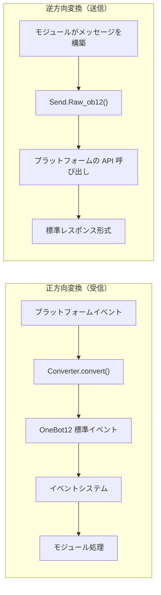
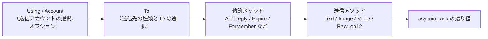
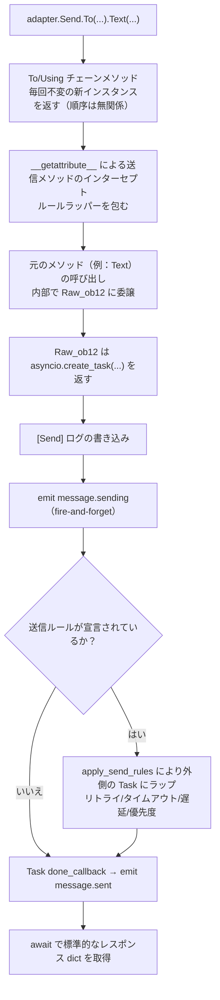

# ErisPulse 适配器开发

This skill is auto-built from the ErisPulse documentation.
Repository: https://github.com/ErisPulse/ErisPulse
Source paths are annotated per section; see docs/ in the repository for the latest content.

## 内容大纲

AI 按需读取：只读需要的章节即可，不必全文加载。

- 适配器开发入门: 88-97 行
- アダプタの概要: 99-122 行
- ディレクトリ構造: 124-137 行
- 早速始める: 139-466 行
- ローカル開発（ビルド不要）: 468-500 行
- 依存関係の宣言（オプション、2.8.0+）: 502-535 行
- `__init__` に関する注意事項: 537-734 行
- 次のステップ: 736-747 行
- 适配器核心概念: 749-758 行
- アダプタアーキテクチャ: 760-799 行
- AdapterManager アダプタマネージャー: 801-1034 行
- BaseAdapter 基底クラス: 1036-1409 行
- Send メッセージ送信 DSL: 1411-1482 行
- イベント変換器: 1484-1555 行
- 接続管理: 1557-1727 行
- API 応答標準: 1729-1761 行
- 多アカウントサポート: 1763-1834 行
- エラー処理: 1836-1888 行
- Bot 状態管理: 1890-1941 行
- 関連ドキュメント: 1943-1952 行
- 发送 DSL: 1954-1963 行
- 基本的な呼び出し方法: 1965-1989 行
- メソッドチェーン: 1991-1999 行
- 送信方法: 2001-2049 行
- 修飾メソッド: 2051-2115 行
- Event 包装クラスで修飾メソッドを使用する: 2117-2179 行
- アカウント管理: 2181-2206 行
- 非同期処理: 2208-2231 行
- 送信ルールシステム: 2233-2356 行
- バッチ構築モード（Build）: 2358-2481 行
- 命名規則: 2483-2528 行
- 送信リンクの内部分解: 2530-2588 行
- 戻り値: 2590-2645 行
- 完整例: 2647-2683 行
- 関連ドキュメント: 2685-2695 行
- 转换器: 2697-2707 行
- Converter の責務: 2709-2721 行
- BaseConverter 基底クラス（推奨）: 2723-2769 行
- convert() メソッド: 2771-2811 行
- 必須フィールドのマッピング: 2813-2839 行
- メッセージセグメントの変換: 2841-2871 行
- alt_message のレンダリング規約: 2873-2893 行
- プラットフォーム拡張フィールド: 2895-2916 行
- 完全な実装例: 2918-2998 行
- リッチメディアメッセージの変換例: 3000-3047 行
- よくある落とし穴: 3049-3091 行
- ベストプラクティス: 3093-3099 行
- 関連ドキュメント: 3101-3111 行
- 适配器最佳实践: 3113-3122 行
- Botの状態管理とMetaイベント: 3124-3221 行
- 接続管理: 3223-3338 行
- イベントの転換: 3340-3392 行
- SendDSLの実装: 3394-3455 行
- API応答: 3457-3506 行
- 複数アカウントのサポート: 3508-3568 行
- エラー処理: 3570-3622 行
- テスト: 3624-3668 行
- 逆転換とメッセージ構築: 3670-3678 行
- プラットフォームイベントメソッドの拡張: 3680-3732 行
- ドキュメントの維持: 3734-3741 行
- 基本情報: 3743-3745 行
- 支援するメッセージ送信タイプ: 3747-3748 行
- 特有のイベントタイプ: 3750-3751 行
- 設定オプション: 3753-3764 行
- 関連ドキュメント: 3766-3776 行
- 平台接入指南索引: 3778-3795 行
- プラットフォーム固有機能: 3797-3823 行
- 共通インターフェース: 3825-4005 行
- 標準形式: 4007-4063 行
- 参考リンク: 4065-4075 行
- コントリビューション: 4077-4086 行

## 适配器开发入门

> 来源: `docs/ja/developer-guide/adapters/getting-started.md`（https://github.com/ErisPulse/ErisPulse/blob/main/docs/ja/developer-guide/adapters/getting-started.md）

# アダプタ開発入門

> [!TIP]
> **この記事を読むタイミング**：アダプタ開発の入門記事（必読）。ゼロからアダプタを作成し、アダプタの役割とプロジェクト構造を理解する。読了後は必要に応じて [イベントコンバーター](converter.md) と [SendDSL 詳解](send-dsl.md) に進む。

このガイドを完了すると、イベントを受信・メッセージを送信できる最小限のアダプタ（主クラス + コンバーター + Send）が完成し、各コンポーネントの役割が明確になります。新しいプラットフォームへの接続はここから始まります。

## アダプタの概要

### アダプタとは

アダプタは ErisPulse と各メッセージプラットフォームをつなぐ橋渡しの役割を担い、以下の機能を提供します：

1. **正方向変換**：プラットフォームのイベントを OneBot12 標準形式に変換（Converter）
2. **逆方向変換**：OneBot12 メッセージセグメントをプラットフォーム API 呼び出しに変換（`Raw_ob12`）
3. プラットフォームとの接続管理（WebSocket/WebHook）
4. 統一された SendDSL メッセージ送信インターフェースの提供

### アダプタのアーキテクチャ



## ディレクトリ構造

標準的なアダプタのプロジェクト構造は以下の通りです：

```
MyAdapter/
├── pyproject.toml          # プロジェクト設定
├── README.md               # プロジェクト説明
├── LICENSE                 # ライセンス
└── MyAdapter/
    ├── __init__.py          # パッケージエントリ
    ├── Core.py               # アダプタ主クラス
    └── Converter.py          # イベントコンバーター
```

## 早速始める

### 1. プロジェクトの作成

脚手架（scaffold）を使って、pyproject.toml、主クラス、コンバーターを含む完全なプロジェクト構造を作成することを推奨します：

```bash
# パッケージとしてビルド・公開用
epsdk create adapter -n MyAdapter

# ローカルアダプタプラグイン（ビルド不要、plugins/ ディレクトリに配置するだけで自動読み込み可能、後述の「ローカル開発」参照）
epsdk create adapter -n MyAdapter --local
```

脚手架はデフォルトで WebSocket サーバーの骨格を生成します。プラットフォームの接続方式が異なる場合は、`--template` オプションで通信モードのテンプレートを選択し、`start`/`shutdown` を自分で書く必要がなくなります：

```bash
epsdk create adapter -n MyAdapter --template polling   # HTTP ポーリング型（getUpdates によるプル）
epsdk create adapter -n MyAdapter --template webhook   # HTTP コールバック型（プラットフォームのプッシュ）
```

> 3 種類の接続モードの違いと、半成品の基底クラスの最小実装は、[アダプタのコア概念 - 接続モードの半成品基底クラス](core-concepts.md#接続モード半成品基底クラス) を参照してください。実行可能な完全な例は、リポジトリの `examples/example-adapter-polling/` と `examples/example-adapter-webhook/` を参照してください。

手動で作成することも可能です：

```bash
mkdir MyAdapter && cd MyAdapter
```

### 2. pyproject.toml の作成

```toml
[project]
name = "ErisPulse-MyAdapter"
version = "1.0.0"
description = "MyAdapterプラットフォームアダプタ"
readme = "README.md"
requires-python = ">=3.10"
license = { file = "LICENSE" }
authors = [ { name = "yourname", email = "your@mail.com" } ]

dependencies = [
    "ErisPulse>=2.4.0"  # ErisPulse には aiohttp が内蔵されているため、通常は個別に依存関係を指定する必要はない
]

[project.urls]
"homepage" = "https://github.com/yourname/MyAdapter"

[project.entry-points."erispulse.adapter"]
"MyAdapter" = "MyAdapter:MyAdapter"
```

### 3. アダプタ主クラスの作成

フレームワークは `ConfigClass` / `AccountConfigClass` を用いた宣言的設定管理を提供しており、アダプタは設定クラスを宣言するだけで自動的に設定の読み込み、検証、テンプレートの生成が行われます。

```python
# MyAdapter/Core.py
from dataclasses import dataclass, field
# 推奨のルートインポート（2.10+）：頻出シンボルはルートパッケージから直接インポートし、深いパスも互換性がある
from ErisPulse import BaseAdapter, BaseConfig

@dataclass
class MyAdapterConfig(BaseConfig):
    """MyAdapter 設定"""
    api_endpoint: str = field(
        default="https://api.example.com",
        metadata={
            "description": {"i18n": "my_adapter.api_endpoint", "default": "API アドレス"},
            "required": False,
            "ui": {"widget": "text", "group": "connection", "order": 1},
        },
    )
    token: str = field(
        default="",
        metadata={
            "description": {"i18n": "my_adapter.token", "default": "プラットフォーム Token"},
            "required": True,
            "secret": True,
            "ui": {"widget": "password", "group": "basic", "order": 2},
        },
    )

class MyAdapter(BaseAdapter):
    ConfigClass = MyAdapterConfig  # 設定クラスを宣言し、フレームワークが自動管理
    
    # __init__ をオーバーライドする必要はない！フレームワークが自動処理する：
    # - self.sdk / self.logger の自動設定
    # - self.cfg による設定のリアルタイム読み込み
    # - self.Send / self.Request の自動初期化
    
    def _setup_converter(self):
        from .Converter import MyPlatformConverter
        return MyPlatformConverter()
```

> ⚠️ **__init__ について**：新バージョンでは `BaseAdapter.__init__(self, sdk=None)` が SDK の参照、ログの初期化、設定の読み込みを自動的に処理する。ほとんどのアダプタは `__init__` をオーバーライドする必要はない。詳細は [__init__ 注意事項](#init-注意事项) を参照してください。

> ⚠️ **super().__init__() について**：`BaseAdapter.__init__()` は `Send` と `Request` ファクトリのインスタンスを作成する。呼び忘れると、すべてのメッセージ送信とリクエスト操作で `AttributeError` が発生する。詳細は [__init__ 注意事項](#init-注意事项) を参照してください。

### 4. 必須メソッドの実装

```python
class MyAdapter(BaseAdapter):
    # ... __init__ コード ...
    
    async def start(self):
        """アダプタの起動（必須実装）"""
        # WebSocket または WebHook ルートを登録
        router.register_websocket(
            module_name="myplatform",
            path="/ws",
            handler=self._ws_handler
        )
        self.logger.info("アダプタが起動しました")
    
    async def shutdown(self):
        """アダプタの終了（必須実装）"""
        router.unregister_websocket(
            module_name="myplatform",
            path="/ws"
        )
        # 接続とリソースのクリーンアップ
        self.logger.info("アダプタが終了しました")
    
    async def call_api(self, endpoint: str, **params):
        """プラットフォーム API の呼び出し（必須実装）"""
        raise NotImplementedError("call_api を実装する必要があります")
```

#### メタイベントの送信

アダプタは Bot のオンライン状態をフレームワークに通知するために、メタイベントを送信する必要があります。`emit_meta()` を使用すると、一行で実現できます：

```python
class MyAdapter(BaseAdapter):
    async def _ws_handler(self, websocket):
        bot_id = self._get_bot_id()

        # Bot がオンライン
        await self.emit_meta("connect", bot_id, user_name="MyBot")

        try:
            while True:
                data = await websocket.receive_text()
                event = self.convert(data)
                if event:
                    await self.adapter.emit(event)
        except WebSocketDisconnect:
            pass
        finally:
            # Bot がオフライン
            await self.emit_meta("disconnect", bot_id)
```

> Bot の状態管理とメタイベントの詳細は、[アダプタのベストプラクティス - Bot 状態管理とメタイベント](best-practices.md#bot-状態管理と-meta-イベント) を参照してください。

### 5. Send クラスの実装

`At`/`AtAll`/`Reply` 修飾子は SendDSL 基底クラスで既に実装済みです。アダプタは `Raw_ob12` と具体的な送信メソッドを実装するだけで済みます。

フレームワークは以下の 2 つの重要な補助メソッドを提供します：
- `self._apply_modifiers(message)` — At/AtAll/Reply 修飾子を自動的にメッセージセグメントに統合
- `self.send_context` — 送信コンテキスト辞書を取得（`target_type`、`target_id`、`account_id`）

```python
import asyncio

class MyAdapter(BaseAdapter):
    # ... 他のコード ...

    class Send(BaseAdapter.Send):

        def Raw_ob12(self, message, **kwargs):
            """
            OneBot12 形式のメッセージを送信する（必須実装）

            _apply_modifiers を使用して修飾子の状態を自動的に統合し、
            send_context を使用して送信コンテキストを取得する。
            """
            async def _do_send():
                segments = self._apply_modifiers(message)
                return await self._adapter.call_api(
                    endpoint="/send_message",
                    message=segments,
                    **self.send_context,
                    **kwargs
                )
            return asyncio.create_task(_do_send())

        # Text/Image/Voice/Video/File は SendDSL 基底クラスから継承されているため、
        # デフォルトでは Raw_ob12 に委譲するだけで実装不要。
        # プラットフォーム固有のロジックが必要な場合は、個別のメソッドをオーバーライドする：
        # def Text(self, text: str):
        #     return self.Raw_ob12([{"type": "text", "data": {"text": text}}])
```

**メディア送信メソッド（Image/Video/File）の実装ポイント：**

- 基底クラスのデフォルト実装は `file` パラメータを OneBot12 メッセージセグメントにカプセル化して `Raw_ob12` に渡す。アダプタは `Raw_ob12` でダウンロード/アップロードを処理する必要がある。
- `file` パラメータは `bytes` 二進データと `str` URL の両方をサポートする。
- URL が渡された場合は、ファイルをダウンロードしてからプラットフォームにアップロードする必要がある。
- プラットフォームでは通常、まずアップロード API を呼び出してファイル識別子を取得し、次に送信 API を呼び出す。

**`__getattr__` マジックメソッド：**

- 実装メソッド名は大文字小文字を区別しない（`Text`、`text`、`TEXT` はすべて呼び出せる）。
- 未定義のメソッドはエラーではなく、エラーメッセージを返す。

**`Raw_ob12` メソッド：**

- OneBot12 標準メッセージ形式をプラットフォーム形式に変換して送信する。
- `self._apply_modifiers(message)` を使用して At/AtAll/Reply 修飾子を自動的に処理する。
- `**self.send_context` を使用して送信ターゲット情報とアカウント情報を渡す。

### 6. コンバーターの実装

```python
# MyAdapter/Converter.py
import time
import uuid

class MyPlatformConverter:
    def convert(self, raw_event):
        """プラットフォームの生イベントを OneBot12 標準形式に変換する"""
        if not isinstance(raw_event, dict):
            return None
        
        onebot_event = {
            "id": str(raw_event.get("event_id", uuid.uuid4())),
            "time": int(time.time()),
            "type": self._convert_event_type(raw_event.get("type")),
            "detail_type": self._convert_detail_type(raw_event),
            "platform": "myplatform",
            "self": {
                "platform": "myplatform",
                "user_id": str(raw_event.get("bot_id", ""))
            },
            "myplatform_raw": raw_event,
            "myplatform_raw_type": raw_event.get("type", "")
        }
        
        return onebot_event
    
    def _convert_event_type(self, event_type):
        """イベントタイプを変換する"""
        type_map = {
            "message": "message",
            "notice": "notice"
        }
        return type_map.get(event_type, "unknown")
    
    def _convert_detail_type(self, raw_event):
        """詳細タイプを変換する"""
        return "private"  # 簡単化のため
```

### 7. Request クラスの実装（リクエスト操作）

プラットフォームがフレンドリクエスト、グループ招待など、Bot が判断を必要とするリクエストに対応している場合、`Request` 内部クラスを実装できます：

```python
from ErisPulse import BaseAdapter, RequestDSL

class MyAdapter(BaseAdapter):
    # ... Send と他のコード ...

    class Request(RequestDSL):
        """リクエスト操作の実装（フレンドリクエスト、グループ招待など）"""

        def accept(self, **kwargs):
            """リクエストを承認する"""
            async def _do():
                result = await self._adapter.call_api(
                    endpoint="/set_request",
                    request_id=self._request_id,
                    approve=True,
                    **kwargs,
                )
                return {
                    "status": "ok" if result.get("code") == 0 else "failed",
                    "retcode": result.get("code", 0),
                    "data": None,
                    "message_id": "",
                    "message": result.get("message", ""),
                }
            return self._create_task(_do())

        def reject(self, **kwargs):
            """リクエストを拒否する"""
            async def _do():
                result = await self._adapter.call_api(
                    endpoint="/set_request",
                    request_id=self._request_id,
                    approve=False,
                    **kwargs,
                )
                return {
                    "status": "ok" if result.get("code") == 0 else "failed",
                    "retcode": result.get("code", 0),
                    "data": None,
                    "message_id": "",
                    "message": result.get("message", ""),
                }
            return self._create_task(_do())
```

モジュール開発者の使用方法：

```python
from ErisPulse import request

@request.on_friend_request()
async def handle_friend_request(event):
    # Event から便利なメソッドを使用
    await event.approve()
    # またはアダプタ経由で直接操作
    await adapter.myplatform.Request("req_id").accept()
```

> プラットフォームがリクエスト操作をサポートしていない場合は、`Request` 内部クラスを実装する必要はありません。基底クラスはデフォルトで `retcode=10002`（サポートされていない操作）を返します。[リクエスト操作規格](../../standards/request-action-spec.md)を参照してください。

### 8. パッケージエントリの作成

```python
# MyAdapter/__init__.py
from .Core import MyAdapter
```

## ローカル開発（ビルド不要）

モジュールと同様に、アダプタもプロジェクトのローカルプラグインディレクトリ（デフォルトは `plugins/`、`ErisPulse.framework.plugins_dir` で設定可能）に直接開発できます。**`pip install -e .` は不要**です：

```bash
# ローカルアダプタプラグインの生成
epsdk create adapter -n MyAdapter --local
# 生成される構造：
# plugins/
# └── MyAdapter/
#     ├── __init__.py
#     ├── Core.py
#     └── Converter.py
```

フレームワークの起動時に、プラグインディレクトリを自動スキャンし、その中のモジュールやアダプタをロードします（entry-point でインストールしたパッケージと同じ扱い：有効化状態、設定の宣言、ホットリロード、アンロードのクリーンアップなどすべて同じです）：

- **識別ルール**：`__init__.py` を含むパッケージディレクトリまたは単一の `.py` ファイルでも認識されます。`Main` という名前のクラスが優先的に認識されますが、なければプラグイン内の最初の `BaseAdapter` / `BaseModule` のサブクラスが使われます。
- **同名の上書き**：ローカルプラグインと PyPI でインストールされたアダプタが同名の場合、ローカルプラグインが優先されます（デバッグの上書きが可能）。
- **ホットリロード**：`sdk.enable_plugin_hot_reload()` で有効化されたプラグインディレクトリの監視はアダプタにも適用されます。アダプタのコードレベルのホットリロードは 2.11 から提供されています。`await sdk.adapter.reload("プラットフォーム名")` または `await sdk.reload_adapter("プラットフォーム名")` で実行できます（構文検証 → クリーンアップ → キャッシュクリアと再インポート → 再登録と起動、失敗時は自動ロールバック）。[アーキテクチャ概要](../../architecture.md)を参照してください。

### ローカルプラグインから公開

ローカルで検証が完了したら、`pack` サブコマンドを使ってプラグインを一括で公開可能な標準プロジェクトに変換します（インタラクティブにプラグインを選択し、メタ情報を補完し、entry-point を含む pyproject を生成）：

```bash
epsdk create pack
# プラグインディレクトリからプラグインを選択 → プロジェクト名/説明/作者を入力 → MyAdapter/ プロジェクトディレクトリを生成
cd MyAdapter
pip install -e .   # 標準インストールに変換；その後、公開プロセスに従って PyPI にアップロード
```

> **注意**：変換後は、`plugins/` 内の元ファイルを削除することを推奨します。同名のローカルプラグインとインストールパッケージが重複して読み込まれると、ローカルが優先されるため、インストールパッケージが有効であると誤解する可能性があります。

## 依存関係の宣言（オプション、2.8.0+）

アダプタは他のアダプタやモジュールへの依存関係を宣言し、アダプタ間の連携やオプション機能を実現できます：

```python
from typing import ClassVar

class MyAdapter(BaseAdapter):
    # ハード依存：存在しない場合、起動をスキップ（警告 + status=skipped-dependency イベント）
    depends: ClassVar[dict] = {
        "adapters": ["onebot11"],   # 依存するアダプタ（プラットフォーム名）
        "modules": ["TranslateEngine"],  # 依存するモジュール（登録名）
    }
    # ソフト依存：存在しない場合、起動に影響しない。モジュールのロード/アンロード時にコールバックを受ける（オプション機能モード）
    optional_modules: ClassVar[list] = ["TranslateEngine"]
```

- **起動順序**：モジュールのハード依存を宣言したアダプタは、**モジュールの初期化完了後に起動**されます。
- **ソフト依存の通知**：`optional_modules`（またはモジュールのハード依存）に含まれるモジュールがロードされたときに `on_dependency_ready(module_name)` が呼び出されます。アンロードされたときは `on_dependency_lost(module_name)` が呼び出されます（デフォルトでは空実装で、オーバーライド可能です）— 早めのロードやホットリロードの場面をカバーします：

```python
async def on_dependency_ready(self, module_name):
    """ソフト依存モジュールが準備完了：対応するオプション機能を有効化"""
    if module_name == "TranslateEngine":
        self._translate = self.sdk.TranslateEngine

async def on_dependency_lost(self, module_name):
    """ソフト依存モジュールが失われた：機能を降格"""
    if module_name == "TranslateEngine":
        self._translate = None
```

> [!NOTE]
> この機能は ErisPulse **2.8.0+** が必要です。

## `__init__` に関する注意事項

アダプタ開発では、`__init__` のオーバーライドが3つのレベルで発生する可能性があります。以下は各レベルの正しい使い方です。

### 1. BaseAdapter 層（多くの場合オーバーライドは不要）

`BaseAdapter.__init__(self, sdk=None)` は `Send` / `Request` ファクトリインスタンスを作成し、以下の処理を自動的に行います：

- `sdk` パラメータを受け取り、`self.sdk`、`self.logger` を設定
- `ConfigClass` を宣言した場合、`self.cfg` でグローバル設定をリアルタイムに読み取れる
- `AccountConfigClass` を宣言した場合、`self.accounts` で複数アカウントの設定をリアルタイムに読み取れる

**多くの場合、`__init__` をオーバーライドする必要はありません**。`ConfigClass` を宣言するだけで十分です：

```python
class MyAdapter(BaseAdapter):
    ConfigClass = MyAdapterConfig  # 設定クラスを宣言するとフレームワークが自動管理
    
    async def start(self):
        cfg = self.cfg  # タイプセーフでリアルタイムに読み取れる
        ...
```

もし本当にカスタム初期化が必要な場合は、`super().__init__(sdk)` を呼び出します：

```python
class MyAdapter(BaseAdapter):
    ConfigClass = MyAdapterConfig
    
    def __init__(self, sdk=None):
        super().__init__(sdk)  # sdk を渡す
        self.converter = self._setup_converter()
        self.convert = self.converter.convert
```

### 2. Send 内部クラス（多くの場合オーバーライドは不要）

`SendDSL.__init__` は、連鎖呼び出しの状態（ターゲットタイプ、ターゲットID、アカウントなど）を伝達します。**多くの場合、メソッド（`Raw_ob12`、`Text` など）をオーバーライドするだけで、`__init__` をオーバーライドする必要はありません**。

もし本当に必要（例えば、プラットフォーム特有の状態を初期化する場合）であれば、**すべてのパラメータを透過する必要があります**：

```python
class MyAdapter(BaseAdapter):
    class Send(BaseAdapter.Send):
        # パラメータ：adapter, target_type, target_id, account_id
        def __init__(self, adapter, target_type=None, target_id=None, account_id=None):
            super().__init__(adapter, target_type, target_id, account_id)  # ← 必須透過
            self._my_state = None  # プラットフォーム特有の初期化
```

**なぜ透過が必要ですか？** 連鎖呼び出しの各ステップは `self.__class__(...)` を使って新しいインスタンスを作成します：

```python
adapter.Send.To("user", "123")               # → Send(adapter, "user", "123", None)
adapter.Send.To("user", "123").Using("bot1")  # → Send(adapter, "user", "123", "bot1")
```

もし `__init__` のシグネチャが一致していない、または `super()` を呼び出していない場合、連鎖呼び出しは中断します。

### 3. Request 内部クラス（多くの場合オーバーライドは不要）

Send と同じです。パラメータは `adapter`, `request_id`, `account_id` です：

```python
class MyAdapter(BaseAdapter):
    class Request(RequestDSL):
        # パラメータ：adapter, request_id, account_id
        def __init__(self, adapter, request_id=None, account_id=None):
            super().__init__(adapter, request_id, account_id)  # ← 必須透過
            self._my_state = None  # プラットフォーム特有の初期化
```

### まとめ

| レベル | いつオーバーライドするか | 必須の処理 |
|------|------------|-----------|
| **BaseAdapter** | カスタム初期化が必要な場合 | `super().__init__(sdk)` （sdk パラメータを渡す） |
| **Send 内部クラス** | 送信関連の状態を初期化する必要がある場合 | `super().__init__(adapter, target_type, target_id, account_id)` |
| **Request 内部クラス** | リクエスト関連の状態を初期化する必要がある場合 | `super().__init__(adapter, request_id, account_id)` |
| 3つのレベル | 多くの場合 | **ConfigClass を宣言するだけで、`__init__` は触らない** |

### 9. 接続情報とルート発見

アダプタがルートを登録した後、フレームワークはすべてのルート情報を記録します。ユーザーは以下の API を使ってアダプタの接続アドレスを確認できます：

```python
from ErisPulse import sdk

# アダプタの完全な接続情報を取得
info = sdk.adapter.get_connection_info("myplatform")
# {
#   "platform": "myplatform",
#   "status": "started",
#   "connection": {
#     "base_url": "http://localhost:8080",
#     "http_routes": [
#       {"path": "/myplatform/webhook", "method": "POST",
#        "url": "http://localhost:8080/myplatform/webhook"}
#     ],
#     "websocket_routes": [
#       {"path": "/myplatform/ws",
#        "url": "ws://localhost:8080/myplatform/ws"}
#     ]
#   }
# }

# すべての名前空間（アダプタ/モジュール）のルートを一覧表示
namespaces = sdk.router.list_namespaces()
# {"myplatform": {"http": ["/myplatform/webhook"], "websocket": ["/myplatform/ws"]}}

# 名前空間の完全な接続 URL を取得
urls = sdk.router.get_module_urls("myplatform")
# {"base_url": "http://localhost:8080", "http": [...], "websocket": [...]}

# 名前空間の詳細なルート情報を取得
routes = sdk.router.get_module_routes("myplatform")
# {"http": [{"path": "/myplatform/webhook", "methods": ["POST"]}],
#  "websocket": [{"path": "/myplatform/ws", "auth": false}]}
```

> **注意**：`get_connection_info()` が返す情報は、ユーザーに表示するのに適しています（例：WebUI）。プラットフォーム側のコールバックアドレスや WebSocket 接続アドレスの設定に役立ちます。ルート登録時の `module_name` は、ErisPulse でアダプタを登録するときの `platform` 名と完全に一致している必要があります。一致していないと、ルート発見が正しく関連付けられません。

### 10. SSE (Server-Sent Events) のサポート

ErisPulse はサーバーに依存しない SSE を内蔵しており、モジュールやアダプタは `@sdk.router.sse()` を使って SSE エンドポイントを登録できます。

#### 基本的な使用法

```python
import asyncio
from ErisPulse import sdk

@sdk.router.sse("MyModule", "/events")
async def event_stream(sse):
    """SSE イベントを送信する"""
    count = 0
    while not sse.closed:
        await sse.send({"count": count}, event="update")
        count += 1
        await asyncio.sleep(1)
```

#### リクエストパラメータの使用

ハンドラは `request` パラメータを宣言してクライアントリクエスト情報をアクセスできます：

```python
@sdk.router.sse("MyModule", "/events")
async def event_stream(request, sse):
    token = request.query_params.get("token")
    if not validate_token(token):
        await sse.close()
        return

    while not sse.closed:
        data = await fetch_data(token)
        await sse.send(data)
        await asyncio.sleep(5)
```

#### SseEmitter API

| メソッド | 説明 |
|------|------|
| `sse.send(data, event=None, id=None, retry=None)` | SSE イベントを送信する。str 以外の data は自動的に JSON シリアライズされる |
| `sse.close()` | SSE 接続を安全に閉じる（複数回呼び出しても安全） |
| `sse.closed` | 接続が閉じられているか |
| `sse.request` | ベースのリクエストオブジェクト（クエリパラメータ、ヘッダーなどを読み取るのに使用可能） |

#### RouteGroup での使用

```python
api = sdk.router.group("MyModule", "/api", version="1")

@api.sse("/events")
async def events(sse):
    await sse.send({"msg": "hello"})
```

#### ルート発見

SSE ルートは自動的にルート発見 API に含まれる：

```python
# list_namespaces は "sse" キーを含む
sdk.router.list_namespaces()
# {"MyModule": {"http": [...], "websocket": [...], "sse": ["/MyModule/events"]}}

# get_module_routes は streaming: true をマークする
sdk.router.get_module_routes("MyModule")
# {"http": [...], "websocket": [...], "sse": [{"path": "/MyModule/events", "streaming": true}]}

# get_module_urls は完全な URL を生成する
sdk.router.get_module_urls("MyModule")
# {"sse": [{"path": "/MyModule/events", "url": "http://localhost:8080/MyModule/events"}]}
```

> **サーバーに依存しない設計**：`SseEmitter` はコールバックと下層の HTTP フレームワークを分離する。フレームワークは `register_sse()` と `@sse` デコレータを統一的な登録エントリとして提供し、アダプタは下層の HTTP フレームワークに直接依存することなく SSE エンドポイントを実装できる。

## 次のステップ

### アダプタの3つの主要コンポーネントを完成させる

- [イベントコンバーター](converter.md) - プラットフォームイベント → OneBot12 の実装詳細とよくある落とし穴
- [SendDSL 詳解](send-dsl.md) - メッセージ送信チェーン、修飾子メソッド、送信ルール
- [アダプタのコア概念](core-concepts.md) - BaseAdapter / ライフサイクル / マルチアカウントの仕組み

### スケルトンが走り始めたら

- [アダプタのベストプラクティス](best-practices.md) - 接続リトライ、ハートビート、エラーハンドリングのエンジニアリング的な仕上げ
- [公開とモジュールストアガイド](../publishing.md) - PyPI とモジュールストアへの公開

## 适配器核心概念

> 来源: `docs/ja/developer-guide/adapters/core-concepts.md`（https://github.com/ErisPulse/ErisPulse/blob/main/docs/ja/developer-guide/adapters/core-concepts.md）

# アダプタのコアコンセプト

> [!TIP]
> **この記事を読むタイミング**：アダプタ開発経路内に必須（BaseAdapter / SendDSL / ライフサイクル等の全メカニズムの詳細説明）。入門だけしたい場合は先に [アダプタ開発入門](getting-started.md) を読んで、"なぜ"の疑問が生じたらここに戻って調べる。

この記事では、アダプタの動作メカニズムを説明します。AdapterManager がどのようにアダプタを登録・イベントを分配するか、`BaseAdapter` が初期化時に何をしてくれたか、設定と複数アカウントの宣言方法など。アダプタを開発する際に「なぜこのように書くのか？」という疑問が生じたときは、ここに来て調べてください。

## アダプタアーキテクチャ

### コンポーネント関係

```
正方向変換（受信方向）                           反方向変換（送信方向）
─────────────────                           ─────────────────
                                             
┌──────────────────┐                        ┌──────────────────┐
│ プラットフォーム原生イベント     │                        │ モジュール構築メッセージ     │
└────────┬─────────┘                        └────────┬─────────┘
         │                                           │
         ↓                                           ↓
┌──────────────────┐   ┌──────────────────┐   ┌──────────────────┐
│                  │   │  アダプタ (MyAdapter) │   │ Send.Raw_ob12()  │
│  Converter       │   │ ┌──────────────┐ │   │ (反方向変換エントリ)   │
│  (イベント変換器)    │──→│ │              │ │   │                  │
│                  │   │ │              │ │   │                  │
└──────────────────┘   │ └──────────────┘ │   └────────┬─────────┘
                       └──────────────────┘            │
                                │                      ↓
                                ↓              ┌──────────────────┐
                       ┌──────────────────┐    │ プラットフォーム API 呼び出し    │
                       │ OneBot12 標準イベント │    └────────┬─────────┘
                       └────────┬─────────┘             │
                                │                      ↓
                                ↓              ┌──────────────────┐
                       ┌──────────────────┐    │ 標準レスポンス形式     │
                       │ イベントシステム         │    └──────────────────┘
                       └────────┬─────────┘
                                │
                                ↓
                       ┌──────────────────┐
                       │ モジュール (イベント処理)  │
                       └──────────────────┘
```

**コアの対称性**：
- **正方向変換**（Converter）：プラットフォーム原生イベント → OneBot12 標準イベント、元データは `{platform}_raw` に保持
- **反方向変換**（Raw_ob12）：OneBot12 メッセージセグメント → プラットフォーム API 呼び出し、返り値は標準レスポンス形式

## AdapterManager アダプタマネージャー

`AdapterManager` は ErisPulse アダプタシステムのコアコンポーネントで、すべてのプラットフォームアダプタの登録、起動、停止、イベント分配を管理します。

### コア機能

- **アダプタ登録**：複数のプラットフォームアダプタを登録・管理
- **ライフサイクル管理**：アダプタの起動と停止を制御
- **イベント分配**：OneBot12 標準イベントとプラットフォーム原生イベントを分配
- **設定管理**：アダプタの有効/無効状態を管理
- **ミドルウェアサポート**：OneBot12 イベントミドルウェアをサポート

### 基本的な使用法

```python
from ErisPulse import sdk

# アダプタの登録（通常は Loader が自動的に実行）
sdk.adapter.register("myplatform", MyPlatformAdapter)

# すべてのアダプタを起動
await sdk.adapter.startup()

# 指定アダプタを起動
await sdk.adapter.startup(["myplatform"])
# すべてのアダプタを起動
await sdk.adapter.startup()

# アダプタインスタンスを取得
my_adapter = sdk.adapter.get("myplatform")
# または属性でアクセス
my_adapter = sdk.adapter.myplatform

# すべてのアダプタを停止
await sdk.adapter.shutdown()
```

### 起動と停止

#### アダプタの起動

```python
# すべての登録済みアダプタを起動
await sdk.adapter.startup()

# 指定プラットフォームを起動
await sdk.adapter.startup(["platform1", "platform2"])
```

**起動フロー**：

1. `adapter.start` ライフサイクルイベントを送信
2. `adapter.status.change` イベントを送信（starting）
3. 各アダプタを並行起動
4. 起動失敗した場合は自動リトライ（指数バックオフ戦略）
5. 起動成功後 `adapter.status.change` イベントを送信（started）

**リトライメカニズム**：

- 最初の4回のリトライ：60秒、10分、30分、60分
- 5回目以降：3時間固定間隔

#### アダプタの停止

```python
# すべてのアダプタを停止
await sdk.adapter.shutdown()
```

**停止フロー**：

1. `adapter.stop` ライフサイクルイベントを送信
2. すべてのアダプタの `shutdown()` メソッドを呼び出す
3. ルーティングサーバーを閉じる
4. イベントハンドラをクリアする
5. `adapter.stopped` ライフサイクルイベントを送信

### 設定管理

#### プラットフォームの状態確認

```python
# プラットフォームが登録されているか確認
exists = sdk.adapter.exists("myplatform")

# プラットフォームが有効か確認
enabled = sdk.adapter.is_enabled("myplatform")

# in 演算子を使用
if "myplatform" in sdk.adapter:
    print("プラットフォームが存在し、有効です")
```

#### プラットフォームの一覧表示

```python
# すべての登録済みプラットフォームを取得
platforms = sdk.adapter.list_registered()

# すべてのプラットフォームとその状態を取得
status_dict = sdk.adapter.list_items()
# 戻り値: {"platform1": true, "platform2": false, ...}

# 有効なプラットフォームのリストを取得
enabled_platforms = [p for p, enabled in status_dict.items() if enabled]
```

### イベントの監視

#### OneBot12 標準イベント

```python
from ErisPulse import sdk

# すべてのプラットフォームの標準メッセージイベントを監視
@sdk.adapter.on("message")
async def handle_message(data):
    print(f"OneBot12メッセージを受け取りました: {data}")

# 特定プラットフォームの標準メッセージイベントを監視
@sdk.adapter.on("message", platform="myplatform")
async def handle_platform_message(data):
    print(f"myplatformメッセージを受け取りました: {data}")

# すべてのイベントを監視
@sdk.adapter.on("*")
async def handle_any_event(data):
    print(f"イベントを受け取りました: {data.get('type')}")
```

#### プラットフォーム原生イベント

```python
# 特定プラットフォームの原生イベントを監視
@sdk.adapter.on("raw_event_type", raw=True, platform="myplatform")
async def handle_raw_event(data):
    print(f"原生イベントを受け取りました: {data}")

# すべてのプラットフォームの原生イベントを監視（ワイルドカード）
@sdk.adapter.on("*", raw=True)
async def handle_all_raw_events(data):
    print(f"原生イベントを受け取りました: {data}")
```

#### イベント分配メカニズム

`adapter.emit(event_data)` を呼び出したとき：

1. **ミドルウェア処理**：まずすべての OneBot12 ミドルウェアを実行
2. **標準イベント分配**：マッチする OneBot12 イベントハンドラに分配
3. **原生イベント分配**：元データがあれば、原生イベントハンドラに分配

**マッチルール**：

- 精確マッチ：`@sdk.adapter.on("message")` は `message` イベントのみマッチ
- ワイルドカード：`@sdk.adapter.on("*")` はすべてのイベントにマッチ
- プラットフォームフィルタ：`platform="myplatform"` は指定プラットフォームのイベントのみ分配

### ミドルウェア

#### ミドルウェアの追加

```python
@sdk.adapter.middleware
async def logging_middleware(data):
    """ログ記録ミドルウェア"""
    print(f"イベントを処理しています: {data.get('type')}")
    return data  # 必ずデータを返す

@sdk.adapter.middleware
async def filter_middleware(data):
    """イベントフィルタミドルウェア"""
    # 不要なイベントをフィルタ
    if data.get("type") == "notice":
        return None  # None を返すとミドルウェアチェーンはその返り値を無視し、元のデータをそのまま次に渡す
    return data  # 必ずデータを返して次に渡す
```

#### ミドルウェアの返り値契約

| 返り値 | 行為 |
|--------|------|
| `dict` | イベントペイロードを上書き（後続のハンドラは変更後のイベントを受け取る） |
| `None` | 通過、ペイロードは変更なし（WARNING ログを出力するが、明示的に `return data` を推奨） |
| `False` | **否決**：イベントは破棄され、ハンドラには一切の副作用が発生しない |

否決はファイアウォール、リクエスト制限、ブラックリストなど、"イベントレベルで直接破棄"する場面に適しています（以前は高優先度のイベントハンドラで回避するしかありませんでした）。否決時にフレームワークは TRACE ログを出力し、`adapter.event.blocked` ライフサイクルフックをトリガーします（`middleware` ミドルウェア名、完全な `event`、`platform` / `event_type` / `detail_type` を含む）、これにより"なぜイベントが応答されなかったのか"をトラブルシューティングできます：

```python
@sdk.adapter.middleware
async def rate_limit_middleware(data):
    """リクエスト制限ミドルウェア"""
    if _is_rate_limited(data):
        return False  # 否決：イベントは破棄
    data["rate_marked"] = True
    return data

@sdk.lifecycle.on("adapter.event.blocked")
async def on_event_blocked(data):
    print(f"イベントは {data['middleware']} によって否決されました: {data['event_type']}")
```

#### ミドルウェアの実行順序

ミドルウェアは登録順に実行され、後から登録されたミドルウェアが先に実行されます。

> **注意**：ミドルウェアが `None` を返した場合（`return data` を忘れている場合）、フレームワークはその返り値を無視して元のデータをそのまま次に渡し、warning レベルのログを出力します。これにより、個々のミドルウェアのミスがイベントチェーン全体の中断を引き起こすことはありません。

```python
# 登録順
sdk.adapter.middleware(middleware1)  # 最後に実行
sdk.adapter.middleware(middleware2)  # 中間に実行
sdk.adapter.middleware(middleware3)  # 最初に実行

# 実行順序：middleware3 -> middleware2 -> middleware1
```

### アダプタインスタンスの取得

#### get() メソッド

```python
adapter = sdk.adapter.get("myplatform")
if adapter:
    await adapter.Send.To("user", "123").Text("Hello")
```

#### 属性アクセス

```python
# 属性名でアクセス（大文字小文字を区別しない）
adapter = sdk.adapter.myplatform
await adapter.Send.To("user", "123").Text("Hello")
```

## BaseAdapter 基底クラス

### 基本構造

```python
from dataclasses import dataclass, field
from ErisPulse.Core import BaseAdapter
from ErisPulse.Core.Bases import BaseConfig, BotAccountConfig

@dataclass
class MyConfig(BaseConfig):
    """アダプタ設定（宣言後、フレームワークが自動的に管理）"""
    token: str = field(
        default="",
        metadata={
            "description": {"i18n": "my_adapter.token", "default": "Bot Token"},
            "required": True,
            "secret": True,
            "ui": {"widget": "password", "group": "basic", "order": 1},
        },
    )

class MyAdapter(BaseAdapter):
    ConfigClass = MyConfig  # 設定クラスを宣言
    
    # __init__ をオーバーライドする必要はない、フレームワークが自動的に処理する：
    # - self.sdk, self.logger
    # - self.cfg（型安全な設定インスタンス、リアルタイムで読み取り）
    # - self.Send, self.Request
    
    async def start(self):
        """アダプタを起動する（必須実装）"""
        cfg = self.cfg  # 自動的にロードされる型安全な設定
        pass
    
    async def shutdown(self):
        """アダプタを停止する（必須実装）"""
        pass
    
    async def call_api(self, endpoint: str, **params):
        """プラットフォーム API を呼び出す（必須実装）"""
        pass
```

### 設定管理

フレームワークは宣言的設定管理を提供し、dataclass を使って設定構造を定義し、フレームワークが自動的にロード、検証、テンプレート生成を処理します。

#### 単一アカウント設定

```python
from dataclasses import dataclass, field
from ErisPulse.Core.Bases import BaseConfig

@dataclass
class TelegramConfig(BaseConfig):
    token: str = field(default="", metadata={
        "description": {"i18n": "telegram.token", "default": "Bot Token"},
        "required": True,
        "secret": True,
        "ui": {"widget": "password", "group": "basic", "order": 1},
    })
    proxy: str = field(default="", metadata={
        "description": {"i18n": "telegram.proxy", "default": "プロキシアドレス"},
        "ui": {"widget": "text", "group": "advanced", "order": 10},
    })

class TelegramAdapter(BaseAdapter):
    ConfigClass = TelegramConfig
    
    async def start(self):
        cfg = self.cfg  # 型安全、リアルタイムで読み取り
        if not cfg.token:
            raise ValueError("Token が設定されていません")
        await self._connect(cfg.token, proxy=cfg.proxy)
```

#### 複数アカウント設定

`BotAccountConfig` 基底クラスは `enabled` と `name` フィールドを提供します。ほとんどのアダプタはプラットフォームプロトコルやログイン応答から自動的に bot_id を取得でき、イベント変換時にアカウント設定に注入されます。：

```python
from dataclasses import dataclass, field
from ErisPulse.Core.Bases import BotAccountConfig

# 大多数のアダプタ：bot_id は実行時に自動取得、設定は不要
@dataclass
class MyBotConfig(BotAccountConfig):
    token: str = field(default="", metadata={
        "description": {"i18n": "my_adapter.bot_token", "default": "Token"},
        "required": True,
    })

# ログイン時に bot_id を取得できない場合は、ユーザーに設定してもらう
@dataclass
class YunhuBotConfig(BotAccountConfig):
    bot_id: str = field(default="", metadata={
        "description": {"i18n": "yunhu.bot_id", "default": "ロボットID"},
        "required": True,
    })
    token: str = field(default="", metadata={
        "description": {"i18n": "yunhu.token", "default": "Token"},
        "required": True,
    })

class MyAdapter(BaseAdapter):
    AccountConfigClass = MyBotConfig
    
    async def start(self):
        for name, account in self.enabled_accounts.items():
            user_id = await self._login(name, account)
            await self.emit_meta("connect", user_id)
```

#### metadata 約定

フィールド metadata は TOML 注釈生成と WebUI フォームレンダリングの両方に使用されます：

```python
metadata = {
    "description": str | dict,  # フィールド説明（i18n をサポート）
    "required": bool,         # 必須か（検証 + WebUI 必須マーク）
    "secret": bool,           # 敏感か（WebUI では *** に表示、ログでは脱敏）
    "example": bool,          # 落盤しないフラグ：config.toml に書き込まない（デフォルト値/テンプレートは除外）、config.full.example にのみレンダリング；schema に "example": true が付いていれば、CLI 設定ウィザードはデフォルトでスキップ；ユーザーが手動で設定した後は通常の永続化を行う
    "min": number, "max": number,  # 数値範囲検証
    "ui": {                   # WebUI コントロール設定（旧名 "webui" は互換性あり）
        "widget": str,        # コントロールタイプ: "text" | "switch" | "select" | "number" | "password"
        "group": str,         # グループ: "basic" | "advanced" | "connection" など
        "order": int,         # ソートウェイト（小さいほど先に表示）
        "options": list,      # select コントロールの選択肢 [{label, value}]、label は i18n をサポート
        "placeholder": str | dict,  # 入力欄のプレースホルダー（i18n をサポート）
    },
    "extra": dict,            # 余分な拡張フィールド（schema に透かし渡す）
}
```

すべてのユーザーが見えるテキストフィールドは i18n をサポートし、`{"i18n": "key", "default": "text"}` 形式で統一されます。純粋な文字列はそのまま透かし渡されます（後方互換性）。サポートされる i18n フィールド：

| フィールド | 位置 | 説明 |
|------|------|------|
| `description` | field metadata | フィールド説明 |
| `options[].label` | `ui.options` | select コントロールの選択肢ラベル |
| `placeholder` | `ui.placeholder` | 入力欄のプレースホルダー |
| `group_labels` | `_schema_meta` | グループ表示名（Dashboard 分区タイトル） |

i18n を使用する場合は、翻訳キーを i18n システムに事前に登録する必要があります（[i18n ドキュメント](../../advanced/i18n.md#配置フィールド多言語)を参照）。

**description / placeholder / options label** の例：

```python
token: str = field(
    default="",
    metadata={
        "description": {"i18n": "my_adapter.token", "default": "Bot Token"},
        "ui": {
            "widget": "text",
            "placeholder": {"i18n": "my_adapter.token.ph", "default": "Token を入力してください"},
        },
    },
)
mode: str = field(
    default="a",
    metadata={
        "description": {"i18n": "my_adapter.mode", "default": "モード"},
        "ui": {
            "widget": "select",
            "options": [
                {"label": {"i18n": "my_adapter.mode.a", "default": "オプションA"}, "value": "a"},
                {"label": "純粋な文字列のラベル", "value": "b"},  # 純粋な文字列はそのまま透かし渡す
            ],
        },
    },
)
```

**group_labels** の例（設定クラス定義後に宣言）：

```python
MyConfig._schema_meta = {
    "group_labels": {
        "basic": {"i18n": "my_adapter.group.basic", "default": "基本設定"},
        "advanced": {"i18n": "my_adapter.group.advanced", "default": "高度設定"},
    }
}
```

フレームワークの `resolve_config_schema()` は現在の言語に応じて上記のすべてのフィールドの i18n キーを自動的に解決します。`get_config_schema()` は i18n ディクショナリをそのまま透かし渡し、フロントエンドが独自に解決します。

#### docstring から自動生成されるフィールド説明（v2.8.0+）

metadata で `description` を宣言していないフィールドは、フレームワークが設定クラスの docstring からフィールド説明を自動的に抽出してバックアップとして使用します。2 つの一般的なスタイルをサポートします（混在可能）：

```python
@dataclass
class MyConfig(BaseConfig):
    """
    MyAdapter 設定

    :ivar endpoint: プラットフォーム API アドレス        # reST スタイル
    :ivar timeout: リクエストタイムアウト秒数
    """

    endpoint: str = "https://api.example.com"   # metadata description がない → 注釈/説明は docstring から
    timeout: int = 30

    # Google スタイルもサポート（Attributes: 段）：
    # Attributes:
    #     endpoint: プラットフォーム API アドレス
```

優先順位：**metadata description > docstring フィールド説明 > 空**。i18n ディクショナリ形式の description は影響を受けません（常に優先されます）。

#### 嵌套設定（v2.8.0+）

フィールド型がネストされた dataclass の場合、フレームワークは再帰的に処理します：schema は `"type": "table"` + `"fields"` サブツリーで構成され（WebUI では折りたたみ可能なネストされたグループとしてレンダリング）、TOML テンプレートは `[サブテーブル]` セクションとしてレンダリングされ、デフォルト値、埋め込み、検証、i18n 解析はすべて再帰的に有効になります。

```python
@dataclass
class RetryConfig(BaseConfig):
    """リトライ戦略

    :ivar max_retries: 最大リトライ回数
    """
    max_retries: int = 3
    backoff: float = 0.5

@dataclass
class MyConfig(BaseConfig):
    """MyAdapter 設定"""
    endpoint: str = "https://api.example.com"
    retry: RetryConfig = field(default_factory=RetryConfig)   # 嵌套設定セクション
```

生成される TOML テンプレート：

```toml
endpoint = "https://api.example.com"

[retry]
# 最大リトライ回数
max_retries = 3
backoff = 0.5
```

> 嵌套型は直接型注釈を使うことを推奨します；文字列注釈（遅延評価の場面など）は、型が設定クラスのモジュール全体、`__qualname__` 外側のクラス名空間、またはクラス属性から名前で解決できることを保証する必要があります。

#### 落盤しない example フィールド（v2.8.0+）

```python
gc_interval: int = field(default=300, metadata={"example": True})
```

`example: True` が付いたフィールドは：

- config.toml に書き込まれない（アダプタ/モジュール設定テンプレートとデフォルト値は除外、実行時はコードのデフォルト値を使用）
- config.full.example にのみレンダリングされる（ユーザーが参考として手動で config.toml にコピーする）
- schema に `"example": true` が付いている（コンポーネントが表示戦略を独自に決定できる）、CLI 設定ウィザードはデフォルトでスキップ
- ユーザーがこのキーを手動で設定した後は通常の永続化、通常のホットアップデート（ユーザーの明示的な意図が優先）

"冗長でめったに触れない"高度な設定項目に適しており、ユーザーの config.toml を最小限に保ちます。

> ⚠️ `_schema_meta` はクラスレベルのメタデータ（設定フィールドではない）。dataclass のクラス本体で宣言する場合は、`ClassVar` 注釈を付ける必要があります（`_schema_meta: ClassVar[dict] = {...}`）、そうでないと dataclass は普通のフィールドと見なされます。フレームワークはアンダースコアで始まるフィールドを防御的に除外しています（どの schema / テンプレート / デフォルト値 / 検証出力にも含まれません）、それでも規範的な宣言を推奨します。

### 宣言的翻訳キー（v2.7.0+）

アダプタは `ConfigClass` を宣言するのと同じように、`I18nClass` をネストして翻訳キーを一括宣言できます。フレームワークは `__init__` 階段（設定テンプレート生成前）に自動的に宣言されたすべての翻訳キーを登録し、設定説明で参照される i18n キーがテンプレート生成時に利用可能になることを保証します。

```python
from ErisPulse.Core.Bases import BaseAdapter, BaseI18n, I18nKey

class MyAdapter(BaseAdapter):
    class I18nClass(BaseI18n):
        endpoint: I18nKey = I18nKey(
            default="API Endpoint",
            zh_CN="API アドレス",
            zh_TW="API 位址",
            en="API Endpoint",
            ja="APIアドレス",
            ru="API адрес",
        )
        token: I18nKey = I18nKey(
            default="Platform Token",
            zh_CN="プラットフォーム Token",
            zh_TW="平台權杖",
            en="Platform Token",
            ja="プラットフォームトークン",
            ru="Токен платформы",
        )
```

> ``I18nKey.default`` は**言語に依存しないバックアップテキスト**で、どの言語にも登録されません。翻訳を有効にするには、少なくとも1つの言語パラメータを明示的に渡す必要があります。

詳細な使い方（キーのパスルール、明示的な key パラメータなど）は [i18n ドキュメント](../../advanced/i18n.md#推奨書き方-i18nclass-で翻訳キーを宣言する-v270) を参照してください。

### 宣言的イベント拡張メソッド（v2.7.0+）

アダプタは `EventMixin` を使ってプラットフォーム固有のイベント拡張メソッドを一括宣言し、フレームワークが自動的に現在のプラットフォームに登録します。

```python
from ErisPulse.Core import BaseAdapter

class MyAdapter(BaseAdapter):
    class EventMixin:
        def get_chat_name(self):
            """チャット名を取得"""
            return self.get("myplatform_raw", {}).get("chat", {}).get("name", "")

        def is_official_message(self):
            """公式メッセージか判定"""
            raw = self.get("myplatform_raw", {})
            return raw.get("sender", {}).get("is_official", False)
```

登録後、イベントオブジェクトはこれらのメソッドを直接呼び出せます：

```python
@message.on_group_message()
async def handler(event):
    if event.is_official_message():
        chat_name = event.get_chat_name()
        await event.reply(f"[{chat_name}] 公式メッセージを受け取りました")
```

> アダプタのイベント拡張メソッドは自身のプラットフォーム（``self._platform``）に登録されます。モジュールが跨プラットフォームのイベント拡張を必要とする場合は、従来の ``register_event_mixin()`` API を使用してください。

#### アカウント解決

マルチアカウントアダプタは `_resolve_account()` を使って送信先アカウントを自動的に解決できます：

```python
async def call_api(self, endpoint: str, **params):
    account_id = params.pop("account_id", None)
    name, account = self._resolve_account(account_id)
    # name: アカウント名, account: 設定インスタンス
```

解決戦略：アカウント名一致 → `bot_id` フィールド一致 → 他の str フィールド一致 → 最初の有効アカウント。

#### 設定のホットアップデート

サブクラスは `on_config_update()` をオーバーライドして設定変更に応答できます：

```python
class MyAdapter(BaseAdapter):
    ConfigClass = MyConfig
    
    def on_config_update(self, old_config, new_config):
        if old_config.token != new_config.token:
            self.logger.info("Token が更新されました、再接続します")
```

### 初期化プロセス

フレームワークは `BaseAdapter.__init__(self, sdk=None)` で自動的に以下の作業を行います：

1. **SDK リファレンス**：`self.sdk`、`self.logger` を設定
2. **Send/Request ファクトリ**：`self.Send` と `self.Request` を作成
3. **設定テンプレート**：`ConfigClass` を宣言した場合、自動的にデフォルト設定テンプレートを生成（初回）
4. **アカウントテンプレート**：`AccountConfigClass` を宣言した場合、自動的にデフォルトアカウントテンプレートを生成（初回）
5. **EventMixin 登録**：`EventMixin` を宣言した場合、`AdapterManager` がプラットフォーム名を注入した後に自動的に登録

設定は `self.cfg` / `self.accounts` でリアルタイムに読み取ります（各アクセスで設定ストアから最新値を読み取ります）。`self.config` は `self.cfg` の互換性のあるエイリアスとして引き続き使用できます。

ほとんどのアダプタは `__init__` をオーバーライドする必要はありません。カスタム初期化が必要な場合は：

```python
class MyAdapter(BaseAdapter):
    ConfigClass = MyConfig
    
    def __init__(self, sdk=None):
        super().__init__(sdk)  # sdk を渡す
        self.converter = self._setup_converter()
        self.convert = self.converter.convert
```

## Send メッセージ送信 DSL

### 継承関係

```python
class MyAdapter(BaseAdapter):
    class Send(BaseAdapter.Send):
        """Send 嵌套クラス、BaseAdapter.Send から継承"""
        pass
```

### 利用可能な属性

`Send` クラスは呼び出し時に自動的に以下の属性を設定します：

| 属性 | 説明 | 設定方法 |
|-----|------|---------|
| `_target_id` | 目標ID | `To(id)` または `To(type, id)` |
| `_target_type` | 目標タイプ | `To(type, id)` |
| `_target_to` | 簡化目標ID | `To(id)` |
| `_account_id` | 送信アカウントID | `Using(account_id)` |
| `_adapter` | アダプタインスタンス | 自動設定 |
| `_at_user_ids` | @ユーザーIDリスト | `At(user_id)` |
| `_reply_message_id` | 返信メッセージID | `Reply(message_id)` |
| `_at_all` | 全員@するか | `AtAll()` |

> **推奨**：`self.send_context` 属性を使って `target_type`、`target_id`、`account_id` を一括で取得する方が、インスタンス変数を直接アクセスするよりも明確です。

### フレームワーク補助メソッド

| メソッド/属性 | 説明 |
|-----------|------|
| `self._apply_modifiers(message)` | At/AtAll/Reply 修飾子の状態をメッセージセグメントリストにマージ |
| `self.send_context` | `{target_type, target_id, account_id}` ディクショナリを返す |

### 基本メソッド

アダプタは `Raw_ob12` を実装するだけで済み、標準メソッド（Text/Image/Voice/Video/File）は `SendDSL` 基底クラスから継承され、既定で `Raw_ob12` に委譲されます：

```python
class Send(BaseAdapter.Send):
    def Raw_ob12(self, message, **kwargs):
        """OneBot12 メッセージセグメント → プラットフォーム API（必須実装）"""
        async def _do_send():
            segments = self._apply_modifiers(message)
            return await self._adapter.call_api(
                endpoint="/send_message",
                message=segments,
                **self.send_context,
                **kwargs
            )
        return asyncio.create_task(_do_send())

    # Text/Image/Voice/Video/File は基底クラスから継承され、Raw_ob12 に自動的に委譲されるため、再実装は不要
    # プラットフォーム固有のロジックが必要な場合は、個別メソッドをオーバーライドする：
    # def Text(self, text: str):
    #     return self.Raw_ob12([{"type": "text", "data": {"text": text}}])
```

### チェーン式修飾メソッド

```python
class Send(BaseAdapter.Send):

    def __init__(self, adapter, target_type=None, target_id=None, account_id=None):
        super().__init__(adapter, target_type, target_id, account_id)
        self.buttons = []

    def Button(self, content: list) -> 'Send':
        self.buttons.append(content)
        return self
```

## イベント変換器

### 変換フロー

```
プラットフォーム原生イベント
    ↓
Converter.convert()
    ↓
OneBot12 標準イベント
```

### 必須フィールド

変換後のイベントはすべて以下のフィールドを含む必要があります：

```python
{
    "id": "イベントのユニークな識別子",
    "time": 1234567890,           # 10桁の Unix タイムスタンプ
    "type": "message/notice/request/meta",
    "detail_type": "イベントの詳細なタイプ",
    "platform": "プラットフォーム名",
    "self": {
        "platform": "プラットフォーム名",
        "user_id": "ロボットID"     # bot_id と一致する必要がある
    },
    "{platform}_raw": {...},       # 原始データ（必須）
    "{platform}_raw_type": "..."    # 原始タイプ（必須）
}
```

### 変換器の例

```python
class MyPlatformConverter:
    def convert(self, raw_event):
        """プラットフォーム原生イベントを OneBot12 標準形式に変換"""
        if not isinstance(raw_event, dict):
            return None
        
        # イベントIDを生成
        event_id = raw_event.get("event_id") or str(uuid.uuid4())
        
        # タイムスタンプを変換
        timestamp = raw_event.get("timestamp")
        if timestamp and timestamp > 10**12:
            timestamp = int(timestamp / 1000)
        else:
            timestamp = int(timestamp) if timestamp else int(time.time())
        
        # イベントタイプを変換
        event_type = self._convert_type(raw_event.get("type"))
        detail_type = self._convert_detail_type(raw_event)
        
        # 標準イベントを構築
        onebot_event = {
            "id": str(event_id),
            "time": timestamp,
            "type": event_type,
            "detail_type": detail_type,
            "platform": "myplatform",
            "self": {
                "platform": "myplatform",
                "user_id": str(raw_event.get("bot_id", ""))
            },
            "myplatform_raw": raw_event,
            "myplatform_raw_type": raw_event.get("type", "")
        }
        
        return onebot_event
```

## 接続管理

### start() の2つの正しい書き方

クライアントモードのアダプタ（WebSocketクライアント、HTTPポーリングなど）は `start()` で常駐接続ループを起動する必要があります。フレームワークは2つの書き方をサポートしていますが、**どちらか一方のみ使用できます**：

**書き方1：spawn-返却式（推奨）**—`spawn_client_loop()` でループをプラットフォームに属するバックグラウンドタスクとしてスケジュールし、`start()` は即座に返ります：

```python
class MyAdapter(BaseAdapter):
    async def start(self):
        # ループタスクは self._platform に属するため、shutdown でフレームワークが自動的にキャンセル
        self.spawn_client_loop(self._connect_loop())
        # start はここで終了—"起動は成功"、接続失敗はループ内でリトライ

    async def _connect_loop(self):
        while True:
            try:
                await self._connect_and_receive()   # 断線は例外 → 下方の退避
            except asyncio.CancelledError:
                raise
            except Exception:
                await asyncio.sleep(5)              # ループ内で自ら退避して再接続
```

**書き方2：常駐式**—`start()` でループを `await` し、決して返りません：

```python
class MyAdapter(BaseAdapter):
    async def start(self):
        await self._connect_loop()   # 常駐して返りません；ループが例外を投げると start は失敗
```

2つの書き方の違いと共通点：

| | spawn-返却式 | 常駐式 |
|---|---|---|
| `start()` の返りタイミング | ループを起動した後即座に返る | 接続ループが終了/失敗したとき（フレームワークが退避戦略でリトライ） |
| 接続失敗の処理 | ループ内で自ら例外を捕まえて退避 | 例外を上流に投げ、フレームワークのリトライチェーンに任せる |
| 適用場面 | 複数接続、ルーティング登録後に他のタスクを起動する必要がある場合 | "接続即起動"の単純な実装 |

`spawn_client_loop(coro, *, name="client_loop")` は書き方1のスケジューラーのエントリポイントです：タスクは `self._platform` に属して登録され、アダプタの `shutdown()` 時にフレームワークが自動的にキャンセルします。ループ内で例外が捕まえられていない場合は、自動的にログに記録されます（意図した切断再接続はループ内で自ら捕まえてください）。

> **唯一の誤った書き方は混用**です：spawn した後に同じループを `await` する—これにより `start()` は即座に返る意味を失い、タスクのキャンセル経路も予測不能になります。

### 接続モードの半完成基底クラス

前節の2つの書き方の他に、最も一般的な2つの接続モードに対してフレームワークは「半完成」の基底クラス（`ErisPulse.Core.Bases.adapter_patterns`、ルートパッケージから直接インポート可能）を提供しています：`start` / `shutdown` のライフサイクルの編排はすべて基底クラスが行い、サブクラスは業務のフックだけを実装します。

#### PollingAdapter（HTTPポーリング型）

「クライアントが定期的にイベントを取得する」プラットフォーム（Telegram getUpdates型）に適しています。基底クラスはspawn-返却式で常駐ポーリングループを起動し、失敗した場合に自動的にログを残して指数退避します（基数1秒、上限60秒、成功後はゼロに戻る；定数 `POLLING_ADAPTER_BACKOFF_BASE_SECS` / `POLLING_ADAPTER_BACKOFF_MAX_SECS` は `Core/constants.py` で調整可能）：

```python
from ErisPulse import PollingAdapter

class MyAdapter(PollingAdapter):
    # ポーリング間隔はデフォルト5秒；ConfigClass に poll_interval フィールドを宣言すると設定値が優先され（ホットアップデート有効）
    poll_interval = 5.0

    async def fetch_events(self):
        """プラットフォーム原生イベントを1回取得する（基底クラスが退避を統一して処理するため、try/except は不要）"""
        resp = await self.sdk.client.get(f"{self.cfg.endpoint}/getUpdates")
        data = await resp.json()
        return data.get("result", [])

    def convert_one(self, raw):
        """1つの原生イベントを OneBot12 に変換；None を返すとスキップ"""
        return self.converter.convert(raw)

    async def call_api(self, endpoint: str, **params):
        ...  # 普通のアダプタと同じ
```

最小実装面：`fetch_events` / `convert_one` / `call_api`。`start()` でループを起動して即座に返る；`shutdown()` はサブクラスで処理する必要はない（ポーリングループは owner に属して自動的にキャンセルされる）。

#### WebhookAdapter（HTTPコールバック型）

「プラットフォームがコールバックを送信する」プラットフォームに適しています。基底クラスの `start()` はフレームワーク router に受信ルートを登録します（最終的なパスは `/{プラットフォーム名}/webhook`、POSTメソッド）、登録は `owner_scope` に含まれる—アダプタのアンロード時に owner に従って自動的にクリーンアップされ、手動でアン登録する必要はない：

```python
from ErisPulse import WebhookAdapter

class MyAdapter(WebhookAdapter):
    def verify_request(self, request) -> bool:
        """オプションフック：コールバック検証（デフォルトは通す；False を返すと基底クラスは403で拒絶）"""
        cfg = self.cfg
        if not cfg.token:
            return True
        auth = request.headers.get("authorization", "")
        return auth == f"Bearer {cfg.token}"

    def convert(self, payload):
        """コールバックペイロードを OneBot12 に変換；None を返すとスキップ"""
        return self.converter.convert(payload)

    async def call_api(self, endpoint: str, **params):
        ...  # 普通のアダプタと同じ
```

最小実装面：`convert` / `call_api`（`verify_request` はオプション）。コールバックアドレスは `sdk.adapter.get_connection_info(platform)` で取得してプラットフォームのバックエンドに設定する；検証失敗のリクエストは403、ペイロード解析失敗は400、正常は `{"status": "ok"}` を返す。

#### 3つのモードの選択

| プラットフォームプロトコル | 継承 | フットプリント |
|---|---|---|
| プラットフォームが接続してくる（WebSocket サーバー） | `BaseAdapter` | `epsdk create adapter`（デフォルト ws-server） |
| 自分が接続してくる（HTTP ポーリング） | `PollingAdapter` | `epsdk create adapter --template polling` |
| プラットフォームが送ってくる（HTTP コールバック） | `WebhookAdapter` | `epsdk create adapter --template webhook` |

完全に実行可能な例はリポジトリの `examples/example-adapter/`（ws-server）、`examples/example-adapter-polling/`、`examples/example-adapter-webhook/` にあります。

### WebSocket 接続

```python
class MyAdapter(BaseAdapter):
    async def start(self):
        """WebSocket ルートの登録"""
        router.register_websocket(
            module_name="myplatform",
            path="/ws",
            handler=self._ws_handler,
            auth_handler=self._auth_handler
        )
    
    async def _ws_handler(self, websocket):
        """WebSocket 接続ハンドラ"""
        self.connection = websocket
        
        try:
            while True:
                data = await websocket.receive_text()
                onebot_event = self.convert(data)
                if onebot_event:
                    await self.adapter.emit(onebot_event)
        except WebSocketDisconnect:
            self.logger.info("接続が切断されました")
        finally:
            self.connection = None
    
    async def _auth_handler(self, websocket) -> bool:
        """WebSocket 認証"""
        token = websocket.query_params.get("token")
        return token == "valid_token"
```

### WebHook 接続

```python
class MyAdapter(BaseAdapter):
    async def start(self):
        """WebHook ルートの登録"""
        router.register_http_route(
            module_name="myplatform",
            path="/webhook",
            handler=self._webhook_handler,
            methods=["POST"]
        )
    
    async def _webhook_handler(self, request):
        """WebHook リクエストハンドラ"""
        data = await request.json()
        onebot_event = self.convert(data)
        if onebot_event:
            await self.adapter.emit(onebot_event)
        return {"status": "ok"}
```

> 純粋なコールバック型のプラットフォームは、上記の登録/検証/クリーンアップの編排を手動で書く必要はありません—`[WebhookAdapter` 半完成基底クラス](#接続モード半完成基底クラス)を継承し、`convert`（オプションで `verify_request` をオーバーライド）を実装するだけで済みます。

> **ルート情報の照会**：アダプタが登録したルート（HTTP、WebSocket、SSE）は `sdk.adapter.get_connection_info(platform)` と `sdk.router.get_module_urls(module_name)` を使って完全な接続アドレス（`base_url` + パス）を照会できます。[アダプタ開発入門 - 接続情報とルート発見](getting-started.md#9-接続情報とルート発見)と [SSE 支援](getting-started.md#10-sse-server-sent-events-サポート)を参照してください。

## API 応答標準

フレームワークは `make_response()` と `make_error()` メソッドを使って標準化された応答を構築し、手動で応答辞書を構築する必要はありません。

### 成功応答

```python
async def call_api(self, endpoint: str, **params):
    try:
        raw_response = await self._platform_api_call(endpoint, **params)
        
        return self.make_response(
            data=raw_response.get("data"),
            message_id=raw_response.get("data", {}).get("message_id", ""),
            raw=raw_response,
        )
    except Exception as e:
        return self.make_error(message=str(e), raw=None)
```

### 手動構築応答（旧版方式は互換性あり）

```python
async def call_api(self, endpoint: str, **params):
    return {
        "status": "ok",
        "retcode": 0,
        "data": {...},
        "message_id": "msg_id",
        "message": "",
        "myplatform_raw": raw_response
    }
```

## 多アカウントサポート

### 宣言的設定（推奨）

`AccountConfigClass` を宣言して設定クラスを定義した後、フレームワークが自動的に多アカウントのロード、検証、テンプレート生成を管理します：

```python
from dataclasses import dataclass, field
from ErisPulse.Core.Bases import BotAccountConfig

@dataclass
class MyBotConfig(BotAccountConfig):
    bot_id: str = field(default="", metadata={"description": "Bot ID", "required": True})
    token: str = field(default="", metadata={"description": "Token", "required": True, "secret": True})

class MyAdapter(BaseAdapter):
    AccountConfigClass = MyBotConfig
    
    async def start(self):
        for name, account in self.enabled_accounts.items():
            self.logger.info(f"アカウント {name}: {account.bot_id} を起動します")
            await self._connect(name, account)
    
    async def call_api(self, endpoint: str, **params):
        account_id = params.pop("account_id", None)
        name, account = self._resolve_account(account_id)
        # account.token, account.bot_id などのフィールドを使用
```

### アカウント設定ファイル

```toml
[MyAdapter.accounts.account1]
bot_id = "bot_001"
token = "token1"
enabled = true

[MyAdapter.accounts.account2]
bot_id = "bot_002"
token = "token2"
enabled = true
```

### 指定アカウントで送信

```python
# Using メソッドでアカウントを指定
my_adapter = adapter.get("myplatform")

# event から self.user_id を使う（推奨、最も汎用的）
await my_adapter.Send.Using(event["self"]["user_id"]).To("user", "123").Text("Hello")

# アカウント名で指定
await my_adapter.Send.Using("account1").To("user", "123").Text("Hello")
```

### self.user_id と Using の関係

フレームワークのイベント返信メカニズムは、イベントの `self` フィールドから `account_id`（優先）または `user_id` を取り出し、`Using` パラメータとして渡します。アダプタ開発者は、Converter で `self.user_id` の値が `AccountConfigClass` に定義された識別フィールド（例：`bot_id`）と一致するようにし、`_resolve_account()` が正しいアカウントとマッチできるようにする必要があります。

**フレームワーク内部の動作**：

```python
# フレームワークが bot_id を取り出すロジック
bot_id = self.get("self", {}).get("account_id", "") or self.get("self", {}).get("user_id", "")

# bot_id が空でない場合にのみ Using を呼び出す
if bot_id:
    send_chain = send_chain.Using(bot_id)
```

> **重要な点**：アダプタが1つの Bot 設定しか使わなくても、Converter が `self.user_id` を正しく設定している限り、フレームワークはそれを `Using` パラメータとして渡します。アダプタは `self.user_id` が `AccountConfigClass` の識別フィールド（例：`bot_id`）と一致するようにし、`_resolve_account()` が正しいアカウントとマッチできるようにする必要があります。`self.user_id` が空の場合、フレームワークは `Using` を呼び出さず、`call_api` に渡される `account_id` は `None` となり、`_resolve_account(None)` は最初の有効なアカウントを返します。

## エラー処理

### 接続リトライ

```python
import asyncio

class MyAdapter(BaseAdapter):
    async def start(self):
        retry_count = 0
        max_retries = 5
        
        while retry_count < max_retries:
            try:
                await self._connect_to_platform()
                break
            except Exception as e:
                retry_count += 1
                if retry_count < max_retries:
                    wait_time = min(60 * (2 ** retry_count), 600)
                    self.logger.warning(f"接続失敗、{wait_time}秒後にリトライします")
                    await asyncio.sleep(wait_time)
                else:
                    raise
```

### API エラー処理

```python
async def call_api(self, endpoint: str, **params):
    try:
        # 推奨は SDK 内部クライアントを使う
        from ErisPulse.Core import client
        from ErisPulse.Core.Bases.errors import ClientError, ClientTimeoutError
        resp = await client.post(
            f"https://api.platform.com/{endpoint}",
            json=params,
            max_retries=2,
        )
        response = await resp.json()
        return self._standardize_response(response)
    except ClientTimeoutError:
        self.logger.error(f"リクエストタイムアウト: {endpoint}")
        return self._error_response("リクエストタイムアウト", 32000)
    except ClientError as e:
        self.logger.error(f"ネットワークエラー: {e}")
        return self._error_response("ネットワークリクエスト失敗", 33000)
    except Exception as e:
        self.logger.error(f"未知のエラー: {e}")
        return self._error_response(str(e), 34000)
```

> **後方互換性**：`aiohttp.ClientSession` を直接使う古いアダプタコードは影響を受けず、`aiohttp.ClientError` をキャッチできます。2つの方式は共存可能です。新規コードは `sdk.client` + ErisPulse の例外体系を使うことを推奨します。

## Bot 状態管理

AdapterManager には Bot 状態を追跡するシステムが内蔵されており、登録されたすべての Bot のオンライン状態、アクティブ時間、メタ情報を自動的に管理します。

### 自動発見メカニズム

アダプタが `adapter.emit()` でイベントを送信するとき、フレームワークはイベントの `self` フィールドを自動的にチェックします：

- **meta イベント**：`detail_type` に応じて対応する操作を実行（connect で登録/disconnect でオフラインをマーク/heartbeat でアクティブ時間を更新）
- **通常イベント**（message/notice/request）：Bot を自動的に発見し、アクティブ時間を更新

```python
# self フィールドを含むすべてのイベントは自動発見をトリガー
await self.adapter.emit({
    "type": "message",
    "platform": "myplatform",
    "self": {"platform": "myplatform", "user_id": "bot123"},
    # ...
})
# Bot "bot123" は自動的に登録（初めて出現した場合）され、アクティブ時間を更新されます
```

### Meta イベントタイプ

| `detail_type` | 説明 | フレームワークの動作 |
|---|---|---|
| `connect` | Bot 接続 | Bot を登録し、`adapter.bot.online` ライフサイクルイベントをトリガー |
| `disconnect` | Bot 切断 | Bot をオフラインにマークし、`adapter.bot.offline` ライフサイクルイベントをトリガー |
| `heartbeat` | Bot ハートビート | Bot のアクティブ時間とメタ情報を更新 |

### アダプタによる Meta イベント送信

送信方法（`emit_meta()` で一行送信、ハートビートイベントと手動構造化フォーマット）は [アダプタのベストプラクティス - Bot 状態管理と Meta イベント](best-practices.md#bot-状態管理と-meta-イベント) を参照してください。

### `self` フィールドの拡張情報

`self` フィールドは必須の `platform` と `user_id` の他に、以下のオプションフィールドをサポートします：

| フィールド | 説明 |
|---|---|
| `user_name` | Bot ユーザー名 |
| `nickname` | Bot ニックネーム |
| `avatar` | Bot アイコン URL |
| `account_id` | 複数アカウント識別 |

### Bot 状態の照会

照会 API（`get_bot_info()` / `list_bots()` / `is_bot_online()` / `get_status_summary()`）は [アダプタシステム API - Bot 状態管理](../../api-reference/adapter-system.md#bot-状態管理) を参照してください。

### Bot ライフサイクルの監視

`adapter.bot.online` / `adapter.bot.offline` ライフサイクルイベントの表と監視の例は [アダプタシステム API - Bot 状態管理](../../api-reference/adapter-system.md#bot-状態管理) を参照してください。

## 関連ドキュメント

### 実装面の詳細

- [SendDSL 詳解](send-dsl.md) - メッセージ送信の学習
- [アダプタのベストプラクティス](best-practices.md) - 高品質なアダプタの開発

### 入門手順の振り返り

- [アダプタ開発入門](getting-started.md) - 最初のアダプタの作成

## 发送 DSL

> 来源: `docs/ja/developer-guide/adapters/send-dsl.md`（https://github.com/ErisPulse/ErisPulse/blob/main/docs/ja/developer-guide/adapters/send-dsl.md）

# SendDSL の詳細解説

> [!TIP]
> **この記事を読む必要があるのはいつか**：アダプター開発の経路において必須（送信 DSL）。必要ない場合は飛ばしても、他の機能の使用に影響はありません。

SendDSL は、メッセージ送信を一連のチェーンとして指定する方法を提供します：送信先の指定、@ / 返信、リトライ / タイムアウト / 遅延、一括送信。一行のチェーン呼び出しで全てを完了できます。本記事では、送信メソッド、修飾メソッド、送信ルール、および送信チェーンの内部メカニズムについて説明します。

## 基本的な呼び出し方法

### 1. 型とIDを指定する

```python
await adapter.Send.To("group", "123").Text("Hello")
```

### 2. IDのみを指定する

```python
await adapter.Send.To("123").Text("Hello")
```

### 3. 送信アカウントを指定する

```python
await adapter.Send.Using("bot1").Text("Hello")
```

### 4. 組み合わせて使用する

```python
await adapter.Send.Using("bot1").To("group", "123").Text("Hello")
```

## メソッドチェーン



## 送信方法

すべての送信メソッドは `asyncio.Task` オブジェクトを返します。

### 基本メソッド（基底クラスに内包）

以下に示す標準メソッドは `SendDSL` 基底クラスに内包されており、**デフォルトでは `Raw_ob12` に委譲**されます。アダプタのサブクラスでは、これらのメソッドを再実装する必要がなく、直接使用できます。また、IDE による補完も可能です。

| メソッド名 | 説明 | 戻り値 |
|--------|------|---------|
| `Text(text: str)` | テキストメッセージの送信 | `asyncio.Task` |
| `Image(file: bytes \| str)` | 画像の送信 | `asyncio.Task` |
| `Voice(file: bytes \| str)` | 音声の送信（OneBot12 `audio` 段） | `asyncio.Task` |
| `Video(file: bytes \| str)` | 動画の送信 | `asyncio.Task` |
| `File(file: bytes \| str, filename: str = None)` | ファイルの送信 | `asyncio.Task` |

アダプタは、プラットフォーム固有のロジックを提供するために、標準メソッドを個別にオーバーライドできます：

```python
class Send(SendDSL):
    def Raw_ob12(self, message, **kwargs):
        # 必須実装
        ...

    # オプション：Text をオーバーライドしてプラットフォーム固有のロジックを提供
    # def Text(self, text: str):
    #     return self.Raw_ob12([{"type": "text", "data": {"text": text}}])
```

### プロトコルメソッド

| メソッド名 | 説明 | 戻り値 | 必須か |
|--------|------|---------|---------|
| `Raw_ob12(message)` | OneBot12 形式のメッセージを送信 | `asyncio.Task` | **必須実装** |

> **重要**：`Raw_ob12` はアダプタの中心的なメソッドであり、**必ず実装する必要があります**。これは OneBot12 → プラットフォームへの逆変換の統一エントリポイントです。実装しない場合、基底クラスは error ログを記録し、標準のエラー応答（`status: "failed"`, `retcode: 10002`）を返します。標準メソッド（`Text`、`Image` など）はデフォルトで `Raw_ob12` に委譲されます。

### プラットフォーム特有のメソッド

アダプタは `Send` サブクラスに、プラットフォーム固有の送信メソッドを追加できます（`event.supports()` / `event.available_methods()` で識別されます）：

```python
class Send(SendDSL):
    def Raw_ob12(self, message, **kwargs): ...

    # プラットフォーム特有のメソッド
    def Sticker(self, sticker_id: str):
        return self.Raw_ob12([{"type": "sticker", "data": {"id": sticker_id}}])
```

## 修飾メソッド

修飾メソッドは `self` を返すことで、メソッドチェーンをサポートします。

### At メソッド

```python
# @1人のユーザー
await adapter.Send.To("group", "123").At("456").Text("こんにちは")

# @複数のユーザー
await adapter.Send.To("group", "123").At("456").At("789").Text("こんにちは")
```

### AtAll メソッド

```python
# @全員
await adapter.Send.To("group", "123").AtAll().Text("皆さん、こんにちは")
```

### Reply メソッド

```python
# メッセージへの返信
await adapter.Send.To("group", "123").Reply("msg_id").Text("返信内容")
```

### 修飾の組み合わせ

```python
await adapter.Send.To("group", "123").At("456").Reply("msg_id").Text("返信@メッセージ")
```

### プラットフォーム固有の修飾メソッド

`At` / `AtAll` / `Reply` に加えて、アダプターは**プラットフォーム固有の修飾メソッド**を定義できます。このようなメソッドは**`self` を返すだけ**で、デコレータは必要ありません。フレームワークが自動的に認識します。

- `self`（SendDSL インスタンス）を返す → 修飾メソッド。送信パッケージやライフサイクルイベントはトリガーせず、メソッドチェーンを継続します。
- `Task` / `Awaitable` を返す → 送信メソッド。

```python
class Send(SendDSL):
    def Raw_ob12(self, message, **kwargs): ...

    # 修飾メソッド：self を返す、送信はしない
    def Expire(self, seconds: int):
        self._expire = seconds
        return self

    def ForMember(self, user_id: str):
        self._member = user_id
        return self

    # 送信メソッド：Task を返す、修飾メソッドで設定された状態に依存
    def Board(self, content: str, **kwargs):
        return self.Raw_ob12([{"type": "board", "data": {"text": content}}])
```

使用例：

```python
# 修飾メソッドは連続してメソッドチェーンで使用できます
await adapter.Send.To("group", "big").Expire(3600).ForMember("114").Board("ボードの内容")
```

## Event 包装クラスで修飾メソッドを使用する

> [!NOTE]
> `reply(via=)` と `event.send_chain()` は、ErisPulse **2.7.0+** が必要です。

`event.reply()` はデフォルトで `at_sender`/`at_users`/`at_all`/`quote` などの組み込み修飾パラメータのみ公開します。プラットフォーム固有の修飾メソッドを使用するには、2 通りの方法があります。

### 方法1: reply() の via パラメータ

少量で既知の修飾メソッドに適しています：

```python
await event.reply("看板内容", method="Board",
                  via=[("Expire", 3600), ("ForMember", "114514")])
```

`via` はリストであり、各要素は以下のいずれかの形式です：

| 形式 | 等価な連鎖呼び出し |
|------|-------------|
| `"Name"` | `.Name()` |
| `("Name", arg1, arg2)` | `.Name(arg1, arg2)` |
| `("Name", (arg1,), {kw: val})` | `.Name(arg1, kw=val)` |

### 方法2: event.send_chain()

**複数の修飾メソッド**または**内容パラメータのないアクション型メソッド**（例：取り消し、削除）に適しています。`send_chain()` は `To`/`Using` が設定された送信チェーンを返し、任意の修飾メソッドと送信メソッドを自由に追加できます：

```python
# プラットフォーム固有の修飾メソッド + 看板送信
await event.send_chain().Expire(3600).Board("一時間後に期限切れ")

# 複数の修飾メソッドを連続して使用
await (event.send_chain()
       .Expire(3600)
       .ForMember("114514")
       .Board("看板内容", content_type="markdown"))

# 組み込み修飾メソッドも使用可能
await event.send_chain().At("123").Reply("msg_id").Text("hi")

# 内容パラメータのないアクション型メソッド
await event.send_chain().DismissBoard()
```

> `send_chain()` は完全な SendDSL インスタンスを返すため、**すべての連鎖特性が使用可能**です — 修飾メソッドだけでなく、送信ルールや一括構築も含まれます：

```python
# 送信ルール：再試行 + タイムアウト + 成功時のコールバック
await (event.send_chain()
       .Retry(3).Timeout(10)
       .Hook(lambda r: print("送信成功"))
       .Text("信頼性の高い送信"))

# 遅延送信 + プラットフォーム修飾 + 看板
await event.send_chain().Defer(5).Expire(3600).Board("遅延看板")

# 一括構築モード
results = await (event.send_chain()
                 .Build()
                 .Text("第一句").Image("pic.jpg").Text("第二句")
                 .send_all())
```

## アカウント管理

### Using メソッド

`Using()` は、メッセージの送信に使用するアカウントを指定するために使用されます。渡された識別子は、`_resolve_account()` によって以下の優先順位でマッチされます：

1. **アカウント名** — 設定ファイルのキー名（例: `"default"`、`"bot1"`）
2. **実行時に注入された bot_id** — イベントの変換時に自動的に注入される識別子
3. **任意の str フィールド** — 設定ファイルの他の文字列フィールド
4. **デフォルト** — 最初に有効化されたアカウント

```python
# アカウント名を使用
await adapter.Send.Using("account1").To("user", "123").Text("Hello")

# bot_id を使用（イベント内の self.user_id に相当）
await adapter.Send.Using("bot_123").To("user", "123").Text("Hello")
```

### Account メソッド

`Account` メソッドは `Using` と同等です：

```python
await adapter.Send.Account("account1").To("user", "123").Text("Hello")
```

## 非同期処理

### 結果を待たない

```python
# メッセージはバックグラウンドで送信されます
task = adapter.Send.To("user", "123").Text("Hello")

# 他の操作を続行します
# ...
```

### 結果を待つ

```python
# await を直接使用して結果を取得します
result = await adapter.Send.To("user", "123").Text("Hello")
print(f"送信結果: {result}")

# Task を保存して後で待つ
task = adapter.Send.To("user", "123").Text("Hello")
# ... 他の操作 ...
result = await task
```

## 送信ルールシステム

SendDSL には、ルールデコレータとして一連の送信ルールが組み込まれており、ルールはメソッドチェーンで追加され、最終的な送信時に一括で適用されます。ルールは一般的な生産環境のシナリオをカバーしています：タイムアウト制御、失敗時の再試行、成功時のコールバック、遅延送信、優先度による破棄、進捗監視。

ルールメソッドは**selfを返します**（At/AtAll/Replyと同様）、送信メソッド（Text/Imageなど）の前に呼び出す必要があります。ルールは`To`/`Using`/`Account`によって作成された新しいインスタンスと共に伝播されます。

### ルールメソッド一覧

| メソッド | 説明 |
|--------|------|
| `.Hook(callback)` | 送信が成功した後に実行されるコールバック（複数回呼び出すことができ、順番に実行されます） |
| `.Retry(times=1)` | 失敗時に自動的にN回再試行（最初を含めて合計N+1回） |
| `.Timeout(seconds)` | 単一の送信がタイムアウトした場合、現在の試行をキャンセルします（Retryと重ねて使用できます） |
| `.Defer(seconds=1.0)` | 送信を遅延（プロセス内でのタイマー、永続化されません） |
| `.Priority(level, drop_if_busy=False)` | 送信の優先度を設定；送信が溜まっている場合、破棄することができます |
| `.OnProgress(callback)` | 各段階の進捗コールバック（SendContextを引数として渡されます） |
| `.OnError(callback)` | 最終的に失敗した際のエラーコールバック（1回のみ実行されます） |

### 送信成功後に実行するロジック（Hook）

```python
# 同期コールバック
await (adapter.Send.To("user", "123")
       .Hook(lambda r: print(f"送信成功、メッセージID: {r['message_id']}"))
       .Text("你好"))

# 異步コールバック
async def deduct_points(result):
    await db.update(user_id="123", points=-1)

await adapter.Send.To("user", "123").Hook(deduct_points).Text("扣积分")
```

Hookは、送信が最終的に成功した場合（再試行成功を含む）にのみ実行されます。失敗、タイムアウト、キャンセルの場合はトリガーされません。

### 失敗時の自動再試行（Retry）

```python
# 初回失敗後に2回再試行し、合計3回試行します
result = await adapter.Send.To("user", "123").Retry(2).Text("带重试")
```

再試行のトリガー条件：送信時に例外が発生した場合、送信がタイムアウトした場合、送信が`status == "failed"`のレスポンスを返した場合。

### タイムアウトによる自動キャンセル（Timeout）

```python
# 単一の送信が10秒を超えるとキャンセルされます
await adapter.Send.To("user", "123").Timeout(10).Text("带超时")

# タイムアウト + 再試行：各試行10秒、最大3回
await adapter.Send.To("user", "123").Timeout(10).Retry(2).Text("超时重试")
```

### 進捗監視（OnProgress / OnError）

```python
def on_progress(ctx):
    print(f"段階: {ctx.stage}, 試行: {ctx.attempt + 1}/{ctx.max_attempts}, 耗時: {ctx.elapsed:.2f}s")
    if ctx.stage == "failed":
        print(f"  エラー: {ctx.error!r}")

async def on_error(ctx):
    await notify_admin(f"送信先 {ctx.target_id} に送信失敗: {ctx.error!r}")

await (adapter.Send.To("user", "123")
       .Retry(3).Timeout(10)
       .OnProgress(on_progress)
       .OnError(on_error)
       .Text("监控"))
```

`SendContext` に含まれるフィールド：`task_id`、`platform`、`method`、`target_type`、`target_id`、`bot_id`、`stage`、`attempt`、`max_attempts`、`started_at`、`finished_at`、`elapsed`、`error`、`result`、`extra`。

`stage` の可能な値：`pending`、`sending`、`retrying`、`success`、`failed`、`timeout`、`cancelled`、`dropped`。

### 遅延送信（Defer）

```python
# 5秒後に送信
await adapter.Send.To("user", "123").Defer(5).Text("迟到消息")
```

> 注意：遅延はプロセス内でのタイマーであり、プロセスの再起動で失われます。永続化は提供されません。

### 優先度と送信の破棄（Priority）

```python
# 低優先度のメッセージ。送信キューが溜まっている場合、自動的に破棄されます
result = await (adapter.Send.To("user", "123")
               .Priority(-1, drop_if_busy=True)
               .Text("可放弃的通知"))
# 破棄された場合、result["status"] == "failed"
```

`drop_if_busy`を有効にすると、送信中のタスク数がしきい値（デフォルトは64）を超えた場合、今回の送信を放棄します。`.PriorityThreshold(n)`でグローバルなしきい値を調整できます。

### ルールの組み合わせとバックグラウンド実行

```python
# メインのフローをブロックせず、ルールは正常に適用されます
task = (adapter.Send.To("user", "123")
        .Hook(lambda r: print("送信成功！"))
        .Retry(3)
        .Timeout(10)
        .OnProgress(on_progress)
        .Text("你好"))

# 他の操作を継続実行
await handle_next_action()
```

### ルールの伝播

ルールは`To`/`Using`/`Account`によって作成された新しいインスタンスと共に伝播され、メソッドチェーンの呼び出し中にルールが失われることを防ぎます：

```python
# Toの前にルールを設定しても、Toによって作成されたインスタンスにも伝播されます
builder = adapter.Send.Retry(3).Timeout(10)
send = builder.To("user", "123")  # sendはRetry(3)とTimeout(10)を引き継ぎます
await send.Text("hi")
```

複数のインスタンスのルールは相互に独立しています（hooksリストは深くコピーされます）。

## バッチ構築モード（Build）

単発モードに加えて、SendDSL はバッチ構築モードもサポートしています。1つのチェーンに複数の送信メソッドを書き込み、最後に一括して実行します。これは「一気に複数のメッセージを送信する」場面に適しています。

### 構築モードに入る

送信メソッドの前に `.Build()` を呼び出すと、`SendBuilder` が返されます。以降、送信メソッド（Text/Image など）は即座に実行されず、送信意図として蓄積されます：

```python
results = await (adapter.Send.To("user", "123")
                 .Build()                    # 構築モードに入る
                 .Text("第一句")
                 .Image("pic.jpg")
                 .Text("第二句")
                 .send_all())                 # 一括実行
# results = [Text結果, Image結果, Text結果]
```

`.send_all()` は `asyncio.Task` を返し、await 後に結果リスト（意図の順序で）が得られます。

### 並列と直列

デフォルトでは**並列**実行（並行送信、総所要時間は最遅の1つに近い）されます。メッセージの到着順序を保証する必要がある場合は、`.Sequential()` を呼び出します：

```python
# 直列：順に送信
await (adapter.Send.To("group", "456")
       .Build()
       .Sequential()
       .Text("先発这个").Text("再发这个")
       .send_all())

# 並列（デフォルト、明示的に呼び出しても可）
await (adapter.Send.To("group", "456")
       .Build()
       .Parallel()
       .Text("并发1").Text("并发2")
       .send_all())
```

### 失敗しても続行とリトライ

バッチ実行では**失敗しても続行**の戦略を採用しています。1つの送信が失敗しても、他の送信は中断されません。`.Retry()` と併用すると、失敗した項目は自動的にリトライされます（リトライは個々の送信に作用し、バッチ全体をリトライするものではありません）：

```python
await (adapter.Send.To("user", "123")
       .Build()
       .Retry(2)                       # 各送信がそれぞれ2回リトライ
       .Text("可能失败的").Image("也可能失败的")
       .send_all())
```

### バッチ全体のルールとコールバック

ルールはバッチ全体に適用されます：

| メソッド | 説明 |
|--------|------|
| `.Timeout(seconds)` | 各送信の単一タイムアウト |
| `.Retry(times)` | 各送信が個別にリトライ（失敗しても続行） |
| `.Defer(seconds)` | バッチ全体の送信を遅延 |
| `.Hook(callback)` | バッチ全体が成功した後にトリガーされ、`results` リストを受け取る |
| `.OnError(callback)` | バッチに失敗がある場合にトリガーされ、`BatchContext` を受け取る |
| `.OnProgress(callback)` | 各送信が完了するたびにトリガーされ、`BatchContext` を受け取る |

```python
def on_progress(ctx):
    print(f"進捗: {ctx.completed}/{ctx.total}, 成功 {ctx.succeeded}, 失敗 {ctx.failed}")

async def on_error(ctx):
    print(f"バッチに {ctx.failed} 件の失敗があります")

results = await (adapter.Send.To("user", "123")
               .Build()
               .Retry(2).Timeout(10)
               .OnProgress(on_progress)
               .OnError(on_error)
               .Hook(lambda rs: print("バッチ送信完了"))
               .Text("a").Text("b").Text("c")
               .send_all())
```

`BatchContext` には、`task_id`、`total`、`completed`、`succeeded`、`failed`、`stage`、`results`、`errors`、`elapsed`、`extra` が含まれます。

`stage` の値は次のいずれかです：`pending`、`sending`、`success`（すべて成功）、`partial`（一部成功）、`failed`（すべて失敗）。

### デコレータとルールの継承

`.Build()` の前の At/AtAll/Reply デコレータとルールはバッチ全体に継承され、各メッセージに作用します：

```python
await (adapter.Send.To("group", "456")
       .At("789")                        # 継承：各メッセージに @789 が付与
       .Build()
       .Retry(2)                         # 継承 + 追加：各送信がそれぞれリトライ
       .Text("@你的通知")
       .Image("公告图")
       .send_all())
```

Build 後でもデコレータを追加できます（バッチ全体に作用）：

```python
await (adapter.Send.To("group", "456")
       .Build()
       .At("111").At("222")             # 追加 @、バッチ全体に作用
       .Text("@多人")
       .send_all())
```

### バックグラウンド実行

単発と同じように、`.send_all()` は Task を返し、await せずにバックグラウンドで実行させることもできます：

```python
task = (adapter.Send.To("user", "123")
        .Build()
        .Hook(lambda rs: print("バッチ送信完了"))
        .Text("a").Text("b")
        .send_all())

# 主処理をブロックしない
await do_something_else()
```

## 命名規則

### PascalCase 命名

すべての送信メソッドは大文字で始まるキャメルケース（PascalCase）を使用します：

```python
# ✅ 正しい
def Text(self, text: str):
    pass

def Image(self, file: bytes):
    pass

# ❌ 間違っている
def text(self, text: str):
    pass

def send_image(self, file: bytes):
    pass
```

### プラットフォーム固有のメソッド

プラットフォームのプレフィックスを付けるメソッドの追加は推奨されません：

```python
# ✅ 推奨
def Sticker(self, sticker_id: str):
    pass

# ❌ 推奨されない
def TelegramSticker(self, sticker_id: str):
    pass
```

`Raw` メソッドを使用して代用します：

```python
# ✅ 推奨
await adapter.Send.Raw_ob12([{"type": "sticker", ...}])

# ❌ 推奨されない
def TelegramSticker(self, ...):
    pass
```

## 送信リンクの内部分解

`await adapter.Send.To("group", "123").Text("x")` という1回の処理の裏で、フレームワークは以下の処理をすべて代行しています：



**フレームワークが行った各ステップの内容：**

| 階段 | フレームワークが行ったこと |
|------|-------------|
| チェーンの結合 | `To`/`Using`/`Account` の各呼び出しは**不変の新インスタンスを生成**し、既に設定されたフィールドを継承するため、`To(...).Using(...)` と `Using(...).To(...)` は**等価**で、順序は無関係 |
| メソッドのラッピング | 送信メソッド（`Text` など）は `__getattribute__` でインターセプトされ、ラッパーを包む。修飾メソッド（`To`/`Using`/`At`/`Retry` など）は**ラッピングされない**。ネストされた `Raw_ob12` の呼び出しは、 `_in_rule_wrap` マーカーにより重複ラッピングを防ぐ |
| Task の作成 | `Raw_ob12` 内部の `asyncio.create_task()` が Task の真の作成ポイントである。`Text()` は Task を同期的に返すだけで、**ブロックしない** |
| 送信ログ | `[Send] platform/method -> target` というイベントログを記録する（`exclude_levels=["EVENT"]` で非表示にすることも可能） |
| `message.sending` | 送信メソッドが呼び出された際に**即座に** fire-and-forget でトリガーされる（ハンドラが存在する場合に限る、`has_handlers` による短絡） |
| `message.sent` | Task の `done_callback` にバインドされる——**ルールがある場合は、リトライプロセス全体の最終結果を上書きする**、ルールがない場合は元の Task の完了を意味する |

### アカウント解決の優先順位

アダプター内部で `_resolve_account(account_id)` を呼び出すとき、以下の順序で具体的なアカウントに解決される：

1. 単一アカウントアダプター（`AccountConfigClass` がない）→ 直接返す
2. アカウント名が `account_id` と正確に一致
3. 各アカウントの `bot_id` フィールドが一致
4. 各アカウントの任意の `str` フィールド値が一致（`enabled`/`name` を除外）
5. 最後の手段として、最初の有効なアカウント
6. すべて失敗 → `ValueError` を投げる

> あなたが渡した `account_id` は、`Using()` で明示的に指定されたもの > イベントの `self` フィールド（`account_id` は `user_id` より優先され、`event.reply()` が自動的に注入）> 指定しない（アダプターが最初の有効なアカウントをデフォルトで使用）

### 送信ルールエンジン（リトライ/タイムアウト/遅延）

ルールは `Raw_ob12` が Task を返した**後に**、外側の Task にラップされるため、メインの処理には影響しない。重要な事実：

| ルール | 説明 |
|------|------|
| `Retry(n)` | 総試行回数は `n+1` 回。**失敗後は即座に再送信し、指数バックオフはなし** |
| `Timeout(s)` | 単一送信のタイムアウトはキャンセル（`asyncio.wait_for`）、未使用の場合は再試行 |
| `Defer(s)` | 送信前に遅延 sleep |
| `Priority(level, drop_if_busy)` | 累積が閾値を超えた場合は、即座に `{status:"failed", retcode:10002, message:"dropped_low_priority"}` を返す |
| `Hook(fn)` | 最終的に成功した場合のみ、順序通りに実行される |
| `on_progress` / `on_error` | 各段階および最終的な失敗時のコールバック |

> **注意**：リトライは「即座に再送信」であり、退避間隔は存在しない。プラットフォームのリクエスト制限がある場合は、`on_error` コールバックで sleep した後に手動で再送信を行う必要がある。ルールの成功判定は、返却される dict の `status == "ok"` に基づく（`retcode == 0`）。

> 標準的なレスポンス形式と `retcode` の完全な意味は、[API レスポンス規格](../../standards/api-response.md)を参照してください。

## 戻り値

### Task オブジェクト

すべての送信メソッドは `asyncio.Task` を返します。アダプタは `Raw_ob12` を実装するだけでよく、標準メソッド（Text/Image など）はデフォルトで它に委譲されます：

```python
import asyncio

def Raw_ob12(self, message, **kwargs):
    async def _do_send():
        segments = self._apply_modifiers(message)
        return await self._adapter.call_api(
            endpoint="/send_message",
            message=segments,
            **self.send_context,
            **kwargs,
        )
    return asyncio.create_task(_do_send())

# Text/Image/Voice/Video/File は基底クラスから継承され、自動的に Raw_ob12 に委譲されます。
# 標準メソッドをオーバーライドする場合は、asyncio.Task を返すだけです：
# def Text(self, text: str):
#     return self.Raw_ob12([{"type": "text", "data": {"text": text}}])
```

### 応答の標準化

`call_api` は標準化された応答を返す必要があります。`make_response()` / `make_error()` メソッドを推奨します：

```python
async def call_api(self, endpoint: str, **params):
    try:
        result = await self._do_api_call(endpoint, **params)
        return self.make_response(
            data=result.get("data"),
            message_id=result.get("message_id", ""),
            raw=result,
        )
    except Exception as e:
        return self.make_error(message=str(e))
```

手動で構築することも可能です（旧バージョンの方式も互換性があります）：

```python
async def call_api(self, endpoint: str, **params):
    return {
        "status": "ok" または "failed",
        "retcode": 0 またはエラーコード,
        "data": {...},
        "message_id": "msg_id" または "",
        "message": "",
        "{platform}_raw": raw_response
    }
```

## 完整例

### 基本使用

```python
from ErisPulse.Core import adapter

my_adapter = adapter.get("myplatform")

# テキストの送信
await my_adapter.Send.To("user", "123").Text("Hello World!")

# 画像の送信
await my_adapter.Send.To("group", "456").Image("https://example.com/image.jpg")

# ファイルの送信
with open("document.pdf", "rb") as f:
    await my_adapter.Send.To("user", "123").File(f.read())
```

### チェーン呼び出し

```python
# @ユーザー + リプライ
await my_adapter.Send.To("group", "456").At("789").Reply("msg123").Text("リプライ@のメッセージ")

# @全員 + 複数の修飾
await my_adapter.Send.Using("bot1").To("group", "456").AtAll().Text("お知らせメッセージ")
```

### 原始メッセージとメッセージ構築

`Raw_ob12` は逆変換の中心となるエントリポイントです（OB12 メッセージセグメント → プラットフォーム API 呼び出し）。`MessageBuilder` はそれに伴うチェーン式メッセージセグメント構築ツールです。

> 完全な `Raw_ob12` 実装の規格、`MessageBuilder` の使い方およびコード例については、以下のドキュメントを参照してください：
> - [送信メソッド規格 §6 逆変換規格 (OneBot12 → プラットフォーム)](../../standards/send-method-spec.md#6-逆変換規格onebot12--プラットフォーム)
> - [送信メソッド規格 §11 メッセージビルダー](../../standards/send-method-spec.md#11-メッセージビルダー-messagebuilder)

## 関連ドキュメント

### アダプタ開発の続き

- [アダプタ開発の入門](getting-started.md) - アダプタの作成
- [アダプタのコアコンセプト](core-concepts.md) - アダプタアーキテクチャの理解
- [アダプタのベストプラクティス](best-practices.md) - 高品質なアダプタの開発

### 公式規格の遵守

- [送信メソッド規格](../../standards/send-method-spec.md) - 送信メソッドの完全な規格（`Raw_ob12` 実装と `MessageBuilder`）

## 转换器

> 来源: `docs/ja/developer-guide/adapters/converter.md`（https://github.com/ErisPulse/ErisPulse/blob/main/docs/ja/developer-guide/adapters/converter.md）

# イベントコンバーター実装ガイド

> [!TIP]
> **この文書を読むべきタイミング**：アダプター開発パス内では必読（イベントコンバーター）。必要なければスキップしても、他の機能の利用には影響しません。


アダプターがプラットフォームのネイティブイベントを受信すると、イベントコンバーター (Converter) がそれを ErisPulse の統一された OneBot12 標準形式へ変換します。プラットフォームイベントがどのようにフレームワークへ取り込まれるかは、この1つのクラスが決定します。

## Converter の責務

```
プラットフォームネイティブイベント ──→ Converter.convert() ──→ OneBot12 標準イベント
```

Converter は**順方向変換**（受信方向）のみを担当します。つまり、プラットフォームのネイティブイベントデータを OneBot12 標準形式に変換します。逆方向変換（送信方向）は `Send.Raw_ob12()` メソッドが処理します。

### 基本原則

1. **無損失変換**：元のデータは必ず `{platform}_raw` フィールドに完全な形で保持すること
2. **標準互換**：変換後のイベントは OneBot12 標準形式に準拠すること
3. **プラットフォーム拡張**：プラットフォーム固有のデータは `{platform}_` プレフィックス付きフィールドに保存すること

## BaseConverter 基底クラス（推奨）

2.7.0 以降、フレームワークは `BaseConverter` 基底クラス（`ErisPulse.Core.Bases`）を提供しており、OneBot12 イベントの**共通フィールド構築**と**よく使うメッセージセグメントのヘルパー**をカプセル化しているため、コンバーターは型マッピングに集中するだけでよくなります：

```python
from ErisPulse.Core.Bases import BaseConverter


class MyConverter(BaseConverter):
    def __init__(self):
        super().__init__(platform="myplatform")

    def convert(self, raw_event: dict) -> dict | None:
        if not isinstance(raw_event, dict):
            return None
        event_type = raw_event.get("type", "")
        base = self.build_base_event(raw_event, event_type)  # id/time/platform/self/raw
        if event_type == "message":
            base["type"] = "message"
            base["detail_type"] = "group" if raw_event.get("group_id") else "private"
            base["user_id"] = str(raw_event.get("sender_id", ""))
            base["message"] = [self.text(raw_event.get("content", ""))]
            base["alt_message"] = raw_event.get("content", "")
            return base
        return None
```

`build_base_event()` が自動的に埋める共通フィールド：

| フィールド | 供給元 |
|------|------|
| `id` | `raw_event["event_id"]`、未指定時は UUID を自動生成 |
| `time` | `raw_event["timestamp"]`、未指定時は現在時刻 |
| `platform` | コンストラクタで渡された `platform` |
| `self` | `{"platform": ..., "user_id": raw_event["bot_id"]}` |
| `{platform}_raw` | 元のイベント（「無損失変換」の原則を満たす） |
| `{platform}_raw_type` | 元のイベントタイプ |

よく使うメッセージセグメントのヘルパーメソッド（いずれも静的メソッドで、そのまま再利用できます）：

```python
converter.text("hi")          # {"type": "text", "data": {"text": "hi"}}
converter.at("123456")        # {"type": "at", "data": {"user_id": "123456"}}
converter.image("file.png")   # {"type": "image", "data": {"file": "file.png"}}
```

> 手動で実装する場合、`build_base_event` の共通フィールド構築は毎回書く必要があるボイラープレートコードです。`BaseConverter` を使えばこの部分を省略でき、「無損失変換」（元のイベントは常に `{platform}_raw` に入る）も自然に満たされます。

## convert() メソッド

### メソッドシグネチャ

```python
def convert(self, raw_event: dict) -> dict:
    """
    プラットフォームのネイティブイベントを OneBot12 標準形式に変換する

    :param raw_event: プラットフォームのネイティブイベントデータ
    :return: OneBot12 標準形式のイベント辞書
    """
    pass
```

### 戻り値の構造

変換後のイベント辞書には、以下の標準フィールドを含める必要があります：

```python
{
    "id": "イベントの一意なID",
    "time": 1234567890,           # Unix タイムスタンプ（秒）
    "type": "message",             # イベントタイプ
    "detail_type": "private",      # 詳細タイプ
    "platform": "myplatform",      # プラットフォーム名
    "self": {
        "platform": "myplatform",
        "user_id": "bot_user_id"
    },

    # メッセージイベントのフィールド
    "user_id": "sender_id",
    "message": [...],              # OneBot12 メッセージセグメントのリスト
    "alt_message": "プレーンテキストの内容",

    # 元のデータを必ず保持する
    "myplatform_raw": { ... },     # プラットフォームネイティブイベントの完全なデータ
    "myplatform_raw_type": "ネイティブイベントの型名",
}
```

## 必須フィールドのマッピング

### 共通フィールド（すべてのイベントタイプ）

| OB12 フィールド | 型 | 説明 |
|-----------|------|------|
| `id` | str | イベントの一意な識別子 |
| `time` | int | Unix タイムスタンプ（秒） |
| `type` | str | イベントタイプ：`message` / `notice` / `request` / `meta` |
| `detail_type` | str | 詳細タイプ：`private` / `group` / `friend` など |
| `platform` | str | プラットフォーム名。アダプターの登録名と一致させること |
| `self` | dict | ボット情報：`{"platform": "...", "user_id": "..."}` |

### メッセージイベントの追加フィールド

| OB12 フィールド | 型 | 説明 |
|-----------|------|------|
| `user_id` | str | 送信者 ID |
| `message` | list[dict] | OneBot12 メッセージセグメントのリスト |
| `alt_message` | str | プレーンテキストの代替内容 |

### 通知イベントの追加フィールド

| OB12 フィールド | 型 | 説明 |
|-----------|------|------|
| `user_id` | str | 関連するユーザー ID |
| `operator_id` | str | 操作者の ID（グループメンバーの増減など） |

## メッセージセグメントの変換

OneBot12 標準では、以下のメッセージセグメントタイプが定義されています：

```python
# テキスト
{"type": "text", "data": {"text": "Hello"}}

# 画像
{"type": "image", "data": {"file": "https://example.com/img.jpg"}}

# 音声
{"type": "audio", "data": {"file": "https://example.com/audio.mp3"}}

# 動画
{"type": "video", "data": {"file": "https://example.com/video.mp4"}}

# ファイル
{"type": "file", "data": {"file": "https://example.com/doc.pdf"}}

# @メンション
{"type": "mention", "data": {"user_id": "123"}}

# @全員
{"type": "mention_all", "data": {}}

# 返信
{"type": "reply", "data": {"message_id": "msg_123"}}
```

プラットフォームに対応していないメッセージセグメントタイプがある場合は、そのセグメントを省略するか、最も近い標準タイプに変換できます。

## alt_message のレンダリング規約

`alt_message` はメッセージイベントのプレーンテキストの代替内容で、ログのアーカイブ、`extract_text` によるテキストマッチング、コマンドディスパッチのフォールバックに使用されます。各アダプターは `alt_message` を生成する際、以下の規約に従う必要があります（特に mention セグメントに注意）：

- **mention セグメント**は優先的に `@ニックネーム` とレンダリングします。プラットフォームがニックネームを提供しない場合は `@{user_id}` にフォールバックし、`user_id` が `all`（@全員）の場合は `@メンバー全員` とレンダリングします
- ニックネームと `user_id` の**両方が欠けている場合はそのセグメントを省略**し、空の `"@"` を出力してはいけません。`"@ ヘルプ"` のようになると、テキストマッチングやコマンド解析の基準が汚染されます
- `data.get("user_name", fallback)` の罠に注意：メッセージセグメントの構築時に `user_name` のデフォルトとして空文字列が保存されていると、キーが存在するためにフォールバックが永久に機能しません。`data.get("user_name") or data.get("user_id")` という書き方を使うべきです
- その他のメッセージセグメントのレンダリングスタイル（`[画像]`、`[音声]` など）や、セグメント間の連結方法（`""` または `" "`）は、アダプター自身の既存の方針を維持し、強制的な統一は行いません

```python
# mention セグメントのレンダリング例
data = seg.get("data") or {}
user_id = str(data.get("user_id") or "").strip()
user_name = str(data.get("user_name") or "").strip()
if user_id == "all":
    parts.append("@メンバー全員")
elif user_name:
    parts.append(f"@{user_name}")
elif user_id:
    parts.append(f"@{user_id}")
```

## プラットフォーム拡張フィールド

プラットフォーム固有のデータは、標準フィールドとの衝突を避けるため `{platform}_` プレフィックスを付けて保存する必要があります：

```python
{
    # 標準フィールド
    "type": "message",
    "detail_type": "group",
    # ...

    # プラットフォーム拡張フィールド
    "myplatform_raw": { ... },          # 元のイベントデータ（必須）
    "myplatform_raw_type": "chat",      # 元のイベントタイプ（必須）

    # その他のプラットフォーム固有フィールド
    "myplatform_group_name": "グループ名",
    "myplatform_sender_role": "admin",
}
```

> **重要**：`{platform}_raw` フィールドは必須です。ErisPulse のイベントシステムやモジュールは、プラットフォームの元のデータにアクセスするためにこのフィールドに依存している可能性があります。

## 完全な実装例

以下は完全な Converter の実装例です：

```python
class MyConverter:
    def __init__(self, platform: str):
        self.platform = platform

    def convert(self, raw_event: dict) -> dict:
        event_type = raw_event.get("type", "")

        base_event = {
            "id": raw_event.get("id", ""),
            "time": raw_event.get("timestamp", 0),
            "platform": self.platform,
            "self": {
                "platform": self.platform,
                "user_id": raw_event.get("self_id", ""),
            },
            "myplatform_raw": raw_event,
            "myplatform_raw_type": event_type,
        }

        if event_type == "chat":
            return self._convert_message(raw_event, base_event)
        elif event_type == "notification":
            return self._convert_notice(raw_event, base_event)
        elif event_type == "request":
            return self._convert_request(raw_event, base_event)

        return base_event

    def _convert_message(self, raw: dict, base: dict) -> dict:
        base["type"] = "message"
        base["detail_type"] = "group" if raw.get("group_id") else "private"
        base["user_id"] = raw.get("sender_id", "")
        base["message"] = self._convert_message_segments(raw.get("content", ""))
        base["alt_message"] = raw.get("content", "")

        if raw.get("group_id"):
            base["group_id"] = raw["group_id"]

        return base

    def _convert_message_segments(self, content: str) -> list:
        segments = []
        if content:
            segments.append({"type": "text", "data": {"text": content}})
        return segments

    def _convert_notice(self, raw: dict, base: dict) -> dict:
        base["type"] = "notice"
        notification_type = raw.get("notification_type", "")

        if notification_type == "member_join":
            base["detail_type"] = "group_member_increase"
            base["user_id"] = raw.get("user_id", "")
            base["group_id"] = raw.get("group_id", "")
            base["operator_id"] = raw.get("operator_id", "")
        elif notification_type == "friend_add":
            base["detail_type"] = "friend_increase"
            base["user_id"] = raw.get("user_id", "")

        return base

    def _convert_request(self, raw: dict, base: dict) -> dict:
        base["type"] = "request"
        request_type = raw.get("request_type", "")

        if request_type == "friend":
            base["detail_type"] = "friend"
            base["user_id"] = raw.get("user_id", "")
            base["comment"] = raw.get("message", "")
        elif request_type == "group_invite":
            base["detail_type"] = "group"
            base["group_id"] = raw.get("group_id", "")
            base["user_id"] = raw.get("inviter_id", "")

        return base
```

## リッチメディアメッセージの変換例

実際のプラットフォームのメッセージには、通常、画像、@メンション、返信などのリッチメディアコンテンツが含まれます。以下は、`_convert_message_segments` で複数のメッセージタイプを処理する例です：

```python
def _convert_message_segments(self, raw_content: list) -> list:
    """プラットフォームのネイティブメッセージセグメントのリストを OneBot12 標準メッセージセグメントに変換する"""
    segments = []

    for item in raw_content:
        item_type = item.get("type", "")

        if item_type == "text":
            segments.append({
                "type": "text",
                "data": {"text": item.get("content", "")}
            })

        elif item_type == "image":
            file_url = item.get("url") or item.get("file_id", "")
            segments.append({
                "type": "image",
                "data": {"file": file_url}
            })

        elif item_type == "at":
            segments.append({
                "type": "mention",
                "data": {"user_id": item.get("target_id", "")}
            })

        elif item_type == "reply":
            segments.append({
                "type": "reply",
                "data": {"message_id": item.get("reply_to_id", "")}
            })

        elif item_type == "at_all":
            segments.append({"type": "mention_all", "data": {}})

        else:
            segments.append({
                "type": "text",
                "data": {"text": f"[未対応のメッセージタイプ: {item_type}]"}
            })

    return segments
```

## よくある落とし穴

### 1. `{platform}_raw` フィールドの欠落

これは最もよくある間違いです。元のデータのフィールドが欠落すると、モジュールがプラットフォーム固有の情報にアクセスできなくなります。

```python
base_event["myplatform_raw"] = raw_event        # 必須！
base_event["myplatform_raw_type"] = event_type   # 必須！
```

### 2. タイムスタンプ形式の誤り

OneBot12 標準では、`time` フィールドは Unix 秒単位のタイムスタンプ（整数）でなければなりません。プラットフォームがミリ秒のタイムスタンプや ISO 形式の文字列を返す場合は、変換が必要です：

```python
import time

# ミリ秒 → 秒
"time": raw_event.get("timestamp", 0) // 1000

# ISO 文字列 → 秒
"time": int(time.mktime(time.strptime(raw_event["created_at"], "%Y-%m-%dT%H:%M:%S")))
```

### 3. `self` フィールドの欠落

`self` フィールドにはボット自身の情報が含まれ、`user_id` はボットのアカウント ID です。マルチボットのシナリオでは、このフィールドが極めて重要です：

```python
"self": {
    "platform": self.platform,
    "user_id": raw_event.get("bot_id", ""),   # ボット自身の ID
}
```

### 4. detail_type に非標準の値を使用している

`detail_type` は、`private`、`group`、`friend_increase`、`group_member_increase` など、OneBot12 標準で定義された値を使用しなければなりません。プラットフォーム固有の命名は使用しないでください。

### 5. ラウンドトリップの一貫性

Converter が生成するメッセージセグメントタイプが、Send 側がサポートするメソッドと対応していることを確認してください。たとえば、Converter がプラットフォームの画像メッセージを `{"type": "image", ...}` に変換するなら、Send 側の `Image()` メソッドは画像の送信を処理できる必要があります。

## ベストプラクティス

1. **常に元のデータを保持する**：`{platform}_raw` フィールドは省略できません
2. **標準メッセージセグメントを使用する**：プラットフォームのメッセージはできる限り OneBot12 標準のメッセージセグメントに変換します
3. **detail_type を適切に設定する**：標準タイプ（`private`/`group`/`channel` など）を使用し、独自定義はしないでください
4. **エッジケースを処理する**：元のイベントには一部のフィールドが欠けている可能性があるため、`.get()` を使い適切なデフォルト値を提供します
5. **パフォーマンスへの配慮**：`convert()` はすべてのイベントで呼び出されるため、その中で時間のかかる処理を実行することは避けてください

## 関連ドキュメント

### アダプター開発パスを続ける

- [アダプターのコア概念](core-concepts.md) - アダプター全体のアーキテクチャ
- [SendDSL 詳解](send-dsl.md) - 逆変換（送信方向）

### 正式な仕様に従う

- [イベント変換標準](../../standards/event-conversion.md) - 正式なイベント変換仕様
- [セッションタイプシステム](../../standards/session-types.md) - セッションタイプのマッピングルール

## 适配器最佳实践

> 来源: `docs/ja/developer-guide/adapters/best-practices.md`（https://github.com/ErisPulse/ErisPulse/blob/main/docs/ja/developer-guide/adapters/best-practices.md）

# アダプタ開発のベストプラクティス

> [!TIP]  
> **この記事を読むタイミング**: アダプタの基本的な構造が動いた後にお勧めです（工程化のベストプラクティス）。必要ない場合は飛ばしても、他の機能の使用に影響はありません。

ここでは、アダプタ開発における工程上の約束事項をまとめます：Botの状態報告、接続の再試行とハートビート、複数アカウントの解析、標準化されたエラー応答——これらを実装することで、接続の切断が気づかれない、複数アカウントで送信先が間違える、エラーの原因が特定しにくいといったプラットフォームへの接続時によくある問題を回避できます。

## Botの状態管理とMetaイベント

アダプタは、`adapter.emit()` によってMetaイベントを送信し、フレームワークがBotの接続状態、オンライン/オフライン、ハートビート情報を自動的に追跡できるようにする必要があります。

### 1. いつMetaイベントを送信するか

| イベント | `detail_type` | 発生タイミング | フレームワークの動作 |
|------|--------------|---------|---------|
| 接続 | `"connect"` | Botがプラットフォームと接続したとき | Botを登録し、`adapter.bot.online`のライフサイクルイベントをトリガー |
| 切断 | `"disconnect"` | Botがプラットフォームと切断したとき | Botをオフラインとマークし、`adapter.bot.offline`のライフサイクルイベントをトリガー |
| ハートビート | `"heartbeat"` | 定期的に送信（推奨：30〜60秒） | Botのアクティブ時間とメタ情報を更新 |

### 2. Metaイベントの送信

フレームワークは`emit_meta()`メソッドを提供しており、一行でMetaイベントを送信できます：

```python
class MyAdapter(BaseAdapter):
    async def _ws_handler(self, websocket):
        bot_id = self._get_bot_id()

        # Botがオンライン：一行でconnectイベントを送信
        await self.emit_meta("connect", bot_id, user_name="MyBot", nickname="私のロボット")

        try:
            while True:
                data = await websocket.receive_text()
                event = self.convert(data)
                if event:
                    await self.adapter.emit(event)
        except WebSocketDisconnect:
            pass
        finally:
            # Botがオフライン
            await self.emit_meta("disconnect", bot_id)
```

また、標準的なMetaイベントを手動で構築することもできます（旧バージョンの方式も互換性があります）：

```python
await self.adapter.emit({
    "id": str(uuid4()),
    "time": int(time.time()),
    "type": "meta",
    "detail_type": "connect",
    "platform": "myplatform",
    "self": {
        "platform": "myplatform",
        "user_id": bot_id,
        "user_name": "MyBot",
        "avatar": "https://example.com/avatar.jpg",
    },
    "myplatform_raw": raw_data,
    "myplatform_raw_type": "connected",
})
```

### 3. ハートビートイベント

アダプタは、接続が維持されている間、定期的にハートビートイベントを送信してBotのアクティブ時間を更新する必要があります：

```python
class MyAdapter(BaseAdapter):
    async def _heartbeat_loop(self, bot_id: str):
        while self._connected:
            # フレームワークにmeta heartbeatを送信（一行で完了）
            await self.emit_meta("heartbeat", bot_id)
            await asyncio.sleep(30)
```

### 4. `self`フィールドの自動検出

フレームワークの`adapter.emit()`は、すべてのイベント（Metaイベントに限らず）の`self`フィールドを自動的に処理します：

- **通常のイベント**（message/notice/request）の`self`フィールドは自動的にBotを登録します
- **`self`フィールドの拡張情報**：`user_name`、`nickname`、`avatar`、`account_id`などのオプションフィールドがサポートされています

```python
# 転換器にselfフィールドがあれば、Botは自動的に登録され、アクティブ時間が更新されます
onebot_event = {
    "type": "message",
    "detail_type": "private",
    "platform": "myplatform",
    "self": {
        "platform": "myplatform",
        "user_id": "bot123",
        "user_name": "MyBot",
        "nickname": "私のロボット",
    },
    # ... 他のフィールド
}
await self.adapter.emit(onebot_event)
# Bot "bot123" は自動的に登録され、アクティブ時間が更新されます
```

### 5. Botの状態の照会

照会API（`get_bot_info()` / `list_bots()` / `is_bot_online()` / `get_status_summary()`）とBotのライフサイクルイベントの表は、[アダプタシステムAPI - Botの状態管理](../../api-reference/adapter-system.md#bot-状態管理)をご覧ください。

## 接続管理

### 1. 接続の再試行の実装

```python
import asyncio

class MyAdapter(BaseAdapter):
    async def start(self):
        retry_count = 0
        max_retries = 5
        
        while retry_count < max_retries:
            try:
                await self._connect_to_platform()
                self.logger.info("接続成功")
                break
            except Exception as e:
                retry_count += 1
                if retry_count < max_retries:
                    # 指数バックオフ戦略
                    wait_time = min(60 * (2 ** retry_count), 600)
                    self.logger.warning(
                        f"接続失敗、{wait_time}秒後に再試行 ({retry_count}/{max_retries}): {e}"
                    )
                    await asyncio.sleep(wait_time)
                else:
                    self.logger.error("接続失敗、最大再試行回数に達しました")
                    raise
```

### 2. 接続状態の管理

```python
class MyAdapter(BaseAdapter):
    async def start(self):
        self.connection = None
        self._connected = False
    
    async def _ws_handler(self, websocket: WebSocket):
        self.connection = websocket
        self._connected = True
        self.logger.info("接続が確立されました")
        
        try:
            while True:
                data = await websocket.receive_text()
                await self._process_event(data)
        except WebSocketDisconnect:
            self.logger.info("接続が切断されました")
        finally:
            self.connection = None
            self._connected = False
```

### 3. ハートビート保活とMetaハートビート

アダプタのハートビートは、プラットフォームへのハートビート保活とフレームワークへのmeta heartbeatイベントの送信の両方を完了する必要があります。

```python
class MyAdapter(BaseAdapter):
    async def start(self):
        self.connection = await self._connect_to_platform()
        self._heartbeat_task = asyncio.create_task(self._heartbeat_loop())

    async def _heartbeat_loop(self):
        while self.connection:
            try:
                # 1. プラットフォームにハートビート保活を送信
                await self.connection.send_json({"type": "ping"})

                # 2. フレームワークにmeta heartbeatを送信（emit_metaで一行で完了）
                await self.emit_meta("heartbeat", self._bot_id)

                await asyncio.sleep(30)
            except Exception as e:
                self.logger.error(f"ハートビート失敗: {e}")
                break
```

### 4. 接続情報の公開

アダプタが登録したルートは、ユーザーがプラットフォーム側のコールバックアドレスを設定できるように、ユーザーに見えるようにする必要があります。`start()`で接続情報を積極的に出力することをお勧めします：

```python
class MyAdapter(BaseAdapter):
    async def start(self):
        router.register_websocket(
            module_name=self.platform,
            path="/ws",
            handler=self._ws_handler
        )

        if self.sdk:
            info = self.sdk.adapter.get_connection_info(self.platform)
            if info:
                self.logger.info(f"WebSocketアドレス: "
                    f"{info.get('connection', {}).get('base_url', '')}"
                    f"{info.get('connection', {}).get('websocket_routes', [])}")
```

ユーザーは以下のAPIを使って、アダプタのすべてのルートと接続アドレスを確認できます：

```python
from ErisPulse import sdk

# アダプタレベルの接続情報（推奨）
info = sdk.adapter.get_connection_info("myplatform")

# ルートマネージャレベルの照会
sdk.router.list_namespaces()              # すべての名前空間をリストアップ
sdk.router.get_module_routes("myplatform")  # 詳細なルート情報
sdk.router.get_module_urls("myplatform")    # 完全な接続URL
```

> **注意**: ルートを登録する際の`module_name`は、ErisPulseに登録されたアダプタの`platform`名と完全に一致する必要があります。一致しないと`get_connection_info()`でルートを関連付けることができません。複数アカウントアダプタは、異なる`module_name`ではなく、各アカウントにサブパス（例：`/account1/webhook`、`/account2/webhook`）を登録する必要があります。

## イベントの転換

### 1. OneBot12標準に厳密に従う

```python
class MyPlatformConverter:
    def convert(self, raw_event):
        """イベントを転換"""
        onebot_event = {
            "id": str(raw_event.get("event_id", uuid.uuid4())),
            "time": int(time.time()),
            "type": self._convert_type(raw_event.get("type")),
            "detail_type": self._convert_detail_type(raw_event),
            "platform": "myplatform",
            "self": {
                "platform": "myplatform",
                "user_id": str(raw_event.get("bot_id", ""))
            },
            "myplatform_raw": raw_event,  # 保持したまま（必須）
            "myplatform_raw_type": raw_event.get("type", "")  # 元のタイプ（必須）
        }
        return onebot_event
```

### 2. 時間スタンプの標準化

```python
def _convert_timestamp(self, timestamp):
    """10桁の秒単位の時間スタンプに変換"""
    if not timestamp:
        return int(time.time())
    
    # ミリ秒単位の時間スタンプの場合
    if timestamp > 10**12:
        return int(timestamp / 1000)
    
    # 秒単位の時間スタンプの場合
    return int(timestamp)
```

### 3. イベントIDの生成

```python
import uuid

def _generate_event_id(self, raw_event):
    """イベントIDを生成"""
    event_id = raw_event.get("event_id")
    if event_id:
        return str(event_id)
    # プラットフォームがIDを提供していない場合、UUIDを生成
    return str(uuid.uuid4())
```

## SendDSLの実装

`At`/`AtAll`/`Reply`修飾子は、フレームワークのSendDSL基底クラスに既に実装されているため、アダプタは`Raw_ob12`と具体的な送信メソッドを実装するだけで済みます。`self._apply_modifiers(message)`と`self.send_context`を使用して開発を簡素化します。

### 1. 必ずTaskオブジェクトを返す

```python
class Send(BaseAdapter.Send):
    def Raw_ob12(self, message, **kwargs):
        """推奨実装：フレームワークの補助メソッドを使用"""
        async def _do_send():
            segments = self._apply_modifiers(message)
            return await self._adapter.call_api(
                endpoint="/send_message",
                message=segments,
                **self.send_context,
                **kwargs
            )
        return asyncio.create_task(_do_send())

    def Text(self, text: str):
        return self.Raw_ob12([{"type": "text", "data": {"text": text}}])
```

### 2. 鏈式修飾メソッドはselfを返す

```python
class Send(BaseAdapter.Send):

    def __init__(self, adapter, target_type=None, target_id=None, account_id=None):
        super().__init__(adapter, target_type, target_id, account_id)
        self.buttons = []

    def Button(self, content: list) -> 'Send':
        self.buttons.append(content)
        return self # selfを返す
```

### 3. プラットフォーム固有のメソッドをサポート

```python
class Send(BaseAdapter.Send):
    def Sticker(self, sticker_id: str):
        """スタンプを送信"""
        return asyncio.create_task(
            self._adapter.call_api(
                endpoint="/send_sticker",
                message=[{"type": "sticker", "data": {"id": sticker_id}}],
                **self.send_context
            )
        )
    
    def Card(self, card_data: dict):
        """カードメッセージを送信"""
        return asyncio.create_task(
            self._adapter.call_api(
                endpoint="/send_card",
                message=[{"type": "card", "data": {"card_data": card_data}}],
                **self.send_context
            )
        )
```

## API応答

### 1. 標準化された応答フォーマット

フレームワークは`make_response()`と`make_error()`メソッドを提供し、標準化された応答を構築できます：

```python
async def call_api(self, endpoint: str, **params):
    try:
        raw_response = await self._platform_api_call(endpoint, **params)
        
        if raw_response.get("success"):
            return self.make_response(
                data=raw_response.get("data"),
                message_id=raw_response.get("data", {}).get("message_id", ""),
                raw=raw_response,
            )
        else:
            return self.make_error(
                retcode=raw_response.get("code", 10001),
                message=raw_response.get("message", ""),
                raw=raw_response,
            )
    except Exception as e:
        return self.make_error(message=str(e))
```

`make_response()`は自動的に`{platform}_raw`キーを持つ応答辞書を生成します。`make_error()`はデフォルトで`retcode=34000`（Platform Error）を使用します。

### 2. エラーコードの規範

OneBot12標準のエラーコードに従います：

```python
# 1xxxx - アクションリクエストエラー
10001: Bad Request
10002: Unsupported Action
10003: Bad Param

# 2xxxx - アクションハンドラエラー
20001: Bad Handler
20002: Internal Handler Error

# 3xxxx - アクション実行エラー
31000: Database Error
32000: Filesystem Error
33000: Network Error
34000: Platform Error
35000: Logic Error
```

## 複数アカウントのサポート

### 1. 宣言的設定（推奨）

`AccountConfigClass`を宣言して設定クラスを定義した後、フレームワークが複数アカウントのロード、検証、テンプレート生成を自動的に管理します。`BotAccountConfig`基底クラスは`enabled`と`name`フィールドを提供しており、アダプタは宣言する必要はありません：

```python
from dataclasses import dataclass, field
from ErisPulse.Core.Bases import BotAccountConfig

@dataclass
class MyBotConfig(BotAccountConfig):
    token: str = field(default="", metadata={
        "description": {"i18n": "my_adapter.bot_token", "default": "Bot Token"},
        "required": True,
        "secret": True,
    })

class MyAdapter(BaseAdapter):
    AccountConfigClass = MyBotConfig
    
    async def start(self):
        for name, account in self.enabled_accounts.items():
            self.logger.info(f"アカウント {name} を起動中")
            await self._connect(name, account.token)
            # bot_idはフレームワークがプラットフォームプロトコル/ログイン応答から自動的に取得して戻し埋めします
    
    async def call_api(self, endpoint: str, **params):
        account_id = params.pop("account_id", None)
        name, account = self._resolve_account(account_id)
        # name: アカウント名, account: MyBotConfigインスタンス
```

設定ファイルは自動的に生成されます：

```toml
[MyAdapter.accounts.default]
token = ""
enabled = true
name = ""
```

### 2. アカウント選択メカニズム

フレームワークは`_resolve_account()`メソッドを内蔵しており、優先順位でアカウントを照合します：

1. **アカウント名** — 設定のキー名で正確に一致
2. **`bot_id`フィールド** — 自動的に取得されたbot_id（イベントの`event["self"]["user_id"]`から）
3. **任意のstrフィールド** — 設定の他の文字列フィールド
4. **デフォルト** — 最初に有効なアカウント

```python
# アカウント名で照合
name, account = self._resolve_account("account1")

# bot_idで照合（イベントからの最も一般的な方法）
name, account = self._resolve_account("bot_123")

# 任意の値で照合（Noneを渡すと最初の有効なアカウントが返る）
name, account = self._resolve_account(None)
```

## エラー処理

### 1. エラーの分類処理

`make_error()`を使って標準化されたエラー応答を構築します。`sdk.client`を使ってリクエストする際は、ErisPulseの例外をキャッチします：

```python
from ErisPulse.Core.Bases.errors import ClientError, ClientTimeoutError

async def call_api(self, endpoint: str, **params):
    try:
        from ErisPulse.Core import client
        resp = await client.post(
            f"https://api.platform.com/{endpoint}",
            json=params,
            max_retries=2,
        )
        response = await resp.json()
        return self.make_response(data=response, raw=response)
    except ClientTimeoutError:
        self.logger.error(f"リクエストタイムアウト: {endpoint}")
        return self.make_error(retcode=32000, message="リクエストタイムアウト")
    except ClientError as e:
        self.logger.error(f"ネットワークエラー: {e}")
        return self.make_error(retcode=33000, message="ネットワークリクエスト失敗")
    except json.JSONDecodeError:
        self.logger.error("JSON解析失敗")
        return self.make_error(retcode=10006, message="レスポンスフォーマットエラー")
    except Exception as e:
        self.logger.error(f"未知のエラー: {e}", exc_info=True)
        return self.make_error(message=str(e))
```

> **後方互換性**: `aiohttp`を使用する旧アダプタのコードは影響を受けません。`aiohttp.ClientError`をキャッチできます。例外の変換は、`sdk.client`を使ってリクエストする場合にのみ有効です。

### 2. ログ記録

フレームワークは、アダプタごとにサブloggerを自動的に作成します（`sdk.logger.get_child("MyAdapter")`）。手動で初期化する必要はありません：

```python
class MyAdapter(BaseAdapter):
    # ConfigClass = ...  # 設定クラスを宣言するとself.loggerが自動的に利用可能になります
    
    async def start(self):
        self.logger.info("アダプタが起動中です...")
        # ...
        self.logger.info("アダプタの起動が完了しました")
    
    async def shutdown(self):
        self.logger.info("アダプタが終了中です...")
        # ...
        self.logger.info("アダプタの終了が完了しました")
```

## テスト

### 1. 単体テスト

```python
import pytest
from ErisPulse.Core.Bases import BaseAdapter

class TestMyAdapter:
    def test_converter(self):
        """転換器のテスト"""
        converter = MyPlatformConverter()
        raw_event = {"type": "message", "content": "Hello"}
        result = converter.convert(raw_event)
        assert result is not None
        assert result["platform"] == "myplatform"
        assert "myplatform_raw" in result
    
    def test_api_response(self):
        """APIの応答フォーマットのテスト"""
        adapter = MyAdapter()
        response = adapter.call_api("/test", param="value")
        assert "status" in response
        assert "retcode" in response
```

### 2. 集成テスト

```python
@pytest.mark.asyncio
async def test_adapter_start():
    """アダプタの起動テスト"""
    adapter = MyAdapter()
    await adapter.start()
    assert adapter._connected is True

@pytest.mark.asyncio
async def test_send_message():
    """メッセージ送信のテスト"""
    adapter = MyAdapter()
    await adapter.start()
    
    result = await adapter.Send.To("user", "123").Text("Hello")
    assert result is not None
```

## 逆転換とメッセージ構築

`Raw_ob12`はアダプタが**必須実装**すべきメソッドであり、OneBot12 → プラットフォームの逆転換の統一エントリーポイントです。標準メソッド（`Text`、`Image`など）は`Raw_ob12`に委譲し、修飾子の状態（`At`/`Reply`/`AtAll`）は`Raw_ob12`内でメッセージセグメントに統合する必要があります。

`MessageBuilder`は`Raw_ob12`と併用するメッセージセグメント構築ツールで、チェーン呼び出しと迅速な構築をサポートします。

> 完全な実装規範、コード例、使用方法は、以下のドキュメントを参照してください：
> - [送信メソッド規範 §6 逆転換規範](../../standards/send-method-spec.md#6-逆転換規範onebot12--プラットフォーム)
> - [送信メソッド規範 §11 メッセージビルダー](../../standards/send-method-spec.md#11-メッセージビルダー-messagebuilder)

## プラットフォームイベントメソッドの拡張

アダプタはEventラッパークラスにプラットフォーム固有のメソッドを登録し、モジュール開発者がプラットフォーム特有のデータに簡単にアクセスできるようにすることができます。

### 1. Mixinクラスを使用した一括登録（推奨）

プラットフォームに複数の固有メソッドがある場合、Mixinクラスを使用することをお勧めします：

```python
# アダプタのstart()またはモジュールレベルで登録
from ErisPulse.Core.Event import register_event_mixin

class MyPlatformEventMixin:
    def get_chat_name(self):
        """チャット名を取得"""
        return self.get("myplatform_raw", {}).get("chat", {}).get("name", "")

    def is_official_message(self):
        """公式メッセージかどうか判定"""
        raw = self.get("myplatform_raw", {})
        return raw.get("sender", {}).get("is_official", False)

    def get_message_type(self):
        """プラットフォームのメッセージタイプを取得"""
        return self.get("myplatform_raw", {}).get("msg_type", "text")

# 一括登録
register_event_mixin("myplatform", MyPlatformEventMixin)
```

### 2. デコレーターを使用した単一メソッドの登録

```python
from ErisPulse.Core.Event import register_event_method

@register_event_method("myplatform")
def get_chat_name(self):
    return self.get("myplatform_raw", {}).get("chat", {}).get("name", "")
```

### 3. アダプタの終了時のクリーンアップ

```python
from ErisPulse.Core.Event import unregister_platform_event_methods

class MyAdapter(BaseAdapter):
    async def shutdown(self):
        # プラットフォームイベントメソッドの登録をクリーンアップ
        unregister_platform_event_methods("myplatform")
        # ... 他のクリーンアップ
```

> 詳細な登録とアンロードの説明は、[イベントシステムAPI - プラットフォーム拡張メソッドの登録](../../api-reference/event-system.md#アダプタ-プラットフォーム拡張メソッドの登録)をご覧ください。

## ドキュメントの維持

### 1. プラットフォーム特性ドキュメントの維持

`docs/ja/platform-guide/`に`{platform}.md`ドキュメントを作成します（他の言語バージョンは自動生成されます）：

```markdown
# プラットフォーム名アダプタドキュメント

## 基本情報
- 対応モジュールバージョン: 1.0.0
- 維持者: あなたの名前

## 支援するメッセージ送信タイプ
...

## 特有のイベントタイプ
...

## 設定オプション
...
```

### 2. バージョン情報の更新

新しいバージョンをリリースする際、ドキュメント内のバージョン情報を更新します：

```toml
[project]
version = "2.0.0"  # バージョン番号を更新
```

## 関連ドキュメント

### 前提知識の振り返り

- [アダプタ開発入門](getting-started.md) - 最初のアダプタを作成する
- [アダプタの基本概念](core-concepts.md) - アダプタのアーキテクチャを理解する
- [SendDSLの詳細](send-dsl.md) - メッセージ送信を学ぶ

### アダプタの完成後

- [公開とモジュールストアガイド](../publishing.md) - PyPIやモジュールストアに公開する

## 平台接入指南索引

> 来源: `docs/ja/platform-guide/README.md`（https://github.com/ErisPulse/ErisPulse/blob/main/docs/ja/platform-guide/README.md）

# ErisPulse PlatformFeatures ドキュメント

> 基準プロトコル：[OneBot12](https://12.onebot.dev/) 
> 
> 本ドキュメントは**プラットフォーム固有機能ガイド**であり、以下の内容を含みます：
> - 各アダプターが対応するSendメソッドの連鎖呼び出し（チェーン呼び出し）例
> - プラットフォーム固有のイベント/メッセージ形式の説明
> 
> 一般的な使用方法については以下を参照してください：
> - [基本概念](../getting-started/basic-concepts.md)
> - [イベント変換標準](../standards/event-conversion.md)  
> - [APIレスポンス仕様](../standards/api-response.md)

---

## プラットフォーム固有機能

このセクションは各アダプター開発者によって保守されており、そのアダプターとOneBot12標準との差分および拡張機能について説明するものです。以下の各プラットフォームの詳細ドキュメントを参照してください：

- [メンテナンスガイド](maintain-notes.md)

- [Yunhuプラットフォーム特性](yunhu.md)
- [Yunhuユーザープラットフォーム特性](yunhu_user.md)
- [Telegramプラットフォーム特性](telegram.md)
- [OneBot11プラットフォーム特性](onebot11.md)
- [OneBot12プラットフォーム特性](onebot12.md)
- [SnowLumaプラットフォーム特性](snowluma.md)
- [メールプラットフォーム特性](email.md)
- [Kookプラットフォーム特性](kook.md)
- [Matrixプラットフォーム特性](matrix.md)
- [WeCom（企業向けWeChat）プラットフォーム特性](wecom.md)
- [Bilibili プラットフォーム特性](bilibili.md)
- [Minecraft プラットフォーム特性](minecraft.md)
- [QQ公式ボットプラットフォーム特性](qqbot.md)
- [花楓珈琲館](ideaura.md)
- [Discord](discord.md)
- [Webhookプロトコルブリッジ](webhook.md)
- [WeChat公式アカウント](wechatmp.md)

> また `sandbox` アダプターもありますが、このアダプターにはプラットフォーム特性ドキュメントの保守は不要です

---

## 共通インターフェース

### Send 連鎖呼び出し
すべてのアダプターが以下の標準的な呼び出し方法に対応しています：

> **注意：** ドキュメント内の `{AdapterName}` は実際のアダプター名（例： `yunhu`、`telegram`、`onebot11`、`email` など）に置き換えてください。

1. タイプとIDを指定： `To(type,id).Func()`
   ```python
   # アダプターインスタンスの取得
   my_adapter = adapter.get("{AdapterName}")
   
   # メッセージの送信
   await my_adapter.Send.To("user", "U1001").Text("Hello")
   
   # 例：
   yunhu = adapter.get("yunhu")
   await yunhu.Send.To("user", "U1001").Text("Hello")
   ```
2. IDのみ指定： `To(id).Func()`
   ```python
   my_adapter = adapter.get("{AdapterName}")
   await my_adapter.Send.To("U1001").Text("Hello")
   
   # 例：
   telegram = adapter.get("telegram")
   await telegram.Send.To("U1001").Text("Hello")
   ```
3. 送信アカウントを指定： `Using(account_id)`
   ```python
   my_adapter = adapter.get("{AdapterName}")
   await my_adapter.Send.Using("bot1").To("U1001").Text("Hello")
   
   # 例：
   onebot11 = adapter.get("onebot11")
   await onebot11.Send.Using("bot1").To("U1001").Text("Hello")
   ```
4. 直接呼び出し： `Func()`
   ```python
   my_adapter = adapter.get("{AdapterName}")
   await my_adapter.Send.Text("Broadcast message")
   
   # 例：
   email = adapter.get("email")
   await email.Send.Text("Broadcast message")
   ```

#### 非同期送信と結果処理

Send DSLのメソッドは `asyncio.Task` オブジェクトを返します。つまり、結果をすぐに待つかどうかを選択できます：

```python
# アダプターインスタンスの取得
my_adapter = adapter.get("{AdapterName}")

# 結果を待たずに、メッセージをバックグラウンドで送信
task = my_adapter.Send.To("user", "123").Text("Hello")

# 送信結果を取得する必要がある場合は、後から待機できます
result = await task
```

#### 送信ルールデコレーター

実際の開発では、送信成功後に後続のロジックを実行する、失敗時に自動リトライ、タイムアウト取消、送信進捗の監視などが必要になることがよくあります。Send DSLには送信ルールデコレーターが組み込まれており、連鎖メソッドを通じてルールを追加できます：

| メソッド | 説明 |
|--------|------|
| `.Hook(callback)` | 送信成功後に実行されるコールバック（複数回呼び出し可能） |
| `.Retry(times=1)` | 失敗時に自動でN回リトライ（初回を含め計N+1回） |
| `.Timeout(seconds)` | 単回送信のタイムアウト、超過で取消（Retryと併用可） |
| `.Defer(seconds)` | 送信を遅延（プロセス内タイマー、永続化なし） |
| `.OnProgress(callback)` | 各段階の進捗コールバック、SendContextを渡す |
| `.OnError(callback)` | 最終失敗時のエラーコールバック（一度のみ発火） |

```python
yunhu = adapter.get("yunhu")

# 送信成功後にポイントを減算
await (yunhu.Send.To("user", "123")
       .Hook(lambda r: deduct_points("123"))
       .Text("消費が完了しました"))

# 失敗時リトライ + タイムアウト取消 + 進捗監視
def on_progress(ctx):
    print(f"段階: {ctx.stage}, 試行: {ctx.attempt + 1}/{ctx.max_attempts}")

task = (yunhu.Send.To("user", "123")
        .Retry(3)              # 最大3回リトライ
        .Timeout(10)           # 毎回10秒でタイムアウト
        .OnProgress(on_progress)
        .OnError(lambda ctx: notify_admin(ctx.error))
        .Text("重要なお知らせ"))
```

ルールメソッドは `self` を返すため、送信メソッド（Text/Imageなど）の前に呼び出す必要があります。`SendContext` には `stage`（pending/sending/retrying/success/failed/timeout）、`attempt`、`elapsed`、`error`、`result` などのフィールドが含まれ、監視に便利です。

#### 一括構築モード（Build）

1つのチェーン内で複数の送信メソッドを構築し、最後に一括実行します。「一度に複数のメッセージを送る」シナリオに適しています：

```python
yunhu = adapter.get("yunhu")

# 複数のメッセージを構築し、一括送信
results = await (yunhu.Send.To("user", "123")
                .Build()                     # ビルドモードに入る
                .Text("通知1")
                .Image("pic.jpg")
                .Text("通知2")
                .send_all())                 # 一括実行
# results = [Text結果, Image結果, Text結果]
```

`.send_all()` はデフォルトで**並列**実行されます（同時送信で効率が高い）。メッセージの到着順序を保証する必要がある場合は、`.Sequential()` を呼び出して逐次実行します：

```python
# 逐次実行（順序保証）+ 失敗時リトライ
await (yunhu.Send.To("group", "456")
       .Build()
       .Sequential()                # 順番に送信
       .Retry(2)                     # 失敗した項目はそれぞれリトライ
       .Text("1つ目のメッセージ").Text("2つ目のメッセージ")
       .send_all())
```

一括実行は**失敗継続**ポリシーを採用しています：ある項目が失敗しても他の項目は中断されず、失敗した項目は自動的にリトライされます。一括実行でもバッチ全体の `Hook`（全成功後に発火）、`OnError`（失敗があると発火）、`OnProgress`（進捗コールバック）に対応しています。

> より詳細なルールと一括構築の説明については、[SendDSL 詳解](../developer-guide/adapters/send-dsl.md) を参照してください。

### イベントリスニング
イベントのリスニング方法は3種類あります：

1. プラットフォームネイティブイベントのリスニング：
   ```python
   from ErisPulse.Core import adapter, logger
   
   @adapter.on("event_type", raw=True, platform="{AdapterName}")
   async def handler(data):
       logger.info(f"{AdapterName}のネイティブイベントを受信: {data}")
   ```

2. OneBot12標準イベントのリスニング：
   ```python
   from ErisPulse.Core import adapter, logger

   # OneBot12標準イベントをリッスン
   @adapter.on("event_type")
   async def handler(data):
       logger.info(f"標準イベントを受信: {data}")

   # 特定プラットフォームの標準イベントをリッスン
   @adapter.on("event_type", platform="{AdapterName}")
   async def handler(data):
       logger.info(f"{AdapterName}の標準イベントを受信: {data}")
   ```

3. Eventモジュールによるリスニング：
    `Event`のイベントは `adapter.on()` 関数をベースとしているため、`Event`が提供するイベント形式はOneBot12標準イベントです

    ```python
    from ErisPulse.Core.Event import message, notice, request, command

    message.on_message()(message_handler)
    notice.on_notice()(notice_handler)
    request.on_request()(request_handler)
    command("hello", help="挨拶メッセージを送信", usage="hello")(command_handler)

    async def message_handler(event):
        logger.info(f"メッセージを受信: {event}")
    async def notice_handler(event):
        logger.info(f"通知を受信: {event}")
    async def request_handler(event):
        logger.info(f"リクエストを受信: {event}")
    async def command_handler(event):
        logger.info(f"コマンドを受信: {event}")
    ```

中でも最も推奨されるのは `Event` モジュールを使用したイベント処理です。`Event` モジュールは豊富なイベントタイプと豊富なイベント処理メソッドを提供しているためです。

---

## 標準形式
参考用として、ここでは簡単なイベント形式を示します。詳細情報が必要な場合は、上記のリンクを参照してください。

> **注意：** 以下の形式は基本的なOneBot12標準形式であり、各アダプターはこのベースに拡張フィールドを追加している場合があります。詳細は各アダプターの固有機能説明を参照してください。

### 標準イベント形式
すべてのアダプターが実装しなければならないイベント変換形式：
```json
{
  "id": "event_123",
  "time": 1752241220,
  "type": "message",
  "detail_type": "group",
  "platform": "example_platform",
  "self": {"platform": "example_platform", "user_id": "bot_123"},
  "message_id": "msg_abc",
  "message": [
    {"type": "text", "data": {"text": "こんにちは"}}
  ],
  "alt_message": "こんにちは",
  "user_id": "user_456",
  "user_nickname": "ExampleUser",
  "group_id": "group_789"
}
```

### 標準レスポンス形式
#### メッセージ送信成功
```json
{
  "status": "ok",
  "retcode": 0,
  "data": {
    "message_id": "1234",
    "time": 1632847927.599013
  },
  "message_id": "1234",
  "message": "",
  "echo": "1234",
  "{platform}_raw": {...}
}
```

#### メッセージ送信失敗
```json
{
  "status": "failed",
  "retcode": 10003,
  "data": null,
  "message_id": "",
  "message": "必要なパラメータが不足しています",
  "echo": "1234",
  "{platform}_raw": {...}
}
```

---

## 参考リンク
ErisPulse プロジェクト：
- [メインリポジトリ](https://github.com/ErisPulse/ErisPulse/)
- [Yunhu アダプターリポジトリ](https://github.com/ErisPulse/ErisPulse-YunhuAdapter)
- [Telegram アダプターリポジトリ](https://github.com/ErisPulse/ErisPulse-TelegramAdapter)
- [OneBot アダプターリポジトリ](https://github.com/ErisPulse/ErisPulse-OneBotAdapter)

関連公式ドキュメント：
- [OneBot V11 プロトコルドキュメント](https://github.com/botuniverse/onebot-11)
- [Telegram Bot API 公式ドキュメント](https://core.telegram.org/bots/api)
- [Yunhu公式ドキュメント](https://www.yhchat.com/document/1-3)

## コントリビューション

より多くの開発者にアダプタードキュメントの執筆と保守への参加をご案内しています！以下の手順に従ってコントリビューションを提出してください：
1. [ErisPuls](https://github.com/ErisPulse/ErisPulse) リポジトリをForkします。
2. `docs/platform-features/` ディレクトリにMarkdownファイルを作成し、`<プラットフォーム名>.md` の形式で命名します。
3. この `README.md` ファイルに、ご自身が貢献したアダプターへのリンクおよび関連公式ドキュメントを追加します。
4. Pull Request を提出します。

ご支援ありがとうございます！
