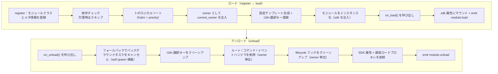
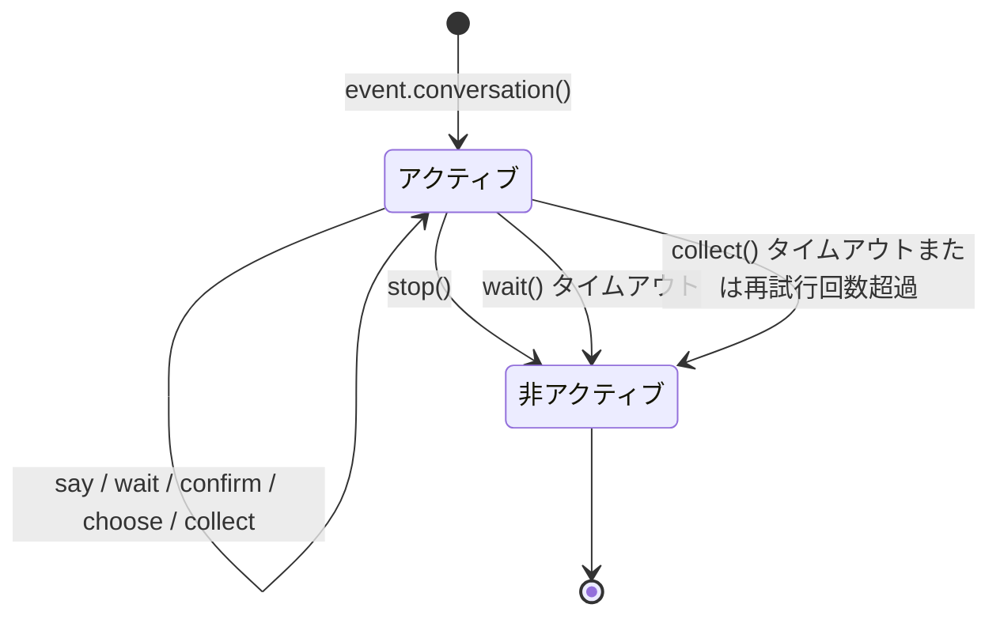

# ErisPulse 模块开发

This skill is auto-built from the ErisPulse documentation.
Repository: https://github.com/ErisPulse/ErisPulse
Source paths are annotated per section; see docs/ in the repository for the latest content.

## 模块开发入门

> 来源: `docs/ja/developer-guide/modules/getting-started.md`（https://github.com/ErisPulse/ErisPulse/blob/main/docs/ja/developer-guide/modules/getting-started.md）

# モジュール開発入門

> [!NOTE]
> **L1 コア必読**——トップページの「学習パス」に含まれる5本のコアドキュメントの1つで、モジュール開発に必須です。


このドキュメントに沿って進めると、`/hello` コマンドに応答できる実行可能なモジュールが完成し、モジュールのプロジェクト構造、登録方法、ロード/アンロードフックについても理解できるようになります。以降のすべてのモジュールドキュメントは、この骨組みの上に成り立っています。

## プロジェクト構造

標準的なモジュール構造：

```
MyModule/
├── pyproject.toml
├── README.md
├── LICENSE
└── MyModule/
    ├── __init__.py
    └── Core.py
```

## pyproject.toml 設定

```toml
[project]
name = "ErisPulse-MyModule"
version = "1.0.0"
description = "モジュール機能の説明"
readme = "README.md"
requires-python = ">=3.10"
license = { file = "LICENSE" }
authors = [ { name = "yourname", email = "your@mail.com" } ]
dependencies = []

[project.urls]
"homepage" = "https://github.com/yourname/MyModule"

[project.entry-points."erispulse.module"]
"MyModule" = "MyModule:Main"
```

## __init__.py

```python
from .Core import Main
```

## Core.py - 基本モジュール

```python
from ErisPulse import sdk
# ルートインポート推奨（2.10+）：よく使うシンボルはルートパッケージから直接インポートでき、深いパスも引き続き互換
from ErisPulse import BaseModule, command

class Main(BaseModule):
    def __init__(self, sdk):
        self.sdk = sdk
        self.logger = sdk.logger.get_child("MyModule")
        self.storage = sdk.storage
    
    @staticmethod
    def get_load_strategy():
        """モジュールのロード戦略を返します"""
        from ErisPulse.loaders import ModuleLoadStrategy
        return ModuleLoadStrategy(
            lazy_load=True,
            priority=0,
            depends=[],  # 任意：依存する他のモジュールのリスト
            # 任意：イベント駆動の遅延アクティベーション——トリガーを宣言すると、最初に一致するイベント/コマンドが到着した時点で自動ロードされます
            # activate_on=[{"command": {"name": "hello", "help": "挨拶を送る"}}],
        )
    
    async def on_load(self, event):
        """モジュールのロード時に呼び出されます"""
        @command("hello", help="挨拶を送る")
        async def hello_command(event):
            name = event.get_user_nickname() or "友達"
            await event.reply(f"こんにちは、{name}さん！")
        
        self.logger.info("モジュールがロードされました")
    
    async def on_unload(self, event):
        """モジュールのアンロード時に呼び出されます"""
        self.logger.info("モジュールがアンロードされました")
```

> **設定の読み取り**：上記の基本例では設定を使用していません。設定を読み取る必要がある場合は、ネストした `ConfigClass` を宣言し、`self.cfg` 経由でリアルタイムに読み取る方法が推奨されます（[モジュールのコアコンセプト](core-concepts.md#宣言的設定の推奨) を参照）。`_load_config()` を手動で呼び出す旧来の書き方は非推奨（廃止予定）です。

## モジュールのテスト

### ローカルテスト

```bash
# プロジェクトディレクトリでモジュールをインストール
epsdk install ./MyModule

# プロジェクトを実行
epsdk run main.py --reload
```

### コマンドのテスト

コマンドを送信してテストします：

```
/hello
```

## コアコンセプト

### BaseModule 基底クラス

すべてのモジュールは `BaseModule` を継承する必要があり、以下のメソッドを提供します：

| メソッド | 説明 | 必須 |
|------|------|------|
| `__init__(self, sdk)` | コンストラクタ（フレームワークが `sdk` インスタンスを渡します） | いいえ |
| `get_load_strategy()` | ロード戦略を返します | いいえ |
| `get_meta()` | モジュール紹介のメタ情報を返します（任意） | いいえ |
| `on_load(self, event)` | モジュールのロード時に呼び出されます | はい |
| `on_unload(self, event)` | モジュールのアンロード時に呼び出されます | はい |

### モジュール紹介 meta

> [!NOTE]
> この機能には ErisPulse **2.8.0+** が必要です。

`get_meta()` を通じて、モジュールの紹介メタ情報（このモジュールが何をするものか、どのカテゴリに属するかなど）を宣言します。
メタ情報はモジュールの**汎用的な紹介データ**であり、help モジュール、Dashboard のモジュール一覧、モジュールストアなど、各種インターフェース/エコシステムモジュールから利用されます。

`get_load_strategy()` が `ModuleLoadStrategy` を返すのと同様に、**`ModuleMeta` 設定クラスのインスタンスを返すことが推奨されます**（属性の型付け、IDE 補完のメリットがあります）。dict を直接返すことにも対応しています：

```python
class MyModule(BaseModule):
    @staticmethod
    def get_meta() -> ModuleMeta:
        return ModuleMeta(
            name="天気",               # 表示名（デフォルトの登録名）
            description="都市の天気を照会",  # モジュールの概要
            version="1.0.0",
            author="ErisDev",
            group="ツール",               # 機能グループ
            tags=["天気", "照会"],
        )
```

互換書式（dict）：

```python
class MyModule(BaseModule):
    @staticmethod
    def get_meta() -> dict:
        return {
            "name": "天気",
            "description": "都市の天気を照会",
            "version": "1.0.0",
            "author": "ErisDev",
            "group": "ツール",
            "tags": ["天気", "照会"],
        }
```

- `module.get_meta("MyModule")` は解決済みのメタ情報を読み取ります（クラス宣言 > 登録 info の優先順位で、当該モジュールのコマンド名が自動補完されます）。
- `module.get_commands_overview()` は「モジュール meta + 登録済みコマンド（エイリアス/グループ/ヘルプ）」を集約した、モジュールごとに整理されたコマンドの一覧を提供します。
- コマンドの所属モジュールは `cmd_info["owner"]` で取得できます（登録時にコンテキストシステムが自動的に注入します）。

#### meta フィールドの i18n サポート

メタ情報のフィールド値には、プレーンな文字列、または i18n 辞書 `{"i18n": "key.path", "default": "フォールバックテキスト"}`（設定の `description` と同じ規約）が使えます。
翻訳キーは `I18nClass` で宣言して登録し、`module.get_meta()` が読み取る際に現在の言語のテキストへ自動的に解決されます：

```python
class MyModule(BaseModule):
    class I18nClass(BaseI18n):
        meta_description: I18nKey = I18nKey(
            default="Weather lookup",
            zh_CN="都市の天気を照会",
            en="Weather lookup",
        )

    @staticmethod
    def get_meta() -> ModuleMeta:
        return ModuleMeta(
            name="天気",
            description={"i18n": "MyModule.meta_description", "default": "Weather lookup"},
        )
```

### SDK オブジェクト

`sdk` オブジェクトを通じてコア機能にアクセスします：

```python
from ErisPulse import sdk

sdk.storage    # ストレージシステム
sdk.config     # 設定システム
sdk.logger     # ログシステム
sdk.adapter    # アダプターシステム
sdk.router     # ルーティングシステム
sdk.lifecycle  # ライフサイクルシステム
```

## 次のステップ

### 学習パスの続き

- [モジュールのコアコンセプト](core-concepts.md) - モジュールアーキテクチャを深く理解する
- [Event ラッパークラス詳解](event-wrapper.md) - Event オブジェクトを学ぶ

### 実装完了後

- [モジュールのベストプラクティス](best-practices.md) - 高品質なモジュールを開発する

## 模块核心概念

> 来源: `docs/ja/developer-guide/modules/core-concepts.md`（https://github.com/ErisPulse/ErisPulse/blob/main/docs/ja/developer-guide/modules/core-concepts.md）

# モジュールのコア概念

> [!NOTE]
> **L1 コア必読**——トップページの「学習パス」にある 5 本のコアドキュメントの 1 つで、モジュール開発に必須です。


このドキュメントでは、モジュールのロードからアンロードまでの完全なライフサイクル、宣言的設定とストレージの使い方を解説します。フレームワークが自動で行うことは何で、自分で書くべきことは何か——読み終えれば全体がつかめます。

## モジュールのライフサイクル

### ロード戦略

```python
from ErisPulse.Core.Bases import BaseModule
from ErisPulse.loaders import ModuleLoadStrategy

class MyModule(BaseModule):
    @staticmethod
    def get_load_strategy():
        """モジュールのロード戦略を返します"""
        return ModuleLoadStrategy(
            lazy_load=True,   # 遅延ロードするか即時ロードするか
            priority=0,       # ロード優先度（数値が大きいほど先にロードされる）
            depends=["OtherModule"]  # 任意：依存する他のモジュールを宣言
        )
```

> `depends` で宣言されたモジュールが未登録の場合、現在のモジュールはスキップされ、警告が記録されます。ロード順序はトポロジカルソートで決定され、同一階層内では `priority` の降順に従います。

> [!NOTE]
> **カスケードアンロード / カスケードリロード**（ErisPulse **2.8.0+**）：他のモジュールから依存されているモジュールをアンロードすると、それに依存するモジュールが**先にカスケードアンロードされます**（ログにカスケードチェーンが記録されます）。任意のモジュール（ローカルプラグイン / ランタイム登録 / PyPI インストールパッケージ）をホットリロードする際も、それに依存するモジュールは同様に**カスケードリロード**され、依存モジュールが無効になったインスタンス参照を保持したまま動作し続けることを防ぎます。循環依存を宣言している場合は、ロード時に `RuntimeError` で拒否されます。
>
> **reload は全量リロード**（ErisPulse **2.11.0+**）：`reload()` はデフォルトでトップレベルパッケージ名に基づいて import キャッシュをクリーンアップし、依存モジュールのコードを再インポートします。アンロード前に自動的に構文プレチェックを行い（失敗時はアンロードを拒否し、旧インスタンスがサービスを継続）、成功後はコードの同一性を検証します（偽リロードの警告 / `stale` マーク）。load 失敗時の状況は `sdk.module.last_error(名前)` で直接照会できます（traceback を含む）。

### on_load メソッド

モジュールのロード時に呼び出され、リソースの初期化とイベントハンドラの登録を行います：

```python
async def on_load(self, event):
    # イベントハンドラを登録
    @command("hello", help="挨拶コマンド")
    async def hello_handler(event):
        await event.reply("こんにちは！")
    
    # SDK 内蔵 HTTP クライアントを使用（接続プールは自動管理、session を手動で作成する必要なし）
    # sdk.client 経由でリクエストを送信できます
```

### on_unload メソッド

モジュールのアンロード時に呼び出され、リソースのクリーンアップを行います：

```python
async def on_unload(self, event):
    # カスタムリソースをクリーンアップ
    # sdk.client はフレームワークが管理するため、手動でクローズする必要なし
    
    # イベントハンドラの解除（フレームワークが自動的に処理）
    self.logger.info("モジュールがアンロードされました")
```

> バックグラウンドタスクの作成とクリーンアップ（`self.spawn()` / フレームワークによるフォールバックキャンセル）の詳細は、[ライフサイクル管理](../../advanced/lifecycle.md#バックグラウンドタスクの帰属と自動キャンセル) を参照してください。

### on_before_unload メソッド

> [!NOTE]
> このフックには ErisPulse **2.11.0+** が必要です。

アンロードパイプラインの**最初のステップ**（`on_unload` およびリソース回収の前に実行）でトリガーされるオプションのフックです。この時点ではモジュールのリソースはすべて無傷のため、アンロード / 休眠 / リロードの前に状態を `sdk.storage` に保存し、次回の `on_load` で復元するのに適しています（遅延ロードによる休眠状態の引き継ぎはまさにこれに基づいています）：

```python
async def on_before_unload(self, event):
    # event["reason"] は呼び出しの理由を示します：unload / reload / disable / cascade / dormant
    if event["reason"] in ("reload", "dormant"):
        await self.sdk.storage.aset(f"{self._module_name}:state", self.collect_state())
```

フックが失敗した場合は警告が出るだけで、アンロードの流れはブロックされません。このフックを宣言していないモジュールの動作は変わりません。休眠 / 復帰のセマンティクスの詳細は、[遅延ロード休眠](../../advanced/lazy-loading.md#遅延ロード休眠dormant_after) を参照してください。

### アンロードと完全アンロード（purge）

> [!NOTE]
> この機能には ErisPulse **2.8.0+** が必要です。

`unload()` はデフォルトでは**ロード解除**のみを行い（インスタンスとリソースをアンロード）、登録スタブ（モジュールクラスとメタ情報）を保持します。モジュールは引き続き discover で再発見でき、`load()` で再インスタンス化でき、再度 `register()` する必要はありません。

**完全アンロード**（モジュールクラスへの参照を解放し、`sys.modules` をクリーンアップして、プラグインとその専用依存関係を GC で回収可能にする）が必要な場合は、`purge=True` を渡します：

```python
# ロード解除のみ：登録スタブを保持し、いつでも再ロード（load()）可能
await sdk.module.unload("MyModule")

# 完全アンロード：登録スタブの削除 + sys.modules のクリーンアップ（プラグインソース）
await sdk.module.unload("MyModule", purge=True)
```

| セマンティクス | `unload()` デフォルト | `unload(purge=True)` |
|------|-----------------|----------------------|
| インスタンスとリソースのアンロード（イベント/task/ルート/lifecycle/i18n） | ✅ | ✅ |
| 登録スタブの保持（モジュールクラスとメタ情報） | ✅ | ❌ 削除 |
| `sys.modules` のクリーンアップ（プラグインフォルダソースのみ） | ❌ | ✅ |
| モジュールクラスが GC で回収可能 | ❌ | ✅ |
| 再ロード | `load()` で直接可能 | 先に `register()` + `load()` が必要 |

> `purge=True` の場合、カスケードアンロードされる依存モジュールも同様に purge されます。アンロード後、フレームワークは `gc.collect()` を実行し、モジュールクラス/インスタンスが回収可能かどうかを確認します。残存参照がある場合はログに警告が出力されます（参照元を含む、DEBUG レベル）。

### ライフサイクルの全体像

上記のメソッドをつなぎ合わせると、フレームワークがモジュールのロード・アンロード時に**裏で行ってくれるすべての処理**は次のようになります：



**ロード時にフレームワークが行ってくれること**（`on_load` を書くだけで、残りは自動的に完了します）：

| ステップ | フレームワークが自動で行うこと |
|------|-------------|
| owner 注入 | インスタンス化の間、モジュール名を `owner_scope` でラップします——`on_load` 内で登録したコマンド/イベント/フック/バックグラウンドタスクは**自動的にこのモジュールに帰属**し、アンロード時には owner 単位で一括クリーンアップできます |
| 設定テンプレート | `ConfigClass` を宣言したモジュールでは、フレームワークが自動で `ErisPulse.<ModuleName>` 設定セクションを生成/入力します |
| i18n 翻訳キー | `I18nClass` を宣言したモジュールでは、翻訳キーが自動登録されます（アンロード時に自動解除） |
| 依存トポロジ | `depends` の宣言に基づいてソートし、依存されるモジュールが先にロードされることを保証します。循環依存は `RuntimeError` で拒否されます |
| SDK マウント | インスタンス化後に `sdk.<ModuleName>` にマウントされるため、`sdk.MyModule.xxx` でアクセスできます |

**アンロード時にフレームワークがクリーンアップしてくれるもの**（上の U1→U7 に対応）：`on_unload` の実行後にフォールバックとしてクリーンアップを行います——バックグラウンドタスクの強制キャンセル（`self.spawn` で作成されたもの。グレースフルな終了処理は `on_unload` 内で自身で行ってください）、i18n キー、ルート、コマンド/イベントハンドラ、lifecycle フック、そして最後に SDK 属性の削除です。`purge=True` の場合はさらに登録スタブの削除 + `sys.modules` のクリーンアップが行われます。

> これらの自動クリーンアップこそが、「`on_load`/`on_unload` だけ書けば手動で unregister する必要がない」という安心感の根拠です——フレームワークは owner 帰属の仕組みによって、「登録した者がクリーンアップする」をワンステップで実現しています。

## SDK オブジェクト

### コアモジュールへのアクセス

```python
from ErisPulse import sdk

# sdk オブジェクトを通じてすべてのコアモジュールにアクセス
sdk.logger.info("ログ")
sdk.storage.set("key", "value")
config = sdk.config.getConfig("MyModule")
```

### モジュール間通信

```python
# 他のモジュールにアクセス
other_module = sdk.OtherModule
result = await other_module.some_method()
```

## アダプターの送信メソッド照会

新しい標準仕様では、フォールバック送信メカニズムを実現するために `__getattr__` メソッドをオーバーライドすることが求められるため、`hasattr` メソッドを使ってメソッドの存在を確認することができなくなりました。`2.3.5` 以降、送信メソッドを照会する機能が新たに追加されました。

### サポートされている送信メソッドの一覧

```python
# プラットフォームがサポートするすべての送信メソッドを一覧表示
methods = sdk.adapter.list_sends("onebot11")
# 戻り値: ["Text", "Image", "Voice", "Markdown", ...]
```

### メソッドの詳細情報の取得

```python
# 特定のメソッドの詳細情報を取得
info = sdk.adapter.send_info("onebot11", "Text")
# 戻り値:
# {
#     "name": "Text",
#     "parameters": [
#         {"name": "text", "type": "str", "default": null, "annotation": "str"}
#     ],
#     "return_type": "Awaitable[Any]",
#     "docstring": "テキストメッセージを送信します..."
# }
```

## 設定管理

### 宣言的設定（推奨）

v2.5.2 以降、モジュールは `ConfigClass` で設定クラスを宣言でき、アダプターと同一の設定 Schema システムを使用します。設定は `self.cfg` を通じてリアルタイムに読み取られ、変更は直ちに反映されます：

```python
from dataclasses import dataclass, field
from ErisPulse.Core.Bases import BaseModule
from ErisPulse.Core.Bases import BaseConfig

@dataclass
class MyModuleConfig(BaseConfig):
    api_key: str = field(
        default="",
        metadata={
            "description": {"i18n": "my_module.api_key", "default": "API キー"},
            "required": True,
            "secret": True,
            "ui": {"widget": "password", "group": "basic", "order": 1},
        },
    )
    timeout: int = field(
        default=30,
        metadata={
            "description": {"i18n": "my_module.timeout", "default": "タイムアウト（秒）"},
            "ui": {"widget": "number", "group": "advanced", "order": 2},
        },
    )

class MyModule(BaseModule):
    ConfigClass = MyModuleConfig

    def __init__(self, sdk):
        self.sdk = sdk
        self.logger = sdk.logger.get_child("MyModule")

    async def on_load(self, event):
        self.logger.info("モジュールがロードされました")

    async def on_unload(self, event):
        pass

    async def do_something(self):
        cfg = self.cfg  # リアルタイムに読み取り、型安全
        api_key = cfg.api_key
        timeout = cfg.timeout
```

`BaseConfig` は汎用の設定基底クラスで、アダプター、モジュール、外部プロジェクトなどあらゆるシーンに適用できます。設定フィールドは i18n による多言語説明をサポートしています（詳細は [i18n ドキュメント](../../advanced/i18n.md#設定フィールドの多言語) を参照）。

> [!NOTE]
> モジュール（アダプターを含む）のロード、アンロード、起動・停止などのライフサイクルはフレームワークが一元管理します（`module manager` / `scope` が照会・制御 API を提供します）。`ConfigClass` はビジネスパラメータのみを担うべきであり、モジュール内部で「自分を起動すべきかどうか」を再度ネストして判断するロジックは不要です。

設定 Schema システムはさらに以下もサポートしています（v2.8.0+。詳細は [アダプター core-concepts](../adapters/core-concepts.md#metadata-規約) を参照）：

- **docstring によるフィールド説明の自動生成**：metadata `description` が宣言されていない場合、docstring の `:ivar フィールド: 説明` または `Attributes:` セクションから自動的にフォールバック抽出します
- **ネスト dataclass 設定**：フィールド型がネスト dataclass の場合、schema/テンプレート/バリデーションが再帰的に処理され、WebUI ではネストされたグループとしてレンダリングされます
- **`example` 非永続化フィールド**：`metadata={"example": True}` のフィールドは config.toml に書き込まれず、`config.full.example` にのみ記録されます（冗長でほとんど変更しない高度な設定項目に適しています）。ユーザーが手動で設定した後は通常どおり永続化されます

### 宣言的翻訳キー（v2.7.0+）

v2.7.0 以降、モジュールは `ConfigClass` を宣言するのと同様に、ネストクラス `I18nClass` によって翻訳キーを一元的に宣言できます。フレームワークはロード時に宣言されたすべての翻訳キーを**自動登録**するため、`i18n.register()` を手動で呼び出す必要はありません。また、登録のタイミングは設定テンプレートの生成より前であるため、設定の説明で参照される i18n キーが確実に利用可能です。

```python
from ErisPulse.Core.Bases import BaseConfig, BaseI18n, I18nKey

class MyModule(BaseModule):
    # 設定クラス（任意）
    @dataclass
    class ConfigClass(BaseConfig):
        welcome_msg: str = field(
            default="ようこそ",
            metadata={
                "description": {"i18n": "mymodule.welcome_msg", "default": "ようこそメッセージ"},
            },
        )

    # 翻訳キーコレクションクラス（任意）
    class I18nClass(BaseI18n):
        # 属性名から完全なキーパスが自動的に構築されます：<モジュール名>.<属性名>
        welcome_msg: I18nKey = I18nKey(
            default="Welcome Message",   # 言語に依存しないフォールバック
            zh_CN="ようこそメッセージ",
            zh_TW="歡迎訊息",
            en="Welcome Message",
            ja="ウェルカムメッセージ",
            ru="Приветственное сообщение",
        )
        hello: I18nKey = I18nKey(
            default="Hello, {name}!",
            zh_CN="こんにちは、{name}！",
            zh_TW="你好，{name}！",
            en="Hello, {name}!",
            ja="こんにちは、{name}！",
            ru="Привет, {name}!",
        )
```

詳細は [i18n 推奨記法](../../advanced/i18n.md#推奨記法i18nclassによる翻訳キーの宣言-v270) を参照してください。

### 手動での設定読み取り（非推奨）

> **非推奨**：代わりに [宣言的設定](#宣言的設定推奨) と `self.cfg` によるリアルタイム読み取りを使用してください。

```python
class MyModule(BaseModule):
    def __init__(self, sdk):
        self.sdk = sdk

    def _load_config(self):
        config = self.sdk.config.getConfig("MyModule")
        if not config:
            self.sdk.config.setConfig("MyModule", {"api_key": "", "timeout": 30})
            return {"api_key": "", "timeout": 30}
        return config
```

## ストレージシステム

### 基本的な使い方

```python
# データを保存
sdk.storage.set("user:123", {"name": "山田太郎"})

# データを取得
user = sdk.storage.get("user:123", {})

# データを削除
sdk.storage.delete("user:123")
```

### トランザクションの使い方

```python
# トランザクションを使用してデータの一貫性を確保
with sdk.storage.transaction():
    sdk.storage.set("key1", "value1")
    sdk.storage.set("key2", "value2")
    # いずれかの操作が失敗した場合、すべての変更がロールバックされます
```

## イベント処理

### イベントハンドラの登録

```python
from ErisPulse.Core.Event import command, message

# コマンドを登録
@command("info", help="情報を取得")
async def info_handler(event):
    await event.reply("これは情報です")

# メッセージハンドラを登録
@message.on_group_message()
async def group_handler(event):
    sdk.logger.info(f"グループメッセージを受信: {event.get_text()}")
```

### イベントハンドラのライフサイクル

フレームワークがイベントハンドラの登録と解除を自動的に管理するため、`on_load` 内で登録するだけで済みます。

## 遅延ロード機構

### 動作原理

```python
# モジュールは初回アクセス時にのみ初期化されます
result = await sdk.my_module.some_method()
# ↑ ここでモジュールの初期化がトリガーされます
```

### 即時ロード

即時初期化が必要なモジュール（リスナー、タイマーなど）の場合：

```python
@staticmethod
def get_load_strategy():
    return ModuleLoadStrategy(
        lazy_load=False,  # 即時ロード
        priority=100
    )
```

## エラー処理

### 例外の捕捉

```python
async def handle_event(self, event):
    try:
        # ビジネスロジック
        await self.process_event(event)
    except ValueError as e:
        self.logger.warning(f"パラメータエラー: {e}")
        await event.reply(f"パラメータエラー: {e}")
    except Exception as e:
        self.logger.error(f"処理に失敗しました: {e}")
        raise
```

### ログ出力

```python
# 異なるログレベルを使用
self.logger.debug("デバッグ情報")    # 詳細なデバッグ情報
self.logger.info("実行状態")      # 通常の実行情報
self.logger.warning("警告情報")  # 警告情報
self.logger.error("エラー情報")    # エラー情報
self.logger.critical("致命的エラー") # 致命的エラー
```

## 関連ドキュメント

### 学習パスを続ける

- [Event ラッパークラス](event-wrapper.md) - イベント処理の詳細

### 深掘りとトラブルシューティング

- [モジュールのベストプラクティス](best-practices.md) - 高品質なモジュールを開発する
- [モジュール開発入門](getting-started.md) - 最初のモジュールの構築手順をおさらいする

## Event 包装类

> 来源: `docs/ja/developer-guide/modules/event-wrapper.md`（https://github.com/ErisPulse/ErisPulse/blob/main/docs/ja/developer-guide/modules/event-wrapper.md）

# Event ラッパークラス詳解

> [!NOTE]
> **L1 コア必読**——トップページの「学習パス」に含まれる5つのコアドキュメントの1つで、モジュール開発に必須です。


ハンドラー内の `event` パラメータが直接 `.get_text()` / `.reply()` / `.wait_reply()` を呼び出せるのは、Event ラッパークラスのおかげです。本ドキュメントはその完全なメソッド一覧です——イベントハンドラーを書く際に必要に応じて参照してください。メソッドのシグネチャと動作は、ここに記載の内容が正となります。

## event パラメータに型注釈を追加する

イベントハンドラの `event` パラメータは **Event 包装クラス**（dict のサブクラス）です。このパラメータに型注釈を付けることを強く推奨します：

```python
from ErisPulse.Core.Event import Event

@message.on_private_message()
async def handler(event: Event):
    text = event.get_text()   # IDE が便利なメソッドをすべて自動補完
    await event.reply(text)   # 静的チェック時に誤字が発見される
```

型注釈を付けない場合、IDE は Event 上のメソッド（`get_text()` / `reply()` / `wait_reply()` / プラットフォーム拡張メソッドなど）を認識できず、すべて手動で記憶して入力する必要があります。

> **注意**：イベントハンドラのコールバックの `event` は **Event 包装クラス**（注釈は `Event`）です。一方、モジュールのライフサイクルメソッド `on_load` / `on_unload` の `event` は普通の **dict**（注釈は `dict`）です。これらは混同しないでください。

## 核心特性

- **完全互換性**：Event は dict を継承しています
- **便利なメソッド**：多数の便利なメソッドを提供しています
- **プロパティアクセス**：イベントフィールドにドット演算子でアクセスできます
- **後方互換性**：すべてのメソッドはオプションです

## 核心フィールドメソッド

```python
from ErisPulse.Core.Event import command

@command("info")
async def info_command(event: Event):
    event_id = event.get_id()
    platform = event.get_platform()
    time = event.get_time()
    print(f"ID: {event_id}, プラットフォーム: {platform}, 時間: {time}")
```

## メッセージイベントメソッド

```python
from ErisPulse.Core.Event import message

@message.on_private_message()
async def private_handler(event: Event):
    text = event.get_text()
    user_id = event.get_user_id()
    nickname = event.get_user_nickname()
    await event.reply(f"こんにちは、{nickname}！")
```

## メッセージタイプの判断

```python
from ErisPulse.Core.Event import message

@message.on_group_message()
async def group_handler(event: Event):
    is_private = event.is_private_message()
    is_group = event.is_group_message()
    is_at = event.is_at_message()
    await event.reply(f"タイプ: {'プライベートチャット' if is_private else 'グループチャット'}")
```

## 回答機能

```python
from ErisPulse.Core.Event import command

@command("ask")
async def ask_command(event: Event):
    await event.reply("あなたの名前を入力してください:")
    reply = await event.wait_reply(timeout=30)
    if reply:
        name = reply.get_text()
        await event.reply(f"こんにちは、{name}！")

@command("price")
async def price_command(event: Event):
    await event.reply("金額を入力してください（例：5元）:")
    # 回答が正規表現に一致しない場合、タイムアウトするまで待機し続ける
    reply = await event.wait_reply(timeout=30, regex=r"\d+\s*元")
    if reply:
        await event.reply(f"金額を受け取りました: {reply.get_text()}")
```

## インタラクティブな会話の高度な機能

> [!NOTE]
> 本機能は ErisPulse **2.8.0+** が必要です。

```python
# 会話の定期的なリマインダー：5 分間返信がない場合にリマインダーを送信し、ユーザーが返信すると自動的にキャンセル
reminder = event.remind(300, "まだですか？話したくない場合は「退出」を入力してください")
reminder.cancel()  # 手動でキャンセルすることも可能です

# タイムアウトによる昇格：時間経過後に必ず通知（返信によってキャンセルされない）、例えば長時間未処理の通知を主人に通知
event.escalate(1800, lambda e: notify_master("工単がタイムアウトしました"))

# 複数ルートの待機：「同意」および「拒否」のいずれかを同時に待機し、先に到着したものを優先
which, reply = await event.select(
    event.expect(pattern="同意*", user="10001"),
    event.expect(pattern="拒绝*", user="10002"),
    timeout=60,
)
if which is None:
    await event.reply("承認がタイムアウトしました")

# 会話レベルの待機：同じグループ内の誰からの返信でも対象になります（グループ協力）
reply = await event.wait_reply(session=True, prompt="誰か回答していただけますか？")

# 会話の受信箱：現在の会話における最新の 20 件のメッセージ（ロボット、AI のコンテキスト / リピート防止の基盤を含む）
messages = await event.history(20)

# メッセージトランザクション：例外が発生した場合、トランザクション内で送信されたメッセージを自動的に撤回
async with event.message_tx():
    await event.reply("処理中です、少々お待ちください...")
    result = await do_something()
    await event.reply(f"完了：{result}")
```

## コマンド情報の取得

```python
from ErisPulse.Core.Event import command

@command("cmdinfo")
async def cmdinfo_command(event: Event):
    cmd_name = event.get_command_name()
    cmd_args = event.get_command_args()
    await event.reply(f"コマンド: {cmd_name}, 引数: {cmd_args}")
```

## 通知イベントメソッド

```python
from ErisPulse.Core.Event import notice

@notice.on_friend_add()
async def friend_add_handler(event: Event):
    await event.reply("友達追加してくれてありがとう！")
```

## 方法速查表

### 核心方法

#### 事件基础信息
- `get_id()` - イベントIDを取得
- `get_time()` - イベントのタイムスタンプ（Unix秒単位）を取得
- `get_type()` - イベントのタイプ（message/notice/request/meta）を取得
- `get_detail_type()` - イベントの詳細タイプ（private/group/friend等）を取得
- `get_platform()` - プラットフォーム名を取得

#### ロボット情報
- `get_self_platform()` - ロボットのプラットフォーム名を取得
- `get_self_user_id()` - ロボットのユーザーIDを取得
- `get_self_account_id()` - ロボットのアカウントID（複数Botモード）を取得
- `get_self_info()` - ロボットの完全な情報辞書を取得

#### 会話識別子
- `get_target_id()` - 統一されたターゲットIDを取得（グループチャットは `group_id`、チャンネルは `channel_id`、プライベートチャットは `user_id` を返す。group → channel → guild → thread → userの順に最初の非空値を返す）
- `get_session_id()` - セッションの唯一の識別子を取得、形式は `{platform}:{detail_type}:{target_id}`

### メッセージイベントメソッド

#### メッセージ内容
- `get_message()` - メッセージセグメントの配列を取得（OneBot12形式）
- `get_alt_message()` - メッセージの代替テキストを取得
- `get_text()` - 純粋なテキスト内容を取得（`get_alt_message()`のエイリアス）
- `get_message_text()` - 純粋なテキスト内容を取得（`get_alt_message()`のエイリアス）

#### 送信者情報
- `get_user_id()` - 送信者のユーザーIDを取得
- `get_user_nickname()` - 送信者のニックネームを取得
- `get_sender()` - 送信者の完全な情報辞書を取得

#### グループ/チャンネル情報
- `get_group_id()` - グループIDを取得（グループメッセージ）
- `get_channel_id()` - チャンネルIDを取得（チャンネルメッセージ）
- `get_guild_id()` - サーバーIDを取得（サーバーメッセージ）
- `get_thread_id()` - トピック/サブチャンネルIDを取得（トピックメッセージ）

#### @メッセージ関連
- `has_mention()` - @ロボットが含まれているか
- `get_mentions()` - すべての@されたユーザーIDのリストを取得

### メッセージタイプ判断

#### 基礎判断
- `is_message()` - メッセージイベントであるか
- `is_private_message()` - プライベートチャットメッセージか
- `is_group_message()` - グループチャットメッセージか
- `is_at_message()` - @メッセージか（`has_mention()`のエイリアス）

### 通知イベントメソッド

#### 通知操作者
- `get_operator_id()` - 操作者のIDを取得
- `get_operator_nickname()` - 操作者のニックネームを取得

#### 通知タイプ判断
- `is_notice()` - 通知イベントであるか
- `is_group_member_increase()` - グループメンバー増加イベント
- `is_group_member_decrease()` - グループメンバー減少イベント
- `is_friend_add()` - 友達追加イベント（`detail_type == "friend_increase"`に一致）
- `is_friend_delete()` - 友達削除イベント（`detail_type == "friend_decrease"`に一致）

### 要求イベントメソッド

#### 要求情報
- `get_comment()` - 要求の付言を取得

#### 要求タイプ判断
- `is_request()` - 要求イベントであるか
- `is_friend_request()` - 友達要求か
- `is_group_request()` - グループ要求か

### 返信機能

#### 基礎返信
- `reply(content, method="Text", at_sender=False, quote=False, at_users=None, reply_to=None, at_all=False, via=None, **kwargs)` - 一般的な返信メソッド
  - `content`: 送信内容（テキスト、URLなど）
  - `method`: 送信方法、デフォルトは "Text"、"Image"/"Voice"/"Video"/"File" など
  - `at_sender`: 送信者を@するか（自動的に user_id を抽出）
  - `quote`: 現在のメッセージを引用して返信するか（自動的に message_id を抽出）
  - `at_users`: @するユーザーIDのリスト、例: `["user1", "user2"]`
  - `reply_to`: 手動で返信するメッセージIDを指定
  - `at_all`: 全員を@するか
  - `**kwargs`: 余分なパラメータ（例: Mentionメソッドの user_id）

- `reply_ob12(message)` - OneBot12メッセージセグメントを使って返信
  - `message`: OneBot12メッセージセグメントのリストまたは辞書、MessageBuilderを使って構築

#### プラットフォーム機能の確認
- `supports(method)` - 現在のプラットフォームが特定の送信方法（例: `"Image"`、`"Voice"`）をサポートしているか確認、`bool`を返す
- `available_methods()` - 現在のプラットフォームで利用可能な送信方法の一覧を取得、メソッド名のリストを返す

#### 転送機能

> **注意**: 転送機能はアダプターのSend DSLによって実装される必要があり、Eventラッパークラス自体は直接の転送メソッドを提供しない。

```python
# メッセージをグループに転送
adapter = sdk.adapter.get(event.get_platform())
target_id = event.get_group_id()  # または他のグループIDを指定
await adapter.Send.To("group", target_id).Text(event.get_text())
```

### 返信待ち機能

- `wait_reply(prompt=None, timeout=60.0, callback=None, validator=None, method="Text", pattern=None, regex=None)` - ユーザーからの返信を待つ
  - `prompt`: プロンプトメッセージ、提供された場合ユーザーに送信される
  - `timeout`: 待ち時間のタイムアウト（秒）、デフォルトは60秒
  - `callback`: 返信を受け取ったときに実行されるコールバック関数
  - `validator`: 返信が有効かどうかを検証する関数
  - `method`: プロンプトメッセージの送信方法、デフォルトは "Text"
  - `pattern`: globワイルドカード（`*` / `?` / `[seq]`）、返信テキストが一致する必要がある、一致しない場合は待機を続ける
  - `regex`: 正規表現、返信テキストが一致する必要がある（`pattern` と `regex` のどちらか一方を選択）、一致しない場合は待機を続ける
  - ユーザーの返信のEventオブジェクトを返す、タイムアウト時は`None`を返す

#### 交互メソッド

- `confirm(prompt=None, timeout=60.0, yes_words=None, no_words=None, method="Text", hint=False)` - 確認対話
  - `True`（確認）/ `False`（否定）/ `None`（タイムアウト）を返す
  - 内部的に中英語の確認語を自動認識し、カスタム語集を指定可能
  - `method`: 送信方法、デフォルトは "Text"、"Image"/"Markdown" などの非テキスト方式もサポート
  - `hint`: プロンプトの末尾に自動的に確認語のヒント（例: "（はい/いいえ）"）を追加するか、デフォルトは`False`

- `choose(prompt, options, timeout=60.0, method="Text", options_format="auto", merge_prompt=False, placeholder="{options}")` - 選択メニュー
  - `options`: 選択肢のテキストリスト
  - 選択肢のインデックス（0ベース）を返す、タイムアウト時は`None`を返す
  - `method`: 送信方法、デフォルトは "Text"、テキスト系メソッド (Text/Markdown/md/Html/h5) はデフォルトで選択肢を末尾にマージ
  - `options_format`: 選択肢のフォーマット（デフォルト: "auto"、methodに応じて自動的に組み込みスタイルを選択）
    - `"auto"`: Markdown→箇条書き（`- 1.選択肢`）、Html→順序付きリスト（`<ol>`）、その他の場合は純粋なテキストリスト
    - `"list"`: 各行に1つずつ、例: ``1. 選択肢A\n2. 選択肢B``
    - `"inline"`: 1行に表示、例: ``1.A | 2.B``
    - `"md"`: Markdownの箇条書き
    - `"html"`: Htmlの順序付きリスト
    - `callable`: 自作の関数、``list[str]``を受け取り``str``を返す
  - `merge_prompt`: 強制的に1つのメッセージにマージして送信するか、デフォルトは`False`
    - `False`（デフォルト）: テキスト系メソッドは自動的にマージ、非テキスト系メソッドはまずpromptを送信してからTextの選択肢を送信
    - `True`: どんなmethodでも1つのメッセージにマージしてユーザーが指定したmethodで送信
  - `placeholder`: 選択肢を挿入する占位符、デフォルトは`{options}`、promptにこのマーカーが含まれる場所に選択肢のテキストを置き換え、空文字に設定すると常に末尾に追加

- `collect(fields, timeout_per_field=60.0)` - フォーム収集
  - `fields`: フィールドのリスト、各項目には`key`、`prompt`、オプション`validator`、オプション`method`が含まれる
  - `{key: value}`の辞書を返す、いずれかのフィールドがタイムアウトすると`None`を返す
  - 各フィールドは`method`キーで送信方法を指定可能、例: 画像を収集する場合 ``{"key": "avatar", "prompt": "プロフィール画像を送ってください", "method": "Image"}``
  - 各フィールドは`options`キー（リスト）をオプションで提供可能、提供された場合、該当フィールドは選択問題になる（`choose`のロジックを自動的に呼び出す）
  - 各フィールドは`options_format`、`merge_prompt`、`placeholder`キーをオプションで提供可能、選択肢のフォーマット、メッセージのマージ動作、占位符を制御

- `wait_for(event_type="message", condition=None, timeout=60.0)` - 任意のイベントを待つ
  - `condition`: 条件関数、`True`を返した場合に一致する
  - 一致するEventオブジェクトを返す、タイムアウト時は`None`を返す

- `conversation(timeout=60.0)` - 複数回対話コンテキストを作成
  - `Conversation`オブジェクトを返す、`say()`/`wait()`/`confirm()`/`choose()`/`collect()`/`stop()`がサポートされる
  - `is_active`属性は対話がアクティブかどうかを示す

#### 交互メソッドの例

**confirm() - 確認対話:**

```python
@command("delete", help="データを削除")
async def delete_handler(event: Event):
    if await event.confirm("すべてのデータを削除してもよろしいですか？"):
        sdk.storage.delete("all_data")
        await event.reply("データを削除しました")
    else:
        await event.reply("キャンセルしました")
```

**confirm() - ヒント付き:**

```python
# hint=True はプロンプトの末尾に "（はい/いいえ）" を追加
if await event.confirm("続行してもよろしいですか？", hint=True):
    await event.reply("続行しました")
# ユーザーが表示する: 続行してもよろしいですか？（はい/いいえ）
```

**choose() - 選択メニュー:**

```python
@command("color", help="色を選択")
async def color_handler(event: Event):
    choice = await event.choose("色を選択してください：", ["赤", "緑", "青"])
    if choice is not None:
        colors = ["赤", "緑", "青"]
        await event.reply(f"選択した色は：{colors[choice]}")
```

**choose() - 選択肢のフォーマットとメッセージのマージ:**

```python
# inline形式：選択肢を1行に表示
choice = await event.choose("選択してください：", ["A", "B", "C"], options_format="inline")
# 出力: 1.A | 2.B | 3.C

# 自作のフォーマット
choice = await event.choose("選択してください：", ["猫", "犬"],
    options_format=lambda opts: " / ".join(opts))
# 出力: 猫 / 犬

# options_format="auto"（デフォルト）：methodに応じて自動的に組み込みスタイルを選択
# Markdown → 箇条書き
choice = await event.choose(
    "## 選択してください", ["猫", "犬"],
    method="Markdown",  # autoは自動的にmdリストを認識
)
# 出力:
# ## 選択してください
# - 1. 猫
# - 2. 犬

# Html → 順序付きリスト
choice = await event.choose(
    "<h2>選択してください</h2>", ["猫", "犬"],
    method="Html", merge_prompt=True,  # autoは自動的にhtmlリストを認識
)
# 出力:
# <h2>選択してください</h2>
# <ol><li>1. 猫</li><li>2. 犬</li></ol>

# マージモード + 占位符
choice = await event.choose(
    "## 選択してください\n{options}\n番号を返信してください",
    ["猫", "犬"],
    method="Markdown", merge_prompt=True,
)

# 自作の占位符
choice = await event.choose(
    "選択してください: [choices]",
    ["猫", "犬"],
    placeholder="[choices]",
)
```

**collect() - フォーム収集:**

```python
@command("register", help="登録")
async def register_handler(event: Event):
    data = await event.collect([
        {"key": "name", "prompt": "お名前を入力してください："},
        {"key": "age", "prompt": "年齢を入力してください：",
         "validator": lambda e: e.get_text().isdigit()},
    ])
    if data:
        await event.reply(f"登録完了！{data['name']}、{data['age']}歳")
```

**非テキストメソッドのreply:**

```python
await event.reply("http://example.com/img.jpg", method="Image")
await event.reply("http://example.com/audio.mp3", method="Voice")

from ErisPulse.Core.Event import MessageBuilder
segments = MessageBuilder.text("この画像を見てください：").image("http://example.com/img.jpg").build()
await event.reply_ob12(segments)
```

> 完全なConversation多回対話の使い方は[Conversation多回対話](../../advanced/conversation.md)を参照してください。

### コマンド情報

#### コマンド基礎
- `get_command_name()` - コマンド名を取得
- `get_command_args()` - コマンド引数のリストを取得
- `get_command_raw()` - コマンドの元のテキストを取得
- `get_command_info()` - 完全なコマンド情報の辞書を取得
- `is_command()` - コマンドか

### 元データ

- `get_raw()` - プラットフォームの元のイベントデータを取得
- `get_raw_type()` - プラットフォームの元のイベントタイプを取得

### プラットフォーム拡張メソッド

アダプターはEventラッパークラスにプラットフォーム固有のメソッドを登録できる。メソッドは対応するプラットフォームのEventインスタンスでのみ利用可能で、他のプラットフォームでアクセスすると`AttributeError`が発生する。

プラットフォームメソッドは`Event.__getattribute__`により、内蔵メソッドよりも優先して有効になるため、`confirm`、`choose`、`collect`、`wait_reply`などの内蔵インタラクティブメソッドを覆い、プラットフォーム特有の実装（例: ボタン、カードなど）を提供できる。内蔵実装は`_builtin_*`関数としてエクスポートされ、覆い書き側で利用可能。

```python
# メールイベント - メールメソッドのみ
event = Event({"platform": "email", "email_raw": {"subject": "Hello"}})
event.get_subject()      # ✅ "Hello"を返す
event.get_chat_type()    # ❌ AttributeError

# Telegramイベント - Telegramメソッドのみ
event = Event({"platform": "telegram", "telegram_raw": {"chat": {"type": "private"}}})
event.get_chat_type()    # ✅ "private"を返す
event.get_subject()      # ❌ AttributeError

# 内蔵メソッドは常に利用可能
event.get_text()         # ✅ どのプラットフォームでも
event.reply("hi")        # ✅ どのプラットフォームでも
```

### 登録されたメソッドの照会

```python
from ErisPulse.Core.Event import get_platform_event_methods

methods = get_platform_event_methods("email")
# ["get_subject", "get_from", ...]
```

### `hasattr` と `dir` のサポート

```python
hasattr(event, "get_subject")   # platform="email"のときのみTrueを返す
"get_subject" in dir(event)     # 同上
```

### 跨プラットフォーム拡張（ワイルドカード）

`register_event_method`と`register_event_mixin`はプラットフォーム名として`"*"`を渡すことができ、登録されたメソッドは**すべてのプラットフォーム**のEventインスタンスで利用可能になる。AI対話、コンテキスト管理など、跨プラットフォームで再利用可能な機能に適している。

```python
from ErisPulse.Core.Event.wrapper import register_event_method

@register_event_method("*")
async def ai_chat(self, prompt: str):
    # selfはEventインスタンス、イベントデータと内蔵メソッドにアクセス可能
    await self.reply(f"AI: {prompt}")
```

登録後、どのプラットフォームのイベントハンドラでも`event.ai_chat(...)`を呼び出すことができる。

メソッドの優先順位（高い順）: プラットフォーム固有メソッド → ワイルドカードメソッド → 内蔵メソッド → 辞書キーアクセス。

> アダプター開発者が拡張メソッドを登録する方法は[イベントシステムAPI - 跨プラットフォーム拡張ワイルドカード](../../api-reference/event-system.md#跨平台扩展通配符)を参照してください。

## 関連ドキュメント

### モジュール開発の続き

- [モジュール開発の入門](getting-started.md) - 最初のモジュールを作成する
- [モジュールのベストプラクティス](best-practices.md) - 高品質なモジュールを開発する

### インタラクション能力の詳細

- [Conversation 多段階対話](../../advanced/conversation.md) - `wait_reply` の上に構築された完全な会話エンジン（情報収集、検証、分岐・ジャンプ）

## 模块最佳实践

> 来源: `docs/ja/developer-guide/modules/best-practices.md`（https://github.com/ErisPulse/ErisPulse/blob/main/docs/ja/developer-guide/modules/best-practices.md）

# モジュール開発ベストプラクティス

> [!TIP]
> **いつこのドキュメントを読むべきか**：最初のモジュールを書き終えた後に読むことを推奨（エンジニアリングのベストプラクティス）。必要なければスキップしても、他の機能の利用には影響しません。


ここでは、モジュール開発におけるエンジニアリング上の作法をまとめています：非同期操作はイベントループをブロックしない、設定は宣言的に、他のモジュールのリソースを管理する場合はアンロード時に解放する——これに従って書けば、メモリリーク、バックグラウンドタスクの残存、ホットリロードの失効といったモジュール開発で最もよくある落とし穴を回避できます。

## モジュール設計

### 1. 単一責任の原則

各モジュールは1つのコア機能のみを担当すべきです：

```python
# 良い設計：各モジュールは1つの機能のみを担当
class WeatherModule(BaseModule):
    """天気照会モジュール"""
    pass

class NewsModule(BaseModule):
    """ニュース照会モジュール"""
    pass

# 悪い設計：1つのモジュールが複数の無関係な機能を担当
class UtilityModule(BaseModule):
    """天気、ニュース、ジョークなど複数の機能を含む"""
    pass
```

### 2. モジュール命名規則

```toml
[project]
name = "ErisPulse-ModuleName"  # ErisPulse- プレフィックスを使用
```

### 3. 明確な設定管理

宣言的設定（`ConfigClass` + `BaseConfig`）の使用を推奨します。型安全性、自動テンプレート生成、WebUI フォーム対応などの機能が得られます：

```python
from dataclasses import dataclass, field
from ErisPulse.Core.Bases import BaseConfig

@dataclass
class MyModuleConfig(BaseConfig):
    api_url: str = field(default="https://api.example.com", metadata={
        "description": {"i18n": "my_module.api_url", "default": "API アドレス"},
    })
    timeout: int = field(default=30, metadata={
        "description": {"i18n": "my_module.timeout", "default": "タイムアウト時間（秒）"},
    })
    cache_ttl: int = field(default=3600, metadata={
        "description": {"i18n": "my_module.cache_ttl", "default": "キャッシュ生存時間（秒）"},
    })

class MyModule(BaseModule):
    ConfigClass = MyModuleConfig

    async def do_something(self):
        cfg = self.cfg  # 型安全、リアルタイム読み取り
        await self._fetch(cfg.api_url, timeout=cfg.timeout)
```

手動方式で設定ストレージの読み書きを行うことも引き続き可能です（[モジュールのコア概念](core-concepts.md#設定管理)を参照）。

### 宣言的翻訳キー（v2.7.0+）

モジュールは `I18nClass` を通じて翻訳キーを一元的に宣言でき、フレームワークが自動的に i18n システムへ登録するため、手動で `i18n.register()` を呼び出す必要はありません。

```python
from ErisPulse.Core.Bases import BaseI18n, I18nKey

class MyModule(BaseModule):
    class I18nClass(BaseI18n):
        # プレースホルダー付きのビジネス翻訳キー
        welcome: I18nKey = I18nKey(
            default="Welcome, {name}!",
            zh_CN="欢迎你，{name}！",
            zh_TW="歡迎你，{name}！",
            en="Welcome, {name}!",
            ja="ようこそ、{name}！",
            ru="Добро пожаловать, {name}!",
        )
        # 設定フィールド説明の翻訳
        api_url: I18nKey = I18nKey(
            default="API URL",
            zh_CN="API 地址",
            zh_TW="API 位址",
            en="API URL",
            ja="API URL",
            ru="API URL",
        )
```

詳細な使い方は [i18n ドキュメント](../../advanced/i18n.md#推奨される書き方i18nclass-による翻訳キーの宣言v270) を参照してください。

## 非同期プログラミング

### 1. 非同期ライブラリの使用

```python
# SDK 組み込み HTTP クライアントの使用を推奨（非同期、ログと統計を自動取得）
from ErisPulse.Core import client

class MyModule(BaseModule):
    async def fetch_data(self, url):
        resp = await client.get(url)
        return await resp.json()

# sdk.client 経由でも使用可能（効果は同じ）
from ErisPulse import sdk

class MyModule(BaseModule):
    async def fetch_data(self, url):
        resp = await sdk.client.get(url)
        return await resp.json()

# aiohttp を直接インポートしない（フレームワークによる一元管理ができない）
import aiohttp

class MyModule(BaseModule):
    async def fetch_data(self, url):
        async with aiohttp.ClientSession() as session:
            async with session.get(url) as response:
                return await response.json()

# requests は使用しない（同期のためイベントループをブロックする）
import requests

class MyModule(BaseModule):
    def fetch_data(self, url):
        return requests.get(url).json()  # イベントループをブロックする
```

### 2. 正しい非同期操作

```python
from ErisPulse.Core.Event import Event  # event: Event アノテーションで IDE 補完が得られる

async def handle_command(self, event: Event):
    # 結果を待つ必要のある時間のかかる操作：直接 await（ライフサイクルが明確）
    result = await self._long_operation()

async def on_load(self, event: dict):
    # バックグラウンドタスク（ポーリング/タイマー/fire-and-forget）：self.spawn() を使用。
    # モジュールのアンロード時、フレームワークが on_unload の後にフォールバックでキャンセルするため、
    # self を保持することによるリークを回避できる
    self.spawn(self._poll())
```

> [!NOTE]
> バックグラウンドタスクには `self.spawn()` を推奨します（ErisPulse **2.8.0+**）。**2.8.3 以降**は、素の `asyncio.create_task`
> も自動的にモジュールへ暗黙的に帰属します（Task Factory が自動登録し、アンロード時にフォールバックでキャンセル、`self` 参照はリークしなくなります）。
> `self.spawn()` が引き続き推奨の書き方です——非メインループのスレッドからメインループへのスケジューリングや、明示的な `owner=` 指定をサポートします。
> **2.8.3 より前**のバージョンでは、素のタスクは帰属せず `self` 参照を保持し続けるためモジュールインスタンスが回収できなくなり
> （ホットリロード時のリーク）、`self.spawn()` を使う必要があります。詳細は [ライフサイクル管理](../../advanced/lifecycle.md#バックグラウンドタスクの帰属と自動キャンセル) を参照。

### 3. リソース管理

```python
async def on_load(self, event):
    # SDK クライアントは接続プールを自動管理するため、手動で session を作成する必要なし
    pass
    
async def on_unload(self, event):
    # カスタムクライアントが必要な場合は、リソースのクリーンアップを忘れずに
    pass
```

## イベント処理

### 1. Event ラッパークラスの使用

```python
# Event ラッパークラスの便利メソッドを使用
@command("info")
async def info_command(event: Event):
    user_id = event.get_user_id()
    nickname = event.get_user_nickname()
    await event.reply(f"こんにちは、{nickname}！")

# 辞書へ直接アクセスするのではなく
@command("info")
async def info_command(event: Event):
    user_id = event["user_id"]  # わかりにくく、間違いやすい
```

### 2. 遅延ロードの適切な使用

```python
# 低頻度コマンドモジュール：activate_on トリガーを宣言し、最初に一致するコマンドが到着した時点で自動アクティブ化（遅延ロードを維持）
class CommandModule(BaseModule):
    @staticmethod
    def get_load_strategy():
        return ModuleLoadStrategy(lazy_load=True, activate_on=[
            {"command": {"name": "dice", "help": "サイコロを1つ振る", "aliases": ["d"]}},
        ])

# 低頻度リスナーモジュール：イベントトリガーを宣言し、イベント到着時に自動アクティブ化
class ListenerModule(BaseModule):
    @staticmethod
    def get_load_strategy():
        return ModuleLoadStrategy(lazy_load=True, activate_on=[
            {"notice": "group_member_increase"},
        ])

# 高頻度トリガー（すべてのメッセージを処理する必要がある）や起動時に即時準備が必要なモジュール：即時ロード
class HotListenerModule(BaseModule):
    @staticmethod
    def get_load_strategy():
        return ModuleLoadStrategy(lazy_load=False)

# ユーティリティモジュールは遅延ロードが適している
class UtilityModule(BaseModule):
    @staticmethod
    def get_load_strategy():
        return ModuleLoadStrategy(lazy_load=True)
```

> `activate_on` の完全な構文（イベントの3形式 / コマンド略記と dict 宣言 / help フォールバックチェーン）については
> [遅延ロードモジュールシステム](../../advanced/lazy-loading.md#イベント駆動の遅延アクティベーションactivate_on) を参照してください。

### 3. イベントハンドラーの登録

```python
async def on_load(self, event):
    # on_load 内でイベントハンドラーを登録
    @command("hello")
    async def hello_handler(event: Event):
        await event.reply("こんにちは！")
    
    @message.on_group_message()
    async def group_handler(event: Event):
        self.logger.info("グループメッセージを受信しました")
    
    # 手動で登録解除する必要はなく、フレームワークが自動的に処理する
```

## ユーティリティモジュール：他のモジュールのものを預かる時は「アンロード通知」を受け止める

**いつ必要か**：あなたのモジュールが他のモジュールの代わりにものを管理している場合（タイマーコールバック、サブスクライバー、接続、キャッシュエントリなど）。これらの参照を、相手モジュールのアンロード後も捨てずに保持し続けると、相手のインスタンスは永遠に回収されません——これがユーティリティモジュールで最もよくあるメモリリークの原因です。

```python
from ErisPulse.Core.Bases import BaseModule
from ErisPulse.runtime import off_cleanup, on_cleanup

class MyToolModule(BaseModule):
    def __init__(self):
        self._entries = {}  # {モジュール名: 管理しているもの}

    def register(self, entry):
        owner = on_cleanup(self._drop)   # ① 登録時にクリーンアップチェーンへ登録し、呼び出し元を自動識別
        self._entries.setdefault(owner, []).append(entry)

    def _drop(self, owner: str):
        self._entries.pop(owner, None)   # ② 相手のアンロード時にフレームワークが自動呼び出し：相手のものを破棄

    async def on_unload(self, event):
        off_cleanup(self._drop)          # ③ 自身のアンロード前にフックを解除
```

たったこれだけで、フレームワークが保証します：

- 相手モジュールが**アンロード / 無効化**される（またはアダプターが終了する）とき、`_drop("相手モジュール名")` が必ず呼び出される
- **呼び出し元の識別は全自動**：相手が `on_load` 内で直接 `sdk.MyToolModule.register(...)` を呼び出しても、`sdk.module.call("MyToolModule", "register", ...)` 経由で呼び出しても、誰が呼び出したのかを正しく識別できる
- タイミングを気にする必要なし——フックはフレームワークのクリーンアップチェーン内でトリガーされ、リーク診断より前に実行されるため、誤検出されない

組み込まない場合の結果：相手が `purge` で完全アンロードされるときにインスタンスを回収できず（リーク診断が「回収不可」と報告）、相手自身も `on_unload` 内であなたへの登録解除を行わなければ、リークは恒久的なものになります。

**通常のモジュール（他のモジュールのものを管理しない）はこれを気にする必要ありません**——フレームワークリソース（コマンド / ハンドラー / ルート / バックグラウンドタスクなど）のアンロード時のクリーンアップは全自動です。

> トリガータイミング、呼び出し元識別ルール、タイムアウトとフォールトトレランスなどの詳細は
> [所有権システム · ユーティリティモジュールガイド](../../advanced/ownership.md#ユーティリティモジュールガイド他のモジュールのハンドルを管理する) を参照してください。

## エラー処理

### 1. 例外の分類処理

```python
from ErisPulse.Core.Bases.errors import ClientError

async def handle_event(self, event: Event):
    try:
        result = await self._process(event)
    except ValueError as e:
        # 予期されるビジネスエラー
        self.logger.warning(f"ビジネス警告: {e}")
        await event.reply(f"パラメータエラー: {e}")
    except ClientError as e:
        # ネットワークエラー（sdk.client の基盤となる aiohttp 例外は自動変換済み）
        self.logger.error(f"ネットワークエラー {e.method} {e.url}: {e}")
        await event.reply("ネットワークリクエストに失敗しました。しばらくしてから再試行してください")
    except Exception as e:
        # 予期しないエラー
        self.logger.error(f"不明なエラー: {e}", exc_info=True)
        await event.reply("処理に失敗しました。管理者に連絡してください")
        raise
```

### 2. タイムアウト処理

```python
# SDK 組み込みクライアントの使用を推奨（タイムアウトとリトライを内蔵）
from ErisPulse.Core import client
from ErisPulse.Core.Bases.errors import ClientTimeoutError

async def fetch_with_timeout(self, url, timeout=30):
    try:
        resp = await client.get(url, timeout=timeout)
        return await resp.json()
    except ClientTimeoutError:
        self.logger.warning(f"リクエストタイムアウト: {url}")
        raise
```

## ストレージシステム

### 1. トランザクションの使用

```python
# トランザクションを使用してデータの一貫性を確保
async def update_user(self, user_id, data):
    with self.sdk.storage.transaction():
        self.sdk.storage.set(f"user:{user_id}:profile", data["profile"])
        self.sdk.storage.set(f"user:{user_id}:settings", data["settings"])

# ❌ トランザクションを使わないとデータ不整合が起こる可能性
async def update_user(self, user_id, data):
    self.sdk.storage.set(f"user:{user_id}:profile", data["profile"])
    # ここでエラーが発生すると、上の設定はロールバックできない
    self.sdk.storage.set(f"user:{user_id}:settings", data["settings"])
```

### 2. バッチ操作

```python
# バッチ操作でパフォーマンスを向上
def cache_multiple_items(self, items):
    self.sdk.storage.set_multi({
        f"item:{k}": v for k, v in items.items()
    })

# ❌ 何度も呼び出すと効率が悪い
def cache_multiple_items(self, items):
    for k, v in items.items():
        self.sdk.storage.set(f"item:{k}", v)
```

## ロギング

### 1. ログレベルの適切な使用

```python
# DEBUG: 詳細なデバッグ情報（開発時のみ）
self.logger.debug(f"入力パラメータ: {params}")

# INFO: 正常動作の情報
self.logger.info("モジュールがロードされました")
self.logger.info(f"リクエストを処理中: {request_id}")

# WARNING: 警告情報、主要機能には影響しない
self.logger.warning(f"設定項目 {key} が未設定のため、デフォルト値を使用します")
self.logger.warning("API の応答が遅く、最適化が必要な可能性があります")

# ERROR: エラー情報
self.logger.error(f"API リクエスト失敗: {e}")
self.logger.error(f"イベント処理失敗: {e}", exc_info=True)

# CRITICAL: 致命的エラー、即時対応が必要
self.logger.critical("データベース接続に失敗し、ボットが正常に動作できません")
```

### 2. 構造化ログ

```python
# 構造化ログを使用すると解析しやすい
self.logger.info(f"リクエスト処理: request_id={request_id}, user_id={user_id}, duration={duration}ms")

# ❌ 非構造化ログを使用
self.logger.info(f"ユーザー {user_id} からのリクエストを処理しました。所要時間 {duration} ミリ秒")
```

## パフォーマンス最適化

### 1. キャッシュの使用

```python
class MyModule(BaseModule):
    def __init__(self):
        self._cache = {}
        self._cache_lock = asyncio.Lock()
    
    async def get_data(self, key):
        async with self._cache_lock:
            if key in self._cache:
                return self._cache[key]
            
            # データベースから取得
            data = await self._fetch_from_db(key)
            
            # データをキャッシュ
            self._cache[key] = data
            return data
```

### 2. ブロッキング操作の回避

```python
# 非同期操作を使用
async def process_message(self, event: Event):
    # 非同期処理
    await self._async_process(event)

# ❌ ブロッキング操作
async def process_message(self, event: Event):
    # 同期操作、イベントループをブロックする
    result = self._sync_process(event)
```

## セキュリティ

### 1. 機密データの保護

```python
# 機密データは設定に保存（宣言的 ConfigClass、secret フィールドはログ/エクスポートに入らない）
from dataclasses import dataclass, field
from ErisPulse.Core.Bases import BaseModule, BaseConfig

@dataclass
class MyModuleConfig(BaseConfig):
    api_key: str = field(
        default="",
        metadata={"description": "API キー", "secret": True},
    )

class MyModule(BaseModule):
    ConfigClass = MyModuleConfig

    def check_api_key(self):
        if not self.cfg.api_key or self.cfg.api_key == "YOUR_API_KEY_HERE":
            raise ValueError("config.toml で有効な API キーを設定してください")

# ❌ 機密データのハードコード
class MyModule(BaseModule):
    API_KEY = "sk-1234567890"  # こんなことをしてはいけない！
```

### 2. 入力検証

```python
# ユーザー入力を検証
async def process_command(self, event: Event):
    user_input = event.get_text()
    
    # 入力長を検証
    if len(user_input) > 1000:
        await event.reply("入力が長すぎます。入力し直してください")
        return
    
    # 入力形式を検証
    if not re.match(r'^[a-zA-Z0-9]+$', user_input):
        await event.reply("入力形式が正しくありません")
        return
```

## テスト

### 1. ユニットテスト

```python
import pytest
from ErisPulse.Core.Bases import BaseModule

class TestMyModule:
    def test_config_defaults(self):
        """設定のデフォルト値をテスト"""
        config = MyModule.ConfigClass()
        assert config.timeout == 30
```

### 2. 結合テスト

```python
@pytest.mark.asyncio
async def test_command_handling():
    """コマンド処理をテスト"""
    module = MyModule()
    await module.on_load({})
    
    # コマンドイベントをシミュレート
    event = create_test_command_event("hello")
    await module.handle_command(event)
```

## デプロイ

### 1. バージョン管理

```toml
[project]
name = "ErisPulse-MyModule"
version = "1.0.0"
```

セマンティックバージョニングに従う：
- MAJOR.MINOR.PATCH
- メジャーバージョン：互換性のない API 変更
- マイナーバージョン：後方互換のある機能追加
- パッチバージョン：後方互換のある問題修正

### 2. README ヘッダー

`epsdk create` が生成する README には ErisPulse ヘッダー識別（ロゴ + バッジ行）が組み込まれています。推奨される2つのパターン：

**パターン A — ErisPulse ロゴのみ（デフォルト）：**

```markdown
<div align="center">


# MyModule

**一言説明**

<p>
  <a href="https://pypi.org/project/ErisPulse-MyModule/"></a>
  <a href="https://pypi.org/project/ErisPulse-MyModule/"></a>
  <a href="./LICENSE"></a>
  <a href="https://github.com/ErisPulse/ErisPulse"></a>
</p>

</div>
```

**パターン B — モジュールアイコン × ErisPulse ロゴ（カスタムアイコンがある場合）：**

```markdown
<div align="center">


<span style="font-size:44px;color:#c8c8c8;margin:0 18px;vertical-align:middle;">×</span>


# MyModule
（バッジ行は上に同じ）
</div>
```

必要に応じて GitHub Stars、Downloads などのバッジを追加できます。ロゴをプロジェクトのローカル（`.github/assets/ErisPulseLogo.png`）にダウンロードして、相対パス参照に変更することもできます。

## 関連ドキュメント

### 学習パスに戻る

- [モジュール開発入門](getting-started.md) - 最初のモジュールを作成する
- [モジュールのコア概念](core-concepts.md) - モジュールアーキテクチャを理解する

### シナリオ別に詳しく

- [Event ラッパークラス](event-wrapper.md) - イベント処理の詳細
- [公開とモジュールストアガイド](../publishing.md) - モジュールを書いた後に PyPI とモジュールストアへ公開する

## ORM 数据模型

> 来源: `docs/ja/developer-guide/orm.md`（https://github.com/ErisPulse/ErisPulse/blob/main/docs/ja/developer-guide/orm.md）

# データモデル層（ORM）

> [!TIP]
> **この記事を読むタイミング**：データモデル、自動テーブル作成、関連マッピングが必要な場合。不要であれば飛ばしても、他の機能の使用に影響はありません。

2.9.0 から、フレームワークに宣言型のデータモデル層が内蔵されました。`Model` を継承し、`Field` を使ってフィールドを宣言するだけで、自動テーブル作成と CRUD 機能が得られます。モデルは、内蔵されたストレージ層（SQLite / MySQL / PostgreSQL）の上に直接構築されています。ストレージのバックエンドは `ErisPulse.storage.backend` で設定され、**バックエンドの切り替えに伴いモデルのコードを変更する必要はありません**。

## モデルの宣言

```python
from ErisPulse.Core.Bases import Model, Field

class User(Model):
    id: int = Field(primary_key=True, autoincrement=True)
    name: str = Field(max_length=64)
    age: int = Field(default=0, ge=0, le=150)
    role: str = Field(default="user", choices=["user", "admin"])
    tags: list = Field(default_factory=list)          # JSON 列、読み書き時に自動的にシリアライズ
    bio: str = Field(default="", description={"i18n": "user.bio", "default": "自己紹介"})
```

- テーブル名はデフォルトでクラス名を snake_case に変換（`UserProfile → user_profile`）し、`__tablename__ = "xxx"` で上書き可能
- `Field` の制約語は宣言型設定クラスと同じ（`choices` / `ge` / `le` / `max_length`、`description` は i18n 辞書もサポート）；バリデータエンジンは設定検証と同じソース

## フィールドパラメータ

| パラメータ | 説明 |
|------|------|
| `default` | 既定値（提供されていない場合、かつ自動増分でない → NOT NULL が必須） |
| `default_factory` | 変更可能な既定値の工場（例: `list`） |
| `primary_key` | 主キー |
| `autoincrement` | 自動増分主キー（暗黙の主キー、`create` 後に自動で戻り値を埋め込む） |
| `max_length` | 文字列の最大長さ（生成される `VARCHAR(n)`、書き込み時の検証） |
| `nullable` | NULL を許可するかどうか（デフォルトは False） |
| `index` | 普通のインデックスを生成 |
| `unique` | 一意制約 |
| `choices` / `ge` / `le` | 列挙 / 数値範囲（書き込み時の検証） |
| `description` | 説明（i18n ディクショナリ、構成クラスと同じ形式） |
| `column_type` | SQL 列の型定義を上書き |

## 建表と CRUD

```python
await User.create_table()                      # 幂等（IF NOT EXISTS）

user = await User.create(name="Alice", age=20) # 挿入（自動増分主キーは自動的に戻り値として返される）
got = await User.get(id=user.id)               # 等値検索で最初の1件を取得

users = await User.where(User.age > 18).order_by("-age").limit(10).all()
first = await User.where(User.name == "Alice").first()
total = await User.count(User.age > 18)

user.age = 21
await user.save()                              # 主キーに基づいて更新（事前制約検証）；主キーが存在しない場合は挿入に降格（自動増分主キーもインスタンスに戻り値として返される）
await user.delete()                            # 主キーに基づいて削除

await User.update_all(User.age > 18, role="adult")  # バッチ更新
await User.delete_all(User.age > 100)               # バッチ削除
```

クエリ式は `> >= < <= == !=`、`in_([...])`、`&`（AND）/ `|`（OR）による組み合わせをサポートします：

```python
await User.where((User.age > 18) & User.name.in_(["Alice", "Bob"])).all()
```

## トランザクション

ORM の読み書きとフレームワークのストレージ層は、同じトランザクションルーティングを使用します。`storage.atransaction()` 環境のトランザクション内では、`create` / `save` / `delete` とクエリは自動的にトランザクション接続を再利用し、トランザクションに合わせて一括でコミットまたはロールバックされます。個別にコミットされることはありません。

```python
async with storage.atransaction():
    await User.create(name="Alice")
    ...  # ブロック内で例外が発生した場合、上記の INSERT もロールバックされます
```

## 宣言式構成クラスとの関係

モデルの宣言と `ConfigClass`（`@dataclass + field(metadata=...)`）は**同じ基底を共有**しています。制約辞書、検証エンジン（`validate_field_constraints`）、型カテゴリ登録表（`python_type_category`）などです。ただし、クラスの基盤は意図的に分離されています。構成フィールドは普通の値（TOMLの往復、一度のロードによるホット更新）であり、モデルフィールドは列記述子（クラスアクセス = クエリ式、行ごとのインスタンス）です。同じ宣言構文を用い、それぞれ異なる役割を持つ2つの基盤です。

### どちらの宣言を使うべきか

| 維度 | 構成クラス `field(metadata=...)` | モデルフィールド `Field()` |
|------|------------------------------|---------------------|
| 適用場面 | モジュールの動作パラメータ（少数、人間が読みやすい、ホット更新が必要） | 業務データのレコード（複数行、プログラムによる読み書き、クエリが必要） |
| ストレージ形態 | `config.toml`（コメントを保持、TOMLの往復） | データベーステーブル（自動作成、SQL方言） |
| 値の形態 | 普通の値（`dataclass`の属性として直接アクセス） | 記述子（クラスアクセス = 列式、インスタンスアクセス = 行値） |
| 制約の宣言 | `metadata={"choices": ..., "min": ..., "max": ...}` | `Field(choices=..., ge=..., le=..., max_length=...)` |
| 共有基底 | 検証エンジン + 制約辞書 + 型カテゴリ登録表（同一のもの） | 同左 |

経験則として：**「モジュールがどのように動作するか」は構成クラスを使い、「ユーザーがどのようなデータを生成したか」はモデルを使う**。

## 辺界と注意事項

- バックエンドはグローバルなストレージ設定によって決定されます。モデルは `__storage__` クラス属性を用いて、カスタムの `BaseStorage` インスタンスに上書きすることができます（テスト用の注入に使用）。
- `list` / `dict` フィールド（パラメータ化されたジェネリック、例えば `list[int]`、`dict[str, int]`）は、コンテナの種類に応じて JSON テキストとして列に格納され、読み書き時に自動的にシリアライズされます。
- `create` / `save` の前に自動的に制約検証が実行され、失敗した場合は `ValueError`（ローカライズされたメッセージ）が送出されます。
- 自動マイグレーションは**追加の列**の場面に対して提供されています（下記を参照）；列の型の変更や列の削除は手動で処理する必要があります。
- ストレージ接続の失敗が発生した際の動作は、ストレージ層と一致します：フレームワークはクラッシュせず、冷却後に自動的に再接続されます。

## 自動マイグレーション（フェーズ2）

`create_table()` は、テーブルが既に存在する場合、既存の列とモデルフィールドを自動的に比較します。**追加されたフィールド**は、`ALTER TABLE ADD COLUMN`（マイグレーションで `NOT NULL` 制約を削除し、既存の行に NULL を挿入）を自動的に実行し、`index=True` を宣言した新しいフィールドは同期的にインデックスが作成されます。手動でマイグレーションスクリプトを書く必要はありません。

```python
# v1リリース後にモデルを進化させ、email / bioフィールドを追加
class User(Model):
    __tablename__ = "orm_users"

    id: int = Field(primary_key=True, autoincrement=True)
    name: str = Field(max_length=64)
    age: int = Field(default=0)
    email: str = Field(default="")     # 新規追加：次回の create_table() で自動的に ADD COLUMN が実行される
    bio: str = Field(default="")

await User.create_table()              # 再帰的：追加された列のみマイグレーションが実行される
```

**制限事項**：追加列のみをサポートしています。主キーの変更、列の型の変更、列の削除は手動で処理する必要があります（破壊的な ALTER による誤操作を避けるため）。

## 外部キー（リレーションマッピングの基礎）

`foreign_key="テーブル.列"` は、列レベルの外部キー制約を宣言し、DDL 生成時に `REFERENCES` 子句を生成します。

```python
class Post(Model):
    __tablename__ = "posts"

    id: int = Field(primary_key=True, autoincrement=True)
    author: int = Field(foreign_key="orm_users.id")

    content: str = Field(max_length=255)
```

## 関係マッピング（relationship）

モデルクラス内で `relationship()` をクラス属性として宣言することで、**外キー列がどのテーブルに宣言されているかによって自動的に方向が判定されます**：

```python
from ErisPulse.Core.Bases import Model, Field, relationship

class User(Model):
    __tablename__ = "orm_users"

    id: int = Field(primary_key=True, autoincrement=True)
    name: str = Field(max_length=64)

    posts = relationship("Post", foreign_key="author")   # 外キーが相手のテーブルにある → has-many

class Post(Model):
    __tablename__ = "posts"

    id: int = Field(primary_key=True, autoincrement=True)
    author: int = Field(foreign_key="orm_users.id")
    content: str = Field(max_length=255)

    writer = relationship("User", foreign_key="author")  # 外キーがこのテーブルにある → belongs-to
```

**has-many**：インスタンス属性はクエリセットを返し、`QuerySet` の全チェイン機能が利用可能で、`create` は自動的に本テーブルの主キーを相手の外キー列に埋め込みます：

```python
alice = await User.get(name="Alice")

posts = await alice.posts.all()                          # このユーザーの全記事
latest = await alice.posts.order_by("-id").first()
total = await alice.posts.count()
hot = await alice.posts.where(Post.content != "").all()  # 相手のテーブルのフィールド条件を追加
await alice.posts.delete()                               # このユーザーのものだけ削除

new_post = await alice.posts.create(content="hi")        # author は自動的に alice.id に設定
```

**belongs-to**：`await` を直接実行すると相手のインスタンスが得られます（一致するものがない場合や外キーが NULL の場合は `None` を返します）：

```python
post = await Post.get(id=1)
writer = await post.writer          # User インスタンスまたは None
await writer.posts.count()          # 双方向にアクセス可能
```

**ポイント**：

- `related` にはクラス名の文字列（モデルクラス名の登録表を惰性で解析）または直接モデルクラスを渡すことができます。
- 関係のクエリと相手のモデルはそれぞれ独自のストレージバックエンドを使用します（バックエンド間の JOIN はサポートされていません。関係のクエリは独立した 2 つの SQL です）。
- 関係のクエリはキャッシュされず、アクセスするたびに即時クエリが実行されます。`User.where(...)` を使用して任意のカスタムクエリを行うことも可能です。

## 次のステップ

### データベースの変更やクラウドデータベースへのデプロイが必要な場合

- [ストアバックエンド](../advanced/storage-backends.md) — SQLite / MySQL / PostgreSQL の設定と切り替え、モデルコードに変更なし

### テーブル構造は不要で、いくつかのキーと値だけを保存したい場合

- [モジュールのコアコンセプト - ストレージシステム](modules/core-concepts.md#ストレージシステム) — モデルを宣言せずに軽量なキー/値ストアの使い方

## 多轮对话

> 来源: `docs/ja/advanced/conversation.md`（https://github.com/ErisPulse/ErisPulse/blob/main/docs/ja/advanced/conversation.md）

# Conversation 多輪対話

> [!TIP]
> **このドキュメントを読む必要があるのはいつですか**：多輪対話のステートマシンとチェックポイントの復元が必要な場合です。必要ない場合はスキップしても、他の機能の使用には影響しません。

1 つのコマンドで複数の質問をユーザーに連続して求める必要がある場合（登録時の情報収集、アンケート、設定のガイドなど）、`Conversation` を使用して、同じセッション内で「質問 → 回答を待つ → 検証 → 次のステップ」をつなげます。タイムアウトや再起動後も、チェックポイントから復元できます。

## 対話の作成

`Event` オブジェクトの `conversation()` メソッドを使用して作成します：

```python
from ErisPulse.Core.Event import command

@command("quiz")
async def quiz_handler(event):
    conv = event.conversation(timeout=30)

    await conv.say("🎮 知識クイズへようこそ！")

    answer = await conv.choose("第1問：Pythonの生みの親は誰ですか？", [
        "Guido van Rossum",
        "James Gosling",
        "Dennis Ritchie",
    ])

    if answer is None:
        await conv.say("タイムアウトしました。また次回お試しください！")
        return

    if answer == 0:
        await conv.say("正解です！")
    else:
        await conv.say("不正解です。正解は Guido van Rossum です")

    conv.stop()
```

## コア API

### say(content, **kwargs)

メッセージを送信し、`self` を返してメソッドチェーンを可能にします：

```python
await conv.say("1行目").say("2行目").say("3行目")
```

送信方法を指定することもできます：

```python
await conv.say("https://example.com/image.jpg", method="Image")
```

### wait(prompt=None, timeout=None)

ユーザーからの返信を待機し、`Event` オブジェクトまたは `None`（タイムアウト）を返します：

```python
# 単純な待機
resp = await conv.wait()
if resp:
    text = resp.get_text()

# プロンプトを送信して待機
resp = await conv.wait(prompt="名前を入力してください：")

# カスタムタイムアウトを使用（対話のデフォルトタイムアウトを上書き）
resp = await conv.wait(prompt="10秒以内に返信してください：", timeout=10)
```

### confirm(prompt=None, **kwargs)

ユーザーの確認（はい/いいえ）を待機し、`True` / `False` / `None`（タイムアウト）を返します：

```python
result = await conv.confirm("すべてのデータを削除してもよろしいですか？")
if result is True:
    await conv.say("削除しました")
elif result is False:
    await conv.say("キャンセルしました")
else:
    await conv.say("タイムアウトしました")
```

内蔵の確認用語：`はい/yes/y/確認/確定/好/ok/true/対/うん/行/同意/問題ない/可能/当然...`

内蔵の否定用語：`否/no/n/キャンセル/不/不要/行かない/cancel/false/間違った/間違った/別/拒否...`

### choose(prompt, options, **kwargs)

ユーザーが選択肢から選ぶのを待機し、選択肢のインデックス（0ベース）または `None` を返します：

```python
choice = await conv.choose("色を選択してください：", ["赤", "緑", "青"])
if choice is not None:
    colors = ["赤", "緑", "青"]
    await conv.say(f"選択した色は {colors[choice]} です")
```

ユーザーは番号（`1`/`2`/`3`）または選択肢のテキスト（`赤`）を入力して選択できます。

`options_format="auto"`（デフォルト）は、method に応じて自動的に内蔵のスタイルを選択します：Markdown→無序リスト、Html→順序付きリスト、その他→純粋なテキストリスト。
また、`"list"`、`"inline"`、`"md"`、`"html"`、またはカスタム関数もサポートします。

`merge_prompt=True` を使用して、プロンプトと選択肢を1つのメッセージに統合することもできます。また、オプション挿入位置を制御するプレースホルダ（デフォルトは `{options}`、`placeholder` でカスタマイズ可能）もサポートします：

```python
choice = await conv.choose(
    "## 選択してください\n{options}",
    ["オプションA", "オプションB"],
    method="Markdown",
    merge_prompt=True,
)

# カスタムプレースホルダ
choice = await conv.choose(
    "選択してください: [choices]",
    ["オプションA", "オプションB"],
    placeholder="[choices]",
)
```

### collect(fields, **kwargs)

複数ステップで情報を収集し、データ辞書または `None` を返します：

```python
data = await conv.collect([
    {"key": "name", "prompt": "名前を入力してください"},
    {"key": "age", "prompt": "年齢を入力してください",
     "validator": lambda e: e.get("alt_message", "").strip().isdigit(),
     "retry_prompt": "年齢は数字でなければなりません。再度入力してください"},
    {"key": "city", "prompt": "都市を入力してください"},
])

if data:
    await conv.say(f"登録完了！\n名前: {data['name']}\n年齢: {data['age']}\n都市: {data['city']}")
else:
    await conv.say("登録が中断されました")
```

フィールドの設定：

| パラメータ | 説明 | デフォルト値 |
|------|------|--------|
| `key` | フィールドのキー名（必須） | - |
| `prompt` | プロンプトメッセージ | `"{key} を入力してください"` |
| `validator` | 関数、Event を受け取り、bool を返す | なし |
| `retry_prompt` | 検証失敗時の再試行プロンプト | `"入力が無効です。再度入力してください"` |
| `max_retries` | 最大再試行回数 | 3 |
| `condition` | 関数、既に収集されたデータの辞書を受け取り、bool を返す | なし |

**条件付きフィールド**：`condition` を使用して、条件が満たされた場合にのみフィールドを収集する動的フォームを実現できます：

```python
data = await conv.collect([
    {"key": "has_car", "prompt": "車をお持ちですか？（はい/いいえ）"},
    {"key": "car_brand", "prompt": "車のブランドを入力してください",
     "condition": lambda d: d.get("has_car", "").lower() in ("はい", "yes", "y")},
])
```

### stop()

手動で対話を終了し、`is_active` を `False` に設定します：

```python
conv.stop()
```

### is_active

対話がアクティブかどうかを返します：

```python
if conv.is_active:
    await conv.say("対話はまだ進行中です")
```

## アクティブ状態の管理



以下の状況で対話は自動的に非アクティブになります：

1. `stop()` メソッドを呼び出す
2. `wait()` がタイムアウトして `None` を返す
3. `collect()` がステップのタイムアウトまたは再試行回数超過で `None` を返す

非アクティブになった後、`wait`/`confirm`/`choose`/`collect` のすべてのインタラクションメソッドは即座に `None` を返し、ユーザーからの入力を待続しません。

## 分岐とジャンプ

### @conv.branch(name) デコレータ

`branch()` を使用して対話の分岐を登録し、`goto()` で分岐間をジャンプします：

```python
@command("menu")
async def menu_handler(event):
    conv = event.conversation(timeout=60)

    @conv.branch("main")
    async def main_menu():
        await conv.say("=== メインメニュー ===\n1. 本人情報\n2. 設定\n3. 終了")
        resp = await conv.wait()
        if resp is None:
            return
        text = resp.get_text().strip()
        if text == "1":
            await conv.goto("profile")
        elif text == "2":
            await conv.goto("settings")
        elif text == "3":
            await conv.say("さようなら！")
            conv.stop()

    @conv.branch("profile")
    async def profile():
        await conv.say("=== 本人情報 ===\n名前: Alice\n0. 戻る")
        resp = await conv.wait()
        if resp and resp.get_text().strip() == "0":
            await conv.goto("main")

    @conv.branch("settings")
    async def settings():
        await conv.say("=== 設定 ===\n1. 通知のオン/オフ\n0. 戻る")
        resp = await conv.wait()
        if resp and resp.get_text().strip() == "0":
            await conv.goto("main")

    await conv.start()  # 最初に登録された分岐から開始
```

### conv.start(name=None)

対話を開始し、デフォルトでは最初に登録された分岐から開始します：

```python
await conv.start()          # 最初の分岐から開始
await conv.start("settings") # 指定された分岐から開始
```

## コンテキストと永続化

### conv.context

各対話インスタンスには、分岐間で状態を共有するための `context` 辞書が内蔵されています：

```python
@conv.branch("step1")
async def step1():
    conv.context["username"] = resp.get_text().strip()
    await conv.goto("step2")

@conv.branch("step2")
async def step2():
    name = conv.context.get("username", "未知")
    await conv.say(f"こんにちは、{name}！")
```

### save() / resume() / clear_saved()

対話は永続化をサポートし、タイムアウトや中断後に復元できます：

```python
# 対話状態を保存する（通常は手動で呼び出す必要はありません、下記の「自動チェックポイント」を参照）
await conv.save()

# ... その後、同じセッションで復元する ...
conv2 = event.conversation()
if await conv2.resume():
    await conv2.say("お帰りなさい！以前の対話を続けましょう")
else:
    await conv2.say("以前の対話は見つかりませんでした")

# 保存された対話を削除する
await conv.clear_saved()
```

ストレージキーにはターゲットの次元が含まれます（`conversation:{platform}:{user_id}:{target_id}`）、同じユーザーの異なるセッション間の対話は互いに上書きされません。`resume()` 時に、ターゲットを含まない旧形式のアーカイブは自動的に移行されます。

## 自動チェックポイントと再起動時の復元

### 自動アーカイブ

フレームワークは以下のタイミングで自動的にチェックポイントを管理します。通常、`save()` を手動で呼び出す必要はありません：

| 時機 | 行動 |
|------|------|
| `goto()` / `start()` で分岐をジャンプする | 自動保存（現在の分岐 + context） |
| `stop()` / `wait()` タイムアウト / `collect()` 失敗 | 自動削除（対話の終端状態） |

### チェックポイント TTL

アーカイブにはタイムスタンプが付いており、`ErisPulse.interaction.checkpoint_ttl`（デフォルト 24 時間）を超えるアーカイブはクリーンアップされます：

- **惰性削除**：復元時にアーカイブが期限切れであることが判明した場合、自動的に削除されます
- **バックグラウンドの自動クリーンアップ**：フレームワークには定期的な GC タスクがあり、最初にチェックポイントを使用した後に惰性で起動され、期限切れのアーカイブを列挙して削除し、長期稼働時にストレージ内の期限切れのチェックポイントが無限に蓄積されることを防ぎます。自動的にクリーンアップされたアーカイブは、その後会話メッセージを受け取った場合、"チェックポイントなし"として扱われます

```toml
[ErisPulse.interaction]
checkpoint_ttl = 86400  # 秒
```

### 再起動時の自動復元

フレームワークが再起動した後、メモリ内の待機中のコルーチンは失われますが、チェックポイントは残ります。`register_resume_handler` を使用して**復元ファクトリ**を登録することで、フレームワークは再起動後にその会話の最初のメッセージを受け取ったときに自動的に対話を継続します：

```python
from ErisPulse.Core.Event.wrapper import Conversation

@Conversation.register_resume_handler()  # platform="onebot11" を渡すことでプラットフォームを限定することも可能
def make_conversation(event) -> Conversation:
    # ファクトリの役割：対話を再構築し、すべての分岐を再登録する
    conv = event.conversation(timeout=60)

    @conv.branch("menu")
    async def menu(conv, event):
        ...

    return conv
```

登録後、`menu` 分岐にあったユーザーが再起動前に最初のメッセージを送信した場合、フレームワークは自動的に：コンテキストを復元 → そのメッセージを認証 → 保存された分岐から対話を継続します。ファクトリを登録していない場合、このメカニズムは無駄なコストがかかりません。

### 復元は即座に引き継ぎ

`resume()` が成功した場合、フレームワークは自動的に2つのことを完了します：

1. **セッションの引き継ぎ**：自動的にそのセッションの排他リースを取得します——他のモジュールは `sdk.interaction.get_owner_of(event)` を使用して「このユーザーが対話で占有されている」ことを感知できます；セッションが他のモジュールによって占有されている場合、復元は失敗（False を返す）し、2つの対話が競合することを防ぎます
2. **履歴の持ち込み**：会話の受信箱から最近の10件のメッセージを `conv.recent_history` に取り込みます（AI モジュールが復元された後、LLM のコンテキストが途切れません）；`resume(with_history=0)` でこの機能をオフにできます

```python
if await conv.resume(with_history=20):
    for m in conv.recent_history:
        print(m["role"], ":", m["text"])
```

### 手動復元（自動メカニズムを使用しない場合）

```python
@command("continue")
async def continue_handler(event):
    conv = event.conversation()
    # ... 分岐を登録する ...
    if await conv.resume():
        conv.goto(conv.get_current_branch())
```

## 代表的なフロー・パターン

### ガイド付き登録

```python
@command("register")
async def register_handler(event):
    conv = event.conversation(timeout=60)

    await conv.say("ようこそ、登録へ！")

    data = await conv.collect([
        {"key": "username", "prompt": "ユーザー名を入力してください（3-20文字）",
         "validator": lambda e: 3 <= len(e.get_text().strip()) <= 20},
        {"key": "email", "prompt": "メールアドレスを入力してください",
         "validator": lambda e: "@" in e.get_text() and "." in e.get_text(),
         "retry_prompt": "メールアドレスの形式が正しくありません。再度入力してください"},
    ])

    if not data:
        await event.reply("登録がキャンセルされました")
        return

    confirmed = await conv.confirm(
        f"登録情報を確認しますか？\nユーザー名: {data['username']}\nメールアドレス: {data['email']}"
    )

    if confirmed:
        await conv.say("✅ 登録完了！")
    else:
        await conv.say("❌ 登録がキャンセルされました")
```

### ループ対話

```python
@command("chat")
async def chat_handler(event):
    conv = event.conversation(timeout=120)
    await conv.say("対話モードに入りました。「終了」で終了します")

    while conv.is_active:
        resp = await conv.wait()
        if resp is None:
            await conv.say("タイムアウトしました。対話は終了します")
            break

        text = resp.get_text().strip()

        if text == "終了":
            await conv.say("さようなら！")
            conv.stop()
        elif text == "help":
            await conv.say("利用可能なコマンド：終了、help、status")
        elif text == "status":
            await conv.say("対話はアクティブです")
        else:
            await conv.say(f"あなたが言ったのは：{text}")
```

## 関連ドキュメント

- [Event 包装クラス](../developer-guide/modules/event-wrapper.md) - Event オブジェクトのすべてのメソッド
- [イベント処理の入門](../getting-started/event-handling.md) - イベント処理の基礎

## 交互会话

> 来源: `docs/ja/advanced/interaction.md`（https://github.com/ErisPulse/ErisPulse/blob/main/docs/ja/advanced/interaction.md）

# 交互会話システム

> [!TIP]
> **この記事を読むのはいつか**：wait_reply、多輪対話、定時リマインダー、セッション排他、およびトレースIDが必要な場合。不要な場合は飛ばしても、他の機能の使用には影響しません。

> **この記事を読んだ後でわかる**：wait_replyの全パラメータの使い方とキャンセル理由、.got()による宣言的多輪対話チェーン、
> セッションタイマー（remind / escalate）、多路待ち（expect / select）とセッション排他リース。
>
> **この記事で取り扱わない**：多輪対話の分岐ステートマシンと再開/復元（[Conversation 多輪対話](conversation.md)を参照）；
> 受信箱の保持戦略のスイッチと実行時の上書き（[会話受信箱](transcript.md)を参照）。

> [!NOTE]
> 本章の内容はErisPulse **2.8.0+** が必要です。

ErisPulseは「ユーザーとの継続的な対話」をフレームワークレベルのインフラとして実装しています。1つのwait_replyから、定時リマインダー、多路待ち、セッション排他、再起動時の復元まで、すべては統一された
**インタラクティブセッションマネージャー**（`Core/Event/interaction.py`、`sdk.interaction`）によってスケジュールされます。

{!--< tips >!--}
本文で取り扱う各機能には**所有者（owner）**が付いています：インタラクティブ待ち、リース、タイマーはすべて登録時のモジュール名を記録し、モジュールのアンロードまたはアダプターの停止時にフレームワークが自動的にクリーンアップし、待機側は即座に通知を受け取ります。これは、所有権システムがインタラクションの次元に拡張されたものです（[所有権システム](ownership.md)を参照）。
{!--< /tips >!--}

## レプライ待ち：wait_reply

**一言で**：現在のコルーチンを中断して、対象ユーザーからの次のメッセージを待機し、一致すれば返信イベントを返し、タイムアウトまたはキャンセルされた場合は`None`を返します。`pattern` / `regex` / `validator`で不適切な返信をフィルタリングできます。

`wait_reply`はインタラクティブセッションの基盤です。現在のコルーチンを中断し、ユーザーが次のメッセージで「返信」することを待ちます。

```python
from ErisPulse.Core.Event import command

@command("ask")
async def ask_command(event):
    reply = await event.wait_reply(prompt="あなたの名前を入力してください:", timeout=30)
    if reply is None:
        await event.reply("タイムアウトしました")
        return
    await event.reply(f"こんにちは、{reply.get_text()}さん！")
```

### 全パラメータ一覧

| パラメータ | 説明 | デフォルト |
|------|------|------|
| `prompt` | 待機前に送信するプロンプトメッセージ | None |
| `timeout` | 待機のタイムアウト（秒） | 60 |
| `pattern` | globフィルター（`*` / `?` / `[seq]`）、一致しない場合は待機を続ける | None |
| `regex` | 正規表現フィルター（patternと同時に指定する場合は両方一致する必要がある）、一致しない場合は待機を続ける | None |
| `validator` | 検証関数（Eventを受け取り、boolを返す）、失敗した場合は待機を続ける | None |
| `callback` | レプライを受け取ったときのコールバック（戻り値方式の代わりの書き方） | None |
| `method` | promptの送信方法 | "Text" |
| `session` | **セッションレベルの待ち**：同じセッション（グループ/チャンネル）内の誰の返信でも一致する | False |

```python
# 数値金額のみを受け入れ、そうでなければ待機を続ける
reply = await event.wait_reply("金額を入力してください:", regex=r"\d+\s*元", timeout=30)

# セッションレベルの待ち：グループ協力の場面で、グループ内の誰かが返信してもOK
reply = await event.wait_reply(session=True, prompt="誰かが答えてくれますか？")
```

### 待ちとコマンドの境界（コマンド透過）

待機中に**登録済みのコマンド**（例：`/cancel`）が送信された場合、デフォルトではコマンドディスパッチャーに渡され、
レプライとして消費されません（設定項目`ErisPulse.event.wait_reply.cmdpass`、`True`にすると逆転する—
メッセージはすべてレプライとして扱われる）。判定のテキスト口径はコマンドディスパッチャーと同じ：`alt_message`が優先され、
存在しない場合はメッセージセグメントの結合（2.10.1以降、純粋なmessageセグメントアダプターでも同様に有効）。

### 待ちがいつキャンセルされるか

待ちが「タイムアウトするまで待つ」だけではない—以下の状況で待ちが**即座に終了**（`wait_reply`が`None`を返す）し、
呼び出し側がタイムアウトまで待つ必要がなくなります。

| 触発 | キャンセル理由（`InteractionCancelled.reason`） | 説明 |
|------|------|------|
| 所有モジュールがアンロード / 禁止 | `owner_unload` | 所有権のクリーンアップ：誰が登録した待ちも、誰が消えた時に一緒に回収される |
| アダプターが停止 / 再起動 | `platform_stop` | そのプラットフォームで中断された待ちはすべてキャンセルされる |
| 同セッションで新しい待ち / リースに置き換えられた | `conflict` | 下記「セッション仲裁」を参照 |
| レプライ者がブロックされた / 所有モジュールが解除された | `revoked` | レプライが一致した**権限再確認**：scopeの身元次元 + モジュール次元 |
| ユーザーのレプライが一致した | —— | 正常経路、レプライイベントを返す |

下層の例外は`InteractionCancelled`（`InteractionError`例外体系に属する）で、
`wait_reply`はそれを`None`を返すように変換しています。理由が必要な呼び出し側は、
`sdk.interaction.register()`の低層APIを使用できます。

### レプライが一致する完全な判定チェーン

レプライメッセージが到着した際、インタラクションマネージャーは以下の順序で判定します（コマンドマッチの**前**に実行され、
対話の連続性が優先される—たとえメッセージが他の高優先度のプロセッサーに認知されたとしても、中断された対話は完了します）：

```
セッションキーが一致する（正確なuser次元 → セッションレベルの戻りにフォールバック）
  → pattern / regexテキストフィルター（一致しない場合は待機を続ける）
  → validator検証（失敗した場合は待機を続ける）
  → 権限再確認（scope身元次元 + ownerモジュール次元、失敗した場合は待ちを終了）
  → 待ち側をウォーキング + イベントを認領（mark_processed）
```

## 宣言的多輪対話：`.got()`チェーン（2.11+）

`@command`は**多輪対話コントローラーのプロキシ**を返し、`.got()`を使って段階的に収集ステップを宣言します。ステップ関数はパラメータ名に従って収集された値を受け取ります（コマンドエントリのパラメータも含む）、型は`type=` / 注釈に従って自動解析されます。下層ではConversationにコンパイルされ、各ステップが1つの分岐、ジャンプは自動的にチェックポイントを保存します。**再起動後、ユーザーのレプライは保存されたステップから継続されます**（復元工場は装飾時に自動的に登録され、モジュールのアンロードに伴って自動的に登録解除されます）。

```python
@command("weather")
async def weather(event):
    pass  # エントリ：最初の.gotのプロンプトが自動的に送信され、手動で質問する必要はありません

@weather.got("city", prompt="都市名を直接返信してください")
async def weather_city(event, city: str):
    await event.reply(f"{city}：晴れ、25℃")

@weather.got("days", prompt="何日間の予報ですか？", type=int, retry_prompt="数字を入力してください")
async def weather_days(event, city: str, days: int):
    await event.reply(f"{city} 未来 {days} 日間……")
```

### パラメータ説明

| パラメータ | 説明 |
|------|------|
| `name` | 収集値の名前（後続のステップ関数のパラメータ名として注入される；プロセス内で一意、重複宣言は登録時にエラーを出す） |
| `prompt` | このステップに入るときに自動的に送信される質問 |
| `timeout` | 単一ステップの待機タイムアウト（秒数または"90s" / "1h30m"の時長文字列、デフォルトは60s） |
| `type` | 値の型（`int` / `float` / `str`…；解析失敗した場合は`retry_prompt`を再送信し、最大`max_retries`回まで） |
| `validator` / `pattern` / `regex` | レプライのフィルタリングと検証（`wait_reply`と同様の意味） |
| `session` | セッションレベルの待ち（同じセッション内の誰でも一致する） |
| `cmdpass` | コマンド通過三態（デフォルトでは`/cancel`などのコマンドは待機中に通常通り実行される） |

### 意味と境界

- **いずれかのステップがタイムアウト / 中断された場合 → 全体のプロセスが終了**し、チェックポイントはクリアされます（`wait_reply`の意味と一致）。
  ステップ関数内ではいつでも`event.reply(...)`を使って中間結果を出力できます。
- **同じユーザーは同時に1つの中断対話しか持てない**—2番目のプロセスの待ちは前のものを上書きします
  （`InteractionCancelled("conflict")`）；排他を提示するには
  [セッションリース](#セッション排他acquire--hold--get_owner_of)を併用してください。
- 収集された値はプロセス内にのみ存在します。再起動後に複雑なステータスを保持したい場合は、
  [Conversation](conversation.md)（`context` + `branch/goto` + 手動チェックポイント）を使用してください。
- `@command`はプロキシオブジェクトを返します：呼び出しの動作、`__name__`、docstring、カスタム属性
  は元の関数と完全に一致します；`command.unregister(プロキシ)`は自動的に展開されます。

## セッションタイマー：remind / escalate

「タイムアウト」を戻り値から編集可能な原語にします。タイマーはインタラクティブセッションに紐づき、
モジュールのアンロード / アダプターの停止に伴って自動的にキャンセルされます。1セッションあたりのアクティブremindの上限は5個です。

### remind：返信がなければリマインダー

```python
@command("ticket")
async def ticket_command(event):
    await event.reply("チケットを提出しました。処理結果はここに通知されます")
    # 5分間返信がなければ優しくリマインダーを送信；ユーザーの返信はすべて自動的にキャンセルされます
    event.remind(300, "まだいますか？結果が出たらすぐにご連絡します")
    reply = await event.wait_reply(timeout=3600)
    ...
```

- `event.remind(delay, text=None, *, callback=None)`：期限が来たら現在のセッションに`text`
  （または`callback(event)`を実行、同期/非同期対応）を送信します。**強制チェック**：`text` と
  `callback`はどちらか一方を指定しなければなりません（両方指定しない場合は`ValueError`を送出）
- 戻り値は`Reminder`ハンドル：`reminder.cancel()`で手動でキャンセル、`reminder.expired`で状態を確認
- ユーザーがこのセッションで**返信した後は自動的にキャンセル**されます—これが「リマインダー」の意味です：
  リマインダーはユーザーが沈黙しているときにのみ表示されます
- `Conversation`内でも同様に使用できます：`conv.remind(120, "まだ検討中ですか？")`

### escalate：期限に必ず届くアップグレード

```python
event.escalate(1800, lambda e: notify_master(f"チケット30分未処理：{event.get_command_args()}"))
```

`remind`との唯一の違いは：**ユーザーの返信でキャンセルされない**—アップグレードアクション（管理者に通知、人間への転送）
は「タイムアウトに必ず届く」約束であり、`cancel()` / モジュールのアンロード / アダプターの停止でのみキャンセルされます。

| | `remind` | `escalate` |
|---|---|---|
| 到期行動 | テキストを送信 / callbackを実行 | callbackを実行 |
| ユーザーの返信 | **自動的にキャンセル** | 影響を受けない |
| 所有権のクリーンアップ（アンロード / プラットフォーム停止） | キャンセル | キャンセル |
| セッションごとの上限 | 5 | なし（所有権のクリーンアップで補完） |

## 多路待ち：expect + select

**一言で**：`expect`は期待を記述するだけで登録はせず、`select`は複数の期待を統一して待機し、いずれかが先に一致したら返す `(インデックス, レプライイベント)`、一致しなかったら自動的にクリーンアップ。

複数の期待を同時に待機し、**先着順**—典型的な場面：管理者の承認を待っている間にユーザーの撤回を待つ、
多人数の協力による投票。

```python
which, reply = await event.select(
    event.expect(pattern="同意*", user="10001"),
    event.expect(pattern="拒否*", user="10002"),
    event.expect(validator=lambda e: e.get_text() == "搁置", session=True),
    timeout=60,
)
if which is None:
    await event.reply("60秒以内に承認結果がありませんでした")
elif which == 0:
    await event.reply("承認しました")
elif which == 1:
    await event.reply("拒否しました")
```

- `event.expect(...)`は**期待の記述**（待ちの登録はしない）を構築します：`pattern` / `regex` / `validator` / `user`（返信者を限定）/ `session`（誰でも返信可能）がサポートされます
- `event.select(*expectations, timeout=60)`：一括して登録 → いずれかが一致したら返す
  `(インデックス, レプライイベント)` → 一致しなかった待ちは自動的にクリーンアップ；すべてがタイムアウトしたら`(None, None)`を返す。**強制チェック**：少なくとも1つのexpectationを渡さなければ、`ValueError`を送出
- 一致したイベントはフレームワークによって認領（`mark_processed`）され、他のプロセッサーによって重複消費されることはありません

{!--< tips >!--}
`select`は多スレッド`asyncio.wait`による手動編集と比べて：期待が一致しなかった場合の自動クリーンアップ、
一致したイベントの自動認領、権限再確認と所有権のクリーンアップがすべて有効—Futureを自分で管理する必要はありません。
{!--< /tips >!--}

> [!NOTE]
> 2.10.1以降、`select`は**集約待ち**：すべての期待を1つの項目に統合し、独自の一致判定を行う、
> 同キーの多路待ち（同じuserに異なるpatternを2つ設定するなど）は互いにキャンセルされず、
> いずれかのルートが先に一致したら返す。返信テキストの判定口径は`alt_message`が優先され、
> メッセージセグメントが戻る（コマンドディスパッチャーと同じ）。
>
> 境界説明：`event.wait_for(...)`はアダプターイベントの総線に直接接続され、**中間件や**
> `detail_type`条件フィルタリング（身元認証はディスパッチャーのエントリでカバー）は経由しない。
> 完全なパイプラインが必要な待ちの場合は`wait_reply` / `select`を使用してください。

## セッション排他：acquire / hold / get_owner_of

所有権が「リソース」から「セッション」へと移行—「このユーザーが現在誰に占有されているか」が第一のクエリになります。

```python
# クエリ：このセッションは誰と対話中ですか？（空きならNoneを返す）
owner = sdk.interaction.get_owner_of(event)
if owner and owner != "MyModule":
    return  # 他のモジュールが対話中なので、干渉しない

# 排他リース：セッションを独占（deny戦略、占有中ならNoneを返す）
lease = sdk.interaction.acquire(event)          # デフォルトTTLは1時間、ttl=で渡すことも可能
if lease is None:
    return  # 既に占有されています
try:
    ...  # 独占対話
finally:
    lease.release()
```

コンテキストマネージャー形式（取得失敗時は`SessionOccupiedError`を送出）：

```python
with sdk.interaction.hold(event) as lease:
    ...  # 終了時に自動リリース
```

リースは`renew(ttl)`で更新可能；TTLは惰性で期限切れ—期限切れのリースは次回アクセス時に自動的にクリーンアップされます。

`Conversation.resume()`が対話を復元する際、フレームワークは自動的にリースを取得します（[Conversation 多輪対話](conversation.md)の「復元即占有」を参照）—
復元された対話は天然にセッションを保持し、他のモジュールは挿入できません。

## セッション受信箱：event.history

> 保持戦略（7日間 / 条数上限）と実行時の上書きAPI、リスクと監査は[セッション受信箱](transcript.md)の専門記事を参照してください。

各セッションの最近のメッセージストリームを統一的に記録（ユーザーとロボットの両方）し、AIコンテキスト、
重複防止、行動分析系モジュールの**共有事実のベース**として使用します—各モジュールは個別に履歴を保存する必要がありません。

```python
messages = await event.history(20)   # 現在のセッションで最近20件、時系列昇順
for m in messages:
    print(m["role"], ":", m["text"])  # role: "user" / "bot"
```

- 自動記録：入力メッセージ（role=user）+ ロボットの出力テキスト（role=bot）
- ストレージ：独立したSQLiteテーブル、保持戦略 = 各セッションの上限（デフォルト50）+ グローバルTTL（デフォルト7日）
- 書き込み方法：メモリバッファ + バックグラウンドバッチ書き込み（遅延最大1秒）、クエリインターフェースは未書き込みのバッファ行を自動的に結合する—同じプロセスで「あなたの書き込みを読む」影響は受けない；通常の終了（`sdk.uninit` / プロセス終了）時に自動的に書き込み。**ハードクラッシュ / 強制終了の際、約1秒の記録が失われる可能性がある**：このベースは最近のコンテキストキャッシュとして位置づけられており、監査用の永続化には適していません
- 設定：`ErisPulse.transcript = {enabled = true, max_per_session = 50, ttl_hours = 168}`
- マネージャーアプリ：`sdk.transcript.append() / get() / clear()`、`aflush()` / `flush()`で手動書き込み

## メッセージトランザクション：message_tx

トランザクション内のすべての出力送信は自動的に記帳されます。**例外が発生した場合、逆順に自動的に送信済みメッセージを撤回**（アダプターが`delete_message`を実装していない場合はスキップし、トランザクションログは正常に記録される）。

```python
async with event.message_tx():
    await event.reply("処理中です、少々お待ちください")
    result = await do_something()          # ここで例外が発生 →
    await event.reply(f"完了: {result}")   # 以前の「処理中」が自動的に撤回される
```

トランザクション外で送信されたものは記帳されません（ゼロオーバーヘッド）；`get_send_receipts()`で現在のトランザクションで送信されたレシートを確認できます。

## トレースID：trace-id

各入力イベントには自動的にトレースID（`event["id"]`を再利用、存在しない場合は生成）が割り当てられ、以下を貫きます：

- handlerコンテキスト（`get_current_trace_id()`で読み取り）
- 出力送信（`[Send]`ログ行に`[trace:...]`を追加、`message.sending/sent`フックの`trace_id`フィールド）
- ライフサイクルフックデータ（dictに自動的に`_trace_id`を追加）
- 定向イベント（`lifecycle.emit(..., to=...)`）とメッセージトランザクションのレシート

1つのメッセージが複数のモジュールによって処理された場合、全経路で同一のIDで連携できます（ログ / スロークエリ / 監査）。

## 他のシステムとの関係

- **所有権**：待ち / リース / タイマーはすべてownerを記録し、アンロード時に回収（[所有権システム](ownership.md)を参照）
- **スコープ**：レプライの一致は身元 + モジュール次元で再確認；モジュール間呼び出しの監査は出力次元を出ます（[スコープ](scope.md)を参照）
- **Conversation**：多輪対話はインタラクティブセッションの上に立つ分岐ステートマシン（[Conversation](conversation.md)を参照），
  その待ちも本ページのすべてのキャンセル / 再確認 / 所有権の意味を享受します

## 関連文書

- [Conversation 多輪対話](conversation.md) - 分岐ステートマシン、自動チェックポイントと再起動時の復元
- [所有権（owner）システム](ownership.md) - 所有権のクリーンアップの全景と設計境界
- [スコープ（scope）](scope.md) - 権限再確認と出力監査の設定方法
- [モジュール間通信](module-communication.md) - モジュール間呼び出しと定向イベント
