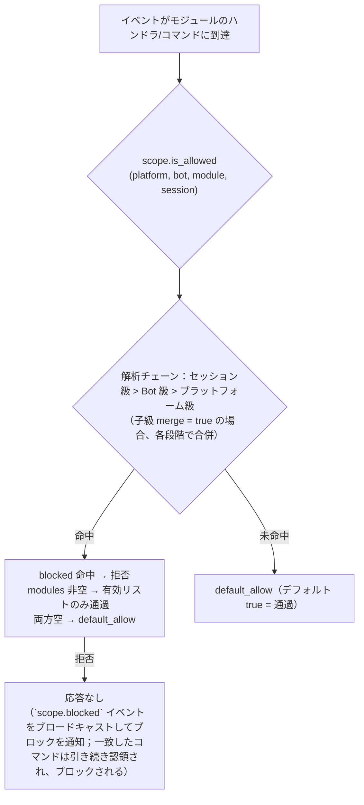
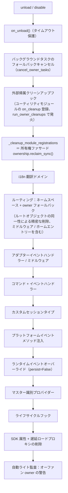
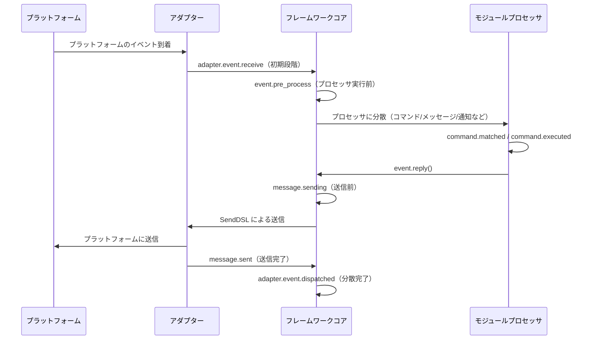

# ErisPulse 权限作用域与归属权

This skill is auto-built from the ErisPulse documentation.
Repository: https://github.com/ErisPulse/ErisPulse
Source paths are annotated per section; see docs/ in the repository for the latest content.

## 作用域

> 来源: `docs/ja/advanced/scope.md`（https://github.com/ErisPulse/ErisPulse/blob/main/docs/ja/advanced/scope.md）

# スコープ（scope）

> [!TIP]
> **この記事を読むべきタイミング**：モジュールの可用性、イベントの受信制限、または出力アクションの制限を制御する必要がある場合。不要な場合は飛ばしても、他の機能の使用に影響はありません。

> **読了後は**：3つのスコープ次元（モジュールの可用性 / イベント受信 / 出力アクション）それぞれの設定経路、判定優先順位と拒否時の挙動、実行時のAPIの使い方、およびブロッキングがどのように可視化されるか（`scope.blocked` イベント）を理解できます。
>
> **本記事では対象外**：リソースの所有権と解放回収（[所有権（owner）システム](ownership.md)を参照）；コマンドACLとイベントの上書き（[イベント処理入門](../getting-started/event-handling.md)を参照）。

> [!NOTE]
> この機能は ErisPulse **2.8.0+** が必要です。

スコープは4つの質問に答える：**どのモジュールが使えるか、どのイベントを受け取るか、特定のモジュールがどのようなテキストを処理するか、モジュールが外部にどのようなアクションを実行できるか**。制御権はすべてユーザーに委ねられます。モジュール / アダプタ / プロセッサ / 出力呼び出しの登録時に**上層**（設定 `ErisPulse.scope` または実行時 `sdk.scope`）で一括して宣言し、イベントパイプラインはエントリ、プロセッサフィルタ、出力ゲートで自動的に読み取り、実行します。

| 次元 | 制御対象 | 拒否時の挙動 | 設定経路 |
|------|---------|---------|---------|
| **① モジュール** | どのモジュールが使えるか（プラットフォーム / Bot / セッションの3段階） | フィルタリングされたモジュールはトリガーされず、返信もされません（`scope.blocked` イベントをブロッキング）。対象となるコマンドは既に認証済みで、ブロックされます。 | `scope.platforms / bots / sessions` |
| **② 身分** | イベントを受け取るかどうか（アダプタ / Bot / セッション / ユーザーの4段階） | エントリで完全に破棄されます（`scope.blocked` イベントをブロッキング）。 | `scope.identity.*` |
| **③ 出力** | モジュールがどのような出力呼び出し（メッセージ / API / リクエスト、メソッドレベルの白黒リスト）を実行できるか | 失敗応答（`retcode=34601`）が返されます。 | `scope.actions` |

> **関連システム**：コマンドは特別なメッセージイベントハンドラであり、そのユーザーの白黒リスト（ACL）と実装パラメータの上書きはコマンドシステムが独自に保持します（`ErisPulse.event.command`）。[イベント処理入門](../getting-started/event-handling.md)と[設定ガイド](../user-guide/configuration.md)を参照してください。

{!--< tips >!--}
1. `from ErisPulse.Core import scope` でシングルトンをインポート（`sdk.scope` は同じオブジェクト）
2. 判定：`scope.is_allowed(...)` / `scope.is_identity_allowed(...)` / `scope.is_action_allowed(...)` は、それぞれ①②③の3つのゲートに対応します
3. 読み書き：次元化されたパラメータメソッド（IDEで補完可能）—— `scope.set_module(...)` / `scope.set_identity(...)` / `scope.set_action(...)`；また、辞書式のバックアップとして `scope.get(path)` / `scope.set(path, v)` / `scope.delete(path)` もあります
4. イベントハンドラのテキスト条件の上書きは、[イベント処理入門 · イベントの上書き](../getting-started/event-handling.md#イベントの上書き-モジュールコードを改ざんせず任意のイベントタイプの挙動を上書き)を参照してください；コマンドACL / パラメータの上書きは[イベント処理入門](../getting-started/event-handling.md)を参照してください
{!--< /tips >!--}

## マッチングエントリの構文（全システムで統一）

スコープのすべての「名前リスト」（モジュール名、身元キー、出力エントリ）は、同一のマッチング構文（`ErisPulse.Core.text_match`）を使用します：

| 構文 | 例 | 説明 |
|------|------|------|
| 精確名 | `"Chat"` | 全値比較、**大文字小文字は区別しない** |
| glob | `"Tool*"`、`"spam_*"` | `*` 任意の文字列 / `?` 1文字 / `[seq]` 文字集合、大文字小文字は区別しない |
| 正規表現 | `"re:^Danger.*"` | `re:` で始まる宣言、正規表現 `search` で一致、デフォルトは大文字小文字は区別しない |

- 不正な正規表現は**静かに無効化**される（エラーは発生せず、クラッシュもしない）
- デコレータのパラメータ（`pattern=` / `regex=`）は固定された意味を持つ：`pattern` は glob、`regex` は正規表現のソースコード（`re:` プレフィックスは付けない）；スコープの設定内の正規表現エントリは**必ず** `re:` プレフィックスを付ける必要がある

## グローバルバックアップ：`default_allow`

`default_allow` は**唯一のグローバルバックアップ**スイッチ（デフォルト `true`）で、2つの判定次元に一括して効果を及ぼします：

- **モジュール次元**：どのバインディングにも一致しない → `default_allow` で許可 / 拒否を決定
- **身元次元**：どの戦略にも一致しない → `default_allow` で許可 / 拒否を決定

`false` に設定すると「暗黙の拒否」厳密モードが有効になり、ホワイトリスト方式で管理されるため、**明示的に許可されていないものはすべて拒否**されます。

> **例外**：③ 出力次元は**`default_allow`の影響を受けない**——これは独立した絞り込みスイッチであり、デフォルトはすべて許可され、明示的なルールでのみ制限される（フレームワーク層の owner が空の呼び出しは常に許可される）。このように厳密なグローバルモードでも、すべてのモジュールのメッセージ返信が意図せず遮断されることはない。コマンド ACL には独立した `ErisPulse.event.command.default_allow` バックアップがあり、互いに影響しない。

## 設定ファイル

```toml
[ErisPulse.scope]
default_allow = true        # グローバルバックアップ（false = 暗黙の拒否厳密モード）
cache_size = 1024           # LRUキャッシュサイズ

# ── ① モジュール次元（優先度：セッション > Bot > プラットフォーム）──
[ErisPulse.scope.platforms.onebot11]
modules = ["Chat", "Tool*"]   # ホワイトリスト：正確な名前 / glob / re: 正規表現
blocked = ["re:^Danger"]
[ErisPulse.scope.bots.onebot11."123456"]
modules = ["Chat"]
merge = true                  # プラットフォームレベルのバインディングに追加（デフォルトは全体を上書き）
[ErisPulse.scope.sessions.onebot11."789012345"]
modules = ["Chat"]

# ── ② 身元次元（優先度：ユーザー > セッション > Bot > アダプタ）──
[ErisPulse.scope.identity.adapters.onebot11]
deny = true                   # アダプタ全体のイベントを完全に破棄
[ErisPulse.scope.identity.bots.onebot11."123456"]
deny = true
[ErisPulse.scope.identity.sessions.onebot11."g_blocked"]
deny = true
[ErisPulse.scope.identity.users.onebot11]
allow = ["u_admin"]           # ユーザー鍵は glob / re: 正規表現をサポート
deny = ["u_bad", "spam_*"]

# ── ③ 出力次元（デフォルトはすべて許可され、明示的な絞り込みのみ制限）──
[ErisPulse.scope.actions.MyModule]
send = { deny = true }                                    # 送信を完全に禁止
api = { allow = ["get_*"] }                               # クエリ系の標準APIのみ許可
request = { deny = true }                                 # リクエスト処理を禁止
```

## ① モジュール次元

**一言で言うと**：プラットフォーム / Bot / セッションの3段階でバインド制御を行い、"このコンテキストでどのモジュールが有効か"を制御します。フィルタリングされたモジュールはトリガされず、応答もしません（一致したコマンドは引き続き認領され、ブロックされます）。

「あるコンテキストで、どのモジュールが有効か」を回答します。デフォルトではすべて開放です。バインドを設定した場合にフィルタリングが開始され、**モジュールとアダプタは一切変更不要です**。



- **解析優先度**：セッション級 > Bot 級 > プラットフォーム級、高優先度のバインドは低優先度を**全体的に上書き**します。  
  子級バインドに `merge = true` を指定した場合は、低優先度と**各項目ごとに合併**されます（`modules` / `blocked` はそれぞれ独立に合併され、`merge` 自体は項目としてカウントされません）。
- **デフォルトの意味**：フィルタリングされたモジュールのコマンドやハンドラはトリガされず、応答もしません。TRACE レベルのログで確認可能（`core.scope.denied`）。  
  同時に `scope.blocked` ライフサイクルイベントをブロードキャストして、誰がブロックされたか、なぜブロックされたかを観測できます。  
  一致した**コマンド**は引き続き認領され、ブロックされます——コマンドのテキストは低優先度のメッセージハンドラに漏れることなく、二重応答の混乱を解消します。
- **フレームワークレベルのハンドラ**（`scope_exempt=True` または owner が空）は影響を受けません。モジュール名が空（フレームワーク層のリソース）の場合は常に通過します。
- **セッション感知のヘルプとコマンド照会**：コマンド照会 API（`command.help` / `get_command` / `get_commands` / `get_group_commands` / `get_visible_commands`、および `module.get_commands_overview`）は、任意の `event=` または明示的な `platform=` / `bot_id=` / `session_id=` キーワードをサポートします。  
  現在のセッションで無効なモジュールのコマンドは結果に含まれません（`get_command` は None を返し、単一コマンドのヘルプは「未登録」として扱われ、デフォルトの意味と一致します）。  
  コンテキストを渡さない場合は、全量の動作を維持します。

### バインドの継承（merge）

デフォルトでは、全体的な上書きの意味が明確で予測可能です。上級バインドに**追加**したい場合は、子級に `merge = true` を指定します：

```toml
[ErisPulse.scope.platforms.onebot11]
modules = ["Chat", "Tool"]      # プラットフォーム級：Chat、Tool を有効

[ErisPulse.scope.bots.onebot11."123456"]
modules = ["Music"]
merge = true                    # この Bot の実効値 = ["Chat", "Tool", "Music"]
```

- 合併ルール：`modules` と `blocked` はそれぞれ**合併**されます。バインド内では `blocked` が `modules` より優先されます。
- 鏈式合併：プラットフォーム → Bot → セッションの順に段階的に追加され、各段階で `merge` または上書きを独立して決定します。

## ② 身元次元（イベント受容）

**一言で言うと**：ユーザー／セッション／Bot／アダプターの4段階の戦略に基づき、イベント配信の入口で「受容すべきでないイベント」を完全に破棄し、deny は allow より優先されます。

「どのユーザーのイベントを受け入れるか」を決定します。拒否されたイベントは**配信の入口で完全に破棄**されます——ミドルウェアや任意のハンドラ（フレームワークレベルを含む）には一切渡らず、TRACE レベルのログ（`core.scope.identity_denied`）でのみ確認できます。

- **解析優先度**：ユーザー > セッション > Bot > アダプター。最も具体的に設定された戦略を採用します。deny は allow より優先されます。
- 各段階のバインディングは二元的な戦略です：`{ allow = true }` または `{ deny = true }`
- ユーザーのキーには glob / 正規表現（例：`"spam_*"` で一括してスパムユーザーをブロック）が使用可能です。
- 代表的な使い方——上位階層で deny し、個別のユーザーに対して allow を設定することで「例外的に許可」を実現します：

```toml
[ErisPulse.scope.identity.adapters.onebot11]
deny = true
[ErisPulse.scope.identity.users.onebot11]
allow = ["u_admin"]   # アダプター階層で拒否されていても、u_admin のイベントは許可されます
```

## ③ 出站次元（制限モジュールが発信する呼び出し）

**一言で言うと**：メソッド単位のホワイトリスト・ブラックリストによって、モジュールが発信するメッセージ / API / リクエスト呼び出しを制限し、拒否された呼び出しはネットワークリクエストを一切行わず、直接 `retcode=34601` を返します。

制限されるモジュールの**発信アクション**：メッセージ送信 / 標準APIアクション / リクエスト操作。  
3つのアクションはそれぞれ下層DSLに対応します：`Event.reply` と `Send`（send）、`Api` / `call_api`（api）、`Request` の accept/reject（request）。イベントハンドラ実行中にモジュールが発信する出站呼び出しは、モジュールのオーナーを含み、この次元で一括して判定されます。

### 規則の形態（インライン表）

各アクションのルールはインライン表です：`{ allow = [...], deny = true|[...] }`。  
同一アクションには1つのルールしか設定できません（TOMLのキーは重複不可、全禁止と細粒度のどちらか1つを選択）：

```toml
[ErisPulse.scope.actions.MyModule]
send = { deny = true }                                  # 送信を全禁止（Event.reply / Send DSL）
# またはメソッド単位の細粒度設定：send = { allow = ["Text", "Image*"], deny = ["File"] }
api = { allow = ["get_*"] }                             # 限定的に取得系標準APIを許可
# またはアクション単位のブラックリスト：api = { deny = ["set_*", "leave_*"] }
request = { deny = true }                               # リクエストのaccept/reject処理を禁止
```

- `send` の項目は**送信メソッド名**（`Text` / `Image` / `File` ...）に一致する
- `api` の項目は**標準アクション名**（`get_group_info` / `set_group_name` ...）に一致する
- 項目は正確な名前 / glob / `re:` 正規表現（全システムと統一された構文で、大文字小文字は区別しない）
- `allow` に1つの文字列を記述することは、1つの項目のリストと同義です：`send = { allow = "Text" }`

### 判定の意味

**デフォルトは全許可**——設定がなければ、またはオーナーが空（フレームワーク層の内部呼び出し）であれば許可されます。  
ルールが設定された場合、以下の順序で判定されます：

1. `deny = true` → 拒否
2. `deny` リストに呼び出し名が一致 → 拒否
3. `allow` リストが空でなく、呼び出し名が一致しない（または呼び出しに名前がない）→ 拒否
4. その他の場合 → 許可

拒否された呼び出しはネットワークリクエストを一切行わず、標準の失敗レスポンスを直接返します（`retcode = 34601`、[api-response §5.3](../standards/api-response.md#53-フレームワーク拡張返却コード34xxx-プラットフォームエラーセグメントの下3桁カスタマイズ)を参照）。  
3つのアクションは互いに独立しており、1つだけを制限することも可能です。

```python
# 実行時API
sdk.scope.set_action("MyModule", "send", deny=True)              # 送信を全禁止
sdk.scope.set_action("MyModule", "send", allow=["Text"])         # 送信はテキストのみ許可
sdk.scope.is_action_allowed("MyModule", "send", name="Image")    # False
sdk.scope.is_action_allowed("MyModule", "api", name="get_user_info")  # 規則に従って判定
sdk.scope.delete_action("MyModule", "send")                      # 許可を復元
sdk.scope.get_action("MyModule", "send")                         # そのアクションの現在のルール
```

## 実行時API

スコープの実行時APIは3つの層に分かれています：**判定**（3つの質問）、**次元ごとの読み書き**（各次元の `set` / `get` / `delete` パラメータ化メソッド、署名はすべて型注釈付き、IDEで補完可能）、**辞書式バックアップ**（ドット区切りのパスで任意の節に直接アクセス）。

```python
from ErisPulse import sdk

scope = sdk.scope
```

### 判定（3つの質問）

```python
scope.is_allowed("onebot11", "123456", "Chat")                 # ① モジュール次元
scope.is_allowed("onebot11", "123456", "Chat", "789012345")    # セッションレベルを含む
scope.is_allowed("onebot11", "123456", None)                   # フレームワーク層のリソース -> True

scope.is_identity_allowed("onebot11", "123456", "group_9", "u1")   # ② 身元次元

scope.is_action_allowed("MyModule", "send")                    # ④ 出力次元
scope.is_action_allowed("MyModule", "send", name="Image")      # メソッドレベルの細粒度
```

### ① モジュール次元

```python
# バインディング（パラメータによって階層が決まります：session_id > bot_id > プラットフォームレベル）
scope.set_module("onebot11", bot_id="123456", modules=["Chat", "Tool*"])
scope.set_module("onebot11", blocked=["re:^Danger"])                       # プラットフォームレベル
scope.set_module("onebot11", bot_id="123456", session_id="g9", modules=["Chat"])  # セッションレベル
scope.set_module("onebot11", bot_id="123456", modules=["Music"], merge=True)      # 現在のバインディングと並列に結合
scope.set_module("onebot11", bot_id="123456", modules=["Chat"], persist=False)    # 実行時のみ

# 読み取り / 削除
scope.get_module("onebot11", bot_id="123456")   # {"modules": ["Chat"], "blocked": []}
scope.delete_module("onebot11", bot_id="123456")
```

> `merge=True` は**書き込み時に並列に結合**（現在のバインディングとエントリを結合）です；階層間の解析時の `merge = true` 設定は上記の[バインディング継承](#バインディング継承merge)をご覧ください——これらは独立したメカニズムです。

> **実行時バインディング（`persist=False`）の意味**：実行時バインディングは独立したオーバーライド層に保存され、**任意の後続の設定書き込み / 設定ファイルのホットアップデートでも削除されません**（設定ツリーが再構築された後に、書き込み順に自動的に再実行されます、実行時削除も含みます）。これらは永続化されず、プロセスの再起動後に失われます；モジュールのアンロード時に、そのモジュールが書き込んだ実行時バインディングはバックアップでクリーンアップされます。その後、同一のパスで `persist=True` を実行すると、ユーザー永続化の意味で実行時ルールが上書きされます。

### ② 身元次元

```python
# 戦略のバインディング（パラメータによって階層が決まります：user > session > bot > adapter；allow / deny のどちらか一方）
scope.set_identity("onebot11", user_id="u_bad", deny=True)
scope.set_identity("onebot11", user_id="spam_*", deny=True)    # キーは glob / re: 正規表現をサポート
scope.set_identity("onebot11", bot_id="123456", session_id="g9", allow=True)

# 読み取り / 削除
scope.get_identity("onebot11", user_id="u_bad")   # {"deny": True}
scope.delete_identity("onebot11", user_id="u_bad")
```

### ③ 出力次元

```python
# 制限ルールの設定（allow: str|list；deny: bool|str|list；ルール全体の置換）
scope.set_action("MyModule", "send", deny=True)                    # 送信を完全に禁止
scope.set_action("MyModule", "send", allow=["Text"])               # テキスト送信のみ許可
scope.set_action("MyModule", "api", deny=["set_*", "leave_*"])     # 管理系APIを禁止

# 読み取り / 削除
scope.get_action("MyModule", "send")       # {"allow": ["Text"]} 元のルール
scope.delete_action("MyModule", "send")    # 個別のアクションを削除
scope.delete_action("MyModule")            # モジュールのすべてのアクション制限を削除
```

### 一般的な操作

```python
scope.get("platforms")   # 辞書式バックアップ：ドット区切りのパスで任意の節を読み取り
scope.topology()         # 全設定ツリー（ダッシュボード用）
scope.stats()
# {"module_calls": .., "module_filtered": .., "identity_checks": .., "identity_denied": ..,
#  "action_checks": .., "action_denied": .., "cache_hits": .., "cache_misses": ..}
scope.reset_stats()
scope.clear()           # 全設定をクリア（メモリ上でのみ有効）
```

### 高度な操作：辞書式ドット区切りパスバックアップ

次元化されたメソッドは日常的なシナリオをカバーします；任意のノード（または将来追加される次元）に直接アクセスする必要がある場合、**辞書式API**を使用できます——`get` / `set` / `delete` はドット区切りのパスを受け取り（dictの深さのマージ、書き込み後すぐに読み取り可能）、`scope[path]` / `scope[path] = v` / `del scope[path]` / `path in scope` プロトコルも提供します：

```python
scope.set("bots.onebot11.123456", {"modules": ["Chat"], "blocked": []})
scope.set("identity.users.onebot11.u_bad", {"deny": True})
scope.get("actions.MyModule.send")

scope["platforms.onebot11"]        # 読み取り（存在しない場合はKeyErrorを送出）
scope["platforms.onebot11"] = {...}  # 書き込み
del scope["platforms.onebot11"]      # 削除
"actions.MyModule" in scope          # 存在確認
```

## 拦截の可視化：`scope.blocked` イベント

スコープのフィルタリング（モジュールのフィルタ / 身元の拒否）が発生すると、**`scope.blocked`** というライフサイクルイベントがブロードキャストされ、"誰がブロックされたか、どのレベルでブロックされたか"をサブスクライブ、統計、ダッシュボードで表示可能になります——ブロックはデフォルトで返信されませんが、不可知のブラックボックスではありません。

| フィールド | 説明 |
|------|------|
| `dimension` | `"module"`（モジュール次元のフィルタ）/ `"identity"`（身元の受信拒否） |
| `module` | フィルタされたモジュール名（モジュール次元のみ） |
| `platform` / `bot_id` / `session_id` / `user_id` | ブロックが発生したソースコンテキスト |

```python
from ErisPulse.Core.lifecycle import lifecycle

@lifecycle.on("scope.blocked")
def on_blocked(data):
    print(f"ブロックされた：{data['dimension']} {data.get('module') or data.get('user_id')}")
```

- イベントは `fire` でバックグラウンドでブロードキャストされます（リスナーがいない場合はオーバーヘッドがなく、ホットパスを遅らせません）
- キャッシュヒットによる重複のブロックは**再ブロードキャストされません**——同じ組み合わせはキャッシュが失効するたびに1回だけブロードキャストされます
- `adapter.event.blocked`（ミドルウェアによる拒否）とは区別されます：これはイベントレベルの破棄であり、本イベントはスコープの受信ゲートのモジュール / 身元フィルタリングです

## キャッシュとホットアップデート

- `is_allowed` / `is_identity_allowed` / `is_action_allowed` の結果は**LRUキャッシュ**（`scope.cache_size` で調整可能）が付いており、`set` / `delete` / 設定のホットアップデート（`config.updated` / `config.set`）で自動的に失効します
- すべての次元の設定は**即座に有効**になります、再起動は不要です
- スコープは**イベントごとの判断**であり、イベント間で状態を記憶しません：設定が変わると、次のイベントは新しいルールに従います

## 設定フォーマットの検証

ロード時 / ホットアップデート時に各セクションの設定フォーマットを検証します：型の間違ったセクション（例：`platforms` が文字列に設定されている）、不正な出力ルール（例：`allow` が数値に設定されている）、未知のアクション名、未知のトップレベルのキー（例：`alow` というスペルミス）は **WARNING** として出力され、対応するセクション / 条目は無視され、他の合法な設定は正常に有効になります——間違った設定は静かに失効するのではなく、警告されます。

## 一般的な問題と注意事項

### 1. 設定の階層と上書き

- モジュール次元：セッションレベル > Botレベル > プラットフォームレベル、**全体的に上書き**（子レベルで `merge = true` の場合は各エントリを並列に結合）。プラットフォームで `Chat` を許可し、Bot で `Music` を追加したい場合は、Bot レベルで `merge = true` を書くか、両方をリストに書く
- 身元次元：ユーザー > セッション > Bot > アダプタ、**最も具体的な**設定された戦略を取ります（例外許可ができます）
- コマンドのユーザーブラックリスト/ホワイトリスト：正確なコマンド名が glob キーに優先されます（`event.command.acl` を参照）

### 2. モジュール/コマンドが反応しない

まず作用域が原因かどうかを疑います：

```python
from ErisPulse import sdk

print(sdk.scope.is_allowed(event.get_platform(), bot_id, "MyModule", session_id))
print(sdk.scope.is_identity_allowed(event.get_platform(), bot_id, session_id, user_id))
print(sdk.scope.stats())   # module_filtered / identity_denied > 0 なら、ブロック記録がある
```

フィルタされた場合、デフォルトでは返信されません（モジュール次元と身元次元、ルールを暴露しないように）；`scope.blocked` ライフサイクルイベントをブロードキャストし、統計は継続的に蓄積されます；ACL で拒否されたコマンドは「権限不足」の返信を表示します。

### 3. 出力アクションが拒否されたときのトラブルシューティング

```python
from ErisPulse import sdk

print(sdk.scope.get("actions.MyModule"))
print(sdk.scope.stats())   # action_denied > 0 なら、呼び出しがブロックされている
```

ブロックは**明示的**です：拒否された呼び出しは `retcode = 34601` の標準の失敗レスポンスを返し、ネットワークリクエストは発生しません。

### 4. セッション識別子のプラットフォーム間隔離

`(platform, session_id)` 組み合わせが唯一の識別子です。`scope.sessions.onebot11."789"` は onebot11 でのみ作用し、telegram 上で同じ `789` のセッションには影響しません。身元次元のユーザーキーも同様です。

## 拓撲ツリーアプリケーションプログラミングインターフェース

`ModuleManager.get_topology()` と `AdapterManager.get_topology()` は、モジュール/アダプタの所属関係データを提供します。`sdk.get_topology()` は、作用域 `scope` を含む一括集約を行います：

```python
from ErisPulse import sdk

topology = sdk.get_topology()
# {
#   "modules": {                                   # モジュール → 持有するリソース
#     "Chat": {
#       "loaded": True, "enabled": True,
#       "commands": ["chat", "translate"],
#       "handlers": {"message": 2, "notice": 1},
#       "routes": {"http": ["/Chat/api"], "ws": [], "sse": []},
#       "lifecycle_hooks": 3,
#     }
#   },
#   "adapters": {                                  # アダプタ → Bot → 作用域
#     "onebot11": {
#       "status": "started", "enabled": True,
#       "bots": {"123456": {"status": "online", "scope": {...}}},
#       "scope": {"modules": [...], "blocked": [...]},
#     }
#   },
#   "scope": {                                     # 作用域（モジュール / 身元 / 出力アクション）
#     "platforms": {...}, "bots": {...}, "sessions": {...},
#     "identity": {"adapters": {...}, "bots": {...}, "sessions": {...}, "users": {...}},
#     "actions": {...},
#   },
# }
```

- モジュールのトポロジーは、登録されたコマンド、イベントハンドラ、HTTP/WS/SSEルート、ライフサイクルフックを統合し、モジュールリソースツリーを描画するのに便利です。
- アダプタのトポロジーは、各アダプタの状態、下位のBotの状態、およびプラットフォーム/Botレベルの作用域バインディング（モジュール次元）を統合します。
- **JSON安全出力**：`get_topology(json_safe=...)` はデフォルトで `True` であり、返された構造は直接 `json.dumps` できます——モジュール `info` は純粋なデータの `meta` サブテーブルのみ保持されます（`module_class` / `strategy` などの実行時オブジェクトは除外）、その他のノード（アダプタ作者が Bot `info` に挿入した任意のオブジェクトを含む）もバックアップで浄化されます（クラスオブジェクトは `__name__` を取得し、シリアライズできないオブジェクトは `str()` に退化します）。ダッシュボード / WebUI は直接シリアライズして返すことができます；原始オブジェクトが必要な場合は `json_safe=False` を渡します。

## 関連ドキュメント

次の意図に応じて選択してください：

- **リソースの所有権とアンロード回収を制御したい** → [所有権（owner）システム](ownership.md)——スコープは「リソースが有効かどうか」を管理し、所有権は「リソースは誰のものか、誰がアンロード時に回収されるか」を管理します。
- **モジュール間の呼び出しを監査したい** → [モジュール間通信](module-communication.md)——`module.call` が呼び出し元のアイデンティティでエグジットゲートを通過する方法
- **モジュールの新バージョンを段階的にリリースしたい** → [影モジュールと段階的リリース](shadow.md)——独立した owner として並行して試運転
- **設定セクションの書式とホットアップデートの動作を確認したい** → [設定ガイド](../user-guide/configuration.md)

## 归属权

> 来源: `docs/ja/advanced/ownership.md`（https://github.com/ErisPulse/ErisPulse/blob/main/docs/ja/advanced/ownership.md）

# 所有権（owner）システム

> [!TIP]
> **この文書を読むべき場面**：リソースリークの調査、アンロード時のクリーンアップフローの理解、または帰属リソースの宣言を行うとき。必要なければ読み飛ばしても、他の機能の利用には影響しません。

> **読み終えるとわかること**：owner コンテキストがどのようにリソースを自動帰属させるか、帰属リソースの一覧表、アンロード/無効化時の
> クリーンアップチェーンの完全な時系列、そしてどのリソースがアンロード時にクリーンアップされないか（設計上の境界）。
>
> **この文書の対象外**：リソースが「いつ有効になるか」の権限判定（[スコープ](scope.md)を参照）；
> バックグラウンドタスクの推奨される書き方と強制キャンセルの境界（[ライフサイクル管理 · バックグラウンドタスクの帰属と自動キャンセル](lifecycle.md#バックグラウンドタスクの帰属と自動キャンセル)を参照）。


所有権はモジュールの「プラグアンドプレイ」を支える礎です：モジュールがロード中に登録したすべてのフレームワークリソースは自動的に記名され、
アンロード/無効化時には記名に基づいて一括回収されます——モジュール作者はリソースを宣言するだけで、クリーンアップロジックを手書きする必要はありません。

> **関連システム**：スコープはイベント配信時に「リソースが有効かどうか」を決定し、
> 所有権はライフサイクルにおいて「リソースが誰に帰属し、誰のアンロード時に回収されるか」を決定します。
> スコープの詳細は[統一コントロールプレーン](scope.md)を、バックグラウンドタスクの詳細は
> [ライフサイクル管理](lifecycle.md#バックグラウンドタスクの帰属と自動キャンセル)を参照してください。

{!--< tips >!--}
1. 帰属は**登録の瞬間**に `current_owner` に基づいて自動記録され、モジュールコードの変更は一切不要
2. アンロード/無効化は同一のクリーンアップチェーン（`_cleanup_module_registrations`）を共用し、各ステップの失敗は警告のみで中断しない
3. ユーザー設定セマンティクスのリソース（永続化オーバーライド / scope ルール / コマンド ACL）はモジュールのアンロード時にクリーンアップ**されない**
4. ユーティリティモジュールが管理する外部ハンドルは `on_cleanup(cb)` でクリーンアップチェーンに組み込め、相手モジュールのアンロード時に自動コールバックされる（[ユーティリティモジュールガイド](#ユーティリティモジュールガイド他モジュールのハンドル管理)を参照）
{!--< /tips >!--}

## owner コンテキストの仕組み

owner はコンテキスト変数 `current_owner` で伝播します（`ErisPulse.runtime.context`）：

```python
from ErisPulse.runtime import owner_scope, get_current_owner

with owner_scope("MyModule"):
    # この区間内で登録されたすべてのリソースは自動的に MyModule に帰属する
    assert get_current_owner() == "MyModule"
```

フレームワークは以下のタイミングで owner を自動注入します（モジュール/アダプターコードで手動ラップは不要）：

| タイミング | owner の値 | 場所 |
|------|----------|------|
| モジュール `load()` | モジュール名 | インスタンス化 + `on_load` の全工程 |
| アダプター `start()` / `restart()` | プラットフォーム名 | アダプター起動の全工程 |
| `activate_on` 遅延ロード stub 登録 | モジュール名 | プレースホルダーコマンド/ハンドラーの登録 |
| イベントハンドラー実行中 | ハンドラーの帰属先モジュール名 | handler / コマンドエントリーでの再注入 |

実行期の再注入とは：モジュールが `on_load` 内で宣言したコマンドハンドラーが**実行中**に
登録型 API（`sdk.adapter.on()`、`overrides.*.set(persist=False)` など）を呼び出した場合も、
同様に自動的に当該モジュールに帰属することを意味します。

## 帰属リソース一覧

モジュールがロードコンテキスト内で登録した以下のリソースはすべて帰属が記録され、アンロード/無効化時に自動回収されます：

| リソース | 登録方法 | クリーンアップ呼び出し |
|------|----------|----------|
| コマンド | `@command()` / コマンド dict 宣言 | `command.unregister_by_owner()` |
| イベントハンドラー | `@message` / `@notice` / `@request` / `@meta` | `handler.unregister_by_owner()` |
| アダプターイベントリスナー | `sdk.adapter.on()` / `raw=True` | `adapter.unregister_handlers_by_owner()` |
| アダプターミドルウェア | `@sdk.adapter.middleware` | 同上 |
| ルーティング（HTTP/WS/SSE） | `router.http()` / `websocket()` / `sse()` | ネームスペース別 + owner 別の二重フォールバック |
| ルーティングミドルウェア | `@router.middleware()` / `add_middleware()` | `router.unregister_all_by_owner()` |
| Dashboard ホームエントリー | `router.register_home_entry()` | `unregister_home_entries_by_owner()` |
| カスタムセッションタイプ | `register_custom_type()` | `unregister_custom_types_by_owner()` |
| プラットフォームイベントメソッド注入 | `register_event_method()` / `register_event_mixin()` | `unregister_event_methods_by_owner()`（モジュールアンロード時に自動回収、旧クロージャーのリークなし） |
| バックグラウンドタスク | `self.spawn()` | `cancel_owner_tasks()` |
| 外部帰属クリーンアップフック（ユーティリティモジュール預かり） | `runtime.on_cleanup(cb)` | `run_owner_cleanups()`（アンロード/無効化/アダプター終了チェーン内で発火） |
| ライフサイクルフック | `lifecycle.register()` | `lifecycle.unregister_by_owner()` |
| マスター識別プロバイダー | `master.provider` | `master.unregister_by_owner()` |
| i18n 翻訳キー | `I18nClass` 宣言（domain=モジュール名） | `i18n.unregister_domain()` |
| イベントオーバーライド（ランタイム） | `overrides.*.set(persist=False)` | `overrides.unregister_by_owner()` |
| 対話セッション（wait_reply 待機 / リース） | `event.wait_reply()` / `sdk.interaction.acquire()` | `interaction.cancel_by_owner()`（待機側は即座にキャンセルを受け取る） |
| コンテキストデータ | `runtime/context` が owner ごとに記録 | モジュール単位で精密にクリーンアップ |

アダプター側の対応リソース（プラットフォーム名を owner とする）は、アダプターの `shutdown()` / `restart()` 時に
`_cleanup_adapter_resources` によって回収されます。さらに以下を含みます：

| リソース | クリーンアップ呼び出し |
|------|----------|
| アダプター自身の `on()` ハンドラーとミドルウェア | `adapter.unregister_handlers_by_owner(platform)` |
| プラットフォームイベントメソッド拡張（`EventMixin`） | `unregister_platform_event_methods(platform)` |
| カスタムセッションタイプ | `unregister_custom_types_by_owner(platform)` |
| 対話セッション（当該プラットフォームで保留中の wait_reply / リース） | `interaction.cancel_by_platform(platform)` |
| i18n 翻訳ドメイン（domain=設定キー） | `i18n.unregister_domain(設定キー)` |
| 細粒度ネームスペースルーティング | `router.unregister_all_by_owner(platform)` |

## アンロード/無効化クリーンアップシーケンス

`unload()` と `disable()` は同一のクリーンアップチェーンを共用します（各ステップは独立した try/except で、
失敗はログに記録されるだけで**後続のクリーンアップは中断しません**）：



`sdk.uninit()` の終了時には別途グローバルなフォールバックがあります：全アダプター shutdown → 全モジュール unload →
`router.stop()`（ルーティング/ミドルウェア/ホームエントリーのクリア）→ `cancel_all_background_tasks()` →
イベントハンドラーとフックのクリア。

## 所有権統一ファサード（ownership）

クリーンアップチェーンの 16 ステップは、所有権統一ファサード `ErisPulse.Core.ownership` に集約されています。
4 つの動詞が「登録解除、カウント、スキャン、監査」をカバーします——サブシステムごとの `*_by_owner` 登録解除関数は
そのまま維持され、ファサードの内部実装として機能します：

| 動詞 | 用途 |
|------|------|
| `ownership.reclaim(owner)` | owner 名義の下にある全リソースを一括登録解除（タスクキャンセル → クリーンアップフック → 登録系リソース；非同期の完全版） |
| `ownership.reclaim_sync(owner)` | 登録系リソースの登録解除（同期版、同期アンロードパス用） |
| `ownership.counts(owner=None)` | owner の在籍リソースを読み取り専用で集計（None は全 owner） |
| `ownership.orphans()` | オーファンスキャン：リソースは在籍しているが owner は登録解除済み（リーク確定リスト） |
| `ownership.audit(owner, deep=)` | リーク監査レポート（カウント + オーファン + 任意の gc インスタンス全数調査） |

```python
from ErisPulse.Core import ownership

ownership.reclaim_sync("MyModule")       # {'commands': 1, 'routes_http': 2, ...}
ownership.counts("MyModule")             # 在籍リソースのカウント
ownership.orphans()                      # [{"owner": "ghost", "total": 2, ...}]
```

**監査エントリー**：

- アンロード / リロード後の**自動ライト監査**：オーファン owner リソースを検出したら WARNING 警告（ゼロオーバーヘッドのカウントスキャン）
- `sdk.module.audit(name, deep=True)`：モジュールインスタンスの gc 全数調査——インスタンスが回収不能な場合、
  参照元の型を提示（「誰が旧インスタンスを掴んでいるか」を特定）；グローバルな一時停止のオーバーヘッドがあるため、明示的なトラブルシューティングのみに使用
- 深い全数調査は明示的な操作であり、設定キーを設けず、自動修復も行いません

## ホットリロード失敗時のロールバック

ホットリロードは「**アンロード前スナップショット → 失敗時自動リストア**」に変更されました：新バージョンの構文エラー、依存関係の欠落、
ロード失敗時には、旧インスタンスと登録状態（レジストリエントリー、sdk 属性、sys.modules エントリー）が
自動的に復元され、サービスは中断せず、ログに「旧インスタンスへロールバックしサービスを継続しています」と表示されます。

ベストエフォートのセマンティクス（ドキュメント化された境界）：

- `on_unload` が実行済みの副作用（切断済みの接続、キャンセル済みのタスク）は取り消せません——
  復元後の旧インスタンスは「後片付け済み」の状態にあり、再度ロードをトリガーしないと完全には利用できません
- サードパーティが実行時に手動でキャッシュした旧インスタンスへの参照は復元対象外です
- 対象パッケージが既にアンロードされている場合（entry-point が消失）はアンロード成功とみなし、ロールバックしません

## 設計上の境界：アンロード時にクリーンアップされないリソース

所有権が回収するのは**モジュールコードが登録したランタイムリソース**のみです。以下のリソースは**ユーザー設定のセマンティクス**
（制御権はユーザーにあり、意図的な設定である可能性がある）に属し、モジュールのアンロード後も設定と共に永続的に保持されます：

| リソース | セマンティクス | 説明 |
|------|------|------|
| `overrides.*.set(persist=True)` | 永続化オーバーライド | 設定ファイルに書き込まれ、再起動を跨いで有効；モジュールのアンロードでは削除されない（ユーザーの明示的な設定） |
| `scope.set_action()` などのスコープルール | 権限コントロールプレーン | ユーザー/Dashboard が管理し、モジュールをアンロードしてもルールは回収されない |
| `overrides.acl.set(persist=True)` | コマンド ACL | 同上 |
| Conversation `save()` 永続化 | 複数回対話のアーカイブ | データ資産はクリーンアップされない |

ランタイムの一時書き込み（`persist=False`）は owner と共に回収されます——**永続化するかどうかが
「ユーザー資産」と「モジュールのランタイム状態」の境界線です**。

## 内部実装：帰属の仕組み

**ひとことで言うと**：アトリビューションチェーン（contextvar の伝播）が「誰の頭に記録されるか」を決め、
キャンセルチェーン（タスク登録表）が「アンロード時にキャンセル可能か」を決めます——2 つのチェーンは独立して動作しており、
リソースを正しくクリーンアップするには両方が揃う必要があります。

帰属システムは**2 つの独立したチェーン**で構成されており、その分担を理解することが帰属問題のトラブルシューティングの前提となります：

### アトリビューションチェーン（contextvar の伝播）

`runtime/context.py` の `current_owner` などの ContextVar は**アトリビューション**を担います——
「今まさにこのコードが登録したリソース/発行した呼び出しが誰の頭に記録されるか」。伝播ルールは Python の
contextvars のセマンティクスに従います：

| 実行パス | context は伝播するか | アトリビューション結果 |
|---------|----------------|---------|
| 同期呼び出しチェーン / `await` チェーン | ✅ 伝播 | 正しく帰属 |
| `owner_scope` 内の `asyncio.create_task` | ✅ 伝播（task は作成時点の context をコピー） | タスク**内部**のフレームワーク呼び出しは正しく帰属 |
| `run_in_executor` / 素のスレッド | ❌ 非伝播 | アトリビューション喪失 |
| 独立イベントループ | ❌ 非伝播 | アトリビューション喪失 |

> アトリビューション ≠ 登録：context の伝播は「誰の頭に記録されるか」にのみ影響し、リソースがクリーンアップ可能かどうかは
> 後述のキャンセルチェーンに入っているかどうかで決まります。

### キャンセルチェーン（タスク登録表）

`runtime/tasks.py` の `_owner_tasks` 登録表は**ライフサイクル**を担います——
「owner 名義の下にどの未完了タスクがあり、アンロード時に一括キャンセルされるか」。タスクが登録表に入る経路：

1. **明示的なスケジューリング**：`spawn_background()` / `self.spawn()` → 作成時に
   `current_owner`（または明示的な `owner=` 引数）をキャプチャ → 登録表に記載；
2. **Task Factory 自動登録**（2.8.3）：`install_owner_task_factory()` がフレームワーク起動時に
   メインイベントループへインストール——**あらゆる**タスク作成（サードパーティライブラリ内部の
   `create_task` を含む）がファクトリーを通過する際に `current_owner` を読み取り、非 None であれば登録。

登録表は自己クリーンアップします：各タスクは `done_callback` を持ち、完了と同時に表から削除されるため、リークはありません。

### キャンセル時系列（モジュールアンロード）

```
module.unload()
  → on_unload(event)                    # モジュール自身のクリーンアップ（フォールバックのタイムアウト保護）
  → フレームワークが当該 owner のコマンド/イベント/フック/ルーティングを登録解除
  → cancel_owner_tasks(owner)           # タスク登録表によるフォールバックキャンセル
      → task.cancel() を一件ずつ実行    # キャンセル処理を実行中のタスク自身は除外
      → await gather(pending, timeout)  # 回収を待機（タイムアウト時はそれ以上ブロックしない）
```

### トラブルシューティングの考え方

- **リソースがクリーンアップされない** → 登録表を確認：`get_owner_tasks("MyModule")` に当該タスクが含まれているか；
  含まれていなければ登録パスが帰属チェーンを経由していない（import 時 / スレッド / 独立ループ）。上記の表と照らし合わせて特定してください。
- **アトリビューションが誤っている** → エラー発生時点の `get_current_owner()` の値を確認；非同期の遅延実行
  （コールバック/タスク）のアトリビューションは実行時ではなく作成時点の context から取得されます。

## モジュール作者ガイド

### 推奨される書き方

```python
from ErisPulse import sdk
from ErisPulse.Core.Event import command
from ErisPulse.runtime import owner_scope, spawn_background

class MyModule(BaseModule):
    async def on_load(self, event):
        # フレームワークリソース：自動帰属、手動クリーンアップ不要
        self.task = self.spawn(self.polling())      # バックグラウンドタスク
        sdk.router.register_home_entry("私のモジュール", "/my")  # ホームエントリー

        # モジュール固有リソース：owner_scope で包めば帰属体系に組み込まれる
        with owner_scope("MyModule"):
            self.client.on_event(self._handle)      # 仮想のカスタム登録

    async def on_unload(self, event):
        # フレームワークリソースは自動回収済み。owner_scope の及ばない固有リソースだけをクリーンアップ
        await self.client.close()
```

### 注意点

- **import 時の登録は帰属しない**：モジュールのトップレベル（import 時）で登録されたフック/ハンドラーは
  `owner_scope` の前に発生するため、フレームワークレベルのリソース（owner=None）とみなされ**クリーンアップされません**。
  すべて `on_load()` 内で登録してください。
- **カスタム domain の i18n 登録**：`i18n.register(domain=...)` の domain が
  モジュール名と異なる場合、自動回収されません。domain=モジュール名を維持してください。
- **バックグラウンドタスクには `self.spawn()` を推奨**：2.8.3 以降、素の `asyncio.create_task` も**自動的に暗黙帰属**します
  （Task Factory が自動登録し、アンロード時にフォールバックキャンセル）；ただし `self.spawn()` が依然として推奨の書き方です——
  非メインループのスレッドからメインループへのスケジューリング、明示的な `owner=` 指定、fire-and-forget の GC 防止をサポートします。
  **2.8.3 より前**のバージョンでは素のタスクは帰属しないため、必ず `self.spawn()` を使用してください。
- クリーンアップチェーンは「失敗時は警告のみ」：単一ステップのクリーンアップで例外が発生しても、他のリソースの回収は妨げられません。ログは
  DEBUG/WARNING レベルで確認でき、トラブルシューティング時には TRACE を有効にしてください。

### 登録タイミング → 帰属結果の対照表

| 登録シナリオ | 帰属結果 | 説明 |
|---------|---------|------|
| `on_load()` 内でフレームワーク API（コマンド/イベント/lifecycle/ルーティングのデコレーター）経由で登録 | モジュールに帰属 | アンロード時に自動登録解除 |
| モジュールのトップレベル（import 時）に登録 | **帰属なし**（owner=None） | クリーンアップされないため使用しないでください |
| `self.spawn()` で作成したバックグラウンドタスク | モジュールに帰属 | アンロード時に自動キャンセル |
| `owner_scope("Name")` 内でサードパーティ API 経由で登録 | モジュールに帰属 | サードパーティのコールバックが scope 内で同期的に実行されることに依存 |
| 素の `asyncio.create_task`（`loop.create_task` / `ensure_future` を含む） | **自動帰属**（Task Factory、2.8.3+） | 作成の瞬間に `current_owner` を読み取り、owner コンテキスト内では自動登録・アンロード時にフォールバックキャンセル；詳細は後述の[内部実装](#内部実装帰属の仕組み)を参照 |
| サードパーティライブラリの非同期コールバック（aiohttp / APScheduler など）内部で作成されたタスク | **自動帰属**（Task Factory、2.8.3+） | コールバック実行時に `current_owner` が注入済み（フレームワークハンドラー実行中など）であれば、タスクは自動登録 |
| `run_in_executor`（スレッドプール） | **帰属なし**（非 asyncio.Task） | スレッドはタスクファクトリーの管轄外のため、ライフサイクルは自己管理が必要 |
| 独立イベントループ（自前の loop）内の登録 | **帰属なし** | Task Factory はメインループにのみインストール；contextvars もイベントループを跨いで伝播しません |

> 原則：**帰属は登録の瞬間の `current_owner` コンテキストに従います**；あらゆる非同期の遅延実行、
> スレッドプール、独立ループはこのコンテキストから外れます——帰属させたい場合は明示的に `owner_scope` に入ってください。

## ユーティリティモジュールガイド：他モジュールのハンドル管理

**シナリオ**：定時タスク、レジストリ、コネクションプールといった「ユーティリティモジュール」は、他のモジュールに代わってものを預かります——
相手が `on_load` 内で `sdk.Cron.on_trigger(handler)` を呼び出すと、あなたのコンテナには相手のインスタンスを指す
コールバックが保存されます。フレームワークは相手が登録したすべてのフレームワークリソースを自動クリーンアップしますが、
**あなたのプライベートコンテナ内の参照**まではクリーンアップできません：相手がアンロードされた後もあなたのコンテナがそのインスタンスを
握り続けると、GC で回収できなくなります（メモリリーク。`purge` のリーク診断では「回収不可」と報告されます）。

**解決策**：相手のものを登録するのと同じ関数内で `on_cleanup()` を呼び出せば、
フレームワークが相手のアンロード / 無効化時にあなたのクリーンアップ関数を自動コールバックします：

```python
from ErisPulse.Core.Bases import BaseModule
from ErisPulse.runtime import off_cleanup, on_cleanup

class CronModule(BaseModule):
    def __init__(self):
        self._entries = {}  # {モジュール名: そのモジュールが預けたコールバックのリスト}

    def on_trigger(self, handler):
        # 呼び出し元モジュール名を自動識別（on_load からの直接呼び出し / module.call 経由のどちらも正しく）、
        # 戻り値は解決済みの owner で、記名キーとしてそのまま使用可能
        owner = on_cleanup(self._drop)
        self._entries.setdefault(owner, []).append(handler)

    def _drop(self, owner: str):
        """相手モジュールがアンロード/無効化された際にフレームワークから自動呼び出し：そのハンドルを破棄するだけ"""
        self._entries.pop(owner, None)

    async def on_unload(self, event):
        off_cleanup(self._drop)  # ③ 自身のアンロード前にフックを登録解除し、フック表が self を保持するのを防ぐ
```

フレームワークが保証する動作：

| 項目 | 動作 |
|--------|------|
| 発火タイミング | 相手モジュールの unload / disable、またはアダプターのシャットダウン——いずれもフレームワークのクリーンアップチェーン内で発火し、purge のリーク診断より前に実行 |
| 呼び出し元の識別 | 直接呼び出しでは `current_owner` を取得；`module.call()` 経由の呼び出しでは呼び出し元（`current_caller`）を取得；`on_cleanup(cb, owner="モジュール名")` での明示指定も可能。**強制検証**：owner を解決できない場合（3 つの取得元がすべて欠落）は `ValueError` をスロー——プライベートユーティリティモジュールは自身のロードコンテキスト内でフックを登録すべき |
| コールバックシグネチャ | `cb(owner: str)`、同期 / 非同期どちらも可；非同期にはタイムアウト保護付き（`CLEANUP_CALLBACK_TIMEOUT_SECS`、デフォルト 10 秒） |
| 耐障害性 | 単一のコールバックの例外 / タイムアウトはログへの記録のみで、他のフックとクリーンアップチェーンには影響しない |
| 重複登録 | 同一 `(owner, callback)` は冪等に重複排除 |

**必要ない場合**：相手が登録したのがフレームワークリソース（コマンド、イベントハンドラー、ルーティング、
バックグラウンドタスクなど）であれば、フレームワークがすでに完全自動でクリーンアップします（上記の[帰属リソース一覧](#帰属リソース一覧)を参照）。
`on_cleanup` が必要なのは、あなたのプライベートコンテナ内に保持している相手のハンドルだけです。
モジュール開発者視点のクイックリファレンス版は
[ベストプラクティス · ユーティリティモジュール](../developer-guide/modules/best-practices.md#ユーティリティモジュール他者のものを預かるときはアンロード通知を受け止める)を参照してください。

## 関連ドキュメント

次のステップの意図に応じて選択してください：

- **「リソースがいつ有効になるか」（権限面）を制御したい** → [スコープ](scope.md)——所有権は「リソースが誰に帰属し、誰のアンロード時に回収されるか」を管理し、スコープは「リソースがいつ有効になるか」を管理します
- **バックグラウンドタスク / タイマーのフォールバックキャンセル** → [ライフサイクル管理 · バックグラウンドタスクの帰属と自動キャンセル](lifecycle.md#バックグラウンドタスクの帰属と自動キャンセル)
- **独立した owner による分離でカナリアリリースを行いたい** → [シャドウモジュールとカナリア昇格](shadow.md)
- **モジュール開発者視点のクイックリファレンスと推奨書式** → [モジュールのベストプラクティス](../developer-guide/modules/best-practices.md)

## 生命周期

> 来源: `docs/ja/advanced/lifecycle.md`（https://github.com/ErisPulse/ErisPulse/blob/main/docs/ja/advanced/lifecycle.md）

# ライフサイクル管理

> [!TIP]
> **この記事を読むタイミング**：フレームワークのライフサイクルイベント（起動 / 加載 / 状態変化）をサブスクライブする必要がある場合。必要ない場合はスキップしても、他の機能の使用に影響はありません。

> **この記事を読むことでわかる内容**：ライフサイクルイベントの登録 / 発動 / 特定の送信メカニズム、4つのトリガーAPIの違いと選択方法、フレームワークが事前に埋め込んだすべてのフックの断点（core / module / adapter / server / messageなど）のそれぞれのデータ形式。
>
> **この記事では扱わない内容**：モジュール自身が実装するライフサイクルメソッド（`on_load` / `on_unload`、[モジュール開発ガイド](../developer-guide/modules/getting-started.md)を参照）；起動プロセスの各段階の経緯（[起動フローと手動制御](startup.md)を参照）。

モジュールの加載失敗、設定の変更、メッセージの送信、コマンド実行などのノードで通知を受け取り、自身のロジックを実行したい場合（監査、統計、アラート、連携など）は、フレームワークのライフサイクルイベントをサブスクライブするだけでよい。フレームワークは各重要なノードにフックの断点を事前に埋め込んでおり、`@sdk.lifecycle.on("イベント名")` と一行で接続できる。本文末尾には、すべての断点の一覧が付属している。

システムは3種類のトリガー方式をサポートしています：
- `await lifecycle.emit("event", data)` — 精簡版、任意のデータを渡す（`to="Owner"`の場合は特定の送信）
- `lifecycle.emit_sync("event", data)` — 同期版（非非同期コンテキストで使用）
- `await lifecycle.submit_event("event", ...)` — 旧バージョンと互換性があり、標準のイベント形式を自動的に構築する

## イベント処理メカニズム

### ハンドラの登録

```python
from ErisPulse import sdk

# デコレーターモード
@sdk.lifecycle.on("module.load")
async def on_module_load(data):
    print(f"モジュールのロード: {data}")

# プログラミング登録
sdk.lifecycle.register("module.load", on_module_load, priority=10)

# 登録解除
sdk.lifecycle.unregister("module.load", on_module_load)

# 所有者ごとに一括登録解除（モジュール/アダプターのアンロード時にフレームワークが自動的に呼び出す）
removed = sdk.lifecycle.unregister_by_owner("MyModule")
print(f"クリーンアップしたライフサイクルフック数: {removed}")
```

### 優先度

ハンドラは `priority` パラメータをサポートし、数値が大きいほど先に実行されます（モジュールローダーと同じ）：

```python
@sdk.lifecycle.on("adapter.event.receive", priority=10)  # 最初に実行
async def first_handler(data):
    pass

@sdk.lifecycle.on("adapter.event.receive", priority=0)  # 後に実行
async def second_handler(data):
    pass
```

### ポイント構造イベント

具体的なイベントをトリガーする際、その親イベントもトリガーされます：
- `module.load` をトリガーすると、`module` もトリガーされます
- `adapter.event.receive` をトリガーすると、`adapter.event` と `adapter` もトリガーされます

### ワイルドカード

`*` を登録してすべてのイベントをキャッチできます：

```python
@sdk.lifecycle.on("*")
async def on_anything(data):
    print(f"イベントを受け取りました: {data}")
```

### 定向送信（emit to=）

> [!NOTE]
> この機能は ErisPulse **2.8.0+** が必要です。

`emit()` に `to` パラメータを指定すると、定向送信モードになります：イベントは、その所有者（owner）として登録されたハンドラにのみ配信されます（モジュールが `on_load` 内で登録したフックは自動的に本モジュールに所属します）、他のモジュールやワイルドカード `*` ハンドラは感知しません。

```python
# 送信元：イベントは Chat モジュールが登録したフックにのみ送信されます
await sdk.lifecycle.emit("message_received", {"text": "hi"}, to="Chat")

# 受信元（Chat モジュール内）：同名のフックを登録し、owner は登録時に自動的に記録されます
@sdk.lifecycle.on("message_received")
async def on_message_received(data): ...

@sdk.lifecycle.on("message")   # ポイント構造の親プレフィックスも同様に有効（owner でフィルタリング）
async def on_any(data): ...
```

- 目標の owner に登録されたフックがない場合 → イベントは**消費されません**（`has_handlers()` で事前に検出可能）
- `data` が dict の場合、自動的に `_trace_id` を追加します（既存の値を上書きしません）
- `emit_sync` / `submit_event` でも `to=` パラメータをサポート
- モジュール間通信の3層モデル（RPC / 定向 / ブロードキャスト）は
  [モジュール間通信](module-communication.md) を参照

### 一回限りの登録（once）

2.7.0 から、`lifecycle.once()` で登録されたハンドラは**一度実行後、自動的に登録解除**されます。これは「初回準備完了」のような一回限りのフックに適しています：

```python
@sdk.lifecycle.once("core.init.complete")
async def on_first_ready(data):
    print("初回準備完了、以降はトリガーされません")
```

- `on()` と同じ優先度パラメータの意味（`priority` 数値が大きいほど先に実行）
- 自動的に登録解除、手動での `unregister` は不要
- 同期/非同期ハンドラの両方をサポート

### 監視者確認（has_handlers）

ホットパスの短絡処理では、`has_handlers()` を使って監視者が存在するかを事前に確認し、不要なイベントのループやタスクのスケジューリングを避けることができます：

```python
if sdk.lifecycle.has_handlers("message.sending"):
    await sdk.lifecycle.emit("message.sending", send_ctx)
```

- 精確なイベント名、ワイルドカード `*`、親イベントの3種類のマッチをカバー
- 監視者がいない場合は `False` を返し、`emit` を安全にスキップできます

## フックのブレークポイント一覧

プラットフォームからフレームワークにメッセージが届き、処理が完了するまでの典型的なライフサイクルイベントの時系列は以下の通りです。



フレームワークは以下のフックのブレークポイントを内蔵しており、`@sdk.lifecycle.on()` で任意のブレークポイントを監視してカスタムロジックを実装できます。

### コア初期化

| フック名 | 発生タイミング | データ |
|---------|---------|------|
| `core.init.start` | SDKの初期化開始 | `{}` |
| `core.init.stage` | 初期化の各段階開始（バックグラウンドで発生） | `{"stage": str}`、値は `discovery` / `adapter_register` / `adapter_start` / `module_register` / `module_init` / `adapter_start_deferred` / `router_start` |
| `core.init.complete` | SDKの初期化完了 | `{"duration": float, "success": bool, "stages": {stage: float}, "adapters": {"enabled": [str], "disabled": [str]}, "modules": {"enabled": [str], "disabled": [str]}, "error": str(失敗時のみ)}` |
| `core.uninit.complete` | SDKの逆初期化完了 | `{"duration": float, "success": bool, "adapters_closed": int, "modules_unloaded": int, "module_properties_cleared": int, "module_properties_to_clear": [str], "error": str(失敗時のみ)}` |

**例：起動進捗表示**

```python
@sdk.lifecycle.on("core.init.stage")
def show_stage(data):
    print(f"[起動] 階段に到達: {data['stage']}")
```

### 設定変更

| フック名 | 発生タイミング | データ |
|---------|---------|------|
| `config.set` | 設定項目が変更された | `{"key": str, "old_value": Any, "new_value": Any}` |
| `config.updated` | 外部で config.toml を編集した後にツリー全体の変更が検出された | `{"old_config": dict, "new_config": dict, "config_file": str}` |

**例：設定監査**

```python
@sdk.lifecycle.on("config.set")
def audit_config(data):
    print(f"[監査] {data['key']}: {data['old_value']} -> {data['new_value']}")
```

### モジュールのライフサイクル

| フック名 | 発生タイミング | データ |
|---------|---------|------|
| `module.register` | モジュールクラスがマネージャーに登録された | `{"module_name": str, "success": bool}` |
| `module.load` | モジュールのロードが完了した（インスタンス化成功）；失敗時は `payload` に追加で `"error": str, "traceback": str`（失敗時の現場は `module.last_error(名前)` でも取得可能） | `{"module_name": str, "success": bool}` |
| `module.init` | モジュールの初期化が完了した（遅延ロード含む） | `{"module_name": str, "success": bool}` |
| `module.before_unload` | アンロードの最初のステップ（`on_unload` とリソース回収の前；モジュールインスタンスフック `on_before_unload` が同期的に発生） | `{"module_name": str, "reason": str}`；`reason` の値は `unload` / `reload` / `disable` / `cascade` / `dormant` |
| `module.sleep` | モジュールの休眠が完了した（遅延ロードの休眠：リソースは解放され、アクセス時に自動的に復活） | `{"module_name": str, "success": bool}` |
| `module.unload` | モジュールのアンロードまたは無効化（`disable` と `unload` は依存関係に通知するため同等；`on_dependency_lost` の契約には「無効化」が含まれる） | `{"module_name": str, "success": bool}` |
| `module.reload` | モジュールのホットリロードが完了した（依存モジュールも含む） | `{"module_name": str, "success": bool, "full": bool, "duration_ms": int}`；単一モジュールの場合、`"identity_changed": bool`（False = プロセス内で古いコードが実行されている可能性あり、C拡張のキャッシュなど）、`"version_old": str, "version_new": str` を追加で持つ；全量リロード（`reload_all`）の場合は `module_name` が `"All"` になり、`payload` に `"results": dict[str, bool]` を追加で持つ |

> **モジュールインスタンスフック `on_before_unload`**：`module.before_unload` イベントに対応するオプションのライフサイクルメソッド——`event["reason"]` に理由が記載され、リソース解放前に `sdk.storage` に状態を保存し、復活/リロード後に `on_load` で復元するのに適している（遅延ロードの休眠の状態継続はこれに基づく）。フックの失敗は警告のみで、アンロードプロセスをブロックしない。

### アダプターのライフサイクル

| フック名 | 発生タイミング | データ |
|---------|---------|------|
| `adapter.load` | アダプターの登録が完了した | `{"platform": str, "success": bool}` |
| `adapter.reload` | アダプターのコードレベルでのホットリロードが完了した | `{"adapter_name": str, "success": bool, "full": bool, "duration_ms": int, "identity_changed": bool, "version_old": str, "version_new": str, "was_started": bool, "source": str}`；`identity_changed=False` = プロセス内で古いコードが実行されている可能性あり |
| `adapter.start` | アダプターの起動 | `{"platforms": [str]}` |
| `adapter.status.change` | アダプターの状態が変化した | `{"platform": str, "status": str, "retry_count": int, "error": str(失敗時のみ)}`；status の完全な値は：`starting` / `started` / `start_failed` / `stopping` / `stopped` / `stop_failed` / `skipped-dependency` / `disabled` |
| `adapter.stop` | アダプターの停止 | `{"platforms": [str]}` |
| `adapter.stopped` | アダプターの停止が完了した | `{"platforms": [str]}` |
| `adapter.bot.online` | Botのオンライン | `{"platform": str, "bot_id": str, "info": dict, "status": str}` |
| `adapter.bot.offline` | Botのオフライン | `{"platform": str, "bot_id": str, "status": str}` |

### イベントの受信と処理

| フック名 | 発生タイミング | データ |
|---------|---------|------|
| `adapter.event.receive` | 外部プラットフォームイベントを受信した（初期段階） | `{"platform": str, "event_type": str, "raw_event_type": str}` |
| `adapter.event.blocked` | ミドルウェアがイベントを拒否した（`False` を返した、イベントは破棄されプロセッサに渡らない） | `{"middleware": str, "platform": str, "event_type": str, "detail_type": str, "event": dict, "_trace_id": str}` |
| `adapter.event.dispatched` | イベントの分散が完了した | `{"platform": str, "event_type": str, "raw_event_type": str, "onebot_handlers_count": int}` |
| `event.pre_process` | イベントプロセッサが実行される直前 | `{"event_type": str, "platform": str, "detail_type": str}` |

**例：イベント統計**

```python
event_counter = {}

@sdk.lifecycle.on("adapter.event.receive")
def count_events(data):
    platform = data["platform"]
    event_counter[platform] = event_counter.get(platform, 0) + 1

@sdk.lifecycle.on("adapter.event.dispatched")
def log_unhandled(data):
    if data["onebot_handlers_count"] == 0:
        print(f"[未処理] {data['platform']}/{data['event_type']}")
```

### メッセージの送信

| フック名 | 発生タイミング | データ |
|---------|---------|------|
| `message.sending` | メッセージが送信される直前 | `{"platform": str, "method": str, "detail_type": str, "target_id": str, "bot_id": str}` |
| `message.sent` | メッセージの送信が完了した | `{"platform": str, "method": str, "detail_type": str, "target_id": str, "bot_id": str}` |

**例：メッセージ送信監査**

```python
@sdk.lifecycle.on("message.sending")
def log_sending(data):
    print(f"[送信] -> {data['platform']}/{data['detail_type']}/{data['target_id']} via {data['method']}")
```

### コマンドシステム

| フック名 | 発生タイミング | データ |
|---------|---------|------|
| `command.matched` | コマンドがマッチし、実行される直前 | `{"command": str, "args": list[str], "platform": str, "user_id": str}` |
| `command.executed` | コマンドの実行が完了した | `{"command": str, "args": list[str], "platform": str, "user_id": str, "success": bool, "error": str(失敗時のみ)}` |

**例：コマンド統計**

```python
@sdk.lifecycle.on("command.matched")
def count_commands(data):
    print(f"[コマンド] /{data['command']} from {data['user_id']}@{data['platform']}")
```

### HTTPルーティング

| フック名 | 発生タイミング | データ |
|---------|---------|------|
| `server.request` | HTTPリクエストが受信された | `{"method": str, "path": str, "client_ip": str, "request_id": str}` |
| `server.response` | HTTPレスポンスが送信された | `{"method": str, "path": str, "status_code": int, "client_ip": str, "request_id": str}` |

> `request_id` は [X-Request-ID リクエスト連絡ID](router.md#リクエスト連絡-idx-request-id)：クライアントリクエストヘッダーを優先して使用し、なければUUIDを生成する。これによりリクエストとレスポンスを関連付けることができる。

**例：リクエストログ**

```python
@sdk.lifecycle.on("server.response")
def log_http(data):
    print(f"[HTTP] {data['method']} {data['path']} -> {data['status_code']}")
```

### WebSocket

| フック名 | 発生タイミング | データ |
|---------|---------|------|
| `server.start` | ルーティングサーバーが起動した | `{"base_url": str, "host": str, "port": int, "success": bool, "error": str(失敗時のみ)}` |
| `server.stop` | ルーティングサーバーが停止した | `{}` |
| `server.websocket.connect` | WebSocket接続が確立した | `{"path": str, "module_name": str, "client_ip": str}` |
| `server.websocket.disconnect` | WebSocket接続が切断された | `{"path": str, "module_name": str, "reason": str, "error": str(異常時のみ)}` |

**例：WebSocket接続監視**

```python
@sdk.lifecycle.on("server.websocket.connect")
def on_ws_connect(data):
    print(f"[WS] 接続: {data['path']} from {data['client_ip']}")

@sdk.lifecycle.on("server.websocket.disconnect")
def on_ws_disconnect(data):
    print(f"[WS] 切断: {data['path']} ({data['reason']})")
```

### ストレージ接続状態

ストレージバックエンドの接続プールの確立、障害、および復旧（すべてバックグラウンドで発生し、ストレージ操作をブロックしない）：

| フック名 | 発生タイミング | データ |
|---------|---------|------|
| `storage.ready` | ストレージバックエンドの接続プールが準備完了（各イベントループで最初のプール確立に成功した） | `{"backend": str}` |
| `storage.unreachable` | 重試回数が尽き、クールダウン期間に入る（この間は操作が即座に失敗する） | `{"backend": str, "error": str, "cooldown": float}` |
| `storage.recovered` | クールダウンが終了し、再接続に成功し、ストレージが再び利用可能になった | `{"backend": str}` |

**例：ストレージ障害アラート**

```python
@sdk.lifecycle.on("storage.unreachable")
def alert_storage_down(data):
    print(f"[アラート] ストレージバックエンド {data['backend']} に到達不可: {data['error']}、{data['cooldown']}秒後に自動的に再接続されます")

@sdk.lifecycle.on("storage.recovered")
def notify_storage_back(data):
    print(f"[復旧] ストレージバックエンド {data['backend']} が再び利用可能になりました")
```

### HTTPクライアント

`sdk.client` のリクエストと接続イベント（すべてバックグラウンドで発生）：

| フック名 | 発生タイミング | データ |
|---------|---------|------|
| `client.request.success` | HTTPリクエストが成功した | `{"method": str, "url": str, "status": int, "elapsed": float}` |
| `client.request.failed` | HTTPリクエストの再試行が尽き、最終的に失敗した | `{"method": str, "url": str, "error": str, "attempts": int, "elapsed": float}` |
| `client.ws.connect` | WebSocket接続が確立した | `{"url": str}` |

### 国際化

| フック名 | 発生タイミング | データ |
|---------|---------|------|
| `i18n.language.changed` | フレームワークの言語が切り替わった（`i18n.set_language`） | `{"language": str, "previous": str}` |

## 標準イベント定義

```python
STANDARD_EVENTS = {
    "core": ["init.start", "init.stage", "init.complete", "uninit.complete"],
    "module": ["load", "before_unload", "init", "sleep", "unload", "register", "reload"],
    "adapter": [
        "load", "start", "status.change", "reload", "stop", "stopped",
        "event.receive", "event.blocked", "event.dispatched",
        "bot.online", "bot.offline",
    ],
    "server": [
        "start", "stop",
        "request", "response",
        "websocket.connect", "websocket.disconnect",
    ],
    "event": ["pre_process"],
    "message": ["sending", "sent"],
    "command": ["matched", "executed"],
    "config": ["set", "updated"],
    "storage": ["ready", "unreachable", "recovered"],
    "client": ["request.success", "request.failed", "ws.connect"],
    "i18n": ["language.changed"],
}
```

## 完全な API リファレンス

### 登録と解除

| メソッド | 説明 |
|------|------|
| `@lifecycle.on(event, *, priority=0)` | デコレータによるハンドラの登録 |
| `lifecycle.register(event, handler, *, priority=0)` | プログラム的な登録 |
| `lifecycle.unregister(event, handler=None)` | 登録の解除（handler=None の場合はそのイベントの全ハンドラを解除） |

### 発火

| メソッド | 説明 |
|------|------|
| `await lifecycle.emit(event, data=None, *, to=None)` | 非同期で発火し、ハンドラは**並列実行**（互いにブロックせず、返却時に全て完了）、返り値が None でない場合、優先度順に data をチェーンで置き換え返す；`to` に owner を指定すると、特定のオブジェクトに投递 |
| `lifecycle.fire(event, data=None, *, to=None)` | **バックグラウンド発火（投げっぱなし）**：ハンドラはバックグラウンドタスクで並列実行され、待機せず、返り値なし；リスナーがいない場合はオーバーヘッドゼロ。高頻度のホットパスや純粋な観測イベントに適している（`server.request` / `storage.ready`）；順序に敏感な処理（`config.set`）やシャットダウンシーケンスは `emit` を使用すること |
| `lifecycle.emit_sync(event, data=None, *, to=None)` | 同期で発火、非同期ハンドラは create_task でスケジュール |
| `await lifecycle.submit_event(event_type, *, source, msg, data, to=None, background=False)` | 旧版との互換性、標準イベント形式を自動構築；`background=True` の場合、`fire` のバックグラウンド発火経路を使用 |

**4種類の発火 API の対照表**：

| メソッド | 呼び出し形態 | ハンドラの完了を待つか | 代表的な使用場面 |
|------|---------|------------------|---------|
| `emit` | `await`（非同期） | **待つ**——ハンドラは並列実行、返却時に全て完了、返り値は優先度順に data をチェーンで置き換え返す | 通常の発火；順序に敏感な消費（`config.set`）やシャットダウンシーケンスには必ずこれを使用 |
| `fire` | 直接呼び出し（同期で返却） | **待たない**——バックグラウンドタスクで並列実行、返り値なし；リスナーがいない場合はオーバーヘッドゼロ | 高頻度のホットパスや純粋な観測イベント（`server.request` / `storage.ready`） |
| `emit_sync` | 直接呼び出し（同期） | 同期ハンドラは即時完了；非同期ハンドラは `create_task` でスケジュール（返り値は返却できない） | 非同期コンテキスト外（同期コード）でイベントを発火する場合 |
| `submit_event` | `await`（非同期） | 待つ（`background=True` の場合は `fire` と同じ待たない） | 旧版との互換性：自動で標準イベント形式（`source` / `msg` / `timestamp`）を構築 |

### ユーティリティ

| メソッド | 説明 |
|------|------|
| `lifecycle.start_timer(timer_id)` | タイマーを開始 |
| `lifecycle.get_duration(timer_id)` | 経過時間を取得（秒） |
| `lifecycle.stop_timer(timer_id)` | タイマーを停止し、経過時間を返す |
| `lifecycle.list_hooks()` | 登録済みの全てのフックとハンドラ数をリストアップ |
| `lifecycle.clear()` | 全てのハンドラとタイマーをクリア |

## モジュールでの使用例

```python
from ErisPulse.Core.Bases import BaseModule
from ErisPulse import sdk

class Main(BaseModule):
    async def on_load(self, event):
        # 簡単なメッセージ数カウントの実装
        self.msg_count = 0
        
        @sdk.lifecycle.on("adapter.event.receive")
        async def count(data):
            if data["event_type"] == "message":
                self.msg_count += 1
        
        # すべてのコマンドを監視
        @sdk.lifecycle.on("command.matched")
        async def log_cmd(data):
            sdk.logger.info(f"コマンド実行: /{data['command']} by {data['user_id']}")
        
        # 設定変更の監査
        @sdk.lifecycle.on("config.set")
        def audit(data):
            sdk.logger.info(f"設定変更: {data['key']} = {data['new_value']}")
```

## バックグラウンドタスクの所有者と自動キャンセル

> [!NOTE]
> この機能は ErisPulse **2.8.0+** が必要です。

モジュールが作成した asyncio バックグラウンドタスクが `on_unload` でキャンセルされない場合、`self` の参照が保持され、モジュールインスタンスの回収ができなくなります（ホットリロード後に古いインスタンスが残存）。フレームワークは以下のバックアップメカニズムを提供します：

- **`self.spawn(coro)`**（モジュール内で推奨）：タスクはモジュール名に自動的に所属し、モジュールのアンロード時にフレームワークが `on_unload` **後に**未終了のタスクをキャンセルし、警告を記録します
- **`spawn_background(coro)`**（`ErisPulse.runtime`）：現在の `owner_scope` コンテキストを自動的にキャプチャします；`cancel_owner_tasks(owner)` で所属をキャンセル、`cancel_all_background_tasks()` は `sdk.uninit()` のバックアップ用
- **アダプター**：停止時にプラットフォーム名の下のバックグラウンドタスクもバックアップでキャンセル

```python
async def on_load(self, event):
    # 推奨：バックグラウンドタスクは self.spawn() を使用し、アンロード時にフレームワークがバックアップでキャンセル
    self.spawn(self._poll())

async def on_unload(self, event):
    # 精密制御の場合は、手動でキャンセルし、終了処理を待機する必要があります
    if self._poll_task:
        self._poll_task.cancel()
        await asyncio.gather(self._poll_task, return_exceptions=True)

async def _poll(self):
    while True:
        await asyncio.sleep(60)
        ...
```

> [!IMPORTANT]
> フレームワークのバックアップは**強制キャンセル**（`cancel_owner_tasks`）で、`on_unload` の返り値の後に行われます。したがって、優雅な終了処理が必要なタスク（バッファのフラッシュ、状態の永続化、接続の閉鎖）は**必ず**`on_unload` で `cancel()` + `await` で完了する必要があります — バックアップが終了処理を保持することを期待しないでください。フレームワークは「`self` を保持するタスクが残らないように」することを保証しますが、「優雅」を保証するわけではありません。`await` の結果が必要なタスクは直接 `await` してください、バックグラウンドタスクに投げないでください。

## 注意事項

1. **ハンドラは同期または非同期**：システムが自動的に識別し、正しく呼び出します
2. **データの渡し方**：`emit()` モードでは、ハンドラが `None` 以外の値を返すと、後続のハンドラに渡される `data` を変更します
3. **イベント名の命名規則**：点構造のイベント名を使用することを推奨します、親イベントの監視が容易になります
4. **エラーの隔離**：ハンドラの1つが例外を発生しても、他のハンドラの実行に影響しません
5. **同期トリガーの制限**：`emit_sync()` では、非同期ハンドラは fire-and-forget 方式でスケジュールされ、返り値は回伝できません
6. **ライフサイクルのクリーンアップ**：`sdk.uninit()` を呼び出すと、すべての登録されたハンドラとタイマーがクリーンアップされます
7. **ロード優先性**：フレームワークの初期化段階でイベントをサブスクライブしたい場合は、高優先度を設定し、遅延ロードを無効化することを推奨します

## 関連ドキュメント

次の意図に応じて選択してください：

- **アダプターからハンドラーへのイベントの全フローを確認したい** → [アーキテクチャ概要](../architecture.md)
- **モジュールを開発する際に実装すべきライフサイクルメソッド（on_load / on_unload）** → [モジュール開発ガイド](../developer-guide/modules/getting-started.md)
- **バックグラウンドタスクとリソースの回収をカバーしたい** → [所有権（owner）システム](ownership.md)
- **起動フローの各段階（`core.init.*` イベントの発生元）** → [起動フローと手動制御](startup.md)
- **ライフサイクルイベントの使用推奨事項** → [モジュールのベストプラクティス](../developer-guide/modules/best-practices.md)
