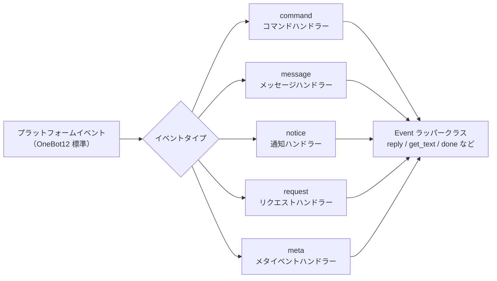

# イベントシステム API

> [!TIP]
> **このドキュメントを読むべきタイミング**：コマンドの登録、メッセージ/通知/リクエストイベントのリッスン、または `event.reply()` / `wait_reply()` / `confirm()` などのイベントインタラクションメソッドを使用する必要がある場合に、本文を参照してください。不要であればスキップしてください。

本ドキュメントでは、ErisPulse イベントシステムの API について詳しく説明します。

イベントシステムは、プラットフォームイベントをタイプごとに 5 種類のハンドラーへディスパッチします：



## Command コマンドモジュール

### コマンドの登録

```python
from ErisPulse.Core.Event import command

# 基本コマンド
@command("hello", help="挨拶を送る")
async def hello_handler(event):
    await event.reply("こんにちは！")

# エイリアス付きコマンド
@command(["help", "h"], aliases=["ヘルプ"], help="ヘルプを表示")
async def help_handler(event):
    pass

# 権限付きコマンド
def is_admin(event):
    return event.get("user_id") in admin_ids

@command("admin", permission=is_admin, help="管理者コマンド")
async def admin_handler(event):
    pass

# 非表示コマンド
@command("secret", hidden=True, help="シークレットコマンド")
async def secret_handler(event):
    pass

# コマンドグループ
@command("admin.reload", group="admin", help="モジュールを再読み込み")
async def reload_handler(event):
    pass

# サブコマンド（スペース区切りの複数トークンからなるコマンド名）
# マッチングには最長プレフィックスを採用：/admin add x は admin add に優先的にヒット（args は ["x"]）。
# サブコマンドで permission が宣言されていない場合、親チェーン上で最も近い位置で権限を宣言している祖先コマンドを継承します
@command("admin add", help="管理者を追加")
async def admin_add_handler(event):
    pass
```

**命名競合ルール**：コマンド名はエイリアスよりも優先されます。既存のコマンドと同名のエイリアスを登録した場合、そのエイリアスは無効となり警告が出力されます。既存のエイリアスと同名のコマンドを登録した場合はコマンド名が優先して有効となり、無効となったエイリアスは自動的に削除されます——いずれの競合の場合も WARNING ログが出力され、サイレントに乗っ取られることはありません。

### コマンド情報

すべてのコマンド照会 API はオプションの**セッションコンテキスト**をサポートしています：`event=`（Event または dict）を渡すか、明示的に `platform=` / `bot_id=` / `session_id=` を渡します（event と併用した場合は明示的パラメータが優先されます）。これにより、スコープモジュールの次元で現在のセッションにおいて利用不可のモジュールのコマンドがフィルタリングされます（詳細は advanced/scope.md を参照）。すべてオプションのキーワード引数であり、渡さない場合は従来通りの全量動作が維持されます。

```python
# コマンドヘルプを取得
help_text = command.help()

# セッション認識ヘルプ：現在のセッションで利用可能なコマンドのみを一覧表示
help_text = command.help(event=event)

# 特定のコマンドを取得（マージ・オーバーライド後の有効なパラメータを返す。セッションで利用不可の場合は None を返す）
cmd_info = command.get_command("admin")
cmd_info = command.get_command("admin", event=event)

# すべてのコマンドを取得（セッション認識時は利用不可モジュールのコマンドをフィルタリング）
all_commands = command.get_commands()
all_commands = command.get_commands(event=event)

# コマンドグループ内のすべてのコマンドを取得（セッション認識フィルタリングに対応）
admin_commands = command.get_group_commands("admin")
admin_commands = command.get_group_commands("admin", event=event)

# すべての可視コマンドを取得
visible_commands = command.get_visible_commands()

# セッション認識の可視コマンド（event または明示的キーワードのいずれかで可）
visible_commands = command.get_visible_commands(event=event)
visible_commands = command.get_visible_commands(
    platform=event.get("platform"),
    bot_id=event.get_self_account_id(),
    session_id=event.get_session_id(),
)
```

### 返信を待つ

```python
# ユーザーの返信を待つ
@command("ask", help="ユーザー情報を尋ねる")
async def ask_command(event):
    reply = await command.wait_reply(
        event,
        prompt="お名前を入力してください:",  # すでに上で送信済み
        timeout=30.0
    )
    
    if reply:
        name = reply.get_text()
        await event.reply(f"こんにちは、{name}さん！")

# 検証付きの返信待ち
def validate_age(event_data):
    try:
        age = int(event_data.get_text())
        return 0 <= age <= 150
    except ValueError:
        return False

@command("age", help="ユーザーの年齢を尋ねる")
async def age_command(event):
    await event.reply("年齢を入力してください:")
    
    reply = await command.wait_reply(
        event,
        timeout=60,
        validator=validate_age
    )
    
    if reply:
        age = int(reply.get_text())
        await event.reply(f"あなたの年齢は {age} 歳です")

# コールバック付きの返信待ち
async def handle_confirmation(reply_event):
    text = reply_event.get_text().lower()
    if text in ["はい", "yes", "y"]:
        await event.reply("操作が確認されました！")
    else:
        await event.reply("操作はキャンセルされました。")

@command("confirm", help="操作を確認")
async def confirm_command(event):
    await command.wait_reply(
        event,
        prompt="'はい'または'いいえ'を入力してください:",
        callback=handle_confirmation
    )
```

## Message メッセージモジュール

### メッセージイベント

```python
from ErisPulse.Core.Event import message

# すべてのメッセージをリッスン
@message.on_message()
async def message_handler(event):
    sdk.logger.info(f"メッセージを受信: {event.get_text()}")

# プライベートメッセージをリッスン
@message.on_private_message()
async def private_handler(event):
    user_id = event.get_user_id()
    sdk.logger.info(f"プライベートチャットから: {user_id}")

# グループメッセージをリッスン
@message.on_group_message()
async def group_handler(event):
    group_id = event.get_group_id()
    sdk.logger.info(f"グループチャットから: {group_id}")

# @メッセージをリッスン
@message.on_at_message()
async def at_handler(event):
    mentions = event.get_mentions()
    sdk.logger.info(f"メンションされたユーザー: {mentions}")
```

### 条件付きリッスン

```python
# 優先度を使用して実行順序を制御
@message.on_message(priority=10)  # 数値が大きいほど優先度が高い
async def high_priority_handler(event):
    pass

# ハンドラー内部で条件フィルタリングを実装
@message.on_message()
async def filtered_handler(event):
    if "キーワード" not in event.get_text():
        return
    # キーワードを含むメッセージを処理
    pass
```

## Notice 通知モジュール

### 通知イベント

```python
from ErisPulse.Core.Event import notice

# フレンド追加
@notice.on_friend_add()
async def friend_add_handler(event):
    user_id = event.get_user_id()
    await event.reply("フレンド追加ありがとうございます！")

# フレンド削除
@notice.on_friend_remove()
async def friend_remove_handler(event):
    user_id = event.get_user_id()
    sdk.logger.info(f"フレンド削除: {user_id}")

# グループメンバーの追加
@notice.on_group_increase()
async def member_increase_handler(event):
    user_id = event.get_user_id()
    await event.reply(f"新しいメンバーを歓迎します！")

# グループメンバーの減少
@notice.on_group_decrease()
async def member_decrease_handler(event):
    user_id = event.get_user_id()
    sdk.logger.info(f"グループメンバーが退出: {user_id}")
```

## Request リクエストモジュール

### リクエストイベント

```python
from ErisPulse.Core.Event import request

# フレンドリクエスト
@request.on_friend_request()
async def friend_request_handler(event):
    user_id = event.get_user_id()
    comment = event.get_comment()
    sdk.logger.info(f"フレンドリクエスト: {user_id}, コメント: {comment}")

# グループ招待リクエスト
@request.on_group_request()
async def group_request_handler(event):
    group_id = event.get_group_id()
    user_id = event.get_user_id()
    sdk.logger.info(f"グループ招待: {group_id}, 送信者: {user_id}")
```

## Meta メタイベントモジュール

### メタイベント

```python
from ErisPulse.Core.Event import meta

# 接続イベント
@meta.on_connect()
async def connect_handler(event):
    platform = event.get_platform()
    sdk.logger.info(f"プラットフォーム {platform} が正常に接続されました")

# 切断イベント
@meta.on_disconnect()
async def disconnect_handler(event):
    platform = event.get_platform()
    sdk.logger.info(f"プラットフォーム {platform} が切断されました")

# ハートビートイベント
@meta.on_heartbeat()
async def heartbeat_handler(event):
    sdk.logger.debug("ハートビートを受信")
```

### Bot ステータス照会

アダプターがメタイベントを送信すると、フレームワークは自動的に Bot のステータスを追跡します。照会 API とライフサイクルイベントのリッスンについては、[アダプターシステム API - Bot ステータス管理](adapter-system.md#bot-ステータス管理) を参照してください。

## Event ラッパークラス

Event モジュールのイベントハンドラーは、Event ラッパークラスのインスタンスを受け取ります。これは dict を継承し、便利なメソッドを提供します。メソッドの完全な一覧、パラメータシグネチャ、および動作の詳細については [Event ラッパークラス詳解](../developer-guide/modules/event-wrapper.md) を参照してください。このセクションでは概要のみを紹介します。

### 機能概要

- **イベント基本情報**：`get_id()` / `get_time()` / `get_type()` / `get_detail_type()` / `get_platform()`
- **ボット情報**：`get_self_platform()` / `get_self_user_id()` / `get_self_account_id()` / `get_self_info()`
- **セッション識別**：`get_target_id()`（統一ターゲット ID。`group_id` → `channel_id` → `guild_id` → `thread_id` → `user_id` の順で最初の空でない値を取得）；`get_session_id()`（形式は `{platform}:{detail_type}:{target_id}`、例：`"telegram:private:12345"`）
- **メッセージ内容と送信者**：`get_message()` / `get_alt_message()` / `get_text()` / `get_user_id()` / `get_sender()` / `get_group_id()` など
- **メッセージタイプ判定**：`is_message()` / `is_private_message()` / `is_group_message()` / `is_at_message()` / `has_mention()` / `get_mentions()`
- **返信**：`reply(content, method=..., at_sender=..., quote=..., at_users=..., reply_to=..., at_all=..., via=...)` / `reply_ob12()`；プラットフォーム機能の照会 `supports()` / `available_methods()`；自由送信チェーン `send_chain()` は [SendDSL 詳解](../developer-guide/adapters/send-dsl.md#方法2eventsend_chain) を参照
- **コマンド情報**：`get_command_name()` / `get_command_args()` / `is_command()` など
- **インタラクティブセッション**：`wait_reply()` / `confirm()` / `choose()` / `collect()` / `wait_for()` / `conversation()`
- **ツール**：`to_dict()`（内部キーをフィルタリング）/ `get_raw()` / `get_raw_type()`

> 各メソッドの完全なパラメータ説明と例については [Event ラッパークラス詳解](../developer-guide/modules/event-wrapper.md) を参照してください。マルチターン対話の高度な内容は [Conversation マルチターン対話](../advanced/conversation.md) を参照してください。

### チェーン制御

`event.done(claim=, stop=)` は「クレーム（claim）」と「ブロック（stop）」という 2 つの直交するセマンティクスを統一的に制御します：

- **クレーム（claim）**：イベントが処理済みであることをマークし（`_processed`）、コマンドディスパッチャーはこれに基づいて重複排除をスキップします
- **ブロック（stop）**：低優先度ハンドラーへの伝播を阻止します（`_propagation_stopped`）

```python
# クレーム + ブロック（デフォルト）
event.done()

# クレームのみ、ブロックなし（低優先度のオブザーバーも引き続き確認できる）
event.done(stop=False)

# ブロックのみ、クレームなし（ファイアウォール / レート制限など）
event.done(claim=False)

# mark_processed が本体メソッド、done はそのエイリアス
event.mark_processed()             # event.done() と同等
event.mark_processed(stop=False)   # event.done(stop=False) と同等

# ステータスの照会
event.is_processed()  # クレーム済みかどうか
event.is_stopped()    # 伝播がブロック済みかどうか
```

### プラットフォーム拡張メソッド

アダプターは Event にプラットフォーム固有のメソッドを登録でき、そのメソッドは対応するプラットフォームのインスタンスでのみ利用できます。

#### ユーザー：プラットフォーム拡張メソッドの利用

アダプターがプラットフォーム固有のメソッドを登録すると、イベントハンドラー内で直接呼び出せるようになります。メソッドはプラットフォームごとに異なるため、対応する [プラットフォームドキュメント](../platform-guide/) を参照してください。

```python
from ErisPulse.Core.Event import message

@message.on_message()
async def handle_message(event):
    platform = event.get_platform()

    # プラットフォームに応じて固有メソッドを呼び出す
    if platform == "email":
        subject = event.get_subject()           # メール固有
        attachments = event.get_attachments()   # メール固有
```

#### プラットフォームに登録済みのメソッドの照会

```python
from ErisPulse.Core.Event import get_platform_event_methods

# 特定のプラットフォームに登録されているメソッドを確認
methods = get_platform_event_methods("email")
# ["get_subject", "get_from", "get_attachments", ...]

# 動的に判定して呼び出す
for method_name in get_platform_event_methods(event.get_platform()):
    method = getattr(event, method_name)
    print(f"{method_name}: {method()}")
```

#### プラットフォームメソッドの分離

異なるプラットフォームで登録されたメソッドは互いに干渉しません：

```python
# メールイベント - メールのメソッドのみ
event = Event({"platform": "email", "email_raw": {"subject": "Hello"}})
event.get_subject()      # ✅ "Hello"
event.get_chat_type()    # ❌ AttributeError

# Telegram イベント - Telegram のメソッドのみ
event = Event({"platform": "telegram", "telegram_raw": {"chat": {"type": "private"}}})
event.get_chat_type()    # ✅ "private"
event.get_subject()      # ❌ AttributeError
```

#### `hasattr` / `dir` のサポート

```python
hasattr(event, "get_subject")   # platform="email" の場合のみ True を返す
"get_subject" in dir(event)     # 同様
```

### アダプター：プラットフォーム拡張メソッドの登録

アダプターはデコレーターを通じて Event にプラットフォーム固有のメソッドを登録できます。メソッドの最初のパラメータは `self`（Event インスタンス）で、イベントデータに自由にアクセスできます。

#### 単一メソッドの登録

```python
from ErisPulse.Core.Event import register_event_method

@register_event_method("email")
def get_subject(self):
    """メールの件名を取得"""
    return self.get("email_raw", {}).get("subject", "")

@register_event_method("email")
def get_from(self):
    """送信者を取得"""
    return self.get("email_raw", {}).get("from", {})
```

#### 一括登録（Mixin クラス）

メソッドが多い場合は、Mixin クラスによる一括登録が推奨されます：

```python
from ErisPulse.Core.Event import register_event_mixin

class EmailEventMixin:
    def get_subject(self):
        return self.get("email_raw", {}).get("subject", "")

    def get_from(self):
        return self.get("email_raw", {}).get("from", {})

    def get_attachments(self):
        return self.get("email_raw", {}).get("attachments", [])

# すべてのメソッドを一度に登録
register_event_mixin("email", EmailEventMixin)
```

#### 戻り値の規約

| シナリオ | 戻り値 | ユーザーの使用方法 |
|------|--------|------------|
| データを返す（テキスト、辞書など） | 値をそのまま返す | `subject = event.get_subject()` |
| 操作を実行する（メッセージ送信など） | `asyncio.Task` を返す | `task = event.do_something()` `await` は任意 |

> **推奨**：データを返さないメソッドは `asyncio.Task` を返すようにしてください。そうすることで、`await` するかどうかをユーザーが自由に決定でき、`await` しなかった場合でも操作は最後まで実行されます。

```python
@register_event_method("email")
def forward_email(self, to_address: str):
    """メールを転送する — Task を返し、ユーザーが await するかどうかを自由に決定できる"""
    import asyncio
    return asyncio.create_task(
        self._do_forward(to_address)
    )

# ユーザーは await で結果を待つことができる
await event.forward_email("user@example.com")

# await しない場合でも、操作はバックグラウンドで実行される
event.forward_email("user@example.com")
```

#### メソッドの登録解除

```python
from ErisPulse.Core.Event import unregister_event_method, unregister_platform_event_methods

# 単一メソッドの登録解除
unregister_event_method("email", "get_subject")

# 特定プラットフォームの全メソッドの登録解除（アダプターの shutdown 時に呼び出す）
unregister_platform_event_methods("email")
```

#### 組み込みメソッドのオーバーライド

`register_event_mixin` / `register_event_method` は、Event の組み込みメソッド（`confirm`、`choose`、`collect`、`wait_reply`、`reply` など）のオーバーライドをサポートしています。登録されたプラットフォームメソッドは `Event.__getattribute__` を経由して組み込みメソッドより優先的に有効になるため、アダプターはプラットフォーム特有のインタラクション実装を提供できます。

組み込み実装は `_builtin_*` 関数としてエクスポートされており、オーバーライド側はこれらをフォールバックとして呼び出せます：

```python
from ErisPulse.Core.Event import register_event_mixin, _builtin_choose

class YunhuEventMixin:
    async def choose(self, prompt, options, timeout=60, method="Text"):
        # Yunhu プラットフォームではボタンコンポーネントを使用
        buttons = [[{"text": opt} for opt in options]]
        await self.reply(prompt)
        # ...ボタンコールバックまたはテキスト返信を待つ...
        # 組み込みロジックへフォールバック
        return await _builtin_choose(self, None, options, timeout, "Text")

register_event_mixin("yunhu", YunhuEventMixin)
```

## クロスプラットフォーム拡張（ワイルドカード）

`register_event_method` と `register_event_mixin` は、プラットフォーム名として `"*"` を渡すことをサポートしており、登録されたメソッドは**すべてのプラットフォーム**の Event インスタンスで利用できます。AI 対話、コンテキスト管理など、クロスプラットフォームでの再利用が必要な機能モジュールに適しています。

### クロスプラットフォームメソッドの登録

```python
from ErisPulse.Core.Event.wrapper import register_event_method

@register_event_method("*")
async def ai_chat(self, prompt: str):
    """self は Event インスタンスであり、イベントデータや組み込みメソッドに自由にアクセスできる"""
    await self.reply(f"AI: {prompt}")
```

登録後、すべてのプラットフォームのイベントハンドラーから呼び出せます：

```python
from ErisPulse.Core.Event import message

@message.on_message()
async def handler(event):
    await event.ai_chat(event.get_text())
```

### メソッド解決の優先順位

属性アクセスで Event メソッドを取得する際の解決順序は次の通りです：

1. **プラットフォーム固有メソッド**（現在のプラットフォームのオーバーライド）
2. **ワイルドカードメソッド**（`"*"` で登録されたクロスプラットフォームメソッド）
3. **組み込みメソッド**（`reply`、`confirm` など）
4. **辞書キーとしてのアクセス**

> そのため、ワイルドカードメソッドは組み込みメソッド（`reply` など）をオーバーライドできますが、同名のプラットフォーム固有メソッドがあればさらにそちらが優先されます。

## 優先度システム

イベントハンドラーは優先度をサポートしており、数値が大きいほど優先度が高くなります：

```python
# 高優先度のハンドラーが先に実行される
@message.on_message(priority=10)
async def high_priority_handler(event):
    pass

# 低優先度のハンドラーが後に実行される
@message.on_message(priority=0)
async def low_priority_handler(event):
    pass
```

## 関連ドキュメント

**API の参照を続ける**：
- [コアモジュール API](core-modules.md) - コアモジュール API
- [アダプターシステム API](adapter-system.md) - Adapter 管理 API

**サンプルからイベント処理を学ぶ**：
- [モジュール開発ガイド](../developer-guide/modules/) - カスタムモジュールの開発
- [イベント処理](../getting-started/event-handling.md) - イベント処理入門チュートリアル