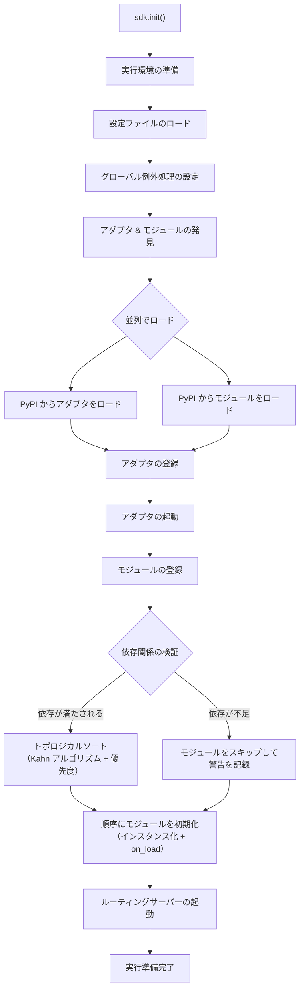
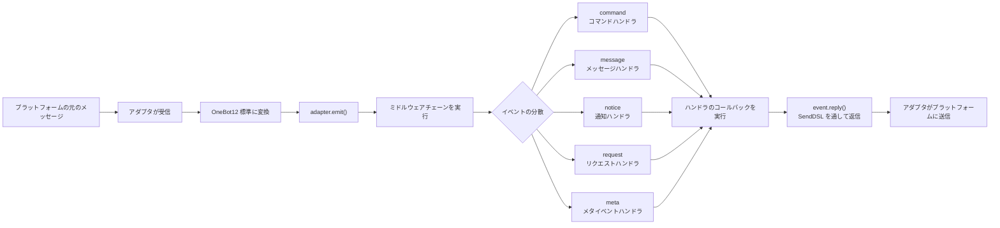
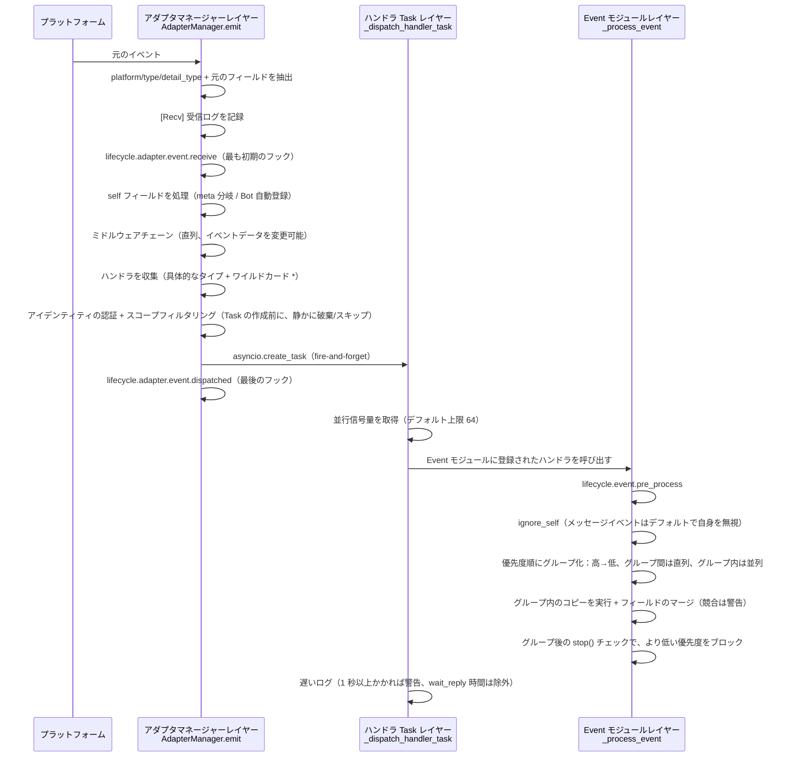
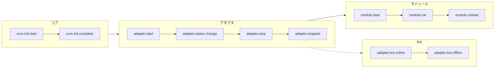
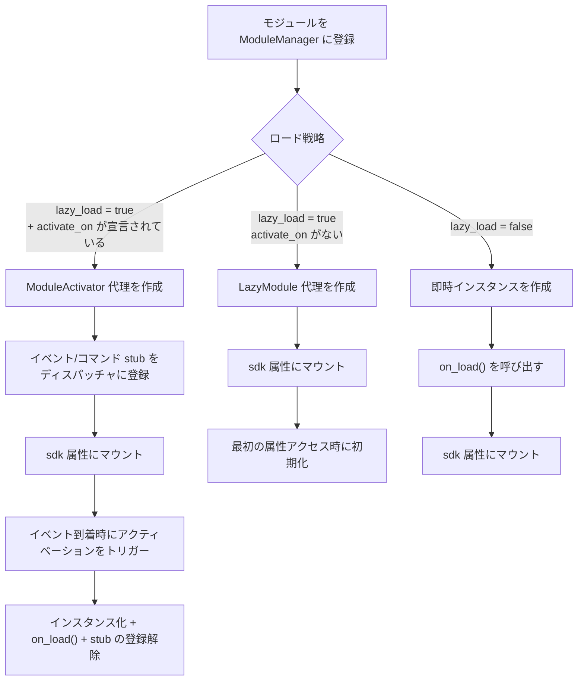
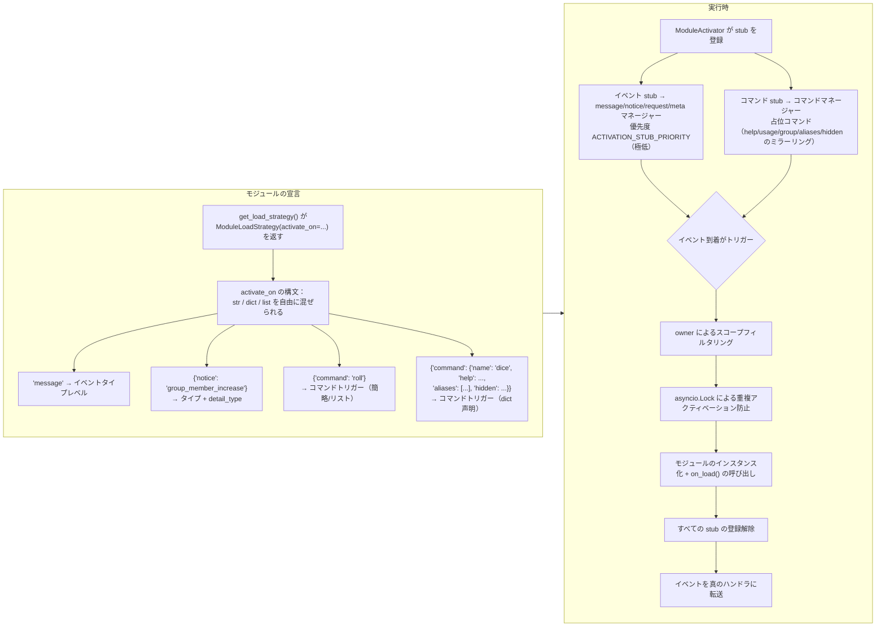
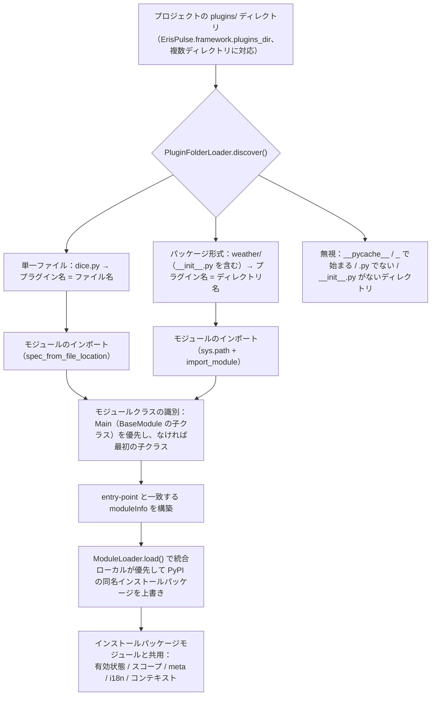
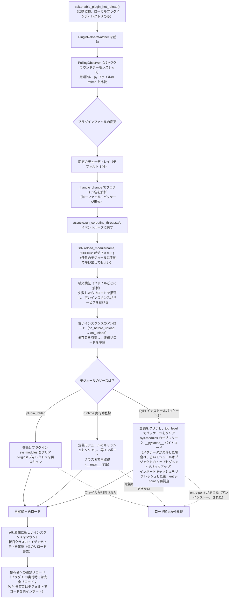

# アーキテクチャ概要

> [!TIP]
> **この記事を読むタイミング**：フレームワークが背後で何をしているのか、1 つのメッセージがどのように流れるのか、モジュールがどのような順序で初期化されるのか、ホットリロード時に何が起こるのか、または「フレームワークがなぜそのように振る舞うのか」を理解したいときに読んでください。ハンドラを書くだけなら [イベント処理の入門](getting-started/event-handling.md) で十分です。必要なければ飛ばしてください。

ユーザーが送信したメッセージがロボットに返信されるまで、メッセージはアダプタ変換、ミドルウェア、スコープフィルタリング、優先度スケジューリングといった数段階を経ます。モジュールも起動時にすべて読み込まれるわけではありません。この記事では、このチェーンを図で明確に描き、各段階で何ができるかを説明します。

## SDK のコアアーキテクチャ

下図は、SDK のコアモジュールの構成とその関係を示しています：

### コアモジュールの説明

| モジュール | 説明 |
|------|------|
| **Event** | イベントシステム。command / message / notice / request / meta の 5 種類のイベント処理と、Conversation 多輪対話機能を提供します。|
| **Adapter** | アダプタマネージャー。複数のプラットフォーム用アダプタの登録、起動、停止を管理します。|
| **Module** | モジュールマネージャー。プラグインの登録、ロード、アンロードを管理し、依存関係の宣言とトポロジカルソートをサポートします。|
| **Lifecycle** | ライフサイクルマネージャー。イベント駆動のライフサイクルフックを提供します。|
| **Storage** | SQLite を基にしたキー値ストレージシステム。一般的な SQL チェーン式クエリをサポートします。|
| **Config** | TOML 形式の設定ファイルを管理します。|
| **Logger** | モジュール化されたログシステム。サブロガーをサポートします。|
| **Router** | HTTP/WebSocket ルーティング管理。抽象層を介して下層バックエンド（現在は FastAPI + Uvicorn）をカプセル化し、デコレータールーティング、ミドルウェア、グループ、リクエスト制限、CORS をサポートします。|
| **Client** | 統一 HTTP/WS クライアント（2.8.0 以前は `HttpClient` で、互換性のエイリアスを保持）。抽象層を介して下層リクエストライブラリ（現在は aiohttp）をカプセル化し、リクエスト統計、リトライ、ログ、WebSocket クライアント、ErisPulse の例外体系等功能を提供します。クライアントとサーバーの WebSocket は `WebSocketConnectionBase` 基底クラスを共有します。|

## 初期化の流れ

下図は `sdk.init()` の完全な初期化プロセスを示しています：

### 初期化段階の詳細

> 完全な初期化の流れを分解した（Finder / Loader / Manager / Router）、下層のエントリーポイント（`init()` / `init_task()` / `init_sync()`）と手動での完全起動については [起動プロセスと手動制御](advanced/startup.md) を参照してください。

## イベント処理の流れ

下図は、プラットフォームからハンドラまでのメッセージの完全な流れを示しています：

### イベント処理のチェーンの詳細

上記の図は「結果」です。下に `adapter.emit()` の後でフレームワークが**背後で何をしたか**を分解します。これは 3 層の分散チェーンです：

**各ステップでフレームワークが何をしたか、そして何を干预できるか：**

| ステージ | フレームワークが何をしたか | あなたが干预できる |
|------|-------------|-----------|
| 受信 | 標準フィールドを抽出し、`{platform}_raw` の元のデータを保持。`[Recv]` ログを記録 | `adapter.event.receive` を監視して初期イベントを取得 |
| self フィールド | meta イベントは connect/disconnect/heartbeat 分岐を処理。通常のイベントは Bot を自動登録し、`adapter.bot.online` をトリガー | `adapter.bot.online` / `bot.offline` を監視 |
| ミドルウェア | **直列**で実行。戻り値が None でなければイベントデータを置き換える | ミドルウェアを登録してイベントを変更/ブロック |
| 分発と収集 | 具体的なタイプのハンドラを先に取得し、次に `*` ワイルドカードハンドラを取得 | — |
| アイデンティティ次元 | 分発の入口はユーザー > 会話 > Bot > アダプタの順に判定し、イベントを受け取るかどうかを決定（`scope.is_identity_allowed`）。**拒否された場合はイベントは完全に破棄される** | `ErisPulse.scope.identity` をバインド |
| スコープフィルタリング | モジュールの所有者に応じて `scope.is_allowed` を判定（会話レベル > Bot レベル > プラットフォームレベル）。**不通過の場合は静かにスキップ** | スコープのホワイトリスト/ブラックリストを設定 |
| スケジューリング | 各マッチするハンドラは独立した `asyncio.Task` で実行される。`emit()` はハンドラの完了を待たずに即座に返却される | — |
| 優先度 | 高優先度のグループが先に実行される。**グループ間は直列、グループ内は並列**（グループ内の各ハンドラはイベントのコピーを持ち、フィールドをマージし、競合は WARNING として警告）。 | `@command(..., priority=N)` / 登録時に priority を指定 |
| ブロッキング | 各グループの処理後、`event.is_stopped()` をチェックし、マッチした場合は**より低い優先度は実行されない** | `event.mark_processed(stop=True)` / `event.done()` |

> **よくある誤解**：
> 1. **スコープフィルタリングは静かに実行される**— フィルターされたハンドラはエラーもレスポンスも出さず、TRACE ログレベルでのみ表示される（`core.scope.denied`）。"私のモジュールにメッセージが届かない"場合は、まずスコープのバインドを確認してください。
> 2. **ハンドラは天然並列**— フレームワークは各ハンドラに独立した Task を作成しており、**自分で `asyncio.create_task` をラップする必要はない**。
> 3. **同じ優先度のグループ内ではブロッキングされない**— `mark_processed(stop=True)` は、より低い優先度のグループをブロックするだけで、同じグループ内で並行実行中のハンドラは途中で中断されない。
> 4. **遅いログの閾値は固定の 1 秒**— ハンドラの処理時間が 1 秒を超えると、ログに WARNING が出る（`wait_reply` の待機時間は処理時間から除外される）が、実行は中断されない。

> スコープのモジュール次元の 3 級バインド、アイデンティティ次元の認証と出力アクション制限の詳細は [スコープ（scope）](advanced/scope.md) を参照してください。イベントスコープのテキストフィルタリングとコマンドユーザー ACL は [イベント処理の入門](getting-started/event-handling.md) を参照してください。並列上限の設定は [設定ガイド](user-guide/configuration.md#フレームワーク設定) を参照してください。

## ライフサイクルイベント

下図はフレームワーク各コンポーネントのライフサイクルイベントの発生順序を示しています：

### ライフサイクルイベントの監視

> 完全なイベント監視方法（`lifecycle.on()` / `once()` / `has_handlers()`）、すべてのライフサイクルイベントリストとデータ形式は [ライフサイクル管理](advanced/lifecycle.md) を参照してください。

## モジュールのロード戦略

ErisPulse は 3 つのモジュールロード戦略をサポートし、`get_load_strategy()` が返す `ModuleLoadStrategy` によって宣言されます：

> 詳細は [遅延ロードシステム](advanced/lazy-loading.md)、[ライフサイクル管理](advanced/lifecycle.md) およびモジュールのドキュメントを参照してください。

### イベント駆動遅延アクティベーション（`activate_on`）のトリガーアーキテクチャ

> [!NOTE]
> この機能は ErisPulse **2.8.0+** が必要です。

`activate_on` を使用すると、モジュールは**最初のマッチするイベント/コマンドが到着した時点で**初めてロードされ、常駐メモリを避けることができ、同時にイベントのロスも防げます：

**トリガの意味の要点：**

> 完全な `activate_on` 構文（str / dict / list）、コマンド dict 声明、占位コマンド help のフォールバックチェーン、スコープフィルタリング、失敗の意味については [遅延ロードシステム](advanced/lazy-loading.md#イベント駆動遅延アクティベーションactivate_on) を参照してください。

## 本地プラグインフォルダのアーキテクチャ

> [!NOTE]
> この機能は ErisPulse **2.8.0+** が必要です。

ローカルプラグイン（`plugins/` ディレクトリ）は、パッケージ化して公開する必要がなく、フレームワークの起動時に自動的に発見され、ロードされます：

**約束と特性：**

- プラグイン名の由来：単一ファイルはファイル名、パッケージ形式はディレクトリ名
- ローカルプラグイン `moduleInfo.meta.source == "plugin_folder"` で、PyPI インストールパッケージモジュールとシームレスに共存
- 同名の場合はローカルが優先（ローカルの上書きデバッグに便利）、無効化された場合は同名の entry-point 条目も削除

## モジュールのホットリロードアーキテクチャ

ホットリロードは**すべてのモジュールソース**に対して一貫しています：ローカルプラグイン（`plugins/` ディレクトリ）、実行時登録（`sdk.module.register()`）、PyPI インストールパッケージモジュールはすべて `sdk.reload_module()` / `sdk.module.reload()` でホットリロードできます。**デフォルトは全量リロード**（トップレベルパッケ名で import キャッシュをクリアし、依存者コードを再インポート、`full=False` は軽量の逃生門）；`sdk.reload_all_modules()` / `sdk.module.reload_all()` で登録済みのすべてのモジュールを一度に全量リロードできます（pip で一括アップデート後に呼び出すことですべてが有効になります）：

**3 つのソースの違いは発見段階のみ**、検証、アンロード、連鎖リロードは完全に同じです：

- **ローカルプラグイン**（`moduleInfo.meta.source == "plugin_folder"`）：`sys.modules` をクリアした後、`plugins/` ディレクトリを再スキャンします。ファイルが削除された場合は、ロード結果から削除されます。
- **実行時登録**（`source == "runtime"`）：定義モジュールを再インポートし、クラス名で再取得して再登録します。`__main__` に定義されている、またはソースファイルのないクラスは再インポートを拒否します（守衛アラート、エントリースクリプトの再実行を防ぎます）。
- **PyPI インストールパッケージ**：`meta.top_level` に基づいて、`sys.modules` のサブツリーをクリアし、インポートキャッシュをリフレッシュします（entry-point 60 秒キャッシュを突破）。再調査して再インポートします。entry-point が消えた（pip でアンインストールされた）場合は、ロード結果から削除されます。

**デフォルトの意味と信頼性の保証（2.11）：**

- **reload は全量リロード**：デフォルトで、トップレベルパッケージ名に基づいて `sys.modules` をクリアし、依存者コードを再インポートします。`full=False` は、メタデータに基づいてクリアし、PyPI 依存者は直接再インスタンス化するだけです（巨大な依存ツリーのパフォーマンスのための逃生門）。
- **構文検証のゲート**：アンロードのプロセスに入る前に、ファイルごとに構文解析を行い、失敗した場合はリロードを拒否します。古いインスタンスはアンロードされず、サービスを継続します。構文エラーは、モジュールを「半死」状態にすることがありません（巨大なパッケージでファイル数上限を超えた場合は、検証をスキップします）。
- **キャッシュのバックアップ**：`top_level` メタデータが欠落した場合は、「旧モジュールオブジェクト `__name__` 前方一致 → モジュールクラス `__module__` 前方一致」の 2 段階でクリア範囲を推定します。リロードの際には、ソースファイルのバイトコードキャッシュ（`__pycache__`）もクリアし、秒単位で長さが同じ小さな変更でも有効になります。
- **アイデンティティの確認**：リロードが成功した後、新旧のクラスアイデンティティが変化しているかをアサーションし、変化していない場合（C 拡張など、キャッシュがクリアできない場合）は明示的に警告し、`module.reload` イベントに `identity_changed: false` を含めます。`module.get_info()` は `running_identity` / `stale` フィールドで「登録されたバージョン ≠ 実行中のバージョン」を公開します。
- **失敗の確認**：load 失敗の現場（例外 + traceback）は、`module.last_error(名前)` / `get_info()["last_error"]` から直接確認できます。失敗したパスは、そのモジュールの import キャッシュをクリアします。「コードを変更してから再 reload する」ことで、必ず新しいコードを読み込むことができます。
- 重載は、もともと遅延ロードのモジュールを強制的にアクティブにします（明示的なログ）。`reload_all_modules()` は、遅延ロードの戦略を維持し、重載前に既にロード済みのモジュールを再アクティブにし、スリープ（休眠）中のモジュールはスリープのままにします。
- `reload_all_modules()` は依存関係のトポロジカル順序で再ロードし、単一モジュールの失敗は診断を記録してスキップします（全体のロールバックはしない—on_unload の副作用は取り消せないため、単一モジュールのホットリロードのベストエフォートの意味と一致）。重載失敗でロールバックされた状況も同様で、ログには明確に旧インスタンスが終了済みであることが示されます。

## アダプタのホットリロードアーキテクチャ

アダプタのコードレベルのホットリロード（2.11）は、モジュールのパイプラインと同構造です：`sdk.adapter.reload(プラットフォーム名)` / `sdk.reload_adapter(プラットフォーム名)` は、**ローカルプラグイン**と **PyPI インストールパッケージ**の 2 つのソースに対して実行されます：

**モジュールのパイプラインとの違い：**

- アダプタには遅延ロードや依存の連鎖リロードがない：リロードは**依存する他のアダプタには連鎖しない**（警告のみ—依存先は登録表を間接的に消費しており、インスタンスの連鎖的な意味はない）。
- 起動は非同期のチェーン（`startup` は `_run_adapter` で発行され、依存のスキップと指数的バックオフリトライを含む）：起動の一時的な失敗は**リロードの失敗とは見なされない**（コードはすでに新しいものに変わっているため）、結果は `adapter.status.change` で通知される。
- `register()` のインスタンスの再利用の落とし穴（同じオブジェクトは旧インスタンスが再利用される）は、「pyc クリア + sys.modules クリア + アイデンティティの確認」の 3 つの手段でバックアップされる。
- ライフサイクルイベント：`adapter.reload`（payload に `adapter_name` / `success` / `full` / `duration_ms` / `identity_changed` / `version_old→new` / `was_started` / `source` を含む）

## 次に進むべきこと

- **起動/終了を手動で制御したい**：[起動プロセスと手動制御](advanced/startup.md) を参照してください。初期化の各段階を分解し、個別にアダプタやルーティングを起動・停止できます。
- **遅延ロードとスリープを理解したい**：[遅延ロードシステム](advanced/lazy-loading.md) を参照してください。`activate_on` イベント駆動遅延アクティベーションの完全な構文が含まれています。
- **モジュールを書くときにライフサイクルを上手く使う**：[ライフサイクル管理](advanced/lifecycle.md) を参照してください。すべてのライフサイクルイベントと監視方法が含まれています。