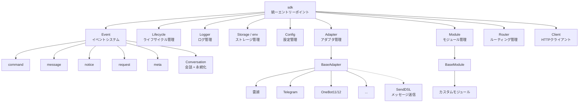
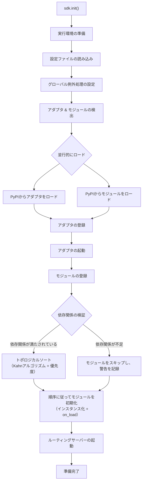
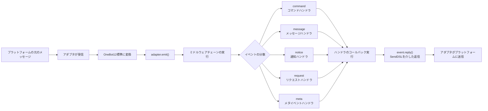
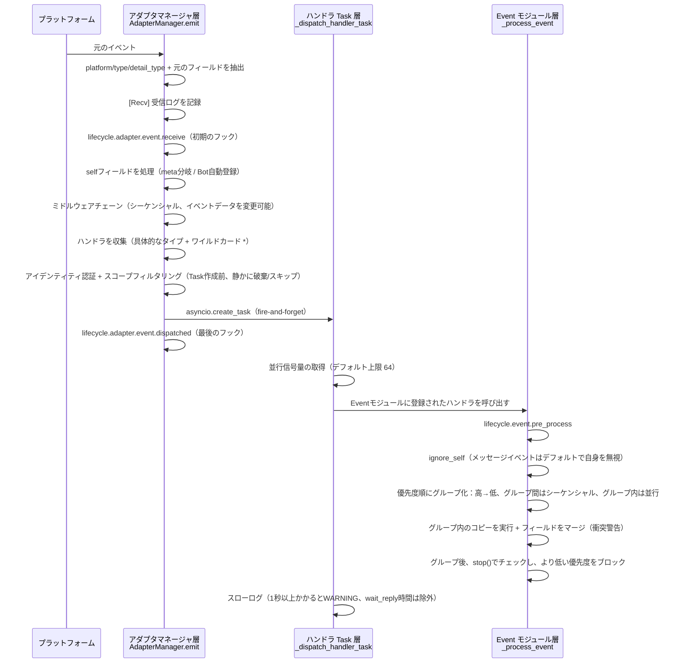
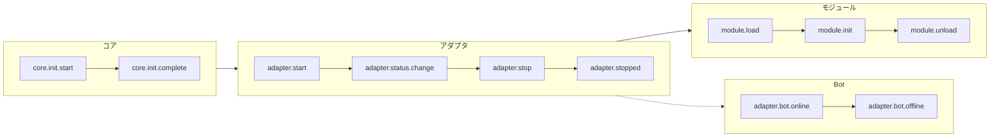
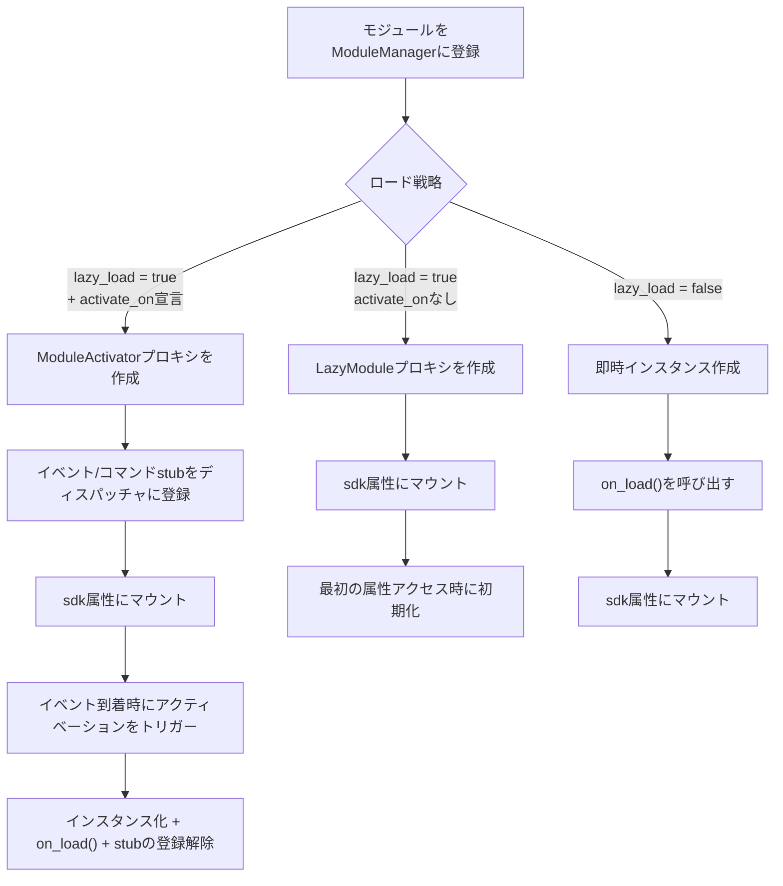
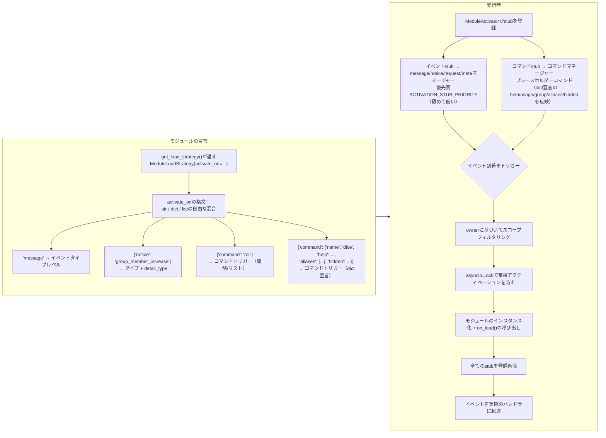
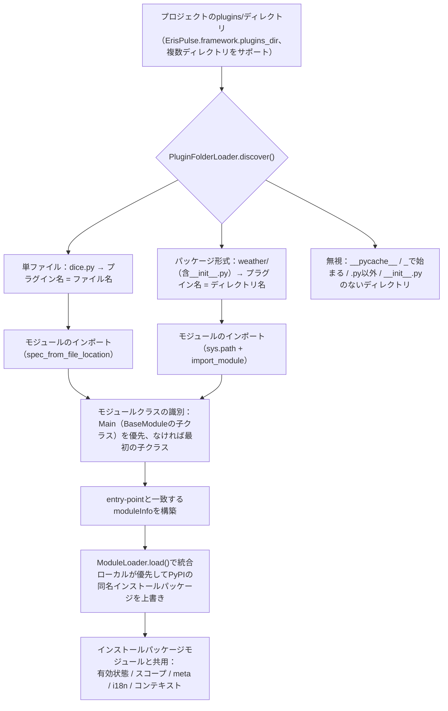
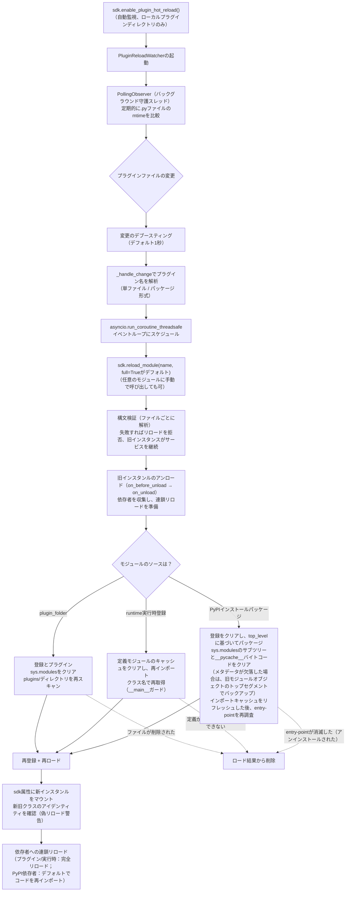
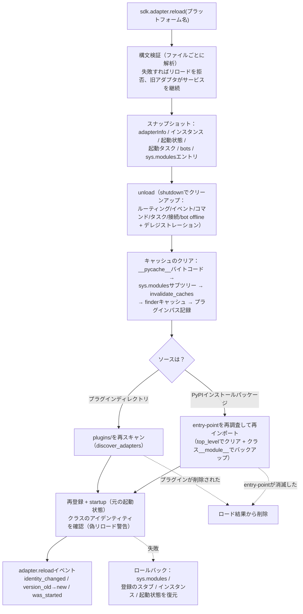

# アーキテクチャ概要

このドキュメントでは、ErisPulse SDKの技術的アーキテクチャを可視化した図解により、フレームワークの設計思想とモジュール間の関係を迅速に理解できるようご案内します。

## SDKコアアーキテクチャ

以下の図は、SDKのコアモジュール構成とその関係を示しています：

### コアモジュールの説明

| モジュール | 説明 |
|------|------|
| **Event** | イベントシステム。command / message / notice / request / metaの5種類のイベント処理、およびConversationによる多段対話処理を提供。|
| **Adapter** | アダプタマネージャー。複数プラットフォーム用アダプタの登録、起動、停止を管理。|
| **Module** | モジュールマネージャー。プラグインの登録、ロード、アンロードを管理。依存関係の宣言とトポロジカルソートをサポート。|
| **Lifecycle** | ライフサイクルマネージャー。イベント駆動のライフサイクルフックを提供。|
| **Storage** | SQLiteベースのキーバリューストレージシステム。一般的なSQLチェーンクエリをサポート。|
| **Config** | TOML形式の設定ファイル管理。|
| **Logger** | モジュール化されたログシステム。サブロガーをサポート。|
| **Router** | HTTP/WebSocketルーティング管理。抽象層を介して下層バックエンド（現在はFastAPI + Uvicorn）をカプセル化。デコレータルーティング、ミドルウェア、グループ、リクエスト制限、CORSをサポート。|
| **Client** | 統一されたHTTP/WSクライアント（2.8.0以前は`HttpClient`、互換エイリアスを保持）。抽象層を介して下層リクエストライブラリ（現在はaiohttp）をカプセル化。リクエスト統計、リトライ、ログ、WebSocketクライアント、ErisPulseの例外体系を提供。クライアントとサーバーのWebSocketは`WebSocketConnectionBase`基底クラスを共有。|

## 初期化フロー

以下の図は、`sdk.init()`の完全な初期化プロセスを示しています：

### 初期化フェーズの詳細

> 完全な初期化の流れを分解した（Finder / Loader / Manager / Router）、下層エントリポイント（`init()` / `init_task()` / `init_sync()`）と手動の完全起動は [起動フローと手動制御](advanced/startup.md) を参照してください。

## イベント処理フロー

以下の図は、プラットフォームからハンドラへのメッセージの完全な転送経路を示しています：

### イベント処理チェーンの詳細

上記の図は「結果」です。下に`adapter.emit()`を展開したフレームワークが**裏で何をしているか**を示します。これは3層の分散チェーンです：

**フレームワークが何をしたか、そしてあなたが介入できる部分：**

| フェーズ | フレームワークが何をしたか | 介入できる部分 |
|------|-------------|-----------|
| 受信 | 標準フィールドを抽出、`{platform}_raw`の元データを保持；`[Recv]`ログを記録 | `adapter.event.receive`を監視して初期イベントを取得 |
| selfフィールド | metaイベントはconnect/disconnect/heartbeat分岐；通常のイベントはBotを自動登録し`adapter.bot.online`をトリガー | `adapter.bot.online` / `bot.offline`を監視 |
| ミドルウェア | **シーケンシャル**に実行、戻り値がNoneでなければイベントデータを置換 | ミドルウェアを登録してイベントを変更/ブロック |
| 分散収集 | 先に具体的なタイプのハンドラを取得し、次に`*`ワイルドカードハンドラを取得 | — |
| アイデンティティ | 分散の入口はユーザー>会話>Bot>アダプタの順でイベントの受信を判定（`scope.is_identity_allowed`）、**拒否された場合、イベントは完全に破棄** | `ErisPulse.scope.identity`をバインド |
| スコープフィルタリング | モジュールのownerに基づいて`scope.is_allowed`を判定（会話レベル>Botレベル>プラットフォームレベル）、**通過しない場合、静かにスキップ** | スコープのホワイトリスト/ブラックリストを設定 |
| スケジューリング | 各マッチするハンドラは独立した`asyncio.Task`、`emit()`は**ハンドラの完了を待たずに即座に返却** | — |
| 優先度 | 高優先度のグループが先に実行；**グループ間はシーケンシャル、グループ内は並行**（グループ内のハンドラはイベントのコピーを持ち、フィールドをマージし、衝突時はWARNINGを出力） | `@command(..., priority=N)` / 登録時にpriorityを指定 |
| ブロッキング | 各グループ処理後、`event.is_stopped()`をチェックし、ヒットした場合**より低い優先度は実行されない** | `event.mark_processed(stop=True)` / `event.done()` |

> **よくある誤解**:
> 1. **スコープフィルタリングは静かである**— フィルタリングされたハンドラはエラーもレスポンスも出さず、TRACEレベルのログ（`core.scope.denied`）でのみ表示される。「モジュールがメッセージを受け取らない」場合は、まずスコープのバインドを確認すること。
> 2. **ハンドラは天然に並行である**— フレームワークは各ハンドラに対して独立したTaskを作成しており、**自分で`asyncio.create_task`をラップする必要はない**。
> 3. **同じ優先度のグループ内ではブロッキングしない**— `mark_processed(stop=True)`は、より低い優先度のグループをブロックするだけで、同じグループ内の並行実行中のハンドラは途中で中断されない。
> 4. **スローログの閾値は固定の1秒である**— ハンドラの処理時間が1秒を超えるとログにWARNINGが出力される（`wait_reply`の待ち時間は処理時間から除外される）が、処理は中断されない。

> スコープ（scope）のモジュール次元の3段階のバインド、アイデンティティ次元の認証と出力アクション制限の詳細は [スコープ（scope）](advanced/scope.md) を参照してください。イベントスコープのテキストフィルタリングとコマンドユーザーACLは [イベント処理入門](getting-started/event-handling.md) を参照してください。並行上限の設定は [設定ガイド](user-guide/configuration.md#フレームワーク設定) を参照してください。

## ライフサイクルイベント

以下の図は、フレームワークの各コンポーネントのライフサイクルイベントの発生順序を示しています：

### ライフサイクルイベントの監視

> 完全なイベントリスナーのメソッド（`lifecycle.on()` / `once()` / `has_handlers()`）、全ライフサイクルイベントのリストとデータ形式は [ライフサイクル管理](advanced/lifecycle.md) を参照してください。

## モジュールロード戦略

ErisPulseは、`get_load_strategy()`が返す`ModuleLoadStrategy`で宣言される3種類のモジュールロード戦略をサポートします：

> 詳細は [遅延ロードシステム](advanced/lazy-loading.md)、[ライフサイクル管理](advanced/lifecycle.md)、およびモジュールドキュメントを参照してください。

### イベント駆動遅延アクティベーション（`activate_on`）のトリガーアーキテクチャ

> [!NOTE]
> この機能はErisPulse **2.8.0以降**が必要です。

`activate_on`は、モジュールを**最初のマッチするイベント/コマンドが到着したときに初めてロード**するようにします。これにより、メモリ常駐を避けることができ、イベントのロスもありません：

**トリガーセマンティクスの要点：**

> 完全な`activate_on`の構文（str / dict / list）、コマンドdict宣言、プレースホルダのhelpのフォールバックチェーン、スコープフィルタリング、失敗のセマンティクスは [遅延ロードシステム](advanced/lazy-loading.md#イベント駆動遅延アクティベーションactivate_on) を参照してください。

## 本地プラグインフォルダアーキテクチャ

> [!NOTE]
> この機能はErisPulse **2.8.0以降**が必要です。

ローカルプラグイン（`plugins/`ディレクトリ）は、パッケージ化して公開する必要がなく、フレームワークの起動時に自動的に検出されロードされます：

**規約と特性：**

- プラグイン名の取得元：単ファイルはファイル名、パッケージ形式はディレクトリ名
- 本地プラグイン`moduleInfo.meta.source == "plugin_folder"`、PyPIインストールパッケージモジュールとシームレスに共存
- 同名の場合はローカルが優先（ローカル上書きデバッグ用）、無効化された場合は同名のentry-point項目も削除

## モジュールのホットリロードアーキテクチャ

ホットリロードは**全てのモジュールソース**に対して一貫しています：ローカルプラグイン（`plugins/`ディレクトリ）、実行時登録（`sdk.module.register()`）、PyPIインストールパッケージモジュールはすべて`sdk.reload_module()` / `sdk.module.reload()`でホットリロード可能——**デフォルトは全量リロード**（トップレベルパッケ名に基づいてimportキャッシュをクリアし、依存者コードを再インポート、`full=False`は軽量の安全弁）、`sdk.reload_all_modules()` / `sdk.module.reload_all()`で一度に全量リロード可能（pipで一括アップデート後に呼び出すと全てが有効になります）：

**3つのソースの差異は発見フェーズのみで、検証、アンロード、連鎖リロードは完全に一致します：**

- **ローカルプラグイン**（`moduleInfo.meta.source == "plugin_folder"`）：`sys.modules`をクリアした後、`plugins/`ディレクトリを再スキャン；ファイルが削除された場合はロード結果から削除
- **実行時登録**（`source == "runtime"`）：定義モジュールのキャッシュをクリアし、再インポート、クラス名で再取得し、再登録；`__main__` / 元ファイルのないクラスは再インポートを拒否（ガード警告、エントリスクリプトの再実行を防ぐ）
- **PyPIインストールパッケージ**：`meta.top_level`に基づいてパッケージの`sys.modules`サブツリーをクリアし、インポートキャッシュをリフレッシュ（entry-pointの60秒キャッシュを突破）後、再調査して再インポート；entry-pointが消滅した（pipでアンインストール）場合はロード結果から削除

**デフォルトの意味と信頼性保証（2.11）：**

- **reloadは全量リロード**：デフォルトでトップレベルパッケ名に基づいて`sys.modules`をクリアし、依存者コードを再インポート；`full=False`はメタデータのみをクリアし、PyPI依存者は再インスタンス化（巨大な依存ツリーのパフォーマンス用の安全弁）
- **構文検証のゲート**：アンロードプロセスに入る前にファイルごとに構文解析、失敗すればリロードを拒否——旧インスタンルはアンロードされず、サービスを継続、構文エラーはモジュールを「半死状態」にすることなく、大容量パッケージのファイル数上限を超えた場合は検証をスキップ
- **キャッシュのバックアップ**：`top_level`メタデータが欠落した場合は「旧モジュールオブジェクト`__name__`の接頭辞 → モジュールクラス`__module__`の接頭辞」の2段階でクリア範囲を推定；リロード時に元ファイルのバイトコードキャッシュ（`__pycache__`）もクリアし、同じ秒数・同じ長さの小さな変更も有効
- **アイデンティティの確認**：リロード成功後に新旧クラスのアイデンティティ変化をアサーションし、変化がない場合（C拡張などキャッシュがクリアできない）は明示的に警告し、`module.reload`イベントに`identity_changed: false`を添付；`module.get_info()`は`running_identity` / `stale`フィールドで「登録バージョン ≠ 実行バージョン」を公開
- **失敗の可視化**：ロード失敗の現場（例外 + traceback）は`module.last_error(名前)` / `get_info()["last_error"]`で直接確認可能、失敗経路は同時にそのモジュールのimportキャッシュをクリアする——「コードを変更して再リロード」を1回行うと必ず新しいコードを読み込む
- 重載は元の遅延ロードモジュールを強制的にアクティブにする（明示的なログ）；`reload_all_modules()`は遅延ロード戦略を維持し、重載前に既にロード済みのモジュールを再アクティブ化し、休眠中のモジュールは休眠のまま
- `reload_all_modules()`は依存トポロジ順に再ロードし、単一モジュールの失敗は診断を記録してスキップ（全体のロールバックはない——on_unload副作用は元に戻せない、単一モジュールのホットリロードのベストエフォートの意味と一致）；失敗した場合もロールバックされた状態は同様、ログは旧インスタンルが完了済みであることを明確に示す

## アダプタのホットリロードアーキテクチャ

アダプタのコードレベルのホットリロード（2.11）は、モジュールパイプラインと同構造です：`sdk.adapter.reload(プラットフォーム名)` / `sdk.reload_adapter(プラットフォーム名)`は**ローカルプラグイン**と**PyPIインストールパッケージ**の両方のソースに対して実行されます——

**モジュールパイプラインとの違い：**

- アダプタには遅延ロードと依存の連鎖がありません：リロードは**依存する他のアダプタに連鎖しない**（警告のみ——登録表を間接的に消費するが、インスタンスの連鎖的な意味はない）
- 起動は非同期のチェーン（`startup`は`_run_adapter`で発行され、依存をスキップし、指数的退避リトライを含む）：起動が一時的に失敗しても**リロード失敗と判定しない**（コードはすでに新しいものに置き換わっている）、結果は`adapter.status.change`で通知される
- `register()`のインスタンスの再利用の罠（同じオブジェクトであれば旧インスタンスが再利用される）は「pycクリア + sys.modulesクリア + アイデンティティの確認」の3つの手段でバックアップ
- ライフサイクルイベント：`adapter.reload`（payloadには`adapter_name` / `success` / `full` / `duration_ms` / `identity_changed` / `version_old→new` / `was_started` / `source`が含まれる）