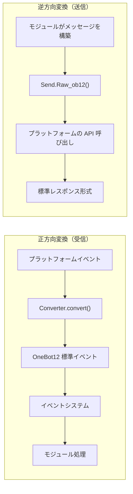

# アダプター開発入門

> [!TIP]
> **この記事を読むタイミング**：アダプター開発の入門記事（必須）。ゼロからアダプターを作成し、アダプターの役割範囲とプロジェクト構造を理解するにはここを読む必要があります。読了後は [イベント変換器](converter.md) と [SendDSL 詳解](send-dsl.md) に進んでください。

この記事を読み終えると、イベントを受け取り、メッセージを送信できる最小限のアダプター（主クラス + 変換器 + Send）が完成し、各コンポーネントの役割範囲が明確になります。新しいプラットフォームへの接続はここから始まります。

## アダプター概要

### 什么是アダプター

アダプターは ErisPulse と各メッセージプラットフォームの間の橋渡し役であり、以下の機能を担います：

1. **正方向変換**：プラットフォームのイベントを受け取り、OneBot12 標準形式に変換する（Converter）
2. **逆方向変換**：OneBot12 メッセージセグメントをプラットフォームの API 呼び出しに変換する（`Raw_ob12`）
3. プラットフォームとの接続（WebSocket/WebHook）を管理する
4. 統一された SendDSL メッセージ送信インターフェースを提供する

### アダプター構造



## ディレクトリ構造

標準的なアダプターのパッケージ構造は以下の通りです：

```
MyAdapter/
├── pyproject.toml          # プロジェクト設定
├── README.md               # プロジェクト説明
├── LICENSE                 # ライセンス
└── MyAdapter/
    ├── __init__.py          # パッケージエントリ
    ├── Core.py               # アダプター主クラス
    └── Converter.py          # イベント変換器
```

## 速習

### 1. プロジェクト作成

脚手架を使って完全な骨格（pyproject、主クラス、変換器を含む）を作成することを推奨します：

```bash
# パッケージ化・公開用の標準プロジェクト
epsdk create adapter -n MyAdapter

# ローカルアダプタープラグイン（パッケージ化不要、plugins/ ディレクトリに配置すれば自動読み込み可能、下記の「ローカル開発」参照）
epsdk create adapter -n MyAdapter --local
```

脚手架はデフォルトで WebSocket サーバーの骨格を生成します。通信モードが異なる場合は `--template` オプションで通信モードテンプレートを選択し、生成された半成品基底クラスを使用します（`start`/`shutdown` は不要）：

```bash
epsdk create adapter -n MyAdapter --template polling   # HTTP ポーリング型（getUpdates によるプル）
epsdk create adapter -n MyAdapter --template webhook   # HTTP コールバック型（プラットフォームのプッシュ）
```

> 3 種類の接続モードの違いと半成品基底クラスの最小実装面は [アダプターの基本概念 - 接続モードの半成品基底クラス](core-concepts.md#接続モードの半成品基底クラス) を参照してください。実行可能な完全な例はリポジトリの `examples/example-adapter-polling/` と `examples/example-adapter-webhook/` を参照してください。

手動で作成することも可能です：

```bash
mkdir MyAdapter && cd MyAdapter
```

### 2. pyproject.toml の作成

```toml
[project]
name = "ErisPulse-MyAdapter"
version = "1.0.0"
description = "MyAdapterプラットフォームアダプター"
readme = "README.md"
requires-python = ">=3.10"
license = { file = "LICENSE" }
authors = [ { name = "yourname", email = "your@mail.com" } ]

dependencies = [
    "ErisPulse>=2.4.0"  # ErisPulse は aiohttp を内蔵しているため、通常は個別に依存関係を指定する必要はない
]

[project.urls]
"homepage" = "https://github.com/yourname/MyAdapter"

[project.entry-points."erispulse.adapter"]
"MyAdapter" = "MyAdapter:MyAdapter"
```

### 3. アダプター主クラスの作成

フレームワークは `ConfigClass` / `AccountConfigClass` を用いた宣言的設定管理を提供しており、アダプターは設定クラスを宣言するだけで自動的に設定のロード、検証、テンプレート生成が行われます。

```python
# MyAdapter/Core.py
from dataclasses import dataclass, field
# 推奨のルートインポート（2.10+）：頻出シンボルはルートパッケージから直接インポートし、深いパスも互換性がある
from ErisPulse import BaseAdapter, BaseConfig

@dataclass
class MyAdapterConfig(BaseConfig):
    """MyAdapter 設定"""
    api_endpoint: str = field(
        default="https://api.example.com",
        metadata={
            "description": {"i18n": "my_adapter.api_endpoint", "default": "API アドレス"},
            "required": False,
            "ui": {"widget": "text", "group": "connection", "order": 1},
        },
    )
    token: str = field(
        default="",
        metadata={
            "description": {"i18n": "my_adapter.token", "default": "プラットフォーム Token"},
            "required": True,
            "secret": True,
            "ui": {"widget": "password", "group": "basic", "order": 2},
        },
    )

class MyAdapter(BaseAdapter):
    ConfigClass = MyAdapterConfig  # 設定クラスを宣言し、フレームワークが自動管理

    # __init__ をオーバーライドする必要はない！フレームワークが自動処理する：
    # - self.sdk / self.logger の自動設定
    # - self.cfg による設定のリアルタイム読み取り
    # - self.Send / self.Request の自動初期化

    def _setup_converter(self):
        from .Converter import MyPlatformConverter
        return MyPlatformConverter()
```

> ⚠️ **__init__ について**：新バージョンでは `BaseAdapter.__init__(self, sdk=None)` が SDK リファレンス、ログ初期化、設定のロードを自動処理する。ほとんどのアダプターは `__init__` をオーバーライドする必要はない。詳細は [__init__ に関する注意事項](#init-に関する注意事項) を参照してください。

> ⚠️ **super().__init__() について**：`BaseAdapter.__init__()` は `Send` と `Request` ファクトリインスタンスの作成を担当する。呼び出さないと、すべてのメッセージ送信とリクエスト操作が `AttributeError` を発生させる。詳細は [__init__ に関する注意事項](#init-に関する注意事項) を参照してください。

### 4. 必須メソッドの実装

```python
class MyAdapter(BaseAdapter):
    # ... __init__ コード ...

    async def start(self):
        """アダプターの起動（必須実装）"""
        # WebSocket または WebHook ルートを登録
        router.register_websocket(
            module_name="myplatform",
            path="/ws",
            handler=self._ws_handler
        )
        self.logger.info("アダプターが起動しました")

    async def shutdown(self):
        """アダプターの停止（必須実装）"""
        router.unregister_websocket(
            module_name="myplatform",
            path="/ws"
        )
        # 接続とリソースのクリーンアップ
        self.logger.info("アダプターが停止しました")

    async def call_api(self, endpoint: str, **params):
        """プラットフォーム API の呼び出し（必須実装）"""
        raise NotImplementedError("call_api を実装する必要があります")
```

#### メタイベントの送信

アダプターは Bot のオンライン状態をフレームワークに通知するためにメタイベントを送信する必要があります。`emit_meta()` を使用すれば一行で完了します：

```python
class MyAdapter(BaseAdapter):
    async def _ws_handler(self, websocket):
        bot_id = self._get_bot_id()

        # Bot のオンライン
        await self.emit_meta("connect", bot_id, user_name="MyBot")

        try:
            while True:
                data = await websocket.receive_text()
                event = self.convert(data)
                if event:
                    await self.adapter.emit(event)
        except WebSocketDisconnect:
            pass
        finally:
            # Bot のオフライン
            await self.emit_meta("disconnect", bot_id)
```

> Bot の状態管理とメタイベントの詳細は [アダプターのベストプラクティス - Bot の状態管理とメタイベント](best-practices.md#bot-の状態管理と-meta-イベント) を参照してください。

### 5. Send クラスの実装

`At`/`AtAll`/`Reply` 修飾子は SendDSL 基底クラスに内蔵されているため、アダプターは `Raw_ob12` と具体的な送信メソッドを実装するだけでよい。

フレームワークは以下の2つの重要な補助メソッドを提供する：
- `self._apply_modifiers(message)` — 修飾子状態をメッセージセグメントに自動的にマージする
- `self.send_context` — 送信コンテキスト辞書を取得する（`target_type`、`target_id`、`account_id`）

```python
import asyncio

class MyAdapter(BaseAdapter):
    # ... その他のコード ...

    class Send(BaseAdapter.Send):

        def Raw_ob12(self, message, **kwargs):
            """
            OneBot12 形式のメッセージを送信する（必須実装）

            _apply_modifiers を使用して修飾子状態を自動的にマージし、
            send_context を使用して送信コンテキストを渡す。
            """
            async def _do_send():
                segments = self._apply_modifiers(message)
                return await self._adapter.call_api(
                    endpoint="/send_message",
                    message=segments,
                    **self.send_context,
                    **kwargs
                )
            return asyncio.create_task(_do_send())

        # Text/Image/Voice/Video/File は SendDSL 基底クラスから継承されているため、
        # デフォルトで Raw_ob12 に委任する必要はなく、再実装する必要はない。
        # プラットフォーム固有のロジックが必要な場合は、個別のメソッドをオーバーライドする：
        # def Text(self, text: str):
        #     return self.Raw_ob12([{"type": "text", "data": {"text": text}}])
```

**メディア送信メソッド（Image/Video/File）の実装ポイント：**

- 基底クラスのデフォルト実装は `file` パラメータを OneBot12 メッセージセグメントとして `Raw_ob12` に渡す。アダプターは `Raw_ob12` でダウンロード/アップロードを処理する必要がある。
- `file` パラメータは `bytes` 二進データと `str` URL の両方に対応する。
- URL が渡された場合、ファイルをダウンロードしてからプラットフォームにアップロードする必要がある。
- プラットフォームは通常、ファイル識別子を取得するためのアップロードインターフェースを先に呼び出し、次に送信インターフェースを呼び出す。

**`__getattr__` マジックメソッド：**

- メソッド名の大小文字を区別しない（`Text`、`text`、`TEXT` はすべて呼び出し可能）
- 定義されていないメソッドはエラーではなく、メッセージを返す

**`Raw_ob12` メソッド：**

- OneBot12 標準メッセージ形式をプラットフォーム形式に変換して送信する
- `self._apply_modifiers(message)` を使用して At/AtAll/Reply 修飾子を自動的に処理する
- `**self.send_context` を使用して送信先情報とアカウント情報を渡す

### 6. 変換器の実装

```python
# MyAdapter/Converter.py
import time
import uuid

class MyPlatformConverter:
    def convert(self, raw_event):
        """プラットフォームの生のイベントを OneBot12 標準形式に変換する"""
        if not isinstance(raw_event, dict):
            return None
        
        onebot_event = {
            "id": str(raw_event.get("event_id", uuid.uuid4())),
            "time": int(time.time()),
            "type": self._convert_event_type(raw_event.get("type")),
            "detail_type": self._convert_detail_type(raw_event),
            "platform": "myplatform",
            "self": {
                "platform": "myplatform",
                "user_id": str(raw_event.get("bot_id", ""))
            },
            "myplatform_raw": raw_event,
            "myplatform_raw_type": raw_event.get("type", "")
        }
        
        return onebot_event
    
    def _convert_event_type(self, event_type):
        """イベントタイプを変換する"""
        type_map = {
            "message": "message",
            "notice": "notice"
        }
        return type_map.get(event_type, "unknown")
    
    def _convert_detail_type(self, raw_event):
        """詳細タイプを変換する"""
        return "private"  # 簡略化された例
```

### 7. Request クラスの実装（リクエスト操作）

プラットフォームがフレンドリクエスト、グループ招待など Bot が決定を下す必要があるリクエストをサポートしている場合、`Request` 内部クラスを実装することができます。

```python
from ErisPulse import BaseAdapter, RequestDSL

class MyAdapter(BaseAdapter):
    # ... Send とその他のコード ...

    class Request(RequestDSL):
        """リクエスト操作の実装（フレンドリクエスト、グループ招待など）"""

        def accept(self, **kwargs):
            """リクエストを承認する"""
            async def _do():
                result = await self._adapter.call_api(
                    endpoint="/set_request",
                    request_id=self._request_id,
                    approve=True,
                    **kwargs,
                )
                return {
                    "status": "ok" if result.get("code") == 0 else "failed",
                    "retcode": result.get("code", 0),
                    "data": None,
                    "message_id": "",
                    "message": result.get("message", ""),
                }
            return self._create_task(_do())

        def reject(self, **kwargs):
            """リクエストを拒否する"""
            async def _do():
                result = await self._adapter.call_api(
                    endpoint="/set_request",
                    request_id=self._request_id,
                    approve=False,
                    **kwargs,
                )
                return {
                    "status": "ok" if result.get("code") == 0 else "failed",
                    "retcode": result.get("code", 0),
                    "data": None,
                    "message_id": "",
                    "message": result.get("message", ""),
                }
            return self._create_task(_do())
```

モジュール開発者の使用方法：

```python
from ErisPulse import request

@request.on_friend_request()
async def handle_friend_request(event):
    # Event からの便利なメソッドを使用
    await event.approve()
    # またはアダプターを直接操作
    await adapter.myplatform.Request("req_id").accept()
```

> プラットフォームがリクエスト操作をサポートしていない場合は、`Request` 内部クラスを実装する必要はありません。基底クラスはデフォルトで `retcode=10002`（サポートされていない操作）を返します。詳細は [リクエスト操作規格](../../standards/request-action-spec.md) を参照してください。

### 8. パッケージエントリの作成

```python
# MyAdapter/__init__.py
from .Core import MyAdapter
```

## ローカル開発（パッケージ化不要）

モジュールと同様に、アダプターもプロジェクトのローカルプラグインディレクトリ（デフォルトは `plugins/` で、`ErisPulse.framework.plugins_dir` で設定可能）に直接開発することもできます。**`pip install -e .` は不要**です：

```bash
# ローカルアダプタープラグインの生成
epsdk create adapter -n MyAdapter --local
# 生成される構造：
# plugins/
# └── MyAdapter/
#     ├── __init__.py
#     ├── Core.py
#     └── Converter.py
```

フレームワークの起動時に自動的にプラグインディレクトリをスキャンし、その中のモジュールやアダプターをロードします（entry-point でインストールされたパッケージと同じ扱い：有効化状態、設定の宣言、ホットリロード、アンロードのクリーンアップがすべて同じです）：

- **識別ルール**：`__init__.py` を含むパッケージディレクトリまたは単一の `.py` ファイルでも認識されます。`Main` という名前のクラスが優先的に認識され、なければプラグイン内の最初の `BaseAdapter` / `BaseModule` 子クラスが選ばれます。
- **同名の上書き**：ローカルプラグインと PyPI でインストールされたアダプターが同名の場合、ローカルプラグインが優先されます（デバッグの上書きが可能です）。
- **ホットリロード**：`sdk.enable_plugin_hot_reload()` で有効化されたプラグインディレクトリの監視はアダプターにも適用されます。アダプターのコードレベルのホットリロードは 2.11 から提供されています。`await sdk.adapter.reload("プラットフォーム名")` または `await sdk.reload_adapter("プラットフォーム名")` で実行できます（構文検証 → クリーンアップ → キャッシュクリアと再インポート → 再登録と起動、失敗時は自動ロールバック）。詳細は [アーキテクチャ概要](../../architecture.md) を参照してください。

### ローカルプラグインから公開

ローカルで検証が完了したら、`pack` サブコマンドを使ってプラグインを一括で公開可能な標準プロジェクトに変換します（対話的にプラグインを選択し、メタ情報を補完し、entry-point を含む pyproject を生成します）：

```bash
epsdk create pack
# プラグインディレクトリ内のプラグインを選択 → プロジェクト名/説明/作者を入力 → MyAdapter/ プロジェクトディレクトリを生成
cd MyAdapter
pip install -e .   # 標準インストールに変換；その後、公開プロセスに従って PyPI にアップロード
```

> **ヒント**：変換後は `plugins/` ディレクトリの元ファイルを削除することを推奨します。同名のローカルプラグインとインストールされたパッケージが重複して読み込まれるのを防ぎます（ローカルが優先されるため、パッケージが有効であると誤認する可能性があります）。

## 依存関係の宣言（オプション、2.8.0+）

アダプターは他のアダプターやモジュールへの依存を宣言することで、アダプター間の連携やオプション機能を実現できます：

```python
from typing import ClassVar

class MyAdapter(BaseAdapter):
    # 硬的依存：不足すると起動をスキップ（警告 + status=skipped-dependency イベント）
    depends: ClassVar[dict] = {
        "adapters": ["onebot11"],   # 依存するアダプター（プラットフォーム名）
        "modules": ["TranslateEngine"],  # 依存するモジュール（登録名）
    }
    # ソフトな依存：不足しても起動に影響しない；モジュールのロード/アンロード時にコールバックを受け取る（オプション機能モード）
    optional_modules: ClassVar[list] = ["TranslateEngine"]
```

- **起動順序**：モジュールの硬的依存を宣言したアダプターは、**モジュールの初期化完了後に起動**されます。
- **ソフト依存通知**：`optional_modules`（またはモジュールの硬的依存）に含まれるモジュールがロードされたときに `on_dependency_ready(module_name)` を呼び出し、アンロードされたときに `on_dependency_lost(module_name)` を呼び出します（デフォルトでは空実装で、オーバーライド可能です）——遅いロードやホットリロードの状況をカバーします：

```python
async def on_dependency_ready(self, module_name):
    """ソフト依存モジュールが準備完了：対応するオプション機能を有効化"""
    if module_name == "TranslateEngine":
        self._translate = self.sdk.TranslateEngine

async def on_dependency_lost(self, module_name):
    """ソフト依存モジュールが失われた：機能を降格"""
    if module_name == "TranslateEngine":
        self._translate = None
```

> [!NOTE]
> この機能は ErisPulse **2.8.0+** が必要です。

## `__init__` に関する注意事項

アダプター開発では、`__init__` のオーバーライドが3つのレベルで発生する可能性があります。以下は各レベルの正しいやり方です。

### 1. BaseAdapter 層（通常はオーバーライド不要）

`BaseAdapter.__init__(self, sdk=None)` は `Send` / `Request` ファクトリインスタンスを作成し、以下を自動的に処理します：

- `sdk` パラメータを受け取り、`self.sdk`、`self.logger` を設定する
- `ConfigClass` を宣言した場合、`self.cfg` でグローバル設定をリアルタイムに読み取ることができる
- `AccountConfigClass` を宣言した場合、`self.accounts` で複数アカウントの設定をリアルタイムに読み取ることができる

**通常は `__init__` をオーバーライドする必要はありません。`ConfigClass` を宣言するだけで十分です：**

```python
class MyAdapter(BaseAdapter):
    ConfigClass = MyAdapterConfig  # 宣言後、フレームワークが設定を自動管理する
    
    async def start(self):
        cfg = self.cfg  # タイプセーフで、リアルタイムに読み取る
        ...
```

もし本当にカスタム初期化が必要な場合は、`super().__init__(sdk)` を呼び出すだけです：

```python
class MyAdapter(BaseAdapter):
    ConfigClass = MyAdapterConfig
    
    def __init__(self, sdk=None):
        super().__init__(sdk)  # sdk を渡す
        self.converter = self._setup_converter()
        self.convert = self.converter.convert
```

### 2. Send 内部クラス（通常はオーバーライド不要）

`SendDSL.__init__` は連鎖呼び出しのステートを渡す役割を担います（ターゲットタイプ、ターゲットID、アカウントなど）。**通常は、`Raw_ob12`、`Text` などのメソッドをオーバーライドするだけで、`__init__` をオーバーライドする必要はありません。**

もし本当に必要（例えば、プラットフォーム特有のステートを初期化する場合）な場合は、**すべてのパラメータを透過する必要があります**：

```python
class MyAdapter(BaseAdapter):
    class Send(BaseAdapter.Send):
        # パラメータ：adapter, target_type, target_id, account_id
        def __init__(self, adapter, target_type=None, target_id=None, account_id=None):
            super().__init__(adapter, target_type, target_id, account_id)  # ← 必須透過
            self._my_state = None  # プラットフォーム特有の初期化
```

**なぜ透過する必要があるのか？** 連鎖呼び出しの各ステップは `self.__class__(...)` を使って新しいインスタンスを作成します：

```python
adapter.Send.To("user", "123")               # → Send(adapter, "user", "123", None)
adapter.Send.To("user", "123").Using("bot1")  # → Send(adapter, "user", "123", "bot1")
```

もし `__init__` のシグネチャが一致しない、または `super()` を呼び出さないと、連鎖呼び出しが中断します。

### 3. Request 内部クラス（通常はオーバーライド不要）

Send と同じです。パラメータは `adapter`, `request_id`, `account_id` です：

```python
class MyAdapter(BaseAdapter):
    class Request(RequestDSL):
        # パラメータ：adapter, request_id, account_id
        def __init__(self, adapter, request_id=None, account_id=None):
            super().__init__(adapter, request_id, account_id)  # ← 必須透過
            self._my_state = None  # プラットフォーム特有の初期化
```

### まとめ

| レベル | いつオーバーライドするか | 必須の操作 |
|------|------------|-----------|
| **BaseAdapter** | カスタム初期化ロジックが必要な場合 | `super().__init__(sdk)` （sdk パラメータを渡す） |
| **Send 内部クラス** | 送信関連ステートを初期化する必要がある場合 | `super().__init__(adapter, target_type, target_id, account_id)` |
| **Request 内部クラス** | リクエスト関連ステートを初期化する必要がある場合 | `super().__init__(adapter, request_id, account_id)` |
| 3つのレベル | 通常 | **ConfigClass を宣言するだけで、`__init__` は触らない** |

### 9. 接続情報とルート発見

アダプターがルートを登録した後、フレームワークはすべてのルート情報を記録します。ユーザーは以下の API を使ってアダプターの接続アドレスを確認できます：

```python
from ErisPulse import sdk

# アダプターの完全な接続情報を取得
info = sdk.adapter.get_connection_info("myplatform")
# {
#   "platform": "myplatform",
#   "status": "started",
#   "connection": {
#     "base_url": "http://localhost:8080",
#     "http_routes": [
#       {"path": "/myplatform/webhook", "method": "POST",
#        "url": "http://localhost:8080/myplatform/webhook"}
#     ],
#     "websocket_routes": [
#       {"path": "/myplatform/ws",
#        "url": "ws://localhost:8080/myplatform/ws"}
#     ]
#   }
# }

# すべてのネームスペース（アダプター/モジュール）のルートをリストアップ
namespaces = sdk.router.list_namespaces()
# {"myplatform": {"http": ["/myplatform/webhook"], "websocket": ["/myplatform/ws"]}}

# ネームスペースの完全な接続 URL を取得
urls = sdk.router.get_module_urls("myplatform")
# {"base_url": "http://localhost:8080", "http": [...], "websocket": [...]}

# ネームスペースの詳細ルート情報を取得
routes = sdk.router.get_module_routes("myplatform")
# {"http": [{"path": "/myplatform/webhook", "methods": ["POST"]}],
#  "websocket": [{"path": "/myplatform/ws", "auth": false}]}
```

> **ヒント**：`get_connection_info()` が返す情報は、ユーザーに表示するのに適しています（例：WebUI）。プラットフォーム側のコールバックアドレスや WebSocket 接続アドレスを設定するのに役立ちます。ルート登録時の `module_name` は、ErisPulse で登録された `platform` 名と完全に一致している必要があります。そうしないと、ルート発見が正しく関連付けられません。

### 10. SSE (Server-Sent Events) のサポート

ErisPulse はサーバーに依存しない SSE を内蔵しており、モジュールやアダプターは `@sdk.router.sse()` を使って SSE エンドポイントを登録できます。

#### 基本的な使用法

```python
import asyncio
from ErisPulse import sdk

@sdk.router.sse("MyModule", "/events")
async def event_stream(sse):
    """SSE イベントを送信する"""
    count = 0
    while not sse.closed:
        await sse.send({"count": count}, event="update")
        count += 1
        await asyncio.sleep(1)
```

#### リクエストパラメータの使用

ハンドラは `request` パラメータを宣言してクライアントリクエスト情報をアクセスできます：

```python
@sdk.router.sse("MyModule", "/events")
async def event_stream(request, sse):
    token = request.query_params.get("token")
    if not validate_token(token):
        await sse.close()
        return

    while not sse.closed:
        data = await fetch_data(token)
        await sse.send(data)
        await asyncio.sleep(5)
```

#### SseEmitter API

| メソッド | 説明 |
|------|------|
| `sse.send(data, event=None, id=None, retry=None)` | SSE イベントを送信する。str 以外の data は自動的に JSON シリアライズされる |
| `sse.close()` | SSE 接続を安全に閉じる（複数回呼び出しても安全） |
| `sse.closed` | 接続が閉じられているかどうか |
| `sse.request` | ベースのリクエストオブジェクト（query params、headers を読むのに使用可能） |

#### RouteGroup での使用

```python
api = sdk.router.group("MyModule", "/api", version="1")

@api.sse("/events")
async def events(sse):
    await sse.send({"msg": "hello"})
```

#### ルート発見

SSE ルートは自動的にルート発見 API に含まれます：

```python
# list_namespaces は "sse" キーを含む
sdk.router.list_namespaces()
# {"MyModule": {"http": [...], "websocket": [...], "sse": ["/MyModule/events"]}}

# get_module_routes は streaming: true をマークする
sdk.router.get_module_routes("MyModule")
# {"http": [...], "websocket": [...], "sse": [{"path": "/MyModule/events", "streaming": true}]}

# get_module_urls は完全な URL を生成する
sdk.router.get_module_urls("MyModule")
# {"sse": [{"path": "/MyModule/events", "url": "http://localhost:8080/MyModule/events"}]}
```

> **サーバーに依存しない設計**：`SseEmitter` はコールバックと下位の HTTP フレームワークを分離する。フレームワークは `register_sse()` と `@sse` デコレータを統一された登録エントリとして提供し、アダプターは下位の HTTP フレームワークに直接依存することなく SSE エンドポイントを実装できる。

## 次に進む

### アダプターの三大要素を完成させる

- [イベント変換器](converter.md) - プラットフォームイベント → OneBot12 の実装の詳細とよくある落とし穴
- [SendDSL 詳解](send-dsl.md) - メッセージ送信チェーン、修飾メソッド、送信ルール
- [アダプターの基本概念](core-concepts.md) - BaseAdapter / ライフサイクル / 多アカウントの仕組み

### 骨格が完成した後

- [アダプターのベストプラクティス](best-practices.md) - 接続リトライ、ハートビート、エラーハンドリングのエンジニアリング的な仕上げ
- [公開とモジュールストアガイド](../publishing.md) - PyPI とモジュールストアへの公開