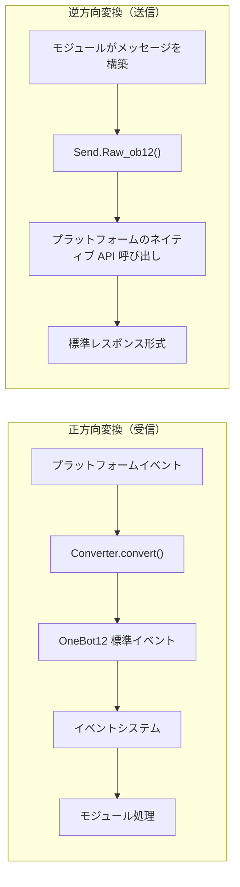

# アダプター開発入門

> [!TIP]
> **このドキュメントを読むべきタイミング**：アダプター開発パスの入口となるドキュメント（必読）です。ゼロからアダプターを作成する方法、アダプターの責務の境界やプロジェクト構造については、すべてここで解説します。読み終えた後は、必要に応じて [イベントコンバーター](converter.md) と [SendDSL 詳解](send-dsl.md) に進んでください。

このドキュメントを一通り読み進めると、イベントの受信とメッセージの送信が可能な、動作する最小限のアダプター（メインクラス + コンバーター + Send）が完成し、各コンポーネントの責務の境界も明確になります。新しいプラットフォームへの接続に関するすべての作業は、ここから始まります。

## アダプタ概要

### アダプタとは何か

アダプタは、ErisPulse と各メッセージプラットフォームの間の橋渡し役であり、以下の機能を担います：

1. **正方向変換**：プラットフォームイベントを受け取り、OneBot12 標準形式に変換する（Converter）
2. **逆方向変換**：OneBot12 メッセージセグメントをプラットフォーム API 呼び出しに変換する（`Raw_ob12`）
3. プラットフォームとの接続を管理する（WebSocket/WebHook）
4. 統一された SendDSL メッセージ送信インターフェースを提供する

### アダプタのアーキテクチャ



## ディレクトリ構造

標準的なアダプタパッケージ構造は以下の通りです：

```
MyAdapter/
├── pyproject.toml          # プロジェクト設定
├── README.md               # プロジェクト説明
├── LICENSE                 # ライセンス
└── MyAdapter/
    ├── __init__.py          # パッケージエントリ
    ├── Core.py               # アダプタ主クラス
    └── Converter.py          # イベントコンバーター
```

## 早速始める

### 1. プロジェクトの作成

スクリプトを使って完全な骨格を生成することを推奨します（pyproject、主クラス、コンバーターを含む）：

```bash
# 標準プロジェクト（パッケージ化・公開用）
epsdk create adapter -n MyAdapter

# ローカルアダプタプラグイン（パッケージ化不要、plugins/ ディレクトリに配置すると自動的にロードされる、下記「ローカル開発」参照）
epsdk create adapter -n MyAdapter --local
```

手動で作成することも可能です：

```bash
mkdir MyAdapter && cd MyAdapter
```

### 2. pyproject.toml の作成

```toml
[project]
name = "ErisPulse-MyAdapter"
version = "1.0.0"
description = "MyAdapter プラットフォームアダプタ"
readme = "README.md"
requires-python = ">=3.10"
license = { file = "LICENSE" }
authors = [ { name = "yourname", email = "your@mail.com" } ]

dependencies = [
    "ErisPulse>=2.4.0"  # ErisPulse には aiohttp が内蔵されているため、通常は個別に依存関係を宣言する必要はない
]

[project.urls]
"homepage" = "https://github.com/yourname/MyAdapter"

[project.entry-points."erispulse.adapter"]
"MyAdapter" = "MyAdapter:MyAdapter"
```

### 3. アダプタ主クラスの作成

フレームワークは `ConfigClass` / `AccountConfigClass` を提供しており、宣言的な設定管理が可能。アダプタは設定クラスを宣言するだけで自動的にロード、検証、設定テンプレートの生成が行われます。

```python
# MyAdapter/Core.py
from dataclasses import dataclass, field
# 推奨のルートインポート（2.10+）：頻出シンボルはルートパッケージから直接インポートし、深いパスも互換性がある
from ErisPulse import BaseAdapter, BaseConfig

@dataclass
class MyAdapterConfig(BaseConfig):
    """MyAdapter 設定"""
    api_endpoint: str = field(
        default="https://api.example.com",
        metadata={
            "description": {"i18n": "my_adapter.api_endpoint", "default": "API アドレス"},
            "required": False,
            "ui": {"widget": "text", "group": "connection", "order": 1},
        },
    )
    token: str = field(
        default="",
        metadata={
            "description": {"i18n": "my_adapter.token", "default": "プラットフォームトークン"},
            "required": True,
            "secret": True,
            "ui": {"widget": "password", "group": "basic", "order": 2},
        },
    )

class MyAdapter(BaseAdapter):
    ConfigClass = MyAdapterConfig  # 設定クラスを宣言すると、フレームワークが自動的に管理する
    
    # __init__ をオーバーライドする必要はない！フレームワークが自動的に処理する：
    # - self.sdk / self.logger が自動的に設定される
    # - self.cfg が設定をリアルタイムで読み取れる
    # - self.Send / self.Request が自動的に初期化される
    
    def _setup_converter(self):
        from .Converter import MyPlatformConverter
        return MyPlatformConverter()
```

> ⚠️ **__init__ について**：新バージョンでは `BaseAdapter.__init__(self, sdk=None)` が SDK リファレンス、ログ初期化、設定の読み込みを自動的に処理する。ほとんどのアダプタは **`__init__` をオーバーライドする必要はない**。詳細は [__init__ 注意事項](#init-注意事项) を参照。

> ⚠️ **super().__init__() について**：`BaseAdapter.__init__()` は `Send` と `Request` ファクトリインスタンスの作成を担当する。呼び忘れると、すべてのメッセージ送信とリクエスト操作が `AttributeError` を発生させる。詳細は [__init__ 注意事項](#init-注意事项) を参照。

### 4. 必須メソッドの実装

```python
class MyAdapter(BaseAdapter):
    # ... __init__ コード ...
    
    async def start(self):
        """アダプタの起動（必須実装）"""
        # WebSocket または WebHook ルートを登録
        router.register_websocket(
            module_name="myplatform",
            path="/ws",
            handler=self._ws_handler
        )
        self.logger.info("アダプタが起動しました")
    
    async def shutdown(self):
        """アダプタの停止（必須実装）"""
        router.unregister_websocket(
            module_name="myplatform",
            path="/ws"
        )
        # 接続とリソースのクリーンアップ
        self.logger.info("アダプタが停止しました")
    
    async def call_api(self, endpoint: str, **params):
        """プラットフォーム API を呼び出す（必須実装）"""
        raise NotImplementedError("call_api を実装する必要があります")
```

#### メタイベントの送信

アダプタは、Bot のオンライン状態をフレームワークに追跡させるために、メタイベントを送信する必要があります。`emit_meta()` を使用すれば、一行で実現できます：

```python
class MyAdapter(BaseAdapter):
    async def _ws_handler(self, websocket):
        bot_id = self._get_bot_id()

        # Bot がオンライン
        await self.emit_meta("connect", bot_id, user_name="MyBot")

        try:
            while True:
                data = await websocket.receive_text()
                event = self.convert(data)
                if event:
                    await self.adapter.emit(event)
        except WebSocketDisconnect:
            pass
        finally:
            # Bot がオフライン
            await self.emit_meta("disconnect", bot_id)
```

> Bot 状態管理とメタイベントの詳細は [アダプタのベストプラクティス - Bot 状態管理とメタイベント](best-practices.md#bot-状態管理と-meta-イベント) を参照してください。

### 5. Send クラスの実装

`At`/`AtAll`/`Reply` 修飾子は SendDSL 基底クラスに内蔵されており、アダプタは `Raw_ob12` と具体的な送信メソッドを実装するだけでよい。

フレームワークは 2 つの重要な補助メソッドを提供している：
- `self._apply_modifiers(message)` — 修飾子状態を自動的にメッセージセグメントにマージする
- `self.send_context` — 送信コンテキスト辞書（`target_type`、`target_id`、`account_id`）を取得する

```python
import asyncio

class MyAdapter(BaseAdapter):
    # ... 他のコード ...

    class Send(BaseAdapter.Send):

        def Raw_ob12(self, message, **kwargs):
            """
            OneBot12 形式のメッセージを送信する（必須実装）

            _apply_modifiers を使用して修飾子状態を自動的にマージし、send_context を使用して送信コンテキストを渡す。
            """
            async def _do_send():
                segments = self._apply_modifiers(message)
                return await self._adapter.call_api(
                    endpoint="/send_message",
                    message=segments,
                    **self.send_context,
                    **kwargs
                )
            return asyncio.create_task(_do_send())

        # Text/Image/Voice/Video/File は SendDSL 基底クラスから継承されており、Raw_ob12 にデフォルトで委譲されるため、再実装は不要。
        # プラットフォーム固有のロジックが必要な場合は、個別のメソッドをオーバーライドする：
        # def Text(self, text: str):
        #     return self.Raw_ob12([{"type": "text", "data": {"text": text}}])
```

**メディア送信メソッド（Image/Video/File）の実装ポイント：**

- 基底クラスのデフォルト実装は、`file` パラメータを OneBot12 メッセージセグメントにラップして `Raw_ob12` に渡す。アダプタは `Raw_ob12` でダウンロード/アップロードを処理する必要がある。
- `file` パラメータは `bytes` バイナリデータと `str` URL の両方をサポートする。
- URL を渡した場合は、まずファイルをダウンロードしてからプラットフォームにアップロードする必要がある。
- プラットフォームは通常、まずアップロードインターフェースを呼び出してファイル識別子を取得し、次に送信インターフェースを呼び出す。

**`__getattr__` マジックメソッド：**

- メソッド名の大文字小文字を区別しない（`Text`、`text`、`TEXT` がすべて呼び出せる）
- 未定義のメソッドはエラーではなく、メッセージを返す

**`Raw_ob12` メソッド：**

- OneBot12 標準メッセージ形式をプラットフォーム形式に変換して送信する
- `self._apply_modifiers(message)` を使用して At/AtAll/Reply 修飾子を自動的に処理する
- `**self.send_context` を使用して送信ターゲット情報とアカウント情報を渡す

### 6. コンバーターの実装

```python
# MyAdapter/Converter.py
import time
import uuid

class MyPlatformConverter:
    def convert(self, raw_event):
        """プラットフォームのネイティブイベントを OneBot12 標準形式に変換する"""
        if not isinstance(raw_event, dict):
            return None
        
        onebot_event = {
            "id": str(raw_event.get("event_id", uuid.uuid4())),
            "time": int(time.time()),
            "type": self._convert_event_type(raw_event.get("type")),
            "detail_type": self._convert_detail_type(raw_event),
            "platform": "myplatform",
            "self": {
                "platform": "myplatform",
                "user_id": str(raw_event.get("bot_id", ""))
            },
            "myplatform_raw": raw_event,
            "myplatform_raw_type": raw_event.get("type", "")
        }
        
        return onebot_event
    
    def _convert_event_type(self, event_type):
        """イベントタイプを変換する"""
        type_map = {
            "message": "message",
            "notice": "notice"
        }
        return type_map.get(event_type, "unknown")
    
    def _convert_detail_type(self, raw_event):
        """詳細タイプを変換する"""
        return "private"  # 簡略化例
```

### 7. Request クラスの実装（リクエスト操作）

プラットフォームがフレンドリクエスト、グループ招待など Bot が意思決定を必要とするリクエストをサポートしている場合、`Request` 内部クラスを実装できます。

```python
from ErisPulse import BaseAdapter, RequestDSL

class MyAdapter(BaseAdapter):
    # ... Send と他のコード ...

    class Request(RequestDSL):
        """リクエスト操作の実装（フレンドリクエスト、グループ招待など）"""

        def accept(self, **kwargs):
            """リクエストを承認する"""
            async def _do():
                result = await self._adapter.call_api(
                    endpoint="/set_request",
                    request_id=self._request_id,
                    approve=True,
                    **kwargs,
                )
                return {
                    "status": "ok" if result.get("code") == 0 else "failed",
                    "retcode": result.get("code", 0),
                    "data": None,
                    "message_id": "",
                    "message": result.get("message", ""),
                }
            return self._create_task(_do())

        def reject(self, **kwargs):
            """リクエストを拒否する"""
            async def _do():
                result = await self._adapter.call_api(
                    endpoint="/set_request",
                    request_id=self._request_id,
                    approve=False,
                    **kwargs,
                )
                return {
                    "status": "ok" if result.get("code") == 0 else "failed",
                    "retcode": result.get("code", 0),
                    "data": None,
                    "message_id": "",
                    "message": result.get("message", ""),
                }
            return self._create_task(_do())
```

モジュール開発者が使用する方法：

```python
from ErisPulse import request

@request.on_friend_request()
async def handle_friend_request(event):
    # Event からの便利なメソッド
    await event.approve()
    # またはアダプタを介して直接操作
    await adapter.myplatform.Request("req_id").accept()
```

> プラットフォームがリクエスト操作をサポートしていない場合は、`Request` 内部クラスを実装する必要はありません。基底クラスはデフォルトで `retcode=10002`（サポートされていない操作）を返します。詳細は [リクエスト操作仕様](../../standards/request-action-spec.md) を参照してください。

### 8. パッケージエントリの作成

```python
# MyAdapter/__init__.py
from .Core import MyAdapter
```

## 本地開発（バンドル不要）

モジュールと同様に、アダプタもプロジェクトのローカルプラグインディレクトリ（デフォルトは `plugins/`、`ErisPulse.framework.plugins_dir` で設定可能）に配置して直接開発できます。**`pip install -e .` は不要です**：

```bash
# ローカルアダプタプラグインの生成
epsdk create adapter -n MyAdapter --local
# 構造は以下のようになります：
# plugins/
# └── MyAdapter/
#     ├── __init__.py
#     ├── Core.py
#     └── Converter.py
```

フレームワークの起動時に、プラグインディレクトリを自動スキャンして、その中のモジュールやアダプタをロードします（entry-point 安装パッケージと同じ扱いです：有効化状態、設定宣言、ホット更新、アンロード時のクリーンアップなどすべて同じです）：

- **認識ルール**：`__init__.py` を含むパッケージディレクトリまたは単一の `.py` ファイルが対象です。`Main` という名前のクラスが優先的に認識され、なければプラグイン内にある最初の `BaseAdapter` / `BaseModule` のサブクラスが対象になります。
- **同名の上書き**：ローカルプラグインと PyPI でインストールされたアダプタが同名の場合、ローカルプラグインが優先されます（デバッグ時の上書きが容易になります）。
- **ホットリロード**：`sdk.enable_plugin_hot_reload()` で有効にしたプラグインディレクトリの監視は、アダプタにも適用されます。アダプタのコードレベルでのホットリロードは 2.11 から提供されています——`await sdk.adapter.reload("プラットフォーム名")` または `await sdk.reload_adapter("プラットフォーム名")`（構文検証 → アンロードとクリーンアップ → キャッシュのクリアと再インポート → 再登録と起動、失敗時は自動的にロールバック）；詳細は[アーキテクチャ概要](../../architecture.md)をご覧ください。

### ローカルプラグインから公開へ

ローカルでの検証が完了したら、`pack` サブコマンドを使って、プラグインをワンクリックで公開可能な標準プロジェクトに変換します（対象のプラグインを選択し、元情報を補完して、entry-point を含む `pyproject` を生成します）：

```bash
epsdk create pack
# プラグインディレクトリの中からプラグインを選択 → プロジェクト名/説明/作者を入力 → MyAdapter/ プロジェクトディレクトリを生成
cd MyAdapter
pip install -e .   # 標準インストールに変換；その後、公開プロセスに従って PyPI にアップロードします
```

> **ヒント**：変換後は、`plugins/` ディレクトリから元のファイルを削除することを推奨します。同名のローカルプラグインとインストールパッケージが重複して読み込まれるのを防ぐためです（ローカルのものが優先されるため、インストールパッケージが有効になっているように見えてしまうことがあります）。

## 依存関係宣言（オプション、2.8.0+）

アダプタは、他のアダプタやモジュールへの依存を宣言し、アダプタ間の連携やオプション機能を実現できます。

```python
from typing import ClassVar

class MyAdapter(BaseAdapter):
    # 硬依存：存在しない場合、起動をスキップし、警告と status=skipped-dependency イベントを送信
    depends: ClassVar[dict] = {
        "adapters": ["onebot11"],   # 依存するアダプタ（プラットフォーム名）
        "modules": ["TranslateEngine"],  # 依存するモジュール（登録名）
    }
    # ソフト依存：存在しない場合、起動に影響しない；モジュールのロード/アンロード時にコールバックを受ける（オプション機能モード）
    optional_modules: ClassVar[list] = ["TranslateEngine"]
```

- **起動順序**：モジュールの硬依存を宣言したアダプタは、**モジュールの初期化が完了した後に起動**されます。
- **ソフト依存通知**：`optional_modules`（またはモジュールの硬依存）に含まれるモジュールがロードされたときに `on_dependency_ready(module_name)` が呼び出され、アンロードされたときに `on_dependency_lost(module_name)` が呼び出されます（デフォルトでは空実装、オーバーライド可能）— 晩期ロードとホットリロードの状況をカバーします：

```python
async def on_dependency_ready(self, module_name):
    """ソフト依存モジュールが準備完了：対応するオプション機能を有効化"""
    if module_name == "TranslateEngine":
        self._translate = self.sdk.TranslateEngine

async def on_dependency_lost(self, module_name):
    """ソフト依存モジュールが失われた：機能を降格"""
    if module_name == "TranslateEngine":
        self._translate = None
```

> [!NOTE]
> この機能は ErisPulse **2.8.0+** が必要です。

## `__init__` 注意事項

アダプタ開発では、`__init__` のオーバーライドが3つのレベルで必要になる場合があります。以下は各レベルの正しいやり方です。

### 1. BaseAdapter 層（ほとんどの場合、オーバーライド不要）

`BaseAdapter.__init__(self, sdk=None)` は、`Send` / `Request` ファクトリインスタンスを作成し、以下の処理を自動的に行います：

- `sdk` パラメータを受け取り、`self.sdk`、`self.logger` を設定する
- `ConfigClass` を宣言した場合、`self.cfg` でグローバル設定をリアルタイムに読み取れる
- `AccountConfigClass` を宣言した場合、`self.accounts` でマルチアカウント設定をリアルタイムに読み取れる

**ほとんどの場合、`__init__` をオーバーライドする必要はありません**。`ConfigClass` を宣言するだけでよいです：

```python
class MyAdapter(BaseAdapter):
    ConfigClass = MyAdapterConfig  # 設定クラスを宣言すると、フレームワークが自動的に管理する
    
    async def start(self):
        cfg = self.cfg  # タイプセーフ、リアルタイムに読み取れる
        ...
```

もし本当にカスタム初期化が必要な場合は、`super().__init__(sdk)` を呼び出すだけです：

```python
class MyAdapter(BaseAdapter):
    ConfigClass = MyAdapterConfig
    
    def __init__(self, sdk=None):
        super().__init__(sdk)  # sdk を渡す
        self.converter = self._setup_converter()
        self.convert = self.converter.convert
```

### 2. Send 内部クラス（ほとんどの場合、オーバーライド不要）

`SendDSL.__init__` は、チェーン呼び出しの状態を伝達する（ターゲットタイプ、ターゲットID、アカウントなど）ことを担当します。**ほとんどの場合、メソッド（`Raw_ob12`、`Text` など）をオーバーライドするだけで、`__init__` をオーバーライドする必要はありません。**

もし本当に必要（例えば、プラットフォーム特有の状態の初期化）な場合は、**すべてのパラメータを透かす必要があります**：

```python
class MyAdapter(BaseAdapter):
    class Send(BaseAdapter.Send):
        # パラメータ：adapter, target_type, target_id, account_id
        def __init__(self, adapter, target_type=None, target_id=None, account_id=None):
            super().__init__(adapter, target_type, target_id, account_id)  # ← 必須透かす
            self._my_state = None  # プラットフォーム特有の初期化
```

**なぜ透かす必要があるのか？** チェーン呼び出しの各ステップは `self.__class__(...)` で新しいインスタンスを作成するためです：

```python
adapter.Send.To("user", "123")               # → Send(adapter, "user", "123", None)
adapter.Send.To("user", "123").Using("bot1")  # → Send(adapter, "user", "123", "bot1")
```

もし `__init__` のシグネチャが一致しない、または `super()` を呼び出していない場合、チェーン呼び出しは中断します。

### 3. Request 内部クラス（ほとんどの場合、オーバーライド不要）

Send と同様。パラメータは `adapter`, `request_id`, `account_id` です：

```python
class MyAdapter(BaseAdapter):
    class Request(RequestDSL):
        # パラメータ：adapter, request_id, account_id
        def __init__(self, adapter, request_id=None, account_id=None):
            super().__init__(adapter, request_id, account_id)  # ← 必須透かす
            self._my_state = None  # プラットフォーム特有の初期化
```

### まとめ

| レベル | いつオーバーライドするか | 必須の作業 |
|------|------------|-----------|
| **BaseAdapter** | カスタム初期化ロジックが必要な場合 | `super().__init__(sdk)` （sdk パラメータを渡す） |
| **Send 内部クラス** | 送信関連の状態を初期化する必要がある場合 | `super().__init__(adapter, target_type, target_id, account_id)` |
| **Request 内部クラス** | リクエスト関連の状態を初期化する必要がある場合 | `super().__init__(adapter, request_id, account_id)` |
| 3つのレベル | ほとんどの場合 | **ConfigClass を宣言するだけで、`__init__` に触らない** |

### 9. 接続情報とルート発見

アダプタがルートを登録した後、フレームワークはすべてのルート情報を記録します。ユーザーは以下の API を使ってアダプタの接続アドレスを取得できます：

```python
from ErisPulse import sdk

# アダプタの完全な接続情報を取得
info = sdk.adapter.get_connection_info("myplatform")
# {
#   "platform": "myplatform",
#   "status": "started",
#   "connection": {
#     "base_url": "http://localhost:8080",
#     "http_routes": [
#       {"path": "/myplatform/webhook", "method": "POST",
#        "url": "http://localhost:8080/myplatform/webhook"}
#     ],
#     "websocket_routes": [
#       {"path": "/myplatform/ws",
#        "url": "ws://localhost:8080/myplatform/ws"}
#     ]
#   }
# }

# すべての名前空間（アダプタ/モジュール）のルートをリストアップ
namespaces = sdk.router.list_namespaces()
# {"myplatform": {"http": ["/myplatform/webhook"], "websocket": ["/myplatform/ws"]}}

# 名前空間の完全な接続 URL を取得
urls = sdk.router.get_module_urls("myplatform")
# {"base_url": "http://localhost:8080", "http": [...], "websocket": [...]}

# 名前空間の詳細なルート情報を取得
routes = sdk.router.get_module_routes("myplatform")
# {"http": [{"path": "/myplatform/webhook", "methods": ["POST"]}],
#  "websocket": [{"path": "/myplatform/ws", "auth": false}]}
```

> **ヒント**：`get_connection_info()` が返す情報は、ユーザー（例：WebUI）に表示するのに適しており、プラットフォーム側のコールバックアドレスや WebSocket 接続アドレスの設定に役立ちます。ルート登録時の `module_name` は、ErisPulse でアダプタが登録する `platform` 名と完全に一致している必要があります。そうしないと、ルート発見は正しく関連付けられません。

### 10. SSE (Server-Sent Events) 支持

ErisPulse は、サーバーに依存しない SSE を内蔵しており、モジュールやアダプタは `@sdk.router.sse()` を使って SSE エンドポイントを登録できます。

#### 基本的な使用

```python
import asyncio
from ErisPulse import sdk

@sdk.router.sse("MyModule", "/events")
async def event_stream(sse):
    """SSE イベントを送信する"""
    count = 0
    while not sse.closed:
        await sse.send({"count": count}, event="update")
        count += 1
        await asyncio.sleep(1)
```

#### リクエストパラメータの使用

ハンドラは `request` パラメータを宣言してクライアントリクエスト情報をアクセスできます：

```python
@sdk.router.sse("MyModule", "/events")
async def event_stream(request, sse):
    token = request.query_params.get("token")
    if not validate_token(token):
        await sse.close()
        return

    while not sse.closed:
        data = await fetch_data(token)
        await sse.send(data)
        await asyncio.sleep(5)
```

#### SseEmitter API

| メソッド | 説明 |
|------|------|
| `sse.send(data, event=None, id=None, retry=None)` | SSE イベントを送信する。str 以外の data は自動的に JSON シリアライズされる |
| `sse.close()` | SSE 接続を安全に閉じる（複数回呼び出しても安全） |
| `sse.closed` | 接続が閉じられているかどうか |
| `sse.request` | ベースリクエストオブジェクト（クエリパラメータ、ヘッダーの読み取りに使用可能） |

#### RouteGroup での使用

```python
api = sdk.router.group("MyModule", "/api", version="1")

@api.sse("/events")
async def events(sse):
    await sse.send({"msg": "hello"})
```

#### ルート発見

SSE ルートは自動的にルート発見 API に含まれるようになります：

```python
# list_namespaces は "sse" キーを含む
sdk.router.list_namespaces()
# {"MyModule": {"http": [...], "websocket": [...], "sse": ["/MyModule/events"]}}

# get_module_routes は streaming: true をマークする
sdk.router.get_module_routes("MyModule")
# {"http": [...], "websocket": [...], "sse": [{"path": "/MyModule/events", "streaming": true}]}

# get_module_urls は完全な URL を生成する
sdk.router.get_module_urls("MyModule")
# {"sse": [{"path": "/MyModule/events", "url": "http://localhost:8080/MyModule/events"}]}
```

> **サーバーに依存しない設計**：`SseEmitter` はコールバックと下位の HTTP フレームワークを分離する。フレームワークは `register_sse()` と `@sse` デコレータを統一的な登録エントリとして提供し、アダプタは下位の HTTP フレームワークに直接依存することなく SSE エンドポイントを実装できる。

## 次のステップ

### アダプターの三大要素を揃える

- [イベントコンバーター](converter.md) - プラットフォームイベント → OneBot12 の実装詳細とよくある落とし穴
- [SendDSL 詳解](send-dsl.md) - メッセージ送信チェーン、修飾メソッドと送信ルール
- [アダプターのコア概念](core-concepts.md) - BaseAdapter / ライフサイクル / マルチアカウントの仕組み解説

### スケルトンが動作した後

- [アダプターのベストプラクティス](best-practices.md) - 接続リトライ、ハートビート、エラー処理の実装仕上げ
- [公開とモジュールストアガイド](../publishing.md) - PyPI とモジュールストアへの公開