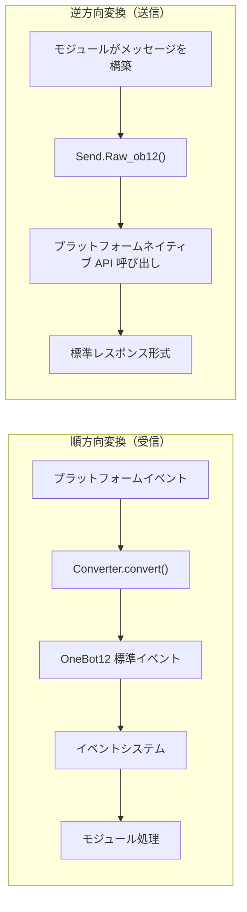

# アダプター開発入門

> [!TIP]
> **いつこのドキュメントを読むべきか**：アダプター開発パスの入口編（必読）。ゼロからアダプターを書く、アダプターの責務境界とプロジェクト構造を理解する、そのすべてがここにあります。読み終えたら、必要に応じて[イベントコンバーター](converter.md)と[SendDSL 詳解](send-dsl.md)へ進んでください。

このドキュメントを最後まで進めると、イベントを受信しメッセージを送信できる最小限の動作するアダプター（メインクラス + コンバーター + Send）が手に入り、各コンポーネントの責務境界も明確になります。新しいプラットフォームへの対応作業は、すべてここから始まります。

## アダプターの概要

### アダプターとは

アダプターは ErisPulse と各メッセージプラットフォームの間の橋渡し役であり、以下を担当します：

1. **順方向変換**：プラットフォームのイベントを受信し、OneBot12 標準形式へ変換する（Converter）
2. **逆方向変換**：OneBot12 メッセージセグメントをプラットフォーム API 呼び出しへ変換する（`Raw_ob12`）
3. プラットフォームとの接続管理（WebSocket/WebHook）
4. 統一された SendDSL メッセージ送信インターフェースの提供

### アダプターのアーキテクチャ



## ディレクトリ構造

標準的なアダプターパッケージの構造：

```
MyAdapter/
├── pyproject.toml          # プロジェクト設定
├── README.md               # プロジェクト説明
├── LICENSE                 # ライセンス
└── MyAdapter/
    ├── __init__.py          # パッケージエントリ
    ├── Core.py               # アダプターメインクラス
    └── Converter.py          # イベントコンバーター
```

## クイックスタート

### 1. プロジェクトの作成

スキャフォールドで完全な骨格（pyproject、メインクラス、コンバーターを含む）を直接生成することをおすすめします：

```bash
# 標準プロジェクト（パッケージ化して公開する用）
epsdk create adapter -n MyAdapter

# ローカルアダプタープラグイン（パッケージ化不要。plugins/ ディレクトリに置くだけで自動読み込みされる。下記「ローカル開発」参照）
epsdk create adapter -n MyAdapter --local
```

スキャフォールドはデフォルトで WebSocket サーバー骨格を生成します。プラットフォームの接続方式が異なる場合は、`--template`
で通信モードのテンプレートを選択できます（生成時に対応する半完成品基底クラスがそのまま使え、`start`/`shutdown` は自分で書く必要がありません）：

```bash
epsdk create adapter -n MyAdapter --template polling   # HTTP ポーリング型（getUpdates による取得）
epsdk create adapter -n MyAdapter --template webhook   # HTTP コールバック型（プラットフォームからのプッシュ）
```

> 3 つの接続モードの違いと半完成品基底クラスの最小実装範囲については
> [アダプターのコア概念 - 接続モード半完成品基底クラス](core-concepts.md#接続モード半完成品基底クラス)を参照してください。
> 完全に動作するサンプルは、リポジトリの `examples/example-adapter-polling/` と `examples/example-adapter-webhook/` を参照してください。

手動で作成することもできます：

```bash
mkdir MyAdapter && cd MyAdapter
```

### 2. pyproject.toml の作成

```toml
[project]
name = "ErisPulse-MyAdapter"
version = "1.0.0"
description = "MyAdapterプラットフォームアダプター"
readme = "README.md"
requires-python = ">=3.10"
license = { file = "LICENSE" }
authors = [ { name = "yourname", email = "your@mail.com" } ]

dependencies = [
    "ErisPulse>=2.4.0"  # ErisPulse には aiohttp が内蔵されているため、通常は個別の依存追加は不要
]

[project.urls]
"homepage" = "https://github.com/yourname/MyAdapter"

[project.entry-points."erispulse.adapter"]
"MyAdapter" = "MyAdapter:MyAdapter"
```

### 3. アダプターメインクラスの作成

フレームワークは `ConfigClass` / `AccountConfigClass` による宣言型の設定管理を提供しており、アダプターは設定クラスを宣言するだけで、設定の自動読み込み、検証、設定テンプレートの生成が行われます。

```python
# MyAdapter/Core.py
from dataclasses import dataclass, field
# ルートからのインポートを推奨（2.10+）：よく使うシンボルはルートパッケージから直接インポートでき、深いパスも引き続き互換
from ErisPulse import BaseAdapter, BaseConfig

@dataclass
class MyAdapterConfig(BaseConfig):
    """MyAdapter の設定"""
    api_endpoint: str = field(
        default="https://api.example.com",
        metadata={
            "description": {"i18n": "my_adapter.api_endpoint", "default": "API アドレス"},
            "required": False,
            "ui": {"widget": "text", "group": "connection", "order": 1},
        },
    )
    token: str = field(
        default="",
        metadata={
            "description": {"i18n": "my_adapter.token", "default": "プラットフォームのトークン"},
            "required": True,
            "secret": True,
            "ui": {"widget": "password", "group": "basic", "order": 2},
        },
    )

class MyAdapter(BaseAdapter):
    ConfigClass = MyAdapterConfig  # 設定クラスを宣言すると、フレームワークが自動管理
    
    # __init__ をオーバーライドする必要はありません！フレームワークが自動処理します：
    # - self.sdk / self.logger を自動設定
    # - self.cfg による設定のリアルタイム読み取り
    # - self.Send / self.Request を自動初期化
    
    def _setup_converter(self):
        from .Converter import MyPlatformConverter
        return MyPlatformConverter()
```

> ⚠️ **`__init__` について**：新しいバージョンでは `BaseAdapter.__init__(self, sdk=None)` が SDK 参照の保持、ログの初期化、設定の読み込みを自動的に処理します。ほとんどのアダプターでは**`__init__` をオーバーライドする必要がなくなりました**。詳細は [__init__ の注意事項](#init-の注意事項) を参照してください。

> ⚠️ **`super().__init__()` について**：`BaseAdapter.__init__()` は `Send` と `Request` のファクトリーインスタンスの作成を担当します。呼び出しを忘れると、すべてのメッセージ送信とリクエスト操作で `AttributeError` が発生します。詳細は [__init__ の注意事項](#init-の注意事項) を参照してください。

### 4. 必須メソッドの実装

```python
class MyAdapter(BaseAdapter):
    # ... __init__ コード ...
    
    async def start(self):
        """アダプターを起動する（必須実装）"""
        # WebSocket または WebHook ルートを登録
        router.register_websocket(
            module_name="myplatform",
            path="/ws",
            handler=self._ws_handler
        )
        self.logger.info("アダプターが起動しました")
    
    async def shutdown(self):
        """アダプターをシャットダウンする（必須実装）"""
        router.unregister_websocket(
            module_name="myplatform",
            path="/ws"
        )
        # 接続とリソースをクリーンアップ
        self.logger.info("アダプターをシャットダウンしました")
    
    async def call_api(self, endpoint: str, **params):
        """プラットフォーム API を呼び出す（必須実装）"""
        raise NotImplementedError("call_api を実装する必要があります")
```

#### Meta イベントの能動的な送信

アダプターは meta イベントを能動的に送信し、フレームワークが Bot のオンライン状態を追跡できるようにすべきです。`emit_meta()` を使えば 1 行で実現できます：

```python
class MyAdapter(BaseAdapter):
    async def _ws_handler(self, websocket):
        bot_id = self._get_bot_id()

        # Bot がオンライン
        await self.emit_meta("connect", bot_id, user_name="MyBot")

        try:
            while True:
                data = await websocket.receive_text()
                event = self.convert(data)
                if event:
                    await self.adapter.emit(event)
        except WebSocketDisconnect:
            pass
        finally:
            # Bot がオフライン
            await self.emit_meta("disconnect", bot_id)
```

> Bot 状態管理と Meta イベントの詳細については、[アダプターのベストプラクティス - Bot 状態管理](best-practices.md#bot-状態管理と-meta-イベント)を参照してください。

### 5. Send クラスの実装

`At`/`AtAll`/`Reply` 修飾子はフレームワークの SendDSL 基底クラスに組み込み実装されており、アダプターが実装するのは `Raw_ob12` と各送信メソッドだけで済みます。

フレームワークは 2 つの重要なヘルパーメソッドを提供します：
- `self._apply_modifiers(message)` — At/AtAll/Reply 修飾子をメッセージセグメントに自動マージ
- `self.send_context` — 送信コンテキスト辞書（`target_type`、`target_id`、`account_id`）を取得

```python
import asyncio

class MyAdapter(BaseAdapter):
    # ... その他のコード ...

    class Send(BaseAdapter.Send):

        def Raw_ob12(self, message, **kwargs):
            """
            OneBot12 形式のメッセージを送信する（必須実装）

            _apply_modifiers を使って修飾子の状態を自動マージし、
            send_context を使って送信コンテキストを取得します。
            """
            async def _do_send():
                segments = self._apply_modifiers(message)
                return await self._adapter.call_api(
                    endpoint="/send_message",
                    message=segments,
                    **self.send_context,
                    **kwargs
                )
            return asyncio.create_task(_do_send())

        # Text/Image/Voice/Video/File/Location は SendDSL 基底クラスから継承済みで、
        # デフォルトで Raw_ob12 に委譲されるため、再実装は不要です。
        # プラットフォーム固有のロジックが必要な場合は、個別のメソッドをオーバーライドできます：
        # def Text(self, text: str):
        #     return self.Raw_ob12([{"type": "text", "data": {"text": text}}])
```

**メディア系送信メソッド（Image/Video/File）の実装のポイント：**

- 基底クラスのデフォルト実装は、`file` パラメーターを OneBot12 メッセージセグメントとして `Raw_ob12` に渡します。アダプターは `Raw_ob12` 内でダウンロード/アップロードを処理する必要があります
- `file` パラメーターは、`bytes` バイナリデータと `str` URL の両方の型をサポートする必要があります
- URL が渡された場合は、まずファイルをダウンロードしてからプラットフォームへアップロードします
- プラットフォームは通常、まずアップロード API を呼び出してファイル識別子を取得し、その後送信 API を呼び出します

**`__getattr__` マジックメソッド：**

- メソッド名の大文字小文字を区別しない（`Text`、`text`、`TEXT` のいずれでも呼び出せる）
- 未定義のメソッドはエラーではなくヒント情報を返すようにする

**`Raw_ob12` メソッド：**

- OneBot12 標準メッセージ形式をプラットフォーム形式に変換して送信する
- `self._apply_modifiers(message)` を使って At/AtAll/Reply 修飾子を自動処理する
- `**self.send_context` を使って送信先情報とアカウント情報を渡す

### 6. コンバーターの実装

```python
# MyAdapter/Converter.py
import time
import uuid

class MyPlatformConverter:
    def convert(self, raw_event):
        """プラットフォームのネイティブイベントを OneBot12 標準形式に変換する"""
        if not isinstance(raw_event, dict):
            return None
        
        onebot_event = {
            "id": str(raw_event.get("event_id", uuid.uuid4())),
            "time": int(time.time()),
            "type": self._convert_event_type(raw_event.get("type")),
            "detail_type": self._convert_detail_type(raw_event),
            "platform": "myplatform",
            "self": {
                "platform": "myplatform",
                "user_id": str(raw_event.get("bot_id", ""))
            },
            "myplatform_raw": raw_event,
            "myplatform_raw_type": raw_event.get("type", "")
        }
        
        return onebot_event
    
    def _convert_event_type(self, event_type):
        """イベントタイプを変換する"""
        type_map = {
            "message": "message",
            "notice": "notice"
        }
        return type_map.get(event_type, "unknown")
    
    def _convert_detail_type(self, raw_event):
        """詳細タイプを変換する"""
        return "private"  # 簡略化したサンプル
```

### 7. Request クラスの実装（リクエスト操作）

プラットフォームがフレンドリクエストやグループ招待など、Bot が判断を下す必要があるリクエストをサポートしている場合は、`Request` 内部クラスを実装できます：

```python
from ErisPulse import BaseAdapter, RequestDSL

class MyAdapter(BaseAdapter):
    # ... Send とその他のコード ...

    class Request(RequestDSL):
        """リクエスト操作の実装（フレンドリクエスト、グループ招待など）"""

        # 公開エントリの accept()/reject() は基底クラスが提供（scope 認証ゲート + タスクラッパー）。
        # アダプターは _do_accept / _do_reject だけをオーバーライドし、標準レスポンスの dict を直接返す
        async def _do_accept(self, **kwargs) -> dict:
            """リクエストを承認する"""
            result = await self._adapter.call_api(
                endpoint="/set_request",
                request_id=self._request_id,
                account_id=self.request_context.get("account_id"),
                approve=True,
                **kwargs,
            )
            return {
                "status": "ok" if result.get("code") == 0 else "failed",
                "retcode": result.get("code", 0),
                "data": None,
                "message_id": "",
                "message": result.get("message", ""),
            }

        async def _do_reject(self, **kwargs) -> dict:
            """リクエストを拒否する（_do_accept と同構造：approve=False）"""
            result = await self._adapter.call_api(
                endpoint="/set_request",
                request_id=self._request_id,
                account_id=self.request_context.get("account_id"),
                approve=False,
                **kwargs,
            )
            return {
                "status": "ok" if result.get("code") == 0 else "failed",
                "retcode": result.get("code", 0),
                "data": None,
                "message_id": "",
                "message": result.get("message", ""),
            }
```

モジュール開発者向けの使い方：

```python
from ErisPulse import request

@request.on_friend_request()
async def handle_friend_request(event):
    # Event の便利メソッドを使う
    await event.approve()
    # またはアダプター経由で直接操作
    await adapter.myplatform.Request("req_id").accept()
```

> プラットフォームがリクエスト操作をサポートしていない場合は、`Request` 内部クラスを実装しなくても構いません。基底クラスはデフォルトで `retcode=10002`（サポートされていない操作）を返します。詳細は[リクエスト操作仕様](../../standards/request-action-spec.md)を参照してください。

### 8. パッケージエントリの作成

```python
# MyAdapter/__init__.py
from .Core import MyAdapter
```

## ローカル開発（パッケージ化不要）

モジュールと同様に、アダプターもプロジェクトのローカルプラグインディレクトリ（デフォルトは `plugins/`、`ErisPulse.framework.plugins_dir` で設定可能）に置いて直接開発でき、**`pip install -e .` は不要**です：

```bash
# ローカルアダプタープラグインを生成
epsdk create adapter -n MyAdapter --local
# 生成される構造：
# plugins/
# └── MyAdapter/
#     ├── __init__.py
#     ├── Core.py
#     └── Converter.py
```

フレームワークは起動時にプラグインディレクトリを自動スキャンし、その中のモジュールとアダプターを読み込みます（entry-point でインストールしたパッケージと同等の扱い：有効状態、設定宣言、ホットアップデート、アンインストール時のクリーンアップはすべて同一）：

- **識別ルール**：パッケージディレクトリ（`__init__.py` を含む）でも単一の `.py` ファイルでも可。`Main` という名前のクラスを優先的に識別し、なければプラグイン内の最初の `BaseAdapter` / `BaseModule` サブクラスを採用
- **同名上書き**：ローカルプラグインと PyPI からインストールしたアダプターが同名の場合、ローカルプラグインが優先される（上書きデバッグに便利）
- **ホットリロード**：`sdk.enable_plugin_hot_reload()` で有効化されるプラグインディレクトリの監視は、アダプターにも適用されます。アダプターのコードレベルホットリロードは 2.11 から提供——`await sdk.adapter.reload("プラットフォーム名")` または `await sdk.reload_adapter("プラットフォーム名")`（構文の事前チェック → アンインストール時のクリーンアップ → キャッシュクリアと再インポート → 再登録して起動、失敗時は自動ロールバック。詳細は[アーキテクチャ概要](../../architecture.md)を参照）

### ローカルプラグインから公開へ

ローカルでの検証が完了したら、`pack` サブコマンドでプラグインをワンクリックで公開可能な標準プロジェクトに変換できます（対話形式でプラグインを選択、メタ情報を補完し、entry-point を含む pyproject を生成）：

```bash
epsdk create pack
# プラグインディレクトリ内のプラグインを選択 → プロジェクト名/説明/作者を入力 → MyAdapter/ プロジェクトディレクトリを生成
cd MyAdapter
pip install -e .   # 標準インストールに切り替え。その後、公開フローに従って PyPI にアップロード
```

> **ヒント**：変換後は、ローカルプラグインとインストール済みパッケージの重複読み込みを避けるため、`plugins/` 内の元ファイルを削除することをおすすめします（両者が同名の場合はローカルが優先され、インストール済みパッケージが有効になっていると誤認する原因になります）。

## 依存関係の宣言（オプション、2.8.0+）


アダプターは他のアダプターやモジュールへの依存を宣言でき、アダプター間の連携やオプション機能を実現できます：

```python
from typing import ClassVar

class MyAdapter(BaseAdapter):
    # ハード依存：欠落時は起動をスキップ（警告 + status=skipped-dependency イベント）
    depends: ClassVar[dict] = {
        "adapters": ["onebot11"],   # 依存するアダプター（プラットフォーム名で指定）
        "modules": ["TranslateEngine"],  # 依存するモジュール（登録名で指定）
    }
    # ソフト依存：欠落しても起動には影響なし。モジュールのロード/アンロード時にコールバックを受信（オプション機能モード）
    optional_modules: ClassVar[list] = ["TranslateEngine"]
```

- **起動順序**：モジュールへのハード依存を宣言したアダプターは、**モジュールの初期化完了後に**起動が延期されます
- **ソフト依存の通知**：`optional_modules`（またはモジュールへのハード依存）内のモジュールがロードされたときに `on_dependency_ready(module_name)` が呼び出され、アンロードされたときに `on_dependency_lost(module_name)` が呼び出されます（デフォルトは空実装、オーバーライド可）——遅延ロードやホットリロードのシナリオにも対応：

```python
async def on_dependency_ready(self, module_name):
    """ソフト依存モジュールの準備完了：対応するオプション機能を有効化"""
    if module_name == "TranslateEngine":
        self._translate = self.sdk.TranslateEngine

async def on_dependency_lost(self, module_name):
    """ソフト依存モジュールの喪失：機能を縮退"""
    if module_name == "TranslateEngine":
        self._translate = None
```

> [!NOTE]
> この機能には ErisPulse **2.8.0+** が必要です。

## `__init__` の注意事項

アダプター開発では、`__init__` のオーバーライドが関わる可能性のある 3 つの層があります。以下はそれぞれの層での正しいやり方です。

### 1. BaseAdapter 層（ほとんどの場合オーバーライド不要）

`BaseAdapter.__init__(self, sdk=None)` は `Send` / `Request` のファクトリーインスタンスの作成を担当し、以下を自動的に行います：

- `sdk` パラメーターを受け取り、`self.sdk`、`self.logger` を設定
- `ConfigClass` が宣言されている場合、`self.cfg` でグローバル設定をリアルタイムに読み取れる
- `AccountConfigClass` が宣言されている場合、`self.accounts` でマルチアカウント設定をリアルタイムに読み取れる

**ほとんどの場合 `__init__` をオーバーライドする必要はなく**、`ConfigClass` を宣言するだけで済みます：

```python
class MyAdapter(BaseAdapter):
    ConfigClass = MyAdapterConfig  # 宣言すればフレームワークが自動管理
    
    async def start(self):
        cfg = self.cfg  # 型安全、リアルタイム読み取り
        ...
```

カスタム初期化が本当に必要な場合は、`super().__init__(sdk)` を呼び出すだけです：

```python
class MyAdapter(BaseAdapter):
    ConfigClass = MyAdapterConfig
    
    def __init__(self, sdk=None):
        super().__init__(sdk)  # sdk を渡す
        self.converter = self._setup_converter()
        self.convert = self.converter.convert
```

### 2. Send 内部クラス（ほとんどの場合オーバーライド不要）

`SendDSL.__init__` はチェーン呼び出しの状態受け渡し（ターゲットタイプ、ターゲット ID、アカウントなど）を担当します。**ほとんどの場合、メソッドだけをオーバーライドすればよく**（`Raw_ob12`、`Text` など）、`__init__` をオーバーライドする必要はありません。

本当に必要な場合（プラットフォーム固有の状態の初期化など）は、**すべてのパラメーターを透過的に渡す必要があります**：

```python
class MyAdapter(BaseAdapter):
    class Send(BaseAdapter.Send):
        # パラメーター：adapter, target_type, target_id, account_id
        def __init__(self, adapter, target_type=None, target_id=None, account_id=None):
            super().__init__(adapter, target_type, target_id, account_id)  # ← 必ず透過的に渡すこと
            self._my_state = None  # プラットフォーム固有の初期化
```

**なぜ透過的に渡す必要があるのか？** チェーン呼び出しの各ステップでは `self.__class__(...)` で新しいインスタンスが作成されます：

```python
adapter.Send.To("user", "123")               # → Send(adapter, "user", "123", None)
adapter.Send.To("user", "123").Using("bot1")  # → Send(adapter, "user", "123", "bot1")
```

`__init__` のシグネチャが一致しない、または `super()` を呼び出していない場合、チェーン呼び出しは中断されます。

### 3. Request 内部クラス（ほとんどの場合オーバーライド不要）

Send と同様です。パラメーターは `adapter`, `request_id`, `account_id`：

```python
class MyAdapter(BaseAdapter):
    class Request(RequestDSL):
        # パラメーター：adapter, request_id, account_id
        def __init__(self, adapter, request_id=None, account_id=None):
            super().__init__(adapter, request_id, account_id)  # ← 必ず透過的に渡すこと
            self._my_state = None  # プラットフォーム固有の初期化
```

### まとめ

| 層 | いつオーバーライドするか | 必須事項 |
|------|------------|-----------|
| **BaseAdapter** | カスタム初期化ロジックが必要なとき | `super().__init__(sdk)` （sdk パラメーターを渡す） |
| **Send 内部クラス** | 送信関連の状態を初期化する必要があるとき | `super().__init__(adapter, target_type, target_id, account_id)` |
| **Request 内部クラス** | リクエスト関連の状態を初期化する必要があるとき | `super().__init__(adapter, request_id, account_id)` |
| 3 つの層すべて | ほとんどの場合 | **ConfigClass を宣言するだけで済み、`__init__` には触れない** |

### 9. 接続情報とルートディスカバリー

アダプターがルートを登録すると、フレームワークはすべてのルート情報を記録します。ユーザーは以下の API でアダプターの接続アドレスを確認できます：

```python
from ErisPulse import sdk

# アダプターの完全な接続情報を取得
info = sdk.adapter.get_connection_info("myplatform")
# {
#   "platform": "myplatform",
#   "status": "started",
#   "connection": {
#     "base_url": "http://localhost:8080",
#     "http_routes": [
#       {"path": "/myplatform/webhook", "method": "POST",
#        "url": "http://localhost:8080/myplatform/webhook"}
#     ],
#     "websocket_routes": [
#       {"path": "/myplatform/ws",
#        "url": "ws://localhost:8080/myplatform/ws"}
#     ]
#   }
# }

# すべての名前空間（アダプター/モジュール）のルートを一覧表示
namespaces = sdk.router.list_namespaces()
# {"myplatform": {"http": ["/myplatform/webhook"], "websocket": ["/myplatform/ws"]}}

# 名前空間の完全な接続 URL を取得
urls = sdk.router.get_module_urls("myplatform")
# {"base_url": "http://localhost:8080", "http": [...], "websocket": [...]}

# 名前空間の詳細なルート情報を取得
routes = sdk.router.get_module_routes("myplatform")
# {"http": [{"path": "/myplatform/webhook", "methods": ["POST"]}],
#  "websocket": [{"path": "/myplatform/ws", "auth": false}]}
```

> **ヒント**：`get_connection_info()` の戻り値はユーザーに表示する（WebUI など）のに適しており、プラットフォーム側のコールバックアドレスや WebSocket 接続アドレスを設定する際の助けになります。ルート登録時の `module_name` は、アダプターが ErisPulse に登録した `platform` 名と完全に一致している必要があります。一致していないと、ルートディスカバリーが正しく関連付けできません。

### 10. SSE (Server-Sent Events) サポート

ErisPulse にはサーバー非依存の SSE サポートが組み込まれており、モジュールとアダプターは `@sdk.router.sse()` で SSE エンドポイントを登録できます。

#### 基本的な使い方

```python
import asyncio
from ErisPulse import sdk

@sdk.router.sse("MyModule", "/events")
async def event_stream(sse):
    """SSE イベントをプッシュする"""
    count = 0
    while not sse.closed:
        await sse.send({"count": count}, event="update")
        count += 1
        await asyncio.sleep(1)
```

#### リクエストパラメーターの使用

ハンドラーは `request` パラメーターを宣言することで、クライアントのリクエスト情報にアクセスできます：

```python
@sdk.router.sse("MyModule", "/events")
async def event_stream(request, sse):
    token = request.query_params.get("token")
    if not validate_token(token):
        await sse.close()
        return

    while not sse.closed:
        data = await fetch_data(token)
        await sse.send(data)
        await asyncio.sleep(5)
```

#### SseEmitter API

| メソッド | 説明 |
|------|------|
| `sse.send(data, event=None, id=None, retry=None)` | SSE イベントを送信する。str 以外の data は自動的に JSON シリアライズされる |
| `sse.close()` | SSE 接続を優雅に閉じる（安全に呼び出せ、複数回の呼び出し可） |
| `sse.closed` | 接続が閉じられているかどうか |
| `sse.request` | 下層のリクエストオブジェクト（query params、headers の読み取りに使用可） |

#### RouteGroup での使用

```python
api = sdk.router.group("MyModule", "/api", version="1")

@api.sse("/events")
async def events(sse):
    await sse.send({"msg": "hello"})
```

#### ルートディスカバリー

SSE ルートはルートディスカバリー API に自動的に現れます：

```python
# list_namespaces には "sse" キーが含まれる
sdk.router.list_namespaces()
# {"MyModule": {"http": [...], "websocket": [...], "sse": ["/MyModule/events"]}}

# get_module_routes は streaming: true とマークする
sdk.router.get_module_routes("MyModule")
# {"http": [...], "websocket": [...], "sse": [{"path": "/MyModule/events", "streaming": true}]}

# get_module_urls は完全な URL を生成する
sdk.router.get_module_urls("MyModule")
# {"sse": [{"path": "/MyModule/events", "url": "http://localhost:8080/MyModule/events"}]}
```

> **サーバー非依存設計**：`SseEmitter` はコールバックを通じて下層の HTTP フレームワークと疎結合になっています。フレームワークは統一された登録入口として `register_sse()` と `@sse` デコレーターを提供しており、アダプターはどの下層 HTTP フレームワークにも直接依存することなく SSE エンドポイントを実装できます。

## 次のステップ

### アダプターの三大要素を補完する

- [イベントコンバーター](converter.md) - プラットフォームイベント → OneBot12 の実装詳細とよくある落とし穴
- [SendDSL 詳解](send-dsl.md) - メッセージ送信チェーン、修飾メソッドと送信ルール
- [アダプターのコア概念](core-concepts.md) - BaseAdapter / ライフサイクル / マルチアカウントの仕組み解説

### 骨格が動いた後は

- [アダプターのベストプラクティス](best-practices.md) - 接続リトライ、ハートビート、エラー処理のエンジニアリング的な仕上げ
- [公開とモジュールストアガイド](../publishing.md) - PyPI とモジュールストアへの公開