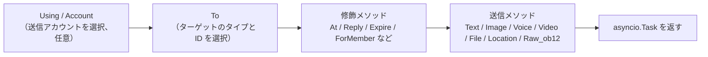
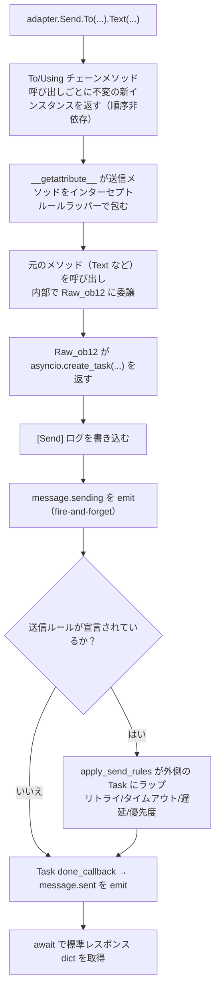

# SendDSL 詳細解説

> [!TIP]
> **この記事を読むべきとき**：アダプター開発パスでは必読（送信 DSL）。不要な場合はスキップしても、他の機能の利用には影響しません。


SendDSL はメッセージ送信を一連のチェーンで完結させます：ターゲット指定、@ / 返信、リトライ / タイムアウト / 遅延、一括送信まで、1 行のチェーン呼び出しで実現できます。本記事では、送信メソッド、修飾メソッド、送信ルール、および送信パイプラインの内部メカニズムを解説します。

## 基本的な呼び出し方法

### 1. タイプと ID を指定

```python
await adapter.Send.To("group", "123").Text("Hello")
```

### 2. ID のみ指定

```python
await adapter.Send.To("123").Text("Hello")
```

### 3. 送信アカウントを指定

```python
await adapter.Send.Using("bot1").Text("Hello")
```

### 4. 組み合わせて使用

```python
await adapter.Send.Using("bot1").To("group", "123").Text("Hello")
```

## メソッドチェーン



## 送信メソッド

すべての送信メソッドは `asyncio.Task` オブジェクトを返します。

### 基本メソッド（基底クラス組み込み）

以下の標準メソッドは `SendDSL` 基底クラスに組み込み実装されており、**デフォルトで `Raw_ob12` に委譲**されます。アダプターのサブクラスで再実装しなくてもそのまま使用でき、IDE の補完にも対応します：

| メソッド名 | 説明 | 戻り値 |
|--------|------|---------|
| `Text(text: str)` | テキストメッセージを送信 | `asyncio.Task` |
| `Image(file: bytes \| str)` | 画像を送信 | `asyncio.Task` |
| `Voice(file: bytes \| str)` | 音声を送信（OneBot12 の `audio` セグメント） | `asyncio.Task` |
| `Video(file: bytes \| str)` | 動画を送信 | `asyncio.Task` |
| `File(file: bytes \| str, filename: str = None)` | ファイルを送信 | `asyncio.Task` |
| `Location(latitude: float, longitude: float, title: str = "", content: str = "")` | 位置情報メッセージを送信（OneBot12 の `location` セグメント） | `asyncio.Task` |

アダプターは個々の標準メソッドをオーバーライドして、プラットフォーム固有のロジックを提供できます：

```python
class Send(SendDSL):
    def Raw_ob12(self, message, **kwargs):
        # 実装必須
        ...

    # 任意：プラットフォーム固有のロジックを提供するため Text をオーバーライド
    # def Text(self, text: str):
    #     return self.Raw_ob12([{"type": "text", "data": {"text": text}}])
```

### プロトコルメソッド

| メソッド名 | 説明 | 戻り値 | 必須か |
|--------|------|---------|---------|
| `Raw_ob12(message)` | OneBot12 形式のメッセージを送信 | `asyncio.Task` | **実装必須** |

> **重要**：`Raw_ob12` はアダプターの中核メソッドであり、**実装必須**です。逆変換（OneBot12 → プラットフォーム）の統一エントリーポイントです。未実装の場合、基底クラスは error ログを記録し、標準エラーレスポンス（`status: "failed"`、`retcode: 10002`）を返します。標準メソッド（`Text`、`Image` など）はデフォルトで `Raw_ob12` に委譲されます。

### プラットフォーム固有メソッド

アダプターは `Send` サブクラスにプラットフォーム固有の送信メソッドを追加できます（`event.supports()` / `event.available_methods()` に認識されます）：

```python
class Send(SendDSL):
    def Raw_ob12(self, message, **kwargs): ...

    # プラットフォーム固有メソッド
    def Sticker(self, sticker_id: str):
        return self.Raw_ob12([{"type": "sticker", "data": {"id": sticker_id}}])
```

## 修飾メソッド

修飾メソッドはチェーン呼び出しをサポートするために `self` を返します。

### At メソッド

```python
# 単一ユーザーに @
await adapter.Send.To("group", "123").At("456").Text("こんにちは")

# 複数ユーザーに @
await adapter.Send.To("group", "123").At("456").At("789").Text("皆さんこんにちは")
```

### AtAll メソッド

```python
# 全メンバーに @
await adapter.Send.To("group", "123").AtAll().Text("皆さんこんにちは")
```

### Reply メソッド

```python
# メッセージに返信
await adapter.Send.To("group", "123").Reply("msg_id").Text("返信内容")
```

### 修飾の組み合わせ

```python
await adapter.Send.To("group", "123").At("456").Reply("msg_id").Text("@したメッセージへの返信")
```

### プラットフォーム専用修飾メソッド

組み込みの `At`/`AtAll`/`Reply` に加え、アダプターは**プラットフォーム専用の修飾メソッド**を定義できます。この種のメソッドは**`self` を返すだけ**で、デコレーターは一切不要です——フレームワークが自動的に識別します：

- `self`（SendDSL インスタンス）を返す → 修飾メソッド。送信ラップやライフサイクルイベントをトリガーせず、チェーンを継続
- `Task`/`Awaitable` を返す → 送信メソッド

```python
class Send(SendDSL):
    def Raw_ob12(self, message, **kwargs): ...

    # 修飾メソッド：self を返し、送信しない
    def Expire(self, seconds: int):
        self._expire = seconds
        return self

    def ForMember(self, user_id: str):
        self._member = user_id
        return self

    # 送信メソッド：Task を返す。修飾メソッドが設定した状態に依存
    def Board(self, content: str, **kwargs):
        return self.Raw_ob12([{"type": "board", "data": {"text": content}}])
```

使用例：

```python
# 修飾メソッドは連続してチェーンで積み重ね可能
await adapter.Send.To("group", "big").Expire(3600).ForMember("114").Board("ボードの内容")
```

## Event ラッパークラスでの修飾メソッドの使用

> [!NOTE]
> `reply(via=)` と `event.send_chain()` の本機能には ErisPulse **2.7.0+** が必要です。

`event.reply()` はデフォルトで `at_sender`/`at_users`/`at_all`/`quote` などの組み込み修飾パラメータのみを公開しています。プラットフォーム専用修飾メソッドを使用するには、2 つの方法があります：

### 方法 1：reply() の via パラメータ

少数の既知の修飾メソッドに適しています：

```python
await event.reply("ボードの内容", method="Board",
                  via=[("Expire", 3600), ("ForMember", "114514")])
```

`via` はリストであり、各要素は次の形式を取れます：

| 形式 | 等価なチェーン呼び出し |
|------|-------------|
| `"Name"` | `.Name()` |
| `("Name", arg1, arg2)` | `.Name(arg1, arg2)` |
| `("Name", (arg1,), {kw: val})` | `.Name(arg1, kw=val)` |

### 方法 2：event.send_chain()

**連続する複数の修飾メソッド**や**コンテンツ引数を持たないアクション型メソッド**（取り消し、削除など）に適しています。`send_chain()` は `To`/`Using` が設定済みの送信チェーンを返し、任意の修飾メソッドと送信メソッドを自由に追加できます：

```python
# プラットフォーム専用修飾メソッド + ボード送信
await event.send_chain().Expire(3600).Board("1時間後に失効")

# 連続する複数の修飾メソッド
await (event.send_chain()
       .Expire(3600)
       .ForMember("114514")
       .Board("ボードの内容", content_type="markdown"))

# 組み込み修飾メソッドも同様に使用可能
await event.send_chain().At("123").Reply("msg_id").Text("hi")

# コンテンツ引数を持たないアクション型メソッド
await event.send_chain().DismissBoard()
```

> `send_chain()` が返すのは完全な SendDSL インスタンスであるため、**すべてのチェーン機能が利用可能**です——修飾メソッドだけでなく、送信ルールや一括構築も含まれます：

```python
# 送信ルール：リトライ + タイムアウト + 成功コールバック
await (event.send_chain()
       .Retry(3).Timeout(10)
       .Hook(lambda r: print("送信成功"))
       .Text("確実な送信"))

# 遅延送信 + プラットフォーム修飾 + ボード
await event.send_chain().Defer(5).Expire(3600).Board("遅延ボード")

# 一括構築モード
results = await (event.send_chain()
                 .Build()
                 .Text("1文目").Image("pic.jpg").Text("2文目")
                 .send_all())
```

## アカウント管理

### Using メソッド

`Using()` はメッセージ送信に使用するアカウントを指定するために使います。渡された識別子は、以下の優先順位で具体的なアカウントにマッチします（解決はフレームワークが自動的に行います）：

1. **アカウント名** — 設定のキー名（例：`"default"`、`"bot1"`）
2. **`bot_id` フィールド** — アカウント設定内の `bot_id` フィールド（実行時にアダプターが書き込むもので、通常はボットの `self.user_id`）
3. **任意の str フィールド** — 設定内のその他の文字列フィールド
4. **フォールバック** — 最初に有効になっているアカウント

```python
# アカウント名を使用
await adapter.Send.Using("account1").To("user", "123").Text("Hello")

# bot_id を使用（通常はイベント内の self.user_id）
await adapter.Send.Using("bot_123").To("user", "123").Text("Hello")
```

> イベント処理のチェーン内で明示的な `Using()` がない場合、フレームワークはイベントを発生させたアカウントを自動的にバインドします（[シームレスなシンタックスシュガー](#シームレスなシンタックスシュガー) を参照）。タイマー／起動タスクなどイベントコンテキストがないシナリオではデフォルトアカウントが使用されます。

### Account メソッド

`Account` メソッドは `Using` と同等です：

```python
await adapter.Send.Account("account1").To("user", "123").Text("Hello")
```

## 非同期処理

### 結果を待機しない

```python
# メッセージはバックグラウンドで送信される
task = adapter.Send.To("user", "123").Text("Hello")

# 他の操作を続けて実行
# ...
```

### 結果を待機する

```python
# await で直接結果を取得
result = await adapter.Send.To("user", "123").Text("Hello")
print(f"送信結果: {result}")

# 先に Task を保存し、後で待機
task = adapter.Send.To("user", "123").Text("Hello")
# ... 他の操作 ...
result = await task
```

## 送信ルールシステム

SendDSL には送信ルールデコレータのセットが組み込まれており、チェーンメソッドでルールを付加し、最終的な送信時に一括適用します。ルールは一般的な本番環境のシナリオをカバーします：タイムアウト制御、失敗時のリトライ、成功時のコールバック、遅延送信、優先度に基づく破棄、進捗監視。

ルールメソッドは **self を返します**（At/AtAll/Reply と同様）ので、送信メソッド（Text/Image など）より前に呼び出す必要があります。ルールは `To`/`Using`/`Account` で作成される新しいインスタンスに伝播します。

### ルールメソッド一覧

| メソッド | 説明 |
|--------|------|
| `.Hook(callback)` | 送信成功後に実行されるコールバック（複数回呼び出し可能、順番に実行） |
| `.Retry(times=1)` | 失敗時に自動で N 回リトライ（初回を含め合計 N+1 回） |
| `.Timeout(seconds)` | 単回送信のタイムアウト。タイムアウト時は現在の試行をキャンセル（Retry と併用可能） |
| `.Defer(seconds=1.0)` | 遅延送信（プロセス内タイマー、永続化なし） |
| `.Priority(level, drop_if_busy=False)` | 優先度を設定。滞留時は破棄可能 |
| `.OnProgress(callback)` | 各段階の進捗コールバック（`SendContext` を受け取る） |
| `.OnError(callback)` | 最終失敗時のエラーコールバック（1 回のみ発火） |

### 送信成功後に実行するロジック（Hook）

```python
# 同期コールバック
await (adapter.Send.To("user", "123")
       .Hook(lambda r: print(f"送信成功、メッセージID: {r['message_id']}"))
       .Text("こんにちは"))

# 非同期コールバック
async def deduct_points(result):
    await db.update(user_id="123", points=-1)

await adapter.Send.To("user", "123").Hook(deduct_points).Text("ポイント消費")
```

Hook は送信が最終的に成功した場合（リトライでの成功を含む）にのみ実行されます。失敗・タイムアウト・キャンセルでは発火しません。

### 失敗時の自動リトライ（Retry）

```python
# 初回失敗後に 2 回リトライ、合計 3 回試行
result = await adapter.Send.To("user", "123").Retry(2).Text("リトライ付き")
```

リトライのトリガー条件：送信時の例外発生、送信のタイムアウト、`status == "failed"` のレスポンスが返された場合。

### タイムアウト時の自動キャンセル（Timeout）

```python
# 単回送信が 10 秒を超えたらキャンセル
await adapter.Send.To("user", "123").Timeout(10).Text("タイムアウト付き")

# タイムアウト + リトライ：1 回の試行につき 10 秒、最大 3 回
await adapter.Send.To("user", "123").Timeout(10).Retry(2).Text("タイムアウトリトライ")
```

### 進捗監視（OnProgress / OnError）

```python
def on_progress(ctx):
    print(f"段階: {ctx.stage}, 試行: {ctx.attempt + 1}/{ctx.max_attempts}, 経過時間: {ctx.elapsed:.2f}s")
    if ctx.stage == "failed":
        print(f"  エラー: {ctx.error!r}")

async def on_error(ctx):
    await notify_admin(f"{ctx.target_id} への送信失敗: {ctx.error!r}")

await (adapter.Send.To("user", "123")
       .Retry(3).Timeout(10)
       .OnProgress(on_progress)
       .OnError(on_error)
       .Text("監視"))
```

`SendContext` に含まれるフィールド：`task_id`、`platform`、`method`、`target_type`、`target_id`、`bot_id`、`stage`、`attempt`、`max_attempts`、`started_at`、`finished_at`、`elapsed`、`error`、`result`、`extra`。

`stage` の取り得る値：`pending`、`sending`、`retrying`、`success`、`failed`、`timeout`、`cancelled`、`dropped`。

### 遅延送信（Defer）

```python
# 5 秒後に送信
await adapter.Send.To("user", "123").Defer(5).Text("遅延メッセージ")
```

> 注意：遅延はプロセス内のタイマーによるものであり、プロセスの再起動で失われます。永続化は提供されません。

### 優先度と滞留時の破棄（Priority）

```python
# 低優先度メッセージ。キューが滞留した場合は自動的に破棄
result = await (adapter.Send.To("user", "123")
               .Priority(-1, drop_if_busy=True)
               .Text("放棄可能な通知"))
# 破棄された場合、result["status"] == "failed"
```

`drop_if_busy` を有効にすると、送信中タスク数がしきい値（デフォルト 64）を超えた時点で今回の送信を即座に諦めます。グローバルなしきい値は `.PriorityThreshold(n)` で調整できます。

### ルールの組み合わせとバックグラウンド実行

```python
# メインフローをブロックせず、ルールはそのまま有効
task = (adapter.Send.To("user", "123")
        .Hook(lambda r: print("送信成功！"))
        .Retry(3)
        .Timeout(10)
        .OnProgress(on_progress)
        .Text("こんにちは"))

# 他の操作を続けて実行
await handle_next_action()
```

### ルールの伝播

ルールは `To`/`Using`/`Account` で作成される新しいインスタンスに伝播し、チェーン呼び出し中のルール消失を防ぎます：

```python
# ルールは To の前に設定しても、To が作成するインスタンスに伝播する
builder = adapter.Send.Retry(3).Timeout(10)
send = builder.To("user", "123")  # send は引き続き Retry(3) と Timeout(10) を保持
await send.Text("hi")
```

複数インスタンス間でルールは相互に独立しています（hooks リストはディープコピー）。

## 一括構築モード（Build）

単発送モードに加え、SendDSL は一括構築モードもサポートしています：1 つのチェーン内に複数の送信メソッドを記述し、最後にまとめて実行します。「一度に複数のメッセージをまとめて送る」シナリオに適しています。

### 構築モードへの移行

送信メソッドの前に `.Build()` を呼び出すと `SendBuilder` を返します。以後、送信メソッド（Text/Image など）は即時実行されず、送信インテントとして蓄積されます：

```python
results = await (adapter.Send.To("user", "123")
                 .Build()                    # 構築モードへ移行
                 .Text("1文目")
                 .Image("pic.jpg")
                 .Text("2文目")
                 .send_all())                 # 一括実行
# results = [Textの結果, Imageの結果, Textの結果]
```

`.send_all()` は `asyncio.Task` を返し、await するとインテントの順序どおりの結果リストが得られます。

### 並列と逐次

デフォルトは**並列**実行です（同時送信、全体の所要時間は最も遅い 1 件にほぼ等しくなります）。メッセージの到着順序を保証する必要がある場合は `.Sequential()` を呼び出します：

```python
# 逐次：順番に 1 つずつ送信
await (adapter.Send.To("group", "456")
       .Build()
       .Sequential()
       .Text("先にこれを送る").Text("次にこれを送る")
       .send_all())

# 並列（デフォルト、明示的に呼び出すことも可）
await (adapter.Send.To("group", "456")
       .Build()
       .Parallel()
       .Text("並列1").Text("並列2")
       .send_all())
```

### 失敗継続とリトライ

一括実行では「失敗継続」戦略を採用しています：1 件が失敗しても他の送信は中断されません。`.Retry()` と組み合わせると、失敗した項目が自動的にリトライされます（リトライは単一項目に作用し、バッチ全体の再試行ではありません）：

```python
await (adapter.Send.To("user", "123")
       .Build()
       .Retry(2)                       # 各項目が個別に 2 回リトライ
       .Text("失敗する可能性あり").Image("こちらも失敗する可能性あり")
       .send_all())
```

### バッチ全体のルールとコールバック

ルールはバッチ全体に一括して作用します：

| メソッド | 説明 |
|--------|------|
| `.Timeout(seconds)` | 各送信の単回タイムアウト |
| `.Retry(times)` | 各送信が個別にリトライ（失敗継続） |
| `.Defer(seconds)` | バッチ全体の送信を遅延 |
| `.Hook(callback)` | バッチ全体の成功後に発火し、`results` リストを受け取る |
| `.OnError(callback)` | バッチに失敗が存在する場合に発火し、`BatchContext` を受け取る |
| `.OnProgress(callback)` | 各項目の完了時に発火し、`BatchContext` を受け取る |

```python
def on_progress(ctx):
    print(f"進捗: {ctx.completed}/{ctx.total}, 成功 {ctx.succeeded}, 失敗 {ctx.failed}")

async def on_error(ctx):
    print(f"バッチに {ctx.failed} 件の失敗があります")

results = await (adapter.Send.To("user", "123")
               .Build()
               .Retry(2).Timeout(10)
               .OnProgress(on_progress)
               .OnError(on_error)
               .Hook(lambda rs: print("バッチ全体が完了"))
               .Text("a").Text("b").Text("c")
               .send_all())
```

`BatchContext` に含まれるもの：`task_id`、`total`、`completed`、`succeeded`、`failed`、`stage`、`results`、`errors`、`elapsed`、`extra`。

`stage` の取り得る値：`pending`、`sending`、`success`（全件成功）、`partial`（一部成功）、`failed`（全件失敗）。

### 修飾子とルールの継承

`.Build()` より前に指定した At/AtAll/Reply 修飾子とルールはバッチ全体に継承され、各メッセージに作用します：

```python
await (adapter.Send.To("group", "456")
       .At("789")                        # 継承：各メッセージで @789
       .Build()
       .Retry(2)                         # 継承 + 追加：各項目が個別にリトライ
       .Text("@付きの通知")
       .Image("お知らせ画像")
       .send_all())
```

Build に入った後も修飾子を追加できます（バッチ全体に作用）：

```python
await (adapter.Send.To("group", "456")
       .Build()
       .At("111").At("222")             # @ を追加、バッチ全体に作用
       .Text("複数人への @")
       .send_all())
```

### バックグラウンド実行

単発送と同様に、`.send_all()` は Task を返すため、await せずにバックグラウンドで実行させることができます：

```python
task = (adapter.Send.To("user", "123")
        .Build()
        .Hook(lambda rs: print("一括送信が完了"))
        .Text("a").Text("b")
        .send_all())

# メインフローをブロックしない
await do_something_else()
```

## 命名規約

### PascalCase 命名

すべての送信メソッドはアッパーキャメルケース（PascalCase）を使用します：

```python
# ✅ 正しい
def Text(self, text: str):
    pass

def Image(self, file: bytes):
    pass

# ❌ 誤り
def text(self, text: str):
    pass

def send_image(self, file: bytes):
    pass
```

### プラットフォーム固有メソッド

プラットフォーム接頭辞付きメソッドの追加は推奨されません：

```python
# ✅ 推奨
def Sticker(self, sticker_id: str):
    pass

# ❌ 非推奨
def TelegramSticker(self, sticker_id: str):
    pass
```

代わりに `Raw` メソッドを使用してください：

```python
# ✅ 推奨
await adapter.Send.Raw_ob12([{"type": "sticker", ...}])

# ❌ 非推奨
def TelegramSticker(self, ...):
    pass
```

## 送信チェーンの内部分解

`await adapter.Send.To("group", "123").Text("x")` を一度実行する裏側では、フレームワークが以下の一連の処理を実行しています：



**各ステップでフレームワークが行っていること：**

| 段階 | フレームワークの動作 |
|------|-------------|
| チェーン合成 | `To`/`Using`/`Account` は呼び出しごとに**不変インスタンスを新規作成**し、設定済みのフィールドを引き継ぎます。そのため `To(...).Using(...)` と `Using(...).To(...)` は**等価**であり、順序に依存しません |
| メソッドラップ | 送信メソッド（`Text` など）は `__getattribute__` によってインターセプトされ、ラッパーで包まれます。修飾メソッド（`To`/`Using`/`At`/`Retry` など）は**ラップされません**。ネストした `Raw_ob12` 呼び出しは `_in_rule_wrap` フラグにより重複ラップを防止します |
| Task 生成 | `Raw_ob12` 内部の `asyncio.create_task()` が Task が実際に生成される箇所です。`Text()` はこの Task を同期的に返すだけで、**ブロックしません** |
| 送信ログ | `[Send] platform/method -> target` のイベントログを書き込みます（`exclude_levels=["EVENT"]` で抑制可能） |
| `message.sending` | 送信メソッドが呼び出された時点で**即座に** fire-and-forget で発火します（リスナーが存在する場合のみ。まず `has_handlers` で短絡評価） |
| `message.sent` | Task の `done_callback` にバインドされます——**ルールがある場合はリトライフロー全体の最終結果をカバー**し、ルールがない場合は元の Task の完了そのものです |

### アカウント解決フォールバックチェーン

`Using()` による明示的な指定（`reply()` による自動注入を含む）や、イベントチェーンで自動バインドされたアカウント識別子は、以下の順序で具体的なアカウントに解決されます：

1. 単一アカウントアダプター（`AccountConfigClass` なし）→ そのまま返す
2. アカウント名と `account_id` の完全一致
3. 各アカウントの `bot_id` フィールドとの一致
4. 各アカウントの任意の `str` フィールド値との一致（`enabled`/`name` を除外）
5. フォールバックとして最初の有効なアカウントを採用：`account_id` が未指定の場合はそのまま採用（デフォルトアカウントのセマンティクス）。明示的に渡された `account_id` が解決できない場合は WARNING を記録した上で採用（WARNING 内の `platform` / `account_id` / `account` は、アカウントに帰属しないイベントの送信元を特定するために使用）
6. 有効なアカウントが一つもない場合（全アカウントが無効化されている場合を含む）→ `ValueError` をスロー：送信可能なアカウントが存在しません

> 渡される `account_id` の優先順位：`Using()` による明示的指定（`event.reply()` による自動注入の `self.user_id` / `self.account_id` 代位を含む）> **イベントディスパッチチェーンによるフォールバック**（イベント処理時に明示的に指定されなかった送信は、イベントをトリガーしたアカウントに自動バインド）> 未指定（デフォルトアカウントのセマンティクス。タイマー／起動タスクなどイベントコンテキストのないシナリオ）。

### シームレスなシンタックスシュガー

> 「イベントチェーン内での `Using()` 不要」「代位アカウント名ルーティング」には ErisPulse **2.12+** が必要です。

| シンタックスシュガー | トリガー条件 | 効果 |
|--------|----------|------|
| イベントチェーン内での `Using()` 不要 | イベント処理チェーン内での `Send` / `Api` / `Request` 呼び出し | イベントをトリガーしたアカウントに自動バインド（ディスパッチ入口が呼び出しコンテキストを注入。`send_context` / `api_context` / `request_context` も同一基準） |
| `reply()` 自動引用 | `quote=True` | イベントの `message_id` を自動取得して `Reply` セグメントを構築 |
| `reply()` 自動アカウントバインド | reply チェーン | 自動で `Using(self.account_id or self.user_id)`——代位アカウント名でそのままルーティング可能 |
| 代位アカウント名ルーティング | 動的アカウントで user_id を未取得 | イベントの `self.account_id` = アカウント名 → アカウント名マッチングにより正しいアカウントに解決 |
| デフォルトアカウントフォールバック | イベントコンテキストなし（タイマー／起動タスク） | 最初の有効なアカウント（既存のセマンティクスは不変） |

### 送信ルールエンジン（リトライ／タイムアウト／遅延）

ルールは `Raw_ob12` が Task を返した**後**に新しい外側の Task としてラップされるため、メインフローには影響しません。重要なポイント：

| ルール | 説明 |
|------|------|
| `Retry(n)` | 合計 `n+1` 回試行。**失敗後はただちに再送、指数バックオフなし** |
| `Timeout(s)` | 単一送信のタイムアウトでキャンセル（`asyncio.wait_for`）。試行回数が残っていればリトライ |
| `Defer(s)` | 送信前に遅延 sleep |
| `Priority(level, drop_if_busy)` | 滞留がしきい値を超えた場合、`{status:"failed", retcode:10002, message:"dropped_low_priority"}` を直接返す |
| `Hook(fn)` | 最終成功時のみ順に実行 |
| `on_progress` / `on_error` | 各段階／最終失敗時のコールバック |

> **注意**：リトライは「即時再送」であり、バックオフ間隔はありません。プラットフォームのレート制限によりバックオフが必要な場合は、`on_error` コールバック内で自ら sleep した後、手動で再送してください。ルールの成功判定は、返される dict の `status == "ok"` を基準とします（`retcode == 0`）。

> 標準レスポンス形式と `retcode` の完全なセマンティクスについては、[API レスポンス仕様](../../standards/api-response.md) を参照してください。

## 戻り値

### Task オブジェクト

すべての送信メソッドは `asyncio.Task` を返します。アダプターは `Raw_ob12` を実装するだけでよく、標準メソッド（Text/Image など）はデフォルトでそれに委譲されます：

```python
import asyncio

def Raw_ob12(self, message, **kwargs):
    async def _do_send():
        segments = self._apply_modifiers(message)
        return await self._adapter.call_api(
            endpoint="/send_message",
            message=segments,
            **self.send_context,
            **kwargs,
        )
    return asyncio.create_task(_do_send())

# Text/Image/Voice/Video/File/Location は基底クラスから継承済みで、自動的に Raw_ob12 に委譲される
# 標準メソッドをオーバーライドする場合は、asyncio.Task を返せばよい：
# def Text(self, text: str):
#     return self.Raw_ob12([{"type": "text", "data": {"text": text}}])
```

### 標準化レスポンス

`call_api` は標準化されたレスポンスを返すべきです。`make_response()` / `make_error()` メソッドの使用を推奨します：

```python
async def call_api(self, endpoint: str, **params):
    try:
        # _do_api_call はアダプターが自前で実装するプラットフォームリクエスト（例示プレースホルダ）
        result = await self._do_api_call(endpoint, **params)
        return self.make_response(
            data=result.get("data"),
            message_id=result.get("message_id", ""),
            raw=result,
        )
    except Exception as e:
        return self.make_error(message=str(e))
```

手動構築もサポートされています（旧バージョンの方式も引き続き互換）：

```python
async def call_api(self, endpoint: str, **params):
    return {
        "status": "ok" or "failed",
        "retcode": 0 or error_code,
        "data": {...},
        "message_id": "msg_id" or "",
        "message": "",
        "{platform}_raw": raw_response
    }
```

## 完全な使用例

### 基本的な使用

```python
from ErisPulse.Core import adapter

my_adapter = adapter.get("myplatform")

# テキストを送信
await my_adapter.Send.To("user", "123").Text("Hello World!")

# 画像を送信
await my_adapter.Send.To("group", "456").Image("https://example.com/image.jpg")

# ファイルを送信
with open("document.pdf", "rb") as f:
    await my_adapter.Send.To("user", "123").File(f.read())
```

### チェーン呼び出し

```python
# ユーザーへの @ + 返信
await my_adapter.Send.To("group", "456").At("789").Reply("msg123").Text("@したメッセージへの返信")

# 全体への @ + 複数の修飾
await my_adapter.Send.Using("bot1").To("group", "456").AtAll().Text("お知らせメッセージ")
```

### 生メッセージとメッセージ構築

`Raw_ob12` は逆変換の中核エントリーポイント（OB12 メッセージセグメントの受信 → プラットフォーム API 呼び出し）であり、`MessageBuilder` はそれと併用するチェーン式メッセージセグメント構築ツールです。

> `Raw_ob12` の完全な実装仕様、`MessageBuilder` の使い方およびコード例については、以下を参照してください：
> - [送信メソッド仕様 §6 逆変換仕様](../../standards/send-method-spec.md#6-反向转换规范onebot12--平台)
> - [送信メソッド仕様 §11 メッセージビルダー](../../standards/send-method-spec.md#11-消息构建器-messagebuilder)

## 関連ドキュメント

### アダプター開発パスの続き

- [アダプター開発入門](getting-started.md) - アダプターの作成
- [アダプターのコア概念](core-concepts.md) - アダプターのアーキテクチャを理解する
- [アダプターのベストプラクティス](best-practices.md) - 高品質なアダプターを開発する

### 正式な仕様への準拠

- [送信メソッド仕様](../../standards/send-method-spec.md) - 送信メソッドの完全な仕様（`Raw_ob12` の実装と `MessageBuilder`）