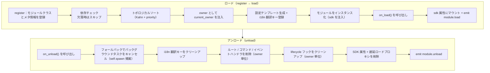

# モジュールのコア概念

> [!NOTE]
> **L1 コア必読**——トップページの「学習パス」にある 5 本のコアドキュメントの 1 つで、モジュール開発に必須です。


このドキュメントでは、モジュールのロードからアンロードまでの完全なライフサイクル、宣言的設定とストレージの使い方を解説します。フレームワークが自動で行うことは何で、自分で書くべきことは何か——読み終えれば全体がつかめます。

## モジュールのライフサイクル

### ロード戦略

```python
from ErisPulse.Core.Bases import BaseModule
from ErisPulse.loaders import ModuleLoadStrategy

class MyModule(BaseModule):
    @staticmethod
    def get_load_strategy():
        """モジュールのロード戦略を返します"""
        return ModuleLoadStrategy(
            lazy_load=True,   # 遅延ロードするか即時ロードするか
            priority=0,       # ロード優先度（数値が大きいほど先にロードされる）
            depends=["OtherModule"]  # 任意：依存する他のモジュールを宣言
        )
```

> `depends` で宣言されたモジュールが未登録の場合、現在のモジュールはスキップされ、警告が記録されます。ロード順序はトポロジカルソートで決定され、同一階層内では `priority` の降順に従います。

> [!NOTE]
> **カスケードアンロード / カスケードリロード**（ErisPulse **2.8.0+**）：他のモジュールから依存されているモジュールをアンロードすると、それに依存するモジュールが**先にカスケードアンロードされます**（ログにカスケードチェーンが記録されます）。任意のモジュール（ローカルプラグイン / ランタイム登録 / PyPI インストールパッケージ）をホットリロードする際も、それに依存するモジュールは同様に**カスケードリロード**され、依存モジュールが無効になったインスタンス参照を保持したまま動作し続けることを防ぎます。循環依存を宣言している場合は、ロード時に `RuntimeError` で拒否されます。
>
> **reload は全量リロード**（ErisPulse **2.11.0+**）：`reload()` はデフォルトでトップレベルパッケージ名に基づいて import キャッシュをクリーンアップし、依存モジュールのコードを再インポートします。アンロード前に自動的に構文プレチェックを行い（失敗時はアンロードを拒否し、旧インスタンスがサービスを継続）、成功後はコードの同一性を検証します（偽リロードの警告 / `stale` マーク）。load 失敗時の状況は `sdk.module.last_error(名前)` で直接照会できます（traceback を含む）。

### on_load メソッド

モジュールのロード時に呼び出され、リソースの初期化とイベントハンドラの登録を行います：

```python
async def on_load(self, event):
    # イベントハンドラを登録
    @command("hello", help="挨拶コマンド")
    async def hello_handler(event):
        await event.reply("こんにちは！")
    
    # SDK 内蔵 HTTP クライアントを使用（接続プールは自動管理、session を手動で作成する必要なし）
    # sdk.client 経由でリクエストを送信できます
```

### on_unload メソッド

モジュールのアンロード時に呼び出され、リソースのクリーンアップを行います：

```python
async def on_unload(self, event):
    # カスタムリソースをクリーンアップ
    # sdk.client はフレームワークが管理するため、手動でクローズする必要なし
    
    # イベントハンドラの解除（フレームワークが自動的に処理）
    self.logger.info("モジュールがアンロードされました")
```

> バックグラウンドタスクの作成とクリーンアップ（`self.spawn()` / フレームワークによるフォールバックキャンセル）の詳細は、[ライフサイクル管理](../../advanced/lifecycle.md#バックグラウンドタスクの帰属と自動キャンセル) を参照してください。

### on_before_unload メソッド

> [!NOTE]
> このフックには ErisPulse **2.11.0+** が必要です。

アンロードパイプラインの**最初のステップ**（`on_unload` およびリソース回収の前に実行）でトリガーされるオプションのフックです。この時点ではモジュールのリソースはすべて無傷のため、アンロード / 休眠 / リロードの前に状態を `sdk.storage` に保存し、次回の `on_load` で復元するのに適しています（遅延ロードによる休眠状態の引き継ぎはまさにこれに基づいています）：

```python
async def on_before_unload(self, event):
    # event["reason"] は呼び出しの理由を示します：unload / reload / disable / cascade / dormant
    if event["reason"] in ("reload", "dormant"):
        await self.sdk.storage.aset(f"{self._module_name}:state", self.collect_state())
```

フックが失敗した場合は警告が出るだけで、アンロードの流れはブロックされません。このフックを宣言していないモジュールの動作は変わりません。休眠 / 復帰のセマンティクスの詳細は、[遅延ロード休眠](../../advanced/lazy-loading.md#遅延ロード休眠dormant_after) を参照してください。

### アンロードと完全アンロード（purge）

> [!NOTE]
> この機能には ErisPulse **2.8.0+** が必要です。

`unload()` はデフォルトでは**ロード解除**のみを行い（インスタンスとリソースをアンロード）、登録スタブ（モジュールクラスとメタ情報）を保持します。モジュールは引き続き discover で再発見でき、`load()` で再インスタンス化でき、再度 `register()` する必要はありません。

**完全アンロード**（モジュールクラスへの参照を解放し、`sys.modules` をクリーンアップして、プラグインとその専用依存関係を GC で回収可能にする）が必要な場合は、`purge=True` を渡します：

```python
# ロード解除のみ：登録スタブを保持し、いつでも再ロード（load()）可能
await sdk.module.unload("MyModule")

# 完全アンロード：登録スタブの削除 + sys.modules のクリーンアップ（プラグインソース）
await sdk.module.unload("MyModule", purge=True)
```

| セマンティクス | `unload()` デフォルト | `unload(purge=True)` |
|------|-----------------|----------------------|
| インスタンスとリソースのアンロード（イベント/task/ルート/lifecycle/i18n） | ✅ | ✅ |
| 登録スタブの保持（モジュールクラスとメタ情報） | ✅ | ❌ 削除 |
| `sys.modules` のクリーンアップ（プラグインフォルダソースのみ） | ❌ | ✅ |
| モジュールクラスが GC で回収可能 | ❌ | ✅ |
| 再ロード | `load()` で直接可能 | 先に `register()` + `load()` が必要 |

> `purge=True` の場合、カスケードアンロードされる依存モジュールも同様に purge されます。アンロード後、フレームワークは `gc.collect()` を実行し、モジュールクラス/インスタンスが回収可能かどうかを確認します。残存参照がある場合はログに警告が出力されます（参照元を含む、DEBUG レベル）。

### ライフサイクルの全体像

上記のメソッドをつなぎ合わせると、フレームワークがモジュールのロード・アンロード時に**裏で行ってくれるすべての処理**は次のようになります：



**ロード時にフレームワークが行ってくれること**（`on_load` を書くだけで、残りは自動的に完了します）：

| ステップ | フレームワークが自動で行うこと |
|------|-------------|
| owner 注入 | インスタンス化の間、モジュール名を `owner_scope` でラップします——`on_load` 内で登録したコマンド/イベント/フック/バックグラウンドタスクは**自動的にこのモジュールに帰属**し、アンロード時には owner 単位で一括クリーンアップできます |
| 設定テンプレート | `ConfigClass` を宣言したモジュールでは、フレームワークが自動で `ErisPulse.<ModuleName>` 設定セクションを生成/入力します |
| i18n 翻訳キー | `I18nClass` を宣言したモジュールでは、翻訳キーが自動登録されます（アンロード時に自動解除） |
| 依存トポロジ | `depends` の宣言に基づいてソートし、依存されるモジュールが先にロードされることを保証します。循環依存は `RuntimeError` で拒否されます |
| SDK マウント | インスタンス化後に `sdk.<ModuleName>` にマウントされるため、`sdk.MyModule.xxx` でアクセスできます |

**アンロード時にフレームワークがクリーンアップしてくれるもの**（上の U1→U7 に対応）：`on_unload` の実行後にフォールバックとしてクリーンアップを行います——バックグラウンドタスクの強制キャンセル（`self.spawn` で作成されたもの。グレースフルな終了処理は `on_unload` 内で自身で行ってください）、i18n キー、ルート、コマンド/イベントハンドラ、lifecycle フック、そして最後に SDK 属性の削除です。`purge=True` の場合はさらに登録スタブの削除 + `sys.modules` のクリーンアップが行われます。

> これらの自動クリーンアップこそが、「`on_load`/`on_unload` だけ書けば手動で unregister する必要がない」という安心感の根拠です——フレームワークは owner 帰属の仕組みによって、「登録した者がクリーンアップする」をワンステップで実現しています。

## SDK オブジェクト

### コアモジュールへのアクセス

```python
from ErisPulse import sdk

# sdk オブジェクトを通じてすべてのコアモジュールにアクセス
sdk.logger.info("ログ")
sdk.storage.set("key", "value")
config = sdk.config.getConfig("MyModule")
```

### モジュール間通信

```python
# 他のモジュールにアクセス
other_module = sdk.OtherModule
result = await other_module.some_method()
```

## アダプターの送信メソッド照会

新しい標準仕様では、フォールバック送信メカニズムを実現するために `__getattr__` メソッドをオーバーライドすることが求められるため、`hasattr` メソッドを使ってメソッドの存在を確認することができなくなりました。`2.3.5` 以降、送信メソッドを照会する機能が新たに追加されました。

### サポートされている送信メソッドの一覧

```python
# プラットフォームがサポートするすべての送信メソッドを一覧表示
methods = sdk.adapter.list_sends("onebot11")
# 戻り値: ["Text", "Image", "Voice", "Markdown", ...]
```

### メソッドの詳細情報の取得

```python
# 特定のメソッドの詳細情報を取得
info = sdk.adapter.send_info("onebot11", "Text")
# 戻り値:
# {
#     "name": "Text",
#     "parameters": [
#         {"name": "text", "type": "str", "default": null, "annotation": "str"}
#     ],
#     "return_type": "Awaitable[Any]",
#     "docstring": "テキストメッセージを送信します..."
# }
```

## 設定管理

### 宣言的設定（推奨）

v2.5.2 以降、モジュールは `ConfigClass` で設定クラスを宣言でき、アダプターと同一の設定 Schema システムを使用します。設定は `self.cfg` を通じてリアルタイムに読み取られ、変更は直ちに反映されます：

```python
from dataclasses import dataclass, field
from ErisPulse.Core.Bases import BaseModule
from ErisPulse.Core.Bases import BaseConfig

@dataclass
class MyModuleConfig(BaseConfig):
    api_key: str = field(
        default="",
        metadata={
            "description": {"i18n": "my_module.api_key", "default": "API キー"},
            "required": True,
            "secret": True,
            "ui": {"widget": "password", "group": "basic", "order": 1},
        },
    )
    timeout: int = field(
        default=30,
        metadata={
            "description": {"i18n": "my_module.timeout", "default": "タイムアウト（秒）"},
            "ui": {"widget": "number", "group": "advanced", "order": 2},
        },
    )

class MyModule(BaseModule):
    ConfigClass = MyModuleConfig

    def __init__(self, sdk):
        self.sdk = sdk
        self.logger = sdk.logger.get_child("MyModule")

    async def on_load(self, event):
        self.logger.info("モジュールがロードされました")

    async def on_unload(self, event):
        pass

    async def do_something(self):
        cfg = self.cfg  # リアルタイムに読み取り、型安全
        api_key = cfg.api_key
        timeout = cfg.timeout
```

`BaseConfig` は汎用の設定基底クラスで、アダプター、モジュール、外部プロジェクトなどあらゆるシーンに適用できます。設定フィールドは i18n による多言語説明をサポートしています（詳細は [i18n ドキュメント](../../advanced/i18n.md#設定フィールドの多言語) を参照）。

> [!NOTE]
> モジュール（アダプターを含む）のロード、アンロード、起動・停止などのライフサイクルはフレームワークが一元管理します（`module manager` / `scope` が照会・制御 API を提供します）。`ConfigClass` はビジネスパラメータのみを担うべきであり、モジュール内部で「自分を起動すべきかどうか」を再度ネストして判断するロジックは不要です。

設定 Schema システムはさらに以下もサポートしています（v2.8.0+。詳細は [アダプター core-concepts](../adapters/core-concepts.md#metadata-規約) を参照）：

- **docstring によるフィールド説明の自動生成**：metadata `description` が宣言されていない場合、docstring の `:ivar フィールド: 説明` または `Attributes:` セクションから自動的にフォールバック抽出します
- **ネスト dataclass 設定**：フィールド型がネスト dataclass の場合、schema/テンプレート/バリデーションが再帰的に処理され、WebUI ではネストされたグループとしてレンダリングされます
- **`example` 非永続化フィールド**：`metadata={"example": True}` のフィールドは config.toml に書き込まれず、`config.full.example` にのみ記録されます（冗長でほとんど変更しない高度な設定項目に適しています）。ユーザーが手動で設定した後は通常どおり永続化されます

### 宣言的翻訳キー（v2.7.0+）

v2.7.0 以降、モジュールは `ConfigClass` を宣言するのと同様に、ネストクラス `I18nClass` によって翻訳キーを一元的に宣言できます。フレームワークはロード時に宣言されたすべての翻訳キーを**自動登録**するため、`i18n.register()` を手動で呼び出す必要はありません。また、登録のタイミングは設定テンプレートの生成より前であるため、設定の説明で参照される i18n キーが確実に利用可能です。

```python
from ErisPulse.Core.Bases import BaseConfig, BaseI18n, I18nKey

class MyModule(BaseModule):
    # 設定クラス（任意）
    @dataclass
    class ConfigClass(BaseConfig):
        welcome_msg: str = field(
            default="ようこそ",
            metadata={
                "description": {"i18n": "mymodule.welcome_msg", "default": "ようこそメッセージ"},
            },
        )

    # 翻訳キーコレクションクラス（任意）
    class I18nClass(BaseI18n):
        # 属性名から完全なキーパスが自動的に構築されます：<モジュール名>.<属性名>
        welcome_msg: I18nKey = I18nKey(
            default="Welcome Message",   # 言語に依存しないフォールバック
            zh_CN="ようこそメッセージ",
            zh_TW="歡迎訊息",
            en="Welcome Message",
            ja="ウェルカムメッセージ",
            ru="Приветственное сообщение",
        )
        hello: I18nKey = I18nKey(
            default="Hello, {name}!",
            zh_CN="こんにちは、{name}！",
            zh_TW="你好，{name}！",
            en="Hello, {name}!",
            ja="こんにちは、{name}！",
            ru="Привет, {name}!",
        )
```

詳細は [i18n 推奨記法](../../advanced/i18n.md#推奨記法i18nclassによる翻訳キーの宣言-v270) を参照してください。

### 手動での設定読み取り（非推奨）

> **非推奨**：代わりに [宣言的設定](#宣言的設定推奨) と `self.cfg` によるリアルタイム読み取りを使用してください。

```python
class MyModule(BaseModule):
    def __init__(self, sdk):
        self.sdk = sdk

    def _load_config(self):
        config = self.sdk.config.getConfig("MyModule")
        if not config:
            self.sdk.config.setConfig("MyModule", {"api_key": "", "timeout": 30})
            return {"api_key": "", "timeout": 30}
        return config
```

## ストレージシステム

### 基本的な使い方

```python
# データを保存
sdk.storage.set("user:123", {"name": "山田太郎"})

# データを取得
user = sdk.storage.get("user:123", {})

# データを削除
sdk.storage.delete("user:123")
```

### トランザクションの使い方

```python
# トランザクションを使用してデータの一貫性を確保
with sdk.storage.transaction():
    sdk.storage.set("key1", "value1")
    sdk.storage.set("key2", "value2")
    # いずれかの操作が失敗した場合、すべての変更がロールバックされます
```

## イベント処理

### イベントハンドラの登録

```python
from ErisPulse.Core.Event import command, message

# コマンドを登録
@command("info", help="情報を取得")
async def info_handler(event):
    await event.reply("これは情報です")

# メッセージハンドラを登録
@message.on_group_message()
async def group_handler(event):
    sdk.logger.info(f"グループメッセージを受信: {event.get_text()}")
```

### イベントハンドラのライフサイクル

フレームワークがイベントハンドラの登録と解除を自動的に管理するため、`on_load` 内で登録するだけで済みます。

## 遅延ロード機構

### 動作原理

```python
# モジュールは初回アクセス時にのみ初期化されます
result = await sdk.my_module.some_method()
# ↑ ここでモジュールの初期化がトリガーされます
```

### 即時ロード

即時初期化が必要なモジュール（リスナー、タイマーなど）の場合：

```python
@staticmethod
def get_load_strategy():
    return ModuleLoadStrategy(
        lazy_load=False,  # 即時ロード
        priority=100
    )
```

## エラー処理

### 例外の捕捉

```python
async def handle_event(self, event):
    try:
        # ビジネスロジック
        await self.process_event(event)
    except ValueError as e:
        self.logger.warning(f"パラメータエラー: {e}")
        await event.reply(f"パラメータエラー: {e}")
    except Exception as e:
        self.logger.error(f"処理に失敗しました: {e}")
        raise
```

### ログ出力

```python
# 異なるログレベルを使用
self.logger.debug("デバッグ情報")    # 詳細なデバッグ情報
self.logger.info("実行状態")      # 通常の実行情報
self.logger.warning("警告情報")  # 警告情報
self.logger.error("エラー情報")    # エラー情報
self.logger.critical("致命的エラー") # 致命的エラー
```

## 関連ドキュメント

### 学習パスを続ける

- [Event ラッパークラス](event-wrapper.md) - イベント処理の詳細

### 深掘りとトラブルシューティング

- [モジュールのベストプラクティス](best-practices.md) - 高品質なモジュールを開発する
- [モジュール開発入門](getting-started.md) - 最初のモジュールの構築手順をおさらいする