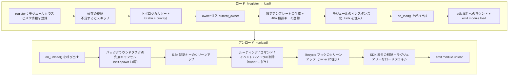

# モジュールのコアコンセプト

> [!NOTE]
> **L1 必読**——「読むべき順序」の5つのコアドキュメントの1つ、モジュール開発に必須。

このドキュメントでは、モジュールのロードからアンロードまでのライフサイクル、宣言的設定とストレージの使い方を解説します。フレームワークが自動で行う部分と、開発者が書くべき部分を明確にします。

## モジュールのライフサイクル

### ロード戦略

```python
from ErisPulse.Core.Bases import BaseModule
from ErisPulse.loaders import ModuleLoadStrategy

class MyModule(BaseModule):
    @staticmethod
    def get_load_strategy():
        """モジュールのロード戦略を返す"""
        return ModuleLoadStrategy(
            lazy_load=True,   # ラグジュアリーなロードか即時ロード
            priority=0,       # ロード優先度（数値が大きいほど先にロードされる）
            depends=["OtherModule"]  # 任意：依存する他のモジュールを宣言
        )
```

> `depends` で宣言したモジュールが登録されていない場合、現在のモジュールはスキップされ、警告が記録されます。ロード順序はトポロジカルソートによって決定され、同レベルでは `priority` 降順に処理されます。

> [!NOTE]
> **連鎖アンロード / 連鎖リロード**（ErisPulse **2.8.0+**）：他のモジュールに依存しているモジュールをアンロードする際、依存しているモジュールは**先に連鎖的にアンロード**されます（連鎖のログが説明されます）。また、モジュールのホットリロード（ローカルプラグイン / 実行時登録 / PyPI でインストールされたパッケージ）を行う際、依存しているモジュールも**連鎖的にリロード**されます。依存者が無効なインスタンスの参照を保持したまま実行されないようにします。循環依存を宣言した場合、ロード時に `RuntimeError` で拒否されます。
>
> **リロードは全量リロード**（ErisPulse **2.11.0+**）：`reload()` はデフォルトで、インポートキャッシュをクリアして依存者コードを再インポートし、アンロード前に自動的に構文チェック（失敗するとアンロードを拒否、古いインスタンスが引き続きサービスを提供）を行い、成功後、コードのアイデンティティを確認（偽のリロード警告 / `stale` マーク）。ロードに失敗した場合、`sdk.module.last_error(名前)` で直ちにエラーを確認できます（traceback 付き）。

### on_load メソッド

モジュールのロード時に呼び出され、リソースの初期化とイベントハンドラの登録に使用されます：

```python
async def on_load(self, event):
    # イベントハンドラの登録
    @command("hello", help="挨拶コマンド")
    async def hello_handler(event):
        await event.reply("こんにちは！")
    
    # SDK 内蔵の HTTP クライアントを使用（接続プールを自動管理、手動の session 作成は不要）
    # sdk.client でリクエストを送信できる
```

### on_unload メソッド

モジュールのアンロード時に呼び出され、リソースのクリーンアップに使用されます：

```python
async def on_unload(self, event):
    # 自作リソースのクリーンアップ
    # sdk.client はフレームワークが管理するので、手動で閉じる必要はない
    
    # イベントハンドラのキャンセル（フレームワークが自動処理）
    self.logger.info("モジュールはアンロードされました")
```

> バックグラウンドタスクの作成とクリーンアップ（`self.spawn()` / フレームワークがキャンセルをカバー）の詳細は [ライフサイクル管理](../../advanced/lifecycle.md#バックグラウンドタスクの所有と自動キャンセル) を参照してください。

### on_before_unload メソッド

> [!NOTE]
> 本フックは ErisPulse **2.11.0+** が必要です。

アンロードのパイプラインの**最初のステップ**（`on_unload` とリソースの回収の前に）にトリガーされるオプションフックです。この時点でモジュールのリソースはすべて保たれており、アンロード / スリープ / リロードの前で `sdk.storage` に状態を保存し、次回の `on_load` で復元するのに適しています（ラグジュアリーなロードのスリープ状態はこのフックに基づいて接続されます）：

```python
async def on_before_unload(self, event):
    # event["reason"] は原因を示す：unload / reload / disable / cascade / dormant
    if event["reason"] in ("reload", "dormant"):
        await self.sdk.storage.aset(f"{self._module_name}:state", self.collect_state())
```

フックが失敗しても警告のみで、アンロードプロセスはブロックされません。このフックを宣言していないモジュールは、従来通りの動作をします。スリープ / アウェークの意味は [ラグジュアリーなロードのスリープ](../../advanced/lazy-loading.md#ラグジュアリーなロードのスリープdormant_after) を参照してください。

### アンロードと完全アンロード（purge）

> [!NOTE]
> 本機能は ErisPulse **2.8.0+** が必要です。

`unload()` はデフォルトで**ロード解除**（アンロードインスタンスとリソース）のみを行いますが、登録の残骸（モジュールクラスとメタ情報）は保持されます——モジュールは再発見され、`load()` で再インスタンス化可能で、再登録は不要です。

**完全アンロード**（モジュールクラスの参照を解放し、`sys.modules` をクリーンアップして、プラグインとその排他的な依存が GC で回収されるようにする）が必要な場合は、`purge=True` を渡します：

```python
# ロード解除のみ：登録の残骸を保持し、再ロードはいつでも可能
await sdk.module.unload("MyModule")

# 完全アンロード：登録の残骸の削除 + `sys.modules` のクリーンアップ（プラグインソースのみ）
await sdk.module.unload("MyModule", purge=True)
```

| 語義 | `unload()` デフォルト | `unload(purge=True)` |
|------|-----------------|----------------------|
| アンロードインスタンスとリソース（イベント/task/ルーティング/lifecycle/i18n） | ✅ | ✅ |
| 登録の残骸（モジュールクラスとメタ情報）の保持 | ✅ | ❌ 削除 |
| `sys.modules` のクリーンアップ（プラグインフォルダソースのみ） | ❌ | ✅ |
| モジュールクラスの GC 回収 | ❌ | ✅ |
| 再ロード | `load()` で直接利用可能 | 再 `register()` + `load()` が必要 |

> `purge=True` の場合、連鎖アンロードの依存者も purge されます。アンロード後、フレームワークは `gc.collect()` を実行し、モジュールクラス/インスタンスが回収可能かどうかを確認し、残留参照はログに警告されます（含引用元、DEBUG 級）。

### ライフサイクルの全体像

上記のメソッドをつなげると、フレームワークがモジュールのロードとアンロードの際に、**背後で全てのことを自動で行う**：



**ロード時にフレームワークが自動で行うこと**（`on_load` を書くだけで、残りは自動処理）：

| フェーズ | フレームワークが自動で行うこと |
|------|-------------|
| owner 注入 | インスタンス化時に `owner_scope` でモジュール名をラップ——`on_load` で登録したコマンド/イベント/フック/バックグラウンドタスクは**自動的にこのモジュールに所有**され、アンロード時に owner に従って一括クリーンアップ |
| 設定テンプレート | `ConfigClass` を宣言したモジュールは、フレームワークが自動的に `ErisPulse.<ModuleName>` 設定セクションを生成/埋め込み |
| i18n 翻訳キー | `I18nClass` を宣言したモジュールは、翻訳キーを自動登録（アンロード時に自動登録解除） |
| 依存トポロジー | `depends` で宣言した順序に従い、依存モジュールを先にロードするようにする；循環依存は `RuntimeError` で拒否 |
| SDK マウント | インスタンス化後に `sdk.<ModuleName>` にマウントされ、`sdk.MyModule.xxx` でアクセスできるようになる |

**アンロード時にフレームワークがクリーンアップすること**（上記の U1→U7 に対応）：`on_unload` 実行後に兜底クリーンアップ——バックグラウンドタスクは強制キャンセル（`self.spawn` で作成されたもの、優雅な終了は `on_unload` で行う）、i18n キー、ルーティング、コマンド/イベントハンドラ、lifecycle フック、最後に SDK 属性を削除。`purge=True` は追加で登録の残骸と `sys.modules` をクリーンアップ。

> これらの自動クリーンアップが「`on_load`/`on_unload` を書けば、手動で unregister する必要がない」根拠です——フレームワークは owner 归属を使って「誰が登録したか、誰がクリーンアップするか」を一括処理にしています。

## SDK オブジェクト

### コアモジュールのアクセス

```python
from ErisPulse import sdk

# sdk オブジェクトを使って全てのコアモジュールにアクセス
sdk.logger.info("ログ")
sdk.storage.set("key", "value")
config = sdk.config.getConfig("MyModule")
```

### モジュール間通信

```python
# 他のモジュールにアクセス
other_module = sdk.OtherModule
result = await other_module.some_method()
```

## アダプタ送信メソッドの検索

新しい標準規格では、`__getattr__` メソッドをオーバーライドしてデフォルト送信メカニズムを実装する必要があるため、`hasattr` メソッドでメソッドの存在をチェックすることはできません。`2.3.5` 以降、送信メソッドを検索する機能が追加されました。

### 送信メソッドの一覧表示

```python
# プラットフォームがサポートする全ての送信メソッドをリストアップ
methods = sdk.adapter.list_sends("onebot11")
# 返り値: ["Text", "Image", "Voice", "Markdown", ...]
```

### メソッドの詳細情報取得

```python
# 特定のメソッドの詳細情報を取得
info = sdk.adapter.send_info("onebot11", "Text")
# 返り値:
# {
#     "name": "Text",
#     "parameters": [
#         {"name": "text", "type": "str", "default": null, "annotation": "str"}
#     ],
#     "return_type": "Awaitable[Any]",
#     "docstring": "テキストメッセージを送信..."
# }
```

## 設定管理

### 宣言的設定（推奨）

v2.5.2 以降、モジュールは `ConfigClass` を宣言することで、アダプタと同じ設定 Schema システムを使用できます。設定は `self.cfg` でリアルタイムに読み取ることができ、変更後は即座に反映されます：

```python
from dataclasses import dataclass, field
from ErisPulse.Core.Bases import BaseModule
from ErisPulse.Core.Bases import BaseConfig

@dataclass
class MyModuleConfig(BaseConfig):
    api_key: str = field(
        default="",
        metadata={
            "description": {"i18n": "my_module.api_key", "default": "API キー"},
            "required": True,
            "secret": True,
            "ui": {"widget": "password", "group": "basic", "order": 1},
        },
    )
    timeout: int = field(
        default=30,
        metadata={
            "description": {"i18n": "my_module.timeout", "default": "タイムアウト時間（秒）"},
            "ui": {"widget": "number", "group": "advanced", "order": 2},
        },
    )

class MyModule(BaseModule):
    ConfigClass = MyModuleConfig

    def __init__(self, sdk):
        self.sdk = sdk
        self.logger = sdk.logger.get_child("MyModule")

    async def on_load(self, event):
        self.logger.info("モジュールはロードされました")

    async def on_unload(self, event):
        pass

    async def do_something(self):
        cfg = self.cfg  # 実時読み取り、型安全
        api_key = cfg.api_key
        timeout = cfg.timeout
```

`BaseConfig` は、アダプタ、モジュール、外部プロジェクトなど、あらゆる場面で使用できる汎用設定基底クラスです。設定フィールドは i18n 多言語説明（[i18n ドキュメント](../../advanced/i18n.md#設定フィールドの多言語)）をサポートしています。

> [!NOTE]
> モジュール（アダプタ含む）のロード、アンロード、起動/停止などのライフサイクルは、フレームワークが一括管理しています（`module manager` / `scope` がクエリと制御 API を提供）。`ConfigClass` はビジネスパラメータのみを保持すべきであり、モジュールは内部で「自分自身を起動するかどうか」の論理を再嵌套判断する必要はありません。

設定 Schema システムは（v2.8.0+、[アダプタ core-concepts](../adapters/core-concepts.md#metadata-の規約) を参照）：

- **docstring からフィールド説明の自動生成**：`metadata` の `description` が宣言されていない場合、`docstring` の `:ivar フィールド: 説明` または `Attributes:` ブロックから兜底として抽出
- **ネストされた dataclass 設定**：フィールド型がネストされた dataclass の場合、schema/テンプレート/検証を再帰的に処理し、WebUI はネストされたグループとしてレンダリング
- **`example` は保存しないフィールド**：`metadata={"example": True}` のフィールドは `config.toml` に書き込まれず、`config.full.example` に記録される（冗長で頻繁に触れない高度な設定項目に適している）、ユーザーが手動で設定した後は通常永続化される

### 宣言的翻訳キー（v2.7.0+）

v2.7.0 以降、モジュールは `ConfigClass` を宣言するのと同じように、`I18nClass` というネストされたクラスを使って翻訳キーを一括宣言できます。フレームワークはロード時に**自動的に宣言された全ての翻訳キーを登録**し、`i18n.register()` を手動で呼ぶ必要がなく、設定テンプレート生成よりも早い段階で登録され、設定の説明で参照される i18n キーが利用可能であることを保証します。

```python
from ErisPulse.Core.Bases import BaseConfig, BaseI18n, I18nKey

class MyModule(BaseModule):
    # 設定クラス（オプション）
    @dataclass
    class ConfigClass(BaseConfig):
        welcome_msg: str = field(
            default="ようこそ",
            metadata={
                "description": {"i18n": "mymodule.welcome_msg", "default": "ようこそメッセージ"},
            },
        )

    # 翻訳キー集合クラス（オプション）
    class I18nClass(BaseI18n):
        # プロパティ名は自動的にモジュール名と結合され、完全なキー名になる：<モジュール名>.<プロパティ名>
        welcome_msg: I18nKey = I18nKey(
            default="Welcome Message",   # 言語に依存しない兜底
            zh_CN="ようこそ",
            zh_TW="歡迎訊息",
            en="Welcome Message",
            ja="ようこそ",
            ru="Добро пожаловать",
        )
        hello: I18nKey = I18nKey(
            default="Hello, {name}!",
            zh_CN="こんにちは、{name}！",
            zh_TW="你好，{name}！",
            en="Hello, {name}!",
            ja="こんにちは、{name}！",
            ru="Привет, {name}!",
        )
```

詳細は [i18n 推奨書き方](../../advanced/i18n.md#推奨書き方-i18nclass-で翻訳キーを宣言する-v270) を参照してください。

### 手動設定の読み取り（廃止）

> **廃止**：[宣言的設定](#宣言的設定推奨) + `self.cfg` 実時読み取りに変更してください。

```python
class MyModule(BaseModule):
    def __init__(self, sdk):
        self.sdk = sdk

    def _load_config(self):
        config = self.sdk.config.getConfig("MyModule")
        if not config:
            self.sdk.config.setConfig("MyModule", {"api_key": "", "timeout": 30})
            return {"api_key": "", "timeout": 30}
        return config
```

## ストレージシステム

### 基本的な使用

```python
# データを保存
sdk.storage.set("user:123", {"name": "張三"})

# データを取得
user = sdk.storage.get("user:123", {})

# データを削除
sdk.storage.delete("user:123")
```

### トランザクションの使用

```python
# トランザクションを使用してデータの一貫性を保証
with sdk.storage.transaction():
    sdk.storage.set("key1", "value1")
    sdk.storage.set("key2", "value2")
    # いずれかの操作が失敗した場合、すべての変更はロールバックされる
```

## イベント処理

### イベントハンドラの登録

```python
from ErisPulse.Core.Event import command, message

# コマンドを登録
@command("info", help="情報を取得")
async def info_handler(event):
    await event.reply("これは情報です")

# メッセージハンドラを登録
@message.on_group_message()
async def group_handler(event):
    sdk.logger.info(f"グループメッセージを受け取りました: {event.get_text()}")
```

### イベントハンドラのライフサイクル

フレームワークはイベントハンドラの登録と解除を自動管理するので、`on_load` で登録するだけでよい。

## ラグジュアリーなロードメカニズム

### 動作原理

```python
# モジュールは初めてアクセスされたときに初期化される
result = await sdk.my_module.some_method()
# ↑ ここでモジュールの初期化がトリガーされる
```

### 即時ロード

即時初期化が必要なモジュール（リスナー、タイマーなど）：

```python
@staticmethod
def get_load_strategy():
    return ModuleLoadStrategy(
        lazy_load=False,  # 即時ロード
        priority=100
    )
```

## エラー処理

### 例外のキャッチ

```python
async def handle_event(self, event):
    try:
        # ビジネスロジック
        await self.process_event(event)
    except ValueError as e:
        self.logger.warning(f"パラメータエラー: {e}")
        await event.reply(f"パラメータエラー: {e}")
    except Exception as e:
        self.logger.error(f"処理失敗: {e}")
        raise
```

### ログ記録

```python
# さまざまなログレベルを使用
self.logger.debug("デバッグ情報")    # 詳細なデバッグ情報
self.logger.info("実行状態")      # 正常な実行情報
self.logger.warning("警告情報")  # 警告情報
self.logger.error("エラー情報")    # エラー情報
self.logger.critical("致命的エラー") # 致命的エラー
```

## 関連ドキュメント

### さらに学習するための順序

- [Event ラッパークラス](event-wrapper.md) - イベント処理の詳細

### 深入とトラブルシューティング

- [モジュールのベストプラクティス](best-practices.md) - 高品質なモジュール開発
- [モジュール開発の入門](getting-started.md) - 最初のモジュールの構築手順を振り返る
- [モジュールのトラブルシューティングガイド](../module-troubleshooting.md) - モジュールの動作が予期しない場合の対症療法