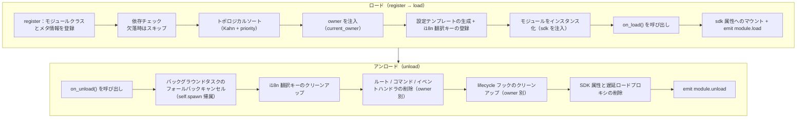

# モジュールのコアコンセプト

> [!NOTE]
> **L1 コア必読**——トップページの「読み進めパス」にある5本のコアドキュメントの1つで、モジュール開発に必須です。


このドキュメントでは、モジュールのロードからアンロードまでの完全なライフサイクル、宣言型設定とストレージの使い方を解説します——フレームワークが自動でやってくれることと、自分で書くべきことを整理し、読み終えれば全体像がつかめます。

## モジュールのライフサイクル

### ロード戦略

```python
from ErisPulse.Core.Bases import BaseModule
from ErisPulse.loaders import ModuleLoadStrategy

class MyModule(BaseModule):
    @staticmethod
    def get_load_strategy():
        """モジュールのロード戦略を返す"""
        return ModuleLoadStrategy(
            lazy_load=True,   # 遅延ロードするか即時ロードするか
            priority=0,       # ロード優先度（数値が大きいほど先にロードされる）
            depends=["OtherModule"]  # 任意：依存する他のモジュールを宣言
        )
```

> `depends` で宣言されたモジュールが未登録の場合、現在のモジュールはスキップされ、警告が記録されます。ロード順序はトポロジカルソートで決定され、同一レベルでは `priority` の降順に従います。

> [!NOTE]
> **カスケードアンロード / カスケードリロード**（ErisPulse **2.8.0+**）：他のモジュールから依存されているモジュールをアンロードすると、それに依存しているモジュールは**先にカスケードアンロードされます**（ログにカスケードチェーンが出力されます）。任意のモジュール（ローカルプラグイン / ランタイム登録 / PyPI インストールパッケージ）をホットリロードする際も、依存しているモジュールは同様に**カスケードリロード**され、依存者が無効になったインスタンス参照を保持したまま動作し続けることを防ぎます。循環依存が宣言されている場合は、ロード時に `RuntimeError` で拒否されます。
>
> **reload はフルリロード**（ErisPulse **2.11.0+**）：`reload()` はデフォルトでトップレベルのパッケージ名に基づいて import キャッシュをクリーンアップし、依存者の再インポートを行います。アンロード前に自動で構文チェックを行い（失敗時はアンロードを拒否し、旧インスタンスがサービスを継続）、成功後はコードの同一性を照合します（偽リロードの警告 / `stale` マーク）。ロード失敗時の状況は `sdk.module.last_error(名前)` で直接照会できます（traceback を含む）。

### on_load メソッド

モジュールのロード時に呼び出され、リソースの初期化とイベントハンドラの登録に使用します：

```python
async def on_load(self, event):
    # イベントハンドラを登録
    @command("hello", help="挨拶コマンド")
    async def hello_handler(event):
        await event.reply("こんにちは！")
    
    # SDK 組み込みの HTTP クライアントを使用（コネクションプールは自動管理、session の手動作成は不要）
    # sdk.client からリクエストを送信できます
```

### on_unload メソッド

モジュールのアンロード時に呼び出され、リソースのクリーンアップに使用します：

```python
async def on_unload(self, event):
    # カスタムリソースをクリーンアップ
    # sdk.client はフレームワークが管理するため、手動でクローズする必要はありません
    
    # イベントハンドラを解除（フレームワークが自動的に処理します）
    self.logger.info("モジュールをアンロードしました")
```

> バックグラウンドタスクの作成とクリーンアップ（`self.spawn()` / フレームワークによるフォールバックキャンセル）の詳細は、[ライフサイクル管理](../../advanced/lifecycle.md#バックグラウンドタスクの帰属と自動キャンセル) を参照してください。

### on_before_unload メソッド

> [!NOTE]
> このフックには ErisPulse **2.11.0+** が必要です。

アンロードパイプラインの**最初のステップ**（`on_unload` とリソース回収より前）で発火するオプションフックです——この時点ではモジュールのすべてのリソースがまだ無傷のため、アンロード / 休眠 / リロードの前に状態を `sdk.storage` に保存し、次回の `on_load` で復元するのに適しています（遅延ロード休眠の状態引継ぎはまさにこれに基づいています）：

```python
async def on_before_unload(self, event):
    # event["reason"] はアンロード / リロード / 無効化 / 連鎖 / スリープの意図を示す
    if event["reason"] in ("reload", "dormant"):
        await self.state.aset("snapshot", self.collect_state())
```

フックが失敗した場合は警告が出るだけで、アンロードフローはブロックされません。このフックを宣言していないモジュールの挙動は変わりません。休眠 / 復帰のセマンティクスの詳細は、[遅延ロード休眠](../../advanced/lazy-loading.md#遅延ロード休眠dormant_after) を参照してください。

### アンロードと完全アンロード（purge）

> [!NOTE]
> この機能には ErisPulse **2.8.0+** が必要です。

`unload()` はデフォルトでは**ロードの取り消しのみ**を行い（インスタンスとリソースをアンロード）、登録スタブ（モジュールクラスとメタ情報）は保持します——モジュールは引き続き discover で再検出でき、`register()` を再実行しなくても `load()` で再インスタンス化できます。

**完全アンロード**（モジュールクラスの参照を解放し `sys.modules` をクリーンアップして、プラグインとその専用依存関係を GC で回収できるようにする）が必要な場合は、`purge=True` を渡します：

```python
# ロードの取り消しのみ：登録スタブは保持され、いつでも再 load() できます
await sdk.module.unload("MyModule")

# 完全アンロード：登録スタブを削除 + sys.modules をクリーンアップ（プラグイン由来の場合）
await sdk.module.unload("MyModule", purge=True)
```

| セマンティクス | `unload()` デフォルト | `unload(purge=True)` |
|------|-----------------|----------------------|
| インスタンスとリソースのアンロード（イベント/task/ルート/lifecycle/i18n） | ✅ | ✅ |
| 登録スタブの保持（モジュールクラスとメタ情報） | ✅ | ❌ 削除 |
| `sys.modules` のクリーンアップ（プラグインフォルダ由来のみ） | ❌ | ✅ |
| モジュールクラスが GC で回収可能 | ❌ | ✅ |
| 再ロード | `load()` で直接利用可能 | 先に `register()` + `load()` が必要 |

> `purge=True` の場合、カスケードアンロードされる依存者も同様に purge されます。アンロード後、フレームワークは `gc.collect()` を実行し、モジュールクラス/インスタンスが回収可能かどうかをチェックします。残存参照はログに警告として出力されます（参照元を含む、DEBUG レベル）。

### ライフサイクルの全体像

上記のメソッドをつなげると、フレームワークが1つのモジュールをロード・アンロードする際に**裏で行っているすべての処理**は次のとおりです：



**ロード時にフレームワークがやってくれること**（自分で書くのは `on_load` だけで、残りは自動で完了します）：

| ステップ | フレームワークが自動で行うこと |
|------|-------------|
| owner 注入 | インスタンス化の間、`owner_scope` でモジュール名を囲みます——`on_load` 内で登録したコマンド/イベント/フック/バックグラウンドタスクは**自動的にこのモジュールに帰属**し、アンロード時に owner 単位でワンステップでクリーンアップされます |
| 設定テンプレート | `ConfigClass` を宣言したモジュールでは、フレームワークが `ErisPulse.<ModuleName>` 設定セクションを自動生成/自動投入します |
| i18n 翻訳キー | `I18nClass` を宣言したモジュールでは、翻訳キーが自動登録されます（アンロード時に自動登録解除） |
| 依存トポロジ | `depends` の宣言に基づいてソートし、依存されるモジュールが先にロードされることを保証します。循環依存は `RuntimeError` で拒否されます |
| SDK マウント | インスタンス化後に `sdk.<ModuleName>` にマウントされ、`sdk.MyModule.xxx` でアクセスできるようになります |

**アンロード時にフレームワークがクリーンアップしてくれるもの**（上の U1→U7 に対応）：`on_unload` の実行完了後にフォールバックでクリーンアップします——バックグラウンドタスクの強制キャンセル（`self.spawn` で作成されたもの。グレースフルな終了処理は `on_unload` 内で自前に行ってください）、i18n キー、ルート、コマンド/イベントハンドラ、lifecycle フック、最後に SDK 属性を削除します。`purge=True` を指定した場合はさらに登録スタブの削除 + `sys.modules` のクリーンアップが行われます。

> この自動クリーンアップこそが「`on_load`/`on_unload` を書くだけで、手動 unregister は不要」という安心感の根拠です——フレームワークは owner による帰属を利用して、「登録したものを登録者がクリーンアップする」仕組みをワンステップで実現しています。

## SDK オブジェクト

### コアモジュールへのアクセス

```python
from ErisPulse import sdk

# sdk オブジェクトを通じてすべてのコアモジュールにアクセス
sdk.logger.info("ログ")
sdk.storage.set("key", "value")

# モジュール固有の小さな状態（カウンタ/スイッチ/最終実行時刻）には self.state を優先使用——
# キーには自動的に module.state.<モジュール名>. プレフィックスが付き、モジュールのアンロード/リロード後も残ります：
count = self.state.get("runs", 0) + 1
self.state.set("runs", count)            # 同期（任意のコンテキスト）
await self.state.aset("runs", count)     # 非同期パス
await self.state.aget("runs", 0)
config = sdk.config.getConfig("MyModule")
```

### モジュール間の通信

```python
# 他のモジュールにアクセス
other_module = sdk.OtherModule
result = await other_module.some_method()
```

## アダプタ送信メソッドの照会

新しい標準仕様では、`__getattr__` メソッドをオーバーライドしてフォールバック送信メカニズムを実装することが求められるため、`hasattr` メソッドでメソッドの存在を確認できなくなりました。`2.3.5` から、送信メソッドを照会する機能が新たに追加されました。

### サポートされる送信メソッドの一覧表示

```python
# プラットフォームがサポートするすべての送信メソッドを一覧表示
methods = sdk.adapter.list_sends("onebot11")
# 戻り値: ["Text", "Image", "Voice", "Markdown", ...]
```

### メソッドの詳細情報の取得

```python
# 特定のメソッドの詳細情報を取得
info = sdk.adapter.send_info("onebot11", "Text")
# 戻り値:
# {
#     "name": "Text",
#     "parameters": [
#         {"name": "text", "type": "str", "default": null, "annotation": "str"}
#     ],
#     "return_type": "Awaitable[Any]",
#     "docstring": "テキストメッセージを送信..."
# }
```

## 設定管理

### 宣言型設定（推奨）

v2.5.2 以降、モジュールは `ConfigClass` で設定クラスを宣言でき、アダプタと同じ設定 Schema システムを利用できます。設定は `self.cfg` でリアルタイムに読み込まれ、変更すると即座に反映されます：

```python
from dataclasses import dataclass, field
from ErisPulse.Core.Bases import BaseModule
from ErisPulse.Core.Bases import BaseConfig

@dataclass
class MyModuleConfig(BaseConfig):
    api_key: str = field(
        default="",
        metadata={
            "description": {"i18n": "my_module.api_key", "default": "API キー"},
            "required": True,
            "secret": True,
            "ui": {"widget": "password", "group": "basic", "order": 1},
        },
    )
    timeout: int = field(
        default=30,
        metadata={
            "description": {"i18n": "my_module.timeout", "default": "タイムアウト時間（秒）"},
            "ui": {"widget": "number", "group": "advanced", "order": 2},
        },
    )

class MyModule(BaseModule):
    ConfigClass = MyModuleConfig

    def __init__(self, sdk):
        self.sdk = sdk
        self.logger = sdk.logger.get_child("MyModule")

    async def on_load(self, event):
        self.logger.info("モジュールをロードしました")

    async def on_unload(self, event):
        pass

    async def do_something(self):
        cfg = self.cfg  # リアルタイム読み込み、型安全
        api_key = cfg.api_key
        timeout = cfg.timeout
```

`BaseConfig` は汎用の設定基底クラスで、アダプタ、モジュール、外部プロジェクトなどあらゆるシーンに適用できます。設定フィールドは i18n による多言語説明をサポートしています（詳細は [i18n ドキュメント](../../advanced/i18n.md#設定フィールドの多言語化) を参照してください）。

> [!NOTE]
> モジュール（アダプタを含む）のロード、アンロード、起動・停止などのライフサイクルはフレームワークが一元管理します（`module manager` / `scope` が照会・制御 API を提供します）。`ConfigClass` はビジネスパラメータのみを担うべきであり、モジュール内部で「自分を起動すべきかどうか」を再度判定するロジックをネストさせる必要はありません。

設定 Schema システムはさらに以下もサポートしています（v2.8.0+、詳細は [アダプタ core-concepts](../adapters/core-concepts.md#metadata-規約) を参照）：

- **docstring によるフィールド説明の自動生成**：metadata `description` が宣言されていない場合、docstring の `:ivar フィールド名: 説明` や `Attributes:` セクションから自動的にフォールバック抽出します
- **ネストされた dataclass 設定**：フィールドの型がネスト dataclass の場合、schema/テンプレート/検証が再帰的に処理され、WebUI ではネストされたグループとして描画されます
- **`example` の非書き込みフィールド**：`metadata={"example": True}` のフィールドは config.toml に書き込まれず、`config.full.example` にのみ記録されます（冗長でめったに触れない高度な設定項目に適しています）。ユーザーが手動で設定すると通常どおり永続化されます

### 設定のホットアップデート（on_config_update）

モジュールとアダプタが `on_config_update(old, new)` メソッドを実装すると、**このモジュールに関連する設定が実際に変化した**際にフレームワークが自動でルーティングして呼び出します（設定イベントを自分で購読する必要はありません）。token / スイッチ / レートリミットパラメータの変更が**再起動なしで**反映されます：

```python
class MyModule(BaseModule):
    ConfigClass = MyModuleConfig

    def on_config_update(self, old_config, new_config):
        # ConfigClass を宣言している場合は型安全な設定オブジェクト（未宣言の場合は dict）；
        # 実行時の setConfig() で発火した場合、old_config は None（new のみ値を持つ）
        if old_config is None or new_config.api_key != old_config.api_key:
            self.logger.info("API key が更新されたため、クライアントを再構築します")
            self._client = build_client(new_config.api_key)
```

発火元とルーティングルール：

- **実行時の書き込み**（コードや Dashboard からの `setConfig()` 呼び出し）：設定キーのプレフィックスでルーティングをマッチング——このモジュールの設定キー（またはそのサブキー）の範囲内にある書き込みだけが発火し、その際 `old_config` は `None` になります
- **設定ファイルの編集**（ファイル監視によるツリー全体の比較で発火）：新旧の設定セクションが一致しない場合にのみ発火し、その際 `old` / `new` はそれぞれ変更前・変更後の設定オブジェクトになります
- コールバック内で送出された例外はフレームワークが捕捉して記録し、設定の書き込み自体には影響しません

使い分けの指針：

- `self.cfg` はリアルタイム読み込みです——状態の再構築が不要な単純なパラメータ（タイムアウト秒数など）は次の行のコードで既に新しい値になるため、このフックで手動同期する必要はありません
- 再構築が必要な**ステートフルなリソース**（クライアント接続、コネクションプール、タイマー）のみ、このフックで処理します

### 宣言型翻訳キー（v2.7.0+）

v2.7.0 以降、モジュールは `ConfigClass` を宣言するのと同じように、ネストクラス `I18nClass` で翻訳キーを一括宣言できます。フレームワークはロード時に宣言されたすべての翻訳キーを**自動登録**し、`i18n.register()` を手動で呼び出す必要はありません。また、登録タイミングは設定テンプレートの生成より早いため、設定説明で参照される i18n キーが確実に利用可能になります。

```python
from ErisPulse.Core.Bases import BaseConfig, BaseI18n, I18nKey

class MyModule(BaseModule):
    # 設定クラス（任意）
    @dataclass
    class ConfigClass(BaseConfig):
        welcome_msg: str = field(
            default="ようこそ",
            metadata={
                "description": {"i18n": "mymodule.welcome_msg", "default": "ウェルカムメッセージ"},
            },
        )

    # 翻訳キーコレクションクラス（任意）
    class I18nClass(BaseI18n):
        # 属性名から完全なキーパス <モジュール名>.<属性名> が自動的に組み立てられます
        welcome_msg: I18nKey = I18nKey(
            default="Welcome Message",   # 言語非依存のフォールバック
            zh_CN="ようこそメッセージ",
            zh_TW="ようこそメッセージ",
            en="Welcome Message",
            ja="ウェルカムメッセージ",
            ru="Приветственное сообщение",
        )
        hello: I18nKey = I18nKey(
            default="Hello, {name}!",
            zh_CN="こんにちは、{name}！",
            zh_TW="こんにちは、{name}！",
            en="Hello, {name}!",
            ja="こんにちは、{name}！",
            ru="Привет, {name}!",
        )
```

詳細は [i18n の推奨記法](../../advanced/i18n.md#推奨記法i18nclass-による翻訳キーの宣言v270) を参照してください。

### 手動での設定読み込み（廃止予定）

> **廃止予定**：代わりに [宣言型設定](#宣言型設定推奨) + `self.cfg` によるリアルタイム読み込みを使用してください。

```python
class MyModule(BaseModule):
    def __init__(self, sdk):
        self.sdk = sdk

    def _load_config(self):
        config = self.sdk.config.getConfig("MyModule")
        if not config:
            self.sdk.config.setConfig("MyModule", {"api_key": "", "timeout": 30})
            return {"api_key": "", "timeout": 30}
        return config
```

## ストレージシステム

### 基本的な使い方

```python
# データを保存
sdk.storage.set("user:123", {"name": "山田太郎"})

# データを取得
user = sdk.storage.get("user:123", {})

# データを削除
sdk.storage.delete("user:123")
```

### トランザクションの使い方

```python
# トランザクションを使用してデータの一貫性を確保
with sdk.storage.transaction():
    sdk.storage.set("key1", "value1")
    sdk.storage.set("key2", "value2")
    # いずれかの操作が失敗した場合、すべての変更がロールバックされます
```

## イベント処理

### イベントハンドラの登録

```python
from ErisPulse.Core.Event import command, message

# コマンドを登録
@command("info", help="情報を取得")
async def info_handler(event):
    await event.reply("これは情報です")

# メッセージハンドラを登録
@message.on_group_message()
async def group_handler(event):
    sdk.logger.info(f"グループメッセージを受信: {event.get_text()}")
```

### イベントハンドラのライフサイクル

フレームワークはイベントハンドラの登録と登録解除を自動管理するため、`on_load` 内で登録するだけです。

## 遅延ロード機構

### 動作原理

```python
# モジュールは初めてアクセスされたときにのみ初期化されます
result = await sdk.my_module.some_method()
# ↑ ここでモジュールの初期化がトリガーされます
```

### 即時ロード

即時初期化が必要なモジュール（リスナー、タイマーなど）の場合：

```python
@staticmethod
def get_load_strategy():
    return ModuleLoadStrategy(
        lazy_load=False,  # 即時ロード
        priority=100
    )
```

## エラー処理

### 例外の捕捉

```python
async def handle_event(self, event):
    try:
        # ビジネスロジック
        await self.process_event(event)
    except ValueError as e:
        self.logger.warning(f"パラメータエラー: {e}")
        await event.reply(f"パラメータエラー: {e}")
    except Exception as e:
        self.logger.error(f"処理に失敗しました: {e}")
        raise
```

### ログ記録

```python
# 異なるログレベルを使用
self.logger.debug("デバッグ情報")    # 詳細なデバッグ情報
self.logger.info("実行状態")      # 通常の実行情報
self.logger.warning("警告情報")  # 警告情報
self.logger.error("エラー情報")    # エラー情報
self.logger.critical("致命的エラー") # 致命的エラー
```

## 関連ドキュメント

### 学習を続けるパス

- [Event ラッパークラス](event-wrapper.md) - イベント処理の詳細

### 深掘りとトラブルシューティング

- [モジュールのベストプラクティス](best-practices.md) - 高品質なモジュールの開発
- [モジュール開発入門](getting-started.md) - 最初のモジュール構築の手順を振り返る