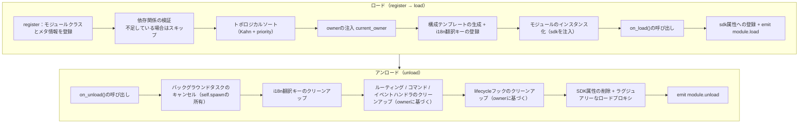

# モジュールの基本概念

> [!NOTE]
> **L1 核心必読**——「読むべき順」の5つの核心ドキュメントの1つ。モジュール開発に不可欠。

モジュールのロードからアンロードまでのライフサイクル、宣言的構成、ストレージの使い方を解説します。フレームワークが自動的に何をしてくれ、何を書く必要があるか、理解しましょう。

## モジュールのライフサイクル

### ロード戦略

```python
from ErisPulse.Core.Bases import BaseModule
from ErisPulse.loaders import ModuleLoadStrategy

class MyModule(BaseModule):
    @staticmethod
    def get_load_strategy():
        """モジュールのロード戦略を返す"""
        return ModuleLoadStrategy(
            lazy_load=True,   # ラグジュアリーなロードか即時ロード
            priority=0,       # ロード優先度（数値が大きいほど先にロードされる）
            depends=["OtherModule"]  # 任意：依存する他のモジュールを宣言
        )
```

> `depends` で宣言されたモジュールが登録されていない場合、このモジュールはスキップされ、警告が記録されます。ロード順序はトポロジカルソートによって決定され、同レベルでは `priority` 降順に並べられます。

> [!NOTE]
> **連鎖アンロード / 連鎖再ロード**（ErisPulse **2.8.0+**）：他のモジュールに依存しているモジュールをアンロードする際、依存しているモジュールは**先に連鎖アンロード**されます（連鎖チェーンをログに説明）。ローカルプラグイン / 実行時登録 / PyPI でインストールされたパッケージをホットリロードする際、依存しているモジュールも**連鎖リロード**されます。依存者が無効なインスタンス参照を保持したまま実行されないようにします。循環依存を宣言すると、ロード時に `RuntimeError` で拒否されます。
>
> **リロードは全量リロード**（ErisPulse **2.11.0+**）：`reload()` はデフォルトで、インポートキャッシュをクリアして依存モジュールのコードを再インポートし、アンロード前に自動的に構文検証を行います（失敗した場合はアンロードを拒否し、古いインスタンスがサービスを継続します）。成功後、コードのアイデンティティを確認し、偽のリロード警告 / `stale` マークを出力します。ロード失敗の現場は `sdk.module.last_error(名前)` で直接確認できます（traceback含む）。

### on_load メソッド

モジュールがロードされたときに呼び出され、リソースの初期化とイベントハンドラの登録に使用されます：

```python
async def on_load(self, event):
    # イベントハンドラの登録
    @command("hello", help="挨拶コマンド")
    async def hello_handler(event):
        await event.reply("你好！")
    
    # SDKの内蔵HTTPクライアントを使用（接続プールを自動管理し、sessionの手動作成は不要）
    # sdk.client でリクエストを送信できます
```

### on_unload メソッド

モジュールがアンロードされたときに呼び出され、リソースのクリーンアップに使用されます：

```python
async def on_unload(self, event):
    # 自作リソースのクリーンアップ
    # sdk.client はフレームワークが管理するため、手動で閉じる必要はありません
    
    # イベントハンドラのキャンセル（フレームワークが自動的に処理）
    self.logger.info("モジュールがアンロードされました")
```

> バックグラウンドタスクの作成とクリーンアップ（`self.spawn()` / フレームワークによるキャンセル）については [ライフサイクル管理](../../advanced/lifecycle.md#バックグラウンドタスクの所有権と自動キャンセル) を参照してください。

### on_before_unload メソッド

> [!NOTE]
> このフックは ErisPulse **2.11.0+** が必要です。

アンロードプロセスの**最初のステップ**（`on_unload` とリソースの回収の前に）に発火するオプションフックです。この時点ではモジュールのすべてのリソースは健全な状態で、アンロード / 停止 / 再ロードの前に `sdk.storage` に状態を保存し、次回の `on_load` で復元できます（ラグジュアリーなロードの休眠状態の継続はこれに基づいています）：

```python
async def on_before_unload(self, event):
    # event["reason"] は原因を示す: unload / reload / disable / cascade / dormant
    if event["reason"] in ("reload", "dormant"):
        await self.state.aset("snapshot", self.collect_state())
```

フックが失敗しても警告のみで、アンロードプロセスはブロックされません。このフックを宣言していないモジュールは、通常通り動作します。休眠 / 唤醒の意味については [ラグジュアリーなロードの休眠](../../advanced/lazy-loading.md#ラグジュアリーなロードの休眠dormant_after) を参照してください。

### アンロードと完全アンロード（purge）

> [!NOTE]
> この機能は ErisPulse **2.8.0+** が必要です。

`unload()` はデフォルトで**ロードの解除**（アンロードされたインスタンスとリソース）を行うだけで、登録の残骸（モジュールクラスとメタ情報）は保持されます。これにより、モジュールは再び `load()` で再インスタンス化可能で、再 `register()` は不要です。

**完全アンロード**（モジュールクラスの参照を解放し、`sys.modules` をクリーンアップし、プラグインとその独占的な依存関係が GC によって回収されるようにする）が必要な場合は、`purge=True` を渡します：

```python
# ロードの解除のみ：登録の残骸を保持し、いつでも再 `load()` が可能
await sdk.module.unload("MyModule")

# 完全アンロード：登録の残骸と `sys.modules` のクリーンアップ（プラグインのソース）
await sdk.module.unload("MyModule", purge=True)
```

| 意味 | `unload()` デフォルト | `unload(purge=True)` |
|------|-----------------|----------------------|
| アンロードされたインスタンスとリソース（イベント/task/ルーティング/lifecycle/i18n） | ✅ | ✅ |
| 登録の残骸（モジュールクラスとメタ情報）を保持 | ✅ | ❌ 削除 |
| `sys.modules` のクリーンアップ（プラグインフォルダソースのみ） | ❌ | ✅ |
| モジュールクラスが GC によって回収される | ❌ | ✅ |
| 再ロード | `load()` で直接利用可能 | 再 `register()` + `load()` が必要 |

> `purge=True` の場合、依存モジュールも purge されます。アンロード後、フレームワークは `gc.collect()` を実行し、モジュールクラス/インスタンスが回収可能かどうかを確認し、残留参照はログに警告（含引用元、DEBUGレベル）が出力されます。

### ライフサイクルの全体像

上記のメソッドをまとめると、フレームワークがモジュールのロードとアンロードの際に**裏で行ってくれるすべての処理**です：



**ロード時にフレームワークが自動で行う処理**（`on_load` を書くだけで、その他は自動）：

| フェーズ | フレームワークが自動で行う |
|------|-------------|
| ownerの注入 | インスタンス化時に `owner_scope` でモジュール名をラップする——`on_load` で登録したコマンド/イベント/フック/バックグラウンドタスクは**自動的にこのモジュールに所有権をもつ**。アンロード時に owner に基づいて一括クリーンアップされる |
| 構成テンプレート | `ConfigClass` を宣言したモジュールは、フレームワークが自動的に `ErisPulse.<ModuleName>` 構成セクションを生成/埋め込む |
| i18n翻訳キー | `I18nClass` を宣言したモジュールは、翻訳キーを自動的に登録（アンロード時に自動的に登録解除） |
| 依存トポロジー | `depends` で宣言された順序に従い、依存モジュールが先にロードされるようにする；循環依存は `RuntimeError` で拒否される |
| SDKの登録 | インスタンス化後に `sdk.<ModuleName>` に登録され、`sdk.MyModule.xxx` でアクセスできるようになる |

**アンロード時にフレームワークがクリーンアップする**（上記の U1→U7 に対応）：`on_unload` の実行後にバックグラウンドタスクの強制キャンセル（`self.spawn` で作成されたもの、優雅な終了は `on_unload` で行う）、i18n キー、ルーティング、コマンド/イベントハンドラ、lifecycleフック、最後に SDK 属性の削除。`purge=True` では追加で登録の残骸と `sys.modules` をクリーンアップする。

> これらの自動クリーンアップが「`on_load`/`on_unload` を書くだけで、手動で unregister する必要がない」根拠です——フレームワークは owner に所属させることで「誰が登録したか、誰がクリーンアップするか」を一括処理にしています。

## SDKオブジェクト

### コアモジュールへのアクセス

```python
from ErisPulse import sdk

# sdkオブジェクトを通してすべてのコアモジュールにアクセス
sdk.logger.info("ログ")
await sdk.storage.aset("key", "value")

# モジュール固有の小さな状態（カウンタ/スイッチ/最後の実行時間）は self.state を優先する——
# キーは自動的に module.state.<モジュール名>. で前付されるため、モジュールのアンロードや再ロード後も存在する：
count = self.state.get("runs", 0) + 1
self.state.set("runs", count)            # 同期（任意のコンテキスト）
await self.state.aset("runs", count)     # 異步経路
await self.state.aget("runs", 0)
config = sdk.config.getConfig("MyModule")
```

### モジュール間通信

```python
# 他のモジュールにアクセス
other_module = sdk.OtherModule
result = await other_module.some_method()
```

## トランスレーター送信メソッドの検索

新しい標準規格では、`__getattr__` メソッドをオーバーライドしてデフォルト送信メカニズムを実装する必要があるため、`hasattr` メソッドを使ってメソッドの存在をチェックすることはできません。`2.3.5` 以降、送信メソッドを検索する機能が追加されました。

### 利用可能な送信メソッドの一覧表示

```python
# プラットフォームがサポートするすべての送信メソッドの一覧表示
methods = sdk.adapter.list_sends("onebot11")
# 戻り値: ["Text", "Image", "Voice", "Markdown", ...]
```

### メソッドの詳細情報の取得

```python
# 特定のメソッドの詳細情報を取得
info = sdk.adapter.send_info("onebot11", "Text")
# 戻り値:
# {
#     "name": "Text",
#     "parameters": [
#         {"name": "text", "type": "str", "default": null, "annotation": "str"}
#     ],
#     "return_type": "Awaitable[Any]",
#     "docstring": "テキストメッセージを送信..."
# }
```

## 構成管理

### 宣言的構成（推奨）

v2.5.2 以降、モジュールは `ConfigClass` を宣言することで、トランスレーターと同じ構成スキーマシステムを使用できます。構成は `self.cfg` でリアルタイムに読み取り、変更後は即座に有効になります：

```python
from dataclasses import dataclass, field
from ErisPulse.Core.Bases import BaseModule
from ErisPulse.Core.Bases import BaseConfig

@dataclass
class MyModuleConfig(BaseConfig):
    api_key: str = field(
        default="",
        metadata={
            "description": {"i18n": "my_module.api_key", "default": "API キー"},
            "required": True,
            "secret": True,
            "ui": {"widget": "password", "group": "basic", "order": 1},
        },
    )
    timeout: int = field(
        default=30,
        metadata={
            "description": {"i18n": "my_module.timeout", "default": "タイムアウト時間（秒）"},
            "ui": {"widget": "number", "group": "advanced", "order": 2},
        },
    )

class MyModule(BaseModule):
    ConfigClass = MyModuleConfig

    def __init__(self, sdk):
        self.sdk = sdk
        self.logger = sdk.logger.get_child("MyModule")

    async def on_load(self, event):
        self.logger.info("モジュールがロードされました")

    async def on_unload(self, event):
        pass

    async def do_something(self):
        cfg = self.cfg  # 実時読み取り、型安全
        api_key = cfg.api_key
        timeout = cfg.timeout
```

`BaseConfig` は、トランスレーター、モジュール、外部プロジェクトなど、あらゆる場面で使用できる汎用構成基底クラスです。構成フィールドは i18n 多言語説明をサポートします（[i18nドキュメント](../../advanced/i18n.md#構成フィールドの多言語)を参照）。

> [!NOTE]
> モジュール（トランスレーターを含む）のロード、アンロード、起動停止などのライフサイクルは、フレームワークが一括管理します（`module manager` / `scope` がクエリとコントロールAPIを提供）。`ConfigClass` は業務パラメータのみを保持するべきで、モジュールは内部で再び「自分自身を起動するかどうか」の判断を埋め込むべきではありません。

構成スキーマシステムはさらにサポートしています（v2.8.0+、[トランスレーター core-concepts](../adapters/core-concepts.md#metadata-の規約)を参照）：

- **docstring から自動生成されたフィールド説明**：`metadata` `description` を宣言していない場合、docstring の `:ivar フィールド: 説明` または `Attributes:` ブロックから自動的に抽出
- **ネストされた dataclass 構成**：フィールドの型がネストされた dataclass の場合、スキーマ/テンプレート/検証は再帰的に処理され、WebUI ではネストされたグループとしてレンダリングされる
- **`example` は保存しないフィールド**：`metadata={"example": True}` のフィールドは `config.toml` に書き込まれず、`config.full.example` に記録される（冗長でほとんど触れない高度な構成項目に適している）、ユーザーが手動で設定した後は通常の永続化が行われる

### 構成のホット更新（on_config_update）

モジュールとトランスレーターが `on_config_update(old, new)` メソッドを実装すると、フレームワークは**このモジュールに関連する構成が実際に変更された**ときに自動的にルーティングされます（構成イベントを自分でサブスクライブする必要はありません）。token / スイッチ / 限流パラメータの変更は**リスタートなしで有効**になります：

```python
class MyModule(BaseModule):
    ConfigClass = MyModuleConfig

    def on_config_update(self, old_config, new_config):
        # ConfigClass を宣言した場合は型安全な構成オブジェクト（宣言していない場合は dict）；
        # 実行時 setConfig() がトリガーされた際、old_config は None（new だけが値を持つ）
        if old_config is None or new_config.api_key != old_config.api_key:
            self.logger.info("API キーが更新されたため、クライアントを再構築します")
            self._client = build_client(new_config.api_key)
```

トリガーの出所とルーティングルール：

- **実行時書き込み**（コードまたはダッシュボードで `setConfig()` を呼び出す）：構成キーの接頭辞でルーティングされる——このモジュールの構成キー（またはそのサブキー）に書かれたものだけがトリガーされ、このとき `old_config` は `None`
- **構成ファイルの編集**（ファイル監視がツリー全体の比較をトリガー）：新旧構成セクションが等しくない場合にトリガーされ、このとき `old` / `new` はそれぞれ変更前の後の構成オブジェクト
- コールバック内で発生した例外はフレームワークによって捕捉・記録され、構成の書き込み自体には影響しない

使用のポイント：

- `self.cfg` はリアルタイムで読み取れる——再構成する必要のない単純なパラメータ（例：タイムアウト秒数）は、次の行で新しい値になるため、このフックで手動に同期する必要はない
- 再構成が必要な**状態を持つリソース**（クライアント接続、接続プール、タイマー）はこのフックで処理する

### 宣言的翻訳キー（v2.7.0+）

v2.7.0 以降、モジュールは `ConfigClass` を宣言するのと同じように、`I18nClass` というネストされたクラスを使って翻訳キーを一括宣言できます。フレームワークはロード時に**宣言されたすべての翻訳キーを自動的に登録**し、`i18n.register()` を手動で呼び出す必要がなく、登録のタイミングは構成テンプレート生成よりも早いため、構成説明で参照される i18n キーが利用可能であることを保証します。

```python
from ErisPulse.Core.Bases import BaseConfig, BaseI18n, I18nKey

class MyModule(BaseModule):
    # 構成クラス（オプション）
    @dataclass
    class ConfigClass(BaseConfig):
        welcome_msg: str = field(
            default="ようこそ",
            metadata={
                "description": {"i18n": "mymodule.welcome_msg", "default": "ようこそメッセージ"},
            },
        )

    # 翻訳キー集合クラス（オプション）
    class I18nClass(BaseI18n):
        # プロパティ名は自動的にモジュール名.<プロパティ名>に結合される
        welcome_msg: I18nKey = I18nKey(
            default="Welcome Message",   # 言語に依存しないデフォルト
            zh_CN="ようこそ",
            zh_TW="歡迎訊息",
            en="Welcome Message",
            ja="ようこそメッセージ",
            ru="Добро пожаловать",
        )
        hello: I18nKey = I18nKey(
            default="Hello, {name}!",
            zh_CN="こんにちは、{name}！",
            zh_TW="你好，{name}！",
            en="Hello, {name}!",
            ja="こんにちは、{name}！",
            ru="Привет, {name}!",
        )
```

詳細は [i18nの推奨書き方](../../advanced/i18n.md#推奨書き方-i18nclass-を使って翻訳キーを宣言する-v270) を参照してください。

### 手動での構成読み取り（廃止済み）

> **廃止済み**：[宣言的構成](#宣言的構成推奨) + `self.cfg` のリアルタイム読み取りに変更してください。

```python
class MyModule(BaseModule):
    def __init__(self, sdk):
        self.sdk = sdk

    def _load_config(self):
        config = self.sdk.config.getConfig("MyModule")
        if not config:
            self.sdk.config.setConfig("MyModule", {"api_key": "", "timeout": 30})
            return {"api_key": "", "timeout": 30}
        return config
```

## ストレージシステム

### 基本的な使用

```python
# データを保存
await sdk.storage.aset("user:123", {"name": "張三"})

# データを取得
user = await sdk.storage.aget("user:123", {})

# データを削除
sdk.storage.delete("user:123")
```

### トランザクションの使用

```python
# トランザクションを使用してデータの一貫性を保証
async with sdk.storage.atransaction():
    await sdk.storage.aset("key1", "value1")
    await sdk.storage.aset("key2", "value2")
    # いずれかの操作が失敗した場合、すべての変更はロールバックされる
```

## イベント処理

### イベントハンドラの登録

```python
from ErisPulse.Core.Event import command, message

# コマンドを登録
@command("info", help="情報を取得")
async def info_handler(event):
    await event.reply("これは情報です")

# メッセージハンドラを登録
@message.on_group_message()
async def group_handler(event):
    sdk.logger.info(f"グループメッセージを受け取りました: {event.get_text()}")
```

### イベントハンドラのライフサイクル

フレームワークはイベントハンドラの登録とアンロードを自動的に管理します。`on_load` で登録するだけです。

## ラグジュアリーなロード機構

### 動作原理

```python
# モジュールは初めてアクセスされたときにのみ初期化される
result = await sdk.my_module.some_method()
# ↑ ここでモジュールの初期化がトリガーされる
```

### 即時ロード

即時初期化が必要なモジュール（リスナー、タイマーなど）：

```python
@staticmethod
def get_load_strategy():
    return ModuleLoadStrategy(
        lazy_load=False,  # 即時ロード
        priority=100
    )
```

## エラー処理

### 例外のキャッチ

```python
async def handle_event(self, event):
    try:
        # ビジネスロジック
        await self.process_event(event)
    except ValueError as e:
        self.logger.warning(f"パラメータエラー: {e}")
        await event.reply(f"パラメータエラー: {e}")
    except Exception as e:
        self.logger.error(f"処理失敗: {e}")
        raise
```

### ログの記録

```python
# さまざまなログレベルを使用
self.logger.debug("デバッグ情報")    # 詳細なデバッグ情報
self.logger.info("実行状態")      # 正常実行情報
self.logger.warning("警告情報")  # 警告情報
self.logger.error("エラー情報")    # エラー情報
self.logger.critical("致命的エラー") # 致命的エラー
```

## 関連ドキュメント

### 学習の継続

- [Eventラッパークラス](event-wrapper.md) - イベント処理の詳細

### 深入とトラブルシューティング

- [モジュールのベストプラクティス](best-practices.md) - 高品質なモジュールの開発
- [モジュール開発の入門](getting-started.md) - 最初のモジュールの構築手順を振り返る