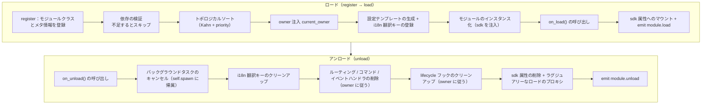

# モジュールのコア概念

> [!NOTE]
> **L1 必読**——「読むべき順」の5つのコアドキュメントの1つ、モジュール開発に必須。

このドキュメントでは、モジュールがロードからアンロードまでのライフサイクル、宣言的構成とストレージの使い方を説明します。フレームワークが自動的にやってくれること、そしてあなたが書くべきこと、すべてが一目瞭然になります。

## モジュールのライフサイクル

### ロード戦略

```python
from ErisPulse.Core.Bases import BaseModule
from ErisPulse.loaders import ModuleLoadStrategy

class MyModule(BaseModule):
    @staticmethod
    def get_load_strategy():
        """モジュールのロード戦略を返す"""
        return ModuleLoadStrategy(
            lazy_load=True,   # ラグジュアリーなロードか即時ロード
            priority=0,       # ロードの優先度（数値が大きいほど先にロードされる）
            depends=["OtherModule"]  # オプション：依存する他のモジュールを宣言
        )
```

> `depends` で宣言したモジュールが登録されていない場合、このモジュールは警告を記録してスキップされます。ロード順はトポロジカルソートによって決定され、同じレベルでは `priority` 降順に並びます。

> [!NOTE]
> **連鎖アンロード / 連鎖リロード**（ErisPulse **2.8.0+**）：他のモジュールに依存しているモジュールをアンロードする場合、依存しているモジュールは**先に連鎖アンロード**されます（ログに連鎖チェーンが表示されます）。ローカルプラグイン / 実行時登録 / PyPI パッケージの任意のモジュールをホットリロードする際、依存しているモジュールも**連鎖リロード**されます。依存者が無効なインスタンス参照を保持して実行し続けるのを防ぎます。循環依存を宣言すると、ロード時に `RuntimeError` で拒否されます。
>
> **リロードは全量リロード**（ErisPulse **2.11.0+**）：`reload()` はデフォルトで、インポートキャッシュをクリアして依存者コードを再インポートし、アンロード前に自動的に構文チェックを行います（失敗するとアンロードを拒否し、古いインスタンスがサービスを継続します）。成功後、コードのアイデンティティを確認し、偽のリロードを警告し、`stale` マークを付与します。ロードに失敗した場合は、`sdk.module.last_error(名前)` を使用して直ちにエラーログを確認できます（traceback含む）。

### on_load メソッド

モジュールがロードされたときに呼び出され、リソースの初期化とイベントハンドラの登録を行います：

```python
async def on_load(self, event):
    # イベントハンドラの登録
    @command("hello", help="挨拶コマンド")
    async def hello_handler(event):
        await event.reply("こんにちは！")
    
    # SDK 内蔵の HTTP クライアントを使用（接続プールはフレームワークが管理、session の手動作成は不要）
    # sdk.client を使用してリクエストを送信
```

### on_unload メソッド

モジュールがアンロードされたときに呼び出され、リソースのクリーンアップを行います：

```python
async def on_unload(self, event):
    # 自作リソースのクリーンアップ
    # sdk.client はフレームワークが管理、手動で閉じる必要はない
    
    # イベントハンドラのキャンセル（フレームワークが自動処理）
    self.logger.info("モジュールがアンロードされました")
```

> バックグラウンドタスクの作成とクリーンアップ（`self.spawn()` / フレームワークによるキャンセル）は [ライフサイクル管理](../../advanced/lifecycle.md#バックグラウンドタスクの所有と自動キャンセル) を参照してください。

### on_before_unload メソッド

> [!NOTE]
> このフックは ErisPulse **2.11.0+** が必要です。

アンロードプロセスの**最初のステップ**（`on_unload` とリソースの回収の前）に呼び出されるオプションフックです。この時点でモジュールのすべてのリソースは健全な状態のままです。アンロード / スリープ / リロードの前に `sdk.storage` に状態を保存し、次回の `on_load` で復元できます（ラグジュアリーなロードの休眠状態はこれに基づいて接続されます）：

```python
async def on_before_unload(self, event):
    # event["reason"] はアンロード / リロード / 禁用 / 連鎖 / スリープの意図を示す
    if event["reason"] in ("reload", "dormant"):
        await self.state.aset("snapshot", self.collect_state())
```

フックの失敗は警告のみで、アンロードプロセスをブロックしません。このフックを宣言していないモジュールは、従来通りの動作をします。スリープ / アクティベーションの意味は [ラグジュアリーなロードのスリープ](../../advanced/lazy-loading.md#ラグジュアリーなロードのスリープdormant_after) を参照してください。

### アンロードと完全アンロード（purge）

> [!NOTE]
> この機能は ErisPulse **2.8.0+** が必要です。

`unload()` はデフォルトで**ロードの解除**（インスタンスとリソースのアンロード）を行いますが、登録のメタデータ（モジュールクラスとメタ情報）は保持されます。モジュールは再び `load()` で再インスタンス化され、`register()` は不要です。

**完全アンロード**（モジュールクラスの参照を解放し、`sys.modules` をクリアして、プラグインとその排他的な依存関係を GC で回収できるようにする）が必要な場合は、`purge=True` を渡します：

```python
# ロードの解除のみ：登録のメタデータを保持し、いつでも再 `load()` が可能
await sdk.module.unload("MyModule")

# 完全アンロード：登録のメタデータと `sys.modules` をクリア（プラグインのソース）
await sdk.module.unload("MyModule", purge=True)
```

| 意味 | `unload()` デフォルト | `unload(purge=True)` |
|------|-----------------|----------------------|
| インスタンスとリソースのアンロード（イベント/task/ルーティング/lifecycle/i18n） | ✅ | ✅ |
| 登録のメタデータ（モジュールクラスとメタ情報）の保持 | ✅ | ❌ 削除 |
| `sys.modules` のクリア（プラグインフォルダのソースに限る） | ❌ | ✅ |
| モジュールクラスを GC で回収可能にする | ❌ | ✅ |
| 再ロード | `load()` で直接可能 | `register()` + `load()` が必要 |

> `purge=True` の場合、連鎖アンロードの依存モジュールも purge されます。アンロード後、フレームワークは `gc.collect()` を実行し、モジュールクラス/インスタンスが回収可能かどうかを確認し、残留参照はログに警告されます（参照元も含む、DEBUGレベル）。

### ライフサイクルの全体像

上記のメソッドを組み合わせると、フレームワークがモジュールのロードとアンロードの際に**背後で行うすべての処理**がわかります：



**ロード時にフレームワークが自動で行う**（`on_load` を書くだけで、残りは自動）：

| フェーズ | フレームワークが自動で行う |
|------|-------------|
| owner 注入 | インスタンス化中に `owner_scope` でモジュール名をラップする——`on_load` で登録したコマンド/イベント/フック/バックグラウンドタスクは**自動的にこのモジュールに帰属**し、アンロード時に owner に従って一括クリーンアップされる |
| 設定テンプレート | `ConfigClass` を宣言したモジュールは、フレームワークが自動で `ErisPulse.<ModuleName>` 設定セクションを生成/埋め込む |
| i18n 翻訳キー | `I18nClass` を宣言したモジュールは、翻訳キーが自動登録される（アンロード時に自動で登録解除） |
| 依存トポロジー | `depends` の宣言に従ってソートされ、依存されるモジュールは先にロードされる；循環依存は `RuntimeError` で拒否される |
| SDK マウント | インスタンス化後に `sdk.<ModuleName>` にマウントされ、`sdk.MyModule.xxx` でアクセスできるようになる |

**アンロード時にフレームワークがクリーンアップする**（上記の U1→U7 に対応）：`on_unload` 実行後にバックグラウンドタスクの強制キャンセル（`self.spawn` で作成されたもの、優雅な終了は `on_unload` で行う）、i18n キー、ルーティング、コマンド/イベントハンドラ、lifecycle フック、最後に SDK 属性の削除。`purge=True` の場合、追加で登録のメタデータと `sys.modules` をクリアする。

> これらの自動クリーンアップが「`on_load`/`on_unload` を書くだけで、手動で unregister する必要がない」根拠です——フレームワークは owner 归属を使って「誰が登録したか、誰がクリーンアップするか」を一括処理にしています。

## SDK オブジェクト

### コアモジュールのアクセス

```python
from ErisPulse import sdk

# sdk オブジェクト経由で全てのコアモジュールにアクセス
sdk.logger.info("ログ")
sdk.storage.set("key", "value")

# モジュール固有の小さな状態（カウンタ/スイッチ/前回実行時刻）は self.state を優先する——
# キーは自動的に module.state.<モジュール名>. で前付けされ、モジュールのアンロードやリロード後も存在する：
count = self.state.get("runs", 0) + 1
self.state.set("runs", count)            # 同期（任意のコンテキスト）
await self.state.aset("runs", count)     # 非同期経路
await self.state.aget("runs", 0)
config = sdk.config.getConfig("MyModule")
```

### モジュール間通信

```python
# 他のモジュールにアクセス
other_module = sdk.OtherModule
result = await other_module.some_method()
```

## アダプタ送信メソッドの照会

新しい標準規格では、`__getattr__` メソッドのオーバーライドでデフォルト送信メカニズムを実装するため、`hasattr` メソッドでメソッドの存在をチェックすることはできません。`2.3.5` 以降、送信メソッドを照会する機能が追加されました。

### 送信メソッドの一覧表示

```python
# プラットフォームがサポートするすべての送信メソッドを一覧表示
methods = sdk.adapter.list_sends("onebot11")
# 戻り値: ["Text", "Image", "Voice", "Markdown", ...]
```

### メソッドの詳細情報取得

```python
# 特定のメソッドの詳細情報を取得
info = sdk.adapter.send_info("onebot11", "Text")
# 戻り値:
# {
#     "name": "Text",
#     "parameters": [
#         {"name": "text", "type": "str", "default": null, "annotation": "str"}
#     ],
#     "return_type": "Awaitable[Any]",
#     "docstring": "テキストメッセージを送信..."
# }
```

## 設定管理

### 宣言的設定（推奨）

v2.5.2 以降、モジュールは `ConfigClass` を宣言することで、アダプタと同じ設定スキーマシステムを使用できます。設定は `self.cfg` でリアルタイムに読み取ることができ、変更後は即座に反映されます：

```python
from dataclasses import dataclass, field
from ErisPulse.Core.Bases import BaseModule
from ErisPulse.Core.Bases import BaseConfig

@dataclass
class MyModuleConfig(BaseConfig):
    api_key: str = field(
        default="",
        metadata={
            "description": {"i18n": "my_module.api_key", "default": "API キー"},
            "required": True,
            "secret": True,
            "ui": {"widget": "password", "group": "basic", "order": 1},
        },
    )
    timeout: int = field(
        default=30,
        metadata={
            "description": {"i18n": "my_module.timeout", "default": "タイムアウト時間（秒）"},
            "ui": {"widget": "number", "group": "advanced", "order": 2},
        },
    )

class MyModule(BaseModule):
    ConfigClass = MyModuleConfig

    def __init__(self, sdk):
        self.sdk = sdk
        self.logger = sdk.logger.get_child("MyModule")

    async def on_load(self, event):
        self.logger.info("モジュールがロードされました")

    async def on_unload(self, event):
        pass

    async def do_something(self):
        cfg = self.cfg  # 実時読み取り、型安全
        api_key = cfg.api_key
        timeout = cfg.timeout
```

`BaseConfig` は、アダプタ、モジュール、外部プロジェクトなど、あらゆる場面で使用できる汎用設定基底クラスです。設定フィールドは i18n 多言語の説明をサポートします（[i18n ドキュメント](../../advanced/i18n.md#設定フィールドの多言語)を参照）。

> [!NOTE]
> モジュール（アダプタも含む）のロード、アンロード、起動・停止などのライフサイクルは、フレームワークが一括管理します（`module manager` / `scope` がクエリとコントロール API を提供）。`ConfigClass` は業務パラメータのみを保持すべきで、モジュール内では「自分自身が起動するかどうか」の判断を再び行うべきではありません。

設定スキーマシステムはさらに（v2.8.0+、[アダプタ core-concepts](../adapters/core-concepts.md#metadata-の規約) を参照）：

- **docstring からフィールド説明を自動生成**：`metadata` の `description` が宣言されていない場合、docstring の `:ivar フィールド: 説明` または `Attributes:` セクションから自動的に抽出されます
- **ネストされた dataclass 設定**：フィールドの型がネストされた dataclass の場合、スキーマ/テンプレート/検証は再帰的に処理され、WebUI ではネストされたグループとしてレンダリングされます
- **`example` フィールドは保存しない**：`metadata={"example": True}` のフィールドは `config.toml` に書き込まれず、`config.full.example` に記録されます（冗長で触れることが少ない高度な設定項目に適しています），ユーザーが手動で設定した場合は正常に永続化されます

### 宣言的翻訳キー（v2.7.0+）

v2.7.0 以降、モジュールは `ConfigClass` を宣言するのと同じように、`I18nClass` というネストされたクラスを使って翻訳キーを一括宣言できます。フレームワークはロード時に**宣言されたすべての翻訳キーを自動登録**し、`i18n.register()` を手動で呼び出す必要はありません。登録タイミングは設定テンプレート生成より前で、設定の説明で参照される i18n キーが利用可能であることを保証します。

```python
from ErisPulse.Core.Bases import BaseConfig, BaseI18n, I18nKey

class MyModule(BaseModule):
    # 設定クラス（オプション）
    @dataclass
    class ConfigClass(BaseConfig):
        welcome_msg: str = field(
            default="ようこそ",
            metadata={
                "description": {"i18n": "mymodule.welcome_msg", "default": "ようこそメッセージ"},
            },
        )

    # 翻訳キー集合クラス（オプション）
    class I18nClass(BaseI18n):
        # 属性名が自動的に<モジュール名>.<属性名>に結合される
        welcome_msg: I18nKey = I18nKey(
            default="Welcome Message",   # 言語に依存しないバックアップ
            zh_CN="ようこそ",
            zh_TW="歡迎訊息",
            en="Welcome Message",
            ja="ようこそ",
            ru="Добро пожаловать",
        )
        hello: I18nKey = I18nKey(
            default="Hello, {name}!",
            zh_CN="こんにちは、{name}！",
            zh_TW="你好，{name}！",
            en="Hello, {name}!",
            ja="こんにちは、{name}！",
            ru="Привет, {name}!",
        )
```

詳細は [i18n 推奨書き方](../../advanced/i18n.md#推奨書き方-i18nclass-を使って翻訳キーを宣言する-v270) を参照してください。

### 手動による設定の読み取り（非推奨）

> **非推奨**：[宣言的設定](#宣言的設定推奨) + `self.cfg` のリアルタイム読み取りに切り替えてください。

```python
class MyModule(BaseModule):
    def __init__(self, sdk):
        self.sdk = sdk

    def _load_config(self):
        config = self.sdk.config.getConfig("MyModule")
        if not config:
            self.sdk.config.setConfig("MyModule", {"api_key": "", "timeout": 30})
            return {"api_key": "", "timeout": 30}
        return config
```

## ストレージシステム

### 基本的な使用法

```python
# データを保存
sdk.storage.set("user:123", {"name": "張三"})

# データを取得
user = sdk.storage.get("user:123", {})

# データを削除
sdk.storage.delete("user:123")
```

### トランザクションの使用

```python
# トランザクションを使用してデータの一貫性を保証
with sdk.storage.transaction():
    sdk.storage.set("key1", "value1")
    sdk.storage.set("key2", "value2")
    # いずれかの操作が失敗した場合、すべての変更はロールバックされる
```

## イベント処理

### イベントハンドラの登録

```python
from ErisPulse.Core.Event import command, message

# コマンドを登録
@command("info", help="情報を取得")
async def info_handler(event):
    await event.reply("これは情報です")

# メッセージハンドラを登録
@message.on_group_message()
async def group_handler(event):
    sdk.logger.info(f"グループメッセージを受信: {event.get_text()}")
```

### イベントハンドラのライフサイクル

フレームワークはイベントハンドラの登録と解除を自動的に管理します。`on_load` での登録のみが必要です。

## ラグジュアリーなロード機構

### 動作原理

```python
# モジュールは初めてアクセスされたときにのみ初期化される
result = await sdk.my_module.some_method()
# ↑ ここでモジュールの初期化がトリガーされる
```

### 即時ロード

即時初期化が必要なモジュール（リスナー、タイマーなど）：

```python
@staticmethod
def get_load_strategy():
    return ModuleLoadStrategy(
        lazy_load=False,  # 即時ロード
        priority=100
    )
```

## エラーハンドリング

### 例外のキャッチ

```python
async def handle_event(self, event):
    try:
        # ビジネスロジック
        await self.process_event(event)
    except ValueError as e:
        self.logger.warning(f"パラメータエラー: {e}")
        await event.reply(f"パラメータエラー: {e}")
    except Exception as e:
        self.logger.error(f"処理失敗: {e}")
        raise
```

### ログの記録

```python
# さまざまなログレベルを使用
self.logger.debug("デバッグ情報")    # 詳細なデバッグ情報
self.logger.info("実行状態")      # 正常な実行情報
self.logger.warning("警告情報")  # 警告情報
self.logger.error("エラー情報")    # エラー情報
self.logger.critical("致命的エラー") # 致命的エラー
```

## 関連ドキュメント

### 学習の継続

- [Event 包装クラス](event-wrapper.md) - イベント処理の詳細

### 深入とトラブルシューティング

- [モジュールのベストプラクティス](best-practices.md) - 高品質なモジュールの開発
- [モジュール開発の入門](getting-started.md) - 最初のモジュールの構築手順を振り返る