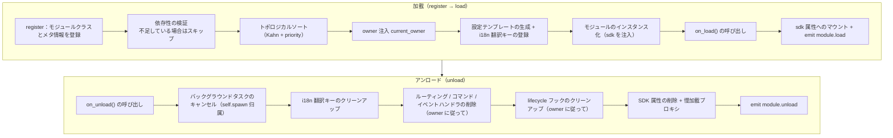

# モジュールのコアコンセプト

> [!NOTE]
> **L1 コア必須読書**——「ホーム画面の読書パス」に含まれる5つのコアドキュメントの1つで、モジュール開発に必須です。

ErisPulse モジュールのコアコンセプトを理解することは、高品質なモジュールを開発するための基礎です。

## モジュールのライフサイクル

### 加載戦略

```python
from ErisPulse.Core.Bases import BaseModule
from ErisPulse.loaders import ModuleLoadStrategy

class MyModule(BaseModule):
    @staticmethod
    def get_load_strategy():
        """モジュールの加載戦略を返す"""
        return ModuleLoadStrategy(
            lazy_load=True,   # 懒加載か即時加載
            priority=0,       # 加載優先度（数値が大きいほど先に加載）
            depends=["OtherModule"]  # 任意：依存する他のモジュールを宣言
        )
```

> `depends` で宣言されたモジュールが登録されていない場合、現在のモジュールは無視され、警告が記録されます。加載順序はトポロジカルソートによって決定され、同レベルでは `priority` 降順に処理されます。

> [!NOTE]
> **連鎖的なアンロード / 連鎖的な再ロード**（ErisPulse **2.8.0+**）：他のモジュールに依存しているモジュールをアンロードする際、依存しているモジュールは**先に連鎖的にアンロード**されます（連鎖のログが説明されます）。ローカルプラグイン / 実行時登録 / PyPI 安装パッケージの任意のモジュールをホットリロードする際、依存するモジュールも**連鎖的に再ロード**されます。依存者が無効なインスタンス参照を保持して実行し続けるのを防ぎます。循環依存を宣言した場合、加載時に `RuntimeError` で拒否されます。
>
> **リロードは全量リロード**（ErisPulse **2.11.0+**）：`reload()` はデフォルトで、インポートキャッシュをトップレベルのパッケージ名でクリアし、依存モジュールのコードを再インポートします。アンロード前に自動的に構文検証（失敗するとアンロードを拒否し、古いインスタンスがサービスを継続）、成功後はコードのアイデンティティを確認（偽のリロード警告 / `stale` マーカー）します。加載に失敗した場合、`sdk.module.last_error(名前)` で直ちにエラーを照会できます（traceback 含む）。

### on_load メソッド

モジュールが加載されるときに呼び出され、リソースの初期化とイベントハンドラの登録に使用されます：

```python
async def on_load(self, event):
    # イベントハンドラの登録
    @command("hello", help="挨拶コマンド")
    async def hello_handler(event):
        await event.reply("你好！")
    
    # SDK 内蔵の HTTP クライアントを使用（接続プールの管理は自動的、手動の session 作成は不要）
    # sdk.client でリクエストを送信可能
```

### on_unload メソッド

モジュールがアンロードされるときに呼び出され、リソースのクリーンアップに使用されます：

```python
async def on_unload(self, event):
    # 自作リソースのクリーンアップ
    # sdk.client はフレームワークが管理するため、手動で閉じる必要はありません
    
    # イベントハンドラのキャンセル（フレームワークが自動的に処理）
    self.logger.info("モジュールはアンロードされました")
```

> バックグラウンドタスクの作成とクリーンアップ（`self.spawn()` / フレームワークによるキャンセル保証）は [ライフサイクル管理](../../advanced/lifecycle.md#バックグラウンドタスクの所有と自動キャンセル) を参照してください。

### on_before_unload メソッド

> [!NOTE]
> このフックは ErisPulse **2.11.0+** が必要です。

アンロードパイプラインの**最初のステップ**（`on_unload` とリソース回収の前に）に発生するオプションフックです。この時点ではモジュールのすべてのリソースは健全な状態のままで、アンロード / スリープ / 再ロードの前に `sdk.storage` に状態を保存し、次回の `on_load` で復元できます（遅延加載の休眠状態はこれに基づいて再開されます）：

```python
async def on_before_unload(self, event):
    # event["reason"] は原因を示す：unload / reload / disable / cascade / dormant
    if event["reason"] in ("reload", "dormant"):
        await self.sdk.storage.aset(f"{self._module_name}:state", self.collect_state())
```

フックの失敗は警告のみで、アンロードプロセスをブロックしません。このフックを宣言していないモジュールは従来通り動作します。スリープ / アウェイクの意味は [遅延加載の休眠](../../advanced/lazy-loading.md#遅延加載の休眠dormant_after) を参照してください。

### アンロードと完全アンロード（purge）

> [!NOTE]
> この機能は ErisPulse **2.8.0+** が必要です。

`unload()` はデフォルトで**加載をキャンセル**（アンロードインスタンスとリソース）しますが、登録のメタデータ（モジュールクラスとメタ情報）は保持します。このため、モジュールは再発見され、`load()` で再インスタンス化可能で、再登録（`register()`）は不要です。

**完全アンロード**（モジュールクラスの参照を解放し、`sys.modules` をクリーンアップして、プラグインとその排他的な依存が GC で回収可能にする）が必要な場合は、`purge=True` を渡します：

```python
# 加載のキャンセルのみ：登録のメタデータを保持し、いつでも再 load() が可能
await sdk.module.unload("MyModule")

# 完全アンロード：登録のメタデータの削除 + sys.modules のクリーンアップ（プラグインフォルダからのみ）
await sdk.module.unload("MyModule", purge=True)
```

| 意味 | `unload()` デフォルト | `unload(purge=True)` |
|------|-----------------|----------------------|
| インスタンスとリソースのアンロード（イベント/task/ルーティング/lifecycle/i18n） | ✅ | ✅ |
| 登録のメタデータの保持（モジュールクラスとメタ情報） | ✅ | ❌ 削除 |
| `sys.modules` のクリーンアップ（プラグインフォルダからのみ） | ❌ | ✅ |
| モジュールクラスの GC 回収 | ❌ | ✅ |
| 再加載 | `load()` で直接可能 | `register()` + `load()` が必要 |

> `purge=True` の場合、連鎖アンロードの依存モジュールも purge されます。アンロード後、フレームワークは `gc.collect()` を実行し、モジュールクラス/インスタンスが回収可能かどうかを確認します。残留参照はログに警告されます（参照元を含む、DEBUG レベル）。

### ライフサイクルの全体像

上記のメソッドを組み合わせると、フレームワークがモジュールの加載とアンロードの際に**裏で行っているすべての処理**がわかります：



**加載時にフレームワークが自動で行う処理**（`on_load` だけを書けばよい、残りは自動処理）：

| 環節 | フレームワークが自動で行う |
|------|-------------|
| owner 注入 | インスタンス化中に `owner_scope` でモジュール名をラップするため、`on_load` で登録したコマンド/イベント/フック/バックグラウンドタスクは**自動的に本モジュールに所属**し、アンロード時に owner に従って一括クリーンアップされる |
| 設定テンプレート | `ConfigClass` を宣言したモジュールの場合、フレームワークが `ErisPulse.<ModuleName>` の設定セグメントを自動生成/埋め込む |
| i18n 翻訳キー | `I18nClass` を宣言したモジュールの場合、翻訳キーが自動登録（アンロード時に自動的に登録解除） |
| 依存トポロジー | `depends` で宣言された順序に従い、依存されるモジュールが先に加載されるよう確保する。循環依存は `RuntimeError` で拒否される |
| SDK マウント | インスタンス化後に `sdk.<ModuleName>` にマウントされるため、`sdk.MyModule.xxx` でアクセス可能になる |

**アンロード時にフレームワークが自動でクリーンアップする**（上記の U1→U7 に対応）：`on_unload` 実行後にバックグラウンドタスクを強制的にキャンセル（`self.spawn` で作成されたタスクは、`on_unload` で優雅に終了させる）、i18n キー、ルーティング、コマンド/イベントハンドラ、lifecycle フックをクリーンアップし、最後に SDK 属性を削除します。`purge=True` の場合は、登録のメタデータの削除 + `sys.modules` のクリーンアップも追加されます。

> これらの自動クリーンアップが「`on_load`/`on_unload` だけを書けばよい、手動で unregister は不要」という自信の源です。フレームワークは owner 归属を使って「誰が登録したか、誰がクリーンアップするか」を一括処理にしています。

## SDK オブジェクト

### コアモジュールへのアクセス

```python
from ErisPulse import sdk

# sdk オブジェクトを介してすべてのコアモジュールにアクセス
sdk.logger.info("ログ")
sdk.storage.set("key", "value")
config = sdk.config.getConfig("MyModule")
```

### モジュール間通信

```python
# 他のモジュールにアクセス
other_module = sdk.OtherModule
result = await other_module.some_method()
```

## 适配器送信メソッドの照会

新しい標準規格では、デフォルト送信メカニズムを実装するために `__getattr__` メソッドのオーバーライドを使用するよう求められており、このため `hasattr` メソッドを用いてメソッドの存在をチェックできなくなりました。`2.3.5` 以降では、送信メソッドを照会する機能が追加されました。

### 対応する送信メソッドの一覧表示

```python
# プラットフォームが対応するすべての送信メソッドを一覧表示
methods = sdk.adapter.list_sends("onebot11")
# 戻り値: ["Text", "Image", "Voice", "Markdown", ...]
```

### メソッドの詳細情報の取得

```python
# 特定のメソッドの詳細情報を取得
info = sdk.adapter.send_info("onebot11", "Text")
# 戻り値:
# {
#     "name": "Text",
#     "parameters": [
#         {"name": "text", "type": "str", "default": null, "annotation": "str"}
#     ],
#     "return_type": "Awaitable[Any]",
#     "docstring": "テキストメッセージを送信..."
# }
```

## 設定管理

### 宣言的設定（推奨）

v2.5.2 以降、モジュールは `ConfigClass` を使って設定クラスを宣言し、アダプタと同じ設定 Schema システムを使用できます。設定は `self.cfg` でリアルタイムに読み取り、変更後は即座に反映されます：

```python
from dataclasses import dataclass, field
from ErisPulse.Core.Bases import BaseModule
from ErisPulse.Core.Bases import BaseConfig

@dataclass
class MyModuleConfig(BaseConfig):
    api_key: str = field(
        default="",
        metadata={
            "description": {"i18n": "my_module.api_key", "default": "API 密钥"},
            "required": True,
            "secret": True,
            "ui": {"widget": "password", "group": "basic", "order": 1},
        },
    )
    timeout: int = field(
        default=30,
        metadata={
            "description": {"i18n": "my_module.timeout", "default": "超时时间（秒）"},
            "ui": {"widget": "number", "group": "advanced", "order": 2},
        },
    )

class MyModule(BaseModule):
    ConfigClass = MyModuleConfig

    def __init__(self, sdk):
        self.sdk = sdk
        self.logger = sdk.logger.get_child("MyModule")

    async def on_load(self, event):
        self.logger.info("モジュールがロードされました")

    async def on_unload(self, event):
        pass

    async def do_something(self):
        cfg = self.cfg  # 実時読み取り、型安全
        api_key = cfg.api_key
        timeout = cfg.timeout
```

`BaseConfig` は、アダプタ、モジュール、外部プロジェクトなど、あらゆる場面で使用できる汎用的な設定基底クラスです。設定フィールドは i18n 多言語説明をサポートしています（詳細は [i18n ドキュメント](../../advanced/i18n.md#配置字段多语言) を参照）。

> [!NOTE]  
> モジュール（アダプタを含む）のロード、アンロード、起動、停止などのライフサイクルは、フレームワークが一括して管理します（`module manager` / `scope` がクエリとコントロール API を提供）。`ConfigClass` は業務パラメータのみを保持すべきであり、モジュールは内部で「自分自身が起動するかどうか」を判断するロジックを再嵌套してはいけません。

設定 Schema システムはさらに（v2.8.0+、[アダプタ core-concepts](../adapters/core-concepts.md#metadata-约定) を参照）：

- **docstring から自動生成されたフィールド説明**：`metadata` の `description` を宣言していない場合、docstring の `:ivar フィールド名: 説明` または `Attributes:` 段から代替として抽出されます。
- **ネストされた dataclass 設定**：フィールドの型がネストされた dataclass の場合、schema/テンプレート/検証は再帰的に処理され、WebUI ではネストされたグループとしてレンダリングされます。
- **`example` は保存しないフィールド**：`metadata={"example": True}` のフィールドは `config.toml` に書き込まれず、`config.full.example` に記録されます（複雑で頻繁に触れない高度な設定項目に適しています）。ユーザーが手動で設定した場合は通常通り永続化されます。

### 宣言的翻訳キー（v2.7.0+）

v2.7.0 以降、モジュールは `ConfigClass` を宣言するのと同じように、`I18nClass` というネストされたクラスを使って翻訳キーを一括して宣言できます。フレームワークはロード時に**自動的に**すべての宣言された翻訳キーを登録し、手動で `i18n.register()` を呼び出す必要はありません。登録のタイミングは設定テンプレート生成よりも早いため、設定説明で参照される i18n キーが利用可能であることを保証します。

```python
from ErisPulse.Core.Bases import BaseConfig, BaseI18n, I18nKey

class MyModule(BaseModule):
    # 設定クラス（オプション）
    @dataclass
    class ConfigClass(BaseConfig):
        welcome_msg: str = field(
            default="欢迎",
            metadata={
                "description": {"i18n": "mymodule.welcome_msg", "default": "欢迎消息"},
            },
        )

    # 翻訳キー集合クラス（オプション）
    class I18nClass(BaseI18n):
        # 属性名が自動的に完全なキー パス：<モジュール名>.<属性名> に結合されます
        welcome_msg: I18nKey = I18nKey(
            default="Welcome Message",   # 言語に依存しない代替
            zh_CN="欢迎消息",
            zh_TW="歡迎訊息",
            en="Welcome Message",
            ja="ウェルカムメッセージ",
            ru="Приветственное сообщение",
        )
        hello: I18nKey = I18nKey(
            default="Hello, {name}!",
            zh_CN="你好，{name}！",
            zh_TW="你好，{name}！",
            en="Hello, {name}!",
            ja="こんにちは、{name}！",
            ru="Привет, {name}!",
        )
```

詳細は [i18n 推奨書き方](../../advanced/i18n.md#推荐写法通过-i18nclass-声明翻译键-v270) を参照してください。

### 手動設定読み取り（廃止）

> **廃止**：宣言的設定 ([声明式配置推荐](#声明式配置推荐)) と `self.cfg` による実時読み取りを使用してください。

```python
class MyModule(BaseModule):
    def __init__(self, sdk):
        self.sdk = sdk

    def _load_config(self):
        config = self.sdk.config.getConfig("MyModule")
        if not config:
            self.sdk.config.setConfig("MyModule", {"api_key": "", "timeout": 30})
            return {"api_key": "", "timeout": 30}
        return config
```

## ストレージシステム

### 基本的な使用方法

```python
# データを保存
sdk.storage.set("user:123", {"name": "張三"})

# データを取得
user = sdk.storage.get("user:123", {})

# データを削除
sdk.storage.delete("user:123")
```

### トランザクションの使用

```python
# トランザクションを使用してデータの一貫性を確保
with sdk.storage.transaction():
    sdk.storage.set("key1", "value1")
    sdk.storage.set("key2", "value2")
    # いずれかの操作が失敗した場合、すべての変更はロールバックされます
```

## イベント処理

### イベントハンドラの登録

```python
from ErisPulse.Core.Event import command, message

# コマンドの登録
@command("info", help="情報を取得します")
async def info_handler(event):
    await event.reply("これは情報です")

# メッセージハンドラの登録
@message.on_group_message()
async def group_handler(event):
    sdk.logger.info(f"グループメッセージを受け取りました: {event.get_text()}")
```

### イベントハンドラのライフサイクル

フレームワークはイベントハンドラの登録とアンロードを自動的に管理します。`on_load` で登録するだけで済みます。

## ラグロードメカニズム

### 動作原理

```python
# モジュールが初めてアクセスされたときにのみ初期化されます
result = await sdk.my_module.some_method()
# ↑ ここでモジュールの初期化がトリガーされます
```

### 立即ロード

初期化が即座に必要なモジュール（例：リスナー、タイマー）の場合：

```python
@staticmethod
def get_load_strategy():
    return ModuleLoadStrategy(
        lazy_load=False,  # 立即ロード
        priority=100
    )
```

## エラー処理

### 例外のキャッチ

```python
async def handle_event(self, event):
    try:
        # ビジネスロジック
        await self.process_event(event)
    except ValueError as e:
        self.logger.warning(f"パラメータエラー: {e}")
        await event.reply(f"パラメータエラー: {e}")
    except Exception as e:
        self.logger.error(f"処理失敗: {e}")
        raise
```

### ログ記録

```python
# 異なるログレベルを使用
self.logger.debug("デバッグ情報")    # 詳細なデバッグ情報
self.logger.info("実行状態")      # 正常な実行情報
self.logger.warning("警告情報")  # 警告情報
self.logger.error("エラー情報")    # エラー情報
self.logger.critical("致命的エラー") # 致命的エラー
```

## 関連ドキュメント

- [モジュール開発入門](getting-started.md) - 最初のモジュールを作成する
- [Event 包装クラス](event-wrapper.md) - イベント処理の詳細
- [ベストプラクティス](best-practices.md) - 高品質なモジュールを開発する