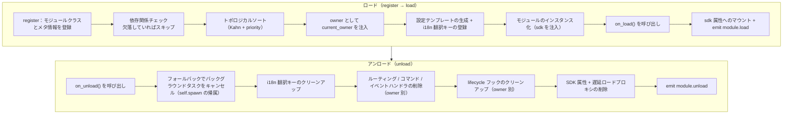

# モジュールのコア概念

> [!NOTE]
> **L1 コア必読**——トップページの「学習パス」にある5つのコアドキュメントの1つで、モジュール開発に必須です。


この文書では、モジュールのロードからアンロードまでの完全なライフサイクル、宣言的設定とストレージの使い方を解説します——フレームワークが自動で行うこと、あなたが書くべきことを、読み終える頃には把握できる内容です。

## モジュールのライフサイクル

### ロード戦略

```python
from ErisPulse.Core.Bases import BaseModule
from ErisPulse.loaders import ModuleLoadStrategy

class MyModule(BaseModule):
    @staticmethod
    def get_load_strategy():
        """モジュールのロード戦略を返す"""
        return ModuleLoadStrategy(
            lazy_load=True,   # 遅延ロードするか即時ロードするか
            priority=0,       # ロード優先度（数値が大きいほど先にロードされる）
            depends=["OtherModule"]  # オプション：依存する他のモジュールを宣言
        )
```

> `depends` で宣言されたモジュールが未登録の場合、現在のモジュールはスキップされ、警告が記録されます。ロード順序はトポロジカルソートによって決まり、同じ階層では `priority` の降順で処理されます。

> [!NOTE]
> **カスケードアンロード / カスケードリロード**（ErisPulse **2.8.0+**）：他のモジュールから依存されているモジュールをアンロードする場合、それに依存しているモジュールは**先にカスケードアンロードされます**（ログにカスケードチェーンが記録されます）。任意のモジュール（ローカルプラグイン / 実行時登録 / PyPI インストールパッケージ）をホットリロードする場合も、それに依存しているモジュールは同様に**カスケードリロード**され、依存しているモジュールが無効になったインスタンス参照を保持したまま動作し続けることを防ぎます。循環依存が宣言されている場合は、ロード時に `RuntimeError` で拒否されます。
>
> **reload は全量リロード**（ErisPulse **2.11.0+**）：`reload()` はデフォルトでトップレベルのパッケージ名に基づいて import キャッシュをクリアし、依存しているモジュールのコードを再インポートします。アンロード前に自動的に構文の事前チェックを行い（失敗時はアンロードを拒否し、旧インスタンスがサービスを継続）、成功後はコードの同一性を確認します（偽リロードの警告 / `stale` マーク）。ロード失敗時の状況は `sdk.module.last_error(名前)` で直接照会できます（traceback を含む）。

### on_load メソッド

モジュールのロード時に呼び出され、リソースの初期化とイベントハンドラの登録に使用します：

```python
async def on_load(self, event):
    # イベントハンドラを登録
    @command("hello", help="挨拶コマンド")
    async def hello_handler(event):
        await event.reply("こんにちは！")
    
    # SDK 内蔵の HTTP クライアントを使用（接続プールを自動管理、session を手動で作成する必要なし）
    # sdk.client を通じてリクエストを送信できます
```

### on_unload メソッド

モジュールのアンロード時に呼び出され、リソースのクリーンアップに使用します：

```python
async def on_unload(self, event):
    # カスタムリソースをクリーンアップ
    # sdk.client はフレームワークが管理するため、手動で閉じる必要なし
    
    # イベントハンドラをキャンセル（フレームワークが自動処理）
    self.logger.info("モジュールはアンロードされました")
```

> バックグラウンドタスクの作成とクリーンアップ（`self.spawn()` / フレームワークによるフォールバックキャンセル）の詳細は、[ライフサイクル管理](../../advanced/lifecycle.md#后台任务归属与自动取消) を参照してください。

### on_before_unload メソッド

> [!NOTE]
> このフックには ErisPulse **2.11.0+** が必要です。

アンロードパイプラインの**最初のステップ**（`on_unload` とリソース回収の前に実行）でトリガーされるオプションのフックです——この時点ではモジュールのすべてのリソースがまだ無傷のため、アンロード / スリープ / リロードの前に状態を `sdk.storage` に保存し、次回の `on_load` で復元するのに適しています（遅延ロードのスリープにおける状態の引き継ぎはまさにこれに基づいています）：

```python
async def on_before_unload(self, event):
    # event["reason"] は目的を示す：unload / reload / disable / cascade / dormant
    if event["reason"] in ("reload", "dormant"):
        await self.sdk.storage.aset(f"{self._module_name}:state", self.collect_state())
```

フックが失敗した場合は警告が出るだけで、アンロードフローはブロックされません。このフックを宣言していないモジュールの動作は変わりません。スリープ / ウェイクのセマンティクスの詳細は、
[遅延ロードのスリープ](../../advanced/lazy-loading.md#懒加载休眠dormant_after) を参照してください。

### アンロードと完全アンロード（purge）

> [!NOTE]
> この機能には ErisPulse **2.8.0+** が必要です。

`unload()` はデフォルトで**ロードの取り消し**のみを行い（インスタンスとリソースをアンロード）、登録スタブ（モジュールクラスとメタ情報）は保持します——モジュールは discover で再発見でき、`register()` をやり直すことなく `load()` で再インスタンス化できます。

**完全アンロード**（モジュールクラスへの参照を解放し、`sys.modules` をクリーンアップして、プラグインとその専用の依存関係を GC で回収できるようにする）が必要な場合は、`purge=True` を渡します：

```python
# ロードの取り消しのみ：登録スタブは保持され、いつでも再 load() 可能
await sdk.module.unload("MyModule")

# 完全アンロード：登録スタブを削除 + sys.modules をクリーンアップ（プラグインソース）
await sdk.module.unload("MyModule", purge=True)
```

| セマンティクス | `unload()` デフォルト | `unload(purge=True)` |
|------|-----------------|----------------------|
| インスタンスとリソースのアンロード（イベント/task/ルーティング/lifecycle/i18n） | ✅ | ✅ |
| 登録スタブの保持（モジュールクラスとメタ情報） | ✅ | ❌ 削除 |
| `sys.modules` のクリーンアップ（プラグインフォルダソースのみ） | ❌ | ✅ |
| モジュールクラスが GC で回収可能 | ❌ | ✅ |
| 再ロード | `load()` でそのまま可能 | 先に `register()` + `load()` が必要 |

> `purge=True` の場合、カスケードアンロードされる依存先のモジュールも同様に purge されます。アンロード後、フレームワークは `gc.collect()` を実行し、モジュールクラス/インスタンスが回収可能かどうかをチェックします。残存する参照はログに警告として記録されます（参照元を含む、DEBUG レベル）。

### ライフサイクルの全体像

上記のメソッドを組み合わせると、フレームワークがモジュールのロードとアンロード時に**裏で自動的に行うすべての処理**は以下の通りです：



**ロード時にフレームワークが自動で行うこと**（あなたは `on_load` を書くだけで、残りは自動的に完了します）：

| 段階 | フレームワークが自動で行うこと |
|------|-------------|
| owner 注入 | インスタンス化の間、`owner_scope` でモジュール名を囲みます——あなたが `on_load` 内で登録したコマンド/イベント/フック/バックグラウンドタスクは**自動的にこのモジュールに帰属**し、アンロード時に owner 別に一括クリーンアップされます |
| 設定テンプレート | `ConfigClass` を宣言したモジュールでは、フレームワークが `ErisPulse.<ModuleName>` 設定セクションを自動生成/自動入力します |
| i18n 翻訳キー | `I18nClass` を宣言したモジュールでは、翻訳キーが自動登録されます（アンロード時に自動的に登録解除） |
| 依存トポロジ | `depends` の宣言に基づいてソートし、依存されるモジュールが先にロードされることを保証します。循環依存は `RuntimeError` で拒否されます |
| SDK マウント | インスタンス化後に `sdk.<ModuleName>` にマウントされ、`sdk.MyModule.xxx` でアクセスできるようになります |

**アンロード時にフレームワークがクリーンアップするもの**（上記の U1→U7 に対応）：`on_unload` の実行後にフォールバックとしてクリーンアップを行います——バックグラウンドタスクの強制キャンセル（`self.spawn` で作成されたもの。適切な終了処理は `on_unload` 内で自前に行ってください）、i18n キー、ルーティング、コマンド/イベントハンドラ、lifecycle フック、最後に SDK 属性を削除します。`purge=True` の場合はさらに登録スタブの削除 + `sys.modules` のクリーンアップが行われます。

> この自動クリーンアップこそが、「`on_load`/`on_unload` だけ書けば、手動で unregister する必要はない」の根拠です——フレームワークは owner による帰属を利用して、「登録した者がクリーンアップする」仕組みをワンアクションで実現しています。

## SDK オブジェクト

### コアモジュールへのアクセス

```python
from ErisPulse import sdk

# sdk オブジェクトを通じてすべてのコアモジュールにアクセス
sdk.logger.info("ログ")
sdk.storage.set("key", "value")
config = sdk.config.getConfig("MyModule")
```

### モジュール間通信

```python
# 他のモジュールにアクセス
other_module = sdk.OtherModule
result = await other_module.some_method()
```

## アダプター送信メソッドの照会

新しい標準仕様では、`__getattr__` メソッドをオーバーライドしてフォールバック送信メカニズムを実装することが求められているため、`hasattr` メソッドでメソッドの存在を確認することができなくなりました。`2.3.5` から、送信メソッドを照会する機能が新たに追加されました。

### サポートされている送信メソッドの一覧

```python
# プラットフォームがサポートするすべての送信メソッドを一覧表示
methods = sdk.adapter.list_sends("onebot11")
# 戻り値: ["Text", "Image", "Voice", "Markdown", ...]
```

### メソッドの詳細情報の取得

```python
# 特定のメソッドの詳細情報を取得
info = sdk.adapter.send_info("onebot11", "Text")
# 戻り値:
# {
#     "name": "Text",
#     "parameters": [
#         {"name": "text", "type": "str", "default": null, "annotation": "str"}
#     ],
#     "return_type": "Awaitable[Any]",
#     "docstring": "テキストメッセージを送信します..."
# }
```

## 設定管理

### 宣言的設定（推奨）

v2.5.2 から、モジュールは `ConfigClass` で設定クラスを宣言でき、アダプターと同じ設定 Schema システムを使用できます。設定は `self.cfg` でリアルタイムに読み取られ、変更後すぐに反映されます：

```python
from dataclasses import dataclass, field
from ErisPulse.Core.Bases import BaseModule
from ErisPulse.Core.Bases import BaseConfig

@dataclass
class MyModuleConfig(BaseConfig):
    api_key: str = field(
        default="",
        metadata={
            "description": {"i18n": "my_module.api_key", "default": "API キー"},
            "required": True,
            "secret": True,
            "ui": {"widget": "password", "group": "basic", "order": 1},
        },
    )
    timeout: int = field(
        default=30,
        metadata={
            "description": {"i18n": "my_module.timeout", "default": "タイムアウト時間（秒）"},
            "ui": {"widget": "number", "group": "advanced", "order": 2},
        },
    )

class MyModule(BaseModule):
    ConfigClass = MyModuleConfig

    def __init__(self, sdk):
        self.sdk = sdk
        self.logger = sdk.logger.get_child("MyModule")

    async def on_load(self, event):
        self.logger.info("モジュールがロードされました")

    async def on_unload(self, event):
        pass

    async def do_something(self):
        cfg = self.cfg  # リアルタイム読み取り、型安全
        api_key = cfg.api_key
        timeout = cfg.timeout
```

`BaseConfig` は汎用の設定基底クラスで、アダプター、モジュール、外部プロジェクトなどあらゆるシーンに適用できます。設定フィールドは i18n による多言語説明に対応しています（詳細は [i18n ドキュメント](../../advanced/i18n.md#配置字段多语言) を参照）。

> [!NOTE]
> モジュール（アダプターを含む）のロード、アンロード、起動・停止などのライフサイクルは、フレームワークが統一的に管理します（`module manager` / `scope` が照会・制御 API を提供）。`ConfigClass` はビジネスパラメータのみを担うべきであり、モジュールが内部で「自分を起動するかどうか」を判断するロジックを再度ネストする必要はありません。

設定 Schema システムはさらに以下にも対応しています（v2.8.0+、詳細は [アダプター core-concepts](../adapters/core-concepts.md#metadata-约定) を参照）：

- **docstring からのフィールド説明の自動生成**：metadata の `description` が宣言されていない場合、docstring の `:ivar フィールド: 説明` や `Attributes:` セクションから自動的にフォールバックとして抽出します
- **ネストされた dataclass 設定**：フィールドの型がネストされた dataclass の場合、schema/テンプレート/検証が再帰的に処理され、WebUI ではネストされたグループとしてレンダリングされます
- **`example` のディスク書き込み対象外フィールド**：`metadata={"example": True}` のフィールドは config.toml に書き込まれず、`config.full.example` にのみ記録されます（冗長でほとんど触れることのない高度な設定項目に適しています）。ユーザーが手動で設定すると、通常どおり永続化されます

### 宣言的翻訳キー（v2.7.0+）

v2.7.0 から、モジュールは `ConfigClass` を宣言するのと同じように、ネストクラス `I18nClass` を通じて翻訳キーを一括宣言できるようになりました。フレームワークはロード時に宣言されたすべての翻訳キーを**自動登録**し、手動で `i18n.register()` を呼び出す必要はありません。また、登録のタイミングは設定テンプレートの生成より前であるため、設定説明で参照される i18n キーが確実に利用可能になります。

```python
from ErisPulse.Core.Bases import BaseConfig, BaseI18n, I18nKey

class MyModule(BaseModule):
    # 設定クラス（オプション）
    @dataclass
    class ConfigClass(BaseConfig):
        welcome_msg: str = field(
            default="ようこそ",
            metadata={
                "description": {"i18n": "mymodule.welcome_msg", "default": "ウェルカムメッセージ"},
            },
        )

    # 翻訳キーコレクションクラス（オプション）
    class I18nClass(BaseI18n):
        # 属性名から完全なキーパスが自動的に組み立てられます：<モジュール名>.<属性名>
        welcome_msg: I18nKey = I18nKey(
            default="Welcome Message",   # 言語に依存しないフォールバック
            zh_CN="欢迎消息",
            zh_TW="歡迎訊息",
            en="Welcome Message",
            ja="ウェルカムメッセージ",
            ru="Приветственное сообщение",
        )
        hello: I18nKey = I18nKey(
            default="Hello, {name}!",
            zh_CN="你好，{name}！",
            zh_TW="你好，{name}！",
            en="Hello, {name}!",
            ja="こんにちは、{name}！",
            ru="Привет, {name}!",
        )
```

詳細は [i18n 推奨記法](../../advanced/i18n.md#推荐写法通过-i18nclass-声明翻译键-v270) を参照してください。

### 手動での設定読み取り（非推奨）

> **非推奨**：代わりに [宣言的設定](#声明式配置推荐) + `self.cfg` によるリアルタイム読み取りを使用してください。

```python
class MyModule(BaseModule):
    def __init__(self, sdk):
        self.sdk = sdk

    def _load_config(self):
        config = self.sdk.config.getConfig("MyModule")
        if not config:
            self.sdk.config.setConfig("MyModule", {"api_key": "", "timeout": 30})
            return {"api_key": "", "timeout": 30}
        return config
```

## ストレージシステム

### 基本的な使い方

```python
# データを保存
sdk.storage.set("user:123", {"name": "山田太郎"})

# データを取得
user = sdk.storage.get("user:123", {})

# データを削除
sdk.storage.delete("user:123")
```

### トランザクションの使用

```python
# トランザクションを使用してデータの一貫性を保証
with sdk.storage.transaction():
    sdk.storage.set("key1", "value1")
    sdk.storage.set("key2", "value2")
    # いずれかの操作が失敗した場合、すべての変更がロールバックされます
```

## イベント処理

### イベントハンドラの登録

```python
from ErisPulse.Core.Event import command, message

# コマンドを登録
@command("info", help="情報を取得")
async def info_handler(event):
    await event.reply("これは情報です")

# メッセージハンドラを登録
@message.on_group_message()
async def group_handler(event):
    sdk.logger.info(f"グループメッセージを受信: {event.get_text()}")
```

### イベントハンドラのライフサイクル

フレームワークがイベントハンドラの登録と登録解除を自動的に管理するため、あなたは `on_load` 内で登録するだけで済みます。

## 遅延ロード機構

### 仕組み

```python
# モジュールは初めてアクセスされた時に初期化されます
result = await sdk.my_module.some_method()
# ↑ ここでモジュールの初期化がトリガーされます
```

### 即時ロード

即時初期化が必要なモジュール（リスナー、タイマーなど）の場合：

```python
@staticmethod
def get_load_strategy():
    return ModuleLoadStrategy(
        lazy_load=False,  # 即時ロード
        priority=100
    )
```

## エラー処理

### 例外のキャッチ

```python
async def handle_event(self, event):
    try:
        # ビジネスロジック
        await self.process_event(event)
    except ValueError as e:
        self.logger.warning(f"パラメータエラー: {e}")
        await event.reply(f"パラメータエラー: {e}")
    except Exception as e:
        self.logger.error(f"処理に失敗しました: {e}")
        raise
```

### ログ記録

```python
# 異なるログレベルを使用
self.logger.debug("デバッグ情報")    # 詳細なデバッグ情報
self.logger.info("実行状態")      # 通常の実行情報
self.logger.warning("警告情報")  # 警告情報
self.logger.error("エラー情報")    # エラー情報
self.logger.critical("致命的エラー") # 致命的エラー
```

## 関連ドキュメント

### 学習パスの続き

- [Event ラッパークラス](event-wrapper.md) - イベント処理の詳細

### 深掘りとトラブルシューティング

- [モジュールのベストプラクティス](best-practices.md) - 高品質なモジュールの開発
- [モジュール開発入門](getting-started.md) - 最初のモジュール構築手順の復習