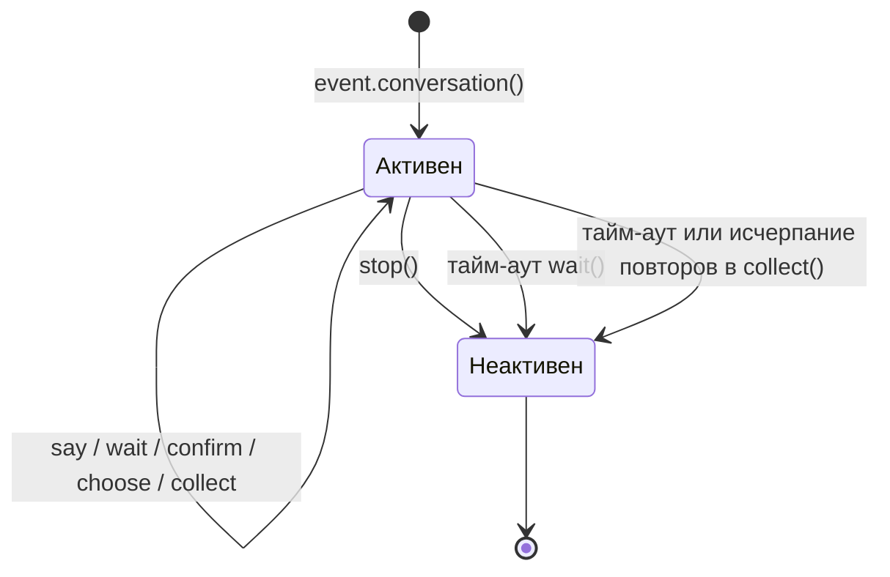

# Conversation: многоходовой диалог

> [!TIP]
> **Когда читать этот документ**: когда нужны конечный автомат многоходового диалога и восстановление из контрольных точек. Если это не нужно — пропустите, на использование остальных функций это не влияет.

Когда команда должна последовательно запрашивать у пользователя информацию в несколько шагов (сбор данных при регистрации, анкеты, мастер настройки), используйте `Conversation`, чтобы выстроить в одной сессии цепочку «вопрос → ожидание ответа → проверка → следующий шаг». После тайм-аута или перезапуска диалог можно восстановить из контрольной точки.

## Создание диалога

Диалог создаётся методом `conversation()` объекта `Event`:

```python
from ErisPulse.Core.Event import command

@command("quiz")
async def quiz_handler(event):
    conv = event.conversation(timeout=30)

    await conv.say("🎮 Добро пожаловать в викторину!")

    answer = await conv.choose("Вопрос 1: кто создатель Python?", [
        "Guido van Rossum",
        "James Gosling",
        "Dennis Ritchie",
    ])

    if answer is None:
        await conv.say("Время вышло, приходите в следующий раз!")
        return

    if answer == 0:
        await conv.say("Правильно!")
    else:
        await conv.say("Неправильно, правильный ответ — Guido van Rossum")

    conv.stop()
```

## Основной API

### say(content, **kwargs)

Отправляет сообщение, возвращает `self`, поддерживая цепочки вызовов:

```python
await conv.say("Первая строка").say("Вторая строка").say("Третья строка")
```

Можно также указать метод отправки:

```python
await conv.say("https://example.com/image.jpg", method="Image")
```

### wait(prompt=None, timeout=None)

Ожидает ответ пользователя, возвращает объект `Event` или `None` (тайм-аут):

```python
# Простое ожидание
resp = await conv.wait()
if resp:
    text = resp.get_text()

# Отправка подсказки и ожидание
resp = await conv.wait(prompt="Пожалуйста, введите ваше имя:")

# Своё время ожидания (переопределяет тайм-аут диалога по умолчанию)
resp = await conv.wait(prompt="Ответьте в течение 10 секунд:", timeout=10)
```

### confirm(prompt=None, **kwargs)

Ожидает подтверждения пользователя (да/нет), возвращает `True` / `False` / `None` (тайм-аут):

```python
result = await conv.confirm("Вы уверены, что хотите удалить все данные?")
if result is True:
    await conv.say("Удалено")
elif result is False:
    await conv.say("Отменено")
else:
    await conv.say("Время ожидания истекло, ответа нет")
```

Встроенные распознаваемые слова подтверждения: `да/yes/y/подтверждаю/точно/хорошо/ok/true/верно/ага/ладно/согласен/без проблем/можно/конечно...`

Встроенные распознаваемые слова отрицания: `нет/no/n/отмена/не/не надо/нельзя/cancel/false/неверно/неправильно/не/отказ...`

### choose(prompt, options, **kwargs)

Ожидает, пока пользователь выберет один из вариантов, возвращает индекс варианта (начиная с 0) или `None`:

```python
choice = await conv.choose("Выберите цвет:", ["Красный", "Зелёный", "Синий"])
if choice is not None:
    colors = ["Красный", "Зелёный", "Синий"]
    await conv.say(f"Вы выбрали {colors[choice]}")
```

Пользователь может выбрать, введя номер (`1`/`2`/`3`) или текст варианта (`Красный`).

`options_format="auto"` (по умолчанию) автоматически выбирает встроенный стиль в зависимости от method: Markdown→маркированный список, Html→нумерованный список, остальные→простой текстовый список.
Также поддерживаются `"list"`, `"inline"`, `"md"`, `"html"` или пользовательская функция.

Поддерживается `merge_prompt=True` для объединения подсказки и вариантов в одно сообщение, а также плейсхолдер, управляющий позицией вставки вариантов (по умолчанию `{options}`, настраивается через `placeholder`):

```python
choice = await conv.choose(
    "## Выберите\n{options}",
    ["Вариант А", "Вариант Б"],
    method="Markdown",
    merge_prompt=True,
)

# Собственное имя плейсхолдера
choice = await conv.choose(
    "Выберите: [choices]",
    ["Вариант А", "Вариант Б"],
    placeholder="[choices]",
)
```

### collect(fields, **kwargs)

Пошаговый сбор информации, возвращает словарь данных или `None`:

```python
data = await conv.collect([
    {"key": "name", "prompt": "Введите имя"},
    {"key": "age", "prompt": "Введите возраст",
     "validator": lambda e: e.get("alt_message", "").strip().isdigit(),
     "retry_prompt": "Возраст должен быть числом, введите ещё раз"},
    {"key": "city", "prompt": "Введите город"},
])

if data:
    await conv.say(f"Регистрация успешна!\nИмя: {data['name']}\nВозраст: {data['age']}\nГород: {data['city']}")
else:
    await conv.say("Процесс регистрации прерван")
```

Конфигурация полей:

| Параметр | Описание | По умолчанию |
|------|------|--------|
| `key` | Ключ поля (обязателен) | - |
| `prompt` | Подсказка | `"Введите {key}"` |
| `validator` | Функция проверки, принимает Event, возвращает bool | нет |
| `retry_prompt` | Подсказка при повторе после неудачной проверки | `"Некорректный ввод, попробуйте ещё раз"` |
| `max_retries` | Максимальное число повторных попыток | 3 |
| `condition` | Функция условия, принимает dict уже собранных данных, возвращает bool | нет |

**Условные поля**: с помощью `condition` можно реализовать динамические формы — поле собирается только при выполнении условия:

```python
data = await conv.collect([
    {"key": "has_car", "prompt": "У вас есть машина? (да/нет)"},
    {"key": "car_brand", "prompt": "Введите марку машины",
     "condition": lambda d: d.get("has_car", "").lower() in ("да", "yes", "y")},
])
```

### stop()

Вручную завершает диалог, устанавливая `is_active` в `False`:

```python
conv.stop()
```

### is_active

Находится ли диалог в активном состоянии:

```python
if conv.is_active:
    await conv.say("Диалог ещё продолжается")
```

## Управление активным состоянием



Диалог автоматически переходит в неактивное состояние в следующих случаях:

1. Вызван метод `stop()`
2. `wait()` по тайм-ауту вернул `None`
3. `collect()` вернул `None` из-за тайм-аута на каком-либо шаге или исчерпания повторных попыток

После перехода в неактивное состояние все интерактивные методы (`wait`/`confirm`/`choose`/`collect`) немедленно возвращают `None` и больше не ожидают ввод пользователя.

## Ветвления и переходы

### Декоратор @conv.branch(name)

Метод `branch()` регистрирует ветвь диалога, а `goto()` выполняет переходы между ветвями:

```python
@command("menu")
async def menu_handler(event):
    conv = event.conversation(timeout=60)

    @conv.branch("main")
    async def main_menu():
        await conv.say("=== Главное меню ===\n1. Личные данные\n2. Настройки\n3. Выход")
        resp = await conv.wait()
        if resp is None:
            return
        text = resp.get_text().strip()
        if text == "1":
            await conv.goto("profile")
        elif text == "2":
            await conv.goto("settings")
        elif text == "3":
            await conv.say("До свидания!")
            conv.stop()

    @conv.branch("profile")
    async def profile():
        await conv.say("=== Личные данные ===\nИмя: Alice\n0. Назад")
        resp = await conv.wait()
        if resp and resp.get_text().strip() == "0":
            await conv.goto("main")

    @conv.branch("settings")
    async def settings():
        await conv.say("=== Настройки ===\n1. Переключатель уведомлений\n0. Назад")
        resp = await conv.wait()
        if resp and resp.get_text().strip() == "0":
            await conv.goto("main")

    await conv.start()  # Начало с первой зарегистрированной ветви
```

### conv.start(name=None)

Запускает диалог, по умолчанию — с первой зарегистрированной ветви:

```python
await conv.start()           # С первой ветви
await conv.start("settings") # С указанной ветви
```

## Контекст и персистентность

### conv.context

У каждого экземпляра диалога есть встроенный словарь `context` для обмена состоянием между ветвями:

```python
@conv.branch("step1")
async def step1():
    conv.context["username"] = resp.get_text().strip()
    await conv.goto("step2")

@conv.branch("step2")
async def step2():
    name = conv.context.get("username", "Неизвестно")
    await conv.say(f"Привет, {name}!")
```

### save() / resume() / clear_saved()

Диалог поддерживает персистентность и может быть восстановлен после тайм-аута или прерывания:

```python
# Сохранение состояния диалога (обычно вызывать вручную не нужно, см. «Автоматическое сохранение» ниже)
await conv.save()

# ... позже восстановление в той же сессии ...
conv2 = event.conversation()
if await conv2.resume():
    await conv2.say("С возвращением! Продолжим прерванный диалог")
else:
    await conv2.say("Предыдущий диалог не найден")

# Очистка сохранённого диалога
await conv.clear_saved()
```

Ключ хранения включает измерение target (`conversation:{platform}:{user_id}:{target_id}`), поэтому диалоги одного пользователя в разных сессиях не перезаписывают друг друга; архивы старого формата (без target) автоматически мигрируют при `resume()`.

## Автоматические контрольные точки и восстановление после перезапуска

### Автоматическое сохранение

Фреймворк автоматически поддерживает контрольные точки в следующих случаях; обычно вручную вызывать `save()` не нужно:

| Момент | Поведение |
|------|------|
| Переход между ветвями `goto()` / `start()` | Автосохранение (текущая ветвь + context) |
| `stop()` / тайм-аут `wait()` / сбой `collect()` | Автоочистка (конечное состояние диалога) |

### TTL контрольных точек

Архивы содержат метку времени; архивы старше `ErisPulse.interaction.checkpoint_ttl` (по умолчанию 24 часа) удаляются:

- **Ленивое отбрасывание**: если при восстановлении обнаруживается, что архив просрочен, он автоматически отбрасывается
- **Активная фоновая очистка**: во фреймворке есть периодическая задача GC (лениво запускается после первого использования контрольных точек), которая активно перечисляет и удаляет просроченные архивы, чтобы при долгой работе просроченные контрольные точки не накапливались в storage бесконечно. Если после активной очистки архива в сессию придёт сообщение, оно обрабатывается как «контрольная точка отсутствует»

```toml
[ErisPulse.interaction]
checkpoint_ttl = 86400  # секунды
```

### Автоматическое восстановление после перезапуска

После перезапуска фреймворка идущие диалоги (ожидающие корутины в памяти) теряются, но контрольные точки сохраняются. Если зарегистрировать **фабрику восстановления** через `register_resume_handler`, фреймворк после перезапуска при получении первого сообщения в этой сессии автоматически продолжит диалог:

```python
from ErisPulse.Core.Event.wrapper import Conversation

@Conversation.register_resume_handler()  # можно передать platform="onebot11", чтобы ограничить платформу
def make_conversation(event) -> Conversation:
    # Задача фабрики: заново создать диалог и перерегистрировать все ветви
    conv = event.conversation(timeout=60)

    @conv.branch("menu")
    async def menu(conv, event):
        ...

    return conv
```

После регистрации, когда пользователь, находившийся до перезапуска в ветви `menu`, пришлёт первое сообщение, фреймворк автоматически: восстановит context → захватит это сообщение → продолжит диалог из сохранённой ветви. Без зарегистрированной фабрики этот механизм не создаёт накладных расходов.

### Восстановление означает захват

При успешном `resume()` фреймворк автоматически делает две вещи:

1. **Захват сессии**: автоматически выполняет acquire эксклюзивной аренды сессии — другие модули могут через `sdk.interaction.get_owner_of(event)` узнать, что «этот пользователь занят диалогом»; если сессия уже занята другим модулем, восстановление отменяется (возвращает False), чтобы два диалога не конфликтовали
2. **Возврат истории**: последние 10 сообщений из входящего ящика сессии помещаются в `conv.recent_history` (контекст LLM у AI-модуля не обрывается после восстановления); можно отключить через `resume(with_history=0)`

```python
if await conv.resume(with_history=20):
    for m in conv.recent_history:
        print(m["role"], ":", m["text"])
```

### Ручное восстановление (если не использовать автоматический механизм)

```python
@command("continue")
async def continue_handler(event):
    conv = event.conversation()
    # ... регистрация ветвей ...
    if await conv.resume():
        conv.goto(conv.get_current_branch())
```

## Типовые шаблоны потоков

### Пошаговая регистрация

```python
@command("register")
async def register_handler(event):
    conv = event.conversation(timeout=60)

    await conv.say("Добро пожаловать! Начинаем регистрацию.")

    data = await conv.collect([
        {"key": "username", "prompt": "Введите имя пользователя (3-20 символов)",
         "validator": lambda e: 3 <= len(e.get_text().strip()) <= 20},
        {"key": "email", "prompt": "Введите адрес электронной почты",
         "validator": lambda e: "@" in e.get_text() and "." in e.get_text(),
         "retry_prompt": "Неверный формат email, введите ещё раз"},
    ])

    if not data:
        await event.reply("Регистрация отменена")
        return

    confirmed = await conv.confirm(
        f"Подтвердить данные регистрации?\nИмя пользователя: {data['username']}\nEmail: {data['email']}"
    )

    if confirmed:
        await conv.say("✅ Регистрация успешно завершена!")
    else:
        await conv.say("❌ Регистрация отменена")
```

### Циклический диалог

```python
@command("chat")
async def chat_handler(event):
    conv = event.conversation(timeout=120)
    await conv.say("Включён режим диалога. Введите «выход», чтобы завершить.")

    while conv.is_active:
        resp = await conv.wait()
        if resp is None:
            await conv.say("Время вышло, диалог завершён")
            break

        text = resp.get_text().strip()

        if text == "выход":
            await conv.say("До свидания!")
            conv.stop()
        elif text == "помощь":
            await conv.say("Доступные команды: выход, помощь, статус")
        elif text == "статус":
            await conv.say("Диалог активен")
        else:
            await conv.say(f"Вы сказали: {text}")
```

## Связанные документы

- [Класс-обёртка Event](../developer-guide/modules/event-wrapper.md) - все методы объекта Event
- [Начало работы с обработкой событий](../getting-started/event-handling.md) - основы обработки событий