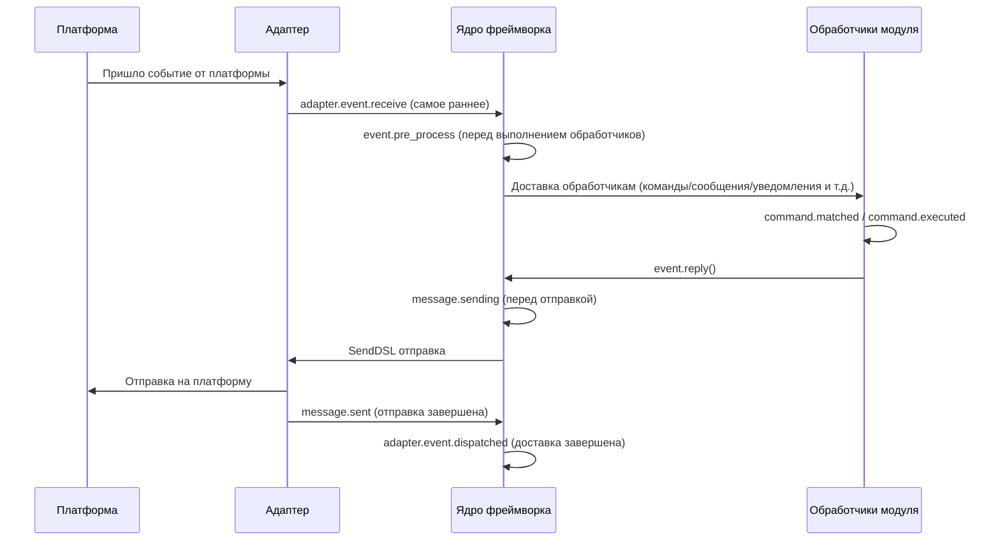

# Управление жизненным циклом

> [!TIP]
> **Когда нужно читать эту статью**: если необходимо подписаться на события жизненного цикла фреймворка (запуск / загрузка / изменение состояния). Если не нужно, можете пропустить, это не повлияет на использование других функций.

ErisPulse предоставляет унифицированную систему хуков/жизненного цикла, которая используется для мониторинга состояния работы компонентов системы, а также для реализации аудита, статистики, пользовательской логики и других расширений.

Система поддерживает три способа вызова:
- `await lifecycle.emit("event", data)` — упрощённая версия, передача произвольных данных (`to="Owner"` — направление доставки)
- `lifecycle.emit_sync("event", data)` — синхронная версия (для не-асинхронных контекстов)
- `await lifecycle.submit_event("event", ...)` — совместимость со старой версией, автоматическое построение стандартного формата события

## Механизм обработки событий

### Регистрация обработчика

```python
from ErisPulse import sdk

# Регистрация через декоратор
@sdk.lifecycle.on("module.load")
async def on_module_load(data):
    print(f"Модуль загружен: {data}")

# Программная регистрация
sdk.lifecycle.register("module.load", on_module_load, priority=10)

# Отмена регистрации
sdk.lifecycle.unregister("module.load", on_module_load)

# Массовая отмена регистрации по владельцу (рамка автоматически вызывает при выгрузке модуля/адаптера)
removed = sdk.lifecycle.unregister_by_owner("MyModule")
print(f"Удалено {removed} хуков жизненного цикла")
```

### Приоритет

Обработчики поддерживают параметр `priority`, чем больше значение, тем раньше он выполняется (аналогично загрузчику модулей):

```python
@sdk.lifecycle.on("adapter.event.receive", priority=10)  # Выполняется первым
async def first_handler(data):
    pass

@sdk.lifecycle.on("adapter.event.receive", priority=0)  # Выполняется позже
async def second_handler(data):
    pass
```

### События с точечной структурой

При триггере конкретного события также триггерятся его родительские события:
- При триггере `module.load` также триггерится `module`
- При триггере `adapter.event.receive` также триггерятся `adapter.event` и `adapter`

### Шаблон звездочки

Регистрация `*` для захвата всех событий:

```python
@sdk.lifecycle.on("*")
async def on_anything(data):
    print(f"Получено событие: {data}")
```

### Направленная рассылка (emit to=)

> [!NOTE]
> Эта функция доступна в ErisPulse **2.8.0+**.

При указании параметра `to` в `emit()` происходит направленная рассылка: событие доставляется только обработчикам, зарегистрированным с владельцем (владелец при регистрации в `on_load` автоматически присваивается модулю), другие модули и обработчики со шаблоном `*` не получают событие.

```python
# Отправитель: событие доставляется только хукам, зарегистрированным модулем Chat
await sdk.lifecycle.emit("message_received", {"text": "hi"}, to="Chat")

# Подписчик (внутри модуля Chat): регистрация хуков с тем же именем, владелец автоматически сохраняется при регистрации
@sdk.lifecycle.on("message_received")
async def on_message_received(data): ...

@sdk.lifecycle.on("message")   # Родительские префиксы с точкой также действуют (фильтрация по владельцу)
async def on_any(data): ...
```

- Если у владельца нет зарегистрированных хуков → событие **не обрабатывается** (можно заранее проверить с помощью `has_handlers()`)
- При `data` в виде словаря автоматически добавляется `_trace_id` (без перезаписи уже существующего значения)
- `emit_sync` / `submit_event` также поддерживают параметр `to=`
- Модель взаимодействия между модулями (RPC / направленная / широковещательная) см. в [Взаимодействие между модулями](module-communication.md)

### Однократная регистрация (once)

Начиная с версии 2.7.0, хуки, зарегистрированные через `lifecycle.once()`, автоматически удаляются после выполнения один раз, что подходит для "первичной готовности" и подобных однократных триггеров:

```python
@sdk.lifecycle.once("core.init.complete")
async def on_first_ready(data):
    print("Первичная готовность, дальнейшие триггеры не будут запускаться")
```

- Имеет ту же семантику параметра приоритета `priority`, что и `on()` (чем больше значение `priority`, тем раньше выполняется)
- Автоматически удаляется, без необходимости ручной `unregister`
- Поддерживает как синхронные, так и асинхронные обработчики

### Запрос слушателя (has_handlers)

Для сценариев с короткими горячими путями можно использовать `has_handlers()` для проверки наличия слушателей, чтобы избежать ненужного перебора событий и запуска задач:

```python
if sdk.lifecycle.has_handlers("message.sending"):
    await sdk.lifecycle.emit("message.sending", send_ctx)
```

- Проверяет **точное имя события, шаблон `*`, родительские события**
- Возвращает `False`, если слушателей нет, безопасно пропустить `emit`

## Список точек хуков

Типичный порядок событий жизненного цикла при получении сообщения от платформы до его обработки:



Фреймворк предоставляет следующие точки хуков, которые можно прослушивать с помощью `@sdk.lifecycle.on()` для реализации пользовательской логики.

### Ядро инициализации

| Имя хука | Триггер | Данные |
|---------|---------|------|
| `core.init.start` | Начало инициализации SDK | `{}` |
| `core.init.stage` | Начало этапа инициализации (выpusкается в фоне) | `{"stage": str}`, значения: `discovery` / `adapter_register` / `adapter_start` / `module_register` / `module_init` / `adapter_start_deferred` / `router_start` |
| `core.init.complete` | Завершение инициализации SDK | `{"duration": float, "success": bool, "stages": {stage: float}, "adapters": {"enabled": [str], "disabled": [str]}, "modules": {"enabled": [str], "disabled": [str]}, "error": str (только при ошибке)}` |
| `core.uninit.complete` | Завершение обратной инициализации SDK | `{"duration": float, "success": bool, "adapters_closed": int, "modules_unloaded": int, "module_properties_cleared": int, "module_properties_to_clear": [str], "error": str (только при ошибке)}` |

**Пример: отображение прогресса запуска**

```python
@sdk.lifecycle.on("core.init.stage")
def show_stage(data):
    print(f"[Запуск] Вход в этап: {data['stage']}")
```

### Изменение конфигурации

| Имя хука | Триггер | Данные |
|---------|---------|------|
| `config.set` | Изменение конфигурационного параметра | `{"key": str, "old_value": Any, "new_value": Any}` |
| `config.updated` | После изменения config.toml обнаружено изменение всей конфигурации | `{"old_config": dict, "new_config": dict, "config_file": str}` |

**Пример: аудит конфигурации**

```python
@sdk.lifecycle.on("config.set")
def audit_config(data):
    print(f"[Аудит] {data['key']}: {data['old_value']} -> {data['new_value']}")
```

### Жизненный цикл модуля

| Имя хука | Триггер | Данные |
|---------|---------|------|
| `module.register` | Регистрация класса модуля в менеджере | `{"module_name": str, "success": bool}` |
| `module.load` | Завершение загрузки модуля (успешное инстанцирование); в случае ошибки payload дополнительно содержит `"error": str, "traceback": str` (сценарий ошибки можно также получить через `module.last_error(имя)` | `{"module_name": str, "success": bool}` |
| `module.init` | Завершение инициализации модуля (включая ленивую загрузку) | `{"module_name": str, "success": bool}` |
| `module.before_unload` | Первая стадия выгрузки (до `on_unload` и освобождения ресурсов; модульные хуки `on_before_unload` срабатывают синхронно) | `{"module_name": str, "reason": str}`; `reason` значения: `unload` / `reload` / `disable` / `cascade` / `dormant` |
| `module.sleep` | Завершение сна модуля (ленивая загрузка: ресурсы освобождены, при обращении автоматически пробуждается) | `{"module_name": str, "success": bool}` |
| `module.unload` | Завершение выгрузки модуля | `{"module_name": str, "success": bool}` |
| `module.reload` | Завершение горячей перезагрузки модуля (включая перезагрузку зависимостей) | `{"module_name": str, "success": bool, "full": bool, "duration_ms": int}`; для одиночного модуля дополнительно содержит `"identity_changed": bool` (False = в процессе возможно всё ещё работает старый код, например, кэш C-расширений) и `"version_old": str, "version_new": str`; при полной перезагрузке (`reload_all`) `module_name` равен `"All"`, payload дополнительно содержит `"results": dict[str, bool]` |

> **Модульный хук `on_before_unload`**: соответствующий событию `module.before_unload` необязательный метод жизненного цикла — `event["reason"]` указывает причину, подходит для сохранения состояния в `sdk.storage` перед освобождением ресурсов, восстановление при пробуждении / перезагрузке происходит в `on_load` (состояние ленивой загрузки продолжается благодаря этому). Ошибка хука лишь предупреждает, не блокирует процесс выгрузки.

### Жизненный цикл адаптера

| Имя хука | Триггер | Данные |
|---------|---------|------|
| `adapter.load` | Завершение регистрации адаптера | `{"platform": str, "success": bool}` |
| `adapter.reload` | Завершение горячей перезагрузки кода адаптера | `{"adapter_name": str, "success": bool, "full": bool, "duration_ms": int, "identity_changed": bool, "version_old": str, "version_new": str, "was_started": bool, "source": str}`; `identity_changed=False` = в процессе возможно всё ещё работает старый код |
| `adapter.start` | Запуск адаптера | `{"platforms": [str]}` |
| `adapter.status.change` | Изменение состояния адаптера | `{"platform": str, "status": str, "retry_count": int, "error": str (только при ошибке)}`; полные значения `status`: `starting` / `started` / `start_failed` / `stopping` / `stopped` / `stop_failed` / `skipped-dependency` / `disabled` |
| `adapter.stop` | Остановка адаптера | `{"platforms": [str]}` |
| `adapter.stopped` | Завершение остановки адаптера | `{"platforms": [str]}` |
| `adapter.bot.online` | Онлайн бота | `{"platform": str, "bot_id": str, "info": dict, "status": str}` |
| `adapter.bot.offline` | Оффлайн бота | `{"platform": str, "bot_id": str, "status": str}` |

### Прием и обработка событий

| Имя хука | Триггер | Данные |
|---------|---------|------|
| `adapter.event.receive` | Получено событие с внешней платформы (самый ранний) | `{"platform": str, "event_type": str, "raw_event_type": str}` |
| `adapter.event.blocked` | Промежуточный слой отклонил событие (возврат `False`, событие отбрасывается и не поступает в обработчики) | `{"middleware": str, "platform": str, "event_type": str, "detail_type": str, "event": dict, "_trace_id": str}` |
| `adapter.event.dispatched` | Завершение доставки события | `{"platform": str, "event_type": str, "raw_event_type": str, "onebot_handlers_count": int}` |
| `event.pre_process` | Перед началом выполнения обработчиков события | `{"event_type": str, "platform": str, "detail_type": str}` |

**Пример: статистика событий**

```python
event_counter = {}

@sdk.lifecycle.on("adapter.event.receive")
def count_events(data):
    platform = data["platform"]
    event_counter[platform] = event_counter.get(platform, 0) + 1

@sdk.lifecycle.on("adapter.event.dispatched")
def log_unhandled(data):
    if data["onebot_handlers_count"] == 0:
        print(f"[Необработано] {data['platform']}/{data['event_type']}")
```

### Отправка сообщений

| Имя хука | Триггер | Данные |
|---------|---------|------|
| `message.sending` | Сообщение готовится к отправке | `{"platform": str, "method": str, "detail_type": str, "target_id": str, "bot_id": str}` |
| `message.sent` | Сообщение отправлено | `{"platform": str, "method": str, "detail_type": str, "target_id": str, "bot_id": str}` |

**Пример: аудит отправки сообщений**

```python
@sdk.lifecycle.on("message.sending")
def log_sending(data):
    print(f"[Отправка] -> {data['platform']}/{data['detail_type']}/{data['target_id']} через {data['method']}")
```

### Командная система

| Имя хука | Триггер | Данные |
|---------|---------|------|
| `command.matched` | Команда совпала и готовится к выполнению | `{"command": str, "args": list[str], "platform": str, "user_id": str}` |
| `command.executed` | Команда выполнена | `{"command": str, "args": list[str], "platform": str, "user_id": str, "success": bool, "error": str (только при ошибке)}` |

**Пример: статистика команд**

```python
@sdk.lifecycle.on("command.matched")
def count_commands(data):
    print(f"[Команда] /{data['command']} от {data['user_id']}@{data['platform']}")
```

### HTTP-роутинг

| Имя хука | Триггер | Данные |
|---------|---------|------|
| `server.request` | Получен HTTP-запрос | `{"method": str, "path": str, "client_ip": str}` |
| `server.response` | Отправлен HTTP-ответ | `{"method": str, "path": str, "status_code": int, "client_ip": str}` |

**Пример: логирование запросов**

```python
@sdk.lifecycle.on("server.response")
def log_http(data):
    print(f"[HTTP] {data['method']} {data['path']} -> {data['status_code']}")
```

### WebSocket

| Имя хука | Триггер | Данные |
|---------|---------|------|
| `server.start` | Запуск сервера маршрутизации | `{"base_url": str, "host": str, "port": int, "success": bool, "error": str (только при ошибке)}` |
| `server.stop` | Остановка сервера маршрутизации | `{}` |
| `server.websocket.connect` | Установлено WebSocket-соединение | `{"path": str, "module_name": str, "client_ip": str}` |
| `server.websocket.disconnect` | Отключено WebSocket-соединение | `{"path": str, "module_name": str, "reason": str, "error": str (только при аномалии)}` |

**Пример: мониторинг WebSocket-соединений**

```python
@sdk.lifecycle.on("server.websocket.connect")
def on_ws_connect(data):
    print(f"[WS] Подключение: {data['path']} от {data['client_ip']}")

@sdk.lifecycle.on("server.websocket.disconnect")
def on_ws_disconnect(data):
    print(f"[WS] Отключение: {data['path']} ({data['reason']})")
```

### Состояние подключения к хранилищу

Создание пула подключений, сбои и восстановление хранилища (все события происходят в фоне, не блокируют операции с хранилищем):

| Имя хука | Триггер | Данные |
|---------|---------|------|
| `storage.ready` | Пул подключений к хранилищу готов (первое успешное создание пула в каждом цикле событий) | `{"backend": str}` |
| `storage.unreachable` | Повторные попытки соединения исчерпаны, включен период охлаждения (операции быстро завершаются ошибкой) | `{"backend": str, "error": str, "cooldown": float}` |
| `storage.recovered` | Период охлаждения закончен, соединение восстановлено, хранилище доступно | `{"backend": str}` |

**Пример: предупреждение о сбое хранилища**

```python
@sdk.lifecycle.on("storage.unreachable")
def alert_storage_down(data):
    print(f"[Предупреждение] Хранилище {data['backend']} недоступно: {data['error']}, автоматическая переподключение через {data['cooldown']}s")

@sdk.lifecycle.on("storage.recovered")
def notify_storage_back(data):
    print(f"[Восстановление] Хранилище {data['backend']} снова доступно")
```

### HTTP-клиент

События запросов и подключений `sdk.client` (все события происходят в фоне):

| Имя хука | Триггер | Данные |
|---------|---------|------|
| `client.request.success` | HTTP-запрос выполнен успешно | `{"method": str, "url": str, "status": int, "elapsed": float}` |
| `client.request.failed` | HTTP-запрос не удался после исчерпания попыток | `{"method": str, "url": str, "error": str, "attempts": int, "elapsed": float}` |
| `client.ws.connect` | Установлено WebSocket-соединение | `{"url": str}` |

### Межкультурная локализация

| Имя хука | Триггер | Данные |
|---------|---------|------|
| `i18n.language.changed` | Смена языка фреймворка (`i18n.set_language`) | `{"language": str, "previous": str}` |

## Стандартное определение событий

```python
STANDARD_EVENTS = {
    "core": ["init.start", "init.stage", "init.complete", "uninit.complete"],
    "module": ["load", "before_unload", "init", "sleep", "unload", "register", "reload"],
    "adapter": [
        "load", "start", "status.change", "reload", "stop", "stopped",
        "event.receive", "event.blocked", "event.dispatched",
        "bot.online", "bot.offline",
    ],
    "server": [
        "start", "stop",
        "request", "response",
        "websocket.connect", "websocket.disconnect",
    ],
    "event": ["pre_process"],
    "message": ["sending", "sent"],
    "command": ["matched", "executed"],
    "config": ["set", "updated"],
    "storage": ["ready", "unreachable", "recovered"],
    "client": ["request.success", "request.failed", "ws.connect"],
    "i18n": ["language.changed"],
}
```

## Полная справочная документация API

### Регистрация и отмена

| Метод | Описание |
|------|------|
| `@lifecycle.on(event, *, priority=0)` | Регистрация обработчика через декоратор |
| `lifecycle.register(event, handler, *, priority=0)` | Программная регистрация |
| `lifecycle.unregister(event, handler=None)` | Отмена регистрации (если handler=None, отменяются все обработчики события) |

### Триггер событий

| Метод | Описание |
|------|------|
| `await lifecycle.emit(event, data=None, *, to=None)` | Асинхронный триггер, обработчики выполняются **параллельно** (не блокируют друг друга, возвращается, когда все завершены), возвращаемые значения, отличные от None, по приоритету перезаписывают data в цепочке; `to` указывает владельца при направленной доставке |
| `lifecycle.fire(event, data=None, *, to=None)` | **Фоновая отправка (бросить в корзину и уйти)**: обработчики выполняются в фоновых задачах параллельно, без ожидания, без возвращаемого значения; при отсутствии слушателей — нулевые затраты. Подходит для частых горячих путей и чистого наблюдения; триггеры, чувствительные к последовательности (например, `config.set`) используйте `emit` |
| `lifecycle.emit_sync(event, data=None, *, to=None)` | Синхронный триггер, асинхронные обработчики запускаются через create_task |
| `await lifecycle.submit_event(event_type, *, source, msg, data, to=None, background=False)` | Совместимость со старой версией, автоматически строит стандартный формат события; `background=True` — фоновая отправка через `fire` |

### Инструменты

| Метод | Описание |
|------|------|
| `lifecycle.start_timer(timer_id)` | Начать таймер |
| `lifecycle.get_duration(timer_id)` | Получить продолжительность (в секундах) |
| `lifecycle.stop_timer(timer_id)` | Остановить таймер и вернуть продолжительность |
| `lifecycle.list_hooks()` | Вывести все зарегистрированные хуки и количество обработчиков |
| `lifecycle.clear()` | Очистить все обработчики и таймеры |

## Пример использования в модуле

```python
from ErisPulse.Core.Bases import BaseModule
from ErisPulse import sdk

class Main(BaseModule):
    async def on_load(self, event):
        # Реализация простой статистики сообщений
        self.msg_count = 0
        
        @sdk.lifecycle.on("adapter.event.receive")
        async def count(data):
            if data["event_type"] == "message":
                self.msg_count += 1
        
        # Мониторинг всех команд
        @sdk.lifecycle.on("command.matched")
        async def log_cmd(data):
            sdk.logger.info(f"Выполнение команды: /{data['command']} от {data['user_id']}")
        
        # Аудит изменений конфигурации
        @sdk.lifecycle.on("config.set")
        def audit(data):
            sdk.logger.info(f"Изменение конфигурации: {data['key']} = {data['new_value']}")
```

## Принадлежность фоновых задач и автоматическая отмена

> [!NOTE]
> Эта функция доступна в ErisPulse **2.8.0+**.

Фоновые задачи, созданные модулем, если не отменены в `on_unload`, будут держать ссылку на `self`, что приведет к невозможности сборки мусора модуля (оставшиеся экземпляры после горячей перезагрузки). Фреймворк предоставляет следующие механизмы:

- **`self.spawn(coro)`** (рекомендуется использовать в модуле): задача автоматически привязывается к имени модуля, при выгрузке модуля фреймворк **автоматически отменяет** не завершенные задачи и записывает предупреждение после `on_unload`
- **`spawn_background(coro)`** (`ErisPulse.runtime`): автоматически захватывает контекст `owner_scope`; `cancel_owner_tasks(owner)` отменяет задачи по принадлежности, `cancel_all_background_tasks()` используется для отмены всех фоновых задач в `sdk.uninit()`
- **Адаптеры**: при остановке отменяются фоновые задачи по имени платформы

```python
async def on_load(self, event):
    # Рекомендуется: фоновые задачи использовать self.spawn(), фреймворк автоматически отменяет их при выгрузке
    self.spawn(self._poll())

async def on_unload(self, event):
    # В сценариях с тонким контролем все равно рекомендуется вручную отменить и дождаться завершения
    if self._poll_task:
        self._poll_task.cancel()
        await asyncio.gather(self._poll_task, return_exceptions=True)

async def _poll(self):
    while True:
        await asyncio.sleep(60)
        ...
```

> [!IMPORTANT]
> Фреймворк принудительно отменяет задачи (`cancel_owner_tasks`), это происходит после возврата `on_unload`. Поэтому задачи, требующие аккуратного завершения (flush буфера, сохранение состояния, закрытие соединений) **обязательно** должны быть вручную отменены и завершены в `on_unload` — не рассчитывайте на автоматическую отмену. Фреймворк гарантирует только «не оставление задач, держащих ссылку на `self»`, но не гарантирует «аккуратное» завершение. Задачи, требующие `await` результата, следует вызывать напрямую `await`, а не передавать в фоновую задачу.

## Примечания

1. **Обработчики могут быть синхронными или асинхронными**: система автоматически распознает и правильно вызывает
2. **Передача данных**: в режиме `emit()` возвращаемое обработчиком значение, отличное от None, изменяет передаваемые последующим обработчикам данные
3. **Нормализация имен событий**: рекомендуется использовать точечную структуру для имен событий, что упрощает использование родительских слушателей
4. **Изоляция ошибок**: ошибка одного обработчика не влияет на выполнение других обработчиков
5. **Ограничения синхронного триггера**: в `emit_sync()` асинхронные обработчики запускаются в режиме fire-and-forget, возвращаемые значения не могут быть переданы обратно
6. **Очистка жизненного цикла**: при вызове `sdk.uninit()` все зарегистрированные обработчики и таймеры будут очищены
7. **Приоритет загрузки**: если необходимо подписаться на события на этапе инициализации фреймворка, рекомендуется установить высокий приоритет и отключить ленивую загрузку

## Связанная документация

- [Руководство по разработке модулей](../developer-guide/modules/getting-started.md) - ознакомьтесь с методами жизненного цикла модуля
- [Лучшие практики](../developer-guide/modules/best-practices.md) - рекомендации по использованию событий жизненного цикла