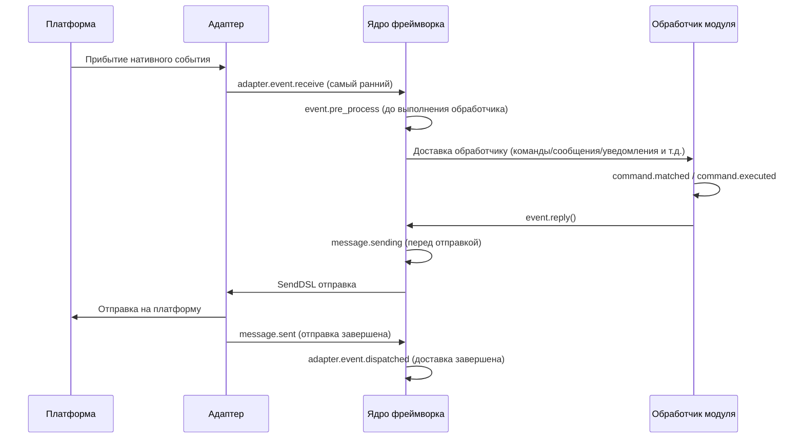

# Управление жизненным циклом

> [!TIP]
> **Когда нужно читать эту статью**: когда необходимо подписаться на события жизненного цикла фреймворка (запуск / загрузка / изменение состояния). Если не нужно, пропустите, это не повлияет на использование других функций.

> **Что вы узнаете**: механизм регистрации / триггеров / направленной передачи событий жизненного цикла, различия и выбор между четырьмя наборами API триггеров, а также все предустановленные точки вставки хуков (core / module / adapter / server / message и т.д.), их форматы данных.
>
> **В этой статье не рассматривается**: методы жизненного цикла, которые модуль должен реализовать сам (`on_load` / `on_unload`, см. [Руководство по разработке модулей](../developer-guide/modules/getting-started.md)); подробности о стадиях запуска (см. [Последовательность запуска и ручное управление](startup.md)).

Если вы хотите получать уведомления о таких событиях, как сбой загрузки модуля, изменение конфигурации, отправка сообщения, выполнение команды, и выполнять собственную логику (аудит, статистика, оповещения, взаимодействие), просто подписывайтесь на события жизненного цикла фреймворка — фреймворк предустановил точки вставки хуков в каждом ключевом узле, и вы можете подключиться всего одной строкой `@sdk.lifecycle.on("имя_события")`. В конце статьи приведен полный список точек вставки.

Система поддерживает три способа триггеризации:
- `await lifecycle.emit("event", data)` — упрощённая версия, передача произвольных данных (`to="Owner"` для направленной доставки)
- `lifecycle.emit_sync("event", data)` — синхронная версия (для не-асинхронных контекстов)
- `await lifecycle.submit_event("event", ...)` — совместимость со старой версией, автоматическое построение стандартного формата события

## Механизм обработки событий

### Регистрация обработчиков

```python
from ErisPulse import sdk

# Декораторный способ
@sdk.lifecycle.on("module.load")
async def on_module_load(data):
    print(f"Модуль загружен: {data}")

# Программная регистрация
sdk.lifecycle.register("module.load", on_module_load, priority=10)

# Отмена регистрации
sdk.lifecycle.unregister("module.load", on_module_load)

# Массовая отмена регистрации по владельцу (фреймворк автоматически вызывает при выгрузке модуля/адаптера)
removed = sdk.lifecycle.unregister_by_owner("MyModule")
print(f"Удалено {removed} хуков жизненного цикла")
```

### Приоритет

Обработчики поддерживают параметр `priority`, чем больше значение, тем раньше они выполняются (аналогично загрузчику модулей):

```python
@sdk.lifecycle.on("adapter.event.receive", priority=10)  # Выполняется первым
async def first_handler(data):
    pass

@sdk.lifecycle.on("adapter.event.receive", priority=0)  # Выполняется позже
async def second_handler(data):
    pass
```

### События с точечной структурой

При триггере конкретного события также триггерятся его родительские события:
- При триггере `module.load` также триггерится `module`
- При триггере `adapter.event.receive` также триггерятся `adapter.event` и `adapter`

### Подстановочные знаки

Регистрация `*` ловит все события:

```python
@sdk.lifecycle.on("*")
async def on_anything(data):
    print(f"Получено событие: {data}")
```

### Направленная передача (emit to=)

> [!NOTE]
> Эта функция доступна в ErisPulse **2.8.0+**.

При указании параметра `to` в `emit()` событие переходит в режим направленной передачи: событие доставляется только обработчикам, зарегистрированным с этим владельцем (хуки, зарегистрированные в `on_load` модуля, автоматически принадлежат этому модулю), другие модули и обработчики с подстановочным знаком `*` не получают уведомления.

```python
# Отправитель: событие доставляется только хукам, зарегистрированным модулем Chat
await sdk.lifecycle.emit("message_received", {"text": "hi"}, to="Chat")

# Пользователь (внутри модуля Chat): регистрируем хук с тем же именем, owner автоматически записывается при регистрации
@sdk.lifecycle.on("message_received")
async def on_message_received(data): ...

@sdk.lifecycle.on("message")   # Префикс родительского события также действует (фильтруется по owner)
async def on_any(data): ...
```

- Если у целевого владельца нет зарегистрированных хуков → событие **не будет обработано** (можно заранее проверить с помощью `has_handlers()`)
- При `data` как dict автоматически добавляется `_trace_id` (не перезаписывает уже существующее значение)
- `emit_sync` / `submit_event` также поддерживают параметр `to=`
- Модульное взаимодействие в трехуровневой модели (RPC / направленная / широковещательная) см. в [Модульном взаимодействии](module-communication.md)

### Одноразовая регистрация (once)

Начиная с версии 2.7.0, обработчики, зарегистрированные через `lifecycle.once()`, автоматически отменяются после одного срабатывания, что подходит для одноразовых хуков, таких как "первичная готовность":

```python
@sdk.lifecycle.once("core.init.complete")
async def on_first_ready(data):
    print("Первичная готовность, дальнейшие срабатывания не будут происходить")
```

- Семантика параметра приоритета `priority` такая же, как у `on()`
- Автоматически отменяется, не нужно вручную `unregister`
- Поддерживает как синхронные, так и асинхронные обработчики

### Наблюдение за слушателями (has_handlers)

В сценариях с короткой цепочкой можно сначала использовать `has_handlers()` для проверки наличия слушателей, чтобы избежать ненужного перебора событий и планирования задач:

```python
if sdk.lifecycle.has_handlers("message.sending"):
    await sdk.lifecycle.emit("message.sending", send_ctx)
```

- Охватывает **точное имя события, подстановочный знак `*` и родительские события**
- Возвращает `False`, если нет слушателей, можно безопасно пропустить `emit`

## Список точек останова хуков

Типичный жизненный цикл события, когда сообщение проходит от платформы в фреймворк до завершения обработки:



Фреймворк включает следующие точки останова хуков, пользователь может прослушивать любую точку останова, реализуя пользовательскую логику с помощью `@sdk.lifecycle.on()`.

### Инициализация ядра

| Название хука | Точка останова | Данные |
|---------|---------|------|
| `core.init.start` | Начало инициализации SDK | `{}` |
| `core.init.stage` | Начало этапа инициализации (выpusкается в фоновом режиме) | `{"stage": str}`; значения: `discovery` / `adapter_register` / `adapter_start` / `module_register` / `module_init` / `adapter_start_deferred` / `router_start` |
| `core.init.complete` | Завершение инициализации SDK | `{"duration": float, "success": bool, "stages": {stage: float}, "adapters": {"enabled": [str], "disabled": [str]}, "modules": {"enabled": [str], "disabled": [str]}, "error": str (только при неудаче)}` |
| `core.uninit.complete` | Завершение обратной инициализации SDK | `{"duration": float, "success": bool, "adapters_closed": int, "modules_unloaded": int, "module_properties_cleared": int, "module_properties_to_clear": [str], "error": str (только при неудаче)}` |

**Пример: отображение прогресса запуска**

```python
@sdk.lifecycle.on("core.init.stage")
def show_stage(data):
    print(f"[Запуск] Вход в этап: {data['stage']}")
```

### Изменение конфигурации

| Название хука | Точка останова | Данные |
|---------|---------|------|
| `config.set` | Изменение конфигурационного параметра | `{"key": str, "old_value": Any, "new_value": Any}` |
| `config.updated` | После обнаружения изменения всей конфигурации после редактирования config.toml | `{"old_config": dict, "new_config": dict, "config_file": str}` |

**Пример: аудит конфигурации**

```python
@sdk.lifecycle.on("config.set")
def audit_config(data):
    print(f"[Аудит] {data['key']}: {data['old_value']} -> {data['new_value']}")
```

### Жизненный цикл модуля

| Название хука | Точка останова | Данные |
|---------|---------|------|
| `module.register` | Регистрация класса модуля в менеджере | `{"module_name": str, "success": bool}` |
| `module.load` | Завершение загрузки модуля (успешное инстанцирование); при неудаче payload дополнительно содержит `"error": str, "traceback": str` (среда неудачи также может быть получена через `module.last_error(имя)`) | `{"module_name": str, "success": bool}` |
| `module.init` | Завершение инициализации модуля (включая ленивую загрузку) | `{"module_name": str, "success": bool}` |
| `module.before_unload` | Первый шаг в процессе выгрузки (до `on_unload` и освобождения ресурсов; хук модульного экземпляра `on_before_unload` срабатывает синхронно) | `{"module_name": str, "reason": str}`; `reason` принимает значения: `unload` / `reload` / `disable` / `cascade` / `dormant` |
| `module.sleep` | Завершение сна модуля (ленивая загрузка: ресурсы освобождены, автоматическое пробуждение при доступе) | `{"module_name": str, "success": bool}` |
| `module.unload` | Выгрузка или отключение модуля (`disable` и `unload` эквивалентны уведомлению зависимых; контракт `on_dependency_lost` содержит "отключение") | `{"module_name": str, "success": bool, "reason": str}`; `reason` принимает значения: `unload` / `reload` / `disable` / `cascade` / `dormant` |
| `module.rollback` | Завершение отката после неудачной горячей перезагрузки (восстановление снимка + повтор старого экземпляра `on_load`) | `{"module_name": str, "success": bool}`; `success` указывает, успешно ли повтор `on_load` (при False старый экземпляр остается в состоянии завершения) |
| `module.reload` | Завершение горячей перезагрузки модуля (включая перезагрузку зависимых) | `{"module_name": str, "success": bool, "full": bool, "duration_ms": int}`; для отдельного модуля дополнительно содержит `"identity_changed": bool` (False = возможно, старый код все еще выполняется в процессе, например, кэш расширений C) и `"version_old": str, "version_new": str`; при полной перезагрузке (`reload_all`) `module_name` равен `"All"`, payload дополнительно содержит `"results": dict[str, bool]` |

> **Хук экземпляра модуля `on_before_unload`**: соответствующий метод жизненного цикла, связанный с событием `module.before_unload` — `event["reason"]` указывает причину, подходит для сохранения состояния в `sdk.storage` перед освобождением ресурсов, восстановление происходит при пробуждении / перезагрузке в `on_load` (состояние продолжения ленивой загрузки основано на этом). Ошибка хука только предупреждает, не блокирует процесс выгрузки.

### Жизненный цикл адаптера

| Название хука | Точка останова | Данные |
|---------|---------|------|
| `adapter.load` | Завершение регистрации адаптера | `{"platform": str, "success": bool}` |
| `adapter.reload` | Завершение горячей перезагрузки кода адаптера | `{"adapter_name": str, "success": bool, "full": bool, "duration_ms": int, "identity_changed": bool, "version_old": str, "version_new": str, "was_started": bool, "source": str}`; `identity_changed=False` = возможно, старый код все еще выполняется в процессе |
| `adapter.rollback` | Завершение отката после неудачной горячей перезагрузки адаптера (после восстановления старого состояния регистрации) | `{"adapter_name": str, "replayed": bool, "success": bool}`; `replayed=True` означает, что старый экземпляр `start()` был повторен, `success` указывает, успешно ли повтор |
| `adapter.start` | Запуск адаптера | `{"platforms": [str]}` |
| `adapter.status.change` | Изменение состояния адаптера | `{"platform": str, "status": str, "retry_count": int, "error": str (только при неудаче)}`; полные значения status: `starting` / `started` / `start_failed` / `stopping` / `stopped` / `stop_failed` / `skipped-dependency` / `disabled` |
| `adapter.stop` | Остановка адаптера | `{"platforms": [str]}` |
| `adapter.stopped` | Завершение остановки адаптера | `{"platforms": [str]}` |
| `adapter.bot.online` | Онлайн бота | `{"platform": str, "bot_id": str, "info": dict, "status": str}` |
| `adapter.bot.offline` | Оффлайн бота | `{"platform": str, "bot_id": str, "status": str}` |

### Получение и обработка событий

| Название хука | Точка останова | Данные |
|---------|---------|------|
| `adapter.event.receive` | Получение события с внешней платформы (самый ранний) | `{"platform": str, "event_type": str, "raw_event_type": str}` |
| `adapter.event.blocked` | Промежуточный модуль отклоняет событие (возвращает `False`, событие отбрасывается и не попадает в обработчики) | `{"middleware": str, "platform": str, "event_type": str, "detail_type": str, "event": dict, "_trace_id": str}` |
| `adapter.event.dispatched` | Завершение доставки события | `{"platform": str, "event_type": str, "raw_event_type": str, "onebot_handlers_count": int}` |
| `event.pre_process` | Начало выполнения обработчика события | `{"event_type": str, "platform": str, "detail_type": str}` |

**Пример: статистика событий**

```python
event_counter = {}

@sdk.lifecycle.on("adapter.event.receive")
def count_events(data):
    platform = data["platform"]
    event_counter[platform] = event_counter.get(platform, 0) + 1

@sdk.lifecycle.on("adapter.event.dispatched")
def log_unhandled(data):
    if data["onebot_handlers_count"] == 0:
        print(f"[Необработано] {data['platform']}/{data['event_type']}")
```

### Отправка сообщений

| Название хука | Точка останова | Данные |
|---------|---------|------|
| `message.sending` | Сообщение готово к отправке | `{"platform": str, "method": str, "detail_type": str, "target_id": str, "bot_id": str}` |
| `message.sent` | Завершение отправки сообщения | `{"platform": str, "method": str, "detail_type": str, "target_id": str, "bot_id": str}` |

**Пример: аудит отправки сообщений**

```python
@sdk.lifecycle.on("message.sending")
def log_sending(data):
    print(f"[Отправка] -> {data['platform']}/{data['detail_type']}/{data['target_id']} через {data['method']}")
```

### Командная система

| Название хука | Точка останова | Данные |
|---------|---------|------|
| `command.matched` | Команда сопоставлена и готова к выполнению | `{"command": str, "args": list[str], "platform": str, "user_id": str}` |
| `command.executed` | Завершение выполнения команды | `{"command": str, "args": list[str], "platform": str, "user_id": str, "success": bool, "error": str (только при неудаче)}` |

**Пример: статистика команд**

```python
@sdk.lifecycle.on("command.matched")
def count_commands(data):
    print(f"[Команда] /{data['command']} от {data['user_id']}@{data['platform']}")
```

### HTTP-маршрутизация

| Название хука | Точка останова | Данные |
|---------|---------|------|
| `server.request` | Получение HTTP-запроса | `{"method": str, "path": str, "client_ip": str, "request_id": str}` |
| `server.response` | Отправка HTTP-ответа | `{"method": str, "path": str, "status_code": int, "client_ip": str, "request_id": str}` |

> `request_id` — это [идентификатор ассоциации запроса](router.md#запрос-ассоциации-idx-request-id): приоритетно используется заголовок запроса клиента, в противном случае генерируется UUID, с его помощью можно связать событие запроса и ответа.

**Пример: логирование HTTP-запросов**

```python
@sdk.lifecycle.on("server.response")
def log_http(data):
    print(f"[HTTP] {data['method']} {data['path']} -> {data['status_code']}")
```

### WebSocket

| Название хука | Точка останова | Данные |
|---------|---------|------|
| `server.start` | Запуск сервера маршрутизации | `{"base_url": str, "host": str, "port": int, "success": bool, "error": str (только при неудаче)}` |
| `server.stop` | Остановка сервера маршрутизации | `{}` |
| `server.websocket.connect` | Установление соединения WebSocket | `{"path": str, "module_name": str, "client_ip": str}` |
| `server.websocket.disconnect` | Разрыв соединения WebSocket | `{"path": str, "module_name": str, "reason": str, "error": str (только при аномалии)}` |

**Пример: мониторинг подключений WebSocket**

```python
@sdk.lifecycle.on("server.websocket.connect")
def on_ws_connect(data):
    print(f"[WS] Подключение: {data['path']} от {data['client_ip']}")

@sdk.lifecycle.on("server.websocket.disconnect")
def on_ws_disconnect(data):
    print(f"[WS] Разрыв: {data['path']} ({data['reason']})")
```

### Состояние подключения хранилища

Создание пула подключений к хранилищу, сбои и восстановление (все события выпускаются в фоновом режиме, не блокируют операции хранилища):

| Название хука | Точка останова | Данные |
|---------|---------|------|
| `storage.ready` | Пул подключений к хранилищу готов (каждое событие цикла впервые успешно создается) | `{"backend": str}` |
| `storage.unreachable` | Повторные попытки подключения исчерпаны, вступает период охлаждения (в течение которого операции завершаются быстро с ошибкой) | `{"backend": str, "error": str, "cooldown": float}` |
| `storage.recovered` | Охлаждение завершено, повторное подключение успешно, хранилище снова доступно | `{"backend": str}` |

**Пример: предупреждение о сбое хранилища**

```python
@sdk.lifecycle.on("storage.unreachable")
def alert_storage_down(data):
    print(f"[Предупреждение] Хранилище {data['backend']} недоступно: {data['error']}, автоматически переподключится через {data['cooldown']}s")

@sdk.lifecycle.on("storage.recovered")
def notify_storage_back(data):
    print(f"[Восстановлено] Хранилище {data['backend']} снова доступно")
```

### HTTP-клиент

События запросов и подключений `sdk.client` (все события выпускаются в фоновом режиме):

| Название хука | Точка останова | Данные |
|---------|---------|------|
| `client.request.success` | HTTP-запрос успешен | `{"method": str, "url": str, "status": int, "elapsed": float}` |
| `client.request.failed` | HTTP-запрос окончательно завершился неудачей после исчерпания попыток повтора | `{"method": str, "url": str, "error": str, "attempts": int, "elapsed": float}` |
| `client.ws.connect` | Установление соединения WebSocket | `{"url": str}` |

### Международная локализация

| Название хука | Точка останова | Данные |
|---------|---------|------|
| `i18n.language.changed` | Смена языка фреймворка (`i18n.set_language`) | `{"language": str, "previous": str}` |

## Стандартное определение событий

```python
STANDARD_EVENTS = {
    "core": ["init.start", "init.stage", "init.complete", "uninit.complete"],
    "module": ["load", "before_unload", "init", "sleep", "unload", "register", "reload"],
    "adapter": [
        "load", "start", "status.change", "reload", "stop", "stopped",
        "event.receive", "event.blocked", "event.dispatched",
        "bot.online", "bot.offline",
    ],
    "server": [
        "start", "stop",
        "request", "response",
        "websocket.connect", "websocket.disconnect",
    ],
    "event": ["pre_process"],
    "message": ["sending", "sent"],
    "command": ["matched", "executed"],
    "config": ["set", "updated"],
    "storage": ["ready", "unreachable", "recovered"],
    "client": ["request.success", "request.failed", "ws.connect"],
    "i18n": ["language.changed"],
}
```

## Полная справочная документация API

### Регистрация и отмена

| Метод | Описание |
|------|------|
| `@lifecycle.on(event, *, priority=0)` | Декораторная регистрация обработчика |
| `lifecycle.register(event, handler, *, priority=0)` | Программная регистрация |
| `lifecycle.unregister(event, handler=None)` | Отмена регистрации (если handler=None, отменяются все обработчики события) |

### Триггеризация

| Метод | Описание |
|------|------|
| `await lifecycle.emit(event, data=None, *, to=None)` | Асинхронный триггер, обработчики выполняются **параллельно** (взаимно не блокируются, возврат происходит после завершения всех), возвращаемое значение не None возвращается по цепочке с заменой data в порядке приоритета; `to` указывает владельца для направленной доставки |
| `lifecycle.fire(event, data=None, *, to=None)` | **Отправка в фоне (бросить в корзину)**: обработчики выполняются в фоновых задачах параллельно, без ожидания, без возврата; если нет слушателей, нулевые накладные расходы. Подходит для частых горячих путей и чистых наблюдений; для последовательных сценариев и последовательного потребления (например `config.set`) используйте `emit` |
| `lifecycle.emit_sync(event, data=None, *, to=None)` | Синхронный триггер, асинхронные обработчики запускаются через create_task |
| `await lifecycle.submit_event(event_type, *, source, msg, data, to=None, background=False)` | Совместимость со старой версией, автоматическое построение стандартного формата события; `background=True` использует `fire` для фоновой отправки |

**Сравнение четырех триггерных API**:

| Метод | Форма вызова | Ожидание завершения обработчиков | Типичные сценарии |
|------|---------|------------------|---------|
| `emit` | `await` (асинхронно) | **Ожидание** — обработчики выполняются параллельно, возврат происходит после завершения всех, возвращаемое значение возвращается по цепочке | Обычный триггер; последовательное потребление (например `config.set`) и цепочки остановки обязательно должны использовать его |
| `fire` | Прямой вызов (синхронный возврат) | **Не ожидание** — фоновые задачи выполняются параллельно, без возврата; если нет слушателей, нулевые накладные расходы | Частые горячие пути и чистые наблюдения (например `server.request` / `storage.ready`) |
| `emit_sync` | Прямой вызов (синхронно) | Синхронные обработчики завершаются немедленно; асинхронные обработчики запускаются через `create_task` (возвращаемое значение не может быть возвращено) | Триггер события в не-асинхронном контексте (синхронный код) |
| `submit_event` | `await` (асинхронно) | Ожидание (если `background=True`, то как `fire` не ожидает) | Совместимость со старой версией: автоматическое построение стандартного формата события (`source` / `msg` / `timestamp`) |

### Инструменты

| Метод | Описание |
|------|------|
| `lifecycle.start_timer(timer_id)` | Начать таймер |
| `lifecycle.get_duration(timer_id)` | Получить продолжительность (в секундах) |
| `lifecycle.stop_timer(timer_id)` | Остановить таймер и вернуть продолжительность |
| `lifecycle.list_hooks()` | Вывести все зарегистрированные хуки и количество обработчиков |
| `lifecycle.clear()` | Очистить все обработчики и таймеры |

## Пример использования в модуле

```python
from ErisPulse.Core.Bases import BaseModule
from ErisPulse import sdk

class Main(BaseModule):
    async def on_load(self, event):
        # Реализация простой статистики сообщений
        self.msg_count = 0
        
        @sdk.lifecycle.on("adapter.event.receive")
        async def count(data):
            if data["event_type"] == "message":
                self.msg_count += 1
        
        # Мониторинг всех команд
        @sdk.lifecycle.on("command.matched")
        async def log_cmd(data):
            sdk.logger.info(f"Выполнение команды: /{data['command']} от {data['user_id']}")
        
        # Аудит изменений конфигурации
        @sdk.lifecycle.on("config.set")
        def audit(data):
            sdk.logger.info(f"Изменение конфигурации: {data['key']} = {data['new_value']}")
```

## Принадлежность фоновых задач и автоматическое отмена

> [!NOTE]
> Эта функция доступна начиная с ErisPulse **2.8.0+**.

Фоновые задачи asyncio, созданные модулем, если не отменить их в `on_unload`, будут удерживать ссылку на `self`, что приведёт к невозможности сборки мусора для экземпляра модуля (старые экземпляры остаются после горячей перезагрузки). Рамка предоставляет следующие механизмы по умолчанию:

- **`self.spawn(coro)`** (рекомендуется в модуле): задача автоматически привязывается к имени модуля, и при выгрузке модуля рамка в `on_unload` **после** этого автоматически отменяет незавершённые задачи и записывает предупреждение
- **`spawn_background(coro)`** (`ErisPulse.runtime`): автоматически захватывает текущий контекст `owner_scope`; `cancel_owner_tasks(owner)` отменяет задачи по принадлежности, `cancel_all_background_tasks()` используется как резервный механизм в `sdk.uninit()`
- **Адаптеры**: при закрытии также автоматически отменяются фоновые задачи, привязанные к имени платформы

**Задачи, созданные до регистрации основного цикла** (начиная с 2.12): `spawn_background()` и `run_main_loop()`
Если основной цикл не доступен, вместо создания временного цикла событий задачи помещаются в очередь ожидания (максимум `PENDING_TASK_QUEUE_MAX`, по умолчанию 1024). При регистрации основного цикла `sdk.run()` задачи из очереди выполняются. Если очередь заполнена, новые задачи отбрасываются и выводится предупреждение; отмена по `owner` также удаляет из очереди ожидания задачи этого `owner`. При выходе из программы, если остаются задачи в очереди, выводится предупреждение и задачи отбрасываются. `run_main_loop()` возвращает `None`, если задача попала в очередь.

```python
async def on_load(self, event):
    # Рекомендуется: использовать self.spawn() для фоновых задач, рамка автоматически отменит их при выгрузке
    self.spawn(self._poll())

async def on_unload(self, event):
    # В сценариях, требующих точного контроля, рекомендуется отменить задачу и дождаться завершения
    if self._poll_task:
        self._poll_task.cancel()
        await asyncio.gather(self._poll_task, return_exceptions=True)

async def _poll(self):
    while True:
        await asyncio.sleep(60)
        ...
```

> [!IMPORTANT]
> Механизм по умолчанию — **принудительная отмена** (`cancel_owner_tasks`), которая происходит после возврата из `on_unload`. Поэтому задачи, требующие аккуратного завершения (очистка буфера, сохранение состояния, закрытие соединений), **обязательно** должны быть отменены и завершены в `on_unload` — не рассчитывайте на механизм по умолчанию для сохранения логики завершения. Рамка гарантирует только «отсутствие задач, удерживающих ссылку на `self`», но не гарантирует «аккуратное завершение». Задачи, ожидающие результата, следует вызывать напрямую, а не передавать их в фоновые задачи.

## Примечания

1. **Обработчики могут быть синхронными или асинхронными**: система автоматически распознаёт и правильно вызывает
2. **Передача данных**: в режиме `emit()`, если обработчик возвращает ненулевое значение, оно изменяет передаваемые последующим обработчикам данные
3. **Нормализация имен событий**: рекомендуется использовать точечную структуру для именования событий, что упрощает использование родительских слушателей
4. **Изоляция ошибок**: ошибка одного обработчика не влияет на выполнение других обработчиков
5. **Ограничение синхронного триггера**: в `emit_sync()` асинхронные обработчики запускаются в фоне без ожидания, возвращаемое значение не может быть возвращено
6. **Очистка жизненного цикла**: при вызове `sdk.uninit()` все зарегистрированные обработчики и таймеры будут очищены
7. **Приоритет загрузки**: если необходимо слушать события на этапе инициализации фреймворка, рекомендуется установить высокий приоритет и отключить ленивую загрузку

## Связанная документация

Выберите следующий шаг:

- **Хочу увидеть, как события проходят от адаптера до обработчика** → [Обзор архитектуры](../architecture.md)
- **Хочу узнать, какие методы жизненного цикла нужно реализовать при разработке модуля (on_load / on_unload)** → [Руководство по разработке модулей](../developer-guide/modules/getting-started.md)
- **Хочу обеспечить отмену фоновых задач и очистку ресурсов** → [Система принадлежности (owner)](ownership.md)
- **Хочу узнать о стадиях запуска (источники событий core.init.*)** → [Последовательность запуска и ручное управление](startup.md)
- **Хочу узнать рекомендации по использованию событий жизненного цикла** → [Лучшие практики модулей](../developer-guide/modules/best-practices.md)