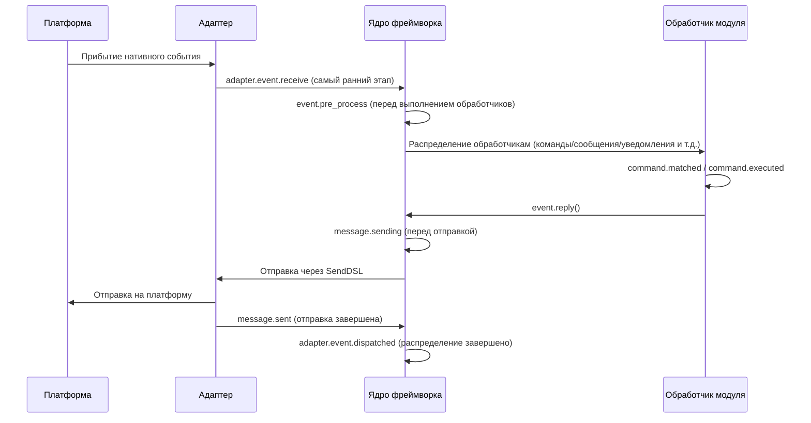

# Управление жизненным циклом

> [!TIP]
> **Когда стоит читать этот документ**: когда нужно подписываться на события жизненного цикла фреймворка (запуск / загрузка / изменение состояния). Если это не требуется — пропустите, на использование остальных функций это не повлияет.

> **Прочитав, вы узнаете**: механизм регистрации / срабатывания / адресной доставки событий
> жизненного цикла, различия четырёх API запуска событий и критерии их выбора,
> а также форматы данных всех предусмотренных во фреймворке точек перехвата (core / module / adapter / server / message
> и т.д.).
>
> **В этой статье не рассматриваются**: методы жизненного цикла, которые должен реализовывать сам модуль (`on_load` / `on_unload`, см.
> [руководство по разработке модулей](../developer-guide/modules/getting-started.md)); подробности этапов цепочки запуска
> (см. [процесс запуска и ручное управление](startup.md)).


Если вы хотите получать уведомления в таких точках, как сбой загрузки модуля, изменение конфигурации, отправка сообщения, выполнение команды, и выполнять там собственную логику (аудит, статистика, оповещения, связанное поведение) — просто подпишитесь на события жизненного цикла фреймворка: фреймворк заранее встроил точки перехвата в каждую ключевую точку, подключение занимает одну строку `@sdk.lifecycle.on("имя_события")`, а полный перечень всех точек приведён в конце статьи.

Система поддерживает три способа запуска событий:
- `await lifecycle.emit("event", data)` — упрощённая версия, передаёт произвольные данные (при `to="Owner"` выполняется адресная доставка)
- `lifecycle.emit_sync("event", data)` — синхронная версия (для неасинхронного контекста)
- `await lifecycle.submit_event("event", ...)` — для обратной совместимости, автоматически формирует стандартный формат события

## Механизм обработки событий

### Регистрация обработчиков

```python
from ErisPulse import sdk

# Режим декоратора
@sdk.lifecycle.on("module.load")
async def on_module_load(data):
    print(f"Загрузка модуля: {data}")

# Программная регистрация
sdk.lifecycle.register("module.load", on_module_load, priority=10)

# Отмена регистрации
sdk.lifecycle.unregister("module.load", on_module_load)

# Массовая отмена регистрации по владельцу (фреймворк вызывает автоматически при выгрузке модуля/адаптера)
removed = sdk.lifecycle.unregister_by_owner("MyModule")
print(f"Очищено хуков жизненного цикла: {removed}")
```

### Приоритет

Обработчики поддерживают параметр `priority`; чем больше значение, тем раньше выполняется обработчик (как и в загрузчике модулей):

```python
@sdk.lifecycle.on("adapter.event.receive", priority=10)  # выполняется первым
async def first_handler(data):
    pass

@sdk.lifecycle.on("adapter.event.receive", priority=0)  # выполняется позже
async def second_handler(data):
    pass
```

### События с точечной структурой

При срабатывании конкретного события также срабатывают его родительские события:
- при срабатывании `module.load` также срабатывает `module`
- при срабатывании `adapter.event.receive` также срабатывают `adapter.event` и `adapter`

### Подстановочный знак

Зарегистрируйте `*`, чтобы перехватывать все события:

```python
@sdk.lifecycle.on("*")
async def on_anything(data):
    print(f"Получено событие: {data}")
```

### Адресная доставка (emit to=)

> [!NOTE]
> Эта функция требует ErisPulse **2.8.0+**.

После указания параметра `to` в `emit()` включается адресная доставка: событие распределяется только обработчикам, зарегистрированным от имени данного владельца (owner) (хуки, зарегистрированные модулем внутри `on_load`, автоматически принадлежат этому модулю); другие модули и обработчики с подстановочным знаком `*` о событии не узнают.

```python
# Отправитель: событие доставляется только хукам, зарегистрированным модулем Chat
await sdk.lifecycle.emit("message_received", {"text": "hi"}, to="Chat")

# Подписчик (внутри модуля Chat): регистрация одноимённого хука, owner автоматически фиксируется при регистрации
@sdk.lifecycle.on("message_received")
async def on_message_received(data): ...

@sdk.lifecycle.on("message")   # точечный родительский префикс тоже работает (фильтрация по owner)
async def on_any(data): ...
```

- Если у целевого владельца нет зарегистрированных хуков → событие **не потребляется** (заранее проверить можно с помощью `has_handlers()`)
- Если `data` — dict, автоматически добавляется `_trace_id` (существующее значение не перезаписывается)
- `emit_sync` / `submit_event` также поддерживают параметр `to=`
- Трёхуровневая модель взаимодействия между модулями (RPC / адресная / широковещательная) описана в разделе
  [взаимодействие между модулями](module-communication.md)

### Одноразовая регистрация (once)

Начиная с 2.7.0, обработчики, зарегистрированные через `lifecycle.once()`, **автоматически отменяются после одного срабатывания** — это подходит для одноразовых хуков типа «первая готовность»:

```python
@sdk.lifecycle.once("core.init.complete")
async def on_first_ready(data):
    print("Первая готовность, повторно больше не сработает")
```

- Та же семантика параметра приоритета, что у `on()` (чем больше `priority`, тем раньше выполняется)
- Автоматическая отмена регистрации, ручной вызов `unregister` не нужен
- Поддерживаются как синхронные, так и асинхронные обработчики

### Проверка слушателей (has_handlers)

В сценариях короткого замыкания на «горячих» путях можно сначала с помощью `has_handlers()` проверить наличие слушателей, чтобы избежать лишнего обхода событий и планирования задач:

```python
if sdk.lifecycle.has_handlers("message.sending"):
    await sdk.lifecycle.emit("message.sending", send_ctx)
```

- Охватывает три вида соответствия: **точное имя события, подстановочный знак `*`, родительские события**
- При отсутствии каких-либо слушателей возвращает `False` — можно безопасно пропустить `emit`

## Обзор точек перехвата

Типичная последовательность событий жизненного цикла сообщения от поступления с платформы во фреймворк до завершения обработки:



Фреймворк имеет встроенные точки перехвата, перечисленные ниже; пользователь может прослушивать любую из них через `@sdk.lifecycle.on()` для реализации собственной логики.

### Инициализация ядра

| Название хука | Момент срабатывания | Данные |
|---------|---------|------|
| `core.init.start` | Начало инициализации SDK | `{}` |
| `core.init.stage` | Начало каждого этапа инициализации (генерация в фоне) | `{"stage": str}`, значения `discovery` / `adapter_register` / `adapter_start` / `module_register` / `module_init` / `adapter_start_deferred` / `router_start` |
| `core.init.complete` | Завершение инициализации SDK | `{"duration": float, "success": bool, "stages": {stage: float}, "adapters": {"enabled": [str], "disabled": [str]}, "modules": {"enabled": [str], "disabled": [str]}, "error": str(только при сбое)}` |
| `core.uninit.complete` | Завершение деинициализации SDK | `{"duration": float, "success": bool, "adapters_closed": int, "modules_unloaded": int, "module_properties_cleared": int, "module_properties_to_clear": [str], "error": str(только при сбое)}` |

**Пример: отображение прогресса запуска**

```python
@sdk.lifecycle.on("core.init.stage")
def show_stage(data):
    print(f"[Запуск] Вход в этап: {data['stage']}")
```

### Изменение конфигурации

| Название хука | Момент срабатывания | Данные |
|---------|---------|------|
| `config.set` | Изменён параметр конфигурации | `{"key": str, "old_value": Any, "new_value": Any}` |
| `config.updated` | Обнаружено изменение всего дерева после внешнего редактирования config.toml | `{"old_config": dict, "new_config": dict, "config_file": str}` |

**Пример: аудит конфигурации**

```python
@sdk.lifecycle.on("config.set")
def audit_config(data):
    print(f"[Аудит] {data['key']}: {data['old_value']} -> {data['new_value']}")
```

### Жизненный цикл модулей

| Название хука | Момент срабатывания | Данные |
|---------|---------|------|
| `module.register` | Класс модуля зарегистрирован в менеджере | `{"module_name": str, "success": bool}` |
| `module.load` | Загрузка модуля завершена (успешная инстанциация); при сбое payload дополнительно содержит `"error": str, "traceback": str` (место сбоя можно также запросить через `module.last_error(имя)`) | `{"module_name": str, "success": bool}` |
| `module.init` | Инициализация модуля завершена (включая ленивую загрузку) | `{"module_name": str, "success": bool}` |
| `module.before_unload` | Первый шаг конвейера выгрузки (раньше `on_unload` и освобождения ресурсов; хук экземпляра модуля `on_before_unload` срабатывает синхронно) | `{"module_name": str, "reason": str}`; значения `reason`: `unload` / `reload` / `disable` / `cascade` / `dormant` |
| `module.sleep` | Перевод модуля в спящий режим завершён (спящий режим ленивой загрузки: ресурсы освобождены, при обращении модуль автоматически пробуждается) | `{"module_name": str, "success": bool}` |
| `module.unload` | Выгрузка или отключение модуля (`disable` и `unload` равнозначно уведомляют зависимые модули, контракт `on_dependency_lost` включает «отключение») | `{"module_name": str, "success": bool}` |
| `module.reload` | Горячая перезагрузка модуля завершена (включая каскадную перезагрузку зависимых) | `{"module_name": str, "success": bool, "full": bool, "duration_ms": int}`; при одиночной перезагрузке дополнительно содержит `"identity_changed": bool` (False = в процессе всё ещё может работать старый код, например кэш C-расширений) и `"version_old": str, "version_new": str`; при полной перезагрузке (`reload_all`) `module_name` равно `"All"`, payload дополнительно содержит `"results": dict[str, bool]` |

> **Хук экземпляра модуля `on_before_unload`**: необязательный метод жизненного цикла, соответствующий событию `module.before_unload` — `event["reason"]` указывает причину вызова; подходит для сохранения состояния в `sdk.storage` перед освобождением ресурсов с последующим восстановлением в `on_load` после пробуждения / перезагрузки (на этом основано сохранение состояния при спящем режиме ленивой загрузки). Сбой хука приводит лишь к предупреждению и не блокирует процесс выгрузки.

### Жизненный цикл адаптеров

| Название хука | Момент срабатывания | Данные |
|---------|---------|------|
| `adapter.load` | Регистрация адаптера завершена | `{"platform": str, "success": bool}` |
| `adapter.reload` | Горячая перезагрузка кода адаптера завершена | `{"adapter_name": str, "success": bool, "full": bool, "duration_ms": int, "identity_changed": bool, "version_old": str, "version_new": str, "was_started": bool, "source": str}`; `identity_changed=False` = в процессе всё ещё может работать старый код |
| `adapter.start` | Запуск адаптера | `{"platforms": [str]}` |
| `adapter.status.change` | Изменение состояния адаптера | `{"platform": str, "status": str, "retry_count": int, "error": str(только при сбое)}`; полные значения status: `starting` / `started` / `start_failed` / `stopping` / `stopped` / `stop_failed` / `skipped-dependency` / `disabled` |
| `adapter.stop` | Остановка адаптера | `{"platforms": [str]}` |
| `adapter.stopped` | Остановка адаптера завершена | `{"platforms": [str]}` |
| `adapter.bot.online` | Бот в сети | `{"platform": str, "bot_id": str, "info": dict, "status": str}` |
| `adapter.bot.offline` | Бот не в сети | `{"platform": str, "bot_id": str, "status": str}` |

### Приём и обработка событий

| Название хука | Момент срабатывания | Данные |
|---------|---------|------|
| `adapter.event.receive` | Получено событие от внешней платформы (самый ранний этап) | `{"platform": str, "event_type": str, "raw_event_type": str}` |
| `adapter.event.blocked` | Middleware отклонил событие (возврат `False`, событие отбрасывается и не попадает ни в один обработчик) | `{"middleware": str, "platform": str, "event_type": str, "detail_type": str, "event": dict, "_trace_id": str}` |
| `adapter.event.dispatched` | Распределение события завершено | `{"platform": str, "event_type": str, "raw_event_type": str, "onebot_handlers_count": int}` |
| `event.pre_process` | Перед началом выполнения обработчиков событий | `{"event_type": str, "platform": str, "detail_type": str}` |

**Пример: статистика событий**

```python
event_counter = {}

@sdk.lifecycle.on("adapter.event.receive")
def count_events(data):
    platform = data["platform"]
    event_counter[platform] = event_counter.get(platform, 0) + 1

@sdk.lifecycle.on("adapter.event.dispatched")
def log_unhandled(data):
    if data["onebot_handlers_count"] == 0:
        print(f"[Не обработано] {data['platform']}/{data['event_type']}")
```

### Отправка сообщений

| Название хука | Момент срабатывания | Данные |
|---------|---------|------|
| `message.sending` | Сообщение вот-вот будет отправлено | `{"platform": str, "method": str, "detail_type": str, "target_id": str, "bot_id": str}` |
| `message.sent` | Отправка сообщения завершена | `{"platform": str, "method": str, "detail_type": str, "target_id": str, "bot_id": str}` |

**Пример: аудит отправки сообщений**

```python
@sdk.lifecycle.on("message.sending")
def log_sending(data):
    print(f"[Отправка] -> {data['platform']}/{data['detail_type']}/{data['target_id']} via {data['method']}")
```

### Система команд

| Название хука | Момент срабатывания | Данные |
|---------|---------|------|
| `command.matched` | Команда сопоставлена и вот-вот будет выполнена | `{"command": str, "args": list[str], "platform": str, "user_id": str}` |
| `command.executed` | Выполнение команды завершено | `{"command": str, "args": list[str], "platform": str, "user_id": str, "success": bool, "error": str(только при сбое)}` |

**Пример: статистика команд**

```python
@sdk.lifecycle.on("command.matched")
def count_commands(data):
    print(f"[Команда] /{data['command']} from {data['user_id']}@{data['platform']}")
```

### HTTP-маршрутизация

| Название хука | Момент срабатывания | Данные |
|---------|---------|------|
| `server.request` | Приём HTTP-запроса | `{"method": str, "path": str, "client_ip": str, "request_id": str}` |
| `server.response` | Отправка HTTP-ответа | `{"method": str, "path": str, "status_code": int, "client_ip": str, "request_id": str}` |

> `request_id` — это [ID корреляции запросов X-Request-ID](router.md#id-корреляции-запросов-x-request-id): сначала используется заголовок запроса клиента, иначе автоматически генерируется UUID; с его помощью можно связать события запроса и ответа.

**Пример: журнал запросов**

```python
@sdk.lifecycle.on("server.response")
def log_http(data):
    print(f"[HTTP] {data['method']} {data['path']} -> {data['status_code']}")
```

### WebSocket

| Название хука | Момент срабатывания | Данные |
|---------|---------|------|
| `server.start` | Запуск сервера маршрутизации | `{"base_url": str, "host": str, "port": int, "success": bool, "error": str(только при сбое)}` |
| `server.stop` | Остановка сервера маршрутизации | `{}` |
| `server.websocket.connect` | Установка WebSocket-соединения | `{"path": str, "module_name": str, "client_ip": str}` |
| `server.websocket.disconnect` | Разрыв WebSocket-соединения | `{"path": str, "module_name": str, "reason": str, "error": str(только при исключении)}` |

**Пример: мониторинг WebSocket-соединений**

```python
@sdk.lifecycle.on("server.websocket.connect")
def on_ws_connect(data):
    print(f"[WS] Подключение: {data['path']} from {data['client_ip']}")

@sdk.lifecycle.on("server.websocket.disconnect")
def on_ws_disconnect(data):
    print(f"[WS] Отключение: {data['path']} ({data['reason']})")
```

### Состояние подключения хранилища

Создание, сбои и восстановление пула подключений бэкенда хранилища (всё генерируется в фоне и не блокирует операции хранилища):

| Название хука | Момент срабатывания | Данные |
|---------|---------|------|
| `storage.ready` | Пул подключений бэкенда хранилища готов (первое успешное создание пула в каждом цикле событий) | `{"backend": str}` |
| `storage.unreachable` | Повторные попытки подключения исчерпаны, начинается период охлаждения (в это время операции быстро завершаются сбоем) | `{"backend": str, "error": str, "cooldown": float}` |
| `storage.recovered` | По окончании охлаждения повторное подключение успешно, хранилище снова доступно | `{"backend": str}` |

**Пример: оповещение о сбое хранилища**

```python
@sdk.lifecycle.on("storage.unreachable")
def alert_storage_down(data):
    print(f"[Тревога] Бэкенд хранилища {data['backend']} недоступен: {data['error']}, автоматическое переподключение через {data['cooldown']} с")

@sdk.lifecycle.on("storage.recovered")
def notify_storage_back(data):
    print(f"[Восстановление] Бэкенд хранилища {data['backend']} снова доступен")
```

### HTTP-клиент

События запросов и подключений `sdk.client` (все генерируются в фоне):

| Название хука | Момент срабатывания | Данные |
|---------|---------|------|
| `client.request.success` | HTTP-запрос выполнен успешно | `{"method": str, "url": str, "status": int, "elapsed": float}` |
| `client.request.failed` | Повторные попытки HTTP-запроса исчерпаны, окончательный сбой | `{"method": str, "url": str, "error": str, "attempts": int, "elapsed": float}` |
| `client.ws.connect` | Установлено WebSocket-соединение | `{"url": str}` |

### Интернационализация

| Название хука | Момент срабатывания | Данные |
|---------|---------|------|
| `i18n.language.changed` | Переключение языка фреймворка (`i18n.set_language`) | `{"language": str, "previous": str}` |

## Определение стандартных событий

```python
STANDARD_EVENTS = {
    "core": ["init.start", "init.stage", "init.complete", "uninit.complete"],
    "module": ["load", "before_unload", "init", "sleep", "unload", "register", "reload"],
    "adapter": [
        "load", "start", "status.change", "reload", "stop", "stopped",
        "event.receive", "event.blocked", "event.dispatched",
        "bot.online", "bot.offline",
    ],
    "server": [
        "start", "stop",
        "request", "response",
        "websocket.connect", "websocket.disconnect",
    ],
    "event": ["pre_process"],
    "message": ["sending", "sent"],
    "command": ["matched", "executed"],
    "config": ["set", "updated"],
    "storage": ["ready", "unreachable", "recovered"],
    "client": ["request.success", "request.failed", "ws.connect"],
    "i18n": ["language.changed"],
}
```

## Полный справочник API

### Регистрация и отмена регистрации

| Метод | Описание |
|------|------|
| `@lifecycle.on(event, *, priority=0)` | Регистрация обработчика через декоратор |
| `lifecycle.register(event, handler, *, priority=0)` | Программная регистрация |
| `lifecycle.unregister(event, handler=None)` | Отмена регистрации (при handler=None отменяются все обработчики данного события) |

### Запуск событий

| Метод | Описание |
|------|------|
| `await lifecycle.emit(event, data=None, *, to=None)` | Асинхронный запуск, обработчики выполняются **параллельно** (не блокируют друг друга, к моменту возврата все завершены); возвращённые не-None значения по порядку приоритета последовательно заменяют data; при указании `to` выполняется адресная доставка владельцу (owner) |
| `lifecycle.fire(event, data=None, *, to=None)` | **Фоновая генерация («бросил и пошёл»)**: обработчики выполняются параллельно в фоновых задачах, без ожидания и без возвращаемых значений; при отсутствии слушателей — нулевые накладные расходы. Подходит для частых «горячих» путей и чисто наблюдательных событий; для последовательности завершения работы и чувствительного к порядку потребления (например `config.set`) используйте `emit` |
| `lifecycle.emit_sync(event, data=None, *, to=None)` | Синхронный запуск, асинхронные обработчики планируются через create_task |
| `await lifecycle.submit_event(event_type, *, source, msg, data, to=None, background=False)` | Для обратной совместимости, автоматически формирует стандартный формат события; при `background=True` выполняется фоновая генерация через `fire` |

**Сравнение четырёх API запуска событий**:

| Метод | Форма вызова | Ожидает ли завершения обработчиков | Типичный сценарий |
|------|---------|------------------|---------|
| `emit` | `await` (асинхронно) | **Ожидает** — обработчики выполняются параллельно, к моменту возврата все завершены, возвращаемые значения воспроизводятся цепочкой | Обычный запуск; для чувствительного к порядку потребления (`config.set`) и последовательности завершения работы обязателен именно он |
| `fire` | Прямой вызов (синхронный возврат) | **Не ожидает** — фоновые задачи выполняются параллельно, без возвращаемых значений; при отсутствии слушателей нулевые накладные расходы | Частые «горячие» пути и чисто наблюдательные события (`server.request` / `storage.ready`) |
| `emit_sync` | Прямой вызов (синхронно) | Синхронные обработчики завершаются сразу; асинхронные планируются через `create_task` (возвращаемые значения вернуть невозможно) | Запуск событий в неасинхронном контексте (синхронный код) |
| `submit_event` | `await` (асинхронно) | Ожидает (при `background=True`, как `fire`, не ожидает) | Для обратной совместимости: автоматически формирует стандартный формат события (`source` / `msg` / `timestamp`) |

### Утилиты

| Метод | Описание |
|------|------|
| `lifecycle.start_timer(timer_id)` | Запуск отсчёта времени |
| `lifecycle.get_duration(timer_id)` | Получить прошедшее время (в секундах) |
| `lifecycle.stop_timer(timer_id)` | Остановить отсчёт и вернуть прошедшее время |
| `lifecycle.list_hooks()` | Перечислить все зарегистрированные хуки и количество обработчиков |
| `lifecycle.clear()` | Очистить все обработчики и таймеры |

## Пример использования в модуле

```python
from ErisPulse.Core.Bases import BaseModule
from ErisPulse import sdk

class Main(BaseModule):
    async def on_load(self, event):
        # Реализуем простую статистику сообщений
        self.msg_count = 0
        
        @sdk.lifecycle.on("adapter.event.receive")
        async def count(data):
            if data["event_type"] == "message":
                self.msg_count += 1
        
        # Мониторинг всех команд
        @sdk.lifecycle.on("command.matched")
        async def log_cmd(data):
            sdk.logger.info(f"Выполнение команды: /{data['command']} by {data['user_id']}")
        
        # Аудит изменений конфигурации
        @sdk.lifecycle.on("config.set")
        def audit(data):
            sdk.logger.info(f"Изменение конфигурации: {data['key']} = {data['new_value']}")
```

## Принадлежность фоновых задач и автоматическая отмена

> [!NOTE]
> Эта функция требует ErisPulse **2.8.0+**.

Если asyncio-фоновые задачи, созданные модулем, не отменены в `on_unload`, они удерживают ссылку на `self`, из-за чего экземпляр модуля не может быть собран сборщиком мусора (после горячей перезагрузки остаётся старый экземпляр). Фреймворк предоставляет следующие механизмы подстраховки:

- **`self.spawn(coro)`** (рекомендуется внутри модулей): задачи автоматически привязываются к имени модуля; при выгрузке модуля фреймворк **после** `on_unload` в качестве подстраховки отменяет незавершённые задачи и записывает предупреждение
- **`spawn_background(coro)`** (`ErisPulse.runtime`): автоматически захватывает текущий контекст `owner_scope`; `cancel_owner_tasks(owner)` отменяет задачи по принадлежности, `cancel_all_background_tasks()` служит подстраховкой для `sdk.uninit()`
- **Адаптеры**: при закрытии также выполняется подстраховочная отмена фоновых задач, принадлежащих платформе

```python
async def on_load(self, event):
    # Рекомендуется: фоновые задачи создавайте через self.spawn(), при выгрузке фреймворк автоматически их отменит
    self.spawn(self._poll())

async def on_unload(self, event):
    # Для сценариев с тонким управлением по-прежнему рекомендуется отменять самостоятельно и дожидаться завершения
    if self._poll_task:
        self._poll_task.cancel()
        await asyncio.gather(self._poll_task, return_exceptions=True)

async def _poll(self):
    while True:
        await asyncio.sleep(60)
        ...
```

> [!IMPORTANT]
> Подстраховка фреймворка — это **принудительная отмена (cancel)** (`cancel_owner_tasks`), она происходит после возврата из `on_unload`. Поэтому задачи, требующие корректного завершения (сброс буферов, сохранение состояния, закрытие соединений), **обязаны** самостоятельно выполнить `cancel()` + `await` внутри `on_unload` — не рассчитывайте, что подстраховка сохранит логику завершения. Фреймворк гарантирует лишь «отсутствие оставшихся задач, удерживающих `self`», но не гарантирует «корректность». Для задач, результат которых нужен через `await`, используйте `await` напрямую, не отправляйте их в фоновые задачи.

## Важные замечания

1. **Обработчики могут быть синхронными или асинхронными**: система автоматически распознаёт и корректно вызывает их
2. **Передача данных**: в режиме `emit()` возвращённые обработчиками не-None значения изменяют data, передаваемые последующим обработчикам
3. **Соглашение об именовании событий**: рекомендуется использовать точечную структуру имён событий для удобства прослушивания родительских событий
4. **Изоляция ошибок**: исключение в одном обработчике не влияет на выполнение остальных
5. **Ограничение синхронного запуска**: в `emit_sync()` асинхронные обработчики планируются по принципу fire-and-forget, возвращаемые значения вернуть невозможно
6. **Очистка жизненного цикла**: при вызове `sdk.uninit()` все зарегистрированные обработчики и таймеры очищаются
7. **Приоритет загрузки**: если нужно прослушивать события уже на этапе инициализации фреймворка, рекомендуется установить высокий приоритет и отключить ленивую загрузку

## Связанная документация

Выберите в зависимости от намерения следующего шага:

- **Хотите увидеть, как события проходят весь путь от адаптера до обработчиков** → [обзор архитектуры](../architecture.md)
- **Какие методы жизненного цикла (on_load / on_unload) следует реализовывать при написании модулей** → [руководство по разработке модулей](../developer-guide/modules/getting-started.md)
- **Подстраховка фоновых задач и освобождение ресурсов** → [система принадлежности (owner)](ownership.md)
- **Этапы цепочки запуска (источник событий `core.init.*`)** → [процесс запуска и ручное управление](startup.md)
- **Рекомендации по использованию событий жизненного цикла** → [лучшие практики модулей](../developer-guide/modules/best-practices.md)