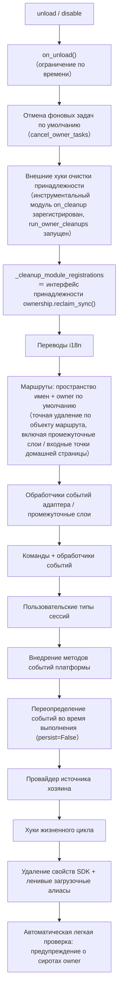

# Система собственности (owner)

> [!TIP]
> **Когда читать эту статью:** при диагностике утечек ресурсов, понимании цепочки очистки при отключении или объявлении принадлежности ресурсов. Если не нужно, пропустите, это не повлияет на использование других функций.

> **После прочтения вы узнаете:** как контекст owner автоматически присваивает ресурсы, полная таблица принадлежности ресурсов, полный порядок очистки при отключении/отключении, а также какие ресурсы не очищаются при отключении (дизайн-границы).
>
> **В этой статье не рассматривается:** определение "когда ресурсы вступают в силу" (см. [Охват (scope)](scope.md)); рекомендации по написанию фоновых задач и границы принудительного отмены (см. [Управление жизненным циклом · Принадлежность и автоматическая отмена фоновых задач](lifecycle.md#фоновые-задачи-принадлежность-и-автоматическая-отмена)).

Собственность — это основа модуля "plug-and-play": все ресурсы, зарегистрированные модулем во время загрузки, автоматически присваиваются, а при отключении/отключении они автоматически удаляются — автору модуля нужно только объявить ресурсы, не писать ручной логики очистки.

> **Связанные системы:** Охват (scope) определяет, "вступают ли ресурсы в силу" во время распределения событий, собственность определяет, "кому принадлежат ресурсы, кто будет очищен при отключении". Охват см. [Единая система управления (scope)](scope.md), фоновые задачи см. [Управление жизненным циклом](lifecycle.md#фоновые-задачи-принадлежность-и-автоматическая-отмена).

{!--< tips >!--}
1. Принадлежность автоматически записывается в момент регистрации по `current_owner`, без изменений в коде модуля
2. Отключение/отключение используют одну и ту же цепочку очистки (`_cleanup_module_registrations`), каждая ошибка вызывает только предупреждение, не прерывая процесс
3. Ресурсы с семантикой пользовательских настроек (постоянное перезаписывание / правила охвата / ACL команд) **не** удаляются при отключении модуля
4. Внешние дескрипторы, управляемые инструментальным модулем, можно добавить в цепочку очистки с помощью `on_cleanup(cb)`, и они будут автоматически вызываться при отключении другого модуля (см. [Руководство по инструментальным модулям](#инструментальный-модуль-управление-дескрипторами-других-модулей))
{!--< /tips >!--}

## Механизм контекста owner

Owner передается через контекстную переменную `current_owner` (`ErisPulse.runtime.context`):

```python
from ErisPulse.runtime import owner_scope, get_current_owner

with owner_scope("MyModule"):
    # Все зарегистрированные ресурсы в этом интервале автоматически присваиваются MyModule
    assert get_current_owner() == "MyModule"
```

Рамка автоматически вставляет owner в следующие моменты (код модуля/адаптера не требует ручного обертывания):

| Момент | Значение owner | Позиция |
|------|----------|------|
| Модуль `load()` | Имя модуля | При инстанцировании + `on_load` на протяжении всего процесса |
| Адаптер `start()` / `restart()` | Имя платформы | На протяжении всего процесса запуска адаптера |
| Регистрация stub для ленивой загрузки `activate_on` | Имя модуля | При регистрации заполнителя команды/обработчика |
| Исполнение обработчика события | Имя модуля, к которому принадлежит обработчик | handler / входная точка команды перезаписывается |

Перезапись во время исполнения означает, что обработчики команд, объявленные модулем в `on_load`, при вызове API регистрации (например, `sdk.adapter.on()` / `overrides.*.set(persist=False)`) во время исполнения также будут автоматически присваиваться этому модулю.

## Полная картина принадлежности ресурсов

Все ресурсы, зарегистрированные в контексте загрузки модуля, записываются в принадлежность и автоматически удаляются при отключении/отключении:

| Ресурс | Способ регистрации | Вызов очистки |
|------|----------|----------|
| Команды | `@command()` / объявление словаря команд | `command.unregister_by_owner()` |
| Обработчики событий | `@message` / `@notice` / `@request` / `@meta` | `handler.unregister_by_owner()` |
| Слушатели событий адаптера | `sdk.adapter.on()` / `raw=True` | `adapter.unregister_handlers_by_owner()` |
| Промежуточные слои адаптера | `@sdk.adapter.middleware` | То же самое |
| Роутеры (HTTP/WS/SSE) | `router.http()` / `websocket()` / `sse()` | Двойная защита по пространству имен + по владельцу |
| Промежуточные слои роутера | `@router.middleware()` / `add_middleware()` | `router.unregister_all_by_owner()` |
| Входная точка Dashboard | `router.register_home_entry()` | `unregister_home_entries_by_owner()` |
| Пользовательские типы сессий | `register_custom_type()` | `unregister_custom_types_by_owner()` |
| Методы событий платформы | `register_event_method()` / `register_event_mixin()` | `unregister_event_methods_by_owner()` (автоматически удаляются при отключении модуля, старые замыкания больше не утекают) |
| Фоновые задачи | `self.spawn()` | `cancel_owner_tasks()` |
| Внешние очистительные хуки принадлежности (инструментальный модуль управляет) | `runtime.on_cleanup(cb)` | `run_owner_cleanups()` (запускается в цепочке отключения/отключения/закрытия адаптера) |
| Жизненный цикл хуки | `lifecycle.register()` | `lifecycle.unregister_by_owner()` |
| Провайдер источника хозяина | `master.provider` | `master.unregister_by_owner()` |
| Переводы i18n | Объявление `I18nClass` (domain=имя модуля) | `i18n.unregister_domain()` |
| Переопределение событий (во время выполнения) | `overrides.*.set(persist=False)` | `overrides.unregister_by_owner()` |
| Взаимодействие сессий (ожидание wait_reply и т.д.) | `event.wait_reply()` / `sdk.interaction.acquire()` | `interaction.cancel_by_owner()` (ожидающая сторона немедленно получает отмену) |
| Контекстные данные | `runtime/context` запись по owner | Точная очистка по модулю |

Соответствующие ресурсы адаптера (с платформой в качестве owner) при `shutdown()` / `restart()` адаптера удаляются с помощью `_cleanup_adapter_resources`, включая:

| Ресурс | Вызов очистки |
|------|----------|
| Собственные `on()` обработчики и промежуточные слои адаптера | `adapter.unregister_handlers_by_owner(platform)` |
| Расширения методов событий платформы (`EventMixin`) | `unregister_platform_event_methods(platform)` |
| Пользовательские типы сессий | `unregister_custom_types_by_owner(platform)` |
| Взаимодействие сессий (ожидание wait_reply / аренды на этой платформе) | `interaction.cancel_by_platform(platform)` |
| Переводы i18n (domain=ключ конфигурации) | `i18n.unregister_domain(ключ конфигурации)` |
| Точные маршруты с именным пространством | `router.unregister_all_by_owner(platform)` |

## Последовательность очистки при отключении/отключении

`unload()` и `disable()` используют одну и ту же цепочку очистки (каждый шаг независим, try/except, ошибка вызывает только лог, **не прерывает последующую очистку**):



При выходе `sdk.uninit()` есть глобальная защита: все адаптеры shutdown → все модули unload → `router.stop()` (очистка маршрутов/промежуточных слоев/входных точек домашней страницы) → `cancel_all_background_tasks()` → очистка обработчиков событий и хуков.

## Единый интерфейс принадлежности (ownership)

Шестнадцать шагов цепочки очистки сведены в единый интерфейс принадлежности `ErisPulse.Core.ownership`, четыре глагола охватывают "удаление, подсчет, сканирование, аудит" — функции `*_by_owner` отдельных подсистем остаются без изменений, как внутренние реализации интерфейса:

| Глагол | Назначение |
|------|------|
| `ownership.reclaim(owner)` | Общее удаление всех ресурсов owner (отмена задач → хуки очистки → зарегистрированные ресурсы; асинхронная полная версия) |
| `ownership.reclaim_sync(owner)` | Удаление зарегистрированных ресурсов (синхронная версия, для синхронного пути отключения) |
| `ownership.counts(owner=None)` | Только чтение статистики ресурсов owner (None для всех owner) |
| `ownership.orphans()` | Сканирование сирот: ресурсы в реестре, но owner уже отключен (доказательство утечки) |
| `ownership.audit(owner, deep=)` | Отчет об аудите утечек (подсчет + сироты + необязательная генерация экземпляров gc) |

```python
from ErisPulse.Core import ownership

ownership.reclaim_sync("MyModule")       # {'commands': 1, 'routes_http': 2, ...}
ownership.counts("MyModule")             # Подсчет ресурсов в реестре
ownership.orphans()                      # [{"owner": "ghost", "total": 2, ...}]
```

**Точка входа аудита**:

- После отключения / перезагрузки **автоматическая легкая проверка**: обнаружение сироты owner ресурсов вызывает предупреждение (ноль затрат на подсчет)
- `sdk.module.audit(name, deep=True)`：Аудит gc экземпляра модуля — если экземпляр не может быть собран, указывается тип ссылки (указывает "кто держит старый экземпляр"); имеет глобальные затраты на паузу, используется только для явной диагностики
- Глубокий аудит — это явная операция, без конфигурационного ключа, не делает автоматическое исправление

## Вложенный жизненный цикл (ownership.nest)

Позволяет одному модулю (родитель) управлять другой группой owner (дочерних), при удалении родителя дочерние удаляются целиком. Типичные сценарии: модуль скриптового движка запускает дочерние плагины, Dashboard управляет расширениями панели, инструментальный модуль управляет внешними записями регистра.

```python
from ErisPulse.Core import ownership

ownership.nest("ScriptEngine", "ScriptEngine.plugin_a")
ownership.nest("ScriptEngine", "ScriptEngine.plugin_b")

ownership.nested_children("ScriptEngine")
# frozenset({"ScriptEngine.plugin_a", "ScriptEngine.plugin_b"})

ownership.unnest("ScriptEngine", "ScriptEngine.plugin_a")
```

| Пункт | Соглашение |
|----|------|
| Порядок удаления | Дочерние удаляются раньше родителей; при одинаковом уровне порядок обратный регистрации (последние зарегистрированные удаляются первыми) |
| Область удаления | Ресурсы (задачи / соединения / маршруты / команды / tracked ресурсы / хуки очистки), **не вызывает модульный on_unload подчиненного** |
| Проверка цикла | `nest` отклоняет самосвязь и уже существующие обратные связи, возвращает `False` и предупреждение |
| Дочерний умирает первым | При самостоятельном удалении (reclaim / reclaim_sync) дочерний автоматически отвязывается, родительская сторона не сохраняет висячие отношения |
| Тайм-аут | Один подчиненный удаляется в течение `CLEANUP_CALLBACK_TIMEOUT_SECS`; при превышении времени вызывается предупреждение, удаляется родитель-подчиненный и продолжается |
| Наблюдаемость | `ownership.counts(parent)` увеличивает счетчик `nested`; `ownership.orphans()` делает транзитивную оболочку для вложенных отношений, остаточные отношения, где родитель исчез, все еще будут обнаружены |

**Почему не вызывается on_unload подчиненного?** Полная разгрузка модуля требует процесса управления (ленивые алиасы, свойства sdk, рассылка событий), а интерфейс ownership отвечает только за очистку ресурсов, перекрестный вызов может привести к риску повторного блокирования разгрузки. При необходимости вызвать on_unload подчиненного, родитель должен явно вызвать его в своем on_unload:

```python
await self.sdk.module.unload(child, reason="cascade")
```

Синхронный вход (например, sdk.module.disable) сначала помечает асинхронную каскадную, фоновые задачи очищают ресурсы подчиненного; reclaim_sync только при отсутствии асинхронной каскадной, самоуправление зарегистрированными ресурсами подчиненного.

## Откат при горячей перезагрузке

Горячая перезагрузка работает по схеме: "снимок перед отключением → автоматический откат при сбое → повторное выполнение on_load": при синтаксической ошибке, отсутствии зависимостей, сбое загрузки новой версии, старый экземпляр и состояние регистрации (записи регистра, свойства sdk, записи sys.modules) автоматически восстанавливаются, после чего в контексте принадлежности **повторно выполняется on_load старого экземпляра** (reason в载荷为`"rollback"`), чтобы восстановить внешние ресурсы, разорванные на этапе отключения; после завершения генерируется событие `module.rollback` (载荷 `{module_name, success}`).

При сбое горячей перезагрузки адаптера также восстанавливается старое состояние регистрации; если старый экземпляр находился в рабочем состоянии и старая запущенная задача завершена, после отката повторно выполняется `start()` и генерируется событие `adapter.rollback` (载荷 `{adapter_name, replayed, success}`). Невозможно отменить последствия отключения / off-line бота.

Ограничения:

- При сбое повторного выполнения или таймауте **только предупреждение**, не откат отката — старый экземпляр остается в состоянии "закрыт" (как в 2.11.2 и более ранних версиях), в логах будет четко указано
- Ручные кэшируемые ссылки на старый экземпляр сторонних библиотек не входят в восстановление
- Если целевой пакет уже был отключен (entry-point исчез), считается, что отключение успешно, откат не производится
-载荷 on_unload содержит reason (`unload` / `reload` / `disable` / `cascade` / `dormant` / `load-failed`), модуль может отложить закрытие ресурсов, которые должны пережить перезагрузку, в `reload`

Полные возможности горячей перезагрузки, семантика цикла и правила для сторонних модулей см. в следующем разделе.

## Границы горячей перезагрузки

Горячая перезагрузка может заменить код, перестроить регистрацию, откатить неудачную перезагрузку — но **это не перезапуск процесса**. Очищаются **регистрируемые в системе принадлежности ресурсы времени выполнения**; ресурсы, не принадлежащие ни одному owner, пользовательские данные с семантикой настроек, внутренние кэшируемые ссылки сторонних библиотек, не исчезают вместе с перезагрузкой.

### Границы возможностей

| Объект | Поведение после перезагрузки | Объяснение |
|------|-----------|------|
| Код модуля / определения классов | Поддерживается, перезагрузка | Старые записи sys.modules удаляются |
| on_unload / on_load | Поддерживается, по порядку вызывается | При неудачной перезагрузке повторно вызывается on_load (см. предыдущий раздел) |
| Команды / обработчики / маршруты / хуки жизненного цикла | Поддерживается, автоматически удаляются и регистрируются | Очищаются через цепочку принадлежности |
| spawn_background / spawn_later / spawn_thread | Поддерживается, по owner отменяются | Потоки только регистрируются, не могут быть принудительно убиты |
| Главный цикл на любом asyncio.create_task | Поддерживается, автоматически отменяется | Фабрика задач перехватывает (включая внутренние создания библиотеки) |
| Задачи, порожденные в цикле хранилища | Поддерживается, автоматически отменяются | Цикл хранилища также установлен фабрикой задач |
| Ресурсы, зарегистрированные с помощью ownership.track() | Поддерживается, вызывается release() | Фабрика задач не может достичь Loop-bound ресурсов |
| Хуки on_cleanup | Поддерживается, вызываются | Инструментальный модуль использует это, чтобы отказаться от управляемых дескрипторов |
| Постоянное переопределение (persist=True) / файлы конфигурации | Не обрабатывается, сохраняется | Пользовательские активы |
| Внутренние кэшируемые объекты сторонних библиотек | Не обрабатывается | Рамка не видит, модуль должен сам отменить ссылки |
| Созданный модулем новый цикл событий / голые потоки | Не удаляется | См. ниже правила |

### Трехуровневое управление ресурсами

1. **Незаметный слой перехвата** — фабрика задач на уровне цикла событий. В контексте owner любая задача создается автоматически принадлежит, охватывает главный цикл и цикл хранилища.
2. **Слой распределения принадлежности** — spawn_background / spawn_later / spawn_thread.
3. **Слой совместного регистрации** — ownership.track() / on_cleanup(), используется для структурных ресурсов, к которым фабрика задач не может достичь (пул соединений, клиенты сторонних библиотек).

### Границы циклов событий

| Цикл | Кто создал | Установлена ли фабрика задач | Назначение |
|------|--------|-----------|------|
| Главный цикл | sdk.run() / sdk.init() | Установлена | Все бизнес-коды |
| Цикл хранилища | AsyncBridge (первый синхронный вызов хранилища) | Установлена | Выполнение API синхронного хранилища |
| Временный цикл | spawn_background по умолчанию | Не установлена, сразу закрывается | Последнее средство, когда главный цикл не готов |

**Временный цикл — последнее средство**: он синхронно блокирует вызывающий поток, и задачи, созданные в нем, могут быть потеряны (в логах есть предупреждение `temp_loop_fallback`). Если вы видите это предупреждение, значит модуль запускает фоновую задачу в неправильное время.

**Отмена задач между циклами — предельные усилия**: при обнаружении задачи в другом работающем цикле, `cancel_owner_tasks` отправляет отмену с помощью `call_soon_threadsafe` и выдает предупреждение `cross_loop_task_residual`, но **не ждет** завершения (перекрестное ожидание циклов небезопасно). Если вы видите это предупреждение, проверьте, не создали ли вы собственный цикл событий.

### Правила для модулей

```python
# Рекомендуется
spawn_background(self._poll())            # Принадлежность фоновой задачи
spawn_later(30, lambda: self._cleanup())  # Принадлежность отложенной задачи
spawn_thread("poller", self._loop_body)   # Принадлежность потока (входная точка автоматически содержит контекст owner)
ownership.track(pool)                     # Явная регистрация ресурса, привязанного к циклу
await sdk.storage.aget(key)               # В асинхронном контексте напрямую используйте асинхронный API

# Избегайте
asyncio.create_task(self._poll())         # Голый вызов: без ссылки легко GC
asyncio.new_event_loop()                  # Самостоятельно созданный цикл: система принадлежности не может достичь
threading.Thread(target=self._loop_body)  # Голый поток: входная точка без контекста owner
self._storage.get(key)                    # В асинхронном контексте синхронный вызов хранилища: блокирует главный цикл
```

### Список проверки

1. В логах есть `cross_loop_task_residual`? → Ресурс находится в самодельном цикле
2. В логах есть `temp_loop_fallback`? → Фоновая задача запущена до готовности главного цикла
3. Ошибка `attached to a different loop`? → Проверьте, не создали ли самодельный цикл или не используете ли объект соединения между циклами
4. ownership.orphans() выводит результат? → Ресурс owner все еще жив после отключения

## Дизайн-границы: какие ресурсы не удаляются при отключении

Система принадлежности удаляет только **регистрируемые модулем ресурсы времени выполнения**. Следующие ресурсы относятся к **семантике пользовательских настроек** (власть у пользователя, возможно, намеренно настроены), и после отключения модуля сохраняются вместе с конфигурацией:

| Ресурс | Семантика | Объяснение |
|------|------|------|
| `overrides.*.set(persist=True)` | Постоянное переопределение | Записывается в файл конфигурации, сохраняется между перезапусками; при отключении модуля не удаляется (явно настроено пользователем) |
| `scope.set_action()` и т.п. правила охвата | Поверхность управления правами | Управляется пользователем/Dashboard, при отключении модуля правила не удаляются |
| `overrides.acl.set(persist=True)` | ACL команд | То же самое |
| `Conversation.save()` сохранение | Многократные сохранения диалога | Данные активы не очищаются |

Временные данные, записанные во время выполнения (`persist=False`), удаляются вместе с owner — **разделение между "активами пользователя" и "состоянием модуля во время выполнения" — именно в persist**.

## Внутренняя реализация: как работает принадлежность

**Одно предложение**: цепочка присвоения (contextvar) определяет "на кого записано", цепочка отмены (таблица задач) определяет "можно ли отменить при отключении" — эти две цепочки работают независимо, для корректной очистки ресурсов необходимы обе.

Система принадлежности состоит из **двух независимых цепочек**; понимание их разделения необходимо для диагностики проблем с принадлежностью:

### Цепочка присвоения (contextvar распространение)

`runtime/context.py` `current_owner` и другие ContextVar отвечают за **присвоение** — "на кого записаны ресурсы/вызовы, зарегистрированные в данный момент". Правила распространения следуют семантике Python contextvars:

| Выполнение | Распространяется ли context | Результат присвоения |
|---------|----------------|---------|
| Синхронная цепочка вызовов / await цепочка | ✅ Распространяется | Правильное присвоение |
| `owner_scope` внутри `asyncio.create_task` | ✅ Распространяется (task копирует момент создания context) | Правильное присвоение для внутренних вызовов задачи |
| `run_in_executor` / голые потоки | ❌ Не распространяется | Присвоение теряется |
| Самостоятельно созданный цикл событий | ❌ Не распространяется | Присвоение теряется |

> Присвоение ≠ регистрация: распространение context влияет только на "на кого записано", возможность очистки ресурса зависит от того, зарегистрирован ли он в следующей цепочке отмены.

### Цепочка отмены (таблица задач)

`runtime/tasks.py` `_owner_tasks` таблица отвечает за **жизненный цикл** — "какие незавершенные задачи принадлежат owner, которые будут отменены при отключении". Задачи попадают в таблицу регистрации следующими способами:

1. **Явная постановка в очередь**: `spawn_background()` / `self.spawn()` → при создании захватывается `current_owner` (или явно параметр `owner=`) → добавляется в таблицу;
2. **Автоматическая регистрация фабрики задач** (2.8.3): `install_owner_task_factory()` устанавливается в главный цикл событий при запуске рамки — **любая** задача (включая внутренние `create_task` сторонних библиотек) проходит через фабрику, читает `current_owner`, если не None, то добавляется.

Таблица саморазрушается: каждая задача имеет `done_callback`, при завершении удаляется из таблицы, утечек нет.

### Последовательность отмены (отключение модуля)

```
module.unload()
  → on_unload(event)                    # Модуль сам очищает (защита таймаута)
  → Рамка удаляет команды/обработчики/钩子/маршруты этого owner
  → cancel_owner_tasks(owner)           # Таблица задач отменяет по умолчанию
      → Отмена каждой задачи (исключая саму задачу, которая выполняет отмену логику)
      → await gather(pending, timeout)  # Ожидание очистки (таймаут не блокирует)
```

### Стратегия диагностики

- **Ресурс не очищается** → Проверьте таблицу регистрации: `get_owner_tasks("MyModule")` содержит ли эту задачу; если нет, значит путь регистрации не проходил через цепочку принадлежности (import время / поток / независимый цикл), сверьтесь с предыдущей таблицей для определения.
- **Неправильное присвоение** → Проверьте `get_current_owner()` в момент ошибки; для асинхронных отложенных выполнений (колбэков/задач) присвоение берется из момента создания context, а не из момента выполнения.

## Руководство для авторов модулей

### Рекомендуемый стиль

```python
from ErisPulse import sdk
from ErisPulse.Core.Event import command
from ErisPulse.runtime import owner_scope, spawn_background

class MyModule(BaseModule):
    async def on_load(self, event):
        # Рамочные ресурсы: автоматически присваиваются, нет необходимости в ручной очистке
        self.task = self.spawn(self.polling())      # Фоновая задача
        sdk.router.register_home_entry("Мой модуль", "/my")  # Входная точка домашней страницы

        # Собственные ресурсы модуля: включите в систему принадлежности с помощью owner_scope
        with owner_scope("MyModule"):
            self.client.on_event(self._handle)      # Пример пользовательской регистрации

    async def on_unload(self, event):
        # Рамочные ресурсы уже автоматически удаляются, нужно только очистить ресурсы, которые не охвачены owner_scope
        await self.client.close()
```

### Примечания

- **Регистрация во время импорта без принадлежности**: ресурсы, зарегистрированные в модуле на уровне импорта (в момент импорта), регистрируются до `owner_scope` и считаются рамочными ресурсами (owner=None) и **не удаляются**. Всегда регистрируйте в `on_load()`.
- **Регистрация пользовательского домена i18n**: `i18n.register(domain=...)` с доменом, отличным от имени модуля, не будет автоматически удаляться, пожалуйста, сохраняйте домен = имя модуля.
- **Рекомендуется использовать `self.spawn()` для фоновых задач**: начиная с версии 2.8.3, голый `asyncio.create_task` также будет **автоматически неявно присваиваться** (фабрика задач автоматически регистрирует, отключается при отмене по умолчанию); но `self.spawn()` по-прежнему рекомендуется — поддерживает перенос задачи с неглавного цикла в главный, явное указание `owner=` и предотвращение GC для fire-and-forget. **В версиях до 2.8.3** голые задачи не присваиваются, необходимо использовать `self.spawn()`.
- Цепочка очистки "не прерывается при сбое": ошибка очистки не блокирует очистку остальных ресурсов, логи уровня DEBUG/WARNING видны, для диагностики можно включить TRACE.

### Таблица соответствия времени регистрации и результата присвоения

| Сценарий регистрации | Результат присвоения | Объяснение |
|---------|---------|------|
| Регистрация с помощью API рамки (команды/обработчики/lifecycle/роутеры) внутри `on_load()` | Присвоение модуля | Автоматически удаляется при отключении |
| Регистрация на уровне импорта модуля (в момент импорта) | **Без присвоения** (owner=None) | Не удаляется, не используйте |
| Фоновая задача, созданная с помощью `self.spawn()` | Присвоение модуля | Автоматически отменяется при отключении |
| Регистрация с помощью стороннего API в `owner_scope("Name")` | Присвоение модуля | Зависит от того, что обратный вызов сторонней библиотеки синхронно выполняется в scope |
| Голый `asyncio.create_task` (включая `loop.create_task` / `ensure_future`) | **Автоматически присваивается** (Task Factory, 2.8.3+) | В момент создания читает `current_owner`, автоматически регистрируется в контексте owner, отключается по умолчанию при отмене; см. раздел [Внутренняя реализация](#внутренняя-реализация-как-работает-принадлежность) |
| Задачи, созданные внутренними обратными вызовами сторонних библиотек (aiohttp / APScheduler и т.д.) | **Автоматически присваиваются** (Task Factory, 2.8.3+) | При выполнении обратного вызова, если `current_owner` уже вставлен (например, во время исполнения обработчика рамки), задача автоматически регистрируется |
| `run_in_executor` (пул потоков) | **Без присвоения** (не asyncio.Task) | Потоки не подчиняются фабрике задач, необходимо самостоятельно управлять жизненным циклом |
| Самостоятельно созданный цикл событий (самостоятельно созданный loop) | **Без присвоения** | Фабрика задач установлена только в главный цикл; contextvars также не распространяются между циклами событий |

> Принцип: **присвоение следует за контекстом `current_owner` в момент регистрации**; любые асинхронные задержки, пулы потоков, независимые циклы событий выходят из этого контекста — при необходимости присвоения явно войдите в `owner_scope`.

## Руководство по инструментальным модулям: управление дескрипторами других модулей

**Сценарий**:定时任务、注册表、连接池这类"工具模块"会替其它模块保管东西——对方在 `on_load` 里调用 `sdk.Cron.on_trigger(handler)`，你的容器里就存下了
一个指向对方实例的回调。框架会自动清理对方注册的一切框架资源，但清理不了
你**私有容器里的引用**：对方卸载后你的容器还拉着它的实例，它就无法被
GC 回收（内存泄漏，`purge` 泄漏诊断报"不可回收"）。

**解法**：在登记对方东西的同一个函数里调用 `on_cleanup()`，
框架会在对方卸载 / 禁用时自动回调你的清理函数：

```python
from ErisPulse.Core.Bases import BaseModule
from ErisPulse.runtime import off_cleanup, on_cleanup

class CronModule(BaseModule):
    def __init__(self):
        self._entries = {}  # {模块名: 该模块托管的回调列表}

    def on_trigger(self, handler):
        # 自动识别调用方模块名（on_load 直接调用 / module.call 均正确），
        # 返回值是解析出的 owner，可直接用作记名键
        owner = on_cleanup(self._drop)
        self._entries.setdefault(owner, []).append(handler)

    def _drop(self, owner: str):
        """对方模块被卸载/禁用时由框架自动调用：抛弃它的句柄即可"""
        self._entries.pop(owner, None)

    async def on_unload(self, event):
        off_cleanup(self._drop)  # ③ 自己卸载前注销钩子，避免钩子表持有 self
```

框架保证的行为：

| 关注点 | 行为 |
|--------|------|
| 触发时机 | 对方模块 unload / disable，或适配器关闭——均在框架清理链内触发，早于 purge 泄漏诊断 |
| 调用方识别 | 直接调用取 `current_owner`；经 `module.call()` 被调用取调用方（`current_caller`）；也可 `on_cleanup(cb, owner="模块名")` 显式指定。**强制校验**：owner 无法解析（三种来源均缺失）时抛 `ValueError`——私有工具模块应在自身加载上下文内登记钩子 |
| 回调签名 | `cb(owner: str)`，同步 / 异步均可；异步带超时保护（`CLEANUP_CALLBACK_TIMEOUT_SECS`，默认 10 秒） |
| 容错 | 单个回调异常 / 超时只记日志，不影响其余钩子与清理链 |
| 重复登记 | 同一 `(owner, callback)` 幂等去重 |

**什么时候不需要**：如果对方注册的是框架资源（命令、事件处理器、路由、
后台任务……），框架已全自动清理（见上文[归属资源全景](#归属资源全景)）。
只有你私有容器里持有的对方句柄才需要 `on_cleanup`。
模块开发视角的速查版见
[最佳实践 · 工具模块](../developer-guide/modules/best-practices.md#инструментальный-модуль-управление-дескрипторами-других-модулей)。

## Связанная документация

Выберите следующий шаг:

- **Хочешь контролировать "вступают ли ресурсы в силу" (уровень прав) → [Охват (scope)](scope.md) — принадлежность управляет "кому принадлежат ресурсы, кто будет очищен при отключении", охват управляет "когда ресурсы вступают в силу"
- **Фоновые задачи / таймеры с автоматической отменой → [Управление жизненным циклом · Принадлежность и автоматическая отмена фоновых задач](lifecycle.md#фоновые-задачи-принадлежность-и-автоматическая-отмена)
- **Изолировать для грейд-тестирования с отдельным owner → [Теневой модуль и серый переход](shadow.md)
- **Справочник для разработчиков модулей с проверкой и рекомендациями → [Лучшие практики модулей](../developer-guide/modules/best-practices.md)