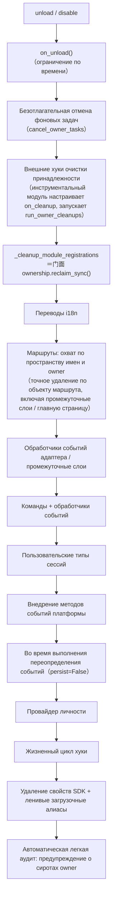

# Система принадлежности (owner)

> [!TIP]
> **Когда читать**: при диагностике утечек ресурсов, при понимании цепочки очистки при отключении или при объявлении принадлежности ресурсов. Если не нужно, пропустите, это не повлияет на использование других функций.

> **После прочтения вы узнаете**: как контекст owner автоматически присваивает ресурсы, полная таблица принадлежности ресурсов, полный порядок очистки при отключении/отключении, а также какие ресурсы не удаляются при отключении (пределы дизайна).
>
> **В этой статье не рассматривается**: когда ресурсы "вступают в силу" (см. [Область действия (scope)](scope.md)); рекомендуемая запись фоновых задач и граница принудительного отмены (см. [Управление жизненным циклом · Принадлежность и автоматическая отмена фоновых задач](lifecycle.md#фоновые задачи принадлежность и автоматическая отмена)).

Принадлежность — это основа "plug-and-play" модуля: все ресурсы, зарегистрированные модулем во время загрузки, автоматически именуются, а при отключении/отключении они автоматически удаляются — автор модуля должен просто объявить ресурсы, не вручную писать логику очистки.

> **Связанные системы**: область действия (scope) определяет, "вступают ли ресурсы в силу" при отправке событий, принадлежность определяет, "кому принадлежат ресурсы, и кто будет удален при отключении". Область действия см. [Единая точка управления (scope)](scope.md), фоновые задачи см. [Управление жизненным циклом](lifecycle.md#фоновые задачи принадлежность и автоматическая отмена).

{!--< tips >!--}
1. Принадлежность автоматически записывается в момент регистрации по `current_owner`, код модуля не требует изменений
2. Отключение/отключение используют одну и ту же цепочку очистки (`_cleanup_module_registrations`), каждая ошибка только предупреждает, не прерывает
3. Ресурсы пользовательского конфигурационного контекста (постоянное перезаписывание / правила области / ACL команд) **не** удаляются при отключении модуля
4. Внешние дескрипторы, управляемые инструментальным модулем, можно добавить в цепочку очистки с помощью `on_cleanup(cb)`, при отключении модуля будет автоматически вызван обратный вызов (см. [Руководство по инструментальному модулю](#инструментальный модуль руководство по управлению дескрипторами других модулей))
{!--< /tips >!--}

## Механизм контекста owner

Owner передается через контекстную переменную `current_owner` (`ErisPulse.runtime.context`):

```python
from ErisPulse.runtime import owner_scope, get_current_owner

with owner_scope("MyModule"):
    # Все ресурсы, зарегистрированные в этом интервале, автоматически присваиваются MyModule
    assert get_current_owner() == "MyModule"
```

Рамка автоматически вставляет owner в следующие моменты (код модуля/адаптера не требует ручного обертывания):

| Момент | Значение owner | Положение |
|------|----------|------|
| Модуль `load()` | Имя модуля | При инстанцировании + `on_load` на протяжении всего процесса |
| Адаптер `start()` / `restart()` | Имя платформы | На протяжении всего процесса запуска адаптера |
| Регистрация stub для ленивой загрузки `activate_on` | Имя модуля | Регистрация замещающих команд/обработчиков |
| Выполнение обработчика событий | Имя модуля, к которому принадлежит обработчик | Повторное вложение в обработчик/входную точку команды |

Повторное вложение во время выполнения означает: обработчики команд, объявленные модулем в `on_load`, при вызове в процессе выполнения регистрационных API (например, `sdk.adapter.on()` или `overrides.*.set(persist=False)`), также будут автоматически присвоены этому модулю.

## Обзор ресурсов принадлежности

Все ресурсы, зарегистрированные в контексте загрузки модуля, записываются с присвоением, и при отключении/отключении они автоматически удаляются:

| Ресурс | Способ регистрации | Вызов очистки |
|------|----------|----------|
| Команды | `@command()` / объявление словаря команд | `command.unregister_by_owner()` |
| Обработчики событий | `@message` / `@notice` / `@request` / `@meta` | `handler.unregister_by_owner()` |
| Слушатели событий адаптера | `sdk.adapter.on()` / `raw=True` | `adapter.unregister_handlers_by_owner()` |
| Промежуточные слои адаптера | `@sdk.adapter.middleware` | То же самое |
| Маршруты (HTTP/WS/SSE) | `router.http()` / `websocket()` / `sse()` | Двойной охват по пространству имен и по owner |
| Промежуточные слои маршрутизатора | `@router.middleware()` / `add_middleware()` | `router.unregister_all_by_owner()` |
| Главная страница Dashboard | `router.register_home_entry()` | `unregister_home_entries_by_owner()` |
| Пользовательские типы сессий | `register_custom_type()` | `unregister_custom_types_by_owner()` |
| Методы событий платформы | `register_event_method()` / `register_event_mixin()` | `unregister_event_methods_by_owner()` (при отключении модуля автоматически удаляются, старые замыкания больше не утекают) |
| Фоновые задачи | `self.spawn()` | `cancel_owner_tasks()` |
| Внешние чистящие хуки принадлежности (инструментальный модуль управляет) | `runtime.on_cleanup(cb)` | `run_owner_cleanups()` (вызывается при отключении/отключении/закрытии адаптера) |
| Жизненный цикл хуки | `lifecycle.register()` | `lifecycle.unregister_by_owner()` |
| Провайдер личности | `master.provider` | `master.unregister_by_owner()` |
| Переводы i18n | Объявление `I18nClass` (domain=имя модуля) | `i18n.unregister_domain()` |
| Переопределения событий (во время выполнения) | `overrides.*.set(persist=False)` | `overrides.unregister_by_owner()` |
| Взаимодействие сессий (ожидание wait_reply и т.д. / аренда) | `event.wait_reply()` / `sdk.interaction.acquire()` | `interaction.cancel_by_owner()` (ожидающая сторона немедленно получает отмену) |
| Контекстные данные | `runtime/context` по owner | Точная очистка по модулю |

Соответствующие ресурсы со стороны адаптера (с платформенным именем в качестве owner) при `shutdown()` / `restart()` адаптера удаляются `_cleanup_adapter_resources`, а также включают:

| Ресурс | Вызов очистки |
|------|----------|
| Собственные `on()` обработчики и промежуточные слои адаптера | `adapter.unregister_handlers_by_owner(platform)` |
| Расширения методов событий платформы (`EventMixin`) | `unregister_platform_event_methods(platform)` |
| Пользовательские типы сессий | `unregister_custom_types_by_owner(platform)` |
| Взаимодействие сессий (ожидание wait_reply / аренда на этой платформе) | `interaction.cancel_by_platform(platform)` |
| Переводы i18n (domain=ключ конфигурации) | `i18n.unregister_domain(ключ конфигурации)` |
| Маршрутизаторы с мелкозернистым пространством имен | `router.unregister_all_by_owner(platform)` |

## Последовательность очистки при отключении/отключении

`unload()` и `disable()` используют одну и ту же цепочку очистки (каждый шаг независимо try/except, ошибка только записывается в лог, **не прерывает последующую очистку**):



`sdk.uninit()` при выходе имеет дополнительный глобальный охват: все адаптеры shutdown → все модули unload → `router.stop()` (очистка маршрутов/промежуточных слоев/главной страницы) → `cancel_all_background_tasks()` → очистка обработчиков событий и хуков.

## Единый интерфейс принадлежности (ownership)

Шестнадцать шагов цепочки очистки сведены под единый интерфейс принадлежности `ErisPulse.Core.ownership`, четыре глагола охватывают "удаление, подсчет, сканирование, аудит" — функции `*_by_owner` отдельных подсистем остаются неизменными, как внутренние реализации интерфейса:

| Глагол | Назначение |
|------|------|
| `ownership.reclaim(owner)` | Общее удаление всех ресурсов owner (отмена задач → хуки очистки → зарегистрированные ресурсы; асинхронная полная версия) |
| `ownership.reclaim_sync(owner)` | Удаление зарегистрированных ресурсов (синхронная версия, для синхронного пути отключения) |
| `ownership.counts(owner=None)` | Только чтение статистики ресурсов owner (None для всех owner) |
| `ownership.orphans()` | Сканирование сирот: ресурсы зарегистрированы, но owner уже отключен (доказательство утечки) |
| `ownership.audit(owner, deep=)` | Отчет об аудите утечек (подсчет + сироты + необязательная генерация экземпляров gc) |

```python
from ErisPulse.Core import ownership

ownership.reclaim_sync("MyModule")       # {'commands': 1, 'routes_http': 2, ...}
ownership.counts("MyModule")             # Подсчет зарегистрированных ресурсов
ownership.orphans()                      # [{"owner": "ghost", "total": 2, ...}]
```

**Точка входа аудита**:

- Автоматическая легкая аудит после отключения / перезагрузки: обнаружение ресурсов сироты owner вызывает предупреждение WARNING (ноль накладных расходов на подсчет сканирования)
- `sdk.module.audit(name, deep=True)`: Глубокое gc-исследование экземпляра модуля — при невозможности сборки мусора экземпляра указывается тип источника ссылки (определение "кто держит старый экземпляр"); имеет глобальные паузы, используется только для явной диагностики
- Глубокое исследование является явной операцией, не имеет конфигурационного ключа, не делает автоматического исправления

## Вложенный жизненный цикл (ownership.nest)

> Эта функция доступна только в ErisPulse **2.12+**.

Позволяет одному модулю (родитель) управлять другой группой owner (дочерних), при удалении родителя удаляются все дочерние. Типичные сценарии: запуск суб-плагинов внутри модуля сценария, панели расширений Dashboard, инструментальный модуль для управления внешними таблицами регистрации.

```python
from ErisPulse.Core import ownership

ownership.nest("ScriptEngine", "ScriptEngine.plugin_a")
ownership.nest("ScriptEngine", "ScriptEngine.plugin_b")

ownership.nested_children("ScriptEngine")
# frozenset({"ScriptEngine.plugin_a", "ScriptEngine.plugin_b"})

ownership.unnest("ScriptEngine", "ScriptEngine.plugin_a")
```

| Элемент | Ограничение |
|----|------|
| Порядок удаления | Дочерние удаляются раньше родителя; при одинаковом уровне по обратному порядку регистрации (последние зарегистрированные удаляются первыми) |
| Область удаления | Ресурсы (задачи / соединения / маршруты / команды / tracked ресурсы / хуки очистки), **не вызывает on_unload дочернего модуля** |
| Обнаружение циклов | `nest` отклоняет самосвязь и уже существующие обратные связи, возвращает `False` и предупреждает |
| Дочерний удаляется первым | При самостоятельной очистке (reclaim / reclaim_sync) дочерний автоматически unnest, родительская сторона не сохраняет висячие отношения |
| Ограничение по времени | Один дочерний отзыв подчинен `CLEANUP_CALLBACK_TIMEOUT_SECS`; при превышении времени предупреждение, удаляется родитель-дочерняя связь и продолжается |
| Наблюдаемость | `ownership.counts(parent)` увеличивает счетчик `nested`; `ownership.orphans()` делает транзитивную оболочку для вложенных отношений, остаточные отношения, где родитель исчез, все еще будут обнаружены |

**Почему не вызывается on_unload дочернего**? Полная отмена модуля должна проходить через уровень менеджера (ленивые алиасы, свойства sdk, рассылка событий), а интерфейс ownership отвечает только за очистку ресурсов, вызовы между уровнями могут привести к риску повторного входа в блокировку отмены. Если нужно вызвать on_unload дочернего, родитель должен явно вызвать его в своем on_unload:

```python
await self.sdk.module.unload(child, reason="cascade")
```

Синхронный вход (например, sdk.module.disable) сначала помечает асинхронную каскадную отмену, фоновые задачи удаляют ресурсы дочернего; reclaim_sync только при отсутствии асинхронной каскадной отмены, сам каскадно удаляет зарегистрированные ресурсы дочернего.

## Откат при горячей перезагрузке

Горячая перезагрузка представляет собой "снимок до отключения → автоматический откат при сбое → повторное выполнение on_load": при синтаксических ошибках, отсутствии зависимостей, сбое загрузки нового варианта, старый экземпляр и состояние регистрации (записи регистрационного стола, свойства sdk, записи sys.modules) автоматически восстанавливаются, после чего в контексте принадлежности **повторно выполняется старый экземпляр on_load** (`reason` равно `"rollback"`), чтобы восстановить внешние ресурсы, разорванные на этапе отключения; после завершения генерируется событие `module.rollback` (负载 `{module_name, success}`).

При неудачной горячей перезагрузке адаптера также восстанавливается старое состояние регистрации; если старый экземпляр находился в рабочем состоянии и старые задачи запуска завершены, после отката повторно выполняется `start()`, и генерируется событие `adapter.rollback` (负载 `{adapter_name, replayed, success}`). Отключение подключения / off-line бота и другие побочные эффекты unload не могут быть отменены. Повторное выполнение и событие `adapter.rollback` требуют ErisPulse **2.12+**.

Ограничения:

- Если повторное выполнение неудачно или превышает время ожидания, **только предупреждение**, не откат в откат — старый экземпляр остается в состоянии "завершения" (как в 2.11.2 и более ранних версиях), в логах будет четко указано
- Ручные кэширования ссылок на старый экземпляр сторонними сторонами не входят в восстановление
- Если целевой пакет был удален (entry-point исчез), считается, что отключение успешно, откат не выполняется
-载荷 on_unload содержит `reason` (`unload` / `reload` / `disable` / `cascade` / `dormant` / `load-failed`), модуль может отложить закрытие ресурсов, которые должны сохраняться между перезагрузками, в `reload`

Полные возможности горячей перезагрузки, семантика цикла и правила для модуля см. в следующем разделе.

## Границы горячей перезагрузки

Горячая перезагрузка может заменить код, перестроить регистрацию, откатить неудачную перезагрузку — но это **не перезапуск процесса**. Очищаются **ресурсы, зарегистрированные в системе принадлежности**; ресурсы, не принадлежащие ни одному owner, пользовательские данные конфигурации, ссылки на объекты внутреннего кэша сторонних библиотек, не исчезают вместе с перезагрузкой.

### Границы возможностей

| Объект | Поведение после перезагрузки | Примечание |
|------|-----------|------|
| Код модуля / определение класса | Поддерживается, повторно импортируется | Старые записи sys.modules удаляются |
| on_unload / on_load | Поддерживается, вызывается по порядку | При неудаче отката повторно вызывается on_load (см. предыдущий раздел) |
| Команды / обработчики / маршруты / хуки жизненного цикла | Поддерживается, автоматически удаляется и регистрируется | Очищается через цепочку очистки принадлежности |
| spawn_background / spawn_later / spawn_thread | Поддерживается, отменяется по owner | Потоки регистрируются только для наблюдения, не могут быть принудительно убиты |
| Любая задача в главном цикле asyncio | Поддерживается, автоматически отменяется | Фабрика задач перехватывает (включая внутренние создания сторонних библиотек) |
| Задачи, порожденные в цикле хранилища | Поддерживается, автоматически отменяется | Цикл хранилища также имеет фабрику задач |
| Ресурсы, зарегистрированные с помощью ownership.track() | Поддерживается, вызывается release() | Фабрика задач не может достичь ресурсов, привязанных к циклу |
| Хуки on_cleanup | Поддерживается, вызывается | Инструментальный модуль использует это, чтобы отбросить управляемые дескрипторы |
| Постоянные переопределения (persist=True) / файлы конфигурации | Не обрабатывается, сохраняется | Пользовательская собственность |
| Объектные ссылки, кэшированные сторонними библиотеками | Не обрабатывается | Рамка не видит, модуль должен сам отменить ссылку |
| Созданные модулем новые циклы событий / голые потоки | Не удаляются | См. правила для модуля ниже |

### Трехуровневое управление ресурсами

1. **Уровень прозрачного перехвата** — фабрика задач на уровне цикла событий. В контексте owner любое создание задачи автоматически присваивается, охватывает главный цикл и цикл хранилища моста.
2. **Уровень распределения принадлежности** — `spawn_background` / `spawn_later` / `spawn_thread`.
3. **Уровень сотрудничества регистрации** — `ownership.track()` / `on_cleanup()`, используется для структурных ресурсов, недоступных для фабрики задач (пулы соединений, клиенты сторонних библиотек).

### Границы цикла событий

| Цикл | Кто создал | Установлена ли фабрика задач | Назначение |
|------|--------|-----------|------|
| Главный цикл | `sdk.run()` / `sdk.init()` | Установлен | Весь бизнес-код |
| Цикл хранилища моста | `AsyncBridge` (первый синхронный вызов хранилища) | Установлен | Фоновое выполнение синхронных API хранилища |
| Временный цикл | `spawn_background` по умолчанию | Не установлена, используется и сразу закрывается | Последнее средство, когда главный цикл не готов |

**Временный цикл — последнее средство**: он синхронно блокирует вызывающий поток, и задачи, порожденные внутри цикла, будут потеряны (в логах есть предупреждение `temp_loop_fallback`). Если видите это предупреждение, значит модуль запустил фоновую задачу в неправильное время.

**Отмена между циклами — по возможности**: `cancel_owner_tasks` обнаруживает задачи в других все еще работающих циклах и отправляет отмену с помощью `call_soon_threadsafe`, выдает предупреждение `cross_loop_task_residual`, но **не ждет** их завершения (ожидание между циклами небезопасно). Если видите это предупреждение, проверьте, не создали ли вы собственный цикл событий.

### Правила для модуля

```python
# Рекомендуется
spawn_background(self._poll())            # Принадлежность фоновой задачи
spawn_later(30, lambda: self._cleanup())  # Принадлежность задержанной задачи
spawn_thread("poller", self._loop_body)   # Принадлежность потока (входная точка автоматически содержит контекст owner)
ownership.track(pool)                     # Явная регистрация ресурсов, привязанных к циклу
await sdk.storage.aget(key)               # Асинхронный контекст напрямую использует асинхронный API

# Избегайте
asyncio.create_task(self._poll())         # Голый вызов: отсутствие ссылки может привести к GC
asyncio.new_event_loop()                  # Самостоятельное создание цикла: система принадлежности не может достичь
threading.Thread(target=self._loop_body)  # Голый поток: отсутствие контекста owner
self._storage.get(key)                    # Синхронный вызов хранилища в асинхронном контексте: блокирует главный цикл
```

### Список проверки

1. В логах есть `cross_loop_task_residual`? → Ресурс находится в самостоятельном цикле
2. В логах есть `temp_loop_fallback`? → Фоновая задача была запущена до готовности главного цикла
3. Ошибка `attached to a different loop`? → Проверьте, не создали ли самостоятельный цикл или не переиспользуете ли объекты соединения между циклами
4. `ownership.orphans()` выводит результат? → Ресурсы под owner остаются после отключения

## Пределы дизайна: какие ресурсы не удаляются при отключении

Система принадлежности удаляет только **регистрируемые в модульном коде ресурсы**. Следующие ресурсы относятся к **конфигурационному контексту пользователя** (управление в руках пользователя, возможно, специально настроено), и после отключения модуля сохраняются вместе с конфигурацией:

| Ресурс | Семантика | Примечание |
|------|------|------|
| `overrides.*.set(persist=True)` | Постоянное переопределение | Записывается в файл конфигурации, действует при перезапуске; при отключении модуля не удаляется (явно настроен пользователем) |
| `scope.set_action()` и другие правила области | Область управления | Управляется пользователем/Dashboard, при отключении модуля правила не удаляются |
| `overrides.acl.set(persist=True)` | ACL команд | То же самое |
| `Conversation.save()` сохранение | Многоразовая переписка | Данные сохраняются, не удаляются |

Временные записи во время выполнения (`persist=False`) удаляются вместе с owner — **постоянность или нет — это граница между "активами пользователя" и "состоянием модуля во время выполнения"**.

## Внутренняя реализация: как работает принадлежность

**Одним предложением**: цепочка присвоения (contextvar) определяет "на кого записано", цепочка отмены (таблица задач) определяет "можно ли отменить при отключении" — эти две цепочки работают независимо, для правильной очистки ресурсов необходимы обе.

Система принадлежности состоит из **двух независимых цепочек**, понимание их разделения необходимо для диагностики проблем с принадлежностью:

### Цепочка присвоения (contextvar распространение)

`runtime/context.py` `current_owner` и другие ContextVar отвечают за **присвоение** — "на кого записаны ресурсы/вызовы, зарегистрированные в этот момент кода". Правила распространения следуют семантике Python contextvars:

| Выполнение | Распространяется ли контекст | Результат присвоения |
|---------|----------------|---------|
| Синхронная вызовная цепочка / `await` цепочка | ✅ Распространяется | Правильное присвоение |
| `owner_scope` внутри `asyncio.create_task` | ✅ Распространяется (task копирует контекст в момент создания) | Присвоение корректно в задаче **внутри** |
| `run_in_executor` / голый поток | ❌ Не распространяется | Присвоение теряется |
| Самостоятельно созданный цикл событий | ❌ Не распространяется | Присвоение теряется |

> Присвоение ≠ регистрация: распространение контекста влияет только на "на кого записано", можно ли очистить ресурс, зависит от того, попал ли он в следующую цепочку отмены.

### Цепочка отмены (таблица регистрации задач)

`runtime/tasks.py` `_owner_tasks` таблица регистрации отвечает за **жизненный цикл** — "какие незавершенные задачи принадлежат owner, которые будут отменены при отключении". Способы попадания задач в таблицу регистрации:

1. **Явная постановка в очередь**: `spawn_background()` / `self.spawn()` → при создании захватывается `current_owner` (или явный параметр `owner=`) → запись в таблицу;
2. **Автоматическая регистрация через Task Factory** (с версии 2.8.3): `install_owner_task_factory()` устанавливается в главный цикл событий при запуске фреймворка — **любая** задача (включая внутренние `create_task` сторонних библиотек) проходит через фабрику и читает `current_owner`, если не None, то регистрируется.

Таблица регистрации саморегулируется: каждая задача имеет `done_callback`, при завершении удаляется из таблицы, утечек нет.

### Последовательность отмены (отключение модуля)

```
module.unload()
  → on_unload(event)                    # Модуль сам очищает (защита от тайм-аута)
  → Фреймворк удаляет команды/обработчики/хуки/маршруты этого owner
  → cancel_owner_tasks(owner)           # Таблица регистрации отменяет по умолчанию
      → поочередно task.cancel()        # Исключая саму задачу, которая выполняет логику отмены
      → await gather(pending, timeout)  # Ожидание завершения (тайм-аут не блокирует)
```

### Стратегия диагностики

- **Ресурс не очищен** → проверьте таблицу регистрации: `get_owner_tasks("MyModule")` содержит ли эта задача; если нет, значит путь регистрации не прошел через цепочку принадлежности (импортный период / поток / независимый цикл), сверьтесь с таблицей выше для определения.
- **Неправильное присвоение** → проверьте `get_current_owner()` в момент ошибки; для асинхронных отложенных вызовов (обратные вызовы/задачи) присвоение берется из контекста в момент создания, а не в момент выполнения.

## Руководство для автора модуля

### Рекомендуемый стиль

```python
from ErisPulse import sdk
from ErisPulse.Core.Event import command
from ErisPulse.runtime import owner_scope, spawn_background

class MyModule(BaseModule):
    async def on_load(self, event):
        # Рамочные ресурсы: автоматически присваиваются, нет необходимости в ручной очистке
        self.task = self.spawn(self.polling())      # Фоновая задача
        sdk.router.register_home_entry("Мой модуль", "/my")  # Главная страница

        # Собственные ресурсы модуля: включите в систему принадлежности с помощью owner_scope
        with owner_scope("MyModule"):
            self.client.on_event(self._handle)      # Пример пользовательской регистрации

    async def on_unload(self, event):
        # Рамочные ресурсы уже автоматически удалены, нужно только очистить ресурсы, не охваченные owner_scope
        await self.client.close()
```

### Примечания

- **Регистрация в импортный период без принадлежности**: регистрация хуков/обработчиков в верхнем уровне модуля (в момент импорта) происходит до `owner_scope`, и они рассматриваются как ресурсы рамки (owner=None) и **не удаляются**. Всегда помещайте регистрацию в `on_load()`.
- **Регистрация пользовательской области i18n**: `i18n.register(domain=...)` с domain, отличным от имени модуля, не будет автоматически удалена, сохраняйте domain=имя модуля.
- **Рекомендуется использовать `self.spawn()` для фоновых задач**: с версии 2.8.3 голый `asyncio.create_task` также будет **автоматически неявно присвоен** (Task Factory автоматически регистрирует, отключение по умолчанию отменяет); но `self.spawn()` по-прежнему рекомендуется — поддержка не главного цикла потока для возврата в главный цикл, явное указание `owner=` и предотвращение GC для fire-and-forget. **До версии 2.8.3** голые задачи не присваиваются, необходимо использовать `self.spawn()`.
- Цепочка очистки "не прерывает при сбое": ошибка очистки не блокирует остальную очистку ресурсов, логи уровня DEBUG/WARNING видны, при диагностике можно включить TRACE.

### Таблица соответствия времени регистрации и результата принадлежности

| Сцена регистрации | Результат принадлежности | Примечание |
|---------|---------|------|
| Регистрация через API рамки (команда/обработчик/lifecycle/маршруты декораторы) в `on_load()` | Принадлежит модулю | При отключении автоматически удаляется |
| Регистрация в верхнем уровне модуля (в момент импорта) | **Без принадлежности** (owner=None) | Не удаляется, не используйте |
| Созданные фоновые задачи с помощью `self.spawn()` | Принадлежат модулю | При отключении автоматически отменяются |
| Регистрация через сторонний API в `owner_scope("Name")` | Принадлежат модулю | Зависит от того, что обратный вызов стороннего API синхронно выполняется в scope |
| Голый `asyncio.create_task` (включая `loop.create_task` / `ensure_future`) | **Автоматически присвоены** (Task Factory, с 2.8.3+) | В момент создания читает `current_owner`, автоматически регистрируется в контексте owner, отключение по умолчанию отменяет; см. ниже [внутреннюю реализацию](#внутренняя-реализация-как-работает-принадлежность) |
| Задачи, созданные в обратных вызовах сторонних библиотек (aiohttp / APScheduler и т.д.) | **Автоматически присвоены** (Task Factory, с 2.8.3+) | В момент выполнения обратного вызова, если `current_owner` уже вставлен (например, во время обработки рамки), задача автоматически регистрируется |
| `run_in_executor` (пул потоков) | **Без принадлежности** (не asyncio.Task) | Потоки не подчиняются фабрике задач, необходимо самостоятельно управлять жизненным циклом |
| Независимый цикл событий (самостоятельно созданный цикл) | **Без принадлежности** | Фабрика задач установлена только в главный цикл; contextvars также не распространяется между циклами событий |

> Принцип: **принадлежность следует контексту `current_owner` в момент регистрации**; любая асинхронная задержка, пулы потоков, независимые циклы событий выходят из этого контекста — при необходимости принадлежности явно войдите в `owner_scope`.

## Руководство по инструментальному модулю: управление дескрипторами других модулей

**Сценарий**:定时任务、注册表、连接池这类"工具模块"会替其它模块保管东西——对方在 `on_load` 里调用 `sdk.Cron.on_trigger(handler)`，你的容器里就存下了 一个指向对方实例的回调。框架会自动清理对方注册的一切框架资源，但清理不了 你**私有容器里的引用**：对方卸载后你的容器还拉着它的实例，它就无法被 GC 回收（内存泄漏，`purge` 泄漏诊断报"不可回收"）。

**解法**：在登记对方东西的同一个函数里调用 `on_cleanup()`， 框架会在对方卸载 / 禁用时自动回调你的清理函数：

```python
from ErisPulse.Core.Bases import BaseModule
from ErisPulse.runtime import off_cleanup, on_cleanup

class CronModule(BaseModule):
    def __init__(self):
        self._entries = {}  # {模块名: 该模块托管的回调列表}

    def on_trigger(self, handler):
        # 自动识别调用方模块名（on_load 直接调用 / module.call 均正确），
        # 返回值是解析出的 owner，可直接用作记名键
        owner = on_cleanup(self._drop)
        self._entries.setdefault(owner, []).append(handler)

    def _drop(self, owner: str):
        """对方模块被卸载/禁用时由框架自动调用：抛弃它的句柄即可"""
        self._entries.pop(owner, None)

    async def on_unload(self, event):
        off_cleanup(self._drop)  # ③ 自己卸载前注销钩子，避免钩子表持有 self
```

框架保证的行为：

| 关注点 | 行为 |
|--------|------|
| 触发时机 | 对方模块 unload / disable，或适配器关闭——均在框架清理链内触发，早于 purge 泄漏诊断 |
| 调用方识别 | 直接调用取 `current_owner`；经 `module.call()` 被调用取调用方（`current_caller`）；也可 `on_cleanup(cb, owner="模块名")` 显式指定。**强制校验**：owner 无法解析（三种来源均缺失）时抛 `ValueError`——私有工具模块应在自身加载上下文内登记钩子 |
| 回调签名 | `cb(owner: str)`，同步 / 异步均可；异步带超时保护（`CLEANUP_CALLBACK_TIMEOUT_SECS`，默认 10 秒） |
| 容错 | 单个回调异常 / 超时只记日志，不影响其余钩子与清理链 |
| 重复登记 | 同一 `(owner, callback)` 幂等去重 |

**什么时候不需要**：如果对方注册的是框架资源（命令、事件处理器、路由、 后台任务……），框架已全自动清理（见上文[归属资源全景](#归属资源全景)）。只有你私有容器里持有的对方句柄才需要 `on_cleanup`。
模块开发视角的速查版见 [最佳实践 · 工具模块](../developer-guide/modules/best-practices.md#工具模块托管别人东西时要接住卸载通知)。

## Связанная документация

Выберите следующий шаг:

- **Хочу контролировать "действует ли ресурс" (уровень управления)** → [Область действия (scope)](scope.md) — принадлежность определяет "кому принадлежат ресурсы, кто будет удален при отключении", область действия определяет "когда ресурсы вступают в силу"
- **Для фоновых задач / таймеров — автоматическая отмена** → [Управление жизненным циклом · Принадлежность и автоматическая отмена фоновых задач](lifecycle.md#фоновые задачи принадлежность и автоматическая отмена)
- **Для изоляции грейд-версий с отдельным owner** → [Теневой модуль и перевод в эксплуатацию](shadow.md)
- **Справочник для разработчика модуля** → [Лучшие практики модулей](../developer-guide/modules/best-practices.md)