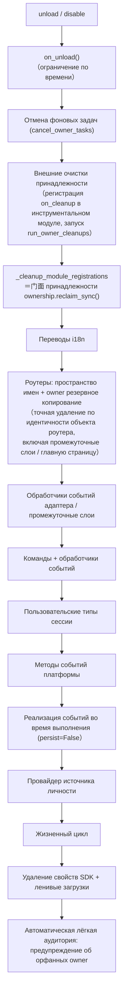

# Система принадлежности (owner)

> [!TIP]
> **Когда читать**: при отладке утечек ресурсов, при изучении цепочки очистки при отключении или при объявлении принадлежащих ресурсов. Если не нужно, пропустите, это не повлияет на использование других функций.

> **Что узнаете**: как контекст owner автоматически присваивает ресурсы, полная картина принадлежащих ресурсов, полный порядок очистки при отключении/отключении, а также какие ресурсы не удаляются при отключении (пределы проектирования).
>
> **В этой статье не рассматривается**: когда ресурсы становятся активными (см. [Область видимости (scope)](scope.md)); рекомендуемый способ написания фоновых задач и границы принудительного отменения (см. [Управление жизненным циклом · Принадлежность и автоматическая отмена фоновых задач](lifecycle.md#фоновые-задачи-принадлежность-и-автоматическая-отмена)).

Принадлежность является основой для "подключения и использования" модуля: все зарегистрированные кадровые ресурсы автоматически присваиваются при загрузке модуля, и при отключении/отключении они автоматически удаляются — автор модуля просто объявляет ресурсы, не пишет логику очистки вручную.

> **Связанные системы**: область видимости (scope) определяет, "активны ли ресурсы" при отправке событий, принадлежность определяет "кому принадлежат ресурсы и кто удаляет их при отключении". Область видимости см. [Единая система управления (scope)](scope.md), фоновые задачи см. [Управление жизненным циклом](lifecycle.md#фоновые-задачи-принадлежность-и-автоматическая-отмена).

{!--< tips >!--}
1. Принадлежность автоматически записывается при регистрации (в момент `current_owner`), код модуля не изменяется
2. Отключение/отключение используют одну и ту же цепочку очистки (`_cleanup_module_registrations`), сбой на каждом шаге только предупреждает, не прерывает
3. Ресурсы пользовательского конфигурационного смысла (постоянное перезаписывание / правила scope / ACL команд) **не** удаляются при отключении модуля
4. Внешние дескрипторы, управляемые инструментальным модулем, можно добавить в цепочку очистки с помощью `on_cleanup(cb)`, и при отключении другого модуля будет автоматически вызван обратный вызов (см. [Руководство по инструментальным модулям](#инструментальные-модули-управление-дескрипторами-других-модулей))
{!--< /tips >!--}

## Механизм контекста owner

Owner передается через переменную контекста `current_owner` (`ErisPulse.runtime.context`):

```python
from ErisPulse.runtime import owner_scope, get_current_owner

with owner_scope("MyModule"):
    # Все зарегистрированные ресурсы в этом диапазоне автоматически принадлежат MyModule
    assert get_current_owner() == "MyModule"
```

Кадры автоматически вставляют owner в следующие моменты (код модуля/адаптера не требует ручного обертывания):

| Момент | Значение owner | Место |
|------|----------|------|
| Модуль `load()` | Имя модуля | Весь процесс инстанцирования + `on_load` |
| Адаптер `start()` / `restart()` | Имя платформы | Весь процесс запуска адаптера |
| Регистрация stub для ленивой активации `activate_on` | Имя модуля | Регистрация запускаемых команд/обработчиков |
| Выполнение обработчика событий | Имя модуля, которому принадлежит обработчик | Переинъекция в точке входа handler / команды |

Переинъекция во время выполнения означает: обработчики команд, объявленные модулем в `on_load`, при вызове API-функций регистрации (например, `sdk.adapter.on()` или `overrides.*.set(persist=False)`), также будут автоматически присвоены этому модулю.

## Полная картина принадлежащих ресурсов

Все ресурсы, зарегистрированные в контексте загрузки модуля, записываются и автоматически удаляются при отключении/отключении:

| Ресурс | Способ регистрации | Вызов очистки |
|------|----------|----------|
| Команды | `@command()` / объявление словаря команд | `command.unregister_by_owner()` |
| Обработчики событий | `@message` / `@notice` / `@request` / `@meta` | `handler.unregister_by_owner()` |
| Слушатели событий адаптера | `sdk.adapter.on()` / `raw=True` | `adapter.unregister_handlers_by_owner()` |
| Промежуточные слои адаптера | `@sdk.adapter.middleware` | То же самое |
| Роутинг (HTTP/WS/SSE) | `router.http()` / `websocket()` / `sse()` | Двойной резерв по пространству имен и по owner |
| Промежуточные слои роутера | `@router.middleware()` / `add_middleware()` | `router.unregister_all_by_owner()` |
| Главная страница Dashboard | `router.register_home_entry()` | `unregister_home_entries_by_owner()` |
| Пользовательские типы сессии | `register_custom_type()` | `unregister_custom_types_by_owner()` |
| Методы событий платформы | `register_event_method()` / `register_event_mixin()` | `unregister_event_methods_by_owner()` (автоматически удаляется при отключении модуля, старые замыкания не утекают) |
| Фоновые задачи | `self.spawn()` | `cancel_owner_tasks()` |
| Внешние очистки принадлежности (инструментальный модуль управляет) | `runtime.on_cleanup(cb)` | `run_owner_cleanups()` (вызывается в цепочке отключения/отключения/закрытия адаптера) |
| Жизненный цикл | `lifecycle.register()` | `lifecycle.unregister_by_owner()` |
| Провайдер источника личности | `master.provider` | `master.unregister_by_owner()` |
| Переводы i18n | Объявление `I18nClass` (domain=имя модуля) | `i18n.unregister_domain()` |
| Переопределения событий (во время выполнения) | `overrides.*.set(persist=False)` | `overrides.unregister_by_owner()` |
| Взаимодействие сессий (ожидание wait_reply и т.д.) | `event.wait_reply()` / `sdk.interaction.acquire()` | `interaction.cancel_by_owner()` (сторона ожидания немедленно получает отмену) |
| Контекстные данные | `runtime/context` записывает по owner | Точный очистка по модулю |

Соответствующие ресурсы на стороне адаптера (с owner именем платформы) удаляются в `shutdown()` / `restart()` адаптера с помощью `_cleanup_adapter_resources`, а также включают:

| Ресурс | Вызов очистки |
|------|----------|
| Собственные `on()` обработчики и промежуточные слои адаптера | `adapter.unregister_handlers_by_owner(platform)` |
| Расширения методов событий платформы (`EventMixin`) | `unregister_platform_event_methods(platform)` |
| Пользовательские типы сессии | `unregister_custom_types_by_owner(platform)` |
| Взаимодействие сессий (ожидание wait_reply / аренды на этой платформе) | `interaction.cancel_by_platform(platform)` |
| Переводы i18n (domain=ключ конфигурации) | `i18n.unregister_domain(ключ конфигурации)` |
| Тонкие пространства имен роутера | `router.unregister_all_by_owner(platform)` |

## Последовательность очистки при отключении/отключении

`unload()` и `disable()` используют одну и ту же цепочку очистки (каждый шаг независим, try/except, сбой только логирует, **не прерывает последующую очистку**):



При выходе `sdk.uninit()` есть глобальный резервный вариант: все адаптеры shutdown → все модули unload → `router.stop()` (очистка роутера/промежуточных слоев/главной страницы) → `cancel_all_background_tasks()` → очистка обработчиков событий и хуков.

## Единый интерфейс принадлежности (ownership)

Шестнадцать шагов цепочки очистки сведены под единый интерфейс принадлежности `ErisPulse.Core.ownership`, четыре глагола охватывают "удаление, подсчет, сканирование, аудит" — функции `*_by_owner` отдельных подсистем остаются неизменными, как внутренняя реализация интерфейса:

| Глагол | Назначение |
|------|------|
| `ownership.reclaim(owner)` | Общая очистка всех ресурсов принадлежащих owner (отмена задач → очистка хуков → зарегистрированные ресурсы; асинхронная полная версия) |
| `ownership.reclaim_sync(owner)` | Очистка зарегистрированных ресурсов (синхронная версия, для синхронного пути отключения) |
| `ownership.counts(owner=None)` | Только чтение: подсчет ресурсов принадлежащих owner (None — все owner) |
| `ownership.orphans()` | Сканирование сирот: ресурсы в списке, но owner уже отключен (список улик утечки) |
| `ownership.audit(owner, deep=)` | Отчет об аудите утечек (подсчет + сироты + необязательное gc-исследование экземпляров) |

```python
from ErisPulse.Core import ownership

ownership.reclaim_sync("MyModule")       # {'commands': 1, 'routes_http': 2, ...}
ownership.counts("MyModule")             # Подсчет ресурсов принадлежащих MyModule
ownership.orphans()                      # [{"owner": "ghost", "total": 2, ...}]
```

**Точка входа аудита**:

- После отключения / перезагрузки **автоматическая лёгкая аудитория**: обнаружение орфанных ресурсов owner приводит к предупреждению (ноль накладных расходов на подсчет сканирования)
- `sdk.module.audit(name, deep=True)`: исследование gc-экземпляра модуля — при невозможности сборки мусора экземпляра указывает тип ссылки (локализация "кто держит старый экземпляр"); есть глобальные паузы, используется только для явной диагностики
- Глубокое исследование является явной операцией, не настраивается, не делает автоматическое восстановление

## Откат при неудачной горячей перезагрузке

Горячая перезагрузка изменена на "снимок до отключения → автоматический откат при сбое": при синтаксических ошибках, отсутствии зависимостей, сбое загрузки, старый экземпляр и состояние регистрации (записи регистрационной таблицы, свойства sdk, записи sys.modules) автоматически восстанавливаются, сервис не прерывается, в логах появляется сообщение "Восстановлено к старому экземпляру для продолжения обслуживания".

Предельное поведение (документированные границы):

- Побочные эффекты, выполненные в `on_unload` (разорванные соединения, отмененные задачи) не отменяются — после восстановления старый экземпляр находится в состоянии "завершения", необходимо снова запустить загрузку, чтобы полностью использовать его
- Ссылки на старый экземпляр, созданные сторонними в ходе выполнения, не входят в область восстановления
- Если целевой пакет уже был отключен (исчез entry-point), считается успешным отключением, откат не выполняется

## Пределы проектирования: какие ресурсы не удаляются при отключении

Принадлежность удаляет **только ресурсы, зарегистрированные кодом модуля во время выполнения**. Следующие ресурсы относятся к **смыслу пользовательской конфигурации** (управление находится у пользователя, возможно, намеренно настроено), и после отключения модуля сохраняются вместе с конфигурацией:

| Ресурс | Смысл | Примечание |
|------|------|------|
| `overrides.*.set(persist=True)` | Постоянное переопределение | Запись в файл конфигурации, действует при перезапуске; при отключении модуля не удаляется (явно настроен пользователем) |
| `scope.set_action()` и т.п. правила области видимости | Поверхность управления разрешениями | Управляется пользователем/Dashboard, при отключении модуля правила не удаляются |
| `overrides.acl.set(persist=True)` | ACL команд | То же самое |
| `Conversation.save()` сохранение | Многоразговорная архивация | Данные активы не очищаются |

Ресурсы, записанные временно во время выполнения (с `persist=False`), удаляются вместе с owner — **постоянность или нет — это граница между "активами пользователя" и "состоянием выполнения модуля"**.

## Внутренняя реализация: как работает принадлежность

**Одним предложением**: цепочка присвоения (contextvar) определяет "на кого записано", цепочка отмены (таблица задач) определяет "можно ли отменить при отключении" — эти две цепочки работают независимо, для правильной очистки ресурсов необходимы обе.

Система принадлежности состоит из **двух независимых цепочек**, понимание их разделения является предпосылкой для отладки проблем с принадлежностью:

### Цепочка присвоения (contextvar)

`runtime/context.py` переменные `current_owner` и т.д. типа `ContextVar` отвечают за **присвоение** — "кому записаны ресурсы/вызовы, зарегистрированные в этом коде". Правила распространения соответствуют семантике `contextvars` Python:

| Выполнение | context распространяется | Результат присвоения |
|---------|----------------|---------|
| Синхронные вызовы / `await` цепочка | ✅ Распространяется | Правильное присвоение |
| `owner_scope` внутри `asyncio.create_task` | ✅ Распространяется (task копирует context в момент создания) | Правильное присвоение внутри задачи |
| `run_in_executor` / голые потоки | ❌ Не распространяется | Присвоение теряется |
| Собственный цикл событий | ❌ Не распространяется | Присвоение теряется |

> Присвоение ≠ регистрация: распространение context влияет только на "на кого записано", можно ли очистить ресурс, зависит от того, попал ли он в цепочку отмены.

### Цепочка отмены (таблица задач)

`runtime/tasks.py` таблица `_owner_tasks` отвечает за **жизненный цикл** — "какие незавершенные задачи принадлежат owner, которые будут отменены при отключении". Способы попадания задач в таблицу регистрации:

1. **Явная отправка**: `spawn_background()` / `self.spawn()` → при создании захватывается `current_owner` (или явный параметр `owner=`) → добавляется в таблицу;
2. **Автоматическая регистрация Task Factory** (2.8.3): `install_owner_task_factory()` устанавливается в главный цикл событий при запуске кадров — **любая** задача (включая внутренние `create_task` сторонних библиотек) проходя через фабрику читает `current_owner`, если не None, то добавляется.

Таблица саморегулируется: каждая задача имеет `done_callback`, при завершении удаляется из таблицы, утечек нет.

### Последовательность отмены (отключение модуля)

```
module.unload()
  → on_unload(event)                    # Модуль самостоятельно очищает (резервное ограничение по времени)
  → Кадры удаляют команды/обработчики/хуки/роутеры этого owner
  → cancel_owner_tasks(owner)           # Резервная отмена из таблицы задач
      → пошагово task.cancel()          # Исключая задачу, которая сама выполняет логику отмены
      → await gather(pending, timeout)  # Ждать завершения (с таймаутом, не блокировать)
```

### Стратегия отладки

- **Ресурс не был очищен** → проверьте таблицу регистрации: `get_owner_tasks("MyModule")` содержит ли задачу; если нет, значит путь регистрации не прошел через цепочку принадлежности (import-период / поток / независимый цикл), сверьтесь с таблицей выше.
- **Неправильное присвоение** → проверьте значение `get_current_owner()` в момент ошибки; для асинхронных отложенных вызовов (колбэков/задач) присвоение берется из context в момент создания, а не в момент выполнения.

## Руководство для авторов модулей

### Рекомендуемый стиль

```python
from ErisPulse import sdk
from ErisPulse.Core.Event import command
from ErisPulse.runtime import owner_scope, spawn_background

class MyModule(BaseModule):
    async def on_load(self, event):
        # Кадровые ресурсы: автоматически присваиваются, не нужно вручную очищать
        self.task = self.spawn(self.polling())      # Фоновая задача
        sdk.router.register_home_entry("Мой модуль", "/my")  # Главная страница

        # Модульные собственные ресурсы: включите в owner_scope, чтобы попасть в систему принадлежности
        with owner_scope("MyModule"):
            self.client.on_event(self._handle)      # Предположим, это пользовательская регистрация

    async def on_unload(self, event):
        # Кадровые ресурсы были автоматически удалены, нужно очистить только ресурсы, не охваченные owner_scope
        await self.client.close()
```

### Примечания

- **Регистрация в момент импорта без принадлежности**: хуки/обработчики, зарегистрированные в верхнем уровне модуля (в момент импорта), регистрируются до `owner_scope` и считаются кадровыми ресурсами (owner=None) и **не удаляются**. Всегда помещайте в `on_load()`.
- **Регистрация пользовательского domain в i18n**: `i18n.register(domain=...)` с domain, не равным имени модуля, не будет автоматически удалена, сохраняйте domain=имя модуля.
- **Рекомендуемый стиль для фоновых задач `self.spawn()`**: начиная с 2.8.3, голые `asyncio.create_task` также **автоматически принадлежат** (Task Factory автоматически регистрирует, отключение автоматически отменяет); но `self.spawn()` по-прежнему рекомендуется — поддерживает перенос задачи с неглавного потока на главный цикл, явное указание `owner=` и предотвращение GC для задач fire-and-forget. **В версиях до 2.8.3** голые задачи не принадлежат, нужно использовать `self.spawn()`.
- Цепочка очистки "сбой только предупреждает": ошибка на одном шаге не блокирует очистку остальных ресурсов, в логах на уровне DEBUG/WARNING видно, при отладке можно включить TRACE.

### Связь времени регистрации → результата принадлежности

| Сцена регистрации | Результат принадлежности | Примечание |
|---------|---------|------|
| Регистрация через API кадров (команды/обработчики/lifecycle/роутеры декораторы) в `on_load()` | Принадлежит модулю | Автоматически удаляется при отключении |
| Регистрация в верхнем уровне модуля (в момент импорта) | **Без принадлежности** (owner=None) | Не удаляется, не используйте |
| Создание фоновой задачи с помощью `self.spawn()` | Принадлежит модулю | Автоматически отменяется при отключении |
| Регистрация через сторонний API в `owner_scope("Name")` | Принадлежит модулю | Зависит от того, что обратный вызов сторонней библиотеки синхронно выполняется в scope |
| Голые `asyncio.create_task` (включая `loop.create_task` / `ensure_future`) | **Автоматически принадлежит** (Task Factory, 2.8.3+) | Считывает `current_owner` в момент создания, автоматически регистрируется в context owner, отключение автоматически отменяет; см. ниже [внутреннюю реализацию](#внутренняя-реализация-как-работает-принадлежность) |
| Задачи, созданные в обратных вызовах сторонних библиотек (aiohttp / APScheduler и т.д.) | **Автоматически принадлежит** (Task Factory, 2.8.3+) | При выполнении обратного вызова, если `current_owner` уже вставлен (например, во время выполнения обработчика кадров), задача автоматически регистрируется |
| `run_in_executor` (пул потоков) | **Без принадлежности** (не asyncio.Task) | Потоки не управляются Task Factory, необходимо самостоятельно управлять жизненным циклом |
| Регистрация в независимом цикле событий (собственный loop) | **Без принадлежности** | Task Factory установлен только в главный цикл; contextvars также не распространяются между циклами событий |

> Принцип: **принадлежность следует за контекстом `current_owner` в момент регистрации**; любое асинхронное отложенное выполнение, пул потоков, независимый цикл событий выходят из этого контекста — при необходимости принадлежности явно войдите в `owner_scope`.

## Руководство по инструментальным модулям: управление дескрипторами других модулей

**Сценарий**: модули-инструменты, такие как таймеры, регистры, пулы соединений, будут хранить вещи для других модулей — когда другой модуль вызывает `sdk.Cron.on_trigger(handler)` в `on_load`, ваш контейнер сохраняет обратный вызов, ссылающийся на экземпляр другого модуля. Кадры автоматически очистят все кадровые ресурсы, зарегистрированные другой стороной, но не очистят **ваш собственный контейнер с ссылками**: после отключения другой стороны ваш контейнер по-прежнему держит его экземпляр, и он не может быть собран сборщиком мусора (утечка памяти, `purge` диагностика сообщает "непересобранный").

**Решение**: в той же функции, где вы регистрируете вещи другой стороны, вызовите `on_cleanup()`, и кадры автоматически вызовут вашу функцию очистки при отключении/отключении другой стороны:

```python
from ErisPulse.Core.Bases import BaseModule
from ErisPulse.runtime import off_cleanup, on_cleanup

class CronModule(BaseModule):
    def __init__(self):
        self._entries = {}  # {имя модуля: список обратных вызовов этого модуля}

    def on_trigger(self, handler):
        # Автоматически определяет имя модуля-вызывающей стороны (прямой вызов / module.call правильно),
        # возвращаемое значение — это разобранный owner, который можно использовать как ключ присвоения
        owner = on_cleanup(self._drop)
        self._entries.setdefault(owner, []).append(handler)

    def _drop(self, owner: str):
        """Вызывается кадрами автоматически при отключении/отключении модуля-вызывающей стороны: просто отбросьте его дескрипторы"""
        self._entries.pop(owner, None)

    async def on_unload(self, event):
        off_cleanup(self._drop)  # ③ Удалите хук перед собственным отключением, чтобы избежать удержания self таблицей хуков
```

Обеспечиваемое поведение кадров:

| Аспект | Поведение |
|--------|------|
| Время срабатывания | Отключение/отключение модуля-вызывающей стороны или закрытие адаптера — все происходит в цепочке очистки кадров, раньше, чем диагностика утечек `purge` |
| Определение вызывающей стороны | Прямой вызов использует `current_owner`; вызов через `module.call()` использует вызывающую сторону (`current_caller`); также можно явно указать `on_cleanup(cb, owner="имя модуля")`. **Обязательная проверка**: при невозможности разобрать owner (все три источника отсутствуют) выбрасывается `ValueError` — инструментальные модули должны регистрировать хуки в контексте загрузки самого модуля |
| Подпись обратного вызова | `cb(owner: str)`, синхронный или асинхронный; асинхронный с защитой по таймауту (`CLEANUP_CALLBACK_TIMEOUT_SECS`, по умолчанию 10 секунд) |
| Обработка ошибок | Ошибка или таймаут одного обратного вызова записываются в лог, не влияют на другие хуки и цепочку очистки |
| Повторная регистрация | Одна и та же `(owner, callback)` идемпотентна и удаляется |

**Когда не нужно**: если другая сторона регистрирует кадровые ресурсы (команды, обработчики событий, роутеры, фоновые задачи и т.д.), кадры уже автоматически удаляют их (см. [Полная картина принадлежащих ресурсов](#полная-картина-принадлежащих-ресурсов)). Только если вы храните дескрипторы другой стороны в собственном контейнере, вам нужно `on_cleanup`. Сводка для авторов модулей см. в [Рекомендации · Инструментальные модули](../developer-guide/modules/best-practices.md#инструментальные-модули-управление-вещами-других-модулей-при-отключении)

## Связанные документы

Выберите следующий шаг:

- **Хотите контролировать "активны ли ресурсы" (уровень разрешений)** → [Область видимости (scope)](scope.md) — принадлежность управляет "кому принадлежат ресурсы, кто удаляет при отключении", область видимости управляет "когда ресурсы становятся активными"
- **Доводка отмены фоновых задач / таймеров** → [Управление жизненным циклом · Принадлежность и автоматическая отмена фоновых задач](lifecycle.md#фоновые-задачи-принадлежность-и-автоматическая-отмена)
- **Изолировать грейд-деплой с отдельным owner** → [Теневой модуль и грейд-деплой](shadow.md)
- **Сводка для авторов модулей: рекомендуемый стиль и проверка** → [Рекомендации по модулям](../developer-guide/modules/best-practices.md)