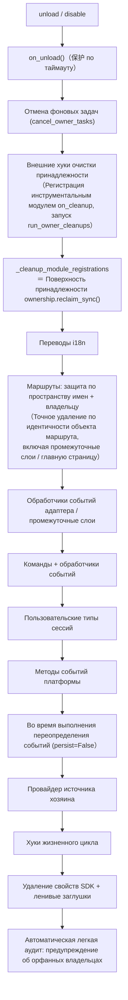

# Система принадлежности (владельца)

> [!TIP]
> **Когда читать эту статью**: при диагностике утечек ресурсов, понимании цепочки очистки при отключении или объявлении принадлежности ресурсов. Если не нужно, можно пропустить, это не повлияет на использование других функций.

> **После прочтения вы узнаете**: как контекст владельца автоматически присваивает ресурсы, полная картина принадлежности ресурсов, полный порядок очистки при отключении/отключении, а также какие ресурсы не очищаются при отключении (пределы дизайна).
>
> **В этой статье не рассматривается**: когда ресурс "вступает в силу" (права определения) (см. [Область действия (scope)](scope.md)); рекомендуемая запись фоновых задач и граница принудительного отмены (см. [Управление жизненным циклом · Принадлежность и автоматическая отмена фоновых задач](lifecycle.md#фоновые-задачи-принадлежность-и-автоматическая-отмена)).

Принадлежность является основой "plug-and-play" модуля: все зарегистрированные в процессе загрузки ресурсы автоматически присваиваются, и при отключении/отключении они автоматически возвращаются — автор модуля должен только объявить ресурсы, не нужно писать ручной код очистки.

> **Связанные системы**: область действия (scope) определяет "действует ли ресурс" при отправке событий, принадлежность определяет "кому принадлежит ресурс, кто при отключении будет очищен". Область действия см. [Единая система управления (scope)](scope.md), фоновые задачи см. [Управление жизненным циклом](lifecycle.md#фоновые-задачи-принадлежность-и-автоматическая-отмена).

{!--< tips >!--}
1. Принадлежность автоматически записывается в момент регистрации по `current_owner`, без изменений в коде модуля
2. Отключение/отключение используют одну и ту же цепочку очистки (`_cleanup_module_registrations`), каждая ошибка только предупреждает, не прерывает
3. Ресурсы пользовательского конфигурационного семантического (постоянное перезаписывание / правила области / ACL команд) **не** очищаются при отключении модуля
4. Внешние дескрипторы, управляемые инструментальным модулем, можно добавить в цепочку очистки с помощью `on_cleanup(cb)`, при отключении модуля автоматически вызывается обратный вызов (см. [Руководство по инструментальным модулям](#инструментальные-модули-управление-дескрипторами-других-модулей))
{!--< /tips >!--}

## Механизм контекста владельца

Принадлежность передается через контекстную переменную `current_owner` (`ErisPulse.runtime.context`):

```python
from ErisPulse.runtime import owner_scope, get_current_owner

with owner_scope("MyModule"):
    # Все зарегистрированные ресурсы в этом интервале автоматически присваиваются MyModule
    assert get_current_owner() == "MyModule"
```

Рамка автоматически вставляет владельца в следующие моменты (код модуля/адаптера не требует ручного обертывания):

| Момент | Значение владельца | Позиция |
|------|----------|------|
| `load()` модуля | Имя модуля | При инстанцировании + `on_load` на протяжении всего процесса |
| `start()` / `restart()` адаптера | Имя платформы | На протяжении всего процесса запуска адаптера |
| Регистрация stub'ов с `activate_on` | Имя модуля | Регистрация запускаемых команд/обработчиков |
| Время выполнения обработчика событий | Имя модуля, к которому принадлежит обработчик | Повторное вложение обработчика / входной точки команды |

Повторное вложение во время выполнения означает: обработчики команд, объявленные модулем в `on_load`, при вызове регистрирующих API (например, `sdk.adapter.on()`, `overrides.*.set(persist=False)`) во время выполнения также автоматически присваиваются этому модулю.

### bind_owner: вшить принадлежность в обратные вызовы и входные точки потоков

`owner_scope` действует на блок кода; `bind_owner(fn)` вшивает контекст "внутрь" самой функции — при упаковке моментально захватывается `current_owner`, и оттуда, где бы ни вызывалась, с какого бы потока или цикла событий, будет выполняться с оригинальным владельцем. Новые потоки по умолчанию имеют пустой контекст (пути триггеров `Timer` / `watcher` / пула потоков сторонних библиотек `current_owner` равен None), задачи, созданные внутри, не попадают в таблицу принадлежности, и их отключение модуля не отменяет (один из источников остатков за пределами цикла), после упаковки принадлежность переносится с собой:

```python
from ErisPulse.runtime import bind_owner

class MyModule(BaseModule):
    async def on_load(self, event):
        # Перед передачей в сторонний планировщик / пул потоков сначала упакуйте:
        external_scheduler.submit(bind_owner(self._poll))

    async def _poll(self):
        # Во время выполнения current_owner == "MyModule", при отключении он может быть правильно очищен
        ...
```

- `async` функции сохраняют `async`, принадлежность действует на протяжении всех `await`;
  обычные функции действуют только на протяжении синхронного выполнения
- Собственные входные точки фреймворка (`self.spawn()` / входные точки команд) уже автоматически несут принадлежность, эта функция предназначена только для **внешних путей триггеров** (внешние планировщики, `threading.Timer`, таблицы обратных вызовов и т.д.)

## Полная картина принадлежности ресурсов

Все ресурсы, зарегистрированные в контексте загрузки, автоматически записываются, и при отключении/отключении они автоматически очищаются:

| Ресурс | Способ регистрации | Вызов очистки |
|------|----------|----------|
| Команды | `@command()` / объявление командного словаря | `command.unregister_by_owner()` |
| Обработчики событий | `@message` / `@notice` / `@request` / `@meta` | `handler.unregister_by_owner()` |
| Слушатели событий адаптера | `sdk.adapter.on()` / `raw=True` | `adapter.unregister_handlers_by_owner()` |
| Промежуточные слои адаптера | `@sdk.adapter.middleware` | То же самое |
| Маршруты (HTTP/WS/SSE) | `router.http()` / `websocket()` / `sse()` | Двойная защита по пространству имен и владельцу |
| Промежуточные слои маршрута | `@router.middleware()` / `add_middleware()` | `router.unregister_all_by_owner()` |
| Главная страница Dashboard | `router.register_home_entry()` | `unregister_home_entries_by_owner()` |
| Пользовательские типы сессий | `register_custom_type()` | `unregister_custom_types_by_owner()` |
| Методы событий платформы | `register_event_method()` / `register_event_mixin()` | `unregister_event_methods_by_owner()` (при отключении модуля автоматически очищается, старые закрытые области больше не утекают) |
| Фоновые задачи | `self.spawn()` | `cancel_owner_tasks()` |
| Внешние очистительные хуки принадлежности (инструментальный модуль управляет) | `runtime.on_cleanup(cb)` | `run_owner_cleanups()` (вызывается в цепочке отключения/отключения/закрытия адаптера) |
| Жизненный цикл хуки | `lifecycle.register()` | `lifecycle.unregister_by_owner()` |
| Провайдер источника хозяина | `master.provider` | `master.unregister_by_owner()` |
| Переводы i18n | Объявление `I18nClass` (domain=имя модуля) | `i18n.unregister_domain()` |
| Переопределения событий (во время выполнения) | `overrides.*.set(persist=False)` | `overrides.unregister_by_owner()` |
| Интерактивные сессии (ожидание wait_reply / аренды) | `event.wait_reply()` / `sdk.interaction.acquire()` | `interaction.cancel_by_owner()` (сторона ожидания немедленно получает отмену) |
| Контекстные данные | `runtime/context` записывает по владельцу | Точная очистка по модулю |

Соответствующие ресурсы со стороны адаптера (с именем платформы как владельца) при `shutdown()` / `restart()` адаптера очищаются по `_cleanup_adapter_resources`, дополнительно:

| Ресурс | Вызов очистки |
|------|----------|
| Собственные `on()` обработчики и промежуточные слои адаптера | `adapter.unregister_handlers_by_owner(platform)` |
| Расширения методов событий платформы (`EventMixin`) | `unregister_platform_event_methods(platform)` |
| Пользовательские типы сессий | `unregister_custom_types_by_owner(platform)` |
| Интерактивные сессии (ожидание wait_reply / аренды на платформе) | `interaction.cancel_by_platform(platform)` |
| Переводы i18n (domain=ключ конфигурации) | `i18n.unregister_domain(ключ конфигурации)` |
| Маршруты с мелкозернистым пространством имен | `router.unregister_all_by_owner(platform)` |

## Последовательность очистки при отключении/отключении

`unload()` и `disable()` используют одну и ту же цепочку очистки (каждый шаг независимо try/except, ошибка только регистрирует в логах, **не прерывает последующую очистку**):



При выходе `sdk.uninit()` есть глобальная защита: все адаптеры shutdown → все модули unload → `router.stop()` (очистка маршрутов/промежуточных слоев/главной страницы) → `cancel_all_background_tasks()` → очистка обработчиков событий и хуков.

## Единая поверхность принадлежности (ownership)

Шестнадцать шагов цепочки очистки сведены в единый интерфейс принадлежности `ErisPulse.Core.ownership`, четыре глагола охватывают "удаление, подсчет, сканирование, аудит" — функции `*_by_owner` отдельных подсистем остаются неизменными, как внутренние реализации поверхности:

| Глагол | Назначение |
|------|------|
| `ownership.reclaim(owner)` | Общее удаление всех ресурсов владельца (отмена задач → хуки очистки → зарегистрированные ресурсы; асинхронная полная версия) |
| `ownership.reclaim_sync(owner)` | Удаление зарегистрированных ресурсов (синхронная версия, для синхронного пути отключения) |
| `ownership.counts(owner=None)` | Только чтение подсчета ресурсов владельца (None для всех владельцев) |
| `ownership.orphans()` | Сканирование сирот: ресурсы зарегистрированы, но владелец уже отключен (доказательство утечек) |
| `ownership.audit(owner, deep=)` | Отчет об аудите утечек (подсчет + сироты + необязательная выборка экземпляров gc) |

```python
from ErisPulse.Core import ownership

ownership.reclaim_sync("MyModule")       # {'commands': 1, 'routes_http': 2, ...}
ownership.counts("MyModule")             # Подсчет зарегистрированных ресурсов
ownership.orphans()                      # [{"owner": "ghost", "total": 2, ...}]
```

**Точка входа аудита**:

- После отключения / перезагрузки **автоматическая легкая аудит**: обнаружение орфанных ресурсов владельца вызывает предупреждение (ноль накладных расходов на подсчет сканирования)
- `sdk.module.audit(name, deep=True)` : аудит экземпляра модуля gc — при невозможности собрать экземпляр указывает тип источника ссылки (локализация "кто держит старый экземпляр"); имеет глобальные паузы, используется только при явной диагностике
- Глубокая выборка — явная операция, без настройки ключа, не делает автоматического восстановления

## Вложенные жизненные циклы (ownership.nest)

> Эта функция доступна в ErisPulse **2.12+**.

Позволяет одному модулю (родитель) управлять другой группой владельцев (дочерних), при удалении родителя дочерние ресурсы также удаляются. Типичные сценарии: запуск под插агинов внутри модуля сценария, панели расширения в Dashboard, инструментальный модуль, управляющий внешними таблицами регистрации.

```python
from ErisPulse.Core import ownership

ownership.nest("ScriptEngine", "ScriptEngine.plugin_a")
ownership.nest("ScriptEngine", "ScriptEngine.plugin_b")

ownership.nested_children("ScriptEngine")
# frozenset({"ScriptEngine.plugin_a", "ScriptEngine.plugin_b"})

ownership.unnest("ScriptEngine", "ScriptEngine.plugin_a")
```

| Элемент | Соглашение |
|----|------|
| Порядок удаления | Дочерние удаляются раньше родителя; при одинаковом уровне по порядку регистрации (последние удаляются первыми) |
| Область удаления | Ресурсный уровень (задачи / соединения / маршруты / команды / tracked ресурсы / хуки очистки), **не вызывает `on_unload` дочернего модуля** |
| Проверка цикла | `nest` отвергает самосвязь и уже существующие обратные связи, возвращает `False` и предупреждает |
| Дочерний умирает первым | При самостоятельном удалении (reclaim / reclaim_sync) дочерний автоматически unnest, родительская сторона не сохраняет висячие отношения |
| Таймаут | Один подчиненный удаляется в пределах `CLEANUP_CALLBACK_TIMEOUT_SECS`; при превышении таймаута предупреждение, удаление родитель-дочерняя связь и продолжение |
| Наблюдаемость | `ownership.counts(parent)` увеличивает счетчик `nested`; `ownership.orphans()` делает транзитивную оболочку для вложенных отношений, остаточные отношения, где родитель исчез, все еще будут обнаружены |

**Почему не вызывается `on_unload` подчиненного**: полная отмена модуля требует процесса управления (ленивые заглушки, свойства sdk, рассылка событий), а поверхность `ownership` отвечает только за очистку ресурсов, перекрестный вызов может привести к риску повторного блокирования отмены. При необходимости `on_unload` подчиненного, родитель должен явно вызвать его в своем `on_unload`:

```python
await self.sdk.module.unload(child, reason="cascade")
```

Синхронный вход (например, `sdk.module.disable`) сначала помечает асинхронную цепочку, фоновые задачи удаляют ресурсы подчиненного; `reclaim_sync` только при отсутствии асинхронной цепочки сама удаляет зарегистрированные ресурсы подчиненного.

## Откат при горячей перезагрузке

Горячая перезагрузка — это "**снимок перед отключением → автоматический откат при сбое → повторное воспроизведение on_load**": при синтаксической ошибке, отсутствии зависимостей, сбое загрузки нового варианта, старый экземпляр и состояние регистрации (записи регистраций, свойства sdk, записи sys.modules) автоматически восстанавливаются, затем в контексте принадлежности **повторно воспроизводится старый экземпляр `on_load`** (`reason` будет `"rollback"`), чтобы восстановить внешние ресурсы, разорванные на этапе отключения; после завершения генерируется событие `module.rollback` (payload `{module_name, success}`).

При неудачной перезагрузке адаптера также восстанавливается старое состояние регистрации; если старый экземпляр находился в рабочем состоянии и старые запущенные задачи завершены, после отката повторно воспроизводится `start()`, и генерируется событие `adapter.rollback` (payload `{adapter_name, replayed, success}`). Потеря соединения / оффлайн бота и другие побочные эффекты отключения не могут быть отменены. Повтор и событие `adapter.rollback` доступны в ErisPulse **2.12+**.

Ограничения:

- При неудаче или таймауте повтора **только предупреждение**, не откат отката отката — старый экземпляр остается в состоянии "завершенного" (как в 2.11.2 и более ранних версиях), в логах будет четко указано
- Сторонние ссылки, созданные в процессе выполнения, не входят в восстановление
- Если целевой пакет был удален (исчезли entry-point), считается успешным отключением, откат не выполняется
-载荷 для `on_unload` содержит `reason` (`unload` / `reload` / `disable` / `cascade` / `dormant` / `load-failed`), модуль может отложить закрытие ресурсов, которые должны пережить перезагрузку, в `reload`

Полные возможности горячей перезагрузки, семантика перекрестных циклов и правила для модулей см. в следующем разделе.

## Ограничения горячей перезагрузки

Горячая перезагрузка может заменить код, пересоздать регистрацию, откатить неудачную перезагрузку — но это **не перезапуск процесса**. Очищаются только **регистрированные в системе принадлежности ресурсы в режиме выполнения**; ресурсы, не принадлежащие ни одному владельцу, пользовательские данные конфигурации, внутренние кэши сторонних библиотек, не исчезнут вместе с перезагрузкой.

### Ограничения возможностей

| Объект | Поведение после перезагрузки | Объяснение |
|------|-----------|------|
| Код модуля / определение класса | Поддерживается, повторно импортируется | Старая запись `sys.modules` удаляется |
| `on_unload` / `on_load` | Поддерживается, вызывается по порядку | При неудаче перезагрузки повторно вызывается `on_load` (см. предыдущий раздел) |
| Команды / обработчики / маршруты / хуки жизненного цикла | Поддерживается, автоматически удаляются и регистрируются | Очищаются через цепочку принадлежности |
| `spawn_background` / `spawn_later` / `spawn_thread` | Поддерживается, отменяются по владельцу | Потоки регистрируются для наблюдения, не могут быть жестко убиты |
| Главный цикл на любом `asyncio.create_task` | Поддерживается, автоматически отменяются | Фабрика задач перехватывает (включая внутренние создания сторонних библиотек) |
| Задачи, созданные в цикле хранилища | Поддерживается, автоматически отменяются | Цикл хранилища также установлен на фабрику задач |
| Ресурсы, зарегистрированные с помощью `ownership.track()` | Поддерживается, вызывается `release()` | Ресурсы, привязанные к циклу, недоступны для фабрики задач |
| Хуки `on_cleanup` | Поддерживается, вызываются | Инструментальный модуль использует их для отбрасывания управляемых дескрипторов |
| Постоянное переопределение (`persist=True`) / файлы конфигурации | Не обрабатывается, сохраняется | Пользовательские активы |
| Объектные ссылки, кэшированные сторонними библиотеками | Не обрабатывается | Фреймворк не видит, модуль должен сам устранить ссылки |
| Созданные модулем `new` события цикла / голые потоки | Не удаляются | См. правила ниже |

### Трехуровневое управление ресурсами

1. **Уровень безвоздейственного перехвата** — фабрика задач на уровне цикла событий. Любое создание задач в контексте владельца автоматически присваивается, охватывая главный цикл и цикл хранилища-моста.
2. **Уровень принадлежности планирования** — `spawn_background` / `spawn_later` / `spawn_thread`.
3. **Уровень сотрудничества регистрации** — `ownership.track()` / `on_cleanup()`, для структурных ресурсов, недоступных для фабрики задач (пулы соединений, клиенты сторонних библиотек).

### Ограничения циклов событий

| Цикл | Создан | Установлена фабрика задач | Назначение |
|------|--------|-----------|------|
| Главный цикл | `sdk.run()` / `sdk.init()` | Установлена | Весь бизнес-код |
| Цикл хранилища-моста | `AsyncBridge` (первый синхронный вызов хранилища) | Установлена | Фоновое выполнение синхронных API хранилища |
| Временный цикл | `spawn_background` по умолчанию | Не установлена, уничтожается после использования | Последнее средство, когда главный цикл не готов |

**Временный цикл — последнее средство**: он синхронно блокирует вызывающий поток, и задачи, созданные внутри цикла, будут потеряны (в логах есть предупреждение `temp_loop_fallback`). Если вы видите это предупреждение, значит модуль запустил фоновую задачу в неправильное время.

**Отмена между циклами — это лучшие усилия**: `cancel_owner_tasks` обнаруживает задачи на других все еще работающих циклах, использует `call_soon_threadsafe` для отправки отмены и выдает предупреждение `cross_loop_task_residual`, но **не ждет** их завершения (ожидание между циклами небезопасно). Если вы видите это предупреждение, проверьте, не создали ли вы собственный цикл событий.

### Правила для модулей

```python
# Рекомендуется
spawn_background(self._poll())            # Принадлежность фоновой задачи
spawn_later(30, lambda: self._cleanup())  # Принадлежность отложенной задачи
spawn_thread("poller", self._loop_body)   # Принадлежность потока (входная точка автоматически имеет контекст владельца)
ownership.track(pool)                     # Явная регистрация ресурса, привязанного к циклу
await sdk.storage.aget(key)               # Асинхронный контекст напрямую использует асинхронный API

# Избегайте
asyncio.create_task(self._poll())         # Голый вызов: отсутствие ссылки легко может быть собрано GC
asyncio.new_event_loop()                  # Создание собственного цикла: система принадлежности полностью не может достичь
threading.Thread(target=self._loop_body)  # Голый поток: входная точка без контекста владельца
self._storage.get(key)                    # В асинхронном контексте синхронный вызов хранилища: блокирует главный цикл
```

### Список проверки

1. В логах есть `cross_loop_task_residual`? → Ресурс находится в самодельном цикле
2. В логах есть `temp_loop_fallback`? → Фоновая задача запущена до готовности главного цикла
3. Ошибка `attached to a different loop`? → Проверьте, не создали ли вы цикл событий или не используете ли объект соединения между циклами
4. `ownership.orphans()` выводит данные? → Ресурс владельца все еще жив после отключения

## Пределы дизайна: какие ресурсы не очищаются при отключении

Система принадлежности очищает только **регистрированные модульным кодом ресурсы в режиме выполнения**. Следующие ресурсы относятся к **конфигурационной семантике пользователя** (управление в руках пользователя, возможно, намеренно настроено), и после отключения модуля сохраняются вместе с конфигурацией:

| Ресурс | Семантика | Объяснение |
|------|------|------|
| `overrides.*.set(persist=True)` | Постоянное переопределение | Записывается в файл конфигурации, действует при перезапуске; модуль не удаляет при отключении (пользователь явно настроил) |
| `scope.set_action()` и т.д. правила области | Управление правами | Управляется пользователем/Dashboard, модуль не удаляет правила при отключении |
| `overrides.acl.set(persist=True)` | ACL команд | То же самое |
| `Conversation.save()` сохранение | Многоразовая архивация диалога | Данные активов не очищаются |

Временные данные, записанные во время выполнения (persist=False), удаляются вместе с владельцем — **постоянно или нет — это граница между "активами пользователя" и "состоянием выполнения модуля"**.

## Внутренняя реализация: как работает принадлежность

**Одно предложение**: цепочка присвоения (contextvar передача) определяет "на кого записано", цепочка отмены (таблица задач) определяет "можно ли отменить при отключении" — эти две цепи работают независимо, для правильной очистки ресурсов необходимы обе.

Система принадлежности состоит из **двух независимых цепей**, понимание их разделения является предпосылкой для диагностики проблем с принадлежностью:

### Цепочка присвоения (contextvar передача)

`runtime/context.py` `current_owner` и другие ContextVar отвечают за **присвоение** — "на кого записан ресурс/вызов, зарегистрированный в этом коде". Правила передачи следуют семантике Python contextvars:

| Выполнение | context передается | Результат присвоения |
|---------|----------------|---------|
| Синхронная цепочка вызовов / `await` цепочка | ✅ Передается | Правильное присвоение |
| `owner_scope` внутри `asyncio.create_task` | ✅ Передается (task копирует контекст в момент создания) | Внутри задачи правильное присвоение |
| `run_in_executor` / голый поток | ❌ Не передается | Присвоение теряется |
| Самостоятельно созданный цикл событий | ❌ Не передается | Присвоение теряется |

> Присвоение ≠ регистрация: передача контекста влияет только на "на кого записано", можно ли очистить ресурс зависит от того, попал ли он в следующую цепочку отмены.

### Цепочка отмены (таблица задач)

`runtime/tasks.py` `_owner_tasks` таблица отвечает за **жизненный цикл** — "какие незавершенные задачи принадлежат владельцу, которые нужно отменить при отключении". Способы попадания задач в таблицу регистрации:

1. **Явное планирование**: `spawn_background()` / `self.spawn()` → при создании захватывает `current_owner` (или явный параметр `owner=`) → регистрируется в таблице;
2. **Фабрика задач автоматически регистрирует** (2.8.3): `install_owner_task_factory()` устанавливается в главный цикл событий при запуске фреймворка — **любая** задача, созданная (включая внутренние `create_task` сторонних библиотек), проходя через фабрику, читает `current_owner`, если не None, регистрируется.

Таблица саморегистрируется: каждая задача имеет `done_callback`, при завершении удаляется из таблицы, утечек нет.

### Последовательность отмены (отключение модуля)

```
module.unload()
  → on_unload(event)                    # Модуль самостоятельно очищает (защита по таймауту)
  → Фреймворк удаляет команды/обработчики/хуки/маршруты этого владельца
  → cancel_owner_tasks(owner)           # Таблица задач отменяет по умолчанию
      → поочередно task.cancel()        # Исключая задачу, которая сама выполняет логику отмены
      → await gather(pending, timeout)  # Ждет завершения (таймаут не блокирует)
```

### Стратегия диагностики

- **Ресурс не очищается** → Проверьте таблицу регистрации: `get_owner_tasks("MyModule")` содержит ли эта задача; если нет, значит путь регистрации не прошел через цепочку принадлежности (import период / поток / независимый цикл), сверьтесь с предыдущей таблицей для локализации.
- **Неправильное присвоение** → Проверьте `get_current_owner()` в момент ошибки; для асинхронных отложенных выполнений (обратные вызовы/задачи) присвоение берется из контекста в момент создания, а не в момент выполнения.

## Руководство для авторов модулей

### Рекомендуемая запись

```python
from ErisPulse import sdk
from ErisPulse.Core.Event import command
from ErisPulse.runtime import owner_scope, spawn_background

class MyModule(BaseModule):
    async def on_load(self, event):
        # Рамочные ресурсы: автоматически присваиваются, нет необходимости в ручной очистке
        self.task = self.spawn(self.polling())      # Фоновая задача
        sdk.router.register_home_entry("Мой модуль", "/my")  # Главная страница

        # Ресурсы, принадлежащие модулю: включаются в систему принадлежности с помощью owner_scope
        with owner_scope("MyModule"):
            self.client.on_event(self._handle)      # Пример пользовательской регистрации

    async def on_unload(self, event):
        # Рамочные ресурсы уже автоматически очищены, нужно только очистить ресурсы, не охваченные owner_scope
        await self.client.close()
```

### Примечания

- **Регистрация в импорте**: Регистрация хуков/обработчиков на уровне модуля (в момент импорта) происходит до `owner_scope`, и они рассматриваются как ресурсы рамки (owner=None) и **не очищаются**. Все должно быть зарегистрировано в `on_load()`.
- **Регистрация пользовательской области i18n**: `i18n.register(domain=...)` с domain, не равным имени модуля, не будет автоматически очищена, сохраните domain=имя модуля.
- **Рекомендуется использовать `self.spawn()` для фоновых задач**: начиная с 2.8.3, голые `asyncio.create_task` также **автоматически присваиваются** (Task Factory автоматически регистрирует, отменяется при отключении); но `self.spawn()` по-прежнему рекомендуется — поддерживает запуск из неглавного цикла потоков, явное указание `owner=` и предотвращение GC для fire-and-forget. **В версиях до 2.8.3** голые задачи не присваиваются, необходимо использовать `self.spawn()`.
- Цепочка очистки "ошибка только предупреждение": исключение в одном шаге не блокирует очистку остальных ресурсов, логи уровня DEBUG/WARNING видны, при диагностике можно включить TRACE.

### Таблица соответствия времени регистрации и результата принадлежности

| Сценарий регистрации | Результат принадлежности | Объяснение |
|---------|---------|------|
| Регистрация через API рамки (команды/обработчики/lifecycle/маршруты) внутри `on_load()` | Принадлежит модулю | Автоматически удаляется при отключении |
| Регистрация на уровне модуля (в момент импорта) | **Без принадлежности** (owner=None) | Не очищается, не используйте |
| Фоновая задача, созданная с помощью `self.spawn()` | Принадлежит модулю | Автоматически отменяется при отключении |
| Регистрация через сторонний API в `owner_scope("Name")` | Принадлежит модулю | Зависит от того, что обратный вызов сторонней библиотеки синхронно выполняется в scope |
| Голые `asyncio.create_task` (включая `loop.create_task` / `ensure_future`) | **Автоматически присваивается** (Task Factory, 2.8.3+) | В момент создания читается `current_owner`, автоматически регистрируется, отменяется при отключении; см. ниже [Внутреннюю реализацию](#внутренняя-реализация-принадлежность-как-работает) |
| Задачи, созданные в обратных вызовах сторонних библиотек (aiohttp / APScheduler и т.д.) | **Автоматически присваиваются** (Task Factory, 2.8.3+) | Если `current_owner` уже вставлен (например, во время выполнения обработчика рамки), задача автоматически регистрируется |
| `run_in_executor` (пул потоков) | **Без принадлежности** (не asyncio.Task) | Потоки не подчиняются фабрике задач, необходимо самостоятельно управлять жизненным циклом |
| Регистрация в независимом цикле событий (самостоятельно созданный цикл) | **Без принадлежности** | Фабрика задач установлена только в главном цикле; contextvars также не передаются между циклами событий |

> Принцип: **принадлежность следует контексту `current_owner` в момент регистрации**; любая асинхронная задержка, пулы потоков, независимые циклы событий выходят из этого контекста — при необходимости принадлежности явно войдите в `owner_scope`.

## Руководство по инструментальным модулям: управление дескрипторами других модулей

**Сценарий**:定时任务、注册表、连接池这类"工具模块"会替其它模块保管东西——对方在 `on_load` 里调用 `sdk.Cron.on_trigger(handler)`，你的容器里就存下了 一个指向对方实例的回调。框架会自动清理对方注册的一切框架资源，但清理不了 你**私有容器里的引用**：对方卸载后你的容器还拉着它的实例，它就无法被 GC 回收（内存泄漏，`purge` 泄漏诊断报"不可回收"）。

**解法**：在登记对方东西的同一个函数里调用 `on_cleanup()`， 框架会在对方卸载 / 禁用时自动回调你的清理函数：

```python
from ErisPulse.Core.Bases import BaseModule
from ErisPulse.runtime import off_cleanup, on_cleanup

class CronModule(BaseModule):
    def __init__(self):
        self._entries = {}  # {模块名: 该模块托管的回调列表}

    def on_trigger(self, handler):
        # 自动识别调用方模块名（on_load 直接调用 / module.call 均正确），
        # 返回值是解析出的 owner，可直接用作记名键
        owner = on_cleanup(self._drop)
        self._entries.setdefault(owner, []).append(handler)

    def _drop(self, owner: str):
        """对方模块被卸载/禁用时由框架自动调用：抛弃它的句柄即可"""
        self._entries.pop(owner, None)

    async def on_unload(self, event):
        off_cleanup(self._drop)  # ③ 自己卸载前注销钩子，避免钩子表持有 self
```

框架保证的行为：

| 关注点 | 行为 |
|--------|------|
| 触发时机 | 对方模块 unload / disable，或适配器关闭——均在框架清理链内触发，早于 purge 泄漏诊断 |
| 调用方识别 | 直接调用取 `current_owner`；经 `module.call()` 被调用取调用方（`current_caller`）；也可 `on_cleanup(cb, owner="模块名")` 显式指定。**强制校验**：owner 无法解析（三种来源均缺失）时抛 `ValueError`——私有工具模块应在自身加载上下文内登记钩子 |
| 回调签名 | `cb(owner: str)`，同步 / 异步均可；异步带超时保护（`CLEANUP_CALLBACK_TIMEOUT_SECS`，默认 10 秒） |
| 容错 | 单个回调异常 / 超时只记日志，不影响其余钩子与清理链 |
|重复登记 | 同一 `(owner, callback)` 幂等去重 |

**什么时候不需要**：如果对方注册的是框架资源（命令、事件处理器、路由、 后台任务……），框架已全自动清理（见上文[归属资源全景](#归属资源-全-景)）。只有你私有容器里持有的对方句柄才需要 `on_cleanup`。
模块开发视角的速查版见 [最佳实践 · 工具模块](../developer-guide/modules/best-practices.md#工具模块-托管-别人-东西-时-要-接住-卸载-通知)。

## Связанные документы

Выберите следующий шаг:

- **Хочу контролировать "действует ли ресурс" (уровень прав) →** [Область действия (scope)](scope.md) — принадлежность управляет "кому принадлежит ресурс, кто при отключении будет очищен", область действия управляет "когда ресурс вступает в силу"
- **Бэкграунд-задачи / таймеры для автоматической отмены** → [Управление жизненным циклом · Принадлежность и автоматическая отмена фоновых задач](lifecycle.md#фоновые-задачи-принадлежность-и-автоматическая-отмена)
- **Изолировать для грейд-деплоя с отдельным владельцем** → [Теневой модуль и грейд-деплой](shadow.md)
- **Краткий обзор и рекомендации для модульного разработчика** → [Лучшие практики модулей](../developer-guide/modules/best-practices.md)