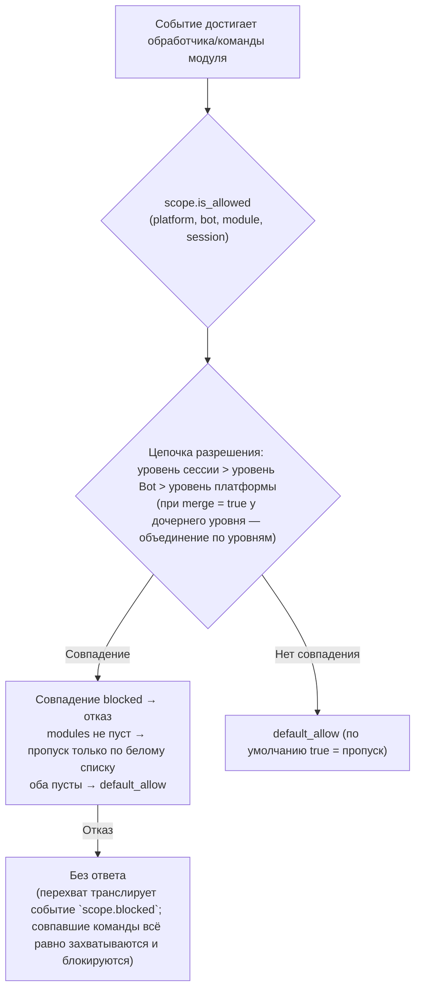

# Область действия (scope)

> [!TIP]
> **Когда читать этот документ**: когда нужно управлять доступностью модулей, допуском событий или ограничениями исходящих действий. Если это не требуется — пропустите, на использование остальных функций это не повлияет.

> **Прочитав, вы узнаете**: пути конфигурации каждого из трёх измерений области действия (доступность модулей / допуск событий / исходящие действия),
> приоритеты их определения и поведение при отказе, как пользоваться API времени выполнения, а также как наблюдать за перехватом (событие `scope.blocked`).
>
> **Здесь не рассматриваются**: принадлежность ресурсов, их выгрузка и освобождение (см. [Систему владения (owner)](ownership.md));
> ACL команд и переопределение событий (см. [Введение в обработку событий](../getting-started/event-handling.md)).

> [!NOTE]
> Для этой функции требуется ErisPulse **2.8.0+**.

Область действия отвечает на четыре вопроса: **какие модули доступны, чьи события принимать, какой текст обрабатывает тот или иной модуль и что модуль может делать наружу**.
Управление полностью отдаётся пользователю: правила объявляются единым образом на **уровне выше** регистрации модулей / адаптеров / обработчиков / исходящих вызовов (в конфигурации `ErisPulse.scope` или во время выполнения через `sdk.scope`), а конвейер событий автоматически считывает и применяет их на входе, при фильтрации обработчиков и на шлюзе исходящих вызовов.

| Измерение | Что контролирует | Поведение при отказе | Путь конфигурации |
|------|---------|---------|---------|
| **① Модули** | Какие модули доступны (три уровня: платформа / Bot / сессия) | Отфильтрованные модули не срабатывают и не отвечают (перехват транслирует событие `scope.blocked`; совпавшие команды всё равно захватываются и блокируются) | `scope.platforms / bots / sessions` |
| **② Идентичность** | Принимать ли события (четыре уровня: адаптер / Bot / сессия / пользователь) | Полное отбрасывание на входе (перехват транслирует событие `scope.blocked`) | `scope.identity.*` |
| **③ Исходящие** | Какие исходящие вызовы может инициировать модуль (сообщения / API / запросы; белые и чёрные списки на уровне методов) | Ответ с ошибкой (`retcode=34601`) | `scope.actions` |

> **Связанные системы**: команды — это особые обработчики событий сообщений; их пользовательские чёрно-белые списки (ACL) и переопределение параметров реализации поддерживаются системой команд (`ErisPulse.event.command`),
> см. [Введение в обработку событий](../getting-started/event-handling.md) и [Руководство по конфигурации](../user-guide/configuration.md).

{!--< tips >!--}
1. Импортируйте синглтон через `from ErisPulse.Core import scope` (это тот же объект, что и `sdk.scope`)
2. Проверки: `scope.is_allowed(...)` / `scope.is_identity_allowed(...)` /
   `scope.is_action_allowed(...)` соответствуют трём шлюзам ①②③
3. Чтение и запись: параметризованные методы по измерениям (с автодополнением в IDE) —
   `scope.set_module(...)` / `scope.set_identity(...)` / `scope.set_action(...)`;
   кроме того есть словарный запасной вариант `scope.get(path)` / `scope.set(path, v)` / `scope.delete(path)`
4. Переопределение текстовых условий обработчиков событий — см.
   [Введение в обработку событий · Переопределение событий](../getting-started/event-handling.md#переопределение-событий-переопределение-поведения-любого-типа-события-без-изменения-кода-модуля);
   ACL команд / переопределение параметров — см. [Введение в обработку событий](../getting-started/event-handling.md)
{!--< /tips >!--}

## Синтаксис записей сопоставления (единый для всей системы)

Все «списки имён» в области действия (имена модулей, ключи идентичности, записи исходящих действий) используют один и тот же синтаксис сопоставления
(`ErisPulse.Core.text_match`):

| Синтаксис | Пример | Описание |
|------|------|------|
| Точное имя | `"Chat"` | Сравнение полного значения, **без учёта регистра** |
| glob | `"Tool*"`, `"spam_*"` | `*` любая строка / `?` один символ / `[seq]` набор символов, без учёта регистра |
| Регулярное выражение | `"re:^Danger.*"` | Объявляется префиксом `re:`, сопоставление через регулярное `search`, по умолчанию без учёта регистра |

- Некорректные регулярные выражения **молча деградируют** до «не совпадает» (без исключений и сбоев)
- Параметры декораторов (`pattern=` / `regex=`) имеют фиксированную семантику: `pattern` — это glob, `regex` — исходный текст регулярного выражения
  (без префикса `re:`); записи-регулярные выражения в конфигурации области действия **обязаны** иметь префикс `re:`

## Глобальное резервное значение: `default_allow`

`default_allow` — **единственный на всю систему** резервный переключатель (по умолчанию `true`),
единообразно действующий на двух измерениях проверки:

- **Измерение модулей**: ни одна привязка не совпала → решение о пропуске/отказе принимает `default_allow`
- **Измерение идентичности**: ни одна политика не совпала → решение о пропуске/отказе принимает `default_allow`

Установка в `false` включает строгий режим «неявного отказа»: управление в духе белого списка,
**всё, что явно не разрешено, отвергается**.

> **Исключение**: измерение ③ исходящих вызовов **не подчиняется** `default_allow` — это независимый переключатель ужесточения:
> по умолчанию всё разрешено, ограничивают только явные правила (вызовы уровня фреймворка с пустым owner пропускаются всегда).
> Благодаря этому строгий глобальный режим случайно не обрежет ответы всех модулей.
> ACL команд имеет собственный резервный переключатель `ErisPulse.event.command.default_allow`; друг на друга они не влияют.

## Файл конфигурации

```toml
[ErisPulse.scope]
default_allow = true        # Глобальное резервное значение (false = строгий режим неявного отказа)
cache_size = 1024           # Размер LRU-кэша

# ── ① Измерение модулей (приоритет: сессия > Bot > платформа) ──
[ErisPulse.scope.platforms.onebot11]
modules = ["Chat", "Tool*"]   # Белый список: точное имя / glob / re: регулярное выражение
blocked = ["re:^Danger"]
[ErisPulse.scope.bots.onebot11."123456"]
modules = ["Chat"]
merge = true                  # Добавление к привязке уровня платформы (по умолчанию — полная перезапись)
[ErisPulse.scope.sessions.onebot11."789012345"]
modules = ["Chat"]

# ── ② Измерение идентичности (приоритет: пользователь > сессия > Bot > адаптер) ──
[ErisPulse.scope.identity.adapters.onebot11]
deny = true                   # Все события адаптера полностью отбрасываются
[ErisPulse.scope.identity.bots.onebot11."123456"]
deny = true
[ErisPulse.scope.identity.sessions.onebot11."g_blocked"]
deny = true
[ErisPulse.scope.identity.users.onebot11]
allow = ["u_admin"]           # Ключи пользователей поддерживают glob / re: регулярные выражения
deny = ["u_bad", "spam_*"]

# ── ③ Измерение исходящих (по умолчанию всё разрешено, запрещается только явным ужесточением) ──
[ErisPulse.scope.actions.MyModule]
send = { deny = true }                                    # Полный запрет отправки
api = { allow = ["get_*"] }                               # Разрешены только стандартные API-запросы
request = { deny = true }                                 # Запрет обработки запросов
```

## ① Измерение модулей

**Коротко**: с помощью трёхуровневых привязок (платформа / Bot / сессия) контролируется, «какие модули доступны в этом контексте»; отфильтрованные модули не срабатывают и не отвечают (совпавшие команды всё равно захватываются и блокируются).

Отвечает на вопрос «какие модули доступны в данном контексте». По умолчанию всё открыто; фильтрация начинается только после настройки привязок,
**модули и адаптеры не требуют никаких изменений**.



- **Приоритет разрешения: уровень сессии > уровень Bot > уровень платформы**; привязка с более высоким приоритетом **полностью перезаписывает** привязку с более низким;
  если у дочерней привязки указано `merge = true`, вместо этого выполняется **объединение по записям** с более низким приоритетом (modules / blocked объединяются по отдельности;
  сам `merge` — управляющий ключ и записью не считается)
- **Семантика по умолчанию**: команды и обработчики отфильтрованного модуля не срабатывают и не отвечают; это видно в логах уровня TRACE
  (`core.scope.denied`); перехват одновременно транслирует событие жизненного цикла `scope.blocked` (подписавшись, можно наблюдать, кого и почему перехватили); совпавшая **команда** всё равно захватывается и блокируется — текст команды больше не «протекает» к обработчикам сообщений с более низким приоритетом, что устраняет двусмысленность двойного ответа, когда после отказа команды обработчик сообщений реагирует ещё раз
- **Обработчики уровня фреймворка** (`scope_exempt=True` или пустой owner) не затрагиваются; ресурсы с пустым именем модуля (уровень фреймворка) пропускаются всегда
- **Справка и запрос команд с учётом сессии**: API запроса команд (`command.help` /
  `get_command` / `get_commands` / `get_group_commands` / `get_visible_commands`,
  а также `module.get_commands_overview`) поддерживают необязательный `event=` или явные
  ключевые аргументы `platform=` / `bot_id=` / `session_id=` — команды модулей, недоступных
  в текущей сессии, больше не попадают в результаты (`get_command` возвращает None, справка по отдельной команде обрабатывается как «не зарегистрирована»,
  что соответствует семантике по умолчанию); без передачи контекста поведение остаётся полным

### Наследование привязок (merge)

Семантика полной перезаписи по умолчанию ясна и предсказуема; когда нужно **добавить** записи к привязке родительского уровня, укажите `merge = true` на дочернем уровне:

```toml
[ErisPulse.scope.platforms.onebot11]
modules = ["Chat", "Tool"]      # Уровень платформы: разрешены Chat, Tool

[ErisPulse.scope.bots.onebot11."123456"]
modules = ["Music"]
merge = true                    # Фактически действующий список у этого Bot = ["Chat", "Tool", "Music"]
```

- Правила объединения: для `modules` и `blocked` по отдельности берётся **объединение**; внутри привязки `blocked` по-прежнему имеет приоритет над `modules`
- Цепное объединение: платформа → Bot → сессия, уровни накладываются последовательно; каждый уровень независимо решает — объединить (`merge`) или перезаписать

## ② Измерение идентичности (допуск событий)

**Коротко**: согласно четырёхуровневым политикам (пользователь / сессия / Bot / адаптер) на входе диспетчеризации полностью отбрасываются «события, которые не должны приниматься»; deny имеет приоритет над allow.

Отвечает на вопрос «чьи события принимать». Отклонённые события **полностью отбрасываются на входе диспетчеризации** —
они не попадают в middleware и ни к одному обработчику (включая уровень фреймворка), видно только в логах уровня TRACE (`core.scope.identity_denied`).

- **Приоритет разрешения: пользователь > сессия > Bot > адаптер**, берётся самая конкретная настроенная политика; deny имеет приоритет над allow
- Привязка каждого уровня — бинарная политика: `{ allow = true }` или `{ deny = true }`
- Ключи пользователей поддерживают glob / регулярные выражения (например, `"spam_*"` блокирует сразу группу спам-пользователей)
- Типичное применение — deny на верхнем уровне и allow для отдельного пользователя как «исключение»:

```toml
[ErisPulse.scope.identity.adapters.onebot11]
deny = true
[ErisPulse.scope.identity.users.onebot11]
allow = ["u_admin"]   # Даже при отказе на уровне адаптера события от u_admin пропускаются
```

## ③ Измерение исходящих (ограничение исходящих вызовов, инициируемых модулями)

**Коротко**: белые и чёрные списки на уровне методов ограничивают вызовы модуля — сообщения / API / запросы; отклонённые вызовы не порождают никаких сетевых запросов и сразу возвращают `retcode=34601`.

Ограничивает **исходящие действия**, инициируемые модулем: отправку сообщений / стандартные действия API / операции запросов.
Три типа действий соответствуют низкоуровневому DSL: `Event.reply` и `Send` (send), `Api` / `call_api` (api),
accept/reject у `Request` (request). Исходящие вызовы, инициированные модулем во время выполнения обработчика события,
несут owner модуля и единообразно проверяются этим измерением.

### Форма правил (инлайн-таблицы)

Правило для каждого действия — это инлайн-таблица: `{ allow = [...], deny = true|[...] }`.
У одного действия может быть только один вид правила (ключи TOML не могут повторяться: либо полный запрет, либо детализация — выберите одно):

```toml
[ErisPulse.scope.actions.MyModule]
send = { deny = true }                                  # Полный запрет отправки (Event.reply / Send DSL)
# Или детализация по методам: send = { allow = ["Text", "Image*"], deny = ["File"] }
api = { allow = ["get_*"] }                             # Пропускаются только стандартные API-запросы (чтение)
# Или чёрный список по действиям: api = { deny = ["set_*", "leave_*"] }
request = { deny = true }                               # Запрет обработки accept/reject запросов
```

- Записи `send` сопоставляются с **именами методов отправки** (`Text` / `Image` / `File` ...),
  записи `api` — с **именами стандартных действий** (`get_group_info` / `set_group_name` ...)
- Записи поддерживают точные имена / glob / `re:` регулярные выражения (единый синтаксис всей системы, без учёта регистра)
- Одиночная строка в `allow` эквивалентна списку из одной записи: `send = { allow = "Text" }`

### Семантика определения

**По умолчанию всё разрешено** — если правил нет или owner пуст (внутренние вызовы уровня фреймворка), вызовы пропускаются.
После настройки правил проверка идёт в следующем порядке:

1. `deny = true` → отказ
2. Имя вызова совпало со списком `deny` → отказ
3. Список `allow` не пуст, а имя вызова не совпало (или у вызова нет имени) → отказ
4. В остальных случаях — пропуск

Отклонённый вызов не порождает никаких сетевых запросов и сразу возвращает стандартный ответ с ошибкой
(`retcode = 34601`, см. [api-response §5.3](../standards/api-response.md#53-расширенные-коды-возврата-фреймворка-34xxx-младшие-три-цифры-сегмента-ошибок-платформы)).
Три типа действий независимы друг от друга — можно ограничить только один из них.

```python
# API времени выполнения
sdk.scope.set_action("MyModule", "send", deny=True)              # Полный запрет отправки сообщений
sdk.scope.set_action("MyModule", "send", allow=["Text"])         # Разрешена только отправка текста
sdk.scope.is_action_allowed("MyModule", "send", name="Image")    # False
sdk.scope.is_action_allowed("MyModule", "api", name="get_user_info")  # Проверка по правилам
sdk.scope.delete_action("MyModule", "send")                      # Вернуть разрешение
sdk.scope.get_action("MyModule", "send")                         # Текущее правило этого действия
```

## API времени выполнения

API времени выполнения области действия состоит из трёх слоёв: **проверки** (три вопроса), **параметризованное чтение/запись по измерениям** (для каждого измерения — методы `set` / `get` / `delete`, сигнатуры полностью типизированы, с автодополнением в IDE), **словарный запасной вариант** (пути через точку ведут к любому разделу напрямую).

```python
from ErisPulse import sdk

scope = sdk.scope
```

### Проверки (три вопроса)

```python
scope.is_allowed("onebot11", "123456", "Chat")                 # ① Измерение модулей
scope.is_allowed("onebot11", "123456", "Chat", "789012345")    # С учётом уровня сессии
scope.is_allowed("onebot11", "123456", None)                   # Ресурс уровня фреймворка -> True

scope.is_identity_allowed("onebot11", "123456", "group_9", "u1")   # ② Измерение идентичности

scope.is_action_allowed("MyModule", "send")                    # ④ Измерение исходящих
scope.is_action_allowed("MyModule", "send", name="Image")      # Детализация по методам
```

### ① Измерение модулей

```python
# Привязка (уровень определяется аргументами: session_id > bot_id > уровень платформы)
scope.set_module("onebot11", bot_id="123456", modules=["Chat", "Tool*"])
scope.set_module("onebot11", blocked=["re:^Danger"])                       # Уровень платформы
scope.set_module("onebot11", bot_id="123456", session_id="g9", modules=["Chat"])  # Уровень сессии
scope.set_module("onebot11", bot_id="123456", modules=["Music"], merge=True)      # Объединение с текущими записями
scope.set_module("onebot11", bot_id="123456", modules=["Chat"], persist=False)    # Только на время выполнения

# Чтение / удаление
scope.get_module("onebot11", bot_id="123456")   # {"modules": ["Chat"], "blocked": []}
scope.delete_module("onebot11", bot_id="123456")
```

> `merge=True` — это **объединение при записи** (слияние записей с существующей привязкой данного уровня); о ключе конфигурации `merge = true`, работающем при разрешении между уровнями, см. выше раздел [Наследование привязок](#наследование-привязок-merge) — это два независимых механизма.

> **Семантика привязок времени выполнения (`persist=False`)**: привязки времени выполнения хранятся в отдельном слое переопределений,
> **любые последующие записи в конфигурацию / горячее обновление файла конфигурации их не сотрут** (после перестроения дерева конфигурации
> они автоматически воспроизводятся в порядке записи, включая удаления во время выполнения). На диск они не записываются и теряются при перезапуске процесса; при выгрузке модуля записанные им
> привязки времени выполнения подлежат гарантированной очистке. Последующая запись `persist=True` по тому же пути (семантика пользовательского сохранения)
> заменит правило времени выполнения.

### ② Измерение идентичности

```python
# Привязка политики (уровень определяется аргументами: user > session > bot > adapter; allow / deny — только одно из двух)
scope.set_identity("onebot11", user_id="u_bad", deny=True)
scope.set_identity("onebot11", user_id="spam_*", deny=True)    # Ключи поддерживают glob / re: регулярные выражения
scope.set_identity("onebot11", bot_id="123456", session_id="g9", allow=True)

# Чтение / удаление
scope.get_identity("onebot11", user_id="u_bad")   # {"deny": True}
scope.delete_identity("onebot11", user_id="u_bad")
```

### ③ Измерение исходящих

```python
# Задать правило ограничения (allow: str|list; deny: bool|str|list; семантика полной замены правила)
scope.set_action("MyModule", "send", deny=True)                    # Полный запрет отправки
scope.set_action("MyModule", "send", allow=["Text"])               # Разрешена только отправка текста
scope.set_action("MyModule", "api", deny=["set_*", "leave_*"])     # Запрет административных API

# Чтение / удаление
scope.get_action("MyModule", "send")       # {"allow": ["Text"]} исходное правило
scope.delete_action("MyModule", "send")    # Удалить одно действие
scope.delete_action("MyModule")            # Удалить все ограничения действий этого модуля
```

### Общие методы

```python
scope.get("platforms")   # Словарный запасной вариант: чтение любого раздела по пути через точку
scope.topology()         # Полное дерево конфигурации (для Dashboard)
scope.stats()
# {"module_calls": .., "module_filtered": .., "identity_checks": .., "identity_denied": ..,
#  "action_checks": .., "action_denied": .., "cache_hits": .., "cache_misses": ..}
scope.reset_stats()
scope.clear()           # Очистить всю конфигурацию (действует только в памяти)
```

### Продвинутое: словарный запасной вариант с путями через точку

Параметризованные методы покрывают повседневные сценарии; когда нужен прямой доступ к любому узлу (или к измерениям, которые появятся в будущем),
используйте словарный API — `get` / `set` / `delete` принимают пути через точку (глубокое слияние dict, чтение сразу после записи),
а также предоставляются протоколы `scope[path]` / `scope[path] = v` / `del scope[path]` / `path in scope`:

```python
scope.set("bots.onebot11.123456", {"modules": ["Chat"], "blocked": []})
scope.set("identity.users.onebot11.u_bad", {"deny": True})
scope.get("actions.MyModule.send")

scope["platforms.onebot11"]        # Чтение (при отсутствии — KeyError)
scope["platforms.onebot11"] = {...}  # Запись
del scope["platforms.onebot11"]      # Удаление
"actions.MyModule" in scope          # Проверка существования
```

## Наблюдаемость перехвата: событие `scope.blocked`

При срабатывании перехвата области действия (фильтрация модулей / отказ по идентичности) транслируется событие жизненного цикла **`scope.blocked`**,
благодаря которому «кого перехватили и на каком уровне» можно отслеживать по подписке, собирать статистику и показывать в Dashboard — перехват по умолчанию
не отвечает, но больше не является непрозрачным чёрным ящиком.

| Поле | Описание |
|------|------|
| `dimension` | `"module"` (фильтрация по измерению модулей) / `"identity"` (отказ при допуске по идентичности) |
| `module` | Имя отфильтрованного модуля (только измерение модулей) |
| `platform` / `bot_id` / `session_id` / `user_id` | Контекст источника, где произошёл перехват |

```python
from ErisPulse.Core.lifecycle import lifecycle

@lifecycle.on("scope.blocked")
def on_blocked(data):
    print(f"Перехвачено: {data['dimension']} {data.get('module') or data.get('user_id')}")
```

- Событие транслируется в фоне через `fire` (при отсутствии слушателей — нулевые накладные расходы, «горячий путь» не замедляется)
- Повторные перехваты, попавшие в кэш, **не** транслируются повторно — одна и та же комбинация транслируется один раз, лишь при сбросе кэша
- Не путать с `adapter.event.blocked` (вето middleware): то — отбрасывание на уровне события, а это событие — фильтрация модулей / идентичности на входе допуска области действия

## Кэш и горячее обновление

- Результаты `is_allowed` / `is_identity_allowed` / `is_action_allowed` кэшируются в **LRU**
  (размер настраивается через `scope.cache_size`); `set` / `delete` /
  горячее обновление конфигурации (`config.updated` / `config.set`) автоматически инвалидируют кэш
- Изменения конфигурации во всех измерениях **вступают в силу немедленно**, перезагрузка не требуется
- Область действия проверяет «по каждому событию» и не помнит ничего между событиями: изменилась конфигурация — следующее событие уже обрабатывается по новым правилам

## Валидация формата конфигурации

При загрузке / горячем обновлении формат конфигурации проверяется по каждому разделу: разделы с неверным типом (например, `platforms` записана как строка),
недопустимые правила исходящих (например, `allow` записан как число), неизвестные имена действий, неизвестные ключи верхнего уровня (например, опечатка `alow`)
вызовут вывод **WARNING** и игнорирование соответствующего раздела / записи; остальная корректная конфигурация работает как обычно — ошибки больше не «тихо» игнорируются.

## Частые вопросы и важные замечания

### 1. Уровни конфигурации и переопределение

- Измерение модулей: уровень сессии > уровень Bot > уровень платформы, **полная перезапись** (при `merge = true` на дочернем уровне — объединение по записям).
  Если нужно «на уровне платформы разрешить Chat, а на уровне Bot добавить Music», укажите на уровне Bot `merge = true` или перечислите оба в одном списке
- Измерение идентичности: пользователь > сессия > Bot > адаптер, берётся **самая конкретная** настроенная политика (можно делать исключения)
- Пользовательские чёрно-белые списки команд: точные имена команд имеют приоритет над ключами glob (см. `event.command.acl`)

### 2. Модуль/команда не реагирует

Сначала заподозрите область действия, а не сам модуль:

```python
from ErisPulse import sdk

print(sdk.scope.is_allowed(event.get_platform(), bot_id, "MyModule", session_id))
print(sdk.scope.is_identity_allowed(event.get_platform(), bot_id, session_id, user_id))
print(sdk.scope.stats())   # module_filtered / identity_denied > 0 означает наличие записей о перехватах
```

Отфильтрованное по умолчанию не отвечает (измерения модулей и идентичности — чтобы не раскрывать правила), но при этом транслируется событие жизненного цикла `scope.blocked`, а статистика продолжает накапливаться;
при отклонении команды по ACL будет явный ответ «недостаточно прав».

### 3. Диагностика при отклонении исходящих действий

```python
from ErisPulse import sdk

print(sdk.scope.get("actions.MyModule"))
print(sdk.scope.stats())   # action_denied > 0 означает, что были перехваченные вызовы
```

Перехват **явный**: отклонённый вызов возвращает стандартный ответ с ошибкой `retcode = 34601` (сетевой запрос не выполняется).

### 4. Изоляция идентификаторов сессий между платформами

Уникальный идентификатор — это комбинация `(platform, session_id)`. `scope.sessions.onebot11."789"`
действует только для onebot11 и не затрагивает сессию с тем же `789` на telegram. То же верно для ключей пользователей в измерении идентичности.

## API дерева топологии

`ModuleManager.get_topology()` и `AdapterManager.get_topology()` предоставляют данные о принадлежности модулей/адаптеров,
`sdk.get_topology()` агрегирует их одним вызовом (включая область действия `scope`):

```python
from ErisPulse import sdk

topology = sdk.get_topology()
# {
#   "modules": {                                   # модуль → принадлежащие ему ресурсы
#     "Chat": {
#       "loaded": True, "enabled": True,
#       "commands": ["chat", "translate"],
#       "handlers": {"message": 2, "notice": 1},
#       "routes": {"http": ["/Chat/api"], "ws": [], "sse": []},
#       "lifecycle_hooks": 3,
#     }
#   },
#   "adapters": {                                  # адаптер → Bot → область действия
#     "onebot11": {
#       "status": "started", "enabled": True,
#       "bots": {"123456": {"status": "online", "scope": {...}}},
#       "scope": {"modules": [...], "blocked": [...]},
#     }
#   },
#   "scope": {                                     # область действия (модули / идентичность / исходящие действия)
#     "platforms": {...}, "bots": {...}, "sessions": {...},
#     "identity": {"adapters": {...}, "bots": {...}, "sessions": {...}, "users": {...}},
#     "actions": {...},
#   },
# }
```

- Топология модуля агрегирует зарегистрированные этим модулем команды, обработчики событий, маршруты HTTP/WS/SSE и хуки жизненного цикла — удобно для построения дерева ресурсов модуля.
- Топология адаптера агрегирует состояние каждого адаптера, состояние подчинённых Bot и привязки области действия уровня платформы/уровня Bot (измерение модулей).
- **JSON-безопасный вывод**: `get_topology(json_safe=...)` по умолчанию `True`; возвращаемая структура пригодна для прямого `json.dumps` — в `info` модуля остаётся только под-таблица чистых данных `meta` (объекты времени выполнения вроде `module_class` / `strategy` отбрасываются), а остальные узлы (включая любые объекты, вложенные авторами адаптеров в `info` Bot) проходят запасную очистку (у классов берётся `__name__`, несериализуемые объекты деградируют до `str()`). Dashboard / WebUI могут сериализовать результат напрямую; если нужны исходные объекты, передайте `json_safe=False`.

## Связанные документы

Выбирайте в зависимости от следующего шага:

- **Хотите управлять принадлежностью ресурсов, их выгрузкой и освобождением** → [Система владения (owner)](ownership.md) — область действия решает, «действует ли ресурс», а владение — «кому принадлежит ресурс и при чьей выгрузке он освобождается»
- **Хотите аудитировать межмодульные вызовы** → [Взаимодействие между модулями](module-communication.md) — как `module.call` проходит шлюз исходящих вызовов с личностью вызывающего
- **Хотите выпускать новые версии модуля в теневом (канареечном) режиме** → [Теневые модули и перевод в основную версию](shadow.md) — параллельный пробный запуск с независимым owner
- **Хотите посмотреть, как записывать разделы конфигурации и как ведёт себя горячее обновление** → [Руководство по конфигурации](../user-guide/configuration.md)