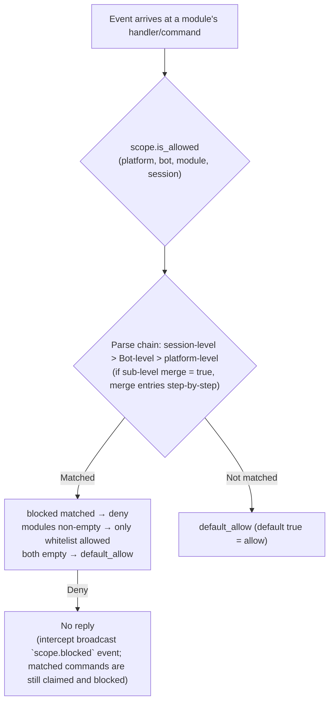

# Scope

> [!TIP]
> **When to read this**: When you need to control module availability, event acceptance, or outbound action restrictions. Skip if not needed, it does not affect the use of other features.

> [!NOTE]
> This feature requires ErisPulse **2.8.0+**.

Scope answers four questions: **which modules are available, whether to accept events from whom, what text a module processes, and what outbound actions a module can perform**. Control is fully given to the user: at the upper level of module / adapter / processor / outbound call registration (configuration `ErisPulse.scope` or runtime `sdk.scope`), it is declared uniformly, and the event pipeline automatically reads and executes at the entry, processor filtering, and outbound gate.

| Dimension | What is controlled | Rejection behavior | Configuration path |
|------|---------|---------|---------|
| **① Module** | Which modules are available (platform / Bot / session three levels) | The filtered modules do not trigger or reply (intercept broadcast `scope.blocked` event; the matched command is still claimed and blocked) | `scope.platforms / bots / sessions` |
| **② Identity** | Whether to accept events (adapter / Bot / session / user four levels) | The entry completely discards (intercept broadcast `scope.blocked` event) | `scope.identity.*` |
| **③ Outbound** | Which outbound calls a module can initiate (message / API / request, method-level white and black lists) | Failure response (retcode=34601) | `scope.actions` |

> **Related systems**: Commands are special message event processors, their user black and white lists (ACL) and implementation parameter overwrites are self-managed by the command system (`ErisPulse.event.command`), see [Event Handling Introduction](../getting-started/event-handling.md) and [Configuration Guide](../user-guide/configuration.md).

{!--< tips >!--}
1. Import the singleton via `from ErisPulse.Core import scope` (`sdk.scope` refers to the same object)
2. Check: `scope.is_allowed(...)` / `scope.is_identity_allowed(...)` / `scope.is_action_allowed(...)` correspond to the three gates ①②③
3. Read and write: Dimensional parameter methods (IDE can complete) — `scope.set_module(...)` / `scope.set_identity(...)` / `scope.set_action(...)`; there is also a dictionary-style fallback `scope.get(path)` / `scope.set(path, v)` / `scope.delete(path)`
4. Event handler text condition overwrite is described in [Event Handling Introduction · Event Overwrite](../getting-started/event-handling.md#Event Overwrite: Overwrite behavior of any event type without changing module code); command ACL / parameter overwrite is described in [Event Handling Introduction](../getting-started/event-handling.md)
{!--< /tips >!--}

## Matching entry syntax (unified across the system)

All "name lists" in scope (module names, identity keys, outbound entries) use the same matching syntax (`ErisPulse.Core.text_match`):

| Syntax | Example | Description |
|------|------|------|
| Exact name | `"Chat"` | Full value comparison, **case-insensitive** |
| Glob | `"Tool*"`、`"spam_*"` | `*` for any string / `?` for single character / `[seq]` for character set, case-insensitive |
| Regular expression | `"re:^Danger.*"` | Declared with `re:` prefix, regular expression `search` match, default case-insensitive |

- Invalid regular expressions **silently degrade** to "no match" (no error thrown, no crash)
- Decorator parameters (`pattern=` / `regex=`) have fixed semantics: `pattern` is a glob, `regex` is the regular expression source (without `re:` prefix); regular expression entries in scope configuration **must** have the `re:` prefix

## Global fallback: `default_allow`

`default_allow` is the **single global fallback switch** (default `true`), affecting two decision dimensions:

- **Module dimension**: If no binding is matched → `default_allow` determines allow or deny
- **Identity dimension**: If no policy is matched → `default_allow` determines allow or deny

Setting it to `false` enables "implicit deny strict mode": whitelist-style management, **all not explicitly allowed are denied**.

> **Exception**: The ③ outbound dimension is **not affected** by `default_allow` — it is an independent tightening switch, defaulting to full allow, restricting only with explicit rules (framework-level owner-empty calls are always allowed). This strict global mode will not accidentally cut off all module message replies. Command ACL has an independent `ErisPulse.event.command.default_allow` fallback, unaffected by each other.

## Configuration file

```toml
[ErisPulse.scope]
default_allow = true        # Global fallback (false = implicit deny strict mode)
cache_size = 1024           # LRU cache size

# ── ① Module dimension (priority: session > Bot > platform) ──
[ErisPulse.scope.platforms.onebot11]
modules = ["Chat", "Tool*"]   # Whitelist: exact name / glob / re: regular expression
blocked = ["re:^Danger"]
[ErisPulse.scope.bots.onebot11."123456"]
modules = ["Chat"]
merge = true                  # Append on top of platform-level binding (default is overall override)
[ErisPulse.scope.sessions.onebot11."789012345"]
modules = ["Chat"]

# ── ② Identity dimension (priority: user > session > Bot > adapter) ──
[ErisPulse.scope.identity.adapters.onebot11]
deny = true                   # Discard all events from this adapter
[ErisPulse.scope.identity.bots.onebot11."123456"]
deny = true
[ErisPulse.scope.identity.sessions.onebot11."g_blocked"]
deny = true
[ErisPulse.scope.identity.users.onebot11]
allow = ["u_admin"]           # User keys support glob / re: regular expression
deny = ["u_bad", "spam_*"]

# ── ③ Outbound dimension (default full allow, restrict only with explicit rules) ──
[ErisPulse.scope.actions.MyModule]
send = { deny = true }                                    # Disable all sending
api = { allow = ["get_*"] }                               # Only allow standard query APIs
request = { deny = true }                                 # Disable request handling
```

## ① Module Dimension

Answers "which modules are available in a given context." By default, all are open; filtering begins only after configuration binding; **modules and adapters require no changes**.



- **Parse priority**: session-level > Bot-level > platform-level, higher priority bindings **fully override** lower priority; if sub-level binding sets `merge = true`, it changes to **entry-by-entry union** with lower priority (modules / blocked are merged individually, `merge` itself is a control key, not counted as an entry)
- **Default semantics**: The commands and handlers of filtered modules do not trigger or reply, TRACE-level logs are visible (`core.scope.denied`); interception also broadcasts the `scope.blocked` lifecycle event (subscribing allows observation of who is blocked and why); matched **commands** are still claimed and blocked — command text is no longer leaked to lower-level message handlers, eliminating the ambiguity of "double response" where the command is rejected but the message handler responds again
- **Framework-level handlers** (`scope_exempt=True` or owner is empty) are unaffected; module names that are empty (framework-level resources) are always allowed
- **Session-aware help and command query**: Command query APIs (`command.help` / `get_command` / `get_commands` / `get_group_commands` / `get_visible_commands`, and `module.get_commands_overview`) all support optional `event=` or explicit `platform=` / `bot_id=` / `session_id=` keywords — commands of modules unavailable in the current session no longer appear in the results (return `None` for `get_command`, handle as "unregistered" for single command help, consistent with default semantics); if no context is provided, full behavior is maintained

### Binding Inheritance (merge)

The default semantics of full override are clear and predictable; when you need to **append** on top of an upper-level binding, set `merge = true` in the sub-level:

```toml
[ErisPulse.scope.platforms.onebot11]
modules = ["Chat", "Tool"]      # Platform-level: allow Chat, Tool

[ErisPulse.scope.bots.onebot11."123456"]
modules = ["Music"]
merge = true                    # The effective modules for this Bot = ["Chat", "Tool", "Music"]
```

- **Merge rules**: `modules` and `blocked` each take the **union**; `blocked` in the binding still takes precedence over `modules`
- **Chained merging**: Platform → Bot → Session, each level independently decides `merge` or override

## ② Identity Dimension (Event Admission)

Answers "whose events are accepted or rejected." Events that are rejected are **completely discarded at the distribution entry** — they do not enter middleware or any handler (including framework-level), and are only visible in TRACE-level logs (`core.scope.identity_denied`).

- **Parse priority**: user > session > Bot > adapter, take the most specific configured policy; deny takes precedence over allow
- Each level's binding is a binary policy: `{ allow = true }` or `{ deny = true }`
- User keys support glob / regular expression (e.g., `"spam_*"` to block a batch of spam users)
- Typical usage — deny at the upper level, allow at the personal level for "exceptional allowance":

```toml
[ErisPulse.scope.identity.adapters.onebot11]
deny = true
[ErisPulse.scope.identity.users.onebot11]
allow = ["u_admin"]   # Even if adapter-level is denied, events from u_admin are still allowed
```

## ③ Outbound Dimension (Restricting Module Outbound Calls)

Restricts **outbound actions** initiated by modules: message sending / standard API actions / request operations. Three types of actions correspond to the underlying DSL: `Event.reply` and `Send` (send), `Api` / `call_api` (api), `Request`'s accept/reject (request). Outbound calls initiated by modules during event handler execution carry the module owner, and are uniformly judged by this dimension.

### Rule Form (Inline Table)

Each action's rule is an inline table: `{ allow = [...], deny = true|[...] }`. Only one rule of the same action is allowed (TOML keys are not repeatable, choose between full deny and fine-grained):

```toml
[ErisPulse.scope.actions.MyModule]
send = { deny = true }                                  # Disable all sending (Event.reply / Send DSL)
# Or fine-grained by method: send = { allow = ["Text", "Image*"], deny = ["File"] }
api = { allow = ["get_*"] }                             # Only allow query-type standard APIs
# Or blacklist by action: api = { deny = ["set_*", "leave_*"] }
request = { deny = true }                               # Disable request handling accept/reject
```

- `send` entries match **send method names** (Text / Image / File ...), `api` entries match **standard action names** (get_group_info / set_group_name ...)
- Entries support exact names / glob / `re:` regular expressions (consistent with the unified system syntax, case-insensitive)
- Writing a single string as `allow` is equivalent to a single entry list: `send = { allow = "Text" }`

### Decision Semantics

**Default is full allow** — if not configured, or owner is empty (internal framework calls), allow. After configuring rules, the following order is used for judgment:

1. `deny = true` → deny
2. `deny` list matches the call name → deny
3. `allow` list is non-empty and the call name is not matched (or the call has no name) → deny
4. Otherwise, allow

Denied calls do not initiate any network requests, directly returning the standard failure response (`retcode = 34601`, see [api-response §5.3](../standards/api-response.md#53-Framework-Extension-Return-Codes-34xxx-Platform-Error-Segment-Low-Three-Bits-User-Defined)).

The three actions are independent, and only one can be restricted.

```python
# Runtime API
sdk.scope.set_action("MyModule", "send", deny=True)              # Disable all message sending
sdk.scope.set_action("MyModule", "send", allow=["Text"])         # Allow only text messages
sdk.scope.is_action_allowed("MyModule", "send", name="Image")    # False
sdk.scope.is_action_allowed("MyModule", "api", name="get_user_info")  # Judged by rules
sdk.scope.delete_action("MyModule", "send")                      # Restore allow
sdk.scope.get_action("MyModule", "send")                         # Current rule for this action
```

## Runtime API

The scope runtime API is divided into three layers: **decision** (three questions), **dimensional read/write** (each dimension `set` / `get` / `delete` parameterized methods, fully type-annotated, IDE can complete), and **dictionary-style fallback** (point path to any section).

```python
from ErisPulse import sdk

scope = sdk.scope
```

### Decision (Three Questions)

```python
scope.is_allowed("onebot11", "123456", "Chat")                 # ① Module dimension
scope.is_allowed("onebot11", "123456", "Chat", "789012345")    # With session level
scope.is_allowed("onebot11", "123456", None)                   # Framework-level resources -> True

scope.is_identity_allowed("onebot11", "123456", "group_9", "u1")   # ② Identity dimension

scope.is_action_allowed("MyModule", "send")                    # ④ Outbound dimension
scope.is_action_allowed("MyModule", "send", name="Image")      # Fine-grained by method
```

### ① Module Dimension

```python
# Binding (hierarchy determined by parameters: session_id > bot_id > platform level)
scope.set_module("onebot11", bot_id="123456", modules=["Chat", "Tool*"])
scope.set_module("onebot11", blocked=["re:^Danger"])                       # Platform level
scope.set_module("onebot11", bot_id="123456", session_id="g9", modules=["Chat"])  # Session level
scope.set_module("onebot11", bot_id="123456", modules=["Music"], merge=True)      # Union with existing entries
scope.set_module("onebot11", bot_id="123456", modules=["Chat"], persist=False)    # Runtime only

# Read / Delete
scope.get_module("onebot11", bot_id="123456")   # {"modules": ["Chat"], "blocked": []}
scope.delete_module("onebot11", bot_id="123456")
```

> `merge=True` is **write-time union** (merge entries with existing bindings at this level); `merge = true` configuration key during cross-level parsing is described above in [Binding Inheritance](#binding inheritance merge) — these are independent mechanisms.

> **Runtime binding (persist=False) semantics**: Runtime bindings are saved in a separate overlay layer, **any subsequent configuration writes / hot reload of configuration files will not overwrite them** (the configuration tree is rebuilt and automatically replayed in the order of writes, including runtime deletions). They do not persist to disk and are lost after process restart; when the module is unloaded, the runtime bindings written by the module are cleaned up by default. Subsequently executing `persist=True` writes (user persistence semantics) will replace the runtime rules.

### ② Identity Dimension

```python
# Binding strategy (hierarchy determined by parameters: user > session > bot > adapter; allow / deny mutually exclusive)
scope.set_identity("onebot11", user_id="u_bad", deny=True)
scope.set_identity("onebot11", user_id="spam_*", deny=True)    # Key supports glob / re: regular expression
scope.set_identity("onebot11", bot_id="123456", session_id="g9", allow=True)

# Read / Delete
scope.get_identity("onebot11", user_id="u_bad")   # {"deny": True}
scope.delete_identity("onebot11", user_id="u_bad")
```

### ③ Outbound Dimension

```python
# Set restriction rules (allow: str|list; deny: bool|str|list; replacement semantics for whole rule)
scope.set_action("MyModule", "send", deny=True)                    # Disable all sending
scope.set_action("MyModule", "send", allow=["Text"])               # Allow only text messages
scope.set_action("MyModule", "api", deny=["set_*", "leave_*"])     # Disable management APIs

# Read / Delete
scope.get_action("MyModule", "send")       # {"allow": ["Text"]} original rule
scope.delete_action("MyModule", "send")    # Remove single action
scope.delete_action("MyModule")            # Remove all action restrictions for this module
```

### General

```python
scope.get("platforms")   # Dictionary-style fallback: read any section by dot path
scope.topology()         # Full configuration tree (for Dashboard)
scope.stats()
# {"module_calls": .., "module_filtered": .., "identity_checks": .., "identity_denied": ..,
#  "action_checks": .., "action_denied": .., "cache_hits": .., "cache_misses": ..}
scope.reset_stats()
scope.clear()           # Clear all configurations (only in-memory effect)
```

### Advanced: Dictionary-style dot path fallback

Dimensional methods cover daily scenarios; when you need to directly access any node (or future added dimensions), you can use the dictionary-style API — `get` / `set` / `delete` accepts dot paths (deep dict merge, immediate read after write), and provides `scope[path]` / `scope[path] = v` / `del scope[path]` / `path in scope` protocol:

```python
scope.set("bots.onebot11.123456", {"modules": ["Chat"], "blocked": []})
scope.set("identity.users.onebot11.u_bad", {"deny": True})
scope.get("actions.MyModule.send")

scope["platforms.onebot11"]        # Read (raises KeyError if not exists)
scope["platforms.onebot11"] = {...}  # Write
del scope["platforms.onebot11"]      # Delete
"actions.MyModule" in scope          # Existence check
```

## Intercept Observability: `scope.blocked` Event

When scope interception (module filtering / identity rejection) occurs, the lifecycle event **`scope.blocked`** is broadcast, making "who is blocked, at which level" subscribable, statable, and presentable in the Dashboard — interception does not reply by default, but is no longer an unknowable black box.

| Field | Description |
|------|------|
| `dimension` | `"module"` (module dimension filtering) / `"identity"` (identity admission rejection) |
| `module` | The filtered module name (only in module dimension) |
| `platform` / `bot_id` / `session_id` / `user_id` | The context where the interception occurred |

```python
from ErisPulse.Core.lifecycle import lifecycle

@lifecycle.on("scope.blocked")
def on_blocked(data):
    print(f"Blocked: {data['dimension']} {data.get('module') or data.get('user_id')}")
```

- The event is broadcast in the background via `fire` (zero overhead if no listeners, does not slow down hot paths)
- Repeated interception with the same cache hit **does not** broadcast again — the same combination is only broadcast once when the cache expires
- Distinct from `adapter.event.blocked` (event-level discard): this event is the module / identity filter at the scope admission gate

## Cache and Hot Update

- `is_allowed` / `is_identity_allowed` / `is_action_allowed` results are cached with **LRU cache** (`scope.cache_size` is adjustable), `set` / `delete` / configuration hot update (`config.updated` / `config.set`) automatically invalidate
- All dimension configurations take effect **immediately**, no restart required
- Scope is "per-event" judgment, does not remember across events: configuration changes, next event follows new rules

## Configuration Format Validation

Configuration format is validated section by section during loading / hot update: type errors in sections (e.g., `platforms` written as a string), invalid outbound rules (e.g., `allow` written as a number), unknown action names, unknown top-level keys (e.g., `alow` spelling error) will output **WARNING** and ignore corresponding sections / entries, while other valid configurations remain effective — writing errors no longer silently fail.

## Common Issues and Notes

### 1. Configuration Hierarchy and Overriding

- Module dimension: session level > Bot level > platform level, **full override** (if sub-level `merge = true`, entries are merged step by step). To "platform allows Chat, Bot adds Music", set `merge = true` in the Bot level, or list both simultaneously
- Identity dimension: user > session > Bot > adapter, take the **most specific** configured policy (can do exception allowance)
- Command user black and white lists: exact command names take precedence over glob keys (see `event.command.acl`)

### 2. Module/Command Not Responding

First suspect scope rather than the module itself:

```python
from ErisPulse import sdk

print(sdk.scope.is_allowed(event.get_platform(), bot_id, "MyModule", session_id))
print(sdk.scope.is_identity_allowed(event.get_platform(), bot_id, session_id, user_id))
print(sdk.scope.stats())   # module_filtered / identity_denied > 0 indicates there are blocking records
```

Being filtered defaults to no reply (module dimension and identity dimension, avoiding rule exposure), but broadcasts the `scope.blocked` lifecycle event, and statistics continue to accumulate; commands rejected by ACL will explicitly reply "insufficient permissions".

### 3. Troubleshooting Outbound Actions Being Rejected

```python
from ErisPulse import sdk

print(sdk.scope.get("actions.MyModule"))
print(sdk.scope.stats())   # action_denied > 0 indicates there are blocked calls
```

The interception is **explicit**: rejected calls return the standard failure response (`retcode = 34601` without initiating network requests).

### 4. Session Identifier Isolation Across Platforms

The `(platform, session_id)` combination is the unique identifier. `scope.sessions.onebot11."789"` only affects onebot11, not the same `789` session on Telegram. The same applies to identity dimension user keys.

## Topology Tree API

`ModuleManager.get_topology()` and `AdapterManager.get_topology()` provide module/adapter ownership relationship data, and `sdk.get_topology()` aggregates them (including scope):

```python
from ErisPulse import sdk

topology = sdk.get_topology()
# {
#   "modules": {                                   # Module → owned resources
#     "Chat": {
#       "loaded": True, "enabled": True,
#       "commands": ["chat", "translate"],
#       "handlers": {"message": 2, "notice": 1},
#       "routes": {"http": ["/Chat/api"], "ws": [], "sse": []},
#       "lifecycle_hooks": 3,
#     }
#   },
#   "adapters": {                                  # Adapter → Bot → Scope
#     "onebot11": {
#       "status": "started", "enabled": True,
#       "bots": {"123456": {"status": "online", "scope": {...}}},
#       "scope": {"modules": [...], "blocked": [...]},
#     }
#   },
#   "scope": {                                     # Scope (module / identity / outbound actions)
#     "platforms": {...}, "bots": {...}, "sessions": {...},
#     "identity": {"adapters": {...}, "bots": {...}, "sessions": {...}, "users": {...}},
#     "actions": {...},
#   },
# }
```

- Module topology aggregates the commands, event handlers, HTTP/WS/SSE routes, and lifecycle hooks registered by the module, facilitating the drawing of the module resource tree.
- Adapter topology aggregates the status of each adapter, the status of its subordinate Bots, and the platform-level/Bot-level scope bindings (module dimension).
- **JSON-safe output**: `get_topology(json_safe=...)` defaults to `True`, returning a structure that can be directly `json.dumps` — the module `info` retains only the pure data `meta` sub-table (discarding `module_class` / `strategy` runtime objects), and other nodes (including arbitrary objects inserted by adapter authors into Bot `info`) are sanitized by default (class objects take `__name__`, unserializable objects are replaced with `str()`). Dashboard/WebUI can directly serialize the return; if original objects are needed, pass `json_safe=False`.