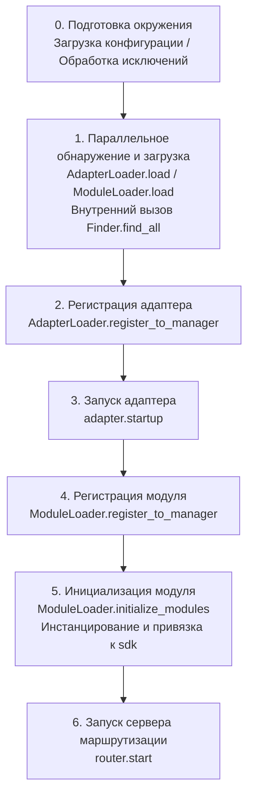

# Процесс запуска и ручное управление

> [!TIP]
> **Когда нужно прочитать эту статью**: если вам нужно вручную управлять цепочкой запуска, настраивать последовательность запуска или устранять проблемы с запуском. Если это не требуется, пропустите, это не повлияет на использование других функций.

В ErisPulse `await sdk.run()` / `await sdk.init()` обернули всю цепочку запуска в "одну строку кода". Но когда вам нужно полностью настроить процесс запуска (например, частичная загрузка, динамическая регистрация, горячая замена, вставка пользовательской стратегии загрузки), вам нужно понимать, что происходит внутри этой цепочки и как вручную управлять каждым шагом.

В этой статье мы разбиваем цепочку запуска на отдельные этапы, объясняем их обязанности, порядок вызова и приводим пример ручного полного запуска.

> В этой статье предполагается, что вы уже запустили [первого робота](../getting-started/first-bot.md) и знакомы с двумя режимами `sdk.run(keep_running=True/False)`. В этой статье фокусируется на разборе цепочки внутри `init()` и более низкоуровневых входов: `init()`/`init_task()`/`init_sync()`

## Обзор главных точек входа SDK

Помимо двух режимов `keep_running` для `run()`, SDK предоставляет несколько более низкоуровневых точек входа, отличающихся **асинхронностью, возвращаемым значением и обработкой исключений**:

| Точка входа | Асинхронность | Возвращаемое значение | Обработка исключений | Сценарии использования |
|-------------|---------------|------------------------|----------------------|--------------------------|
| `await sdk.run(True)` | async, блокирующий режим | `None` (автоматически вызывает `uninit` при остановке) | Ошибки модулей/адаптеров перехватываются, не приводят к падению процесса | Простое приложение-бот |
| `await sdk.run(False)` | async, неблокирующий режим | `None` (не вызывает автоматическую отмену инициализации) | То же самое | Инициализация с последующим выполнением пользовательской логики |
| `await sdk.init()` | async, требует `await` | `bool` | Внутренние исключения компонентов перехватываются, в случае неудачи возвращает `False` | Ручное управление жизненным циклом (в сочетании с `uninit()`) |
| `sdk.init_task()` | async, возвращает задачу без блокирования | `asyncio.Task` | То же, что и `init()` | Параллельное выполнение других инициализаций или когда цикл событий ещё не запущен |
| `sdk.init_sync()` | **Синхронный**, блокирует текущий поток | `bool` | То же, что и `init()` | Сценарии командной строки, синхронные входы без цикла событий |

> **Распространённое заблуждение**: `await sdk.init()` **не эквивалентно** `await sdk.run(keep_running=False)`. Есть два отличия: ① `init()` возвращает `bool` (в случае неудачи возвращает `False`), `run()` возвращает `None`; ② `init()` выполняет только инициализацию, **не вызывает автоматическую отмену**, `run()` автоматически вызывает `uninit()` при завершении цикла событий. Поэтому при необходимости ручного управления жизненным циклом или кастомной отменой инициализации следует использовать `init()` + `uninit()`.

## Обзор запуска

`sdk.init()` (точнее, его внутренний `Initializer.init()`) запускает всю систему в следующем порядке:



Соответствующие основные компоненты:

| Уровень | Компонент | Ответственность |
|----|------|------|
| Обнаружение | `AdapterFinder` / `ModuleFinder` | **Обнаружение** адаптеров/модулей из entry-points установленных пакетов |
| Загрузка | `AdapterLoader` / `ModuleLoader` | Обнаружение + импорт + чтение метаданных + проверка включения/отключения, возвращает список объектов |
| Регистрация | `*Loader.register_to_manager` | Регистрация объектов в соответствующем менеджере |
| Управление | `sdk.adapter` / `sdk.module` | Хранение экземпляров адаптеров/модулей, предоставление интерфейсов запуска/остановки |
| Инициализация | `ModuleLoader.initialize_modules` | Создание экземпляров модулей и привязка к `sdk` (обработка топологической сортировки зависимостей) |
| Маршрутизация | `sdk.router` | HTTP / WebSocket сервер |

> **Важно**: `Finder` и `Loader` — это два уровня. `Loader` внутри **уже содержит** экземпляр `Finder` (`AdapterLoader` содержит `AdapterFinder`, `ModuleLoader` содержит `ModuleFinder`). В большинстве случаев вам достаточно использовать `Loader`, а `Finder` применяется только тогда, когда нужно "перечислить без импорта".

[Документация на русском языке](docs/ru/quick-start.md)

## Подробное описание этапов

### 1. Слой обнаружения: Finder

Finder отвечает только за "поиск пакетов, предоставляющих адаптеры/модули", он не импортирует и не создает экземпляры.

```python
from ErisPulse.finders import AdapterFinder, ModuleFinder

adapter_finder = AdapterFinder()
module_finder = ModuleFinder()

# Найти все установленные entry-points адаптеров/модулей
adapter_entries = adapter_finder.find_all()    # list[EntryPoint]
module_entries = module_finder.find_all()      # list[EntryPoint]

# Найти по имени
entry = module_finder.find_by_name("MyModule")  # EntryPoint | None
```

Каждый `EntryPoint` можно загрузить с помощью `.load()`, чтобы получить соответствующий класс, но обычно вам не нужно делать это вручную — Loader сделает это за вас.

#### Расширяемые точки: entry-points

Протокол обнаружения Finder — это entry-points Python: любой установленный пакет объявляет соответствующую группу в `pyproject.toml`, и пакет будет обнаружен при установке и исчезнет при удалении, без изменений в фреймворке. Открытые фреймворком группы:

| Группа | Обнаружитель | Зарегистрированное содержимое |
|--------|--------------|------------------------------|
| `erispulse.adapter` | `AdapterFinder` (чтение во время загрузки) | Класс адаптера |
| `erispulse.module` | `ModuleFinder` (чтение во время загрузки) | Класс модуля |
| `erispulse.storage.backends` | `create_storage()` (сканирование перед созданием экземпляра хранилища) | Класс хранилища |

Пример пользовательского хранилища: пакет должен объявить группу и путь импорта:

```toml
[project.entry-points."erispulse.storage.backends"]
mydb = "my_erispulse_backend:MyStorage"
```

```toml
# На стороне пользователя: изменение одной строки конфигурации активирует хранилище
[ErisPulse.storage]
backend = "mydb"
```

Адаптеры и модули также должны объявить группы, см. руководство по публикации [здесь](../developer-guide/publishing.md). В сценариях, где не используются entry-points (динамическая регистрация во время выполнения), после импорта можно вызвать функцию регистрации:

```python
from ErisPulse.Core.storage import register_storage_backend

from my_erispulse_backend import MyStorage

register_storage_backend("mydb", MyStorage)
```

Полный контракт хранилища (базовый класс, диалект, объявление возможностей) см. в [Хранилище](storage-backends.md).

### 2. Слой загрузки: Loader

Loader делает "импорт + чтение метаданных + определение включения/отключения" поверх Finder.

```python
from ErisPulse.loaders import AdapterLoader, ModuleLoader
from ErisPulse import sdk

adapter_loader = AdapterLoader()
module_loader = ModuleLoader()

# Внутри load(): вызывается finder.find_all() → обработка entry-point по одному → возвращение кортежа
adapter_objs, enabled_adapters, disabled_adapters = await adapter_loader.load(sdk.adapter)
module_objs, enabled_modules, disabled_modules = await module_loader.load(sdk.module)
```

Возвращаемый Loader кортеж:

| Возвращаемое значение | Значение |
|-----------------------|---------|
| `objs` (`dict`) | Название → объект (класс адаптера / обёртка модуля) |
| `enabled` (`list[str]`) | Названия, включённые (не отключены в конфигурации) |
| `disabled` (`list[str]`) | Названия, отключённые |

#### Информация для диагностики при сбое загрузки

Если модуль/адаптер выбрасывает исключение при загрузке или инициализации, фреймворк пропустит этот компонент и продолжит загрузку других, при этом выведет **сводку пользовательских фреймов**, позволяющую вам определить местоположение ошибки на уровне INFO без необходимости вручную включать DEBUG:

```
[ERROR] [ModuleLoader] Загрузка модуля MyModule из entry-point не удалась, пропущен: 'NoneType' object has no attribute 'platform'
  → MyModule/Core.py:42 in on_load
      adapter = sdk.platform
  → AttributeError: 'NoneType' object has no attribute 'platform'
  → Подсказка: Повысьте уровень логирования до DEBUG, чтобы увидеть полный стек; проверьте реализацию модуля MyModule
```

Информация для диагностики генерируется модулем `ErisPulse.runtime.diagnostics`, автоматически фильтруя внутренние фреймы фреймворка и оставляя только фреймы вашего кода. Если вам нужно повторно использовать эту функциональность в пользовательской логике загрузки:

```python
from ErisPulse.runtime import log_diagnostic

try:
    risky_init()
except Exception as e:
    log_diagnostic(e)  # Автоматически извлекает фреймы пользовательского кода и записывает в лог ERROR
```

Модуль также предоставляет два низкоуровневых функции: `extract_user_frame()` (возвращает структурированную информацию о фрейме) и `format_diagnostic_block()` (возвращает многострочный текст).

### 3. Слой регистрации: register_to_manager

Регистрация объектов, созданных Loader, в менеджере, чтобы `sdk.adapter` / `sdk.module` могли их распознавать.

```python
# Регистрация адаптера (возвращает bool, означающий, были ли все успешны)
await adapter_loader.register_to_manager(enabled_adapters, adapter_objs, sdk.adapter)

# Регистрация модуля
await module_loader.register_to_manager(enabled_modules, module_objs, sdk.module)
```

После регистрации адаптеры зарегистрированы в менеджере адаптеров, а модули — в менеджере модулей, но **ни один из них ещё не запущен/не создан**.

### 4. Запуск адаптеров

```python
# Запуск всех зарегистрированных адаптеров
await sdk.adapter.startup()
# Или указание платформы
await sdk.adapter.startup("yunhu")
await sdk.adapter.startup(["yunhu", "telegram"])
```

> Регистрация ≠ Запуск. `register_to_manager` только регистрирует; `startup` вызывает метод `start()` адаптера, устанавливая соединение с платформой.

### 5. Инициализация модулей

Модули имеют дополнительный шаг — **инициализация** и привязка к `sdk` (чтобы вы могли вызывать `sdk.MyModule.xxx`). Этот шаг также обрабатывает зависимости между модулями и топологическую сортировку.

```python
success = await module_loader.initialize_modules(
    enabled_modules, module_objs, sdk.module, sdk
)
```

После успешной инициализации модуль появится в `sdk.<ModuleName>`.

### 6. Запуск сервера маршрутизации

```python
await sdk.router.start(
    host="0.0.0.0",
    port=8000,
    ssl_certfile=None,
    ssl_keyfile=None,
)
```

Сервер маршрутизации отвечает за получение обратных вызовов webhook / WebSocket от адаптеров. Без запуска сервера адаптеры в режиме сервера не смогут получать сообщения.

## Полный пример ручного запуска

Следующий код **эквивалентен** основному процессу `await sdk.init()`, но каждая его часть доступна для ручного управления, что позволяет вставить собственный код в любой момент:

```python
import asyncio
from ErisPulse import sdk
from ErisPulse.loaders import AdapterLoader, ModuleLoader

async def manual_startup():
    # 0. Подготовка окружения (загрузка конфигурации, регистрация обработки глобальных исключений)
    #    _prepare_environment — это предварительный шаг внутри init(); при ручном процессе его тоже нужно вызвать,
    #    иначе Loader не сможет прочитать конфигурацию и посчитает все адаптеры/модули отключенными.
    if not await sdk._prepare_environment():
        print("Ошибка при подготовке окружения")
        return False

    # 1. Создание загрузчиков (внутри каждый из них содержит Finder)
    adapter_loader = AdapterLoader()
    module_loader = ModuleLoader()

    # 2. Параллельное обнаружение и загрузка (аналогично внутреннему процессу init() с использованием gather)
    (adapter_objs, enabled_adapters, disabled_adapters), \
    (module_objs, enabled_modules, disabled_modules) = await asyncio.gather(
        adapter_loader.load(sdk.adapter),
        module_loader.load(sdk.module),
    )

    # 3. Регистрация адаптеров
    await adapter_loader.register_to_manager(
        enabled_adapters, adapter_objs, sdk.adapter
    )

    # 4. Запуск адаптеров
    if enabled_adapters:
        await sdk.adapter.startup()

    # 5. Регистрация модулей
    await module_loader.register_to_manager(
        enabled_modules, module_objs, sdk.module
    )

    # 6. Инициализация модулей (инстанцирование + привязка к sdk)
    if enabled_modules:
        await module_loader.initialize_modules(
            enabled_modules, module_objs, sdk.module, sdk
        )

    # 7. Запуск маршрутизатора
    await sdk.router.start(host="0.0.0.0", port=8000)

    print("Ручной запуск завершен")
    return True

async def main():
    ok = await manual_startup()
    if ok:
        # Блокировка для поддержания работы (в ручном процессе автоматическая блокировка отсутствует)
        await asyncio.Event().wait()

if __name__ == "__main__":
    asyncio.run(main())
```

### Когда следует использовать ручной запуск?

В большинстве случаев **ручной запуск не требуется**, так как `await sdk.run()` уже выполняет все вышеуказанные шаги. Ручной запуск имеет смысл только в следующих сценариях:

- **Частичная загрузка**: загрузка только определенных адаптеров/модулей, пропуск остальных
- **Динамическая регистрация**: регистрация новых адаптеров/модулей в зависимости от условий во время выполнения
- **Собственный порядок**: необходимость изменить стандартный порядок загрузки (например, запустить модуль до запуска адаптера)
- **Внедрение стратегий**: внедрение в Loader пользовательских менеджеров строгого режима, стратегий загрузки и т.д.
- **Отладка/диагностика**: ручное управление на определенном этапе в случае сбоя для выявления проблемы

## Детальное управление во время выполнения

### Горячая перезагрузка локальных плагинов

`sdk.enable_plugin_hot_reload()` отслеживает изменения исходного кода в локальной директории плагинов (`plugins/`) и автоматически перезагружает их:
Команда `epsdk run` уже включена по умолчанию, и ручной вызов не требуется; если вы используете **чистый `sdk.run()` для запуска**, и вам нужна горячая перезагрузка плагинов, вызовите функцию один раз до `run()` (только локальные плагины будут перезагружены, пакеты/адаптеры, установленные через pip, не затронуты):

```python
sdk.enable_plugin_hot_reload()
sdk.run()
```

Даже если вы использовали `sdk.run()` для запуска, вы по-прежнему можете управлять отдельными подсистемами во время выполнения, без необходимости перезапуска всего SDK:

### Горячий перезапуск адаптеров

```python
# Горячая перезагрузка отдельного адаптера (восстановление соединения, без влияния на другие платформы)
await sdk.adapter.shutdown("yunhu")
await sdk.adapter.startup("yunhu")

# Запуск новой платформы во время выполнения
await sdk.adapter.startup("telegram")

# Временное отключение платформы
await sdk.adapter.shutdown("telegram")
```

> `adapter.startup()` требует, чтобы адаптер **был зарегистрирован** в менеджере. Регистрация происходит внутри `init()`/`run()`, поэтому это детальное управление происходит **после** запуска.

### Сервер маршрутизации

```python
# Временное отключение сервера webhook
await sdk.router.stop()

# Перезапуск (например, при смене порта)
await sdk.router.start(host="0.0.0.0", port=9000)
```

### Загрузка модулей по требованию

```python
# Ручная загрузка модуля (возможно, ленивая загрузка)
await sdk.load_module("MyModule")
```

## Грациозное завершение

Начиная с версии 2.7.0, `sdk.shutdown()` предоставляет **программное грациозное завершение**: установка события завершения позволяет главному циклу, который висит на `await sdk.run(keep_running=True)`, вернуться, что в свою очередь вызывает `uninit()` и завершает очистку ресурсов.

```python
# Вызывается из любого корутина, вызывает грациозный выход (run() висит и возвращается, и автоматически вызывает uninit)
sdk.shutdown()
```

Типичное применение:

```python
async def shutdown_after_idle():
    await asyncio.sleep(3600)
    sdk.shutdown()  # Грациозный выход после 1 часа бездействия
```

**Обработка сигналов**: `run()` внутренне регистрирует обработчики `SIGTERM` / `SIGHUP`, преобразуя системные сигналы в грациозное завершение — при остановке контейнерной оркестрации (Docker `docker stop`) или остановке службы через `systemd` процесс будет завершаться через `uninit()` для очистки, а не будет принудительно убит. Также регистрируется обработчик `SIGUSR1`, который преобразуется в мягкую перезагрузку процесса (`sdk.restart()`): `epsdk restart` отправляет этот сигнал экземпляру с PID 1 внутри контейнера (остановка означает выход контейнера, внешнее перезапуск невозможно), что вызывает горячую перезагрузку компонентов. Канал горячей перезагрузки для `SIGUSR1` требует ErisPulse **2.12+**.

- Windows не поддерживает `loop.add_signal_handler`, обработчики сигналов будут автоматически пропущены (можно по-прежнему использовать `sdk.shutdown()` или Ctrl+C для завершения)
- Повторный вызов `sdk.shutdown()` безопасен (если событие уже установлено, повторный вызов не производит никаких действий)

## Процесс удаления

Обратная операция запуска — это `await sdk.uninit()`, которая выполняет очистку в обратном порядке:

1. Закрытие всех адаптеров (`adapter.shutdown()`)
2. Удаление всех модулей
3. Очистка всех обработчиков событий
4. Очистка свойств модулей менеджера и SDK

В случае ручного запуска, не забудьте вызвать `uninit()` перед выходом, чтобы обеспечить корректное завершение:

```python
try:
    await asyncio.Event().wait()   # Поддержание работы
finally:
    await sdk.uninit()
```

## Перезапуск

SDK предоставляет два способа перезапуска, и вам не нужно предварительно удалять самих себя — фреймворк сам справится:

| Способ | Вызов | Поведение | Сценарии применения |
|------|------|------|----------|
| Горячий перезапуск | `await sdk.restart()` | Внутри одного процесса происходит **горячая перезагрузка на уровне компонентов** (все модули проходят единый путь перезагрузки (общая предварительная проверка синтаксиса / откат снимка / проверка идентичности), адаптеры сначала **обнаруживают entry-point** (новые адаптеры, установленные во время работы, сразу применяются), затем поэтапно перезагружаются на уровне кода) | После обновления или установки компонентов через pip для применения кода, горячая перезагрузка модулей |
| Жесткий перезапуск | `await sdk.hard_restart()` | `uninit()` и выход из процесса с **кодом 42**, затем внешний супервайзер запускает новый процесс | Обновление самого фреймворка (код фреймворка после обновления применяется только в новом процессе), побочные эффекты C-расширений, подозрение на утечку ресурсов |

```python
# Горячий перезапуск: перезагрузка на уровне кода компонентов (наиболее часто используемый способ; новые адаптеры, установленные во время работы, будут запущены)
await sdk.restart()

# Жесткий перезапуск: выход из процесса, передача управления внешнему супервайзеру (см. руководство по супервайзеру ниже)
await sdk.hard_restart("sdk self-update")  # Необязательное поле reason для отображения супервайзером
```

> **Два важных замечания**:
> 1. Эти методы выполняются в фоновом режиме, **немедленно возвращают `True`, означающее "задача перезапуска запланирована"**, а не "перезапуск завершен". Фактический перезапуск происходит в фоновом режиме, чтобы не прерывать текущую цепочку событий.
> 2. Принцип работы `hard_restart()`: после отмены и сохранения конфигурации процесс завершается с **кодом 42** (`HARD_RESTART_EXIT_CODE`) — **он сам не запускает новый процесс**, это должно быть сделано внешним супервайзером, который обнаружит код 42 и перезапустит. Если запускать напрямую `python main.py` без какого-либо супервайзера, процесс завершится с кодом 42 и **не будет автоматически перезапущен** (фреймворк выдаст предупреждение).

> **Взаимоисключающие и объединяемые горячие перезапуски** (начиная с версии 2.11.1): все операции горячей перезагрузки (перезагрузка одного модуля / полная перезагрузка / перезагрузка адаптера / сон / горячая загрузка новых плагинов) выполняются исключительно последовательно — в условиях бури сохранений последовательные запросы не будут выполняться параллельно, запросы, поступающие во время уже идущего перезапуска, автоматически объединяются (запросы, поступающие во время обычной блокировки перезагрузки, также объединяются и ставятся в очередь), после завершения будет выполнена максимум одна дополнительная перезагрузка. При сохранении файлов с синтаксическими ошибками вся перезагрузка будет отклонена **обобщенной предварительной проверкой синтаксиса** (все ошибки файлов и номера строк будут показаны сразу), перезагрузка на уровне адаптеров пропускается, `restart` объявляется неудачной, все старые экземпляры продолжают обслуживание; после исправления снова можно вызвать `restart`.

### Когда использовать жесткий перезапуск?

Горячий перезапуск покрывает большинство сценариев (обновление/установка компонентов через pip, горячая перезагрузка кода модуля, **включая новые адаптеры, установленные во время работы**). Жесткий перезапуск требуется только в следующих случаях:

- **Обновление самого фреймворка**: после обновления самой ErisPulse новые коды фреймворка примутся только в новом процессе (Python не перезагрузит уже загруженные коды фреймворка).
- **Побочные эффекты двоичных библиотек (C-расширений)**: горячий перезапуск происходит в одном процессе, не может освободить C-расширения, открытые дескрипторы файлов, потоки и другие ресурсы процесса; жесткий перезапуск создает новый процесс, и эти побочные эффекты полностью очищаются.
- **Выявление утечек ресурсов**: при подозрении на утечку памяти или дескрипторов, жесткий перезапуск дает чистую среду.

> Функция "Перезапуск фреймворка" в панели управления Dashboard вызывает `hard_restart()`.

### Контракт выходного кода 42

Жесткий перезапуск — это межпроцессное взаимодействие: **SDK отвечает за выход (код 42), супервайзер отвечает за запуск**.

| Роль | Поведение |
|------|------|
| SDK (при жестком перезапуске) | `uninit()` → сохранение конфигурации → запись метки жесткого перезапуска (причина / PID, для отображения супервайзером) → `os._exit(42)` |
| Супервайзер | Обнаружение кода выхода 42 → отображение причины жесткого перезапуска → перезапуск той же команды |

> `sdk.is_supervised()` позволяет проверить, был ли текущий процесс запущен супервайзером (проверка переменной окружения `ERISPULSE_SUPERVISED`). При запуске подпроцесса командой `epsdk run` автоматически вставляется этот маркер; внешние супервайзеры, такие как systemd или Docker, не вставляют его, `is_supervised()` возвращает `False`, и при жестком перезапуске фреймворк выдает предупреждение "Супервайзер не обнаружен".

### Руководство по супервайзеру

Выберите подходящий супервайзер, чтобы жесткий перезапуск действительно сработал:

#### 1. Команда CLI run (разработка/простое развертывание, рекомендуется)

`epsdk run main.py` содержит встроенный цикл супервайзера: он обнаруживает код выхода подпроцесса, при 42 немедленно перезапускает (и отображает причину жесткого перезапуска); другие коды выхода обрабатываются с экспоненциальной задержкой автоматического повторного запуска; `Ctrl+C` сначала корректно завершает подпроцесс (код 0 считается нормальным выходом, больше не запускается).

```bash
epsdk run main.py
```

`epsdk run --reload` (режим горячей перезагрузки для разработки, начиная с версии 2.11.1) также использует структуру "супервайзерный процесс + перезагрузка рабочего подпроцесса": при сохранении `.py` файлов в рабочем процессе происходит **горячая перезагрузка на уровне компонентов** (не перезапуск фреймворка); жесткий перезапуск выполняется супервайзерным процессом, который перезапускает новый рабочий процесс, и после обновления фреймворка новые коды сразу примутся.

#### 详细 перезагрузка (начиная с версии 2.12)

При сохранении `.py` файлов выбор минимальной единицы перезагрузки происходит по принадлежности исходного кода во время выполнения, а не по строке пути:

| Измененный файл | Обработка |
|----------|------|
| В директории плагинов (`ErisPulse.framework.plugins_dir`) | Обрабатывается горячим перезагрузчиком плагинов, watcher разработки не запускается повторно |
| Исходный код уже загруженного модуля (включая `pip install -e` и site-packages) | `sdk.reload_module(имя модуля)` |
| Исходный код уже зарегистрированного адаптера | `sdk.reload_adapter(имя платформы)` |
| Входной скрипт | Перезапуск процесса (код выхода 42, перезапуск супервайзером) |
| Исходный код самого фреймворка (в пакете `ErisPulse`) | Перезапуск процесса |
| Изменения, соответствующие нескольким owner / не поддающиеся определению | Консервативный перезапуск процесса |

В сценариях пакетного обновления, таких как `sdk.reload_all_modules()`, можно перезагрузить все зарегистрированные модули за один раз (в порядке зависимости, модуль с ошибкой пропускается без отката), без перезапуска процесса.

Режим скрипта (`epsdk run main.py --reload`) не превращает рабочий процесс скрипта в подпроцесс: в подпроцессе скрипта монтируется dev watcher, и `component_reload_pid` записывается в `.erispulse/runtime.json`; родительский процесс видит этот маркер и передает изменения модулей/адаптеров/плагинов обработке подпроцесса, только изменения входного скрипта или исходного кода фреймворка приводят к перезапуску процесса скрипта.

#### 2. systemd (сервер Linux)

`RestartForceExitStatus=42` позволяет коду выхода 42 также вызывать перезапуск (по умолчанию `on-failure` применяется только к ненулевым кодам):

```ini
[Service]
ExecStart=/usr/bin/python3 /opt/mybot/main.py
Restart=on-failure
RestartForceExitStatus=42
RestartSec=2
User=mybot
```

#### 3. Docker / docker-compose

Внутри контейнера PID 1 — это приложение, и после выхода с кодом 42 контейнер завершается — используйте стратегию `restart`, чтобы он автоматически перезапускался:

```yaml
services:
  bot:
    build: .
    restart: unless-stopped   # перезапуск при любом выходе (включая 42)
```

> Внутри контейнера `epsdk restart` для экземпляра с PID 1 выполняет горячий перезапуск внутри процесса через SIGUSR1, не завершая контейнер; перезапуск всего процесса осуществляется стратегией `restart`. Подробнее см. [Развертывание → Перезапуск экземпляра с PID 1 внутри контейнера](../user-guide/deployment.md#перезапуск-экземпляра-pid-1-внутри-контейнера).

#### 4. PM2 (экосистема Node)

```bash
pm2 start main.py --name mybot --interpreter python3
# 42 считается кодом выхода, PM2 по умолчанию перезапускает; установите restart_delay для дебаунса
pm2 set mybot.restart_delay 2000
```

#### 5. supervisord

```ini
[program:mybot]
command=python3 /opt/mybot/main.py
autorestart=true
exitcodes=0,2,42    # 42 также считается "нормальным выходом, требующим перезапуска"
```

#### 6. Чистый Python пользовательский супервайзер

```python
import subprocess, sys, time

while True:
    p = subprocess.Popen([sys.executable, "main.py"])
    code = p.wait()
    if code == 42:          # Запрос на жесткий перезапуск
        time.sleep(0.5)
        continue
    if code == 0:           # Нормальный выход
        break
    time.sleep(3)           # Аномальный выход, задержка и повторный запуск
```

> **Поведение при отсутствии супервайзера**: при запуске напрямую `python main.py` после вызова `hard_restart()` процесс завершится с кодом 42 и не будет перезапущен. В этом случае необходимо подключить любой из перечисленных супервайзеров.

## Связанные документы

- [Создание первого бота](../getting-started/first-bot.md) - Основные режимы `keep_running` для начала работы
- [Управление жизненным циклом](lifecycle.md) - Подписка на события запуска `core.init.start` / `core.init.complete` и др.
- [Ленивая загрузка](lazy-loading.md) - Механизм ленивой загрузки модулей и `load_module`