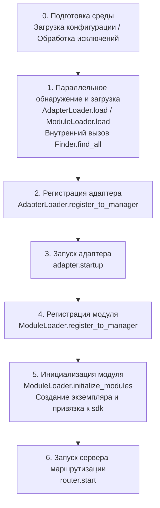

# Процесс запуска и ручное управление

> [!TIP]
> **Когда нужно читать эту статью**: когда требуется вручную управлять цепочкой запуска, настраивать порядок запуска или устранять проблемы с запуском. Если это не требуется, можно пропустить, это не повлияет на использование других функций.

В ErisPulse `await sdk.run()` / `await sdk.init()` объединяют всю цепочку запуска в "одну строку кода". Однако, когда требуется полностью настроить процесс запуска (например, частичная загрузка, динамическая регистрация, горячая замена, внедрение пользовательской стратегии загрузки), необходимо понимать, что происходит внутри этой цепочки и как вручную управлять каждым шагом.

В этой статье цепочка запуска разбивается на отдельные этапы, описываются их обязанности, порядок вызова, а также приводится пример ручного полного запуска.

> В этой статье предполагается, что вы уже запустили [первого робота](../getting-started/first-bot.md) и знакомы с двумя режимами `sdk.run(keep_running=True/False)`. В этой статье акцент делается на разборе внутренней цепочки `init()`, а также более низкоуровневых входных точек `init()`/`init_task()`/`init_sync()`.

## Обзор верхнего уровня SDK

Помимо двух режимов `keep_running` для `run()`, SDK предоставляет несколько более низкоуровневых точек входа, которые отличаются **асинхронностью, возвращаемым значением и обработкой исключений**:

| Точка входа | Асинхронность | Возвращаемое значение | Обработка исключений | Сценарий использования |
|-------------|---------------|------------------------|----------------------|-------------------------|
| `await sdk.run(True)` | async, блокирующий | `None` (автоматически `uninit` при остановке) | Ошибки модулей/адаптеров перехватываются, не приводят к сбою процесса | Простое приложение-бот |
| `await sdk.run(False)` | async, не блокирующий | `None` (не автоматически выгружается) | То же самое | Инициализация, затем выполнение пользовательской логики |
| `await sdk.init()` | async, требует `await` | `bool` | Внутренние исключения компонентов перехватываются, в случае неудачи возвращается `False` | Ручное управление жизненным циклом (с `uninit()`) |
| `sdk.init_task()` | async, возвращает `Task` без блокировки | `asyncio.Task` | То же, что и `init()` | Параллельное выполнение других инициализаций или когда цикл событий еще не запущен |
| `sdk.init_sync()` | **Синхронный**, блокирует текущий поток | `bool` | То же, что и `init()` | Сценарии командной строки, синхронный вход без цикла событий |

> **Распространённое заблуждение**: `await sdk.init()` **не эквивалентно** `await sdk.run(keep_running=False)`. Есть два различия: ① `init()` возвращает `bool` (в случае неудачи возвращает `False`), `run()` возвращает `None`; ② `init()` выполняет только инициализацию и **не производит автоматическую выгрузку**, `run()` автоматически вызывает `uninit()` при завершении цикла событий. Поэтому, если требуется ручное управление жизненным циклом или выгрузкой, используйте `init()` + `uninit()`.

## Обзор запуска

`sdk.init()` (точнее, его внутренний `Initializer.init()`) запускает всю систему в следующем порядке:



Соответствующие основные компоненты:

| Уровень | Компонент | Ответственность |
|----|------|------|
| Обнаружение | `AdapterFinder` / `ModuleFinder` | **Обнаружение** адаптеров/модулей из entry-points установленных пакетов |
| Загрузка | `AdapterLoader` / `ModuleLoader` | Обнаружение + импорт + чтение метаданных + проверка включения/отключения, возвращает список объектов |
| Регистрация | `*Loader.register_to_manager` | Запись объектов в соответствующий менеджер |
| Управление | `sdk.adapter` / `sdk.module` | Хранение экземпляров адаптеров/модулей, предоставление интерфейсов запуска/остановки |
| Инициализация | `ModuleLoader.initialize_modules` | Создание экземпляров модулей и привязка к `sdk` (обработка топологической сортировки зависимостей) |
| Маршрутизация | `sdk.router` | HTTP / WebSocket сервер |

> **Важно**: `Finder` и `Loader` — это два уровня. `Loader` внутри **уже содержит** `Finder` (`AdapterLoader` содержит `AdapterFinder`, `ModuleLoader` содержит `ModuleFinder`). В большинстве случаев вам достаточно использовать `Loader`, а `Finder` применяется только тогда, когда нужно "только перечислить, но не импортировать".

[Документация на русском языке](docs/ru/quick-start.md)

## Подробное описание каждого этапа

### 1. Уровень обнаружения: Finder

Finder отвечает только за "поиск пакетов, предоставляющих адаптеры/модули", не импортирует и не создает экземпляры.

```python
from ErisPulse.finders import AdapterFinder, ModuleFinder

adapter_finder = AdapterFinder()
module_finder = ModuleFinder()

# Поиск всех установленных entry-points для адаптеров/модулей
adapter_entries = adapter_finder.find_all()    # list[EntryPoint]
module_entries = module_finder.find_all()      # list[EntryPoint]

# Поиск по имени
entry = module_finder.find_by_name("MyModule")  # EntryPoint | None
```

Каждый `EntryPoint` можно загрузить через `.load()`, чтобы получить соответствующий класс, но обычно это делает Loader автоматически.

### 2. Уровень загрузки: Loader

Loader на основе Finder выполняет "импорт + чтение метаданных + проверку включения/отключения".

```python
from ErisPulse.loaders import AdapterLoader, ModuleLoader
from ErisPulse import sdk

adapter_loader = AdapterLoader()
module_loader = ModuleLoader()

# Внутри load(): вызывается finder.find_all() → обработка entry-point → возврат тройки
adapter_objs, enabled_adapters, disabled_adapters = await adapter_loader.load(sdk.adapter)
module_objs, enabled_modules, disabled_modules = await module_loader.load(sdk.module)
```

Тройка, возвращаемая `load()`:

| Возвращаемое значение | Значение |
|-----------------------|----------|
| `objs` (`dict`)       | Сопоставление названия → объекта (класс адаптера / обёртка модуля) |
| `enabled` (`list[str]`) | Названия, включённые (не отключены в конфигурации) |
| `disabled` (`list[str]`) | Названия, отключённые |

#### Информация о диагностике при сбое загрузки

Если при загрузке или инициализации модуля/адаптера возникает исключение, фреймворк пропускает этот компонент и продолжает загрузку остальных, выводя **сводку пользовательских фреймов кода**, чтобы вы могли локализовать проблему на уровне INFO, без необходимости вручную включать DEBUG:

```
[ERROR] [ModuleLoader] Загрузка модуля MyModule из entry-point не удалась, пропущено: 'NoneType' object has no attribute 'platform'
  → MyModule/Core.py:42 in on_load
      adapter = sdk.platform
  → AttributeError: 'NoneType' object has no attribute 'platform'
  → Подсказка: Увеличьте уровень логирования до DEBUG для просмотра полного стека; проверьте реализацию модуля MyModule
```

Диагностическая информация генерируется через модуль `ErisPulse.runtime.diagnostics` и автоматически фильтрует внутренние фреймы фреймворка, оставляя только фреймы вашего кода. При необходимости можно повторно использовать это в пользовательской логике загрузки:

```python
from ErisPulse.runtime import log_diagnostic

try:
    risky_init()
except Exception as e:
    log_diagnostic(e)  # Автоматически извлекает фреймы пользовательского кода и записывает в ERROR-лог
```

Модуль также предоставляет два вспомогательных метода: `extract_user_frame()` (возвращает структурированную информацию о фрейме) и `format_diagnostic_block()` (возвращает многострочную текстовую строку).

### 3. Регистрация: register_to_manager

Регистрация объектов, созданных Loader, в менеджере, чтобы `sdk.adapter` / `sdk.module` могли их распознавать.

```python
# Регистрация адаптеров (возвращает bool, означающий, успешно ли все прошли)
await adapter_loader.register_to_manager(enabled_adapters, adapter_objs, sdk.adapter)

# Регистрация модулей
await module_loader.register_to_manager(enabled_modules, module_objs, sdk.module)
```

После регистрации адаптеры зарегистрированы в менеджере адаптеров, а модули — в менеджере модулей, но **ни один из них ещё не запущен/не создан экземпляр**.

### 4. Запуск адаптеров

```python
# Запуск всех зарегистрированных адаптеров
await sdk.adapter.startup()
# Или указать платформу
await sdk.adapter.startup("yunhu")
await sdk.adapter.startup(["yunhu", "telegram"])
```

> Регистрация ≠ Запуск. `register_to_manager` — это просто регистрация; `startup` вызывает метод `start()` адаптера и устанавливает соединение с платформой.

### 5. Инициализация модулей

Модули требуют дополнительного шага — **инициализацию** и привязку к `sdk` (чтобы вы могли обращаться к `sdk.MyModule.xxx`). Этот шаг также обрабатывает зависимости между модулями и сортирует их в топологическом порядке.

```python
success = await module_loader.initialize_modules(
    enabled_modules, module_objs, sdk.module, sdk
)
```

После успешной инициализации модуль появится в `sdk.<ModuleName>`.

### 6. Запуск сервера маршрутизации

```python
await sdk.router.start(
    host="0.0.0.0",
    port=8000,
    ssl_certfile=None,
    ssl_keyfile=None,
)
```

Сервер маршрутизации отвечает за получение обратных вызовов Webhook / WebSocket от адаптеров. Без запуска сервера, адаптеры в режиме сервера не смогут получать сообщения.

## Полный пример ручного запуска

Следующий код **эквивалентен** основному процессу `await sdk.init()`, но каждая его часть доступна для ручного управления, что позволяет вставить пользовательскую логику в любой момент:

```python
import asyncio
from ErisPulse import sdk
from ErisPulse.loaders import AdapterLoader, ModuleLoader

async def manual_startup():
    # 0. Подготовка окружения (загрузка конфигурации, регистрация обработки исключений)
    #    _prepare_environment — это внутренний шаг init(); если использовать ручной процесс,
    #    его необходимо вызвать до Loader, иначе Loader не сможет прочитать конфигурацию,
    #    и все адаптеры/модули будут ошибочно признаны отключенными.
    if not await sdk._prepare_environment():
        print("Ошибка при подготовке окружения")
        return False

    # 1. Создание загрузчиков (внутри каждый загрузчик содержит Finder)
    adapter_loader = AdapterLoader()
    module_loader = ModuleLoader()

    # 2. Параллельное обнаружение и загрузка (аналогично внутреннему gather в init())
    (adapter_objs, enabled_adapters, disabled_adapters), \
    (module_objs, enabled_modules, disabled_modules) = await asyncio.gather(
        adapter_loader.load(sdk.adapter),
        module_loader.load(sdk.module),
    )

    # 3. Регистрация адаптеров
    await adapter_loader.register_to_manager(
        enabled_adapters, adapter_objs, sdk.adapter
    )

    # 4. Запуск адаптеров
    if enabled_adapters:
        await sdk.adapter.startup()

    # 5. Регистрация модулей
    await module_loader.register_to_manager(
        enabled_modules, module_objs, sdk.module
    )

    # 6. Инициализация модулей (инстанцирование + привязка к sdk)
    if enabled_modules:
        await module_loader.initialize_modules(
            enabled_modules, module_objs, sdk.module, sdk
        )

    # 7. Запуск сервера маршрутизации
    await sdk.router.start(host="0.0.0.0", port=8000)

    print("Ручной запуск завершен")
    return True

async def main():
    ok = await manual_startup()
    if ok:
        # Блокировка для поддержания работы (ручной процесс не блокирует автоматически)
        await asyncio.Event().wait()

if __name__ == "__main__":
    asyncio.run(main())
```

### Когда использовать ручной запуск?

В большинстве случаев **ручной запуск не требуется**, так как `await sdk.run()` уже выполняет все вышеперечисленные шаги. Ручной запуск имеет смысл только в следующих сценариях:

- **Частичная загрузка**: загрузить только указанные адаптеры/модули, пропустив остальные
- **Динамическая регистрация**: регистрировать новые адаптеры/модули во время выполнения в зависимости от условий
- **Собственный порядок**: изменить стандартный порядок загрузки (например, запустить модуль до запуска адаптера)
- **Внедрение стратегий**: внедрить в Loader пользовательские менеджеры строгого режима, стратегии загрузки и т. д.
- **Отладка/диагностика**: при сбое на каком-либо этапе, ручной запуск позволяет локализовать проблему

## Контроль на уровне выполнения

Даже после использования `sdk.run()` для запуска, вы всё ещё можете управлять отдельными подсистемами в процессе выполнения, без необходимости перезапуска всего SDK:

### Горячая перезагрузка адаптеров

```python
# Горячая перезагрузка одного из адаптеров (исправление подключения, не влияет на другие платформы)
await sdk.adapter.shutdown("yunhu")
await sdk.adapter.startup("yunhu")

# Запуск новой платформы в процессе выполнения
await sdk.adapter.startup("telegram")

# Временное отключение определённой платформы
await sdk.adapter.shutdown("telegram")
```

> `adapter.startup()` требует, чтобы адаптер **был зарегистрирован** в менеджере. Регистрация происходит внутри `init()`/`run()`, поэтому это и есть тонкое управление, которое возможно **после** запуска.

### Сервер маршрутизации

```python
# Временное отключение сервера webhook
await sdk.router.stop()

# Перезапуск (например, при смене порта)
await sdk.router.start(host="0.0.0.0", port=9000)
```

### Загрузка модулей по требованию

```python
# Ручная загрузка модуля (возможно, ленивой загрузки)
await sdk.load_module("MyModule")
```

## Грациозное завершение

Начиная с версии 2.7.0, `sdk.shutdown()` обеспечивает **программное грациозное завершение**: установка события завершения, которое заставляет основной цикл, зависший в `await sdk.run(keep_running=True)`, вернуться, что приводит к запуску `uninit()` и завершению очистки ресурсов.

```python
# Вызывается в любой корутине, вызывает грациозный выход (run() зависший возвращает и автоматически выполняет uninit)
sdk.shutdown()
```

Типичное применение:

```python
async def shutdown_after_idle():
    await asyncio.sleep(3600)
    sdk.shutdown()  # Грациозное завершение после 1 часа бездействия
```

**Обработка сигналов**: `run()` внутри регистрирует обработчики `SIGTERM` / `SIGHUP`, преобразуя системные сигналы в грациозное завершение — при остановке контейнеров (Docker `docker stop`) или остановке службы `systemd` процесс будет выполнять `uninit()` для очистки, а не будет принудительно убит.

- На Windows не поддерживается `loop.add_signal_handler`, обработчик сигналов будет автоматически пропущен (можно использовать `sdk.shutdown()` или Ctrl+C для вызова завершения)
- Повторный вызов `sdk.shutdown()` безопасен (при уже установленном событии повторные вызовы не выполняют никаких действий)

## Процесс удаления

Обратной операцией запуска является `await sdk.uninit()`, которая очищает в обратном порядке:

1. Закрытие всех адаптеров (`adapter.shutdown()`)
2. Удаление всех модулей
3. Очистка всех обработчиков событий
4. Очистка модульных свойств менеджеров и SDK

В ручных сценариях запуска не забудьте вызвать `uninit()` перед выходом для обеспечения корректного завершения:

```python
try:
    await asyncio.Event().wait()   # Поддержание работы
finally:
    await sdk.uninit()
```

## Перезапуск

SDK предоставляет два способа перезапуска, и вам не нужно вручную удалять — фреймворк сам всё обработает:

| Способ | Вызов | Поведение | Сценарий использования |
|------|------|------|----------|
| Горячий перезапуск | `await sdk.restart()` | **Горячая перезагрузка кода на уровне компонентов** в одном и том же процессе: все модули и адаптеры проходят единый путь перезагрузки (предварительная проверка синтаксиса / откат снимка / проверка идентичности), без полного `uninit()` / `init()` | После обновления компонентов через pip, чтобы код применился, горячая перезагрузка модулей |
| Жёсткий перезапуск | `await sdk.hard_restart()` | `uninit()` и выход с кодом 42, после чего внешний супервизор запускает новый процесс | При подозрении на утечку памяти/ресурсов, требуется полная перезагрузка |

```python
# Горячий перезапуск: перезагрузка кода на уровне компонентов (наиболее часто используемый способ)
await sdk.restart()

# Жёсткий перезапуск: выход из процесса, передача управления внешнему супервизору (см. руководство по супервизору ниже)
await sdk.hard_restart()
```

> **Два важных момента**:
> 1. Оба метода выполняют перезапуск в фоновом режиме, **немедленно возвращая `True` означает, что "задача перезапуска запланирована"**, а не "перезапуск завершён". Фактический перезапуск происходит в фоне, чтобы не прерывать текущую цепочку событий.
> 2. Принцип `hard_restart()` заключается в следующем: после отключения и сохранения конфигурации, процесс завершается с **кодом 42** (`HARD_RESTART_EXIT_CODE`) — **сам он не запускает новый процесс**, необходимо, чтобы внешний супервизор обнаружил код 42 и перезапустил. Если запускать напрямую через `python main.py` без какого-либо супервизора, процесс завершится с кодом 42 и **не будет автоматически перезапущен** (фреймворк выдаст предупреждение).

### Когда использовать жёсткий перезапуск?

Жёсткий перезапуск — это не просто "более полный перезапуск", он более подходит и даже эффективнее в следующих сценариях:

- **Побочные эффекты бинарных библиотек (C-расширений)**: Горячий перезапуск происходит в одном и том же процессе, и не может освободить ресурсы на уровне процесса, такие как C-расширения, открытые дескрипторы файлов, потоки и т.д.; жёсткий перезапуск создает новый процесс, и таким образом полностью очищает эти побочные эффекты.
- **Выявление утечек ресурсов**: При подозрении на утечку памяти или дескрипторов, жёсткий перезапуск обеспечивает чистую среду.
- **Частые перезапуски с высокой производительностью**: Жёсткий перезапуск избегает накладных расходов на отключение и повторную загрузку в одном и том же процессе, фактически более эффективен, чем горячий перезапуск.

> Функция "перезапуск фреймворка" в панели управления Dashboard, в нижнем слое вызывает именно `hard_restart()`.

### Контракт с кодом выхода 42

Жёсткий перезапуск — это взаимодействие между процессами: **SDK отвечает за выход (код 42), супервизор за перезапуск**.

| Роль | Действие |
|------|------|
| SDK (при жёстком перезапуске) | `uninit()` → сохранение конфигурации → `os._exit(42)` |
| Супервизор | Обнаружение кода выхода подпроцесса 42 → перезапуск той же команды |

> `sdk.is_supervised()` позволяет проверить, был ли текущий процесс запущен супервизором (проверка переменной окружения `ERISPULSE_SUPERVISED`). Команда CLI `run` автоматически вставляет этот маркер при запуске подпроцесса; внешние супервизоры, такие как systemd или Docker, не вставляют его, `is_supervised()` возвращает `False`, и в этом случае после жёсткого перезапуска фреймворк выдаёт предупреждение «не обнаружен супервизор».

### Руководство по супервизору

Выберите подходящий супервизор, чтобы жёсткий перезапуск действительно работал:

#### 1. Команда CLI run (разработка / простое развертывание, рекомендуется)

`epsdk run main.py` содержит встроенный цикл супервизора: он отслеживает код выхода подпроцесса, при коде 42 немедленно перезапускает; при других кодах ошибок выполняет автоматическую повторную попытку с экспоненциальной задержкой; `Ctrl+C` сначала корректно завершает подпроцесс (код 0 считается нормальным выходом, и больше не запускается).

```bash
epsdk run main.py
```

#### 2. systemd (серверы Linux)

`RestartForceExitStatus=42` заставляет код выхода 42 также вызывать перезапуск (по умолчанию `on-failure` работает только для ненулевых кодов):

```ini
[Service]
ExecStart=/usr/bin/python3 /opt/mybot/main.py
Restart=on-failure
RestartForceExitStatus=42
RestartSec=2
User=mybot
```

#### 3. Docker / docker-compose

Внутри контейнера PID 1 — это приложение, и при выходе с кодом 42 контейнер завершается — используйте стратегию `restart`, чтобы он автоматически перезапускался:

```yaml
services:
  bot:
    build: .
    restart: unless-stopped   # перезапуск при любом выходе (включая 42)
```

#### 4. PM2 (экосистема Node.js)

```bash
pm2 start main.py --name mybot --interpreter python3
# 42 считается кодом выхода, PM2 по умолчанию перезапускает; настройте restart_delay для защиты от ложных срабатываний
pm2 set mybot.restart_delay 2000
```

#### 5. supervisord

```ini
[program:mybot]
command=python3 /opt/mybot/main.py
autorestart=true
exitcodes=0,2,42    # 42 также считается "нормальным выходом, требующим перезапуска"
```

#### 6. Супервизор на чистом Python

```python
import subprocess, sys, time

while True:
    p = subprocess.Popen([sys.executable, "main.py"])
    code = p.wait()
    if code == 42:          # запрос на жёсткий перезапуск
        time.sleep(0.5)
        continue
    if code == 0:           # нормальный выход
        break
    time.sleep(3)           # ошибка выхода, задержка и повторная попытка
```

> **Поведение при отсутствии супервизора**: При прямом запуске `python main.py` вызов `hard_restart()` приводит к завершению процесса с кодом 42 и **не перезапускает**. В этом случае необходимо подключить любой из перечисленных супервизоров.

## Связанные документы

- [Создание первого бота](../getting-started/first-bot.md) - Основные режимы `keep_running` для начала работы
- [Управление жизненным циклом](lifecycle.md) - Обработка событий запуска `core.init.start` / `core.init.complete` и других
- [Ленивая загрузка системы](lazy-loading.md) - Механизм ленивой загрузки модулей и `load_module`