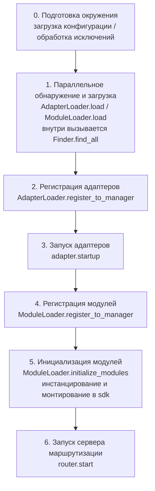

# Процесс запуска и ручное управление

> [!TIP]
> **Когда читать эту статью**: когда нужно вручную управлять цепочкой запуска, настраивать порядок запуска или разбираться в причинах сбоя при запуске. Если это не требуется — пропустите, на использование остальных функций это не влияет.

`await sdk.run()` / `await sdk.init()` в ErisPulse упаковывают всю цепочку запуска в «одну строку кода». Но когда вам нужно полностью кастомизировать процесс запуска (например, частичная загрузка, динамическая регистрация, горячая замена, внедрение собственной стратегии загрузки), необходимо понять, что именно происходит внутри этой цепочки и как вручную управлять каждым шагом.

В этой статье цепочка запуска разбирается на отдельные этапы с описанием их назначения и порядка вызова, а также приводится пример полного ручного запуска.

> Предполагается, что вы уже прошли раздел [«Первый бот»](../getting-started/first-bot.md) и знакомы с двумя режимами `sdk.run(keep_running=True/False)`. Статья сфокусирована на разборе цепочки **внутри** `init()`, а также на более низкоуровневых точках входа, таких как `init()`/`init_task()`/`init_sync()`.

## Обзор точек входа верхнего уровня SDK

Помимо двух режимов `keep_running` у `run()`, SDK предоставляет несколько более низкоуровневых точек входа для инициализации; они различаются **асинхронностью, возвращаемым значением и обработкой исключений**:

| Точка входа | Асинхронность | Возвращаемое значение | Обработка исключений | Сценарий применения |
|------|--------|--------|----------|----------|
| `await sdk.run(True)` | async, блокирует и удерживает | `None` (автоматический `uninit` при завершении) | Ошибки модулей/адаптеров перехватываются и не рушат процесс | Чисто бот-приложение |
| `await sdk.run(False)` | async, без блокировки | `None` (без автоматической выгрузки) | То же | Выполнение собственной логики после инициализации |
| `await sdk.init()` | async, требует await | `bool` | Исключения компонентов перехватываются внутри, при сбое возвращается `False` | Ручное управление жизненным циклом (в паре с `uninit()`) |
| `sdk.init_task()` | async, возвращает Task без блокировки | `asyncio.Task` | Как у `init()` | Параллельное выполнение другой инициализации либо когда цикл событий ещё не запущен |
| `sdk.init_sync()` | **синхронный**, блокирует текущий поток | `bool` | Как у `init()` | Скрипты командной строки, синхронные точки входа без цикла событий |

> **Распространённое заблуждение**: `await sdk.init()` **не эквивалентен** `await sdk.run(keep_running=False)`. Два отличия: ① `init()` возвращает `bool` (при сбое — `False`), а `run()` возвращает `None`; ② `init()` выполняет только инициализацию и **не выгружает автоматически**, тогда как `run()` автоматически вызывает `uninit()` по завершении цикла событий. Поэтому для ручного парного управления выгрузкой или кастомного жизненного цикла используйте `init()` + `uninit()`.

## Обзор цепочки запуска

`sdk.init()` (точнее — его внутренний `Initializer.init()`) поднимает весь фреймворк в следующем порядке:



Соответствующие ключевые компоненты:

| Уровень | Компонент | Назначение |
|----|------|------|
| Обнаружение | `AdapterFinder` / `ModuleFinder` | **Обнаруживает** адаптеры/модули среди entry-points установленных пакетов |
| Загрузка | `AdapterLoader` / `ModuleLoader` | Обнаружение + импорт + чтение метаданных + определение включено/выключено, возвращает список объектов |
| Регистрация | `*Loader.register_to_manager` | Регистрирует объекты в соответствующих менеджерах |
| Управление | `sdk.adapter` / `sdk.module` | Поддерживает экземпляры адаптеров/модулей, предоставляет интерфейсы запуска/остановки |
| Инициализация | `ModuleLoader.initialize_modules` | Создаёт экземпляры модулей и монтирует их в `sdk` (выполняет топологическую сортировку зависимостей) |
| Маршрутизация | `sdk.router` | HTTP / WebSocket сервер |

> **Важно**: `Finder` и `Loader` — это два уровня. `Loader` **уже содержит внутри** `Finder` (`AdapterLoader` включает `AdapterFinder`, `ModuleLoader` включает `ModuleFinder`). В подавляющем большинстве случаев достаточно `Loader`; отдельно `Finder` нужен только тогда, когда требуется «только перечислить, не импортируя».

## Подробный разбор этапов

### 1. Уровень обнаружения: Finder

Finder отвечает только за «поиск пакетов, предоставляющих адаптеры/модули», без импорта и без инстанцирования.

```python
from ErisPulse.finders import AdapterFinder, ModuleFinder

adapter_finder = AdapterFinder()
module_finder = ModuleFinder()

# Поиск всех установленных entry-points адаптеров/модулей
adapter_entries = adapter_finder.find_all()    # list[EntryPoint]
module_entries = module_finder.find_all()      # list[EntryPoint]

# Поиск одного по имени
entry = module_finder.find_by_name("MyModule")  # EntryPoint | None
```

У каждого `EntryPoint` можно вызвать `.load()` для получения соответствующего класса, но обычно это не требуется делать вручную — это сделает Loader.

### 2. Уровень загрузки: Loader

Поверх Finder Loader выполняет «импорт + чтение метаданных + определение включено/выключено».

```python
from ErisPulse.loaders import AdapterLoader, ModuleLoader
from ErisPulse import sdk

adapter_loader = AdapterLoader()
module_loader = ModuleLoader()

# Внутри load(): вызов finder.find_all() → последовательная обработка entry-points → возврат тройки
adapter_objs, enabled_adapters, disabled_adapters = await adapter_loader.load(sdk.adapter)
module_objs, enabled_modules, disabled_modules = await module_loader.load(sdk.module)
```

Тройка, возвращаемая `load()`:

| Возвращаемое значение | Значение |
|--------|------|
| `objs` (`dict`) | имя → объект (класс адаптера / объект-обёртка модуля) |
| `enabled` (`list[str]`) | включённые имена (не отключённые в конфигурации) |
| `disabled` (`list[str]`) | отключённые имена |

#### Диагностическая информация при сбое загрузки

Когда какой-либо модуль/адаптер выбрасывает исключение на этапе загрузки или инициализации, фреймворк пропускает этот компонент и продолжает загрузку остальных, одновременно выводя **сводку кадров пользовательского кода**, что позволяет локализовать место ошибки на уровне INFO по умолчанию без необходимости вручную включать DEBUG:

```
[ERROR] [ModuleLoader] Не удалось загрузить модуль MyModule из entry-point, пропущено: 'NoneType' object has no attribute 'platform'
  → MyModule/Core.py:42 in on_load
      adapter = sdk.platform
  → AttributeError: 'NoneType' object has no attribute 'platform'
  → Подсказка: повысьте уровень логирования до DEBUG, чтобы увидеть полный стек; проверьте код реализации модуля MyModule
```

Диагностическая информация генерируется модулем `ErisPulse.runtime.diagnostics`, который автоматически отфильтровывает внутренние кадры фреймворка, оставляя только кадры вашего кода. Для повторного использования в собственной логике загрузки:

```python
from ErisPulse.runtime import log_diagnostic

try:
    risky_init()
except Exception as e:
    log_diagnostic(e)  # автоматически извлекает кадры пользовательского кода и пишет в ERROR-лог
```

Модуль также предоставляет два низкоуровневых метода: `extract_user_frame()` (возвращает структурированную информацию о кадре) и `format_diagnostic_block()` (возвращает многострочный текст).

### 3. Уровень регистрации: register_to_manager

Регистрирует объекты, созданные Loader'ом, в менеджерах, чтобы `sdk.adapter` / `sdk.module` могли их распознавать.

```python
# Регистрация адаптеров (возвращает bool, указывающий, всё ли прошло успешно)
await adapter_loader.register_to_manager(enabled_adapters, adapter_objs, sdk.adapter)

# Регистрация модулей
await module_loader.register_to_manager(enabled_modules, module_objs, sdk.module)
```

После регистрации адаптеры занесены в менеджер адаптеров, модули — в менеджер модулей, но **ни те, ни другие ещё не запущены/не инстанцированы**.

### 4. Запуск адаптеров

```python
# Запуск всех зарегистрированных адаптеров
await sdk.adapter.startup()
# или указать платформы
await sdk.adapter.startup("yunhu")
await sdk.adapter.startup(["yunhu", "telegram"])
```

> Регистрация ≠ запуск. `register_to_manager` лишь заносит в реестр; `startup` вызывает `start()` адаптера и устанавливает соединение с платформой.

### 5. Инициализация модулей

У модулей по сравнению с адаптерами есть дополнительный шаг — их нужно **инстанцировать** и смонтировать на `sdk` (чтобы вы могли обращаться через `sdk.MyModule.xxx`). На этом шаге также обрабатываются декларации зависимостей между модулями и топологическая сортировка.

```python
success = await module_loader.initialize_modules(
    enabled_modules, module_objs, sdk.module, sdk
)
```

После успешного инстанцирования модуль становится доступен как `sdk.<ModuleName>`.

### 6. Запуск сервера маршрутизации

```python
await sdk.router.start(
    host="0.0.0.0",
    port=8000,
    ssl_certfile=None,
    ssl_keyfile=None,
)
```

Сервер маршрутизации отвечает за приём Webhook / WebSocket-колбэков адаптеров. Без его запуска адаптеры в режиме server не смогут получать сообщения.

## Полный пример ручного запуска

Следующий код **эквивалентен** основному процессу `await sdk.init()`, но каждый шаг находится в ваших руках, и на любом этапе можно вставить собственную логику:

```python
import asyncio
from ErisPulse import sdk
from ErisPulse.loaders import AdapterLoader, ModuleLoader

async def manual_startup():
    # 0. Подготовка окружения (загрузка конфигурации, регистрация глобальной обработки исключений)
    #    _prepare_environment — предварительный шаг внутри init(); при ручном процессе
    #    его также нужно вызвать первым, иначе Loader не сможет прочитать конфигурацию
    #    и ошибочно сочтёт все адаптеры/модули отключёнными.
    if not await sdk._prepare_environment():
        print("Не удалось подготовить окружение")
        return False

    # 1. Создание загрузчиков (каждый внутри содержит свой Finder)
    adapter_loader = AdapterLoader()
    module_loader = ModuleLoader()

    # 2. Параллельное обнаружение и загрузка (как внутри init(), с использованием gather)
    (adapter_objs, enabled_adapters, disabled_adapters), \
    (module_objs, enabled_modules, disabled_modules) = await asyncio.gather(
        adapter_loader.load(sdk.adapter),
        module_loader.load(sdk.module),
    )

    # 3. Регистрация адаптеров
    await adapter_loader.register_to_manager(
        enabled_adapters, adapter_objs, sdk.adapter
    )

    # 4. Запуск адаптеров
    if enabled_adapters:
        await sdk.adapter.startup()

    # 5. Регистрация модулей
    await module_loader.register_to_manager(
        enabled_modules, module_objs, sdk.module
    )

    # 6. Инициализация модулей (инстанцирование + монтирование в sdk)
    if enabled_modules:
        await module_loader.initialize_modules(
            enabled_modules, module_objs, sdk.module, sdk
        )

    # 7. Запуск сервера маршрутизации
    await sdk.router.start(host="0.0.0.0", port=8000)

    print("Ручной запуск завершён")
    return True

async def main():
    ok = await manual_startup()
    if ok:
        # Блокируем и удерживаем работу (ручной процесс не блокирует автоматически)
        await asyncio.Event().wait()

if __name__ == "__main__":
    asyncio.run(main())
```

### Когда стоит запускать вручную?

В подавляющем большинстве случаев ручной запуск **не нужен** — `await sdk.run()` уже делает всё вышеперечисленное. Ручной запуск оправдан только в следующих сценариях:

- **Частичная загрузка**: загрузка только указанных адаптеров/модулей с пропуском остальных
- **Динамическая регистрация**: регистрация новых адаптеров/модулей во время выполнения по условию
- **Собственный порядок**: когда нужно изменить порядок загрузки по умолчанию (например, сначала запустить определённый модуль, затем адаптер)
- **Внедрение стратегий**: внедрение в Loader собственного менеджера строгого режима, стратегий загрузки и т.д.
- **Отладка/диагностика**: при сбое на каком-то этапе — ручное управление для локализации проблемы

## Тонкое управление во время выполнения

Даже если запуск выполнен через `sdk.run()`, вы всё равно можете управлять отдельными подсистемами во время выполнения, не перезапуская весь SDK:

### Горячий запуск/остановка адаптеров

```python
# Горячий перезапуск адаптера (восстановление соединения, не затрагивая другие платформы)
await sdk.adapter.shutdown("yunhu")
await sdk.adapter.startup("yunhu")

# Запуск новой платформы во время работы
await sdk.adapter.startup("telegram")

# Временное отключение платформы
await sdk.adapter.shutdown("telegram")
```

> `adapter.startup()` требует, чтобы адаптер был **уже зарегистрирован** в менеджере. Регистрация происходит внутри `init()`/`run()`, поэтому это тонкое управление **после** запуска.

### Сервер маршрутизации

```python
# Временное отключение webhook-сервера
await sdk.router.stop()

# Повторный запуск (например, на другом порту)
await sdk.router.start(host="0.0.0.0", port=9000)
```

### Загрузка модулей по требованию

```python
# Ручная загрузка (возможно, лениво загружаемого) модуля
await sdk.load_module("MyModule")
```

## Корректное завершение работы

Начиная с 2.7.0, `sdk.shutdown()` предоставляет **программное корректное завершение работы**: устанавливается событие завершения, благодаря чему главный цикл, ожидающий в `await sdk.run(keep_running=True)`, возвращается, что в свою очередь запускает `uninit()` для очистки ресурсов.

```python
# Вызов из любой корутины запускает корректный выход (run() выходит из ожидания и автоматически вызывает uninit)
sdk.shutdown()
```

Типичный пример использования:

```python
async def shutdown_after_idle():
    await asyncio.sleep(3600)
    sdk.shutdown()  # корректный выход после 1 часа простоя
```

**Обработка сигналов**: внутри `run()` регистрируются обработчики `SIGTERM` / `SIGHUP`, преобразующие системные сигналы в корректное завершение — при остановке сервиса оркестратором контейнеров (Docker `docker stop`) или через `systemd` процесс завершит очистку `uninit()`, а не будет убит принудительно.

- Windows не поддерживает `loop.add_signal_handler`, обработчики сигналов автоматически пропускаются (корректное завершение всё равно можно вызвать через `sdk.shutdown()` или Ctrl+C)
- Повторные вызовы `sdk.shutdown()` безопасны (после установки события повторный вызов — пустая операция)

## Процесс выгрузки

Операция, обратная запуску, — `await sdk.uninit()`, которая выполняет очистку в обратном порядке:

1. Останавливает все адаптеры (`adapter.shutdown()`)
2. Выгружает все модули
3. Очищает все обработчики событий
4. Очищает менеджеры и атрибуты модулей на SDK

При ручном запуске не забудьте перед выходом вызвать `uninit()` для корректного завершения:

```python
try:
    await asyncio.Event().wait()   # удерживаем работу
finally:
    await sdk.uninit()
```

## Перезапуск

SDK предоставляет два способа перезапуска, ни один из которых не требует предварительной выгрузки вручную — фреймворк всё сделает сам:

| Способ | Вызов | Поведение | Сценарий применения |
|------|------|------|----------|
| Горячий перезапуск | `await sdk.restart()` | **Горячая перезагрузка на уровне кода компонентов в том же процессе**: все модули проходят единую конвейерную перезагрузку (общая предпроверка синтаксиса / откат по снапшоту / проверка идентичности), адаптеры сначала **повторно обнаруживают entry-points** (новоустановленные/удалённые во время работы адаптеры вступают в силу сразу), затем перезагружаются по одному на уровне кода | Вступление кода в силу после pip-обновления или установки компонентов, горячее обновление модулей |
| Жёсткий перезапуск | `await sdk.hard_restart()` | После `uninit()` процесс завершается с **кодом выхода 42**, а внешний супервизор запускает новый процесс | Обновление самого фреймворка (код обновлённого фреймворка вступает в силу только в новом процессе), побочные эффекты C-расширений, подозрение на утечку ресурсов |

```python
# Горячий перезапуск: перезагрузка на уровне кода компонентов (самый частый случай; новоустановленные через pip адаптеры также будут запущены)
await sdk.restart()

# Жёсткий перезапуск: выход из процесса с передачей перезапуска внешнему супервизору (см. «Руководство по супервизорам» ниже)
await sdk.hard_restart("sdk self-update")  # необязательный reason для отображения супервизором
```

> **Два замечания**:
> 1. Оба метода выполняют перезапуск в фоновой задаче и **сразу возвращают `True`, что означает «задача перезапуска запланирована»**, а не «перезапуск завершён». Фактический перезапуск происходит в фоне, чтобы не прерывать текущую цепочку событий.
> 2. Принцип работы `hard_restart()`: после выгрузки и сохранения конфигурации на диск процесс завершается с **кодом выхода 42** (`HARD_RESTART_EXIT_CODE`) — **сам он новый процесс не запускает**, перезапуск должен выполнить внешний супервизор, обнаруживший код выхода 42. Если запустить напрямую `python main.py` без какого-либо супервизора, процесс завершится с кодом 42 и на этом закончится — **автоматического перезапуска не будет** (фреймворк выдаст предупреждение).

> **Взаимное исключение и слияние горячих перезапусков** (с 2.11.1): все операции горячего перезагрузки (перезагрузка одного модуля / полная перезагрузка / перезагрузка адаптеров / гибернация) полностью взаимоисключающи — при «шторме» сохранений последовательные срабатывания не пересекаются конкурентно, идущий restart при получении нового запроса автоматически сливается с ним, и после завершения выполняется не более одного дополнительного прохода. При сохранении файла с синтаксической ошибкой весь цикл перезагрузки будет отклонён до выгрузки **сводной предпроверкой синтаксиса** (однократно перечисляются все ошибочные файлы и номера строк), все старые экземпляры продолжают работать.

### Когда нужен жёсткий перезапуск?

Горячий перезапуск покрывает подавляющее большинство сценариев (pip-обновление/установка компонентов, горячее обновление кода модулей, **включая адаптеры, установленные во время работы**). Жёсткий перезапуск нужен только в следующих случаях:

- **Обновление самого фреймворка**: после обновления ErisPulse новый код фреймворка вступает в силу только в совершенно новом процессе (Python не переимпортирует уже загруженный код фреймворка).
- **Побочные эффекты бинарных библиотек (C-расширений)**: горячий перезапуск происходит в том же процессе и не может освободить C-расширения, открытые файловые дескрипторы, потоки и другие ресурсы уровня процесса; жёсткий перезапуск создаёт новый процесс, и эти побочные эффекты полностью обнуляются.
- **Поиск утечек ресурсов**: при подозрении на утечку памяти или дескрипторов жёсткий перезапуск даёт чистое окружение.

> Функция «Перезапуск фреймворка» в панели управления Dashboard под капотом вызывает именно `hard_restart()`.

### Контракт кода выхода 42

Жёсткий перезапуск — это межпроцессное взаимодействие: **SDK отвечает за выход (код 42), супервизор — за запуск**.

| Роль | Поведение |
|------|------|
| SDK (при жёстком перезапуске) | `uninit()` → сохранение конфигурации на диск → запись маркера жёсткого перезапуска (причина / PID, для отображения супервизором) → `os._exit(42)` |
| Супервизор | Обнаруживает код выхода 42 у дочернего процесса → показывает причину жёсткого перезапуска → запускает ту же команду заново |

> `sdk.is_supervised()` позволяет узнать, запущен ли текущий процесс супервизором (проверяется переменная окружения `ERISPULSE_SUPERVISED`). Команда CLI `run` автоматически внедряет этот маркер при запуске дочернего процесса; внешние супервизоры вроде systemd / Docker его не внедряют, и `is_supervised()` вернёт `False` — в этом случае после жёсткого перезапуска фреймворк выдаст предупреждение «супервизор не обнаружен».

### Руководство по супервизорам

Выберите подходящий вам супервизор, чтобы жёсткий перезапуск действительно работал:

#### 1. Команда CLI run (разработка/простое развёртывание, рекомендуется)

`epsdk run main.py` содержит встроенный цикл супервизии: отслеживает код выхода дочернего процесса, при 42 немедленно перезапускает (и показывает причину жёсткого перезапуска); другие аварийные коды выхода автоматически повторяются с экспоненциальной задержкой; `Ctrl+C` сначала корректно завершает дочерний процесс (код 0 считается нормальным выходом, перезапуск не выполняется).

```bash
epsdk run main.py
```

`epsdk run --reload` (режим горячего перезагрузки для разработки, с 2.11.1) также использует структуру «супервизор-процесс + дочерний worker-процесс перезагрузки»: сохранение `.py`-файла внутри worker запускает **горячую перезагрузку на уровне компонентов** (без перезапуска всего фреймворка); жёсткий перезапуск выполняется супервизором путём запуска совершенно нового worker'а — после обновления фреймворка новый код вступает в силу немедленно.

#### 2. systemd (серверы Linux)

`RestartForceExitStatus=42` заставляет код выхода 42 также запускать перезапуск (по умолчанию `on-failure` срабатывает только для ненулевых кодов):

```ini
[Service]
ExecStart=/usr/bin/python3 /opt/mybot/main.py
Restart=on-failure
RestartForceExitStatus=42
RestartSec=2
User=mybot
```

#### 3. Docker / docker-compose

Внутри контейнера PID 1 — это процесс приложения; при коде выхода 42 контейнер завершается — используйте стратегию `restart`, чтобы он перезапускался автоматически:

```yaml
services:
  bot:
    build: .
    restart: unless-stopped   # перезапуск при любом выходе (включая 42)
```

#### 4. PM2 (эксплуатация в экосистеме Node)

```bash
pm2 start main.py --name mybot --interpreter python3
# 42 рассматривается как код выхода, PM2 по умолчанию перезапускает; настройте restart_delay (антидребезг)
pm2 set mybot.restart_delay 2000
```

#### 5. supervisord

```ini
[program:mybot]
command=python3 /opt/mybot/main.py
autorestart=true
exitcodes=0,2,42    # 42 также считается «нормальным выходом, требующим перезапуска»
```

#### 6. Собственный супервизор на чистом Python

```python
import subprocess, sys, time

while True:
    p = subprocess.Popen([sys.executable, "main.py"])
    code = p.wait()
    if code == 42:          # запрос жёсткого перезапуска
        time.sleep(0.5)
        continue
    if code == 0:           # нормальный выход
        break
    time.sleep(3)           # аварийный выход, повтор с задержкой
```

> **Поведение без супервизора**: при запуске напрямую через `python main.py` после вызова `hard_restart()` процесс завершится с кодом 42 и не перезапустится. В этом случае следует подключить любой из перечисленных выше супервизоров.

## Связанная документация

- [Создание первого бота](../getting-started/first-bot.md) - введение в два базовых режима `keep_running`
- [Управление жизненным циклом](lifecycle.md) - прослушивание событий запуска `core.init.start` / `core.init.complete` и др.
- [Система ленивой загрузки](lazy-loading.md) - механизм ленивой загрузки модулей и `load_module`