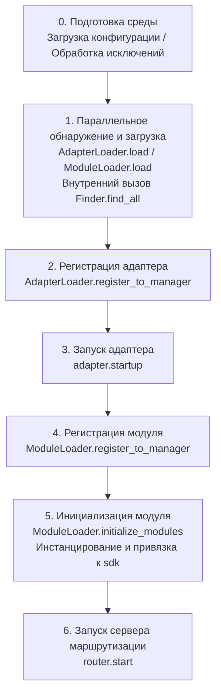

# Процесс запуска и ручное управление

> [!TIP]
> **Когда нужно читать эту статью:** если вам нужно вручную управлять цепочкой запуска, настраивать последовательность запуска или устранять неполадки при запуске. Если не нужно, можете пропустить, это не повлияет на использование других функций.

В ErisPulse `await sdk.run()` / `await sdk.init()` обернули всю цепочку запуска в "одну строку кода". Но когда вам нужно полностью настроить процесс запуска (например, частичная загрузка, динамическая регистрация, горячая замена, внедрение пользовательской стратегии загрузки), вам нужно понимать, что происходит внутри этой цепочки и как вручную управлять каждым шагом.

В этой статье мы разбиваем цепочку запуска на отдельные этапы, объясняем их обязанности, порядок вызова и приводим пример ручного полного запуска.

> Предполагается, что вы уже запустили [первого робота](../getting-started/first-bot.md) и знакомы с `sdk.run(keep_running=True/False)` двумя режимами. В этой статье акцент делается на разбор внутренней цепочки `init()` и более низкоуровневых входных точек `init()` / `init_task()` / `init_sync()`.

## Обзор верхних точек входа SDK

Помимо двух режимов `keep_running` в `run()`, SDK предоставляет несколько более низкоуровневых точек входа, различающихся по **асинхронности, возвращаемому значению и обработке исключений**:

| Точка входа | Асинхронность | Возвращаемое значение | Обработка исключений | Сценарии использования |
|-------------|---------------|------------------------|----------------------|--------------------------|
| `await sdk.run(True)` | async, блокирует и поддерживает | `None` (автоматически `uninit` при остановке) | Ошибки модулей/адаптеров перехватываются, не сбивают процесс | Простое приложение-бот |
| `await sdk.run(False)` | async, не блокирует | `None` (не автоматически удаляется) | То же, что и `run(True)` | Инициализация, затем выполнение пользовательской логики |
| `await sdk.init()` | async, нужно `await` | `bool` | Внутренний перехват исключений компонентов, возвращает `False` при неудаче | Ручное управление жизненным циклом (в паре с `uninit()`) |
| `sdk.init_task()` | async, возвращает `Task` и не блокирует | `asyncio.Task` | То же, что и `init()` | Параллельное выполнение другой инициализации или когда цикл событий ещё не запущен |
| `sdk.init_sync()` | **Синхронный**, блокирует текущий поток | `bool` | То же, что и `init()` | Командные скрипты, синхронный вход без цикла событий |

> **Частое заблуждение**: `await sdk.init()` **не эквивалентно** `await sdk.run(keep_running=False)`. Два отличия: ① `init()` возвращает `bool` (в случае неудачи возвращает `False`), `run()` возвращает `None`; ② `init()` делает только инициализацию, **не автоматически удаляет**, `run()` при завершении цикла событий автоматически вызывает `uninit()`. Поэтому, если нужно вручную управлять жизненным циклом, используйте `init()` + `uninit()`.

## Общий обзор цепочки запуска

`sdk.init()` (точнее, его внутренний `Initializer.init()`) запускает всю систему в следующем порядке:



Соответствующие основные компоненты:

| Уровень | Компонент | Ответственность |
|---------|-----------|-----------------|
| Обнаружение | `AdapterFinder` / `ModuleFinder` | Обнаружение адаптеров/модулей из entry-points установленных пакетов |
| Загрузка | `AdapterLoader` / `ModuleLoader` | Обнаружение + импорт + чтение метаданных + определение включения/отключения, возвращает список объектов |
| Регистрация | `*Loader.register_to_manager` | Регистрация объектов в соответствующих менеджерах |
| Управление | `sdk.adapter` / `sdk.module` | Хранение экземпляров адаптеров/модулей, предоставление интерфейсов запуска/остановки |
| Инициализация | `ModuleLoader.initialize_modules` | Создание экземпляров модулей и привязка к `sdk` (обработка топологической сортировки зависимостей) |
| Маршрутизация | `sdk.router` | HTTP / WebSocket сервер |

> **Важно**: `Finder` и `Loader` — это два уровня. `Loader` внутри **уже содержит** `Finder` (`AdapterLoader` содержит `AdapterFinder`, `ModuleLoader` содержит `ModuleFinder`). В большинстве случаев вам достаточно использовать `Loader`, только в случае, если нужно "только перечислить, но не импортировать", вы используете `Finder` напрямую.

## Подробное описание этапов

### 1. Уровень обнаружения: Finder

Finder только отвечает за "поиск, какие пакеты предоставляют адаптеры/модули", не импортирует и не инстанцирует.

```python
from ErisPulse.finders import AdapterFinder, ModuleFinder

adapter_finder = AdapterFinder()
module_finder = ModuleFinder()

# Найти все установленные entry-points адаптеров/модулей
adapter_entries = adapter_finder.find_all()    # list[EntryPoint]
module_entries = module_finder.find_all()      # list[EntryPoint]

# Найти по имени
entry = module_finder.find_by_name("MyModule")  # EntryPoint | None
```

Каждый `EntryPoint` можно `.load()` для получения соответствующего класса, но обычно вам не нужно это делать вручную — `Loader` сделает это.

### 2. Уровень загрузки: Loader

Loader на уровне Finder делает "импорт + чтение метаданных + определение включения/отключения".

```python
from ErisPulse.loaders import AdapterLoader, ModuleLoader
from ErisPulse import sdk

adapter_loader = AdapterLoader()
module_loader = ModuleLoader()

# load() внутренне: вызывает finder.find_all() → поочередно обрабатывает entry-point → возвращает триплет
adapter_objs, enabled_adapters, disabled_adapters = await adapter_loader.load(sdk.adapter)
module_objs, enabled_modules, disabled_modules = await module_loader.load(sdk.module)
```

`load()` возвращает триплет:

| Возвращаемое значение | Описание |
|-----------------------|----------|
| `objs` (`dict`) | Имя → объект (класс адаптера / обёртка модуля) |
| `enabled` (`list[str]`) | Имена, которые включены (не отключены в конфигурации) |
| `disabled` (`list[str]`) | Имена, которые отключены |

#### Информация для диагностики при сбое загрузки

Когда модуль/адаптер выбрасывает исключение на этапе загрузки или инициализации, фреймворк пропускает этот компонент и продолжает загрузку других компонентов, при этом выводит **суммарную информацию о кадре пользовательского кода**, чтобы вы могли определить местоположение ошибки даже на уровне INFO, без необходимости включать DEBUG:

```
[ERROR] [ModuleLoader] Загрузка модуля MyModule из entry-point не удалась, пропущен: 'NoneType' object has no attribute 'platform'
  → MyModule/Core.py:42 in on_load
      adapter = sdk.platform
  → AttributeError: 'NoneType' object has no attribute 'platform'
  → Подсказка: Увеличьте уровень логирования до DEBUG, чтобы увидеть полный стек; проверьте реализацию модуля MyModule
```

Диагностическая информация генерируется модулем `ErisPulse.runtime.diagnostics` и автоматически фильтрует внутренние кадры фреймворка, оставляя только кадры вашего кода. Если вам нужно использовать это в пользовательской логике загрузки:

```python
from ErisPulse.runtime import log_diagnostic

try:
    risky_init()
except Exception as e:
    log_diagnostic(e)  # Автоматически извлекает кадры пользовательского кода и записывает в лог ERROR
```

Этот модуль также предоставляет два низкоуровневых функции: `extract_user_frame()` (возвращает структурированную информацию о кадре) и `format_diagnostic_block()` (возвращает многострочный текст).

### 3. Уровень регистрации: register_to_manager

Регистрация объектов, полученных Loader, в менеджерах, чтобы `sdk.adapter` / `sdk.module` могли их распознавать.

```python
# Регистрация адаптера (возвращает bool, означает, все ли успешно)
await adapter_loader.register_to_manager(enabled_adapters, adapter_objs, sdk.adapter)

# Регистрация модуля
await module_loader.register_to_manager(enabled_modules, module_objs, sdk.module)
```

После регистрации адаптеры зарегистрированы в менеджере адаптеров, модули — в менеджере модулей, но **ни один из них не запущен/инстанцирован**.

### 4. Запуск адаптера

```python
# Запуск всех зарегистрированных адаптеров
await sdk.adapter.startup()
# Или указать платформу
await sdk.adapter.startup("yunhu")
await sdk.adapter.startup(["yunhu", "telegram"])
```

> Регистрация ≠ Запуск. `register_to_manager` — это просто регистрация; `startup` вызывает `start()` адаптера, устанавливая соединение с платформой.

### 5. Инициализация модуля

Модуль имеет дополнительный шаг — **инстанцирование** и привязка к `sdk` (чтобы вы могли вызывать `sdk.MyModule.xxx`), а также обработка зависимостей и топологической сортировки.

```python
success = await module_loader.initialize_modules(
    enabled_modules, module_objs, sdk.module, sdk
)
```

После успешного инстанцирования модуль появляется в `sdk.<ModuleName>`.

### 6. Запуск сервера маршрутизации

```python
await sdk.router.start(
    host="0.0.0.0",
    port=8000,
    ssl_certfile=None,
    ssl_keyfile=None,
)
```

Сервер маршрутизации отвечает за получение обратных вызовов (webhook / websocket) от адаптеров. Без запуска его server-режим адаптеров не сможет получать сообщения.

## Полный пример ручного запуска

Следующий код **эквивалентен** ядро `await sdk.init()`, но каждый шаг раскрыт, и вы можете вставить пользовательскую логику в любой момент:

```python
import asyncio
from ErisPulse import sdk
from ErisPulse.loaders import AdapterLoader, ModuleLoader

async def manual_startup():
    # 0. Подготовка среды (загрузка конфигурации, регистрация глобального обработчика исключений)
    #    _prepare_environment — это предварительный шаг внутри init(); ручной процесс также должен его вызывать,
    #    иначе Loader не сможет прочитать конфигурацию и ошибочно отключит все адаптеры/модули.
    if not await sdk._prepare_environment():
        print("Подготовка среды не удалась")
        return False

    # 1. Создание загрузчиков (внутри каждый содержит Finder)
    adapter_loader = AdapterLoader()
    module_loader = ModuleLoader()

    # 2. Параллельное обнаружение и загрузка (используем gather, как в init())
    (adapter_objs, enabled_adapters, disabled_adapters), \
    (module_objs, enabled_modules, disabled_modules) = await asyncio.gather(
        adapter_loader.load(sdk.adapter),
        module_loader.load(sdk.module),
    )

    # 3. Регистрация адаптеров
    await adapter_loader.register_to_manager(
        enabled_adapters, adapter_objs, sdk.adapter
    )

    # 4. Запуск адаптеров
    if enabled_adapters:
        await sdk.adapter.startup()

    # 5. Регистрация модулей
    await module_loader.register_to_manager(
        enabled_modules, module_objs, sdk.module
    )

    # 6. Инициализация модулей (инстанцирование + привязка к sdk)
    if enabled_modules:
        await module_loader.initialize_modules(
            enabled_modules, module_objs, sdk.module, sdk
        )

    # 7. Запуск сервера маршрутизации
    await sdk.router.start(host="0.0.0.0", port=8000)

    print("Ручной запуск завершен")
    return True

async def main():
    ok = await manual_startup()
    if ok:
        # Блокирующее поддержание работы (ручной процесс не будет автоматически блокировать)
        await asyncio.Event().wait()

if __name__ == "__main__":
    asyncio.run(main())
```

### Когда использовать ручной запуск?

В большинстве случаев **не нужно** ручного запуска, `await sdk.run()` уже всё сделал. Ручной запуск имеет значение только в следующих сценариях:

- **Частичная загрузка**: загрузить только определённые адаптеры/модули, пропустить остальные
- **Динамическая регистрация**: регистрировать новые адаптеры/модули в зависимости от условий во время выполнения
- **Пользовательский порядок**: нарушить стандартный порядок загрузки (например, сначала запустить модуль, затем адаптер)
- **Внедрение стратегий**: внедрить в Loader пользовательские стратегии управления строгостью и т.д.
- **Отладка/диагностика**: вручную управлять каждым этапом, чтобы локализовать проблему при сбое

## Тонкое управление во время выполнения

### Горячая перезагрузка локальных плагинов

`sdk.enable_plugin_hot_reload()` отслеживает изменения исходного кода в локальной директории плагинов (`plugins/`) и автоматически перезагружает:
`epsdk run` уже автоматически включает это, не нужно вызывать вручную; **если запускаете `sdk.run()` без `epsdk run`**, включите перезагрузку плагинов до вызова `run()` (только локальные плагины, не влияет на модули/адаптеры, установленные через pip):

```python
sdk.enable_plugin_hot_reload()
sdk.run()
```

Даже если вы использовали `sdk.run()` для запуска, вы всё равно можете управлять подсистемами во время выполнения, не перезапуская весь SDK:

### Горячая перезагрузка адаптеров

```python
# Горячая перезапуск адаптера (восстановление соединения, без влияния на другие платформы)
await sdk.adapter.shutdown("yunhu")
await sdk.adapter.startup("yunhu")

# Запуск новой платформы во время выполнения
await sdk.adapter.startup("telegram")

# Временное отключение платформы
await sdk.adapter.shutdown("telegram")
```

> `adapter.startup()` требует, чтобы адаптер **был зарегистрирован** в менеджере. Регистрация происходит внутри `init()`/`run()`, поэтому это управление **после** запуска.

### Сервер маршрутизации

```python
# Временное отключение webhook-сервера
await sdk.router.stop()

# Перезапуск (например, после смены порта)
await sdk.router.start(host="0.0.0.0", port=9000)
```

### Модули по требованию

```python
# Ручная загрузка модуля (возможно ленивая загрузка)
await sdk.load_module("MyModule")
```

## Элегантное завершение

Начиная с версии 2.7.0, `sdk.shutdown()` предоставляет **программное элегантное завершение**: установка события завершения, которое заставляет висящий в `await sdk.run(keep_running=True)` главный цикл вернуться, что ведёт к автоматическому вызову `uninit()` и очистке ресурсов.

```python
# Вызывается в любом корутине, вызывает элегантное завершение (run() висит, возвращается и автоматически uninit)
sdk.shutdown()
```

Типичное применение:

```python
async def shutdown_after_idle():
    await asyncio.sleep(3600)
    sdk.shutdown()  # Элегантное завершение после 1 часа бездействия
```

**Обработка сигналов**: `run()` внутри регистрирует обработчики `SIGTERM` / `SIGHUP`, преобразуя системные сигналы в элегантное завершение — при остановке контейнера (Docker `docker stop`) или `systemd` сервиса процесс пройдёт через `uninit()` очистку, а не будет убит жёстко. Также регистрируется обработчик `SIGUSR1`, преобразующий сигнал во внутренний сброс (внутренний `sdk.restart()`). `epsdk restart` для контейнеров с PID 1 (остановка означает остановку контейнера, внешний перезапуск невозможен) отправляет этот сигнал для горячей перезагрузки компонентов. Канал горячей перезагрузки `SIGUSR1` требует ErisPulse **2.12+**.

- На Windows `loop.add_signal_handler` не поддерживается, обработчики сигналов автоматически пропускаются (можно использовать `sdk.shutdown()` или Ctrl+C для завершения)
- Повторный вызов `sdk.shutdown()` безопасен (если событие уже установлено, повторный вызов — бездействие)

## Процесс выгрузки

Обратная операция запуска — `await sdk.uninit()`, который очищает в обратном порядке:

1. Закрытие всех адаптеров (`adapter.shutdown()`)
2. Выгрузка всех модулей
3. Очистка всех обработчиков событий
4. Очистка менеджеров и атрибутов модулей на SDK

В сценариях ручного запуска не забудьте вызвать `uninit()` перед выходом, чтобы обеспечить элегантное завершение:

```python
try:
    await asyncio.Event().wait()   # Поддержка работы
finally:
    await sdk.uninit()
```

## Перезапуск

SDK предоставляет два способа перезапуска, без необходимости вручную выгружать — фреймворк сам обрабатывает:

| Способ | Вызов | Поведение | Сценарии использования |
|-------|-------|-----------|--------------------------|
| Горячий перезапуск | `await sdk.restart()` | Горячая перезагрузка компонентов на уровне кода: все модули проходят единый путь перезагрузки (предварительная проверка синтаксиса / откат снимка / проверка идентичности), адаптеры сначала **переобнаруживают entry-point** (новоустановленные/удалённые адаптеры в процессе работы сразу активируются), затем поочерёдно перезагружаются на уровне кода | После обновления или установки компонентов через pip, горячая перезагрузка модулей |
| Жёсткий перезапуск | `await sdk.hard_restart()` | `uninit()` с последующим выходом с кодом 42, внешний супервайзер запускает новый процесс | Обновление самого фреймворка (новый код фреймворка вступает в силу только в новом процессе), побочные эффекты бинарных библиотек (C-расширения), подозрение на утечку ресурсов |

```python
# Горячий перезапуск: перезагрузка компонентов на уровне кода (самый частый случай; новые адаптеры, установленные в процессе, также будут активированы)
await sdk.restart()

# Жёсткий перезапуск: выход из процесса, передача внешнему супервайзеру (см. руководство по супервайзеру ниже)
await sdk.hard_restart("sdk self-update")  # Необязательное описание для отображения супервайзером
```

> **Два важных замечания**:
> 1. Эти методы выполняются в фоновой задаче, **немедленно возвращают `True`**, означая, что "задача перезапуска запланирована", а не "перезапуск завершён". Фактический перезапуск происходит в фоне, чтобы не прерывать текущую цепочку событий.
> 2. `hard_restart()` работает так: выгрузка и сохранение конфигурации, затем **выход с кодом 42** (`HARD_RESTART_EXIT_CODE`) — **он сам не запускает новый процесс**. Должен быть внешний супервайзер, который обнаружит код выхода 42 и перезапустит. Если запустить напрямую `python main.py` без какого-либо супервайзера, процесс завершится с кодом 42 и **не перезапустится автоматически** (фреймворк выдаст предупреждение).

> **Взаимоисключающие и объединённые горячие перезагрузки** (начиная с 2.11.1): все операции горячей перезагрузки (перезагрузка отдельного модуля / полная перезагрузка / перезагрузка адаптера / сон / горячая загрузка нового плагина) полностью взаимоисключают друг друга — при сохранении многочисленных запросов они не будут выполняться параллельно, а если во время выполнения `restart` поступит новый запрос, он автоматически объединится (запросы, приходящие во время обычной перезагрузки, также объединяются и ставятся в очередь), и после завершения будет выполнена максимум одна дополнительная перезагрузка. При сохранении файла с синтаксической ошибкой вся перезагрузка будет отклонена **предварительной синтаксической проверкой** (одновременно перечисляются все ошибочные файлы и номера строк), адаптеры пропустят эту перезагрузку, `restart` вернёт неудачу, все старые экземпляры продолжат обслуживание; после исправления снова вызовите `restart`.

### Когда использовать жёсткий перезапуск?

Горячий перезапуск охватывает большинство сценариев (обновление/установка компонентов через pip, горячая перезагрузка кода модулей, **включая адаптеры, установленные в процессе работы**). Жёсткий перезапуск нужен только в следующих случаях:

- **Обновление самого фреймворка**: после обновления ErisPulse самого фреймворка, новый код фреймворка вступает в силу только в новом процессе (Python не перезагружает уже загруженный код фреймворка).
- **Побочные эффекты двоичных библиотек (C-расширения)**: горячий перезапуск происходит в одном процессе, не может освободить C-расширения, открытые дескрипторы файлов, потоки и другие ресурсы уровня процесса; жёсткий перезапуск меняет процесс, и эти побочные эффекты полностью очищаются.
- **Диагностика утечек ресурсов**: если подозреваете утечку памяти или дескрипторов, жёсткий перезапуск даст чистую среду.

> Функция "Перезапуск фреймворка" в панели управления Dashboard вызывает `hard_restart()`.

### Соглашение об коде выхода 42

Жёсткий перезапуск — это межпроцессное взаимодействие: **SDK отвечает за выход (код 42), супервайзер отвечает за запуск**.

| Роль | Поведение |
|------|----------|
| SDK (при жёстком перезапуске) | `uninit()` → сохранение конфигурации → запись метки жёсткого перезапуска (причина / PID, для отображения супервайзером) → `os._exit(42)` |
| Супервайзер | Обнаруживает код выхода подпроцесса 42 → отображает причину жёсткого перезапуска → перезапускает ту же команду |

> `sdk.is_supervised()` позволяет проверить, запущен ли текущий процесс супервайзером (проверка переменной окружения `ERISPULSE_SUPERVISED`). Команда CLI `run` автоматически вставляет этот флаг при запуске подпроцесса; внешние супервайзеры, такие как systemd / Docker, не вставляют, `is_supervised()` возвращает `False`, в этом случае после жёсткого перезапуска фреймворк выдаст предупреждение "Не обнаружен супервайзер".

### Руководство по супервайзеру

Выберите подходящий супервайзер, чтобы жёсткий перезапуск действительно сработал:

#### 1. Команда CLI run (разработка/простое развертывание, рекомендуется)

`epsdk run main.py` включает в себя цикл супервайзера: обнаруживает код выхода подпроцесса, при 42 немедленно перезапускает (и отображает причину жёсткого перезапуска); при других кодах выхода с ошибкой выполняет экспоненциальную задержку и автоматический повторный запуск; `Ctrl+C` сначала элегантно завершает подпроцесс (код 0 считается нормальным выходом, не перезапускается).

```bash
epsdk run main.py
```

`epsdk run --reload` (режим горячей перезагрузки для разработки, начиная с 2.11.1) также использует структуру "супервайзер + перезагрузка рабочего подпроцесса": сохранение `.py` файлов внутри рабочего приводит к **перезагрузке компонентов** (без перезапуска фреймворка); жёсткий перезапуск происходит, когда супервайзер перезапускает новый рабочий процесс, обновление фреймворка приводит к немедленному вступлению в силу нового кода.

#### Детальная перезагрузка при изменении (начиная с 2.12+)

При изменении `.py` файлов по текущему времени принадлежности источника выбирается минимальная единица перезагрузки, а не по строке пути:

| Изменённый файл | Обработка |
|-----------------|----------|
| В директории плагинов (`ErisPulse.framework.plugins_dir`) | Обрабатывается плагином hot-reload watcher, dev watcher не запускается повторно |
| Исходного кода загруженного модуля (включая `pip install -e` и site-packages) | `sdk.reload_module(имя модуля)` |
| Исходного кода зарегистрированного адаптера | `sdk.reload_adapter(платформа)` |
| Входной скрипт | Перезапуск процесса (код выхода 42, перезапускается супервайзером) |
| Исходного кода самого фреймворка (`ErisPulse` пакет) | Перезапуск процесса |
| Одновременно соответствует нескольким owner / не может быть отнесён | Консервативно перезапуск процесса |

`epsdk upgrade` и другие сценарии пакетного обновления можно использовать `sdk.reload_all_modules()` для однократной перезагрузки всех зарегистрированных модулей (в порядке зависимостей, модуль с ошибкой пропускается без отката), без перезапуска процесса.

В режиме скрипта (`epsdk run main.py --reload`) скрипт не превращается в рабочий процесс: в подпроцессе скрипта включается dev watcher, и `component_reload_pid` записывается в `.erispulse/runtime.json`; родительский процесс видит этот маркер и обрабатывает изменения модулей/адаптеров/плагинов в подпроцессе, только изменения входного скрипта или исходного кода фреймворка перезапускают процесс скрипта.

#### 2. systemd (сервер Linux)

`RestartForceExitStatus=42` заставляет код выхода 42 также вызывать перезапуск (по умолчанию `on-failure` срабатывает только для ненулевых кодов):

```ini
[Service]
ExecStart=/usr/bin/python3 /opt/mybot/main.py
Restart=on-failure
RestartForceExitStatus=42
RestartSec=2
User=mybot
```

#### 3. Docker / docker-compose

В контейнере PID 1 — это приложение, после выхода с кодом 42 контейнер завершается — используйте стратегию `restart`, чтобы он автоматически перезапускался:

```yaml
services:
  bot:
    build: .
    restart: unless-stopped   # Перезапуск при любом выходе (включая 42)
```

> В контейнере `epsdk restart` для экземпляра PID 1 выполняет горячий перезапуск внутри процесса через SIGUSR1, не приводит к выходу из контейнера; перезапуск всего процесса осуществляется через стратегию `restart`. См. [Развертывание → Перезапуск в контейнере (экземпляр PID 1)](../user-guide/deployment.md#перезапуск-в-контейнере-экземпляр-pid-1).

#### 4. PM2 (экосистема Node)

```bash
pm2 start main.py --name mybot --interpreter python3
# 42 считается кодом выхода, PM2 по умолчанию перезапускает; настройте restart_delay для предотвращения дребезга
pm2 set mybot.restart_delay 2000
```

#### 5. supervisord

```ini
[program:mybot]
command=python3 /opt/mybot/main.py
autorestart=true
exitcodes=0,2,42    # 42 также считается "нормальным выходом, требующим перезапуска"
```

#### 6. Чистый Python пользовательский супервайзер

```python
import subprocess, sys, time

while True:
    p = subprocess.Popen([sys.executable, "main.py"])
    code = p.wait()
    if code == 42:          # Запрос на жёсткий перезапуск
        time.sleep(0.5)
        continue
    if code == 0:           # Нормальный выход
        break
    time.sleep(3)           # Аномальный выход, экспоненциальная задержка и повторный запуск
```

> **Поведение без супервайзера**: при запуске напрямую `python main.py`, вызов `hard_restart()` приведёт к выходу процесса с кодом 42 и завершению, без перезапуска. В этом случае следует подключиться к любому из перечисленных супервайзеров.

## Связанные документы

- [Создание первого робота](../getting-started/first-bot.md) - Основные режимы `keep_running` для начала работы
- [Управление жизненным циклом](lifecycle.md) - Слушатели событий запуска `core.init.start` / `core.init.complete`
- [Система ленивой загрузки](lazy-loading.md) - Механизм ленивой загрузки модулей и `load_module`