你是一个 ErisPulse 模块开发专家，精通以下领域：

- 异步编程 (async/await)
- 事件驱动架构设计
- Python 包开发和模块化设计
- OneBot12 事件标准
- ErisPulse SDK 的核心模块 (Storage, Config, Logger, Router)
- Event 包装类和事件处理机制
- 多轮对话、消息构建、路由等高级功能
- 模块发布流程和 CLI 命令

你擅长：
- 编写高质量的异步代码
- 设计模块化、可扩展的模块架构
- 实现事件处理器和命令系统
- 使用存储系统和配置管理
- 使用 Conversation、MessageBuilder、Router 等高级功能
- 通过 CLI 管理模块和发布到模块商店
- 遵循 ErisPulse 最佳实践

**使用以下文档作为知识库，回答问题时请优先参考文档内容。**


---


================
ErisPulse 模块开发指南
================


====
框架理解
====


### 架构概览

# Обзор архитектуры

Данный документ представляет визуальные диаграммы, описывающие техническую архитектуру ErisPulse SDK, чтобы помочь вам быстро понять идеи проектирования и модульные зависимости.

## Основная архитектура SDK

На следующей схеме показаны основные модули SDK и их взаимосвязи:

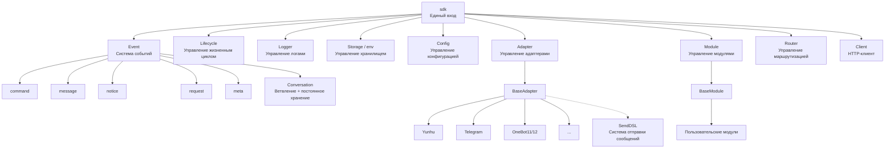

### Описание основных модулей

| Модуль | Описание |
|------|------|
| **Event** | Система событий, обеспечивающая обработку пяти типов событий: command / message / notice / request / meta, а также поддерживает многократные диалоги через Conversation |
| **Adapter** | Менеджер адаптеров, отвечающий за регистрацию, запуск и остановку адаптеров для различных платформ |
| **Module** | Менеджер модулей, отвечающий за регистрацию, загрузку и выгрузку плагинов, поддерживает объявление зависимостей и топологическую сортировку |
| **Lifecycle** | Менеджер жизненного цикла, предоставляющий систему событий для жизненных циклов |
| **Storage** | Система хранилища на основе SQLite, поддерживающая общие SQL-запросы в цепочке |
| **Config** | Управление конфигурационными файлами в формате TOML |
| **Logger** | Модульная система логирования, поддерживающая под-логгеры |
| **Router** | Управление маршрутизацией HTTP/WebSocket, через абстрактный слой обертывает базовые бэкенды (в настоящее время FastAPI + Uvicorn), поддерживает маршрутизацию с помощью декораторов, промежуточные обработчики, группировку, ограничение скорости, CORS |
| **Client** | Единый HTTP/WS-клиент (до версии 2.8.0 назывался `HttpClient`, сохраняется совместимость с псевдонимом), через абстрактный слой обертывает базовые библиотеки запросов (в настоящее время aiohttp), предоставляет функции статистики запросов, повторных попыток, логирования, WebSocket-клиент, систему исключений ErisPulse. Клиент и сервер WebSocket разделяют базовый класс `WebSocketConnectionBase` |

## Процесс инициализации

На следующей схеме показан полный процесс инициализации `sdk.init()`:

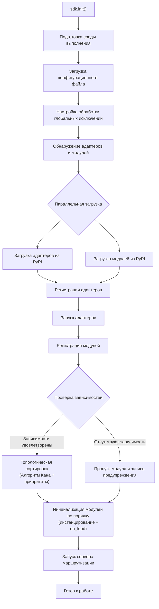

### Подробное описание этапов инициализации

> Полная цепочка инициализации с разбивкой на Finder / Loader / Manager / Router, а также базовые точки входа (`init()` / `init_task()` / `init_sync()`) и ручной полный запуск описаны в [Процесс запуска и ручное управление](docs/ru/advanced/startup.md).

## Процесс обработки событий

На следующей схеме показан полный путь сообщения от платформы до обработчика:

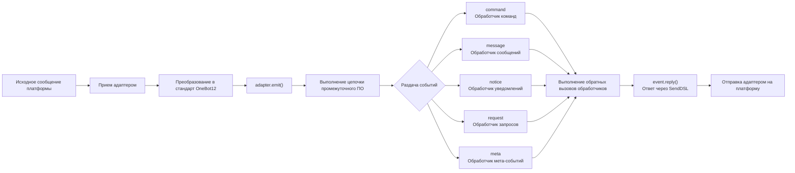

### Подробное описание цепочки обработки событий

Схема выше показывает "результат"; ниже разобрано, что делает фреймворк "за кулисами" после вызова `adapter.emit()` — это трехуровневая цепочка раздачи событий:

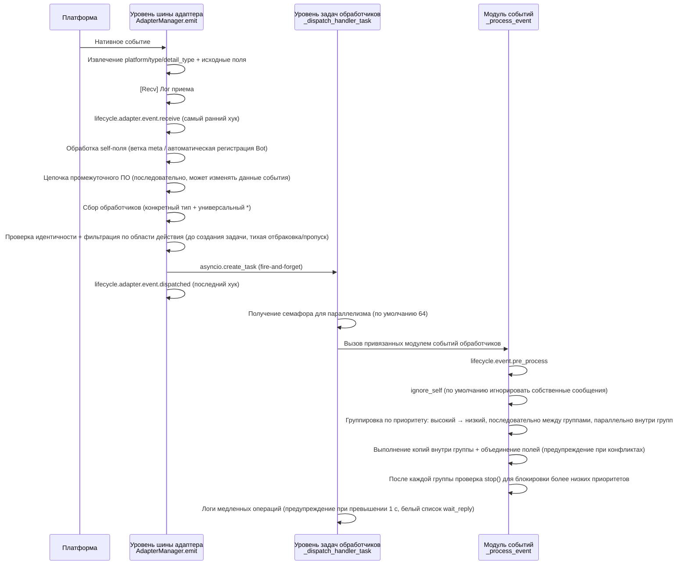

**Что делает фреймворк на каждом этапе и что вы можете изменить:**

| Этап | Что делает фреймворк | Что вы можете изменить |
|------|---------------------|------------------------|
| Прием | Извлекает стандартные поля, сохраняет `{platform}_raw` исходные данные; пишет `[Recv]` лог | Наблюдение за `adapter.event.receive` для раннего доступа к событию |
| self-поле | Мета-события обрабатываются ветвями connect/disconnect/heartbeat; обычные события автоматически регистрируют Bot и вызывают `adapter.bot.online` | Наблюдение за `adapter.bot.online` / `bot.offline` |
| Промежуточное ПО | **Последовательно** выполняется, если возвращается не None, то заменяет данные события | Регистрация промежуточного ПО для изменения/блокировки события |
| Сбор обработчиков | Сначала собираются обработчики конкретного типа, затем универсальные `*` | — |
| Идентификация | Определяет, принимать ли событие по пользователю>сессии>Bot>адаптеру (`scope.is_identity_allowed`), **если отклонено — событие удаляется** | Привязка `ErisPulse.scope.identity` |
| Фильтрация по области | Определяет `scope.is_allowed` по владельцу модуля (сессия>Bot>платформа), **если не проходит — тихо пропускается** | Настройка белого/черного списка областей |
| Планирование | Каждый подходящий обработчик запускается в отдельной `asyncio.Task`, `emit()` **не ждет завершения обработчиков** | — |
| Приоритет | Высокоприоритетные группы обрабатываются первыми; **между группами последовательно, внутри групп параллельно** (каждая группа имеет свою копию события, изменения объединяются в оригинальное событие, конфликты предупреждаются) | `@command(..., priority=N)` / указание при регистрации |
| Прерывание | После обработки каждой группы проверяется `event.is_stopped()`, если True — **не выполняются более низкие приоритеты** | `event.mark_processed(stop=True)` / `event.done()` |

> **Распространенные заблуждения**:
> 1. **Фильтрация по области тихая** — отфильтрованные обработчики не генерируют ошибок и не отвечают, видны только в логах TRACE (`core.scope.denied`). Если "мой модуль не получил сообщение" — сначала проверьте привязку областей.
> 2. **Обработчики обрабатываются параллельно по умолчанию** — фреймворк уже создает отдельные задачи для каждого обработчика, вам **не нужно** дополнительно оборачивать в `asyncio.create_task`.
> 3. **Внутри одной группы приоритетов нет прерывания** — `mark_processed(stop=True)` блокирует только более низкие группы, уже запущенные обработчики в той же группе не прерываются.
> 4. **Порог медленных логов фиксирован в 1 секунду** — если обработчик выполняется дольше 1 с, в логах появляется предупреждение (`wait_reply` время исключается из времени выполнения), но выполнение не прерывается.

> Подробности о привязке областей (scope) по модулям, проверке идентичности и ограничениях отправки см. в [Область (scope)](advanced/scope.md); текстовую фильтрацию событий и ACL пользователя команд см. в [Введение в обработку событий](getting-started/event-handling.md); настройку лимита параллелизма см. в [Руководство по конфигурации](user-guide/configuration.md#framework-config).

## Жизненный цикл

На следующей схеме показан порядок срабатывания событий жизненного цикла компонентов фреймворка:

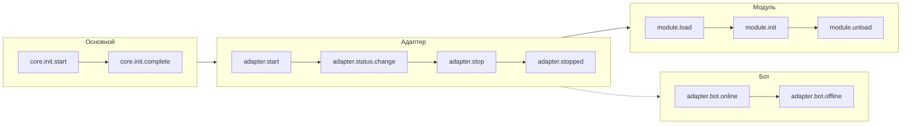

### Подписка на события жизненного цикла

> Полный список методов для прослушивания событий (lifecycle.on() / once() / has_handlers()), полный список событий жизненного цикла и формат данных см. в разделе [Управление жизненным циклом](advanced/lifecycle.md).

## Стратегии загрузки модулей

ErisPulse поддерживает три стратегии загрузки модулей, которые определяются `ModuleLoadStrategy`, возвращаемым функцией `get_load_strategy()`:

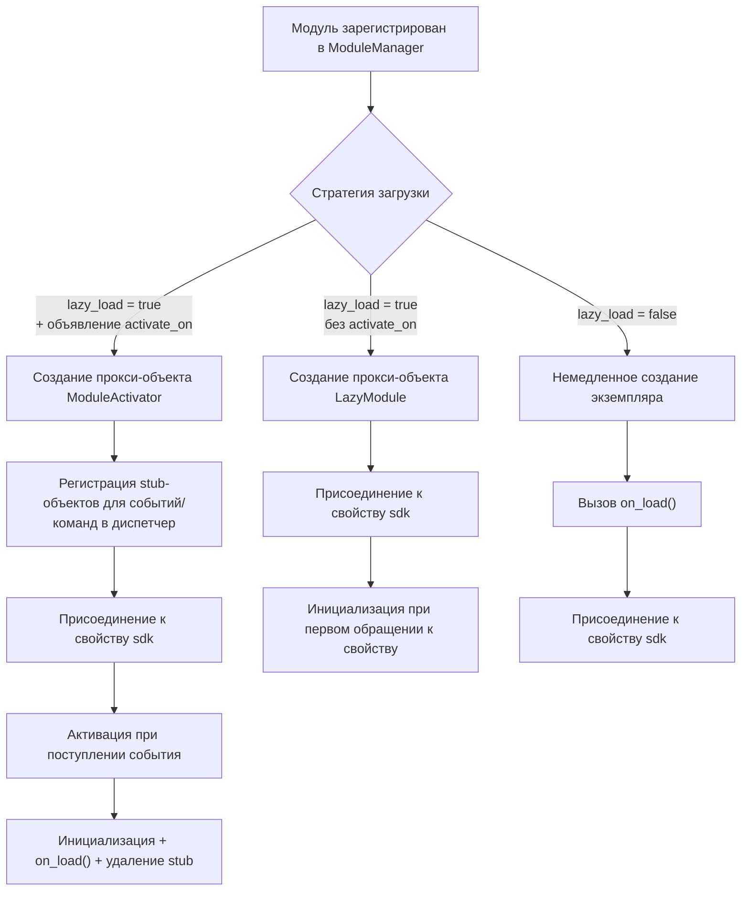

> Подробнее см. [Система ленивой загрузки](advanced/lazy-loading.md), [Управление жизненным циклом](advanced/lifecycle.md) и документацию модуля.

### Архитектура триггерного ленивого активирования (trigger architecture с `activate_on`)

> [!NOTE]
> Эта функция доступна в ErisPulse **2.8.0+**.

`activate_on` позволяет загружать модуль только при поступлении **первого подходящего события/команды**, предотвращая постоянное присутствие в памяти, при этом события не теряются:

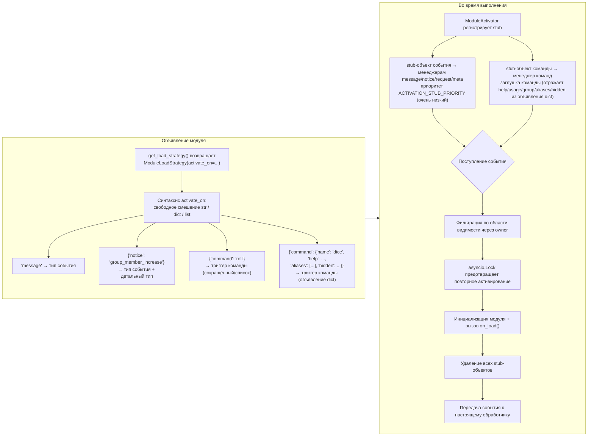

**Ключевые моменты семантики триггеров:**

> Полный синтаксис `activate_on` (str / dict / list), объявление команды через dict, цепочка возврата help для заглушек, фильтрация по области видимости и семантика ошибок см. в [Системе ленивой загрузки](advanced/lazy-loading.md#триггерное-ЛенивоеАктивированиеActivateOn).

## Архитектура локальной папки плагинов

> [!NOTE]
> Эта функция требует ErisPulse **2.8.0+**.

Локальные плагины (в директории `plugins/`) не требуют пакетирования для публикации, и фреймворк автоматически обнаруживает и загружает их при запуске:

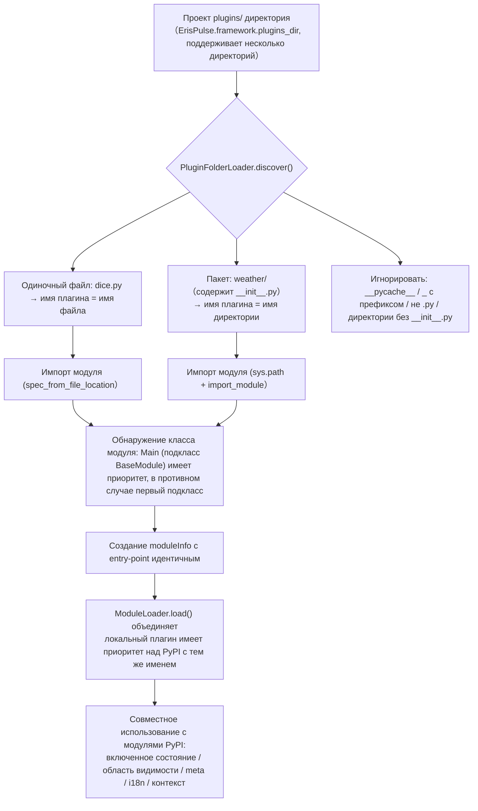

**Соглашения и особенности:**

- Имя плагина берется из имени файла для одиночного файла, и из имени директории для пакета
- Локальный плагин имеет `moduleInfo.meta.source == "plugin_folder"`, и может совместно использоваться с модулями, установленными из PyPI
- При совпадении имен приоритет отдается локальному плагину (удобно для отладки), при отключении удаляется также соответствующий entry-point

## Архитектура горячей перезагрузки модулей

Горячая перезагрузка применяется ко **всем источникам модулей**: локальные плагины (в директории `plugins/`), модули, зарегистрированные во время выполнения (`sdk.module.register()`), и модули из PyPI, все они могут быть перезагружены с помощью `sdk.reload_module()` / `sdk.module.reload()` — **по умолчанию это полная перезагрузка** (удаление кэша импорта по имени пакета и повторная загрузка зависимых модулей, `full=False` — лёгкий "выходной клапан"); `sdk.reload_all_modules()` / `sdk.module.reload_all()` позволяет одновременно перезагрузить все зарегистрированные модули (после обновления пакетов через pip можно вызвать эту функцию, чтобы всё заработало):

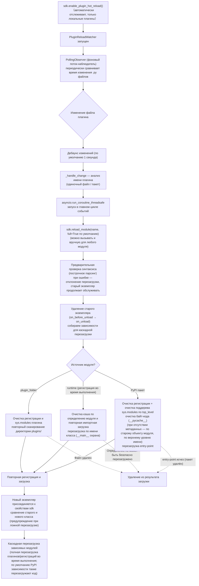

**Различия между тремя источниками проявляются только на этапе обнаружения**, предварительная проверка, удаление и каскадная перезагрузка идентичны:

- **Локальные плагины** (`moduleInfo.meta.source == "plugin_folder"`): после очистки соответствующего `sys.modules` происходит повторный сканирование директории `plugins/`; если файл удален — он удаляется из результата загрузки
- **Регистрация во время выполнения** (`source == "runtime"`): повторная импортная загрузка по определению модуля, повторная загрузка по имени класса и перерегистрация; классы, определённые в `__main__` / без исходного файла, запрещены к перезагрузке (предупреждение охраны, избегаем повторного выполнения скрипта)
- **PyPI пакеты**: по `meta.top_level` очищается поддерево `sys.modules`, обновляется кэш импорта (пробиваем 60-секундный кэш entry-point), затем повторно загружаются и перезагружаются entry-point; если entry-point исчез (пакет удалён) — он удаляется из результата загрузки

**По умолчанию и гарантии надёжности (2.11):**

- **Перезагрузка — полная перезагрузка**: по умолчанию по имени верхнего пакета очищается `sys.modules` и повторно загружаются коды зависимых модулей; `full=False` — только по метаданным, PyPI зависимости перезагружаются через пересоздание экземпляра (выходной клапан для больших зависимостей)
- **Проверка синтаксиса**: перед началом удаления происходит построчное парсинг синтаксиса файлов, при ошибке — отклонение перезагрузки: старый экземпляр не удаляется, продолжает обслуживать; синтаксические ошибки никогда не приводят к "полусмертному" состоянию модуля (при превышении лимита файлов в пакете проверка пропускается)
- **Кэш-поддержка**: при отсутствии метаданных `top_level` очищается по двум уровням: по префиксу имени старого объекта модуля → по префиксу `__module__` класса; при перезагрузке также очищаются байт-коды исходных файлов (`__pycache__`), изменения, даже если файлы одинаковы по размеру и времени изменения, будут применены
- **Сравнение идентичности**: после успешной перезагрузки проверяется изменение идентичности нового и старого класса, если не изменилось (например, из-за кэша расширений на C), выводится предупреждение и событие `module.reload` содержит `identity_changed: false`; `module.get_info()` показывает "регистрационная версия ≠ текущая версия" через поля `running_identity` / `stale`
- **Диагностика ошибок**: при неудачной загрузке (исключение + traceback) можно получить информацию через `module.last_error(имя)` / `get_info()["last_error"]`, при неудаче также очищается кэш импорта модуля — "измените код и перезагрузите ещё раз", чтобы убедиться, что читается новый код
- Перезагрузка принудительно активирует модули, которые изначально загружались лениво (явный лог); `reload_all_modules()` сохраняет стратегию ленивой загрузки, перезагружая только модули, которые были уже загружены до перезагрузки, модули, находящиеся в состоянии "спячки", остаются в спячке
- `reload_all_modules()` перезагружает в порядке зависимостей, при неудаче с одним модулем — записывается диагностическая информация и модуль пропускается (без общего отката — побочные эффекты `on_unload` необратимы, что соответствует поведению перезагрузки одного модуля); в сценариях, где перезагрузка была отменена, также лог будет явно указывать, что старый экземпляр находится в состоянии завершения

## Архитектура горячей перезагрузки адаптера

Горячая перезагрузка адаптера на уровне кода (2.11) аналогична модульной конвейерной архитектуре: `sdk.adapter.reload(имя_платформы)` / `sdk.reload_adapter(имя_платформы)` выполняется для **локальных плагинов** и **пакетов, установленных через PyPI** — 

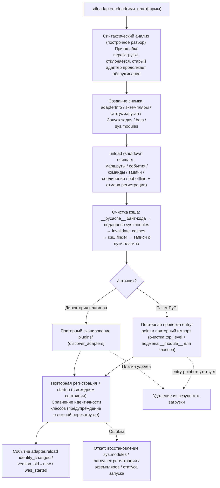

**Различия с модульной конвейерной архитектурой:**

- Адаптеры не поддерживают ленивую загрузку и каскадные зависимости: перезагрузка **не распространяется** на другие адаптеры, от которых зависит (только предупреждение — потребители косвенно используют через реестр, без семантики каскадного экземпляра)
- Запуск — асинхронная цепочка (`startup` передается через `_run_adapter`, включая пропуск зависимостей и экспоненциальную задержку при повторных попытках): временный сбой запуска **не считается сбоем перезагрузки** (код уже обновлен), результат передается через `adapter.status.change`
- Ловушка повторного использования экземпляра в `register()` (одинаковые объекты — старый экземпляр используется повторно) решается «триадой»: очистка pyc + удаление из sys.modules + проверка идентичности
- События жизненного цикла: `adapter.reload` (payload содержит `adapter_name` / `success` / `full` / `duration_ms` / `identity_changed` / `version_old→new` / `was_started` / `source`)


====
快速上手
====


### 快速开始

# Быстрый старт

> **Это ваш первый шаг.** Запустите робота ErisPulse за 5 минут, начиная с нуля.

## Установка ErisPulse

### Сценарий установки с одним нажатием (рекомендуется)

Сценарий автоматически определяет вашу среду (Docker, Python, uv) и предлагает вам выбрать наиболее подходящий способ установки.

Windows (PowerShell):
```powershell
irm https://get.erisdev.com/install.ps1 -OutFile install.ps1; powershell -ExecutionPolicy Bypass -File install.ps1
```

macOS / Linux:
```bash
curl -fsSL https://get.erisdev.com/install.sh -o install.sh && chmod +x install.sh && ./install.sh
```

Сценарий проведет вас через следующие шаги:

- **Установка Docker** (рекомендуется, если Docker обнаружен): выбор источника образа (Docker Hub / GHCR), канал версий (стабильная / предварительная), настройка панели управления Dashboard, настройка портов
- **Установка глобального CLI (uv tool, рекомендуется)**: установка `epsdk` как глобальной команды, без использования виртуального окружения, uv автоматически управляет Python (даже если системная версия слишком низкая); при запуске в каталоге проекта автоматически распознается проект `.venv`
- **Традиционная установка**: автоматическое создание виртуального окружения, выбор версии ErisPulse, необязательная установка модуля панели управления Dashboard

### Использование Docker

Docker-образ уже содержит в себе фреймворк ErisPulse и панель управления Dashboard.

```bash
# Скачать docker-compose.yml
curl -O https://raw.githubusercontent.com/ErisPulse/ErisPulse/main/docker-compose.yml

# Установить токен Dashboard и запустить
ERISPULSE_DASHBOARD_TOKEN=your-token docker compose up -d
```

<details>
<summary>Доступ к Docker Hub невозможен?</summary>

Используйте образ из GitHub Container Registry, измените `image` в `docker-compose.yml`:

```yaml
image: ghcr.io/erispulse/erispulse:latest
```

</details>

После запуска перейдите по адресу `http://<host>:8000/Dashboard` и войдите, используя установленный токен.

### Установка с помощью pip

Убедитесь, что ваша версия Python >= 3.10, затем установите с помощью pip:

```bash
pip install ErisPulse
```

Если вы уже установили [uv](https://github.com/astral-sh/uv), вы также можете использовать `uv pip install ErisPulse`, установка будет быстрее.

Если вы хотите установить глобально командную строку `epsdk`, не загрязняя окружение проекта, рекомендуется использовать `uv tool install`:

```bash
uv tool install ErisPulse
```

После установки `epsdk` будет доступен глобально: при запуске в каталоге проекта он автоматически распознает проект `.venv` (команда `epsdk install` устанавливает в окружение проекта, `epsdk run` запускает с использованием окружения проекта), фреймворк предоставляется из инструментального окружения. Подробнее см. [руководство по установке](user-guide/installation.md).

## Инициализация проекта

### Интерактивная инициализация (рекомендуется)

```bash
epsdk init
```

Это запустит интерактивное руководство, которое поможет вам выполнить следующие шаги:
- Настройка имени проекта
- Настройка уровня логирования
- Настройка сервера (хост и порт)
- Выбор и настройка адаптера
- Создание структуры проекта

### Быстрая инициализация

```bash
# Быстрый режим с указанием имени проекта
epsdk init -q -n my_bot

# Или просто указание имени проекта
epsdk init -n my_bot
```

### Создание проекта вручную

Если вы предпочитаете создавать проект вручную:

```bash
mkdir my_bot && cd my_bot
epsdk init
```

## Установка модуля

### Установка через CLI

```bash
epsdk install Yunhu AIChat
```

### Просмотр доступных модулей

```bash
epsdk list-remote
```

### Интерактивная установка

При отсутствии имени пакета открывается интерактивный интерфейс установки:

```bash
epsdk install
```

## Запуск проекта

```bash
# Обычный запуск
epsdk run main.py

# Режим горячей перезагрузки (рекомендуется при разработке)
epsdk run main.py --reload
```

## Включение автодополнения в IDE (по желанию)

Динамически обнаруживаемые модули/адаптеры ErisPulse не поддерживаются автодополнением в IDE по умолчанию.
Запустите следующую команду для генерации типовых заглушек:

```bash
epsdk types
```

После генерации, используйте импортированные типы для аннотации переменных, чтобы получить точное автодополнение (подробнее см. [Руководство по автодополнению в IDE](./getting-started/ide-completion.md)):

```python
from _ep_types import Yunhu
from ErisPulse import sdk

adapter: Yunhu = sdk.adapter.get("yunhu")
await adapter.Send.To("group", "123").Board(...)  # Автодополнение методов, специфичных для платформы
```

## Структура проекта

Структура проекта после инициализации:

```
my_bot/
├── config/
│   └── config.toml          # Файл конфигурации
└── main.py                  # Точка входа

```

## Конфигурационный файл

Базовый конфигурационный файл `config.toml`:

```toml
[ErisPulse.server]
host = "0.0.0.0"
port = 8000

[ErisPulse.logger]
level = "INFO"

[Yunhu_Adapter]
# Конфигурация адаптера
```


### 创建第一个机器人

# Создание первого бота

Это руководство продолжает [5-минутное краткое руководство](../quick-start.md), помогая вам написать первый обработчик команд и понять механизм работы.

> Если вы еще не установили ErisPulse и не инициализировали проект, пожалуйста, сначала завершите три шага в [Кратком руководстве](../quick-start.md): «Установка», «Инициализация проекта», «Запуск проекта».

## Шаг первый: написание первой команды

Откройте `main.py` и напишите простой обработчик команды:

```python
from ErisPulse import sdk
from ErisPulse.Core.Event import command

@command("hello", help="Отправить приветственное сообщение")
async def hello_handler(event):
    """Обработка команды hello"""
    user_name = event.get_user_nickname() or "друг"
    await event.reply(f"Привет, {user_name}! Я бот ErisPulse.")

@command("ping", help="Проверить, работает ли бот")
async def ping_handler(event):
    """Обработка команды ping"""
    await event.reply("Pong! Бот работает нормально.")

async def main():
    """Основная точка входа"""
    print("Запуск ErisPulse...")
    
    # keep_running=True (по умолчанию): фреймворк блокируется и продолжает работу, пока не получит сигнал о завершении (например, Ctrl+C)
    await sdk.run(keep_running=True)

if __name__ == "__main__":
    import asyncio
    asyncio.run(main())
```

### Параметр `keep_running`

Параметр `sdk.run(keep_running)` управляет тем, блокируется ли фреймворк для поддержания работы:

- **`keep_running=True` (по умолчанию)**: `run()` будет блокироваться до тех пор, пока не получит сигнал о завершении (например, Ctrl+C), подходит для чистых ботов.
- **`keep_running=False`**: `run()` завершит инициализацию и немедленно вернёт управление. **Фреймворк не будет остановлен** — запущенные адаптеры/модули продолжат обрабатывать события сообщений в фоновом режиме, вы можете продолжить выполнять собственную логику, пока цикл событий не завершится и фреймворк не закроется. Например:

```python
async def main():
    await sdk.run(keep_running=False)   # Инициализация завершена, немедленно возвращаем управление
    # Фреймворк уже работает в фоне, здесь можно делать что-то ещё
    while True:
        await asyncio.sleep(3600)
        print("Проверка каждый час")
```

> Помимо двух режимов `run()`, существуют более тонкие способы управления жизненным циклом, такие как `init()`/`uninit()` для ручного управления, а также отдельный запуск и остановка адаптеров/маршрутизации. Подробнее см. [Жизненный цикл и ручное управление](../advanced/startup.md).

## Шаг второй: Запуск робота

```bash
# Обычный запуск
epsdk run main.py

# Режим разработки (поддержка горячей перезагрузки)
epsdk run main.py --reload
```

## Шаг 3: Тестирование бота

Отправьте команду в вашей системе общения:

```
/hello
```

Вы должны получить ответ от бота.

## Описание кода

### Декоратор команды

```python
@command("hello", help="Отправить приветственное сообщение")
```

- `hello`: имя команды, вызывается пользователем с помощью `/hello`
- `help`: описание команды, отображается в команде `/help`

### Параметры события

```python
async def hello_handler(event):
```

Параметр `event` представляет собой объект Event, содержащий:
- Текст сообщения: `event.get_text()`
- Информация о отправителе: `event.get_user_id()`, `event.get_user_nickname()`
- Информация о платформе: `event.get_platform()`
- Информация о группе: `event.get_group_id()`
- Исходные данные: `event.get_raw()`

> Полный список методов объекта Event см. в разделе [Подробное описание Event-объекта](../developer-guide/modules/event-wrapper.md).

### Отправка ответа

```python
await event.reply("Содержимое ответа")
```

Метод `event.reply()` — это удобный способ отправки сообщения отправителю.

## Расширение: добавление дополнительных функций

ErisPulse предоставляет богатые возможности для обработки событий и данных:

- **Прослушивание сообщений**: используйте `@message.on_message()` для прослушивания различных сообщений → [Введение в обработку событий](event-handling.md)
- **Прослушивание уведомлений**: используйте `@notice.on_friend_add()` и другие для прослушивания системных уведомлений → [Введение в обработку событий](event-handling.md)
- **Хранение данных**: используйте `sdk.storage.get/set` для постоянного хранения данных → [Примеры распространенных задач](common-tasks.md)

## Часто задаваемые вопросы

### Команда не отвечает?

1. Проверьте, правильно ли настроен адаптер, убедитесь, что `status` адаптера в файле `config/config.toml` установлен в `true`
2. Проверьте вывод логов в терминале, убедитесь, что нет ошибок (особенно сообщений уровня `ERROR`)
3. Убедитесь, что префикс команды верный (по умолчанию это `/`), можно проверить в разделе `[ErisPulse.event.command]` файла конфигурации
4. Убедитесь, что имя команды написано правильно, обратите внимание на настройки чувствительности к регистру

### Как изменить префикс команды?

Добавьте в `config.toml` следующее:

```toml
[ErisPulse.event.command]
prefix = "!"
case_sensitive = false
```

### Как поддерживать несколько платформ?

ErisPulse использует стандарт OneBot12 для унификации формата событий на разных платформах. Обработчики, зарегистрированные с помощью `@command` и `@message`, автоматически получают события со всех платформ. С помощью `event.get_platform()` можно определить источник платформы:

```python
@command("hello")
async def hello_handler(event):
    platform = event.get_platform()
    
    if platform == "yunhu":
        await event.reply("Привет! От Юньху")
    elif platform == "telegram":
        await event.reply("Hello! От Telegram")
    else:
        await event.reply("Привет!")
```

> Дополнительные советы по адаптации под несколько платформ можно найти в разделе [Примеры типичных задач](common-tasks.md#многоплатформенная-адаптация).


### 基础概念

# Основные понятия

В этом руководстве представлены основные концепции ErisPulse, которые помогут вам понять философию и архитектуру фреймворка.

## Архитектура на основе событий

ErisPulse использует архитектуру на основе событий, где все взаимодействия передаются и обрабатываются через события.

### Процесс событий

```
Пользователь отправляет сообщение
      │
      ▼
Платформа получает
      │
      ▼
Адаптер получает нативное событие платформы
      │
      ▼
Преобразуется в стандартное событие OneBot12
      │
      ▼
Отправляется в систему событий
      │
      ▼
Распределяется по зарегистрированным обработчикам
      │
      ▼
Модуль обрабатывает событие
      │
      ▼
Ответ отправляется через адаптер
      │
      ▼
Платформа отображает пользователю
```

### Стандарт OneBot12

ErisPulse использует OneBot12 как основной стандарт событий. OneBot12 — это универсальный стандарт интерфейса для чат-ботов, определяющий единый формат событий.

Все адаптеры преобразуют платформенно-специфичные события в формат OneBot12, обеспечивая согласованность кода.

## Основные компоненты

### 1. Объект SDK

SDK является единым точкой входа для всех функций, предоставляя доступ к основным компонентам.

```python
from ErisPulse import sdk

# Доступ к основным модулям
sdk.storage    # Система хранения
sdk.config     # Система конфигурации
sdk.logger     # Система логирования
sdk.adapter    # Система адаптеров
sdk.module     # Система модулей
sdk.router     # Система маршрутизации
sdk.client     # HTTP-клиент
sdk.lifecycle  # Система жизненного цикла
```

### 2. Объект Event

Объект Event封装ует данные события и предоставляет удобные методы доступа.

```python
@command("info")
async def info_handler(event):
    # Получение информации о событии
    event_id = event.get_id()
    user_id = event.get_user_id()
    platform = event.get_platform()
    text = event.get_text()
    
    # Отправка ответа
    await event.reply(f"Пользователь: {user_id}, Платформа: {platform}")
```

### 3. Адаптеры

Адаптеры являются мостом между ErisPulse и внешними платформами.

**Задачи:**
- Получение нативных событий платформы
- Преобразование в формат OneBot12
- Отправка событий в формате OneBot12 на платформу

**Примеры адаптеров:**
- Адаптер Yunhu: коммуникация с платформой Yunhu
- Адаптер Telegram: коммуникация с Telegram Bot API
- Адаптер OneBot11: совместимость с OneBot11
- Адаптер Email: обработка отправки и получения электронной почты

### 4. Модули

Модули являются базовыми единицами расширения функциональности, позволяя:

- Регистрировать обработчики событий
- Реализовывать бизнес-логику
- Вызывать адаптеры для отправки сообщений
- Использовать сервисы, предоставляемые основными модулями

#### Механизм обнаружения модулей

ErisPulse использует `importlib.metadata.entry_points` для обнаружения установленных модулей. Модули объявляются в `pyproject.toml` с помощью entry points:

```toml
[project.entry-points."erispulse.module"]
MyModule = "my_package:Main"
```

При инициализации SDK происходит сканирование всех entry points группы `erispulse.module`, классы модулей регистрируются в `ModuleManager`, после чего они инициализируются в соответствии с зависимостями.

#### Минимально рабочий модуль

```python
from ErisPulse.Core.Bases import BaseModule
from ErisPulse import sdk

class Main(BaseModule):
    def __init__(self):
        self.sdk = sdk
        self.logger = sdk.logger.get_child("MyModule")

    async def on_load(self, event):
        self.logger.info("Модуль загружен")

    async def on_unload(self, event):
        self.logger.info("Модуль выгружен")
```

#### Жизненный цикл модуля

- **Регистрация:** SDK обнаруживает класс модуля и регистрирует его в менеджере
- **Загрузка:** Создается экземпляр модуля, вызывается `on_load(event)` (`event = {"module_name": "MyModule"}`)
- **Выгрузка:** Вызывается `on_unload(event)`, очищаются ресурсы

#### Стратегия загрузки

С помощью `get_load_strategy()` объявляется поведение загрузки модуля:

```python
from ErisPulse.loaders import ModuleLoadStrategy

class Main(BaseModule):
    @staticmethod
    def get_load_strategy():
        return ModuleLoadStrategy(
            lazy_load=True,   # Ленивая загрузка (по умолчанию True)
            priority=0        # Приоритет загрузки, чем больше, тем раньше инициализируется
        )
```

- **`lazy_load=True` (по умолчанию):** Модуль инициализируется при первом обращении к `sdk.MyModule`, снижая время запуска
- **`lazy_load=False`:** Модуль инициализируется при запуске SDK, подходит для модулей, обрабатывающих события жизненного цикла или выполняющих фоновые задачи
- **`priority`:** Модули с одинаковым приоритетом загружаются в порядке регистрации; чем больше значение, тем раньше инициализируется

> Подробнее о механизме ленивой загрузки см. в [Системе ленивой загрузки](../advanced/lazy-loading.md).

## Типы событий

ErisPulse поддерживает 5 типов событий:

| Тип события | Декоратор | Описание |
|---------|--------|------|
| Событие сообщения | `@message.on_message()` | Любое сообщение, отправленное пользователем (личные сообщения, группы) |
| Событие команды | `@command("name")` | Сообщение, начинающееся с префикса команды (например, `/hello`) |
| Уведомление | `@notice.on_friend_add()` и др. | Системные уведомления (добавление друзей, изменения в группе) |
| Запрос | `@request.on_friend_request()` и др. | Запросы от пользователей (запросы на добавление в друзья, приглашения в группы) |
| Мета-событие | `@meta.on_connect()` и др. | Системные события (подключение, отключение, heartbeat) |

> Подробное описание и примеры использования каждого типа событий см. в [Введение в обработку событий](event-handling.md).

## Описание основных модулей

### Storage (Хранилище)

Хранилище на основе SQLite для постоянного хранения данных.

```python
# Установка значения
sdk.storage.set("key", "value")

# Получение значения
value = sdk.storage.get("key", "default_value")

# Массовые операции
sdk.storage.set_multi({
    "key1": "value1",
    "key2": "value2"
})

# Транзакции
with sdk.storage.transaction():
    sdk.storage.set("key1", "value1")
    sdk.storage.set("key2", "value2")
```

### Config (Конфигурация)

Управление конфигурационными файлами в формате TOML.

```python
# Получение конфигурации
config = sdk.config.getConfig("MyModule", {})

# Установка конфигурации
sdk.config.setConfig("MyModule", {"key": "value"})

# Чтение вложенной конфигурации
value = sdk.config.getConfig("MyModule.subkey", "default")
```

### Logger (Журнал)

Модульная система журналирования.

```python
# Запись в журнал
sdk.logger.info("Это информационное сообщение")
sdk.logger.warning("Это предупреждение")
sdk.logger.error("Это ошибка")

# Получение дочернего логгера
child_logger = sdk.logger.get_child("submodule")
child_logger.info("Журнал подмодуля")
```

**Синтаксис доступа по атрибутам**

Помимо метода `get_child()`, можно использовать **доступ по атрибутам** для создания дочернего логгера, что является более компактным **синтаксическим сахаром**:

```python
# Создание дочернего логгера через доступ по атрибутам
sdk.logger.mymodule.info("Сообщение модуля")

# Поддержка вложенного доступа
sdk.logger.mymodule.database.info("Сообщение базы данных")
```

### Router (Маршрутизация)

Управление маршрутизацией HTTP и WebSocket, основано на FastAPI + Uvicorn. Поддерживает маршрутизацию с помощью декораторов, промежуточные слои, группы, ограничение скорости, CORS.

```python
from ErisPulse.Core import HttpRequest

@sdk.router.get("MyModule", "/api")
async def handler(request: HttpRequest):
    data = await request.json()
    return {"status": "ok"}
```

> Полный API маршрутизатора (WebSocket, промежуточные слои, ограничение скорости, CORS и др.) см. в [Маршрутизаторе](../advanced/router.md).

### Client (Сетевой клиент)

Единый сетевой клиент, объединяющий HTTP-запросы, WebSocket-соединения, управление пулов, автоматические повторы, таймауты, статистику запросов и интеграцию с событиями жизненного цикла.

```python
from ErisPulse.Core import client

# HTTP-запрос
resp = await client.get("https://api.example.com/users")
data = await resp.json()

# Запрос с повторами и таймаутом
resp = await client.get(url, timeout=30, max_retries=3)

# WebSocket-соединение
ws = await client.ws_connect("wss://example.com/ws")
async for text in ws.iter_text():
    await ws.send_text(f"Эхо: {text}")
```

> Полный API сетевого клиента см. в [Сетевом клиенте](../advanced/http-client.md).

## DSL для отправки сообщений SendDSL

Адаптеры предоставляют интерфейс для отправки сообщений с цепочечным вызовом.

### Базовая отправка

```python
# Получение экземпляра адаптера
yunhu = sdk.adapter.get("yunhu")

# Отправка сообщения
await yunhu.Send.To("user", "U1001").Text("Привет")

# Указание отправляющего аккаунта
await yunhu.Send.Using("bot1").To("group", "G1001").Text("Сообщение в группе")
```

### Цепочки модификаторов

```python
# @пользователя
await yunhu.Send.To("group", "G1001").At("U2001").Text("@сообщение")

# Ответ на сообщение
await yunhu.Send.To("group", "G1001").Reply("msg123").Text("Ответ")

# @всех
await yunhu.Send.To("group", "G1001").AtAll().Text("Объявление")
```

### Методы ответа в Event

Объект Event предоставляет удобные методы для отправки ответа:

```python
@command("test")
async def test_handler(event):
    # Простой текстовый ответ
    await event.reply("Содержимое ответа")
    
    # Отправка изображения
    await event.reply("http://example.com/image.jpg", method="Image")
    
    # Отправка голосового сообщения
    await event.reply("http://example.com/voice.mp3", method="Voice")
```

## Система ленивой загрузки

ErisPulse по умолчанию включает ленивую загрузку модулей, при которой модуль инициализируется только при первом обращении (например, `sdk.MyModule`), что значительно ускоряет запуск.

```python
from ErisPulse.loaders import ModuleLoadStrategy

class Main(BaseModule):
    @staticmethod
    def get_load_strategy():
        return ModuleLoadStrategy(
            lazy_load=True,   # Включить ленивую загрузку (по умолчанию)
            priority=0        # Приоритет загрузки, чем больше, тем раньше инициализируется
        )
```

**Сценарии, требующие отключения ленивой загрузки (`lazy_load=False`):**
- Модули, обрабатывающие события жизненного цикла (например, `core.init.complete`)
- Модули, запускающие фоновые задачи или сервисы
- Модули, требующие инициализации до других модулей

> Подробнее о механизме ленивой загрузки и рекомендациях см. в [Системе ленивой загрузки](../advanced/lazy-loading.md).


### 事件处理入门

# Введение в обработку событий

В этом руководстве рассказывается о том, как обрабатывать различные типы событий в ErisPulse.

## Обзор типов событий

ErisPulse поддерживает следующие типы событий:

| Тип события | Описание | Применение |
|---------|------|---------|
| Событие сообщения | Любое сообщение, отправленное пользователем | Чат-боты, фильтрация контента |
| Событие команды | Сообщение, начинающееся с префикса команды | Обработка команд, точка входа |
| Событие уведомления | Системное уведомление (добавление в друзья, изменения в группе и т.д.) | Приветствия, уведомления о состоянии |
| Событие запроса | Запрос пользователя (запрос в друзья, приглашение в группу) | Автоматическая обработка запросов |
| Событие мета | Системное событие (подключение, сердцебиение) | Мониторинг подключения, проверка состояния |

## Обработка событий сообщений

> **Примечание**: Рекомендуется использовать аннотацию типа `Event` в обработчиках событий, чтобы получить поддержку автодополнения и проверки типов в IDE.

```python
from ErisPulse.Core.Event import Event  # Импорт типа события для аннотации
```

### Отслеживание всех сообщений

```python
from ErisPulse.Core.Event import message, Event

@message.on_message()
async def message_handler(event: Event):
    text = event.get_text()
    user_id = event.get_user_id()
    sdk.logger.info(f"Получено сообщение от {user_id}: {text}")
```

### Отслеживание личных сообщений

```python
@message.on_private_message()
async def private_handler(event: Event):
    user_id = event.get_user_id()
    await event.reply(f"Привет, {user_id}! Это личное сообщение.")
```

### Отслеживание групповых сообщений

```python
@message.on_group_message()
async def group_handler(event: Event):
    group_id = event.get_group_id()
    user_id = event.get_user_id()
    sdk.logger.info(f"В группе {group_id} пользователь {user_id} отправил сообщение")
```

### Отслеживание сообщений с упоминанием

```python
@message.on_at_message()
async def at_handler(event: Event):
    # Получить список упомянутых пользователей
    mentions = event.get_mentions()
    await event.reply(f"Вы упомянули этих пользователей: {mentions}")
```

### Обработка с помощью подстановочных знаков и регулярных выражений

Четыре декоратора сообщения (`on_message` / `on_private_message` / `on_group_message` / `on_at_message`) поддерживают `pattern` (подстановочные знаки glob) и `regex` (регулярные выражения), не соответствующие сообщения **не запускают** обработчик:

```python
# Подстановочные знаки glob: * любая строка, ? один символ, [seq] набор символов
@message.on_message(pattern="签到*")
async def signin_handler(event: Event):
    await event.reply("签到成功")

# Регулярное выражение: совпадение суммы
@message.on_message(regex=r"\d+\s*元")
async def price_handler(event: Event):
    await event.reply(f"Получена сумма: {event.get_text()}")

# pattern и regex одновременно → оба должны соответствовать
@message.on_message(pattern="*元", regex=r"\d+\s*元")
async def combined_handler(event: Event):
    pass
```

`wait_reply` также поддерживает эти два параметра (см. [Функция ожидания ответа](../developer-guide/modules/event-wrapper.md#ожидание-ответа-функция)).

## Обработка событий команд

### Основные команды

```python
from ErisPulse.Core.Event import command

@command("help", help="Отображает справочную информацию")
async def help_handler(event):
    help_text = """
Доступные команды:
/help - Показать справку
/ping - Тест подключения
/info - Просмотр информации
    """
    await event.reply(help_text)
```

### Псевдонимы команд

```python
@command(["help", "h"], aliases=["помощь"], help="Отображает справочную информацию")
async def help_handler(event):
    await event.reply("Справочная информация...")
```

Пользователь может вызывать команду любым из следующих способов:
- `/help`
- `/h`
- `/помощь`

### Аргументы команд

```python
@command("echo", help="Вернуть сообщение")
async def echo_handler(event):
    # Получить аргументы команды
    args = event.get_command_args()
    
    if not args:
        await event.reply("Введите сообщение для повтора")
    else:
        await event.reply(f"Вы сказали: {' '.join(args)}")
```

Аргументы сохраняют оригинальный регистр ввода пользователя (даже если настройки нечувствительны к регистру, нормализация имени команды не влияет на содержимое аргументов).

### Декларативные аргументы и опции (args= / options=)

Ручная обработка аргументов требует ручного преобразования типов и сообщений об ошибках. При декларации `args=` / `options=` фреймворк автоматически анализирует аргументы команды и **внедряет их по именам в обработчик** после прохождения проверки прав доступа; при неверном вводе пользователем автоматически возвращаются локализованные сообщения и инструкции (без выброса исключений и аварийного завершения), а команда `/help <команда>` автоматически отображает инструкции:

```python
@command(
    "roll",
    args="<count:int> [sides:int=6]",
    options={"verbose": "-v/--verbose", "label": "--label"},
    help="Бросить кубик",
)
async def roll_handler(event, count: int, sides: int = 6, verbose: bool = False, label: str = ""):
    total = sum(random.randint(1, sides) for _ in range(count))
    await event.reply(f"Бросил {count} раз {sides}-гранного кубика, общее количество очков: {total}")
```

Синтаксис позиционных аргументов `args=`: `<count:int>` обязательный, `[sides:int=6]` необязательный (с значением по умолчанию). Поддерживаемые типы:

| Тип | Пример ввода | Описание |
|------|---------|------|
| `str` | `hello` | Текст (тип по умолчанию) |
| `int` / `float` | `3` / `0.5` | Число |
| `bool` | `да` / `yes` / `はい` / `да` / `true` / `no` / `отмена` | Логическое значение, использует таблицу подтверждения из `Event.confirm()` |
| `literal` | `<mode:literal=fast|slow>` | Перечисление, принимает только перечисленные значения; по умолчанию берётся первое |
| `duration` | `90s`、`1h30m`、`1d` | Продолжительность, преобразуется в секунды как float |
| `rest` | `<text:rest>` | Остальной текст (должен быть последним) |

`options=` опции объявляются в виде словаря: ключ — имя параметра обработчика, значение — формат флагов (множество алиасов через `/`). Параметры с аннотацией `bool` — это булевы флаги (появление означает `True`); остальные (по умолчанию как `str`) — опции со значениями, поддерживают `--label hello` и `--label=hello` для значений, тип соответствует аннотации обработчика. Опции сначала распознаются и удаляются, оставшиеся токены обрабатываются по `args=` (остаток `rest` покрывает оставшийся текст после удаления опций).

**Особенности поведения**:

- Проверка прав доступа выполняется до анализа аргументов — пользователи без прав не запускают анализ
- При неудачном анализе (неправильный тип / отсутствие параметров / слишком много параметров / неизвестная опция) автоматически возвращается локализованное сообщение об ошибке + инструкция, команда всё равно считается выполненной
- Имена декларированных параметров должны присутствовать в сигнатуре обработчика, иначе при регистрации возникает `ValueError`
- При отсутствии `args=` / `options=` поведение команды не меняется (обратная совместимость)

### Управление командами (cooldown= / rate_limit= / usage_limit= / deprecated=)

Ручная реализация таймеров, ограничения скорости, лимитов использования и устаревших команд может быть заменена декларациями, все четыре параметра могут быть комбинированы.

**Таймер** — синтаксис длительности аналогичен типу `duration` в `args=` (например, `"30s"`、`"1h30m"`、`"1d"`):

```python
@command("daily", cooldown="1d", cooldown_key="user", cooldown_reply="Вы уже отметились сегодня")
async def daily_handler(event):
    await event.reply("Отметка успешно выполнена!")
```

**Ограничение скорости** — декларация скользящего окна в формате `"количество/окно"` (например, `"5/minute"`、`"10/s"`、`"3/2m"`):

```python
@command("search", rate_limit="5/minute", rate_limit_key="user")
async def search_handler(event):
    await event.reply("Результаты поиска")
```

**Лимит использования** — максимальное количество вызовов в периоде (например, `"100/day"`、`"10/hour"`、`"500/30d"`), при превышении лимита выполнение отклоняется:

```python
@command("translate", usage_limit="100/day", usage_limit_key="user",
         usage_limit_reply="Лимит переводов на сегодня исчерпан")
async def translate_handler(event):
    ...
```

В отличие от таймера и ограничения скорости, лимит использования **сохраняется в хранилище** (ключ `erispulse.usage.<key>`, не теряется при перезапуске):
при недоступности хранилища автоматически переходит в чисто инкрементный счётчик в памяти с предупреждением (в этом случае лимит сбрасывается при перезапуске). Счётчик сбрасывается при смене периода лимита, при выгрузке модуля — очищается.
**Устаревание** — при вызове автоматически возвращается сообщение устаревания, `deprecated_reject=True` отклоняет выполнение:

```python
@command("oldcmd", deprecated="Пожалуйста, используйте /newcmd", deprecated_reject=True)
async def old_handler(event): ...
```

Гранулярность ключей (`cooldown_key=` / `rate_limit_key=`): `"user"` (по умолчанию, общие для одного пользователя), `"session"` (общие для одной сессии, например, в одной группе), `"global"` (общие для всех пользователей и сессий).

**Особенности поведения**:

- При срабатывании таймера / ограничения скорости / лимита использования по умолчанию **молча отбрасываются** (в соответствии с областью действия); при декларации `cooldown_reply=` / `rate_limit_reply=` / `usage_limit_reply=` при срабатывании возвращается соответствующее сообщение
- Команда считается выполненной при срабатывании — управление не пропускает команду низкому приоритету
- Проверка управления происходит после всех проверок прав доступа и анализа аргументов, перед фактическим выполнением: пользователи без прав не запускают анализ, ошибки аргументов не уменьшают лимит
- При одновременной декларации таймера и ограничения скорости сначала проверяется таймер (срабатывание таймера не занимает окно ограничения скорости); лимит использования проверяется после таймера и ограничения скорости
- `deprecated=` по умолчанию возвращает сообщение и **продолжает выполнение**; `deprecated_reject=True` отклоняет выполнение (钩子 `command.executed` записывает `success=False, error="deprecated"`)
- В списке `/help` и справке по команде автоматически отображаются метки и сообщения устаревания
- Состояние таймера и ограничения скорости хранится в памяти процесса; при выгрузке модуля автоматически очищается; распределённое хранение и сохранение при перезапуске не поддерживаются (кроме **счётчика лимита использования** — сохраняется в хранилище, см. выше)
- Проверка деклараций происходит на этапе регистрации (fail-fast): синтаксис не соответствует, значение гранулярности ключа не в белом списке, reply не сопровождается основной декларацией — возникает `ValueError`

### Ограничение скорости обработчиков (throttle=) и дебаунсинг (debounce=)

Декларация обработчиков сообщений для защиты от спама — события с одинаковым ключом обрабатываются максимум один раз за интервал, остальные молча отбрасываются:

```python
from ErisPulse import sdk

@sdk.message.on_message(throttle="2s", throttle_key="user")
async def handler(event): ...
```

Дебаунсинг и ограничение скорости дополняют друг друга: **в окне выполняется только последнее событие**, предыдущие задачи автоматически отменяются (подходит для сценариев, где нужно обрабатывать только после окончания ввода, например, автозаполнение поиска):

```python
@sdk.message.on_message(debounce="2s", debounce_key="user")
async def search(event): ...
```

`on_message` / `on_private_message` / `on_group_message` / `on_at_message` поддерживаются; `throttle_key=` / `debounce_key=` используют ту же гранулярность ключей, что и управление командами (user / session / global), синтаксис длительности аналогичен `duration`. Ограничение скорости и `pattern=` / `regex=` и другие условия работают в совокупности (все должны выполняться, чтобы сработало); в интервале отбрасываются события, записываются в лог TRACE; декларации проверяются на этапе регистрации; `throttle=` и `debounce=` семантически взаимоисключающие (одновременная декларация вызывает `ValueError`).

> **Дебаунсинг не прерывает бизнес-логику**: только задачи, которые ещё не пересекли окно ожидания, отменяются; уже пересекшие окно и выполняющиеся обработчики не отменяются новыми событиями (избегает остановки на любом await-точке и частичных побочных эффектов).

### Внедрение зависимостей (Depends)

Общие зависимости (сессия базы данных, чтение конфигурации и т.д.) можно вынести в функции зависимостей, обработчики объявляют параметры с `Depends(функция_зависимости)` в качестве значения по умолчанию, фреймворк автоматически вызывает функцию зависимости с объектом контекста и внедряет результат по именам перед вызовом:

```python
from ErisPulse.Core import Depends

async def get_session(event):
    return await sdk.module.call("DB", "get_session")

@command("admin")
async def admin_handler(event, db=Depends(get_session)):
    ...
```

По умолчанию включено **кэширование на уровне запроса**: в рамках одной обработки события одна и та же функция зависимости вызывается только один раз, результаты всех точек внедрения разделяются (например, `get_db` в рамках одного события создает только одну сессию базы данных); между запросами кэш не используется. Можно отключить кэш для отдельной зависимости с `Depends(get_db, use_cache=False)`.

Охватывает все точки внедрения фреймворка — обработчики команд, обработчики событий (`message.on_message()` и т.д.), жизненный цикл (`sdk.lifecycle.on`), обработчики маршрутов SSE. Первый параметр функции зависимости — объект контекста точки внедрения (в случае события — `Event`, в случае жизненного цикла — `data`, в случае маршрута — `HttpRequest` / `SseEmitter`); можно объявлять как синхронные, так и асинхронные функции зависимости.

**Синтаксический сахар для объявления сервисов других модулей**:

```python
@command("query")
async def query_handler(event, session=Depends.module("DB", "get_session")):
    ...
```

`Depends.module(имя_модуля, имя_метода, *постоянные_аргументы)` эквивалентно вызову `sdk.module.call(...)` внутри функции зависимости. Инициализация модуля (`__init__`) не входит в область охвата — при инициализации нет объекта контекста; для маршрутов HTTP, использующих FastAPI, используйте оригинальный `fastapi.Depends` фреймворка FastAPI.

**Особенности поведения**:

- Декларации проверяются на этапе регистрации (fail-fast): при невозможности вызова зависимости или при повторном имени с `args=` / `options=` возникает `ValueError`
- Исключения, возникающие в функции зависимости, обрабатываются так же, как и исключения в обработчике (ошибка команды автоматически возвращается пользователю)
- Обработчики без декларации `Depends` не имеют накладных расходов (на этапе маршрутизации нет отражения)
- Для маршрутов HTTP, использующих FastAPI, используйте оригинальный `fastapi.Depends`

### Группы команд

```python
@command("admin.reload", group="admin", help="Перезагрузить модуль")
async def reload_handler(event):
    await event.reply("Модуль перезагружен")

@command("admin.stop", group="admin", help="Остановить бота")
async def stop_handler(event):
    await event.reply("Бот остановлен")
```

Параметр `group` используется только для группировки в справке; в примере выше `admin.reload` — это **единое имя команды** (точка — стиль именования, пользователь должен ввести `/admin.reload`).

### Подкоманды

Имена команд поддерживают **многотокенную** структуру с разделением пробелами, реализуя подкоманды вроде `/admin add`, `/admin user ban`:

```python
@command("admin", help="Команды администрирования")
async def admin_handler(event):
    await event.reply("Синтаксис: /admin add | /admin remove")

@command("admin add", help="Добавить администратора")
async def admin_add_handler(event):
    target = event.get_command_args()[0]
    await event.reply(f"Добавлен {target}")

@command("admin remove", aliases=["a remove"], help="Удалить администратора")
async def admin_remove_handler(event):
    await event.reply("Удалён")
```

Правила сопоставления (максимальное префиксное совпадение):

- `/admin add x` сначала попадает в `admin add`, `event.get_command_args()` возвращает `["x"]` (параметры после подкоманды)
- Если зарегистрирована только `admin`, то `/admin add x` попадает в `admin`, `get_command_args()` возвращает `["add", "x"]` (старое поведение не меняется)
- Алиасы поддерживают многотокенную форму (например, `a remove`), также можно использовать однотокенные алиасы (например, `a`) для указания подкоманды
- При регистрации родительской и подкоманды, не зарегистрированная подкоманда (например, `/admin list x`) возвращается к родительской команде

**Наследование прав доступа**: если подкоманда не декларирует `permission`, она автоматически наследует ближайшую родительскую команду, декларирующую `permission` — защита `/admin` автоматически защищает все её подкоманды; при декларации `permission` в подкоманде она имеет приоритет:

```python
def is_admin(event):
    return event.get_user_id() in {"user123"}

@command("admin", permission=is_admin, help="Команды администрирования")
async def admin_handler(event):
    ...

# permission не нужно декларировать повторно, наследуется is_admin
@command("admin add", help="Добавить администратора")
async def admin_add_handler(event):
    ...
```

Примечание: `master=True` и `hidden` **не** наследуются, при необходимости декларируйте отдельно в подкоманде; пользовательские ACL (списки разрешений/запретов) сопоставляются по полному имени команды, шаблоны glob, например, `"admin*"` могут охватывать целую группу подкоманд.

В обзоре команд `/help` подкоманды автоматически отображаются вложенно под видимыми родительскими командами (например, `admin` → `admin add` с отступом на один уровень, `admin user` → `admin user ban` с отступом на два уровня).

### Права доступа и управление доступом команд

Права доступа команд определяются на трёх уровнях, проверяются сверху вниз (если верхний уровень отклоняет, нижние уровни не проверяются):

```python
# ① ACL команды (конфигурация со стороны пользователя): по белому и чёрному списку пользователей для команды, при отказе возвращается "Недостаточно прав"
# ② master=True — только владелец фреймворка может выполнить (фреймворк автоматически проверяет, при отказе возвращается "Недостаточно прав")
@command("restart", master=True, help="Перезапустить модуль")
async def restart_handler(event):
    await event.reply("Модуль перезапущен")

# ③ permission=вызов функции — логика управления доступом команды (выполняется, если функция возвращает True)
def is_admin(event):
    return event.get_user_id() in {"user123", "user456"}

@command("panel", permission=is_admin, help="Панель управления")
async def panel_handler(event):
    await event.reply("Добро пожаловать на панель управления")
```

**ACL пользователей команды** (`ErisPulse.event.command.acl`): пользователь может настроить белый и чёрный списки пользователей для любой команды, имена команд поддерживают точное и шаблонное сопоставление (например, `"roll*"`), при отказе возвращается "Недостаточно прав":

```toml
# config.toml — разрешить только 123456 выполнить restart; 666 всегда запрещён
[ErisPulse.event.command.acl.restart]
allow = ["onebot11:123456"]
deny = ["onebot11:666"]
```

Порядок проверки: если `deny` совпадает → отказ; если `allow` не пуст и не совпадает → отказ; если ACL не настроен, используется `event.command.default_allow` (`false` = строгий режим, без ACL — отказ; `true` — передаётся разработчику по умолчанию `master=True` / `permission`). API во время выполнения (поддержка шаблонов для имен команд):

```python
from ErisPulse.Core.Event import command

command.allow_user("restart", "onebot11", "123456")   # список разрешённых
command.deny_user("restart", "onebot11", "666")       # список запрещённых
command.remove_acl("restart")                          # очистить белый и чёрный списки
command.get_acl("restart")                             # получить текущий список
```

> Обработчики команд импортируются из пакета событий: `from ErisPulse.Core.Event import command`; также доступны через пакет SDK: `sdk.Event.command` (оба являются одним и тем же экземпляром).
> Обычно в модуле уже импортируются вместе с декоратором команды (`from ErisPulse.Core.Event import command`).

Управление доступом на уровне события (для конкретного пользователя / группы / бота) — через **идентификационные области действия** (`scope.identity`); управление доступностью модуля — через **модульные области** (`scope.platforms / bots / sessions`).
См. [Области действия (scope)](../advanced/scope.md).

> Рекомендация: для взаимодействия с бизнес-логикой внутри команды используйте `master=True` / `permission`; для управления доступом по пользователю / группе используйте идентификационные области; для управления доступностью модуля используйте модульные области.

### Приоритет команд

```python
# Чем больше значение приоритета, тем раньше выполнение
@message.on_message(priority=10)
async def high_priority_handler(event):
    await event.reply("Обработчик высокого приоритета")

@message.on_message(priority=1)
async def low_priority_handler(event):
    await event.reply("Обработчик низкого приоритета")
```

### Параллельная обработка событий

Система событий ErisPulse использует модель **параллельной обработки в пределах одного приоритета, последовательной между разными приоритетами**:

```
Событие поступило
    ↓
группа с приоритетом 10: [обработчик C || обработчик D] параллельно → объединить результаты
    ↓ (если не прервано)
группа с приоритетом 0: [обработчик A || обработчик B] параллельно → объединить результаты
    ↓
...
```

- **Параллельно в пределах одного приоритета**: обработчики с одинаковым приоритетом выполняются одновременно, повышая пропускную способность
- **Последовательно между приоритетами**: группы с разными приоритетами выполняются по порядку (чем больше значение, тем раньше), обеспечивая выполнение обработчиков высокого приоритета первыми
- **Копирование по требованию**: обработчики не создают копию, если не изменяют данные, обеспечивая нулевые накладные расходы
- **Обработка конфликтов**: при одновременном изменении одного поля несколькими обработчиками используется последнее значение и записывается предупреждение в лог
- **Механизм прерывания**: при вызове `event.done()` (по умолчанию) или `event.done(claim=False)` любым обработчиком, выполнение последующих групп с низким приоритетом пропускается. Разница между присвоением и блокировкой описана в разделе [Управление цепочкой: присвоение и блокировка](#управление-цепочкой-присвоение-и-блокировка)

```python
# Пример: параллельное выполнение обработчиков с одинаковым приоритетом
@message.on_message(priority=0)
async def handler_a(event):
    # Обработка задачи A
    event['result_a'] = process_a()

@message.on_message(priority=0)
async def handler_b(event):
    # Выполняется параллельно с handler_a
    event['result_b'] = process_b()

# Последовательное выполнение с разными приоритетами
@message.on_message(priority=10)
async def handler_c(event):
    # Наивысший приоритет, выполняется первым
    pass
```

> **Ограничение параллелизма**: все соответствующие задачи немедленно создаются, но ограничиваются сигналом, ограничивающим количество одновременно выполняемых задач, по умолчанию **64** (`ErisPulse.framework.handler_max_concurrency`, поддержка горячего обновления). Задачи, превышающие лимит, ждут в очереди на сигнале, пока предыдущие не завершатся. Это ваш "сброс давления" при пиковых нагрузках.
>
> **Медленные логи**: если обработка одной задачи занимает более **1 секунды**, фреймворк записывает предупреждение в лог (`handler_slow`). Время ожидания `wait_reply` исключается из времени выполнения, чтобы "ожидание ответа" не приводило к ложным предупреждениям о медленной обработке.

## Мидлвары: изменение или отклонение до распределения

Мидлвары выполняются **до** распределения событий по порядку, это правильное место для реализации сценариев, таких как брандмауэр, ограничение скорости, удаление конфиденциальных данных из событий:

```python
from ErisPulse.Core import adapter

@adapter.middleware
async def firewall(data):
    if _is_banned(data.get("user_id")):
        return False          # Отклонение: событие отбрасывается, не попадает ни в один обработчик, без побочных эффектов
    data["checked"] = True    # Возврат dict: изменение данных события (сохранение старого поведения)
    # Возврат None: пропуск, данные события не меняются (старое поведение)
    return data
```

| Возвращаемое значение | Действие |
|--------|------|
| `False` | **Отклонение**: событие немедленно отбрасывается, не попадает ни в один обработчик |
| `dict` | Изменение данных события и продолжение распределения |
| `None` | Пропуск, данные события не меняются |

При отклонении фреймворк выводит трассировочный лог и запускает хук жизненного цикла `adapter.event.blocked` (с именем мидлвары и полным событием), что полезно для аудита "почему событие не ответило".

## Цепочка принятия решений при распределении команд: почему команда не сработала

Сообщение команды последовательно проходит через: **определение текста команды → соответствие имени команды/алиаса (при несовпадении предлагается исправление) → при совпадении команда считается принятой → область действия → пользовательский ACL → владелец → права → холодное ожидание/ограничение скорости → квоты (использование) → устаревание (deprecated, notice/rejected) → разбор параметров → выполнение** (промежуточные обработчики могут отклонить на уровне событий, см. предыдущий раздел). Если какое-либо условие не выполняется, процесс прерывается; при нарушении правил (холодное ожидание/ограничение скорости/квоты) действия по умолчанию игнорируются, при отказе по правам пользователь получает ответ, а устаревшие команды отвечают согласно заявленным правилам (ответ/отказ).

В тестовой среде `ErisPulse-Testing` метод `dispatch()` напрямую возвращает эту цепочку решений (объект `DispatchTrace`, `trace.explain()` выводит построчный отчёт с причинами). В продакшен-среде можно использовать `ErisPulse.Core.Event.start_dispatch_trace()` для получения аналогичной записи.

Кроме того, `ErisPulse.runtime` предоставляет два набора API для диагностики: `explain_module(имя_модуля)` отвечает на вопрос "почему модуль не загрузился" (не зарегистрирован / ленивая загрузка / отключён конфигурацией / отсутствуют зависимости / не соответствует версии SDK, причины перечисляются по порядку), `explain_event(событие)` отвечает на вопрос "почему событие не обработано" (адаптер не зарегистрирован / аккаунт заблокирован / модуль отключил сессию / команда не соответствует); в связке с `format_report()` выводится удобочитаемый отчёт.

## Фильтрация области: почему мой модуль не получил сообщение

После поступления события есть два **молчаливых** фильтра (ни один не отвечает, не выдает ошибки):

1. **Идентификационное измерение** (`ErisPulse.scope.identity`): при входе события в точку распределения проверяется, получает ли оно сообщение по пользователю > группе > боту > адаптеру.
   Отклоненные **все события** немедленно отбрасываются, ни один обработчик (включая распределитель команд) не срабатывает.
2. **Модульное измерение** (`ErisPulse.scope`): при поступлении события в обработчик модуля проверяется, доступен ли модуль по сеансу > боту > платформе, **если не проходит, молча пропускается**.

```toml
# Пример 1: все сообщения в группе не распространяются
[ErisPulse.scope.identity.sessions.onebot11."group_123"]
deny = true

# Пример 2: блокировка MyModule для определенного бота
[ErisPulse.scope.bots.onebot11."123456"]
blocked = ["MyModule"]
```

В этом случае события в группе не будут доставлены обработчикам команд и модуля MyModule. Это не ошибка, а механизм фильтрации — при диагностике "модуль не реагирует" сначала проверьте фильтрацию области по идентификатору и привязке модуля.

- Логи фильтрации видны только на уровне **TRACE** (`core.scope.identity_denied` / `core.scope.denied`), по умолчанию на уровне INFO следов нет
- Фреймворк-обработчики (например, распределитель команд `scope_exempt=True`) не подвержены влиянию **модульного измерения**, но подвержены влиянию **идентификационного измерения** (все событие уже отброшено)
- Перед выполнением команды есть третий фильтр: пользовательский ACL команды (при отклонении отображается "Недостаточно прав", см. предыдущий раздел)
- Четвертый фильтр — **перезапись события** (см. следующий раздел)

> [!NOTE]
> **Отношение между фильтрацией области и присвоением события (claim)**: оба молчаливых фильтра происходят **до** вызова обработчика — обработчики, пропущенные фильтрацией, не имеют возможности выполниться, следовательно, не участвуют в состоянии `event.done()` / `mark_processed()`. Событие считается присвоенным только **фактически выполненными** обработчиками (присвоение командой, присвоение ответом, явный вызов); фильтрация области сама по себе ни присваивает, ни блокирует (молча пропускает, сообщение продолжает проходить оставшуюся цепочку распределения).

> Конфигурация области, сопоставление, API времени выполнения смотрите в [Области (scope)](../advanced/scope.md).

## Перезапись событий: без изменения кода модуля, перезаписать поведение любого типа событий

> [!NOTE]
> Эта функция требует ErisPulse **2.8.0+**.

Параметры, объявленные при регистрации обработчика событий (например, `pattern` / `regex` / `master` / `hidden`), являются **по умолчанию для разработчика**.
Система унифицированной перезаписи позволяет пользователю перезаписать поведение любого модуля по типу события — стандартные типы OneBot12 (meta / message / notice / request) и расширенные типы ErisPulse (command) имеют собственные перезаписываемые параметры:

| Тип события | Перезаписываемые параметры | Действие |
|---------|-----------|------|
| `message` | `pattern` / `regex` / `detail_types` | Условия срабатывания текста + белый список подтипов сообщений |
| `notice` | `detail_types` / `pattern` / `regex` | Белый список подтипов уведомлений + текстовые условия |
| `request` | `detail_types` / `pattern` / `regex` | Белый список подтипов запросов + текстовые условия |
| `meta` | `detail_types` | Белый список подтипов мета-событий (connect / heartbeat и т.д.) |
| `command` | `master` / `hidden` / `aliases` / `prefix` / `help` / `usage` | Параметры реализации команды (приоритет для пользователя) |
| `acl` (специфично для command) | `allow` / `deny` | Белый и черный списки пользователей команды (по шаблону имени команды) |

```toml
# message: перезапись условия срабатывания текста (и с условиями в коде AND)
[ErisPulse.event.overrides.message.ChatModule]
pattern = "闲聊*"

# notice: только определенные подтипы уведомлений
[ErisPulse.event.overrides.notice.MyModule]
detail_types = ["group_increase"]

# command: перезапись параметров реализации (приоритет для пользователя — можно ужесточить или ослабить настройки разработчика)
[ErisPulse.event.overrides.command.MyModule.restart]
master = true
hidden = true

# acl: черно-белые списки пользователей команды (для нескольких команд glob)
[ErisPulse.event.overrides.acl."roll*"]
allow = ["onebot11:u_vip"]

# ACL по умолчанию (false = строгий режим: без ACL — отклонить)
acl_default_allow = true
```

API во время выполнения (``from ErisPulse.Core.Event import overrides`` или ``sdk.Event.overrides``,
**типы подпространства имен** — симметричные `set` / `get` / `delete` для каждого типа)：

```python
from ErisPulse.Core.Event import overrides

overrides.message.set("ChatModule", pattern="闲聊*")   # условие текста message
overrides.notice.set("MyModule", detail_types=["group_increase"])
overrides.command.set("MyModule", "restart", master=True)  # параметры команды
overrides.acl.set("roll*", deny=["onebot11:u_bad"])    # черный список пользователей команды

overrides.message.get("ChatModule")     # {"pattern": "闲聊*"}
overrides.message.delete("ChatModule")  # восстановить настройки разработчика
```

- Условия перезаписи и условия в обработчике кода **одновременно действуют** (AND семантика); `command` параметры и объявления разработчика **глубоко объединяются** (приоритет перезаписи)
- `detail_types`: событие без `detail_type` разрешается (не ошибочно удаляет неизвестные события)
- `pattern` / `regex`: события без текста (connect / heartbeat и т.д.) не ограничиваются, сразу разрешаются
- `command` ключ перезаписи `master` синхронизируется с ключом хранения `must_master`; отключение команды происходит через `acl` deny
- **Ключ маппинга**: `overrides.command.set("My", "restart", master=True)` ключ `master` является просто псевдонимом конфигурации, фактический ключ хранения и ключ возвращаемого значения `get()` унифицирован как **`must_master`** (в `get()` возвращается `{"must_master": true}`) — при чтении во время выполнения используется ключ хранения, не используйте ключ `master` для чтения
- Изменения конфигурации применяются немедленно (горячее обновление), формат проверяется (неизвестные параметры / плохие записи игнорируются)

## Управление цепочкой: присвоение и блокировка

> [!NOTE]
> Параметры `event.done()` / `event.mark_processed()` `claim=` / `stop=` для этой функции требуют ErisPulse **2.7.1+**.

ErisPulse разделяет два ортогональных понятия "присвоение" и "блокировка", объединяя их через `event.done()`, что удобно для добавления слоев наблюдения (логирование, аудит, права доступа) вокруг обработки команд.

**Точное определение двух понятий:**

- **Присвоение (claim)**: пометить событие как обработанное данным обработчиком (записать `_processed`). Распределитель команд видит уже присвоенное событие и **пропускает повторную обработку** — предотвращает дублирование обработки одного сообщения несколькими обработчиками команд. Типичный сценарий: после успешного сопоставления команды присвоить, чтобы распределитель команд больше не вмешивался.
- **Блокировка (stop)**: предотвратить распространение события **ниже по приоритету** обработчиков (записать `_propagation_stopped`). Обработчики с более низким приоритетом больше не увидят это событие. Типичный сценарий: высокоприоритетный обработчик полностью обработал событие, не желая, чтобы низкоприоритетные обработчики выполнялись.

| `event.done(...)` | Присвоение | Блокировка | Сценарий |
|-------------------|------|------|------|
| `event.done()` | ✔ | ✔ | Стандартный подход после обработки команды / обработчика |
| `event.done(stop=False)` | ✔ | ✘ | Только присвоение: низкоприоритетные наблюдатели (логирование / статистика) по-прежнему видят |
| `event.done(claim=False)` | ✘ | ✔ | Только блокировка (например, брандмауэр / ограничение скорости), но не делает дедупликацию |

`event.done(claim=, stop=)` является псевдонимом `event.mark_processed(claim=, stop=)`, параметры и поведение полностью эквивалентны.

```python
@command("help")
async def help_cmd(event):
    event.done()            # Присвоение + блокировка (стандартный подход после обработки команды)

@message.on_message(priority=50)
async def observer(event):
    event.done(stop=False)  # Только присвоение: низкоприоритетные обработчики по-прежнему выполняются (логирование / статистика)

@message.on_message(priority=100)
async def firewall(event):
    if denied(event):
        event.done(claim=False)  # Только блокировка: низкоприоритетные обработчики не выполняются, но дедупликация не делается
```

### Настройка блокировки для команд и ответов

**Присвоение при сопоставлении команды**: как только сообщение сопоставляется с зарегистрированным именем команды (включая подкоманды/псевдонимы), оно будет присвоено и по умолчанию заблокировано распространению — команды, отклоненные правами, больше не будут переданы низкоприоритетным обработчикам сообщений (устранение "повторного ответа" при сопоставлении команды, затем повторном срабатывании `on_message`).

Можно разрешить блокировку, чтобы низкоприоритетные наблюдатели (логирование / аудит / права) по-прежнему видели эти сообщения:

```toml
[ErisPulse.event.command]
block = false   # Сообщения команд продолжают распространяться до низкоприоритетных обработчиков (присвоение не влияет, повторная обработка невозможна)

[ErisPulse.event.wait_reply]
block = false   # Ответы, потребленные wait_reply, продолжают распространяться до низкоприоритетных обработчиков
```

> Примечание: `block` контролирует только **блокировку** (stop), не влияет на **присвоение** (claim) — сопоставленные команды никогда не будут повторно обработаны обработчиками сообщений; сообщения, не сопоставленные ни одной команде, по-прежнему распространяются до обработчиков сообщений.

## Обработка событий уведомлений

### Добавление в друзья

```python
from ErisPulse.Core.Event import notice

@notice.on_friend_add()
async def friend_add_handler(event):
    user_id = event.get_user_id()
    nickname = event.get_user_nickname() or "Новый друг"
    await event.reply(f"Добро пожаловать, {nickname}, добавьте меня в друзья!")
```

### Увеличение участников группы

```python
@notice.on_group_increase()
async def member_increase_handler(event):
    group_id = event.get_group_id()
    user_id = event.get_user_id()
    await event.reply(f"Добро пожаловать, {user_id}, в группу {group_id}")
```

### Уменьшение участников группы

```python
@notice.on_group_decrease()
async def member_decrease_handler(event):
    group_id = event.get_group_id()
    user_id = event.get_user_id()
    await event.reply(f"Пользователь {user_id} покинул группу {group_id}")
```

## Обработка событий запросов

### Запрос на добавление в друзья

```python
from ErisPulse.Core.Event import request

@request.on_friend_request()
async def friend_request_handler(event):
    user_id = event.get_user_id()
    comment = event.get_comment()
    
    sdk.logger.info(f"Получен запрос на добавление в друзья: {user_id}, комментарий: {comment}")
    
    # Можно обработать запрос через API адаптера
    # Конкретная реализация см. в документации каждого адаптера
```

### Запрос на группу

```python
@request.on_group_request()
async def group_request_handler(event):
    group_id = event.get_group_id()
    user_id = event.get_user_id()
    
    await event.reply(f"Получено приглашение в группу {group_id} от {user_id}")
```

## Обработка мета-событий

### Событие подключения

```python
from ErisPulse.Core.Event import meta

@meta.on_connect()
async def connect_handler(event):
    platform = event.get_platform()
    sdk.logger.info(f"{platform} платформа подключена")

@meta.on_disconnect()
async def disconnect_handler(event):
    platform = event.get_platform()
    sdk.logger.warning(f"{platform} платформа отключена")
```

### Событие сердцебиения

```python
@meta.on_heartbeat()
async def heartbeat_handler(event):
    platform = event.get_platform()
    sdk.logger.debug(f"{platform} сердцебиение")
```

### Запрос состояния бота

После того как адаптер отправляет мета-событие, фреймворк автоматически отслеживает состояние бота, и вы можете в любой момент проверить его:

```python
from ErisPulse import sdk

# Проверить, онлайн ли определенный бот
if sdk.adapter.is_bot_online("telegram", "123456"):
    telegram = sdk.adapter.get("telegram")
    await telegram.Send.To("user", "123456").Text("Бот онлайн")

# Вывести список всех онлайн ботов
bots = sdk.adapter.list_bots()
for platform, bot_list in bots.items():
    for bot_id, info in bot_list.items():
        print(f"{platform}/{bot_id}: {info['status']}")

# Получить полную сводку состояния
summary = sdk.adapter.get_status_summary()
```

## Интерактивная обработка

### Использование метода reply для отправки ответа

Метод `event.reply()` поддерживает различные модификаторы, удобные для отправки сообщений с упоминанием, ответом и т.д.:

```python
# Простой ответ
await event.reply("Привет")

# Отправка различных типов сообщений
await event.reply("http://example.com/image.jpg", method="Image")  # изображение
await event.reply("http://example.com/voice.mp3", method="Voice")  # голосовое сообщение

# Упоминание одного пользователя
await event.reply("Привет", at_users=["user123"])

# Упоминание нескольких пользователей
await event.reply("Всем привет", at_users=["user1", "user2", "user3"])

# Ответ на сообщение
await event.reply("Содержание ответа", reply_to="msg_id")

# Упоминание всех пользователей
await event.reply("Анонс", at_all=True)

# Комбинирование: упоминание пользователей + ответ на сообщение
await event.reply("Содержание", at_users=["user1"], reply_to="msg_id")
```

### Ожидание ответа пользователя

```python
@command("ask", help="Спросить пользователя")
async def ask_handler(event):
    await event.reply("Введите ваше имя:")
    
    # Ожидание ответа пользователя, таймаут 30 секунд
    reply = await event.wait_reply(timeout=30)
    
    if reply:
        name = reply.get_text()
        await event.reply(f"Привет, {name}!")
    else:
        await event.reply("Таймаут ожидания, пожалуйста, повторите ввод.")
```

> [!TIP]
> **Во время ожидания команды остаются доступными** (2.8.3+): сообщения, начинающиеся с префикса команды и соответствующие уже зарегистрированной команде (например, `/cancel`) **выполняются**, а не рассматриваются как ответ, ожидание продолжает зависеть — пользователь может в любой момент отменить/переключиться, команда выполнится, и можно продолжить ответ. Для старого поведения, когда "ожидание поглощает весь текст", настройте `ErisPulse.event.wait_reply.cmdpass = true` или однократно `wait_reply(cmdpass=True)`.

### Ожидание с проверкой

```python
@command("age", help="Спросить возраст")
async def age_handler(event):
    def validate_age(event_data):
        """Проверка возраста на валидность"""
        try:
            age = int(event_data.get_text())
            return 0 <= age <= 150
        except ValueError:
            return False
    
    await event.reply("Введите ваш возраст (0-150):")
    
    reply = await event.wait_reply(
        timeout=60,
        validator=validate_age
    )
    
    if reply:
        age = int(reply.get_text())
        await event.reply(f"Ваш возраст: {age} лет")
    else:
        await event.reply("Неверный ввод или таймаут")
```

### Ожидание с обратным вызовом

```python
@command("confirm", help="Подтвердить действие")
async def confirm_handler(event):
    async def handle_confirmation(reply_event):
        text = reply_event.get_text().lower()
        
        if text in ["是", "yes", "y"]:
            await event.reply("Действие подтверждено!")
        else:
            await event.reply("Действие отменено.")
    
    await event.reply("Подтвердить выполнение этого действия? (是/否)")
    
    await event.wait_reply(
        timeout=30,
        callback=handle_confirmation
    )
```

### Подтверждение диалога (confirm)

Ожидание подтверждения или отрицания пользователя, автоматически распознаются встроенные слова подтверждения на китайском и английском:

```python
@command("confirm", help="Подтвердить действие")
async def confirm_handler(event):
    if await event.confirm("Вы уверены, что хотите выполнить это действие?"):
        await event.reply("Подтверждено, выполняется...")
    else:
        await event.reply("Отменено")

# Пользовательские слова подтверждения
if await event.confirm("Продолжить?", yes_words={"go", "继续"}, no_words={"stop", "停止"}):
    pass
```

### Выбор меню (choose)

Пользователь может ответить номером опции или текстом опции:

```python
@command("choose", help="Выбрать")
async def choose_handler(event):
    choice = await event.choose(
        "Выберите цвет:",
        ["красный", "зеленый", "синий"]
    )
    
    if choice is not None:
        colors = ["красный", "зеленый", "синий"]
        await event.reply(f"Вы выбрали: {colors[choice]}")
    else:
        await event.reply("Таймаут выбора")
```

**Объединенный режим**: `merge_prompt=True` вставляет опции в сообщение-подсказку, отправляя все в одном сообщении с указанным методом:

```python
# Отправить объединенную подсказку + опции в Markdown
choice = await event.choose(
    "## Выберите цвет\n{options}\nПожалуйста, введите номер",
    ["красный", "зеленый", "синий"],
    method="Markdown",
    merge_prompt=True,
)
```

> `{options}` — подстановочный знак для указания позиции вставки опций; если не указан, добавляется в конец подсказки.
> Можно настроить подстановочный знак через параметр `placeholder` (например, `placeholder="[choices]"`).
> `options_format="auto"` (по умолчанию) автоматически выбирает стиль в зависимости от метода: Markdown → маркированный список, Html → нумерованный список, другие → простой список.
> Для текстовых методов (Text/Markdown/Html и т.д.) по умолчанию объединяются опции в конец; для не-текстовых методов (Image и т.д.) по умолчанию отправляются две отдельные сообщения.

### Сбор анкеты (collect)

Сбор ввода пользователя в несколько шагов:

```python
@command("register", help="Регистрация")
async def register_handler(event):
    data = await event.collect([
        {"key": "name", "prompt": "Введите имя:"},
        {"key": "age", "prompt": "Введите возраст:", 
         "validator": lambda e: e.get_text().isdigit()},
        {"key": "email", "prompt": "Введите email:"}
    ])
    
    if data:
        await event.reply(f"Регистрация прошла успешно!\nИмя: {data['name']}\nВозраст: {data['age']}\nEmail: {data['email']}")
    else:
        await event.reply("Таймаут регистрации или неверный ввод")
```

### Ожидание произвольного события (wait_for)

Ожидание события, соответствующего определенным условиям, независимо от пользователя:

```python
@command("wait_member", help="Ожидание нового участника")
async def wait_member_handler(event):
    await event.reply("Ожидание нового участника в группе...")
    
    evt = await event.wait_for(
        event_type="notice",
        condition=lambda e: e.get_detail_type() == "group_member_increase",
        timeout=120
    )
    
    if evt:
        await event.reply(f"Добро пожаловать, {evt.get_user_id()}!")
    else:
        await event.reply("Таймаут ожидания")
```

### Многошаговый диалог (conversation)

Создание интерактивного многошагового диалогового контекста:

```python
@command("survey", help="Опрос")
async def survey_handler(event):
    conv = event.conversation(timeout=60)
    
    await conv.say("Добро пожаловать в опрос!")
    
    while conv.is_active:
        reply = await conv.wait()
        
        if reply is None:
            await conv.say("Диалог истек, до свидания!")
            break
        
        text = reply.get_text()
        
        if text == "выход":
            await conv.say("До свидания!")
            break
        
        await conv.say(f"Вы сказали: {text}, продолжайте ввод или ответьте 'выход' для завершения")
```

### Встроенные слова подтверждения

ErisPulse включает в себя набор встроенных слов подтверждения на китайском и английском:

- **Слова подтверждения** (`CONFIRM_YES_WORDS`): 是, yes, y, confirmed, confirmed, ok, true, correct, agreed, no problem...
- **Слова отрицания** (`CONFIRM_NO_WORDS`): 否, no, n, canceled, not, don't, not, cancel, false, wrong, rejected, not allowed...

## Доступ к данным события

### Часто используемые методы объекта Event

```python
@command("info")
async def info_handler(event):
    # Основная информация
    event_id = event.get_id()
    event_time = event.get_time()
    event_type = event.get_type()
    detail_type = event.get_detail_type()
    
    # Информация отправителя
    user_id = event.get_user_id()
    nickname = event.get_user_nickname()
    
    # Содержимое сообщения
    message_segments = event.get_message()
    alt_message = event.get_alt_message()
    text = event.get_text()
    
    # Информация о группе
    group_id = event.get_group_id()
    
    # Информация о боте
    self_id = event.get_self_user_id()
    self_platform = event.get_self_platform()
    
    # Оригинальные данные
    raw_data = event.get_raw()
    raw_type = event.get_raw_type()
    
    # Информация о платформе
    platform = event.get_platform()
    
    # Определение типа сообщения
    is_private = event.is_private_message()
    is_group = event.is_group_message()
    is_at = event.is_at_message()
    
    # Информация о команде
    if event.is_command():
        cmd_name = event.get_command_name()
        cmd_args = event.get_command_args()
        cmd_raw = event.get_command_raw()
```

### Платформенно-специфические методы

Помимо встроенных методов, каждый адаптер платформы регистрирует платформенно-специфические методы, удобные для доступа к платформенно-специфическим данным.

```python
from ErisPulse.Core.Event import message

@message.on_message()
async def handle_message(event):
    platform = event.get_platform()

    # Вызов платформенно-специфических методов в зависимости от платформы
    if platform == "telegram":
        chat_type = event.get_chat_type()      # Telegram специфичный метод
    elif platform == "email":
        subject = event.get_subject()           # Email специфичный метод
```

Если не уверены, зарегистрирован ли для платформы определенный метод, можно запросить, какие методы зарегистрированы для определенной платформы:

```python
from ErisPulse.Core.Event import get_platform_event_methods

methods = get_platform_event_methods("telegram")
# ["get_chat_type", "is_bot_message", ...]
```

> Список платформенно-специфических методов см. в соответствующей [документации платформы](../platform-guide/)。

## Лучшие практики обработки событий

### 1. Обработка исключений

```python
@command("process")
async def process_handler(event):
    try:
        # бизнес-логика
        result = await do_some_work()
        await event.reply(f"Результат: {result}")
    except ValueError as e:
        # ожидаемая бизнес-ошибка
        await event.reply(f"Ошибка параметра: {e}")
    except Exception as e:
        # неожиданная ошибка
        sdk.logger.error(f"Обработка не удалась: {e}")
        await event.reply("Произошла ошибка, попробуйте позже")
```

### 2. Логирование

```python
@message.on_message()
async def message_handler(event):
    user_id = event.get_user_id()
    text = event.get_text()
    
    sdk.logger.info(f"Обработка сообщения: {user_id} - {text}")
    
    # Использование собственного логгера модуля
    from ErisPulse import sdk
    logger = sdk.logger.get_child("MyHandler")
    logger.debug(f"Подробная отладочная информация")
```

### 3. Условная обработка

```python
@message.on_message(priority=0)
async def conditional_handler(event):
    """Условная обработка - проверка внутри обработчика"""
    # Обрабатывать только сообщения определенных пользователей
    if event.get_user_id() in ["bot1", "bot2"]:
        return
    
    # Обрабатывать только сообщения с определенным ключевым словом
    if "ключевое слово" not in event.get_text():
        return
    
    await event.reply("Условие выполнено, обрабатываем сообщение")
```


### IDE 补全

# Генерация типовых заглушек (автодополнение в IDE)

ErisPulse использует entry-points для динамического обнаружения модулей/адаптеров, и типы пользовательских классов не могут быть определены на статическом уровне.  
Команда `epsdk types` сканирует установленные модули/адаптеры и генерирует файл типовых заглушек, позволяя использовать эти типы в аннотациях переменных и получать автодополнение в IDE.

## Основные принципы проектирования

Заглушечные файлы **экспортируют только типы**, не предоставляя каких-либо экземпляров во время выполнения:

- Все импорты находятся внутри ``TYPE_CHECKING``, **без накладных расходов во время выполнения, без изменения поведения**
- Имена типов используют PascalCase, соответствующий названию entry-point (например, ``yunhu`` → ``Yunhu``), что соответствует названию, передаваемому в ``sdk.adapter.get()`` / ``sdk.module.get()``
- Пользователи в коде по-прежнему используют ``sdk.module.get(...)`` / ``sdk.adapter.get(...)`` для получения экземпляров, просто используя импортированные типы для **аннотации переменных**

## Основное использование

Запустите в корневом каталоге проекта:

```bash
epsdk types
```

В текущем каталоге будет создан файл `_ep_types.py`, содержащий типы всех установленных модулей/адаптеров.

## Использование в коде

```python
from _ep_types import MyModule, Yunhu
from ErisPulse import sdk

# Используя импортированные типы для аннотации переменных, IDE будет предлагать методы этого класса
my_mod: MyModule = sdk.module.get("MyModule")
my_mod.hello()                  # ← IDE предлагает hello

my_adapter: Yunhu = sdk.adapter.get("yunhu")
await my_adapter.Send.To("group", "123").Board(...)   # ← Предложения специфичных методов платформы
```

## Работа

1. Сканирование entry-points `erispulse.adapter` / `erispulse.module`
2. Инспекция в целевой среде Python через дочерний процесс для сбора информации о фактических классах каждого адаптера/модуля (включая путь модуля и полное имя)
3. Генерация `.py` файла, в котором:
   - Все ``from xxx import Yyy as Zzz`` находятся в ``TYPE_CHECKING``
   - ``Zzz`` представляет собой имя entry-point в формате PascalCase
4. IDE читает часть ``TYPE_CHECKING`` для предоставления автодополнения; во время выполнения никакой код не выполняется

Пример сгенерированных заглушек:

```python
# _ep_types.py (автоматически сгенерировано)
from typing import TYPE_CHECKING

if TYPE_CHECKING:
    # Адаптеры
    from MyAdapter.Core import MyAdapter as MyAdapter
    from YunhuAdapter.Core import YunhuAdapter as Yunhu

    # Модули
    from MyModule.Core import Main as MyModule

    __all__ = ['MyAdapter', 'Yunhu', 'MyModule']
```

## Параметры командной строки

| Параметр | Описание |
|------|------|
| `-o, --output PATH` | Указывает путь к выходному файлу (по умолчанию `./_ep_types.py`) |
| `--force` | Перезаписывает существующие файлы-заглушки |
| `--adapters-only` | Сканирует только адаптеры |
| `--modules-only` | Сканирует только модули |

## Когда перегенерировать

- После установки или удаления новых модулей или адаптеров
- После обновления публичного API модуля/адаптера
- Когда автодополнение IDE перестаёт работать или типы устаревают

## Отношение к стандартным методам SendDSL

Базовый класс `SendDSL` уже содержит стандартные методы отправки (Text/Image/Voice/Video/File), и любой полученный экземпляр SendDSL может дополнить эти методы.
Команда `types` в основном используется для дополнения **методов, специфичных для платформы** (например, `Board` для Yunhu, `Dice` для Sandbox) и **методов, специфичных для модуля**.


====
模块开发
====


### 模块开发入门

# Введение в разработку модулей

> [!NOTE]
> **Обязательный к прочтению для уровня L1** — одна из пяти ключевых статей в разделе "Путь чтения" на главной странице, необходима для разработки модулей.

В этом руководстве вы научитесь создавать модуль ErisPulse с нуля.

## Структура проекта

Стандартная структура модуля:

```
MyModule/
├── pyproject.toml
├── README.md
├── LICENSE
└── MyModule/
    ├── __init__.py
    └── Core.py
```

## Конфигурация pyproject.toml

```toml
[project]
name = "ErisPulse-MyModule"
version = "1.0.0"
description = "Описание функций модуля"
readme = "README.md"
requires-python = ">=3.10"
license = { file = "LICENSE" }
authors = [ { name = "yourname", email = "your@mail.com" } ]
dependencies = []

[project.urls]
"homepage" = "https://github.com/yourname/MyModule"

[project.entry-points."erispulse.module"]
"MyModule" = "MyModule:Main"
```

## __init__.py

```python
from .Core import Main
```

## Core.py - Основной модуль

```python
from ErisPulse import sdk
# Рекомендуемый корневой импорт (2.10+): часто используемые символы импортируются напрямую из корневого пакета, глубокие пути по-прежнему поддерживаются
from ErisPulse import BaseModule, command

class Main(BaseModule):
    def __init__(self, sdk):
        self.sdk = sdk
        self.logger = sdk.logger.get_child("MyModule")
        self.storage = sdk.storage
    
    @staticmethod
    def get_load_strategy():
        """Возвращает стратегию загрузки модуля"""
        from ErisPulse.loaders import ModuleLoadStrategy
        return ModuleLoadStrategy(
            lazy_load=True,
            priority=0,
            depends=[],  # Опционально: список зависимых других модулей
            # Опционально: ленивая активация по событиям — объявите триггеры, модуль автоматически загрузится при первом совпадении события/команды
            # activate_on=[{"command": {"name": "hello", "help": "Отправить приветствие"}}],
        )
    
    async def on_load(self, event):
        """Вызывается при загрузке модуля"""
        @command("hello", help="Отправить приветствие")
        async def hello_command(event):
            name = event.get_user_nickname() or "друг"
            await event.reply(f"Привет, {name}!")
        
        self.logger.info("Модуль загружен")
    
    async def on_unload(self, event):
        """Вызывается при выгрузке модуля"""
        self.logger.info("Модуль выгружен")
```

> **Чтение конфигурации**: В приведенном выше базовом примере конфигурация не используется. При необходимости чтения конфигурации рекомендуется объявить вложенный класс `ConfigClass` и получать доступ к конфигурации через `self.cfg` в реальном времени (см. [Основные концепции модуля](docs/ru/core-concepts.md#рекомендуемая-декларативная-конфигурация)). Устаревший способ ручного вызова `_load_config()` больше не поддерживается.

## Модуль тестирования

### Локальное тестирование

```bash
# Установка модуля в директории проекта
epsdk install ./MyModule

# Запуск проекта
epsdk run main.py --reload
```

### Команды тестирования

Отправка тестовой команды:

```
/hello
```

## Основные понятия

### Базовый класс BaseModule

Все модули должны наследоваться от `BaseModule`, предоставляя следующие методы:

| Метод | Описание | Обязательно |
|------|------|------|
| `__init__(self, sdk)` | Конструктор (передаётся экземпляр `sdk` от фреймворка) | Нет |
| `get_load_strategy()` | Возвращает стратегию загрузки | Нет |
| `get_meta()` | Возвращает метаинформацию о модуле (необязательно) | Нет |
| `on_load(self, event)` | Вызывается при загрузке модуля | Да |
| `on_unload(self, event)` | Вызывается при выгрузке модуля | Да |

### Метаинформация о модуле

> [!NOTE]
> Эта функция доступна начиная с ErisPulse **2.8.0+**.

С помощью `get_meta()` объявляется метаинформация о модуле (для чего он предназначен, к какой категории относится и т.д.). Метаинформация представляет собой **общие сведения о модуле**, которые могут использоваться различными интерфейсами/экосистемными модулями, такими как модуль help, список модулей в Dashboard, модуль магазина и т.д.

Как и в случае с `get_load_strategy()`, возвращающим `ModuleLoadStrategy`, **рекомендуется возвращать экземпляр класса конфигурации `ModuleMeta`** (с типизацией свойств и автодополнением в IDE), но также поддерживается возврат dict:

```python
class MyModule(BaseModule):
    @staticmethod
    def get_meta() -> ModuleMeta:
        return ModuleMeta(
            name="Погода",               # Отображаемое имя (по умолчанию имя регистрации)
            description="Получение погоды в городе",  # Краткое описание модуля
            version="1.0.0",
            author="ErisDev",
            group="Инструменты",               # Категория функционала
            tags=["Погода", "Поиск"],
        )
```

Альтернативный способ (с dict):

```python
class MyModule(BaseModule):
    @staticmethod
    def get_meta() -> dict:
        return {
            "name": "Погода",
            "description": "Получение погоды в городе",
            "version": "1.0.0",
            "author": "ErisDev",
            "group": "Инструменты",
            "tags": ["Погода", "Поиск"],
        }
```

- `module.get_meta("MyModule")` читает уже разобранную метаинформацию (сначала класс, затем информация о регистрации, автоматически дополняется имя команды модуля).
- `module.get_commands_overview()` объединяет «метаинформацию модуля + зарегистрированные команды (别名/группы/помощь)», организуя обзор команд по модулям.
- Модуль, к которому принадлежит команда, можно получить через `cmd_info["owner"]` (автоматически вставляется контекстной системой при регистрации).

#### Поддержка i18n в полях метаинформации

Значения полей метаинформации могут быть простыми строками или словарями i18n `{"i18n": "key.path", "default": "текст по умолчанию"}` (согласно соглашению для `description` в конфигурации).
Ключи перевода объявляются через `I18nClass`, а `module.get_meta()` при чтении автоматически разбирает значения в текст текущего языка:

```python
class MyModule(BaseModule):
    class I18nClass(BaseI18n):
        meta_description: I18nKey = I18nKey(
            default="Weather lookup",
            zh_CN="查询城市天气",
            en="Weather lookup",
        )

    @staticmethod
    def get_meta() -> ModuleMeta:
        return ModuleMeta(
            name="Погода",
            description={"i18n": "MyModule.meta_description", "default": "Weather lookup"},
        )
```

### Объект SDK

Доступ к основным функциям осуществляется через объект `sdk`:

```python
from ErisPulse import sdk

sdk.storage    # Система хранения
sdk.config     # Система конфигурации
sdk.logger     # Система логирования
sdk.adapter    # Система адаптеров
sdk.router     # Система маршрутизации
sdk.lifecycle  # Система жизненного цикла
```


### 模块核心概念

# Основные концепции модуля

> [!NOTE]
> **Обязательный для чтения на уровне L1** — один из пяти ключевых документов в разделе "Путь чтения" на главной странице, необходим для разработки модулей.

Понимание основных концепций модуля ErisPulse является основой для создания качественных модулей.

## Жизненный цикл модуля

### Стратегия загрузки

```python
from ErisPulse.Core.Bases import BaseModule
from ErisPulse.loaders import ModuleLoadStrategy

class MyModule(BaseModule):
    @staticmethod
    def get_load_strategy():
        """Возвращает стратегию загрузки модуля"""
        return ModuleLoadStrategy(
            lazy_load=True,   # Загрузка "ленивая" или немедленная
            priority=0,       # Приоритет загрузки (чем больше значение, тем раньше загрузка)
            depends=["OtherModule"]  # Опционально: объявление зависимых модулей
        )
```

> Модули, объявленные в `depends`, будут пропущены при загрузке и в логе будет выдано предупреждение, если они не зарегистрированы. Порядок загрузки определяется топологической сортировкой, а при равных приоритетах модули сортируются по убыванию `priority`.

> [!NOTE]
> **Каскадное выгрузка / каскадное перезагрузка** (ErisPulse **2.8.0+**): При выгрузке модуля, который используется другими модулями, модули, зависящие от него, будут **сначала выгружены каскадно** (в логе будет указан цепочка выгрузки); при горячей перезагрузке любого модуля (локальный плагин / модуль, зарегистрированный во время выполнения / пакет из PyPI), модули, зависящие от него, также будут **каскадно перезагружены**, чтобы избежать использования устаревших экземпляров. Циклические зависимости будут отклонены с `RuntimeError` при загрузке.

> **Перезагрузка = полная перезагрузка** (ErisPulse **2.11.0+**): `reload()` по умолчанию очищает кэш импорта по имени пакета и перезагружает код зависимых модулей, автоматически проверяет синтаксис кода перед выгрузкой (в случае ошибки выгрузка отклоняется, старый экземпляр продолжает обслуживать), после успешной перезагрузки проверяется идентичность кода (предупреждение о ложной перезагрузке / `stale` метка); если загрузка не удалась, можно получить информацию об ошибке с помощью `sdk.module.last_error(имя)` (включая traceback).

### Метод on_load

Вызывается при загрузке модуля, используется для инициализации ресурсов и регистрации обработчиков событий:

```python
async def on_load(self, event):
    # Регистрация обработчика события
    @command("hello", help="Команда приветствия")
    async def hello_handler(event):
        await event.reply("Привет!")

    # Использование встроенного HTTP-клиента SDK (автоматически управляет пулом соединений, не нужно создавать session вручную)
    # Отправлять запросы можно через sdk.client
```

### Метод on_unload

Вызывается при выгрузке модуля, используется для очистки ресурсов:

```python
async def on_unload(self, event):
    # Очистка пользовательских ресурсов
    # sdk.client управляется фреймворком, закрывать вручную не нужно
    
    # Отмена обработчика события (фреймворк обрабатывает автоматически)
    self.logger.info("Модуль выгружен")
```

> Создание и очистка фоновых задач (через `self.spawn()` / автоматическая отмена фреймворком) см. в [управлении жизненным циклом](../../advanced/lifecycle.md#задачи-фонового-выполнения-и-автоматическая-отмена).

### Метод on_before_unload

> [!NOTE]
> Этот хук доступен в ErisPulse **2.11.0+**.

Опциональный хук, срабатывающий на **первом шаге** процесса выгрузки (до `on_unload` и освобождения ресурсов) — в этот момент все ресурсы модуля еще доступны, и можно сохранить состояние в `sdk.storage`, чтобы восстановить его при следующем `on_load` (используется для продолжения состояния при ленивой загрузке):

```python
async def on_before_unload(self, event):
    # event["reason"] указывает причину: unload / reload / disable / cascade / dormant
    if event["reason"] in ("reload", "dormant"):
        await self.sdk.storage.aset(f"{self._module_name}:state", self.collect_state())
```

Если хук завершится с ошибкой, будет выдано предупреждение, но процесс выгрузки не будет прерван; модули, не имеющие этого хука, будут работать как обычно. Семантика "засыпания" / "пробуждения" см. в [Ленивой загрузке](../../advanced/lazy-loading.md#засыпание-модуля-dormant_after).

### Выгрузка и полная выгрузка (purge)

> [!NOTE]
> Эта функция доступна в ErisPulse **2.8.0+**.

`unload()` по умолчанию **только отменяет загрузку** (выгружает экземпляр и ресурсы), но оставляет метаданные регистрации (класс модуля и метаинформацию) — модуль можно снова обнаружить и перезагрузить с помощью `load()` без повторной `register()`.

Для **полной выгрузки** (освобождение ссылок на класс модуля, очистка `sys.modules`, чтобы плагин и его уникальные зависимости могли быть собраны сборщиком мусора) нужно передать `purge=True`:

```python
# Только отмена загрузки: оставляются метаданные регистрации, можно перезагрузить load()
await sdk.module.unload("MyModule")

# Полная выгрузка: удаляются метаданные регистрации + очистка sys.modules (только для плагинов из папки)
await sdk.module.unload("MyModule", purge=True)
```

| Семантика | `unload()` по умолчанию | `unload(purge=True)` |
|----------|--------------------------|----------------------|
| Выгрузка экземпляра и ресурсов (события/task/маршруты/lifecycle/i18n) | ✅ | ✅ |
| Сохранение метаданных регистрации (класс модуля и метаинформация) | ✅ | ❌ Удалено |
| Очистка `sys.modules` (только для плагинов из папки) | ❌ | ✅ |
| Класс модуля может быть собран сборщиком мусора | ❌ | ✅ |
| Перезагрузка | `load()` можно использовать напрямую | Необходимо сначала `register()` + `load()` |

> При `purge=True` зависимые модули, которые также выгружаются каскадно, будут удалены полностью; после выгрузки фреймворк выполнит `gc.collect()` и проверит, могут ли класс и экземпляр модуля быть собраны, остаточные ссылки будут выданы в логе (с указанием источника, уровень DEBUG).

### Жизненный цикл в целом

Собрав все методы воедино, вот **все действия, которые фреймворк выполняет за вас** при загрузке и выгрузке модуля:

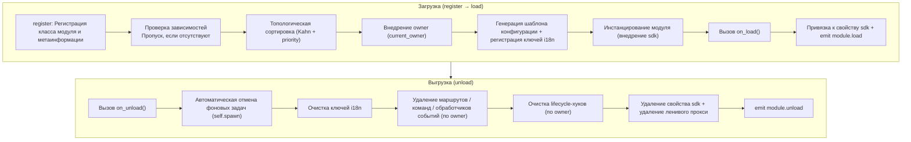

**Что делает фреймворк при загрузке** (вам нужно только написать `on_load()`, остальное делается автоматически):

| Этап | Что делает фреймворк автоматически |
|------|------------------------------------|
| Внедрение owner | При инстанцировании модуль оборачивается в `owner_scope`, все команды/события/хуки/фоновые задачи, зарегистрированные в `on_load`, **автоматически привязываются к модулю** и при выгрузке удаляются по owner |
| Шаблон конфигурации | Модули, объявленные с `ConfigClass`, получают автоматически сгенерированный/заполненный `ErisPulse.<ModuleName>` |
| Ключи i18n | Модули, объявленные с `I18nClass`, автоматически регистрируют ключи переводов (удаляются при выгрузке) |
| Зависимости | Модули сортируются по `depends`, чтобы модули, от которых зависят, загружались первыми; циклические зависимости отклоняются с `RuntimeError` |
| Привязка к SDK | После инстанцирования модуль привязывается к `sdk.<ModuleName>`, чтобы вы могли обращаться к `sdk.MyModule.xxx` |

**Что делает фреймворк при выгрузке** (соответствует U1→U7): После выполнения `on_unload()` происходит автоматическая очистка — фоновые задачи, созданные через `self.spawn`, отменяются (для грациозного завершения их нужно обрабатывать в `on_unload`), ключи i18n, маршруты, команды/обработчики событий, lifecycle-хуки, затем удаляется свойство SDK. При `purge=True` дополнительно удаляются метаданные регистрации и `sys.modules`.

> Именно эта автоматическая очистка обеспечивает то, что **вам нужно только писать `on_load`/`on_unload`, а не вручную unregister** — фреймворк использует привязку owner, чтобы "кто зарегистрировал, тот и очищает" стало одно-клик-операцией.

## Объект SDK

### Доступ к основным модулям

```python
from ErisPulse import sdk

# Доступ к основным модулям через объект sdk
sdk.logger.info("Лог")
sdk.storage.set("key", "value")
config = sdk.config.getConfig("MyModule")
```

### Коммуникация между модулями

```python
# Доступ к другим модулям
other_module = sdk.OtherModule
result = await other_module.some_method()
```

## Методы отправки адаптера

Из-за нового стандарта, требующего перезаписи метода `__getattr__` для реализации механизма отправки по умолчанию, невозможно использовать `hasattr` для проверки существования метода. Начиная с версии `2.3.5`, добавлена функция для запроса методов отправки.

### Список поддерживаемых методов отправки

```python
# Вывод всех поддерживаемых методов отправки платформы
methods = sdk.adapter.list_sends("onebot11")
# Возвращает: ["Text", "Image", "Voice", "Markdown", ...]
```

### Получение подробной информации о методе

```python
# Получение подробной информации о методе
info = sdk.adapter.send_info("onebot11", "Text")
# Возвращает:
# {
#     "name": "Text",
#     "parameters": [
#         {"name": "text", "type": "str", "default": null, "annotation": "str"}
#     ],
#     "return_type": "Awaitable[Any]",
#     "docstring": "Отправка текстового сообщения..."
# }
```

## Управление конфигурацией

### Декларативная конфигурация (рекомендуется)

Начиная с версии `v2.5.2`, модули могут объявлять класс конфигурации через `ConfigClass`, используя ту же систему схемы конфигурации, что и адаптеры. Конфигурация доступна через `self.cfg` в режиме реального времени, изменения применяются немедленно:

```python
from dataclasses import dataclass, field
from ErisPulse.Core.Bases import BaseModule
from ErisPulse.Core.Bases import BaseConfig

@dataclass
class MyModuleConfig(BaseConfig):
    api_key: str = field(
        default="",
        metadata={
            "description": {"i18n": "my_module.api_key", "default": "API ключ"},
            "required": True,
            "secret": True,
            "ui": {"widget": "password", "group": "basic", "order": 1},
        },
    )
    timeout: int = field(
        default=30,
        metadata={
            "description": {"i18n": "my_module.timeout", "default": "Время ожидания (секунд)"},
            "ui": {"widget": "number", "group": "advanced", "order": 2},
        },
    )

class MyModule(BaseModule):
    ConfigClass = MyModuleConfig

    def __init__(self, sdk):
        self.sdk = sdk
        self.logger = sdk.logger.get_child("MyModule")

    async def on_load(self, event):
        self.logger.info("Модуль загружен")

    async def on_unload(self, event):
        pass

    async def do_something(self):
        cfg = self.cfg  # Чтение в режиме реального времени, типобезопасно
        api_key = cfg.api_key
        timeout = cfg.timeout
```

`BaseConfig` — универсальный базовый класс конфигурации, подходит для адаптеров, модулей, внешних проектов и любых сценариев. Поля конфигурации поддерживают многоязычные описания с помощью i18n (см. [документацию по i18n](../../advanced/i18n.md#многоязычные-описания-конфигурационных-полей)).

> [!NOTE]
> Жизненный цикл модуля (включая адаптеры) — загрузка, выгрузка, запуск, остановка и т.д. — управляется фреймворком (модульный менеджер / scope предоставляет API для запроса и управления). `ConfigClass` должен содержать только бизнес-параметры, модулю не нужно вкладывать внутрь логику "нужно ли запускать себя".

Система схемы конфигурации также поддерживает (с версии `v2.8.0`, см. [основные концепты адаптера](../adapters/core-concepts.md#метаданные-оговорка)):

- **Автоматическое создание описания полей из docstring**: Если `description` не объявлен в `metadata`, автоматически извлекается из docstring через `:ivar поле: описание` или раздел `Attributes:`
- **Вложенные dataclass конфигурации**: Если тип поля — вложенный dataclass, схема/шаблон/валидация обрабатываются рекурсивно, веб-интерфейс отображает вложенные группы
- **Поле `example`, не сохраняющееся в файл**: Поле с `metadata={"example": True}` не записывается в `config.toml`, сохраняется только в `config.full.example` (подходит для сложных, редко используемых расширенных настроек), пользователь вручную настраивает и сохраняет как обычное

### Декларативные ключи перевода (v2.7.0+)

Начиная с версии `v2.7.0`, модули могут объявлять ключи перевода так же, как и `ConfigClass`, используя вложенный класс `I18nClass` для централизованного объявления. Фреймворк **автоматически регистрирует** все объявленные ключи перевода при загрузке, без необходимости вызывать `i18n.register()` вручную, и регистрация происходит раньше, чем генерируется шаблон конфигурации, гарантируя, что ключи перевода, используемые в описании конфигурации, уже доступны.

```python
from ErisPulse.Core.Bases import BaseConfig, BaseI18n, I18nKey

class MyModule(BaseModule):
    # Класс конфигурации (опционально)
    @dataclass
    class ConfigClass(BaseConfig):
        welcome_msg: str = field(
            default="Добро пожаловать",
            metadata={
                "description": {"i18n": "mymodule.welcome_msg", "default": "Сообщение приветствия"},
            },
        )

    # Класс набора ключей перевода (опционально)
    class I18nClass(BaseI18n):
        # Имя атрибута автоматически объединяется в полный путь ключа: <имя_модуля>.<имя_атрибута>
        welcome_msg: I18nKey = I18nKey(
            default="Welcome Message",   # Безязыковой резервный вариант
            zh_CN="Добро пожаловать",
            zh_TW="Добро пожаловать",
            en="Welcome Message",
            ja="Добро пожаловать",
            ru="Приветственное сообщение",
        )
        hello: I18nKey = I18nKey(
            default="Hello, {name}!",
            zh_CN="Привет, {name}!",
            zh_TW="Привет, {name}!",
            en="Hello, {name}!",
            ja="Привет, {name}!",
            ru="Привет, {name}!",
        )
```

Подробнее см. [Рекомендуемый способ i18n](../../advanced/i18n.md#рекомендуемый-способ-объявление-ключей-перевода-через-i18nclass-v270).

### Ручное чтение конфигурации (устарело)

> **Устарело**: используйте [декларативную конфигурацию](#декларативная-конфигурация-рекомендуется) + `self.cfg` для чтения в режиме реального времени.

```python
class MyModule(BaseModule):
    def __init__(self, sdk):
        self.sdk = sdk

    def _load_config(self):
        config = self.sdk.config.getConfig("MyModule")
        if not config:
            self.sdk.config.setConfig("MyModule", {"api_key": "", "timeout": 30})
            return {"api_key": "", "timeout": 30}
        return config
```

## Система хранения

### Основное использование

```python
# Сохранение данных
sdk.storage.set("user:123", {"name": "Чжан Сань"})

# Получение данных
user = sdk.storage.get("user:123", {})

# Удаление данных
sdk.storage.delete("user:123")
```

### Использование транзакций

```python
# Использование транзакции для обеспечения согласованности данных
with sdk.storage.transaction():
    sdk.storage.set("key1", "value1")
    sdk.storage.set("key2", "value2")
    # Если любая операция не удалась, все изменения будут отменены
```

## Обработка событий

### Регистрация обработчиков событий

```python
from ErisPulse.Core.Event import command, message

# Регистрация команды
@command("info", help="Получить информацию")
async def info_handler(event):
    await event.reply("Это информация")

# Регистрация обработчика сообщений
@message.on_group_message()
async def group_handler(event):
    sdk.logger.info(f"Получено групповое сообщение: {event.get_text()}")
```

### Жизненный цикл обработчиков событий

Фреймворк автоматически управляет регистрацией и удалением обработчиков событий, вам нужно только зарегистрировать их в `on_load`.

## Механизм ленивой загрузки

### Принцип работы

```python
# Модуль будет инициализирован при первом обращении
result = await sdk.my_module.some_method()
# ↑ Здесь будет вызвана инициализация модуля
```

### Немедленная загрузка

Для модулей, которые должны быть инициализированы немедленно (например, слушатели, таймеры):

```python
@staticmethod
def get_load_strategy():
    return ModuleLoadStrategy(
        lazy_load=False,  # Немедленная загрузка
        priority=100
    )
```

## Обработка ошибок

### Перехват исключений

```python
async def handle_event(self, event):
    try:
        # Бизнес-логика
        await self.process_event(event)
    except ValueError as e:
        self.logger.warning(f"Ошибка параметра: {e}")
        await event.reply(f"Ошибка параметра: {e}")
    except Exception as e:
        self.logger.error(f"Обработка не удалась: {e}")
        raise
```

### Запись в лог

```python
# Использование разных уровней логирования
self.logger.debug("Отладочная информация")    # Подробная отладочная информация
self.logger.info("Состояние выполнения")      # Информация о нормальном выполнении
self.logger.warning("Предупреждение")  # Предупреждающие сообщения
self.logger.error("Ошибка")    # Сообщения об ошибках
self.logger.critical("Критическая ошибка") # Критические ошибки
```


### Event 包装类详解

# Детальный разбор класса-обертки Event

> [!NOTE]
> **Обязательное к прочтению для L1** — одна из пяти основных статей в разделе "Путь чтения" на главной странице, необходима для разработки модулей.

Модуль Event предоставляет мощный класс-обертку Event, упрощающий обработку событий.

## Добавление аннотаций типов для параметра event

Параметр `event` обработчика событий является **обёрткой Event** (подкласс dict). Рекомендуется добавлять аннотации типов для него:

```python
from ErisPulse.Core.Event import Event

@message.on_private_message()
async def handler(event: Event):
    text = event.get_text()   # IDE автоматически подсказывает все удобные методы
    await event.reply(text)   # Опечатки будут обнаружены при статической проверке
```

Без аннотаций IDE не сможет распознать методы Event (`get_text()` / `reply()` / `wait_reply()` / методы расширения платформы не будут подсвечиваться), и приходится полагаться на память при написании.

> **Обратите внимание на различие**: `event` в обратном вызове обработчика событий является **обёрткой Event** (аннотация типа `Event`); `event` в методах жизненного цикла модуля `on_load` / `on_unload` является обычным **dict** (аннотация типа `dict`), не следует их путать.

## Основные возможности

- **Полная совместимость со словарём**: Event наследуется от dict
- **Удобные методы**: Предоставляются много удобных методов
- **Доступ через точку**: Поддерживается доступ к полям события через точку
- **Обратная совместимость**: Все методы являются необязательными

## Основные методы полей

```python
from ErisPulse.Core.Event import command

@command("info")
async def info_command(event: Event):
    event_id = event.get_id()
    platform = event.get_platform()
    time = event.get_time()
    print(f"ID: {event_id}, Платформа: {platform}, Время: {time}")
```

## Методы событий сообщений

```python
from ErisPulse.Core.Event import message

@message.on_private_message()
async def private_handler(event: Event):
    text = event.get_text()
    user_id = event.get_user_id()
    nickname = event.get_user_nickname()
    await event.reply(f"Привет, {nickname}!")
```

## Типы сообщений

```python
from ErisPulse.Core.Event import message

@message.on_group_message()
async def group_handler(event: Event):
    is_private = event.is_private_message()
    is_group = event.is_group_message()
    is_at = event.is_at_message()
    await event.reply(f"Тип: {'Личное сообщение' if is_private else 'Групповое сообщение'}")
```

## Функция ответа

```python
from ErisPulse.Core.Event import command

@command("ask")
async def ask_command(event: Event):
    await event.reply("Пожалуйста, введите ваше имя:")
    reply = await event.wait_reply(timeout=30)
    if reply:
        name = reply.get_text()
        await event.reply(f"Привет, {name}!")

@command("price")
async def price_command(event: Event):
    await event.reply("Пожалуйста, введите сумму (например: 5元):")
    # Ответ должен соответствовать регулярному выражению, иначе продолжаем ожидать до истечения таймаута
    reply = await event.wait_reply(timeout=30, regex=r"\d+\s*元")
    if reply:
        await event.reply(f"Получена сумма: {reply.get_text()}")
```

## Расширенные возможности интерактивных диалогов

> [!NOTE]
> Для использования этих функций требуется ErisPulse **2.8.0+**.

```python
# Повторное напоминание: если в течение 5 минут нет ответа, отправить напоминание, при ответе отменить автоматически
reminder = event.remind(300, "Ещё здесь? Чтобы прекратить общение, напишите «Выход»")
reminder.cancel()  # Также можно отменить вручную

# Продление тайм-аута: обязательное достижение срока (не отменяется ответом), например, для уведомления владельца, если задача не обработана в течение длительного времени
event.escalate(1800, lambda e: notify_master("Задача просрочена"))

# Ожидание нескольких путей: одновременно ждём "одобрить" и "отклонить", срабатывает первый поступивший ответ
which, reply = await event.select(
    event.expect(pattern="одобрить*", user="10001"),
    event.expect(pattern="отклонить*", user="10002"),
    timeout=60,
)
if which is None:
    await event.reply("Тайм-аут, ответа на запрос не получено")

# Ожидание на уровне сессии: ответ любого участника в группе может быть принят (для совместной работы в группе)
reply = await event.wait_reply(session=True, prompt="Кто-нибудь, помогите ответить?")

# Ящик сообщений сессии: последние 20 сообщений текущей сессии (включая сообщения бота, контекст ИИ / база для предотвращения повторения)
messages = await event.history(20)

# Транзакция сообщений: при возникновении ошибки автоматически отменяются отправленные сообщения в рамках транзакции
async with event.message_tx():
    await event.reply("Обработка, пожалуйста, подождите...")
    result = await do_something()
    await event.reply(f"Завершено: {result}")
```

## Получение информации о команде

```python
from ErisPulse.Core.Event import command

@command("cmdinfo")
async def cmdinfo_command(event: Event):
    cmd_name = event.get_command_name()
    cmd_args = event.get_command_args()
    await event.reply(f"Команда: {cmd_name}, аргументы: {cmd_args}")
```

## Метод уведомления события

```python
from ErisPulse.Core.Event import notice

@notice.on_friend_add()
async def friend_add_handler(event: Event):
    await event.reply("Добро пожаловать, добавьте меня в друзья!")
```

## Справочник методов

### Основные методы

#### Базовая информация о событии
- `get_id()` - Получить ID события
- `get_time()` - Получить метку времени события (Unix, секунды)
- `get_type()` - Получить тип события (message/notice/request/meta)
- `get_detail_type()` - Получить подробный тип события (private/group/friend и т.д.)
- `get_platform()` - Получить название платформы

#### Информация о боте
- `get_self_platform()` - Получить название платформы бота
- `get_self_user_id()` - Получить ID пользователя бота
- `get_self_account_id()` - Получить ID аккаунта бота (режим с несколькими ботами)
- `get_self_info()` - Получить полную информацию о боте в виде словаря

#### Идентификаторы сессии
- `get_target_id()` - Получить единый идентификатор цели (для групповых чатов возвращает `group_id`, для каналов `channel_id`, для личных сообщений `user_id`, возвращает первое непустое значение в порядке group → channel → guild → thread → user)
- `get_session_id()` - Получить уникальный идентификатор сессии, формат: `{platform}:{detail_type}:{target_id}`

### Методы событий сообщений

#### Текст сообщения
- `get_message()` - Получить массив сообщений (формат OneBot12)
- `get_alt_message()` - Получить альтернативный текст сообщения
- `get_text()` - Получить чистый текст (псевдоним `get_alt_message()`)
- `get_message_text()` - Получить чистый текст (псевдоним `get_alt_message()`)

#### Информация об отправителе
- `get_user_id()` - Получить ID пользователя-отправителя
- `get_user_nickname()` - Получить никнейм отправителя
- `get_sender()` - Получить полную информацию об отправителе в виде словаря

#### Информация о группе/канале
- `get_group_id()` - Получить ID группы (для сообщений в группе)
- `get_channel_id()` - Получить ID канала (для сообщений в канале)
- `get_guild_id()` - Получить ID сервера (для сообщений на сервере)
- `get_thread_id()` - Получить ID темы/подканала (для сообщений в теме)

#### Упоминания
- `has_mention()` - Содержит ли сообщение упоминание бота
- `get_mentions()` - Получить список ID всех упомянутых пользователей

### Типы сообщений

#### Базовые проверки
- `is_message()` - Является ли событие сообщением
- `is_private_message()` - Является ли сообщение личным
- `is_group_message()` - Является ли сообщение групповым
- `is_at_message()` - Является ли сообщение упоминанием (псевдоним `has_mention()`)

### Методы уведомлений

#### Информация об операторе
- `get_operator_id()` - Получить ID оператора
- `get_operator_nickname()` - Получить никнейм оператора

#### Типы уведомлений
- `is_notice()` - Является ли событие уведомлением
- `is_group_member_increase()` - Событие добавления участника в группу
- `is_group_member_decrease()` - Событие удаления участника из группы
- `is_friend_add()` - Событие добавления друга (соответствует `detail_type == "friend_increase"`)
- `is_friend_delete()` - Событие удаления друга (соответствует `detail_type == "friend_decrease"`)

### Методы запросов

#### Информация о запросе
- `get_comment()` - Получить комментарий к запросу

#### Типы запросов
- `is_request()` - Является ли событие запросом
- `is_friend_request()` - Является ли запросом добавления друга
- `is_group_request()` - Является ли запросом добавления в группу

### Ответы

#### Основные ответы
- `reply(content, method="Text", at_sender=False, quote=False, at_users=None, reply_to=None, at_all=False, via=None, **kwargs)` - Общий метод ответа
  - `content`: Содержимое отправки (текст, URL и т.д.)
  - `method`: Метод отправки, по умолчанию "Text", возможные значения: "Image"/"Voice"/"Video"/"File" и т.д.
  - `at_sender`: Упоминать ли отправителя (автоматически извлекает user_id)
  - `quote`: Цитировать ли текущее сообщение (автоматически извлекает message_id)
  - `at_users`: Список пользователей для упоминания, например `["user1", "user2"]`
  - `reply_to`: Ручное указание ID сообщения для ответа
  - `at_all`: Упоминать ли всех участников
  - `**kwargs`: Дополнительные параметры (например, user_id для метода Mention)

- `reply_ob12(message)` - Ответ с использованием OneBot12-сегментов сообщения
  - `message`: Список или словарь OneBot12-сегментов, можно использовать MessageBuilder для построения

#### Проверка поддержки платформой
- `supports(method)` - Проверить, поддерживает ли текущая платформа метод отправки (например, `"Image"`, `"Voice"`), возвращает `bool`
- `available_methods()` - Получить список всех доступных методов отправки на текущей платформе, возвращает список названий методов

#### Пересылка сообщений

> **Важно**: Функция пересылки реализуется через DSL отправки адаптера, Event-обёртка не предоставляет прямого метода пересылки.

```python
# Пересылка сообщения в группу
adapter = sdk.adapter.get(event.get_platform())
target_id = event.get_group_id()  # или указать другой ID группы
await adapter.Send.To("group", target_id).Text(event.get_text())
```

### Ожидание ответа

- `wait_reply(prompt=None, timeout=60.0, callback=None, validator=None, method="Text", pattern=None, regex=None)` - Ожидание ответа пользователя
  - `prompt`: Текст подсказки, если указан, будет отправлен пользователю
  - `timeout`: Время ожидания (секунды), по умолчанию 60 секунд
  - `callback`: Функция обратного вызова, выполняется при получении ответа
  - `validator`: Функция валидации, проверяет корректность ответа
  - `method`: Метод отправки подсказки, по умолчанию "Text"
  - `pattern`: Шаблон glob (`*` / `?` / `[seq]`), текст ответа должен соответствовать, иначе ожидание продолжается
  - `regex`: Регулярное выражение, текст ответа должен соответствовать (только один из `pattern` или `regex` может быть указан), иначе ожидание продолжается
  - Возвращает объект Event с ответом пользователя, при таймауте возвращает None

#### Интерактивные методы

- `confirm(prompt=None, timeout=60.0, yes_words=None, no_words=None, method="Text", hint=False)` - Подтверждение
  - Возвращает `True` (подтверждение) / `False` (отказ) / `None` (таймаут)
  - Встроенные английские и китайские слова подтверждения автоматически распознаются, можно задать собственные наборы слов
  - `method`: Метод отправки, по умолчанию "Text", поддерживает "Image"/"Markdown" и другие не-текстовые способы отправки подсказки
  - `hint`: Добавлять ли автоматически подсказку с вариантами ответа в конец подсказки (например, "（是/否）"), по умолчанию False

- `choose(prompt, options, timeout=60.0, method="Text", options_format="auto", merge_prompt=False, placeholder="{options}")` - Меню выбора
  - `options`: Список текстовых вариантов
  - Возвращает индекс выбранного варианта (начиная с 0), при таймауте возвращает `None`
  - `method`: Метод отправки, по умолчанию "Text", текстовые методы (Text/Markdown/md/Html/h5) по умолчанию объединяют варианты в конец
  - `options_format`: Формат вариантов (по умолчанию: "auto", автоматически выбирается встроенный стиль в зависимости от метода)
    - `"auto"`: Markdown→неупорядоченный список (`- 1.选项`), Html→упорядоченный список (`<ol>`), другие→простой текстовый список
    - `"list"`: Каждый вариант на отдельной строке, например ``1. 选项A\n2. 选项B``
    - `"inline"`: Варианты отображаются в одной строке, например ``1.A | 2.B``
    - `"md"`: Markdown неупорядоченный список
    - `"html"`: Html упорядоченный список
    - `callable`: Пользовательская функция, принимает ``list[str]`` и возвращает ``str``
  - `merge_prompt`: Принудительно объединять в одно сообщение, по умолчанию False
    - `False` (по умолчанию): Текстовые методы объединяют автоматически; для не-текстовых методов сначала отправляется подсказка, затем текстовые варианты
    - `True`: Независимо от метода объединяются в одно сообщение, отправляется с указанным методом
  - `placeholder`: Заполнитель для вставки вариантов, по умолчанию `{options}`; текст подсказки с этим маркером заменяется на варианты, если установить пустую строку, варианты всегда добавляются в конец

- `collect(fields, timeout_per_field=60.0)` - Сбор формы
  - `fields`: Список полей, каждое поле содержит `key`, `prompt`, необязательный `validator`, необязательный `method`
  - Возвращает словарь `{key: value}`, при таймауте любого поля возвращает `None`
  - Каждое поле может иметь ключ `method` для указания метода отправки, например при сборе изображения: `{"key": "avatar", "prompt": "请发送头像", "method": "Image"}`
  - Каждое поле может иметь ключ `options` (список), при наличии этого ключа поле становится выборочным (автоматически вызывается choose)
  - Каждое поле может иметь ключи `options_format`, `merge_prompt`, `placeholder` для управления форматом вариантов, поведением объединения сообщений и заполнителем

- `wait_for(event_type="message", condition=None, timeout=60.0)` - Ожидание произвольного события
  - `condition`: Функция фильтрации, возвращает `True` при совпадении
  - Возвращает соответствующий объект Event, при таймауте возвращает `None`

- `conversation(timeout=60.0)` - Создание контекста многошагового диалога
  - Возвращает объект `Conversation`, поддерживающий `say()`/`wait()`/`confirm()`/`choose()`/`collect()`/`stop()`
  - Свойство `is_active` указывает, активен ли диалог

#### Примеры интерактивных методов

**confirm() - Подтверждение:**

```python
@command("delete", help="删除数据")
async def delete_handler(event: Event):
    if await event.confirm("确定要删除所有数据吗？"):
        sdk.storage.delete("all_data")
        await event.reply("数据已删除")
    else:
        await event.reply("已取消")
```

**confirm() - С подсказкой:**

```python
# hint=True добавит "（是/否）" в конец подсказки
if await event.confirm("确定继续？", hint=True):
    await event.reply("已继续")
# Пользователь увидит: 确定继续？（是/否）
```

**choose() - Меню выбора:**

```python
@command("color", help="选择颜色")
async def color_handler(event: Event):
    choice = await event.choose("请选择颜色：", ["红色", "绿色", "蓝色"])
    if choice is not None:
        colors = ["红色", "绿色", "蓝色"]
        await event.reply(f"你选择了：{colors[choice]}")
```

**choose() - Форматирование и объединение:**

```python
# inline формат: варианты отображаются в одной строке
choice = await event.choose("请选择：", ["A", "B", "C"], options_format="inline")
# Вывод: 1.A | 2.B | 3.C

# Пользовательская функция
choice = await event.choose("请选择：", ["猫", "狗"],
    options_format=lambda opts: " / ".join(opts))
# Вывод: 猫 / 狗

# options_format="auto" (по умолчанию): автоматически выбирается встроенный стиль в зависимости от метода
# Markdown → неупорядоченный список
choice = await event.choose(
    "## 请选择", ["猫", "狗"],
    method="Markdown",  # auto автоматически распознает как md список
)
# Вывод:
# ## 请选择
# - 1. 猫
# - 2. 狗

# Html → упорядоченный список
choice = await event.choose(
    "<h2>请选择</h2>", ["猫", "狗"],
    method="Html", merge_prompt=True,  # auto автоматически распознает как html список
)
# Вывод:
# <h2>请选择</h2>
# <ol><li>1. 猫</li><li>2. 狗</li></ol>

# Режим объединения + заполнитель
choice = await event.choose(
    "## 请选择\n{options}\n请回复编号",
    ["猫", "狗"],
    method="Markdown", merge_prompt=True,
)

# Пользовательский заполнитель
choice = await event.choose(
    "请选择: [choices]",
    ["猫", "狗"],
    placeholder="[choices]",
)
```

**collect() - Сбор формы:**

```python
@command("register", help="注册")
async def register_handler(event: Event):
    data = await event.collect([
        {"key": "name", "prompt": "请输入姓名："},
        {"key": "age", "prompt": "请输入年龄：",
         "validator": lambda e: e.get_text().isdigit()},
    ])
    if data:
        await event.reply(f"注册成功！{data['name']}，{data['age']}岁")
```

**reply с не-Text методами:**

```python
await event.reply("http://example.com/img.jpg", method="Image")
await event.reply("http://example.com/audio.mp3", method="Voice")

from ErisPulse.Core.Event import MessageBuilder
segments = MessageBuilder.text("看这张图：").image("http://example.com/img.jpg").build()
await event.reply_ob12(segments)
```

> Полное использование многошагового диалога через Conversation см. в [Conversation: Многошаговый диалог](../../advanced/conversation.md).

### Информация о команде

#### Основы команд
- `get_command_name()` - Получить имя команды
- `get_command_args()` - Получить список аргументов команды
- `get_command_raw()` - Получить исходный текст команды
- `get_command_info()` - Получить полную информацию о команде в виде словаря
- `is_command()` - Является ли событие командой

### Исходные данные

- `get_raw()` - Получить исходные данные события платформы
- `get_raw_type()` - Получить тип исходного события платформы

### Платформенные расширения

Адаптеры могут регистрировать платформенно-специфичные методы для Event-обёртки. Методы доступны только на Event-экземплярах соответствующей платформы, при доступе с других платформ выбрасывается `AttributeError`.

Платформенные методы через `Event.__getattribute__` имеют приоритет над встроенными методами, поэтому можно переопределить встроенные интерактивные методы, такие как `confirm`、`choose`、`collect`、`wait_reply`, предоставляя специфичные реализации для платформы (например, кнопки, карточки). Встроенная реализация экспортируется как `_builtin_*` функции для переопределения.

```python
# Почтовое событие - только почтовые методы
event = Event({"platform": "email", "email_raw": {"subject": "Hello"}})
event.get_subject()      # ✅ Возвращает "Hello"
event.get_chat_type()    # ❌ AttributeError

# Telegram событие - только Telegram методы
event = Event({"platform": "telegram", "telegram_raw": {"chat": {"type": "private"}}})
event.get_chat_type()    # ✅ Возвращает "private"
event.get_subject()      # ❌ AttributeError

# Встроенные методы всегда доступны
event.get_text()         # ✅ В любой платформе
event.reply("hi")        # ✅ В любой платформе
```

### Проверка зарегистрированных методов

```python
from ErisPulse.Core.Event import get_platform_event_methods

methods = get_platform_event_methods("email")
# ["get_subject", "get_from", ...]
```

### Поддержка hasattr и dir

```python
hasattr(event, "get_subject")   # Только при platform="email" возвращает True
"get_subject" in dir(event)     # То же самое
```

### Расширение для всех платформ (шаблон "*")

`register_event_method` и `register_event_mixin` поддерживают передачу `"*"` в качестве названия платформы, регистрируя методы, доступные на **всех** платформах Event-экземпляров. Подходит для функций, требующих кросс-платформенного повторного использования, таких как AI-диалоги, управление контекстом и т.д.

```python
from ErisPulse.Core.Event.wrapper import register_event_method

@register_event_method("*")
async def ai_chat(self, prompt: str):
    # self - экземпляр Event, доступен к данным события и встроенным методам
    await self.reply(f"AI: {prompt}")
```

После регистрации, `event.ai_chat(...)` можно вызывать из любого обработчика событий на любой платформе.

Приоритет разрешения методов (от высшего к низшему): платформенно-специфичные методы → методы шаблона → встроенные методы → доступ через ключ словаря.

> Способы регистрации расширений адаптерами см. в [API системы событий - Расширение для всех платформ (шаблон)](../../api-reference/event-system.md#跨平台扩展通配符).


### 模块开发最佳实践

# Лучшие практики разработки модулей

> [!TIP]
> **Когда нужно прочитать эту статью**: рекомендуется прочитать после написания первого модуля (лучшие практики инженерной разработки). Если не нужно, можно пропустить, это не повлияет на использование других функций.

В этом документе представлены лучшие практики разработки модулей ErisPulse.

## Дизайн модуля

### 1. Принцип единственной ответственности

Каждый модуль должен отвечать за одну основную функцию:

```python
# Хороший дизайн: каждый модуль отвечает за одну функцию
class WeatherModule(BaseModule):
    """Модуль для получения погоды"""
    pass

class NewsModule(BaseModule):
    """Модуль для получения новостей"""
    pass

# Плохой дизайн: один модуль отвечает за несколько несвязанных функций
class UtilityModule(BaseModule):
    """Содержит функции погоды, новостей, анекдотов и т.д."""
    pass
```

### 2. Нормы именования модулей

```toml
[project]
name = "ErisPulse-ModuleName"  # Использовать префикс ErisPulse-
```

### 3. Четкое управление конфигурацией

Рекомендуется использовать декларативную конфигурацию (`ConfigClass` + `BaseConfig`), чтобы получить типобезопасность, автоматическое создание шаблонов и поддержку форм веб-интерфейса:

```python
from dataclasses import dataclass, field
from ErisPulse.Core.Bases import BaseConfig

@dataclass
class MyModuleConfig(BaseConfig):
    api_url: str = field(default="https://api.example.com", metadata={
        "description": {"i18n": "my_module.api_url", "default": "Адрес API"},
    })
    timeout: int = field(default=30, metadata={
        "description": {"i18n": "my_module.timeout", "default": "Время ожидания (секунды)"},
    })
    cache_ttl: int = field(default=3600, metadata={
        "description": {"i18n": "my_module.cache_ttl", "default": "Время жизни кэша (секунды)"},
    })

class MyModule(BaseModule):
    ConfigClass = MyModuleConfig

    async def do_something(self):
        cfg = self.cfg  # Типобезопасный доступ к конфигурации
        await self._fetch(cfg.api_url, timeout=cfg.timeout)
```

Также можно продолжать использовать ручное управление конфигурацией (см. [Основные концепции модуля](core-concepts.md#управление-конфигурацией)).

### Декларативные ключи перевода (v2.7.0+)

Модуль может объявлять ключи перевода через `I18nClass`, и фреймворк автоматически зарегистрирует их в системе i18n, без необходимости вызывать `i18n.register()` вручную.

```python
from ErisPulse.Core.Bases import BaseI18n, I18nKey

class MyModule(BaseModule):
    class I18nClass(BaseI18n):
        # Ключ перевода с подстановками
        welcome: I18nKey = I18nKey(
            default="Welcome, {name}!",
            zh_CN="Добро пожаловать, {name}!",
            zh_TW="歡迎你，{name}！",
            en="Welcome, {name}!",
            ja="ようこそ、{name}！",
            ru="Добро пожаловать, {name}!",
        )
        # Описание поля конфигурации
        api_url: I18nKey = I18nKey(
            default="API URL",
            zh_CN="Адрес API",
            zh_TW="API 位址",
            en="API URL",
            ja="API URL",
            ru="API URL",
        )
```

Подробное использование см. в [документации по i18n](../../advanced/i18n.md#рекомендуемый-способ-объявления-ключей-перевода-через-i18nclass-v270).

## Асинхронное программирование

### 1. Использование асинхронных библиотек

```python
# Рекомендуется использовать встроенный HTTP-клиент SDK (асинхронный, автоматическая логгирование и статистика)
from ErisPulse.Core import client

class MyModule(BaseModule):
    async def fetch_data(self, url):
        resp = await client.get(url)
        return await resp.json()

# Также можно использовать sdk.client (результат тот же)
from ErisPulse import sdk

class MyModule(BaseModule):
    async def fetch_data(self, url):
        resp = await sdk.client.get(url)
        return await resp.json()

# Не рекомендуется использовать aiohttp напрямую (неудобно для управления фреймворком)
import aiohttp

class MyModule(BaseModule):
    async def fetch_data(self, url):
        async with aiohttp.ClientSession() as session:
            async with session.get(url) as response:
                return await response.json()

# Не рекомендуется использовать requests (синхронный, блокирует цикл событий)
import requests

class MyModule(BaseModule):
    def fetch_data(self, url):
        return requests.get(url).json()  # Блокирует цикл событий
```

### 2. Правильные асинхронные операции

```python
from ErisPulse.Core.Event import Event  # Подсказки IDE доступны благодаря аннотации event: Event

async def handle_command(self, event: Event):
    # Длительные операции, результат которых необходимо ждать: просто await (жизненный цикл ясен)
    result = await self._long_operation()

async def on_load(self, event: dict):
    # Фоновые задачи (опрос/таймер/fire-and-forget): используйте self.spawn(),
    # при выгрузке модуля фреймворк отменяет задачи после on_unload, избегая утечек ссылок на self
    self.spawn(self._poll())
```

> [!NOTE]
> Рекомендуется использовать `self.spawn()` (ErisPulse **2.8.0+**). С версии **2.8.3** даже прямое использование `asyncio.create_task`
> автоматически привязывается к модулю (Task Factory автоматически регистрируется, задачи отменяются при выгрузке модуля, утечек `self` больше нет);
> `self.spawn()` по-прежнему рекомендуется — поддерживает переключение потоков и явное указание `owner=`.
> В версиях до **2.8.3** прямые задачи не привязываются к модулю и удерживают ссылку на `self`, что приводит к утечке модуля
> (утечка при горячей перезагрузке), поэтому необходимо использовать `self.spawn()`. Подробнее см. [Управление жизненным циклом](../../advanced/lifecycle.md#фоновые-задачи-привязка-и-автоматическая-отмена).

### 3. Управление ресурсами

```python
async def on_load(self, event):
    # Клиент SDK автоматически управляет пулом соединений, не нужно создавать сессию вручную
    pass
    
async def on_unload(self, event):
    # Если нужно использовать кастомный клиент, не забудьте очистить ресурсы
    pass
```

## Обработка событий

### 1. Использование обёртки Event

```python
# Использование удобных методов обёртки Event
@command("info")
async def info_command(event: Event):
    user_id = event.get_user_id()
    nickname = event.get_user_nickname()
    await event.reply(f"Привет, {nickname}!")

# Вместо прямого доступа к словарю
@command("info")
async def info_command(event: Event):
    user_id = event["user_id"]  # Менее понятно, легко ошибиться
```

### 2. Разумное использование ленивой загрузки

```python
# Модуль с редко используемыми командами: объявите триггер activate_on, модуль активируется при первом совпадении команды (сохраняя ленивую загрузку)
class CommandModule(BaseModule):
    @staticmethod
    def get_load_strategy():
        return ModuleLoadStrategy(lazy_load=True, activate_on=[
            {"command": {"name": "dice", "help": "Бросить кубик", "aliases": ["d"]}},
        ])

# Модуль с редкими триггерами событий: объявите триггер activate_on, модуль активируется при поступлении события
class ListenerModule(BaseModule):
    @staticmethod
    def get_load_strategy():
        return ModuleLoadStrategy(lazy_load=True, activate_on=[
            {"notice": "group_member_increase"},
        ])

# Модули, часто вызываемые (каждое сообщение) или требующие готовности при запуске: загружайте немедленно
class HotListenerModule(BaseModule):
    @staticmethod
    def get_load_strategy():
        return ModuleLoadStrategy(lazy_load=False)

# Инструментальные модули подходят для ленивой загрузки
class UtilityModule(BaseModule):
    @staticmethod
    def get_load_strategy():
        return ModuleLoadStrategy(lazy_load=True)
```

> Полный синтаксис `activate_on` (форма триггера события / упрощённая и dict-форма объявления / цепочка help) см. в [системе ленивой загрузки модулей](../../advanced/lazy-loading.md#активация-по-триггеру-activate_on).

### 3. Регистрация обработчиков событий

```python
async def on_load(self, event):
    # Регистрируйте обработчики событий в on_load
    @command("hello")
    async def hello_handler(event: Event):
        await event.reply("Привет!")
    
    @message.on_group_message()
    async def group_handler(event: Event):
        self.logger.info("Получено групповое сообщение")
    
    # Не нужно отменять регистрацию, фреймворк сделает это автоматически
```

## Инструментальные модули: при хранении чужих объектов нужно учитывать "уведомление об отключении"

**Когда это необходимо**: Ваш модуль хранит что-то от имени другого модуля (обратные вызовы по таймеру, подписчики, соединения, кэш и т.д.). Если эти ссылки не будут удалены после выгрузки модуля-владельца, экземпляр не сможет быть освобождён — это наиболее распространённая причина утечек памяти в инструментальных модулях.

```python
from ErisPulse.Core.Bases import BaseModule
from ErisPulse.runtime import off_cleanup, on_cleanup

class MyToolModule(BaseModule):
    def __init__(self):
        self._entries = {}  # {имя модуля: хранимые вещи}

    def register(self, entry):
        owner = on_cleanup(self._drop)   # ① При регистрации добавляем в цепочку очистки, автоматически определяется вызывающий модуль
        self._entries.setdefault(owner, []).append(entry)

    def _drop(self, owner: str):
        self._entries.pop(owner, None)   # ② При выгрузке модуля-владельца фреймворк автоматически вызывает: удаляем его объекты

    async def on_unload(self, event):
        off_cleanup(self._drop)          # ③ Перед собственной выгрузкой отменяем хук
```

Таким образом, фреймворк гарантирует:

- При **выгрузке / отключении** модуля-владельца (или при остановке адаптера) `_drop("имя модуля-владельца")` обязательно будет вызван
- **Автоматическое определение вызывающего модуля**: если модуль-владелец вызывает `sdk.MyToolModule.register(...)` или через `sdk.module.call("MyToolModule", "register", ...)` — будет правильно определён владелец
- Не нужно заботиться о времени — хук вызывается в цепочке фреймворка, до диагностики утечек, не приведёт к ложным срабатываниям

Последствия неподключения: при полной выгрузке модуля-владельца экземпляр не может быть освобождён (диагностика утечек сообщает "недостижимый"); если модуль-владелец также не отменяет уведомление, утечка будет постоянной.

**Обычные модули (не хранящие чужие объекты) не должны этим заниматься** — очистка ресурсов (команды / обработчики / маршрутизация / фоновые задачи и т.д.) автоматически выполняется фреймворком.

> Подробности о времени срабатывания, правилах определения вызывающего модуля, таймаутах и обработке ошибок см. в [системе принадлежности · руководство по инструментальным модулям](../../advanced/ownership.md#руководство-по-инструментальным-модулям-хранение-дескрипторов-других-модулей).

## Обработка ошибок

### 1. Классификация обработки исключений

```python
from ErisPulse.Core.Bases.errors import ClientError

async def handle_event(self, event: Event):
    try:
        result = await self._process(event)
    except ValueError as e:
        # Ожидаемая бизнес-ошибка
        self.logger.warning(f"Предупреждение бизнеса: {e}")
        await event.reply(f"Ошибка параметра: {e}")
    except ClientError as e:
        # Ошибка сети (нижележащие исключения aiohttp уже автоматически преобразованы)
        self.logger.error(f"Ошибка сети {e.method} {e.url}: {e}")
        await event.reply("Ошибка запроса, попробуйте позже")
    except Exception as e:
        # Неожиданная ошибка
        self.logger.error(f"Неизвестная ошибка: {e}", exc_info=True)
        await event.reply("Обработка не удалась, обратитесь к администратору")
        raise
```

### 2. Обработка таймаутов

```python
# Рекомендуется использовать встроенный клиент SDK (с таймаутом и повторами)
from ErisPulse.Core import client
from ErisPulse.Core.Bases.errors import ClientTimeoutError

async def fetch_with_timeout(self, url, timeout=30):
    try:
        resp = await client.get(url, timeout=timeout)
        return await resp.json()
    except ClientTimeoutError:
        self.logger.warning(f"Таймаут запроса: {url}")
        raise
```

## Система хранения

### 1. Использование транзакций

```python
# Использование транзакций для обеспечения согласованности данных
async def update_user(self, user_id, data):
    with self.sdk.storage.transaction():
        self.sdk.storage.set(f"user:{user_id}:profile", data["profile"])
        self.sdk.storage.set(f"user:{user_id}:settings", data["settings"])

# ❌ Без транзакций возможна несогласованность данных
async def update_user(self, user_id, data):
    self.sdk.storage.set(f"user:{user_id}:profile", data["profile"])
    # Если здесь произойдёт ошибка, предыдущий вызов не откатится
    self.sdk.storage.set(f"user:{user_id}:settings", data["settings"])
```

### 2. Массовые операции

```python
# Использование массовых операций для повышения производительности
def cache_multiple_items(self, items):
    self.sdk.storage.set_multi({
        f"item:{k}": v for k, v in items.items()
    })

# ❌ Многократные вызовы менее эффективны
def cache_multiple_items(self, items):
    for k, v in items.items():
        self.sdk.storage.set(f"item:{k}", v)
```

## Логирование

### 1. Разумное использование уровней логирования

```python
# DEBUG: Подробная отладочная информация (только в разработке)
self.logger.debug(f"Параметры ввода: {params}")

# INFO: Информация о нормальной работе
self.logger.info("Модуль загружен")
self.logger.info(f"Обработка запроса: {request_id}")

# WARNING: Предупреждения, не влияющие на основную функциональность
self.logger.warning(f"Параметр {key} не задан, используется значение по умолчанию")
self.logger.warning("API отвечает медленно, возможно, нужно оптимизировать")

# ERROR: Ошибки
self.logger.error(f"Ошибка API: {e}")
self.logger.error(f"Ошибка обработки события: {e}", exc_info=True)

# CRITICAL: Критические ошибки, требующие немедленного вмешательства
self.logger.critical("Ошибка подключения к базе данных, робот не может нормально работать")
```

### 2. Структурированное логирование

```python
# Использование структурированного логирования для упрощения анализа
self.logger.info(f"Обработка запроса: request_id={request_id}, user_id={user_id}, duration={duration}ms")

# ❌ Использование неструктурированного логирования
self.logger.info(f"Обработка запроса, от пользователя {user_id}, заняло {duration} миллисекунд")
```

## Оптимизация производительности

### 1. Использование кэширования

```python
class MyModule(BaseModule):
    def __init__(self):
        self._cache = {}
        self._cache_lock = asyncio.Lock()
    
    async def get_data(self, key):
        async with self._cache_lock:
            if key in self._cache:
                return self._cache[key]
            
            # Получение из базы данных
            data = await self._fetch_from_db(key)
            
            # Кэширование данных
            self._cache[key] = data
            return data
```

### 2. Избегание блокирующих операций

```python
# Использование асинхронных операций
async def process_message(self, event: Event):
    # Асинхронная обработка
    await self._async_process(event)

# ❌ Блокирующая операция
async def process_message(self, event: Event):
    # Синхронная операция, блокирует цикл событий
    result = self._sync_process(event)
```

## Безопасность

### 1. Защита конфиденциальных данных

```python
# Конфиденциальные данные хранятся в конфигурации (декларативный ConfigClass, поля с secret не попадают в логи/экспорт)
from dataclasses import dataclass, field
from ErisPulse.Core.Bases import BaseModule, BaseConfig

@dataclass
class MyModuleConfig(BaseConfig):
    api_key: str = field(
        default="",
        metadata={"description": "Ключ API", "secret": True},
    )

class MyModule(BaseModule):
    ConfigClass = MyModuleConfig

    def check_api_key(self):
        if not self.cfg.api_key or self.cfg.api_key == "YOUR_API_KEY_HERE":
            raise ValueError("Укажите действительный ключ API в config.toml")

# ❌ Конфиденциальные данные в коде
class MyModule(BaseModule):
    API_KEY = "sk-1234567890"  # Не делайте так!
```

### 2. Проверка входных данных

```python
# Проверка входных данных пользователя
async def process_command(self, event: Event):
    user_input = event.get_text()
    
    # Проверка длины ввода
    if len(user_input) > 1000:
        await event.reply("Слишком длинный ввод, попробуйте снова")
        return
    
    # Проверка формата ввода
    if not re.match(r'^[a-zA-Z0-9]+$', user_input):
        await event.reply("Неверный формат ввода")
        return
```

## Тестирование

### 1. Модульные тесты

```python
import pytest
from ErisPulse.Core.Bases import BaseModule

class TestMyModule:
    def test_config_defaults(self):
        """Тест значений по умолчанию конфигурации"""
        config = MyModule.ConfigClass()
        assert config.timeout == 30
```

### 2. Интеграционные тесты

```python
@pytest.mark.asyncio
async def test_command_handling():
    """Тест обработки команд"""
    module = MyModule()
    await module.on_load({})
    
    # Симуляция командного события
    event = create_test_command_event("hello")
    await module.handle_command(event)
```

## Развертывание

### 1. Управление версиями

```toml
[project]
name = "ErisPulse-MyModule"
version = "1.0.0"
```

Соблюдайте семантическое управление версиями:
- MAJOR.MINOR.PATCH
- Главная версия: несовместимые изменения API
- Подверсия: добавление совместимых функций
- Исправление: исправления совместимых ошибок

### 2. Заголовок README

README, созданный с помощью `epsdk create`, уже содержит логотип и шапку ErisPulse. Два рекомендуемых варианта:

**Вариант A — Только логотип ErisPulse (по умолчанию):**

```markdown
<div align="center">


# MyModule

**Одно предложение описания**

<p>
  <a href="https://pypi.org/project/ErisPulse-MyModule/"></a>
  <a href="https://pypi.org/project/ErisPulse-MyModule/"></a>
  <a href="./LICENSE"></a>
  <a href="https://github.com/ErisPulse/ErisPulse"></a>
</p>

</div>
```

**Вариант B — Иконка модуля × Логотип ErisPulse (если есть пользовательская иконка):**

```markdown
<div align="center">


<span style="font-size:44px;color:#c8c8c8;margin:0 18px;vertical-align:middle;">×</span>


# MyModule
(Та же строка с шаблонами)
</div>
```

Можно дополнительно добавить шаблоны GitHub Stars, Downloads и т.д. Логотип можно также загрузить в проект локально (`.github/assets/ErisPulseLogo.png`) и использовать относительный путь.


### 数据模型层（ORM）

# Уровень модели данных (ORM)

> [!TIP]
> **Когда нужно читать эту статью**: при необходимости работы с моделями данных, автоматического создания таблиц или сопоставления отношений. Если нет — пропустите, это не повлияет на использование других функций.

Начиная с версии 2.9.0, фреймворк включает декларативный уровень моделей данных: наследуя `Model` и объявляя поля через `Field`, вы получаете возможность автоматического создания таблиц и CRUD-операций. Модели строятся на базе встроенной системы хранения — SQLite / MySQL / PostgreSQL определяется параметром `ErisPulse.storage.backend`, **смена бэкенда не требует изменений кода моделей**.

## Объявление модели

```python
from ErisPulse.Core.Bases import Model, Field

class User(Model):
    id: int = Field(primary_key=True, autoincrement=True)
    name: str = Field(max_length=64)
    age: int = Field(default=0, ge=0, le=150)
    role: str = Field(default="user", choices=["user", "admin"])
    tags: list = Field(default_factory=list)          # JSON-столбец, автоматическая сериализация при чтении/записи
    bio: str = Field(default="", description={"i18n": "user.bio", "default": "Биография"})
```

- Имя таблицы по умолчанию — имя класса в snake_case (`UserProfile → user_profile`), можно переопределить через `__tablename__ = "xxx"`
- Ограничения `Field` и декларативные параметры класса конфигурации идентичны (`choices` / `ge` / `le` / `max_length`, `description` поддерживает словарь i18n); движок валидации совпадает с движком валидации конфигурации

## Параметры поля

| Параметр | Описание |
|------|------|
| `default` | Значение по умолчанию (если не задано и не автоинкремент → обязательное поле NOT NULL) |
| `default_factory` | Фабрика для изменяемых значений по умолчанию (например, `list`) |
| `primary_key` | Первичный ключ |
| `autoincrement` | Автоинкрементный первичный ключ (включает `primary_key`, `create` автоматически заполняет обратно) |
| `max_length` | Максимальная длина строки (генерирует `VARCHAR(n)`, проверка при записи) |
| `nullable` | Разрешено ли NULL (по умолчанию False) |
| `index` | Создание обычного индекса |
| `unique` | Уникальное ограничение |
| `choices` / `ge` / `le` | Перечисление / диапазон значений (проверка при записи) |
| `description` | Описание (словарь i18n, формат такой же, как в классе конфигурации) |
| `column_type` | Переопределение определения типа SQL-столбца |

## Создание таблицы и CRUD

```python
await User.create_table()                      #幂等（IF NOT EXISTS）

user = await User.create(name="Alice", age=20) # 插入（自增主键自动回填）
got = await User.get(id=user.id)               # 等值查询首条

users = await User.where(User.age > 18).order_by("-age").limit(10).all()
first = await User.where(User.name == "Alice").first()
total = await User.count(User.age > 18)

user.age = 21
await user.save()                              # 按主键更新（先约束校验）；主键缺失时退化为插入（自增主键同样回填到实例）
await user.delete()                            # 按主键删除

await User.update_all(User.age > 18, role="adult")  # 批量更新
await User.delete_all(User.age > 100)               # 批量删除
```

Выражения запросов поддерживают `> >= < <= == !=`、`in_([...])` и операторы `&` (и) / `|` (или):

```python
await User.where((User.age > 18) & User.name.in_(["Alice", "Bob"])).all()
```

## Транзакции

ORM-запись и чтение используют одну и ту же систему транзакций, что и фреймворк хранилища: если вы находитесь в окружении `storage.atransaction()`, `create` / `save` / `delete` и запросы автоматически используют текущую транзакцию, подтверждая или откатывая транзакцию вместе, без независимого подтверждения.

```python
async with storage.atransaction():
    await User.create(name="Alice")
    ...  # Если в блоке возникнет исключение, INSERT-запрос откатится
```

## Отношения с декларативным классом конфигурации

Объявление моделей и `ConfigClass` (`@dataclass + field(metadata=...)`) **разделяют одну и ту же базовую систему** — таблицу ограничений, движок валидатора (`validate_field_constraints`), регистрацию типов (`python_type_category`); но базовые классы намеренно разделены: поля конфигурации — это обычные значения (TOML-перевод, горячая перезагрузка), поля моделей — это описатели столбцов (доступ к классу = выражение запроса, доступ к экземпляру = значение строки). Один и тот же синтаксис объявления, два разных базовых класса.

### Когда использовать какой тип объявления

| Аспект | Поля конфигурации `field(metadata=...)` | Поля модели `Field()` |
|------|------------------------------|---------------------|
| Сценарий использования | Параметры поведения модуля (мало, человекочитаемо, горячая перезагрузка) | Данные бизнес-объектов (много строк, программное чтение/запись, запросы) |
| Формат хранения | `config.toml` (сохранение комментариев, TOML-перевод) | Таблицы базы данных (автоматическое создание, SQL-диалект) |
| Формат значений | Обычные значения (прямое чтение свойств dataclass) | Описатели (доступ к классу = выражение столбца, доступ к экземпляру = значение строки) |
| Ограничения | `metadata={"choices": ..., "min": ..., "max": ...}` | `Field(choices=..., ge=..., le=..., max_length=...)` |
| Общая базовая система | Движок валидатора + таблица ограничений + регистрация типов (одинаковая) | То же самое |

Эмпирическое правило: **"как модуль работает" — используйте класс конфигурации, "какие данные создал пользователь" — используйте модель**.

## Ограничения и замечания

- Бэкенд определяется глобальной конфигурацией хранилища; модель может переопределить `__storage__` для использования пользовательского экземпляра `BaseStorage` (для тестирования)
- Поля `list` / `dict` (с параметризованными типами, например `list[int]`, `dict[str, int]`) хранятся как текст JSON-столбцов, чтение/запись автоматически сериализуются
- При записи (`create` / `save`) автоматически выполняется проверка ограничений, при ошибке выбрасывается `ValueError` (локализованные сообщения)
- Автоматическое миграция поддерживает сценарий **добавления новых столбцов** (см. ниже); изменение типа столбца и удаление столбцов требуют ручного вмешательства
- При сбое подключения к хранилищу поведение такое же, как у слоя хранилища: фреймворк не падает, после паузы автоматически переподключается

## Автоматическая миграция (второй этап)

`create_table()` при наличии таблицы автоматически сравнивает существующие столбцы с полями модели: **новые поля** автоматически выполняют `ALTER TABLE ADD COLUMN` (удаляя ограничение `NOT NULL`, заполняя NULL для существующих строк), новые столбцы с `index=True` также создают индекс. Не требуется ручной написания скриптов миграции.

```python
# После запуска v1 модели: добавление email / bio
class User(Model):
    __tablename__ = "orm_users"

    id: int = Field(primary_key=True, autoincrement=True)
    name: str = Field(max_length=64)
    age: int = Field(default=0)
    email: str = Field(default="")     # Новое поле: при следующем create_table() будет добавлено
    bio: str = Field(default="")

await User.create_table()              #幂等：仅迁移新增列
```

**Ограничения**: поддерживается только добавление столбцов; изменение первичного ключа, типов столбцов и удаление столбцов требует ручного вмешательства (чтобы избежать ошибочных ALTER).

## Внешние ключи (основа сопоставления отношений)

`foreign_key="table.column"` объявляет внешний ключ на уровне столбца, DDL генерирует `REFERENCES`:

```python
class Post(Model):
    __tablename__ = "posts"

    id: int = Field(primary_key=True, autoincrement=True)
    author: int = Field(foreign_key="orm_users.id")

    content: str = Field(max_length=255)
```

## Сопоставление отношений (relationship)

В теле класса модели объявляется `relationship()` как атрибут класса, **направление определяется автоматически по месту объявления внешнего ключа**:

```python
from ErisPulse.Core.Bases import Model, Field, relationship

class User(Model):
    __tablename__ = "orm_users"

    id: int = Field(primary_key=True, autoincrement=True)
    name: str = Field(max_length=64)

    posts = relationship("Post", foreign_key="author")   # Внешний ключ в другой таблице → has-many

class Post(Model):
    __tablename__ = "posts"

    id: int = Field(primary_key=True, autoincrement=True)
    author: int = Field(foreign_key="orm_users.id")
    content: str = Field(max_length=255)

    writer = relationship("User", foreign_key="author")  # Внешний ключ в текущей таблице → belongs-to
```

**has-many**: свойство экземпляра возвращает набор запросов, доступны все возможности `QuerySet`, `create` автоматически заполняет первичный ключ текущей таблицы в столбец внешнего ключа:

```python
alice = await User.get(name="Alice")

posts = await alice.posts.all()                          # Все статьи пользователя
latest = await alice.posts.order_by("-id").first()
total = await alice.posts.count()
hot = await alice.posts.where(Post.content != "").all()  # Дополнительные условия по столбцам другой таблицы
await alice.posts.delete()                               # Удалить только статьи пользователя

new_post = await alice.posts.create(content="hi")        # author автоматически = alice.id
```

**belongs-to**: при `await` получается экземпляр другой модели (если нет соответствия или внешний ключ NULL — возвращается `None`):

```python
post = await Post.get(id=1)
writer = await post.writer          # Экземпляр User или None
await writer.posts.count()          # Двусторонняя связь
```

**Особенности**:

- `related` принимает строку с названием класса (ленивое разрешение по таблице регистрации моделей, порядок объявления не важен) или напрямую передает класс модели
- Запросы отношений и модели используют свои собственные бэкенды хранилища (не поддерживаются JOIN между разными бэкендами — запросы отношений — это отдельные SQL-запросы)
- Запросы отношений не кэшируются, каждый вызов — это немедленный запрос; для произвольных запросов по-прежнему можно использовать `User.where(...)`

[Следующая статья: «Система хранения»](docs/ru/storage.md)


### 模块排查指南

# Руководство по диагностике модулей

> [!TIP]
> **Когда читать эту статью:** при отсутствии реакции модуля, непроисходящем срабатывании команды или неполучении события. Если не требуется диагностика, можно пропустить, это не повлияет на использование других функций.

При отсутствии реакции модуля по симптомам различают три категории проблем, для каждой из которых есть соответствующий инструмент диагностики кадровой системы (RFC EPRFC-2026-001, направление пять):

| Симптом | Инструмент диагностики | Уровень диагностики |
|------|---------|---------|
| Модуль не загружен | `ErisPulse.runtime.explain_module(name)` | Цепочка регистрации и загрузки |
| Событие не обрабатывается | `ErisPulse.runtime.explain_event(event)` | Проверка входа в распределение |
| Команда не срабатывает | Цепочка принятия решения о распределении (тестовая сторона `DispatchTrace` / встроенный в фреймворк `trace`) | Цепочка определения команды |

Обе диагностические функции являются **чистыми операциями чтения**, не изменяют никакого состояния и могут быть вызваны в любое время; возвращают машинно-читаемый словарь, который можно отформатировать с помощью `format_report()` для получения текста, удобного для чтения человеком.

## Сценарий 1: Модуль не загружен

```python
from ErisPulse.runtime import explain_module, format_report

report = explain_module("MyModule")
print(format_report(report))
```

`explain_module()` проверяет каждый пункт и выдает заключение, охватывая следующие причины:

| Проверяемый элемент | Описание |
|-------------------|----------|
| Не зарегистрирован | Пакет не установлен, имя группы entry-point указано неверно, или имя регистрации не совпадает с именем запроса |
| Ленивая загрузка не инициализирована | **Нормальное состояние, а не ошибка:** модуль ленивой загрузки инициализируется при первом вызове (например, `module.call` или запуск команды) |
| Отключено в конфигурации | `ErisPulse.modules.status.<имя модуля> = false` (если не настроено, по умолчанию включено) |
| Зависимости не загружены | В списке `depends`, объявленном модулем, есть модули, которые не готовы |
| Несовместимая версия SDK | В метаданных модуля указано значение `min_sdk_version`, которое выше текущей версии фреймворка |
| Ошибка при on_load | Регистрация прошла успешно, но модуль не загружен, и нет вышеуказанных причин — проверьте записи ERROR в журнале запуска, соответствующие имени модуля |

Возвращаемая структурированная структура dict: `registered` / `loaded` / `lazy` / `enabled` (`None` означает, что по умолчанию включено, если не настроено) / `missing_dependencies` / `sdk_version_ok` / `conclusion` (заключение в одной фразе) / `reasons` (список причин).

## Сценарий 2: Событие не отвечает

```python
from ErisPulse.runtime import explain_event, format_report

report = explain_event(event)   # Event, полученный внутри обработчика, или исходный словарь события
print(format_report(report))
```

`explain_event()` выводит результаты в порядке фактической проверки на входе маршрутизации:

1. **Платформа-адаптер не зарегистрирована**: экземпляр адаптера с указанным `platform` отсутствует — событие вообще не попадает в фреймворк.
2. **Идентификационный измеритель отвергнут пространством действия**: пользователь / сессия / Bot / адаптер заблокированы — событие полностью отбрасывается на входе маршрутизации. Конфигурация пространства действия см. в [модульной конфигурации](../user-guide/configuration.md).
3. **Модуль заблокирован для текущей сессии**: различаются текущая сессия `available_modules` (доступные) и `blocked_modules` (заблокированные пространством действия).
4. **Текст напоминает команду, но не соответствует ни одной**: текст с префиксом команды, но не соответствует ни одной зарегистрированной команде — проверьте конфигурацию префикса и имена команд.

Если все входные проверки пройдены, но ответа по-прежнему нет, вывод указывает на дальнейшее исследование двух мест:

- **Условия фильтрации обработчика**: условия `detail_type` / `pattern=` / `regex=` и т.д. не выполняются;
- **Среднеслойное отклонение**: если среднеслой явно возвращает `False`, событие отбрасывается на уровне события и запускает хук жизненного цикла `adapter.event.blocked` (с именем среднеслоя и полным событием) — можно зарегистрировать этот хук для аудита "кто отбросил событие".

## Сценарий 3: Команда не была запущена (цепочка принятия решений при диспетчеризации)

Для того, чтобы сообщение с префиксом действительно выполнило команду, оно должно последовательно пройти через: определение текста команды → сопоставление команды (с подсказкой по опечатке при неудаче) → область действия → пользовательский ACL → проверка владельца → функция разрешений → охлаждение / ограничение скорости / скрытое отбрасывание из-за лимита использования → отказ и уведомление об устаревании → парсинг параметров → выполнение. Рамка фиксирует каждую точку принятия решения как причинно-следственную цепочку и даёт заключение о том, "почему команда не была запущена".

### В процессе тестирования: TestBot.dispatch возвращает DispatchTrace

Рекомендуется использовать тестирование для воспроизведения проблемы и непосредственно читать причинно-следственную цепочку (инструкции по использованию инструментов см. в [модульном тестировании](testing.md)):

```python
trace = await bot.dispatch(create_command_event("dailyx", user_id="123"))

trace.verdict          # executed / rejected / dropped / failed / no_match / passed
print(trace.explain()) # построчное описание причинно-следственной цепочки (в текущем языке)
trace.assert_no_match()
```

### Встроенный модуль trace в рамке

Цепочка принятия решений предоставляется `ErisPulse.Core.Event.trace` и по умолчанию **не имеет дополнительных накладных расходов** — если не находится в контексте сбора данных, точки принятия решений просто пропускаются, и производственные пути остаются незамеченными:

```python
from ErisPulse.Core.Event import (
    start_dispatch_trace,
    format_dispatch_trace,
    final_verdict,
)

with start_dispatch_trace() as records:
    ...  # сбор данных о диспетчеризации (включая производные задачи обработчиков)

print(format_dispatch_trace(records))   # человекочитаемая причинно-следственная цепочка (в текущем языке)
print(final_verdict(records))           # общий вывод
```

Значения `final_verdict()`:

| Заключение | Значение |
|-----------|----------|
| `executed` | Команда была выполнена |
| `rejected` | Была отклонена по правилам разрешений (область действия / ACL / владелец / функция разрешений) |
| `dropped` | Была скрыто отброшена (охлаждение / ограничение скорости / лимит использования / отказ промежуточного слоя) |
| `failed` | Возникла ошибка при выполнении |
| `no_match` | С префиксом, но не совпало ни с одной командой |
| `passed` | Это не текст команды, передано обработчику сообщений |

Записи представлены в виде машинно-читаемого словаря (stage / verdict / message_key / params), пользователь может отфильтровать по `stage` при настройке собственного отображения (например, показать только `cooldown`).

### Определение скрытого срабатывания правил управления

При срабатывании `cooldown=` / `rate_limit=` / `usage_limit=` по умолчанию происходит **скрытое отбрасывание** (команда всё равно считается активированной, не передаётся низкоприоритетному обработчику), что может быть ошибочно расценено как "команда сломана": наблюдаемое поведение — некоторые пользователи могут использовать команду, а другие получают нулевой ответ, и в причинно-следственной цепочке появляется запись `dropped` для соответствующего `stage`. Команда с `deprecated=` ведёт себя иначе — при вызове автоматически отправляется сообщение об устаревании (отказ от выполнения при `deprecated_reject=True`).

## Сценарий 4: после перезагрузки изменённого кода поведение всё ещё прежнее (2.11+)

Проверьте в следующем порядке:

1. **Проверьте возвращаемое значение и место ошибки**: если `reload` / `load` возвращает `False`, непосредственно вызовите
   `sdk.module.last_error("имя модуля")` — вернёт исключение и полный traceback (с номером строки с ошибкой),
   без необходимости просматривать файлы логов; `module.get_info(имя)["last_error"]` берёт данные из того же источника.
2. **Синтаксические ошибки не приводят к удалению**: `reload` выполняет предварительную проверку синтаксиса перед удалением, отказывает в случае ошибки (старый экземпляр продолжает обслуживать запросы),
   в логах указывается файл и номер строки; исправьте синтаксис и повторите `reload`.
3. **Предупреждение об отсутствии изменения идентичности**: если в логах появляется сообщение "Идентичность кода не изменилась после перезагрузки" или событие `identity_changed: false`,
   это означает, что в процессе всё ещё выполняется старый код (часто встречается с C-расширениями и другими модулями, кэш которых невозможно очистить) — такие модули требуют перезапуска фреймворка.
4. **Убедитесь, что модуль можно перезагрузить**: модули, зарегистрированные во время выполнения (с помощью `sdk.module.register()`), если классы определены в
   `__main__` / входном скрипте, отклоняются при перезагрузке (появляется предупреждение); переместите классы в файл модуля, который можно импортировать.
5. **Жадно загруженные модули активируются принудительно**: перезагрузка активирует модули, которые изначально были жадно загружены (отображается соответствующее сообщение в логах); модули, находящиеся в состоянии сна (спящие), остаются в этом состоянии.

## Сценарий 5: Модуль "включен, но не получает события" (ленивая загрузка и сон, 2.11+)

Модули с ленивой загрузкой, в которых объявлено `dormant_after`, после превышения порога бездействия **автоматически переходят в спящий режим**: ресурсы в среде выполнения освобождаются, обработчики событий отписываются, и модуль перестает получать события (исключение составляют события, объявленные в `activate_on` — события сначала пробуждают, а затем пересылают).

- Подтвердите, находится ли модуль в спящем режиме: ищите в журнале сообщения "в спящем режиме" / событие `module.sleep` или проверьте, что модуль больше не находится в состоянии `loaded` с помощью `sdk.module.get_status_summary()`
- Немедленно пробудите: доступ к любому свойству (например, `sdk.模块名.任意属性`) или `await sdk.module.call(...)`
- Не хотите автоматического перехода в спящий режим: удалите объявление `dormant_after` из `get_load_strategy()`
- Потеряется ли состояние: перед переходом в спящий режим вызывается `on_before_unload(reason="dormant")`, если модуль не реализует этот хук для сохранения состояния, то состояние в памяти будет потеряно (то же самое, что и при выгрузке) — для продолжения работы с сохраненным состоянием см. [Ленивая загрузка и сон (dormant_after)](../advanced/lazy-loading.md#懒加载休眠dormant_after)

## Общие рекомендации

- Перед началом отладки установите уровень логирования в `DEBUG` / `TRACE` (конфигурация описана в [Руководстве для разработчиков](README.md#Техники_отладки)), чтобы увидеть внутренние процессы фреймворка, такие как загрузка модулей, регистрация маршрутов и распределение событий;
- `explain_module` / `explain_event` можно вызывать в любое время, они чисто для чтения и не имеют побочных эффектов, подходит для привязки к операционным командам или панели управления;
- В случае проблем с "незапуском команды" сначала создайте тест с трассировкой `DispatchTrace` для воспроизведения — при неудаче утверждений `assert_executed` / `assert_rejected` будет автоматически прикреплена полная цепочка причинно-следственных связей.


=====
发布与工具
=====


### 发布模块到模块商店

# Руководство по публикации и магазину модулей

> [!TIP]
> **Когда читать эту статью**: при публикации проекта в PyPI / магазине модулей. Если не нужно, можно пропустить, это не повлияет на использование других функций.

Опубликуйте свой модуль или адаптер в магазине модулей ErisPulse, чтобы другие пользователи могли легко найти и установить его.

## Обзор магазина модулей

Магазин модулей ErisPulse — это централизованная регистрация модулей, через которую пользователи могут просматривать, искать и устанавливать модули и адаптеры, предоставленные сообществом, с помощью инструмента командной строки (CLI).

### Просмотр и обнаружение

```bash
# Вывести список всех доступных удаленных пакетов
epsdk list-remote

# Показать только модули
epsdk list-remote -t modules

# Показать только адаптеры
epsdk list-remote -t adapters

# Принудительно обновить список удаленных пакетов
epsdk list-remote -r
```

Вы также можете просматривать магазин модулей онлайн на [официальном сайте ErisPulse](https://www.erisdev.com/#market).

### Поддерживаемые типы отправки

| Тип | Описание | Группа entry-point |
|------|------|----------------|
| Модуль (Module) | Расширение функциональности бота, реализация бизнес-логики | `erispulse.module` |
| Адаптер (Adapter) | Подключение к новым платформам сообщений | `erispulse.adapter` |

## Быстрая публикация

Весь процесс состоит из трех шагов: настройка проекта → публикация на PyPI → отправка в магазин модулей.

### 1. Настройка pyproject.toml

Убедитесь, что в директории проекта присутствуют `pyproject.toml` и `README.md`, и настройте entry-points в зависимости от типа:

#### Модуль

```toml
[project]
name = "ErisPulse-MyModule"
version = "1.0.0"
description = "Описание функций модуля"
requires-python = ">=3.10"
license = { text = "MIT" }
authors = [ { name = "yourname" } ]
dependencies = [
    "ErisPulse>=2.0.0",
]

[project.entry-points."erispulse.module"]
"MyModule" = "MyModule:Main"
```

#### Адаптер

```toml
[project]
name = "ErisPulse-MyAdapter"
version = "1.0.0"
description = "Описание функций адаптера"
requires-python = ">=3.10"

[project.entry-points."erispulse.adapter"]
"myplatform" = "MyAdapter:MyAdapter"
```

> **Примечание**: Рекомендуется начинать имя пакета с `ErisPulse-`, чтобы пользователи могли легко его распознать. Ключ entry-point (например, `"MyModule"`) будет использоваться как имя модуля в SDK.

### 2. Публикация на PyPI

```bash
# Сборка + публикация (требуется учетная запись PyPI)
pip install build twine
python -m build
python -m twine upload dist/*
```

После успешной публикации проверьте установку:

```bash
pip install ErisPulse-MyModule
```

### 3. Отправка в магазин модулей

Перейдите на [магазин модулей ErisPulse](https://www.erisdev.com/#market), нажмите «Отправить модуль», войдите в систему и заполните информацию о модуле.

Поддерживаемые способы входа: **GitHub**, **Codeberg**, **Yunhu**, выберите любой из них.

Заполните следующие пункты:
- Название модуля, описание, адрес репозитория
- Минимальная версия SDK: если не уверены, укажите версию [последнего релиза ErisPulse](https://pypi.org/project/ErisPulse/)

После отправки модуль будет доступен для установки через источник модулей. Модуль будет помечен как «Не проверено», после проверки администратором он изменится на «Проверено».

> **О статусе проверки**:
> - «Не проверено» означает, что модуль еще не прошел официальную проверку, но это не говорит о наличии ошибок
> - При установке модуля, помеченного как «Не проверено», пользователь получит предупреждение о риске, и ему нужно будет подтвердить установку

### 4. Управление опубликованным модулем

После входа в систему на вкладке «Мои модули» в магазине модулей вы можете:

- **Редактировать** — изменить описание модуля, адрес репозитория, теги и т.д., версия будет автоматически синхронизирована с PyPI
- **Удалить** — удалить модуль из магазина модулей (невозможно отменить)

> Модуль, только что отправленный, может потребоваться несколько минут, чтобы появиться в списке «Мои модули».

## Обновление опубликованного модуля

1. Обновите `version` в `pyproject.toml`
2. Пересоберите и перезагрузите: `python -m build && python -m twine upload dist/*`
3. Магазин модулей автоматически синхронизирует последнюю версию с PyPI

Пользователи могут обновить модуль с помощью `epsdk upgrade MyModule`.

## Список проверки перед публикацией

Перед отправкой на PyPI, проверьте следующие пункты:

### Качество кода

- [ ] Все публичные API имеют аннотации типов (подписи функций и возвращаемые значения)
- [ ] Все публичные методы имеют строку документации (`"""..."""` формат, включая `:param` / `:return` / `:raises`)
- [ ] Прошел проверку `ruff check` (без предупреждений)
- [ ] Крылья тестов ≥ 80%
- [ ] Прошел все тесты `pytest`

### Совместимость

- [ ] `pyproject.toml` объявил минимальную версию SDK: `dependencies = ["ErisPulse>=x.y.z"]`
- [ ] Модуль объявил минимальную версию SDK во время выполнения в `get_meta()` с помощью `ModuleMeta(min_sdk_version="x.y.z")` (для адаптеров используется атрибут класса `min_sdk_version`) — если версия SDK пользователя слишком низкая, фреймворк сообщит об ошибке при загрузке и пропустит модуль, а не выдаст трудноотслеживаемые исключения во время выполнения
- [ ] Тестировался на Python 3.10 / 3.11 / 3.12 / 3.13
- [ ] Тестировался на целевой операционной системе (Windows / Linux / macOS, если применимо)
- [ ] Нет циклических зависимостей

### Конфигурация

- [ ] Если используется декларативная конфигурация (`ConfigClass` + `BaseConfig` / `BotAccountConfig`), поля конфигурации имеют `description` (рекомендуется формат i18n) и метаданные `ui`
- [ ] Если зарегистрированы ключи перевода i18n, обеспечено покрытие всех 5 языков (zh-CN / zh-TW / en / ja / ru)
- [ ] Чувствительные поля помечены `secret=True`

### Документация

- [ ] `README.md` содержит инструкции по установке и примеры базового использования
- [ ] `README.md` объясняет способ конфигурации (пример файла конфигурации + переменные среды)
- [ ] `CHANGELOG.md` содержит все изменения
- [ ] Адаптер обновил документацию по функциональности платформы (поддерживаемые типы Send, типы событий и т.д.)

### Публикация

- [ ] `pyproject.toml` версия обновлена
- [ ] Сборка прошла успешно: `python -m build`
- [ ] Загружен на PyPI: `python -m twine upload dist/*`
- [ ] Установка проверена: `pip install ErisPulse-xxx && epsdk run`

## Тестирование в режиме разработки

Перед публикацией можно использовать режим редактирования для локального тестирования:

```bash
epsdk install -e /path/to/MyModule
# или
pip install -e /path/to/MyModule
```

## Часто задаваемые вопросы

### Имя пакета должно начинаться с `ErisPulse-`?

Нет, это не обязательно, но настоятельно рекомендуется. Это помогает пользователям распознавать пакеты экосистемы ErisPulse на PyPI.

### Один пакет может зарегистрировать несколько модулей?

Да. В `entry-points` можно указать несколько пар ключ-значение:

```toml
[project.entry-points."erispulse.module"]
"ModuleA" = "MyPackage:ModuleA"
"ModuleB" = "MyPackage:ModuleB"
```

### Сколько времени занимает проверка?

Обычно это занимает 1-3 рабочих дня. Вы можете проверить статус проверки в магазине модулей на вкладке «Мои модули».

## Распространение приложений через Docker-образы

Если ваше приложение не подходит для публикации на PyPI (например, содержит частные зависимости или требует предварительной настройки среды), вы можете опубликовать Docker-образ через **GitHub Container Registry (GHCR)**, чтобы другие пользователи могли запускать его с помощью `docker pull`.

### Сценарии использования

- У вас есть **полное приложение-бот** (модуль + конфигурация + скрипт запуска), которое вы хотите распространять одним кликом
- Модуль/адаптер зависит от **приватных пакетов** или имеет специальный процесс установки, который не подходит для PyPI
- Вы хотите предоставить **готовое к использованию** решение для развертывания, чтобы снизить порог входа для пользователей

### 1. Создание Dockerfile

На основе официального образа ErisPulse создайте Dockerfile, добавив только ваш модуль:

```dockerfile
FROM erispulse/erispulse:latest

LABEL org.opencontainers.image.title="ErisPulse-MyModule" \
      org.opencontainers.image.description="Описание модуля" \
      org.opencontainers.image.url="https://github.com/yourname/ErisPulse-MyModule" \
      org.opencontainers.image.source="https://github.com/yourname/ErisPulse-MyModule"

COPY pyproject.toml README.md ./
COPY MyModule/ ./MyModule/

RUN uv pip install --system -e .
```

Если модулю требуются дополнительные системные зависимости (например, клиент SSH), добавьте их после `RUN uv pip install`:

```dockerfile
RUN apt-get update && apt-get install -y --no-install-recommends \
    openssh-client \
    && rm -rf /var/lib/apt/lists/*
```

> `erispulse/erispulse:latest` уже содержит ErisPulse, ErisPulse-Dashboard, среду выполнения Python и uv, повторная установка не требуется.

### 2. Создание рабочего потока GitHub Actions

Создайте файл `.github/workflows/docker-publish.yml`:

```yaml
name: Публикация Docker-образа

on:
  workflow_dispatch:
  push:
    branches:
      - main
    tags:
      - "v*"

permissions:
  contents: read
  packages: write

env:
  REGISTRY: ghcr.io
  IMAGE_NAME: ${{ github.repository_owner }}/my-bot

jobs:
  docker-publish:
    runs-on: ubuntu-latest

    steps:
      - name: Клонирование кода
        uses: actions/checkout@v4

      - name: Настройка QEMU (поддержка нескольких архитектур)
        uses: docker/setup-qemu-action@v3

      - name: Настройка Docker Buildx
        uses: docker/setup-buildx-action@v3

      - name: Вход в GitHub Container Registry
        uses: docker/login-action@v3
        with:
          registry: ${{ env.REGISTRY }}
          username: ${{ github.actor }}
          password: ${{ secrets.GITHUB_TOKEN }}

      - name: Извлечение метаданных Docker
        id: meta
        uses: docker/metadata-action@v5
        with:
          images: ${{ env.REGISTRY }}/${{ env.IMAGE_NAME }}
          tags: |
            type=semver,pattern={{version}}
            type=semver,pattern={{major}}.{{minor}}
            type=raw,value=latest

      - name: Сборка и отправка Docker-образа
        uses: docker/build-push-action@v6
        with:
          context: .
          file: ./Dockerfile
          platforms: linux/amd64,linux/arm64
          push: true
          tags: ${{ steps.meta.outputs.tags }}
          labels: ${{ steps.meta.outputs.labels }}
          cache-from: type=gha
          cache-to: type=gha,mode=max
```

> `GITHUB_TOKEN` предоставляется автоматически GitHub Actions, не нужно создавать ключ вручную.

### 3. Запуск сборки

Сборка запускается при отправке кода или создании тега:

```bash
# Отправка на ветку main запускает сборку
git push origin main

# Или создание тега запускает сборку
git tag v1.0.0
git push origin v1.0.0
```

Также можно запустить вручную на странице **Actions** репозитория.

### 4. Настройка образа как публичного

По умолчанию образы GHCR являются **private**, их нужно настроить как Public, чтобы другие пользователи могли получать их без входа:

1. Перейдите в репозиторий → **Packages** → нажмите на соответствующий пакет
2. **Package settings** → **Danger Zone** → **Change visibility** → **Public**

### 5. Использование пользователем

После завершения сборки пользователь может запустить образ одной командой `docker run`:

```bash
docker run -d \
  --name my-bot \
  -p 8000:8000 \
  -v $(pwd)/config:/app/config \
  -e TZ=Asia/Shanghai \
  -e ERISPULSE_DASHBOARD_TOKEN=your-token \
  --restart unless-stopped \
  ghcr.io/<your-username>/my-bot:latest
```

Или с помощью `docker-compose.yml`:

```yaml
services:
  my-bot:
    image: ghcr.io/<your-username>/my-bot:latest
    container_name: my-bot
    ports:
      - "8000:8000"
    volumes:
      - ./config:/app/config
    environment:
      - TZ=Asia/Shanghai
      - ERISPULSE_DASHBOARD_TOKEN=${ERISPULSE_DASHBOARD_TOKEN:-}
    restart: unless-stopped
```

### Одновременная публикация на Docker Hub

Расширьте рабочий поток, добавив вход в Docker Hub перед входом в GHCR, и укажите Docker Hub в `images`:

```yaml
      - name: Вход в Docker Hub
        uses: docker/login-action@v3
        with:
          registry: docker.io
          username: ${{ secrets.DOCKERHUB_USERNAME }}
          password: ${{ secrets.DOCKERHUB_TOKEN }}

      - name: Извлечение Docker-метаданных
        id: meta
        uses: docker/metadata-action@v5
        with:
          images: |
            docker.io/<your-dockerhub-username>/my-bot
            ghcr.io/${{ github.repository_owner }}/my-bot
```

> Необходимо добавить `DOCKERHUB_USERNAME` и `DOCKERHUB_TOKEN` в **Settings → Secrets** репозитория.

### Docker-образ vs PyPI-публикация

| Характеристика | Docker-образ (GHCR) | PyPI-публикация |
|------|---------------------|-----------|
| Способ распространения | `docker pull` для запуска | `pip install` + ручная настройка |
| Область применения | Полное приложение/решение | Отдельный модуль/адаптер |
| Частные зависимости | Поддерживается нативно | Требует частного PyPI-источника |
| Магазин модулей | Не применимо | Можно отправить в магазин модулей |
| Многоархитектурность | Поддерживает amd64/arm64 | Независим от архитектуры |

Оба способа не исключают друг друга — вы можете одновременно публиковать модуль на PyPI в магазине модулей и предоставлять готовый к использованию Docker-образ через GHCR.


### 模块测试（ErisPulse-Testing）

# Модульное тестирование (ErisPulse-Testing)

> [!TIP]
> **Когда нужно читать эту статью**: при написании автоматизированных тестов для собственного модуля. Если не нужно, можно пропустить, это не повлияет на использование других функций.

[ErisPulse-Testing](https://github.com/ErisPulse/ErisPulse-Testing) — официальный инструмент для тестирования (направление три RFC EPRFC-2026-001):
Предоставляет `TestBot`, фабрику тестовых событий, захват и утверждения исходящих сообщений, делая модульное тестирование таким же простым, как написание обычных pytest-тестов.

```bash
pip install ErisPulse-Testing
```

> Инструмент для разработки с односторонней зависимостью от фреймворка, нулевое вмешательство в процесс выполнения. Для запуска тестов на подключение к платформе адаптера используйте `tests/devs/test_adapter.py` из репозитория фреймворка.

## Быстрый старт

```python
import pytest
from ErisPulse.Core.Event.command import command
from ErisPulse_Testing import TestBot, create_command_event

async def test_daily(make_testbot):
    async with make_testbot(prefix="/") as bot:
        @command("daily", cooldown="1d", cooldown_reply="Сегодня уже зарегистрирован")
        async def daily(event):
            await event.reply("Регистрация прошла успешно!")

        await bot.dispatch(create_command_event("daily", user_id="123"))
        assert bot.last_reply.text == "Регистрация прошла успешно！"

        await bot.dispatch(create_command_event("daily", user_id="123"))
        bot.assert_reply_contains("Сегодня уже зарегистрирован")   # Второе попадание в кулдаун
```

`TestBot` рекомендуется использовать с `async with`: при запуске регистрируется MockAdapter (захватывает все исходящие), отключается дедупликация событий, применяются переопределения конфигурации; при выходе автоматически очищаются глобальные состояния фреймворка, тесты не влияют друг на друга.

Сопутствующие pytest fixtures (автоматически доступны после установки):

- `testbot`: стандартный TestBot уровня функции (platform=`test`, префикс `/`)
- `make_testbot(**kwargs)`: фабрика с пользовательскими параметрами (`prefix` / `config` / `platform` / `bot_id` ...)

Рекомендуется в конфигурации проекта установить `asyncio_mode = "auto"` (`[tool.pytest.ini_options]`),
или добавить `@pytest.mark.asyncio` к тестовым функциям.

## Фабрика событий

| Функция | Описание |
|------|------|
| `create_message_event(text, user_id=..., group_id=None, ...)` | Событие сообщения; если `group_id` пуст, то личный чат |
| `create_command_event("roll 3", prefix="/")` | Командное сообщение (префикс добавляется автоматически, если уже есть — не дублируется) |
| `create_notice_event(type, ...)` | Событие уведомления (например, `friend_add`) |
| `create_request_event(type, ...)` | Событие запроса (например, заявка в друзья) |
| `create_meta_event("connect", ...)` | Мета-событие (connect позволяет Bot войти в систему) |

Все события имеют уникальный `id` на основе uuid, что избегает дедупликации событий в фреймворке.

Важно: синтезированные события **не содержат оригинальных платформенных сообщений** (`event.get_raw()` возвращает пустой dict). Для определения сценариев (групповой чат / личный чат) используйте `event.is_group_message()` / `event.get_detail_type()` / `event.get_group_id()` и т.д., не читайте raw-данные.

## API TestBot

### Диспетчеризация

```python
trace = await bot.dispatch(event)          # Диспетчеризация и ожидание обработки, возвращает цепочку решений
await bot.dispatch(event, drain=False)     # Первая взаимодействующая сообщение: не ждать (wait_reply обработчики остаются активными)
await bot.send_message("Привет")             # Быстрый способ отправки сообщения
await bot.reply_as("18", user_id="u1")     # Эмуляция ответа пользователя на wait_reply (автоматически ждёт готовности waiter)
```

`dispatch()` после emit собирает все активные задачи обработчиков и возвращает управление сразу после завершения обработки — **в тестах не нужно использовать sleep**.

### Утверждения исходящих сообщений

```python
bot.replies                # Все исходящие сообщения (список SentMessage)
bot.last_reply.text        # Текст последнего ответа
bot.replies_to("123")      # Фильтрация по цели
bot.clear_replies()        # Изоляция между этапами тестирования
bot.assert_replied()                       # Существует хотя бы одно исходящее сообщение
bot.assert_replied(contains="Регистрация", to="123")
bot.assert_not_replied()                   # Нет исходящих сообщений
bot.assert_reply_contains("Регистрация прошла успешно")       # Существует исходящее сообщение с указанным текстом
await bot.wait_for_reply(timeout=2)        # Ожидание асинхронного ответа
```

Поля `SentMessage`: `text` (первый текстовый сегмент), `segments` (полный набор сегментов), 
`target_type` / `target_id` / `bot_id` (контекст отправки), `has_modifier("at")` и т.д.

### Загрузка модулей

```python
await bot.load_module("MyModule")   # Имя уже зарегистрированного модуля (требуется завершение discovery entry-point через sdk.init())
await bot.load_module(MyModule)     # Или подкласс BaseModule (автоматическая регистрация + загрузка, рекомендуется)
await bot.unload_module("MyModule")
```

Обработчики команд / событий, зарегистрированные в `on_load`, принадлежат модулю и автоматически удаляются при выгрузке. Можно напрямую утверждать, что команда не работает после выгрузки.
Важно: использование строки **не выполняет** поиск entry-point (TestBot не инициализирует процесс discovery фреймворка); для тестирования модулей с мягкими зависимостями передавайте напрямую класс или используйте `module.register` перед передачей имени.

### Замена зависимостей (требуется EP>=2.9.0-dev)

```python
with bot.patch_dependency(get_session, fake_session) as mock:
    await bot.dispatch(create_command_event("query"))
    assert mock.called
```

Заменяется функция, объявленная в таблице команд через `Depends(get_session)`, автоматически восстанавливается при выходе из `with`.

### Переопределение конфигурации

```python
bot = TestBot(prefix="//", config={
    "ErisPulse.event.command.case_sensitive": False,
    "MyModule.api_key": "test-key",     # Конфигурация модуля (доступна через self.cfg)
})
```

Изменения конфигурации применяются в памяти, префикс команд и т.д. обновляются мгновенно. Два важных замечания:

1. **Сохранение на диск**: переопределения сохраняются с задержкой (по умолчанию около 5 секунд) в `config/config.toml` в рабочей директории — если ваш проект в Git, добавьте `config/` в `.gitignore`;
2. **Конфликт с сохранением конфигурации модулем во время выполнения (известное ограничение)**: если модуль сохраняет конфигурацию целиком (например, `self.cfg = ...`, как в списке подписок) и одновременно происходит точечное переопределение, возникает проблема согласованности ConfigManager — модуль может не видеть переопределённые значения, а переопределения могут быть перезаписаны при сохранении (исправлено в ErisPulse 2.9.0-dev.2, в 2.8.x всё ещё актуально). Для тестов, где модуль сохраняет конфигурацию во время выполнения, в 2.8.x рекомендуется сбрасывать соответствующие секции конфигурации в fixture целиком.

## Цепочка диспетчеризации (для отладки "почему команда не сработала"; требуется EP>=2.9.0-dev)

`dispatch()` возвращает `DispatchTrace` — цепочку причинно-следственных связей каждого этапа диспетчеризации:

```python
trace = await bot.dispatch(create_command_event("dailyx", user_id="123"))

trace.verdict        # executed / rejected / dropped / failed / no_match / passed
trace.explain()      # Построчное пояснение причинно-следственных связей (текущий язык)
trace.command        # Найденная команда (None, если не найдена)
trace.steps("cooldown")  # Фильтрация по этапу (например, cooldown)

trace.assert_executed("daily")  # Утверждение выполнения (при ошибке выводит полную цепочку)
trace.assert_rejected()         # Утверждение отказа по правилам ACL
trace.assert_dropped()          # Утверждение отбрасывания (например, из-за кулдауна)
trace.assert_no_match()         # Утверждение отсутствия совпадения с командой
```

Покрытые этапы: текст команды, совпадение команды (при неудаче — предложение исправления), область действия, ACL пользователя, проверка владельца, функции прав, кулдаун и отбрасывание, парсинг параметров, результат выполнения, отмена промежуточными middleware.

В продакшене также доступна встроенная в фреймворк `ErisPulse.Core.Event.trace` (`start_dispatch_trace()` / `format_dispatch_trace()`) для сбора и отображения цепочек диспетчеризации.


### CLI 命令参考

# Справочник команд CLI

Инструмент командной строки ErisPulse (`epsdk`) предоставляет функции управления проектами и пакетами.

> **Примечание:** Все команды можно подробно ознакомиться с помощью `epsdk <команда> --help`. Главная помощь `epsdk` (без команды) сгруппирована по категориям: **Проект** (init / create / run), **Управление компонентами** (install / uninstall / upgrade / list / list-remote / types), **Конфигурация и диагностика** (config / doctor / i18n), **Прочее** (self-update / version).

---

## Команды управления пакетами

| Команда | Алиас | Параметры | Описание |
|------|------|------|------|
| `install` | `i`, `add` | `[package]... [--upgrade/-U] [--pre] [-e PATH] [--user] [--no-deps] [-t DIR] [--index-url URL] [--extra-index-url URL] [--no-cache-dir] [-r FILE] [-c FILE] [--force-reinstall] [--ignore-installed] [--compile/--no-compile] [--prefix DIR] [--src DIR] [--config-settings SETTINGS] [--no-binary FORMAT] [--only-binary FORMAT] [--prefer-binary] [--build-isolation/--no-build-isolation] [--upgrade-strategy {eager,only-if-needed,to-satisfy-only}] [--break-system-packages] [--no-uv]` | Установка модуля/адаптера |
| `uninstall` | `rm`, `remove` | `<package>... [--no-uv]` | Удаление модуля/адаптера |
| `upgrade` | `up` | `[package]... [--force/-f] [--pre] [--no-uv]` | Обновление указанного модуля или всех |
| `self-update` | `su`, `update` | `[version] [--pre] [--force/-f] [--no-uv]` | Обновление самого SDK |

## Команды диагностики

| Команда | Алиас | Параметры | Описание |
|------|------|------|------|
| `doctor` | `diag` | `[--verbose] [--fix]` | Диагностика окружения и вывод отчета о здоровье; `--fix` пытается автоматически исправить |

### install

Установка пакета модуля или адаптера ErisPulse. Если имя пакета не указано, запускается интерактивный режим установки.

**Алиас:** `i`, `add`

**Параметры:**

| Параметр | Короткий | Описание |
|------|--------|------|
| `[package]...` | | Имя пакета для установки, можно указать несколько |
| `--upgrade` | `-U` | Обновление до последней версии при установке |
| `--pre` | | Разрешить установку предварительных версий |
| `--editable` | `-e` | Установка в режиме редактирования (требуется указать путь) |
| `--user` | | Установка в каталог site-packages пользователя |
| `--no-deps` | | Не устанавливать зависимости |
| `--target` | `-t` | Установка в указанную директорию |
| `--index-url` | | Указание URL зеркала PyPI |
| `--extra-index-url` | | Дополнительный URL зеркала PyPI (можно указывать несколько раз) |
| `--no-cache-dir` | | Отключение кэша |
| `--requirement` | `-r` | Установка из файла requirements |
| `--constraint` | `-c` | Установка из файла ограничений |
| `--force-reinstall` | | Принудительная переустановка |
| `--ignore-installed` | | Игнорировать уже установленные пакеты |
| `--compile` | | Компиляция .pyc файлов после установки |
| `--no-compile` | | Не компилировать .pyc файлы после установки |
| `--prefix` | | Установка в указанную префиксную директорию |
| `--src` | | Используемая исходная директория при установке в режиме редактирования |
| `--config-settings` | | Передача настроек сборочному бэкенду (можно указывать несколько раз) |
| `--no-binary` | | Ограничение использования бинарных пакетов (формат: `:all:`) |
| `--only-binary` | | Ограничение использования только бинарных пакетов (формат: `:all:`) |
| `--prefer-binary` | | Предпочтение бинарных пакетов |
| `--build-isolation` | | Включение изоляции сборки |
| `--no-build-isolation` | | Отключение изоляции сборки |
| `--upgrade-strategy` | | Стратегия обновления: `eager`, `only-if-needed`, `to-satisfy-only` |
| `--break-system-packages` | | Разрешить изменение пакетов Python, управляемых системным менеджером |
| `--no-uv` | | Использование pip вместо uv |

**Примеры:**

```bash
# Установка одного модуля
epsdk install Weather

# Установка нескольких модулей
epsdk install Yunhu Weather

# Установка из зеркала и обновление
epsdk install Weather -U --index-url https://pypi.tuna.tsinghua.edu.cn/simple

# Установка в режиме редактирования (режим разработки)
epsdk install -e ./my-adapter
```

### uninstall

Удаление установленного модуля или адаптера ErisPulse. Если имя пакета не указано, запускается интерактивный режим удаления.

**Алиас:** `rm`, `remove`

**Параметры:**

| Параметр | Описание |
|------|------|
| `<package>...` | Имя пакета для удаления, можно указать несколько |
| `--no-uv` | Использование pip вместо uv |

**Примеры:**

```bash
# Удаление одного модуля
epsdk uninstall Weather

# Удаление нескольких модулей
epsdk uninstall Yunhu Weather
```

### upgrade

Обновление установленных компонентов ErisPulse. Если имя пакета не указано, запускается интерактивное обновление всех.

**Алиас:** `up`

**Параметры:**

| Параметр | Короткий | Описание |
|------|--------|------|
| `[package]...` | | Имя пакета для обновления, можно указать несколько |
| `--force` | `-f` | Принудительное обновление, без подтверждения |
| `--pre` | | Разрешить обновление до предварительных версий |
| `--no-uv` | | Использование pip вместо uv |

**Примеры:**

```bash
# Обновление всех пакетов
epsdk upgrade

# Обновление указанного пакета
epsdk upgrade Weather

# Принудительное обновление (без подтверждения)
epsdk upgrade -f
```

### self-update

Обновление самого SDK ErisPulse до последней версии.

**Алиас:** `su`, `update`

**Параметры:**

| Параметр | Короткий | Описание |
|------|--------|------|
| `[version]` | | Указание целевой версии для обновления |
| `--pre` | | Разрешить обновление до предварительных версий |
| `--force` | `-f` | Принудительное обновление, без подтверждения |
| `--no-uv` | | Использование pip вместо uv |

**Примеры:**

```bash
# Обновление до последней стабильной версии
epsdk self-update

# Обновление до указанной версии
epsdk self-update 1.2.3

# Разрешить предварительные версии
epsdk self-update --pre

# Принудительное обновление
epsdk self-update -f
```

> [!NOTE]
> При установке через `uv tool install ErisPulse`, команда автоматически переходит на `uv tool upgrade ErisPulse` (при указании версии — `uv tool install ErisPulse==<версия> --force`), прямое обновление pip-ом приведет к восстановлению инвентаря uv с удалением инструментальной среды.
> На Windows обновление происходит в новом окне консоли: текущий CLI должен выйти для освобождения файлов инструментальной среды, после завершения окна перезапустите терминал.

---

## Команды получения информации

| Команда | Алиас | Параметры | Описание |
|------|------|------|------|
| `list` | `l`, `ls` | `[--type/-t {modules,adapters,all}] [--outdated/-o]` | Вывод установленных компонентов |
| `list-remote` | `lsr` | `[--type/-t {modules,adapters,all}] [--refresh/-r]` | Вывод доступных удаленных компонентов |
| `version` | `ver` | | Вывод информации о версии SDK и Python (эквивалентно `-V`) |

### list

Вывод установленных модулей и адаптеров ErisPulse.

**Алиас:** `l`, `ls`

**Параметры:**

| Параметр | Короткий | Описание |
|------|--------|------|
| `--type` | `-t` | Указание типа: `modules`, `adapters`, `all` (по умолчанию) |
| `--outdated` | `-o` | Вывод только обновляемых пакетов |

**Примеры:**

```bash
# Вывод всех установленных компонентов
epsdk list

# Только модули
epsdk list -t modules

# Только адаптеры
epsdk list -t adapters

# Только обновляемые пакеты
epsdk list -o
```

### list-remote

Вывод доступных удаленных модулей и адаптеров ErisPulse.

**Алиас:** `lsr`

**Параметры:**

| Параметр | Короткий | Описание |
|------|--------|------|
| `--type` | `-t` | Указание типа: `modules`, `adapters`, `all` (по умолчанию) |
| `--refresh` | `-r` | Принудительное обновление кэша удаленных пакетов |

**Примеры:**

```bash
# Вывод всех доступных удаленных компонентов
epsdk list-remote

# Только удаленные модули
epsdk list-remote -t modules

# Обновление кэша и вывод
epsdk list-remote -r
```

---

## Команды конфигурации

| Команда | Алиас | Параметры | Описание |
|------|------|------|------|
| `config` | `cfg`, `conf` | `[name] [--list/-l] [--json]` | Интерактивная конфигурация адаптера/модуля |

### config

Интерактивное заполнение декларативных настроек адаптера/модуля. Визуальная форма генерируется на основе класса конфигурации (`ConfigClass` / `AccountConfigClass`), без необходимости ручного редактирования `config.toml`.

Адаптеры дополнительно поддерживают управление несколькими аккаунтами (бот-аккаунтами): добавление/редактирование/удаление аккаунтов, а также включение/отключение.

**Алиас:** `cfg`, `conf`

**Параметры:**

| Параметр | Короткий | Описание |
|------|--------|------|
| `[name]` | | Имя цели (название платформы адаптера или модуля), пустое значение ведет к интерактивному выбору |
| `--list` | `-l` | Вывод только состояния конфигурации всех целей, без запуска визуальной формы |
| `--json` | | Вывод состояния конфигурации всех целей в формате JSON (для CI / скриптов), без запуска визуальной формы |

**Примеры:**

```bash
# Вывод состояния конфигурации всех адаптеров/модулей
epsdk config --list

# Вывод состояния конфигурации в формате JSON (для CI / скриптов)
epsdk config --json

# Интерактивный выбор цели для конфигурации
epsdk config

# Конфигурация указанного адаптера
epsdk config yunhu

# Конфигурация указанного модуля
epsdk config MyModule
```

**Описание:**

- Состояние конфигурации делится на четыре категории: `Готово` (валидация пройдена), `Незавершено` (отсутствуют обязательные поля или ошибка валидации), `Не настроено` (никогда не создавалось), `Нет конфигурации` (цель не декларирует класс конфигурации)
- Значения полей снабжены указанием источника: если конфигурация уже создана, отображается `当前:值`, если не создана — значение по умолчанию `默认:值`; пустой ввод оставляет текущее значение
- Поля с секретами (объявлены `secret`) не отображаются при вводе, пустой ввод оставляет установленное значение
- В интерактивном режиме после завершения одной формы возвращается в меню выбора (состояние обновлено), можно настроить несколько целей, пустой ввод завершает
- При неудачной валидации формы и отказе от повторного ввода текущая форма отменяется, и никакие конфигурации не записываются (избегается состояние "включено, но конфигурация не завершена")
- Сохранение немедленно записывается в `config/config.toml`, видно в Dashboard и работающем SDK; для применения новой конфигурации аккаунта в работающем адаптере перезапустите процесс
- После успешной установки адаптера через `epsdk install` / `epsdk init`, если обнаружено объявление конфигурации, автоматически запускается визуальная форма; при установке через командную строку выводится только подсказка

---

## Команды управления запуском

> [!TIP]
> `epsdk run` автоматически использует виртуальное окружение `.venv` в проектной директории для запуска бота
> (также можно явно указать интерпретатор через переменную окружения `ERISPULSE_PYTHON`). Команды `epsdk install` /
> `uninstall` / `upgrade` / `list` также действуют на виртуальное окружение проекта.

| Команда | Алиас | Параметры | Описание |
|------|------|------|------|
| `run` | `r` | `[script] [--reload] [--strict/--no-strict]` | Запуск указанного скрипта или SDK |
| `stop` | — | `[--force] [--pid PID]` | Остановка запущенного экземпляра (запущенного через `epsdk run`) |
| `restart` | — | `[--force] [--pid PID]` | Перезапуск запущенного экземпляра (остановка и перезапуск с теми же параметрами) |

### run

Запуск скрипта проекта ErisPulse или прямой запуск SDK. Поддерживает режим горячей перезагрузки.

**Алиас:** `r`

**Параметры:**

| Параметр | Описание |
|------|------|
| `[script]` | Запускаемый скрипт, если не указан, запускается SDK |
| `--reload` | Включение режима горячей перезагрузки, мониторинг изменений файлов автоматически запускает горячую перезагрузку кода компонентов (взаимодействие с системой горячей перезагрузки, без перезапуска всего процесса) |
| `--strict` / `--no-strict` | Временное включение / отключение строгого режима (только для этой сессии, не записывается в конфигурацию); по умолчанию следует `ErisPulse.framework.strict_mode` |

**Примеры:**

```bash
# Прямой запуск SDK
epsdk run

# Запуск указанного скрипта
epsdk run main.py

# Горячая перезагрузка (изменение файлов автоматически запускает горячую перезагрузку кода)
epsdk run main.py --reload

# Горячая перезагрузка SDK
epsdk run --reload

# Временный строгий режим: автосамопроверка не прошла, процесс завершается, строгость фреймворка временно повышается до минимум 1
epsdk run main.py --strict

# Временный нестрогий режим (в конфигурации включен strict_mode, но на этот раз нужно запустить)
epsdk run main.py --no-strict
```

**Автосамопроверка при запуске:** `run` перед запуском быстро проверяет разбор `config/config.toml` и обязательные настройки установленных компонентов, строгость по умолчанию следует `ErisPulse.framework.strict_mode` (если не 0, проверка не пройдена — процесс завершается, если 0 — только предупреждение и продолжение). Отсутствие файла конфигурации считается нормальным для первого запуска, только предупреждение, не ошибка. `--strict` временно включает: предварительная проверка не пройдена — процесс завершается, при этом строгость фреймворка временно повышается до минимум 1 (пропуск некорректных компонентов, через переменную окружения `ERISPULSE_FRAMEWORK_STRICT_MODE` передается в запущенный процесс, не записывается в файл конфигурации); `--no-strict` временно снижает до нестрогого. При ошибках самой самопроверки автоматически пропускается, не включает проверку сети, не блокирует запуск.

### stop

Остановка запущенного экземпляра ErisPulse (запущенного через `epsdk run` и выполненного в той же проектной директории).
При запуске `run` PID супервайзера, PID подпроцесса фреймворка и исходная команда запуска записываются в
`.erispulse/runtime.json`, `stop` использует эти данные для определения экземпляра.

**Порядок остановки:** В POSIX сначала отправляется сигнал SIGINT супервайзеру (аналогичный Ctrl+C — элегантный путь завершения —
цепочка finally автоматически останавливает подпроцесс фреймворка), при таймауте постепенно повышаются SIGTERM / SIGKILL; в Windows сигналы процессов отсутствуют, сначала останавливается подпроцесс фреймворка, затем супервайзер (чтобы супервайзер не ошибочно воспринял принудительное завершение за сбой и не перезапустил).

**Параметры:**

| Параметр | Описание |
|------|------|
| `--force` | Принудительная остановка без элегантного завершения |
| `--pid PID` | Прямое указание PID цели (переопределяет файл состояния, используется для нестандартных способов запуска) |

**Примеры:**

```bash
# Остановка запущенного экземпляра проекта
epsdk stop

# Принудительная остановка
epsdk stop --force
```

### restart

Перезапуск запущенного экземпляра ErisPulse: остановка по семантике `stop`, затем перезапуск с использованием
записанной в файле состояния
**исходной команды запуска** (передача управления текущему терминалу, новый экземпляр записывает новый файл состояния).

**Параметры:** такие же, как у `stop` (`--force` / `--pid PID`).

**Примеры:**

```bash
# Элегантный перезапуск (после обновления адаптера/модуля через pip применить изменения кода; модули в процессе работы также можно использовать
# sdk.reload_module / sdk.adapter.reload для горячей перезагрузки кода, без перезапуска)
epsdk restart
```

> [!NOTE]
> Процессы, запущенные через `python main.py` и т.д., не записывают файл состояния — такие
> процессы следует управлять системными инструментами, или использовать `epsdk stop --pid <PID>` для указания PID.

---

## Команды управления проектом

| Команда | Алиас | Параметры | Описание |
|------|------|------|------|
| `init` | — | `[path] [--project-name/-n <name>] [--path <dir>] [--adapter/-a <name>] [--quick/-q] [--force/-f] [--here] [--no-uv] [--no-venv]` | Инициализация проекта ErisPulse |
| `create` | — | `{module,adapter,pack} [--name/-n <name>] [--description/-d <desc>] [--author/-a <name>] [--email/-e <mail>] [--homepage <url>] [--output/-o <dir>] [--force/-f] [--local]` | Создание шаблона модуля/адаптера; `pack` преобразует локальный плагин в публикуемый проект |

### init

Инициализация нового проекта ErisPulse. Поддерживает интерактивный и быстрый режим, начиная с версии 2.8.4, генерирует `pyproject.toml` (список зависимостей), необязательно создает виртуальное окружение `.venv` проекта и устанавливает фреймворк и адаптеры, а также поддерживает **указание произвольной директории**.

**Параметры:**

| Параметр | Короткий | Описание |
|------|--------|------|
| `[path]` | | Целевой путь (может включать родительскую директорию, например `../apps/mybot`; чистое имя эквивалентно `--project-name`) |
| `--project-name` | `-n` | Имя проекта |
| `--path` | | Родительская директория проекта (в сочетании с `-n` указывает место создания) |
| `--adapter` | `-a` | Предварительно выбранный адаптер для установки (можно передавать несколько раз или через запятую), при передаче пропускается запрос и выбор адаптера |
| `--quick` | `-q` | Быстрый режим, пропускает интерактивное руководство (по умолчанию создает `.venv` и устанавливает зависимости) |
| `--force` | `-f` | Принудительное перезапись существующих файлов конфигурации |
| `--here` | | Инициализация в текущей директории, без создания поддиректории |
| `--no-uv` | | Использование pip вместо uv |
| `--no-venv` | | Пропуск создания виртуального окружения и установки зависимостей |

**Примеры:**

```bash
# Интерактивная инициализация
epsdk init

# Быстрая инициализация (создание my_bot/ в текущей директории, с pyproject.toml + .venv)
epsdk init -q -n my_bot

# Быстрая инициализация с предустановленным адаптером (без интерактива, для скриптов / CI)
epsdk init -q -n my_bot --adapter yunhu,telegram

# Инициализация в произвольной директории (../apps/mybot)
epsdk init ../apps/mybot

# Комбинация родительской директории и имени проекта
epsdk init -n my_bot --path ../apps

# Принудительная перезапись существующих конфигураций
epsdk init -f

# Инициализация в текущей директории
epsdk init --here -n my_bot

# Создание структуры проекта без виртуального окружения
epsdk init --no-venv -n my_bot
```

Результаты init: `main.py`, `pyproject.toml` (список зависимостей), `config/config.toml` + `config.full.example`, `config/ssl/`, `logs/`, `.gitignore`, `README.md`; при выборе создания виртуального окружения дополнительно генерируется `.venv` и устанавливаются `erispulse` и выбранные адаптеры.

> [!NOTE]
> `.gitignore` представляет собой шаблон группового формата: байт-коды Python и результаты сборки, виртуальные окружения и `.env`, кэш инструментов, файлы редактора и системы, и **полностью исключает директории `config/` и `logs/`**, поскольку `config.toml` содержит токены адаптеров и другие чувствительные данные, не рекомендуется добавлять в репозиторий; для совместного использования шаблона конфигурации используйте `config.full.example`.

> [!WARNING]
> **Не используйте `uv run epsdk run` для запуска бота**. `uv run` в директории без `pyproject.toml` создает **одноразовую изолированную среду** — в ней через `epsdk install` установленные адаптеры не сохраняются. Используйте `epsdk run` в проектной директории (автоматически использует `.venv` проекта), или активируйте виртуальное окружение перед запуском.

### create

Создание шаблона проекта модуля или адаптера ErisPulse; подкоманда `pack` преобразует локальный плагин (`plugins/` директория) в публикуемый стандартный проект.

**Параметры:**

| Параметр | Короткий | Описание |
|------|--------|------|
| `{module,adapter,pack}` | | Тип создаваемого проекта: `module` / `adapter` / `pack` (преобразование плагина в проект) |
| `--name` | `-n` | Название проекта (в стиле PascalCase) |
| `--description` | `-d` | Описание проекта |
| `--author` | `-a` | Имя автора |
| `--email` | `-e` | Email автора |
| `--homepage` | | URL домашней страницы проекта |
| `--output` | `-o` | Директория вывода (по умолчанию текущая директория) |
| `--force` | `-f` | Принудительная перезапись существующей директории |
| `--local` | | Создание локального плагина (`module` / `adapter` доступны): генерация структуры пакета `plugins/<name>/`, без установки через пакет |

**Примеры:**

```bash
# Интерактивное создание (вывод руководства по выбору типа и заполнению информации)
epsdk create

# Прямое создание проекта модуля
epsdk create module -n MyModule

# Создание локального плагина (в директорию `plugins/` проекта, автоматически обнаруживается при запуске)
epsdk create module -n MyModule --local

# Создание локального плагина адаптера (аналогично, без установки через пакет)
epsdk create adapter -n MyAdapter --local

# Прямое создание проекта адаптера
epsdk create adapter -n MyAdapter

# Преобразование локального плагина в публикуемый проект (интерактивный выбор плагина → дополнение метаинформации → генерация стандартного проекта)
epsdk create pack

# Полные параметры
epsdk create module -n MyModule -d "Описание модуля" -a "Автор" -e "mail@example.com"

# Указание директории вывода
epsdk create module -n MyModule -o ./projects

# Принудительная перезапись существующей директории
epsdk create module -n MyModule -f
```

---

## Команды языка

| Команда | Алиас | Параметры | Описание |
|------|------|------|------|
| `i18n` | `language`, `lang` | `[lang] [--list/-l]` | Просмотр или смена языка отображения CLI |

### i18n

Просмотр текущего языка CLI, список поддерживаемых языков, смена языка отображения. Если параметр не указан, запускается интерактивное меню выбора.

**Алиас:** `language`, `lang`

**Параметры:**

| Параметр | Короткий | Описание |
|------|--------|------|
| `[lang]` | | Код языка для смены (например, `zh-CN`, `en`, `ja`, `ru`) |
| `--list` | `-l` | Вывод списка всех поддерживаемых языков |

**Примеры:**

```bash
# Интерактивный выбор языка
epsdk i18n

# Смена на английский
epsdk i18n en

# Смена на японский
epsdk i18n ja

# Вывод списка всех поддерживаемых языков
epsdk i18n --list
```

---

## Команды типовых аннотаций

| Команда | Алиас | Параметры | Описание |
|------|------|------|------|
| `types` | `t`, `stub` | `[--output/-o <path>] [--force] [--adapters-only] [--modules-only]` | Генерация файлов типовых аннотаций для поддержки автодополнения IDE |

### types

Сканирование установленных модулей и адаптеров ErisPulse, генерация файлов `.pyi` с типовыми аннотациями, для получения точного автодополнения и проверки типов в IDE.

**Алиас:** `t`, `stub`

**Параметры:**

| Параметр | Короткий | Описание |
|------|--------|------|
| `--output` | `-o` | Путь вывода (по умолчанию `ep-stubs/` в текущей директории) |
| `--force` | | Принудительная перезапись существующих файлов аннотаций |
| `--adapters-only` | | Генерация только для адаптеров |
| `--modules-only` | | Генерация только для модулей |

> **Примечание:** `--adapters-only` и `--modules-only` взаимоисключаются, при одновременном указании применяется последний.

**Примеры:**

```bash
# Генерация типовых аннотаций для всех установленных модулей и адаптеров
epsdk types

# Только для адаптеров
epsdk types --adapters-only

# Вывод в указанную директорию
epsdk types -o ./typings

# Принудительная перезапись файлов
epsdk types --force
```

---

## Глобальные параметры

Следующие параметры применимы ко всем командам:

| Параметр | Короткий | Описание |
|------|--------|------|
| `--help` | `-h` | Показать справку |
| `--version` | `-V` | Показать информацию о версии |
| `--verbose` | `-v` | Показать подробный вывод (можно добавлять `-vv`/`-vvv`) |
| `--no-color` | | Отключить цветной вывод (подходит для CI / сбора логов) |
| `--no-banner` | | Пропустить вывод баннера (скриптовый вызов / CI-сценарий; в неинтерактивных терминалах и при `ERISPULSE_NO_BANNER=1` автоматически молчит) |
| `--yes` | `-y` | Автоматическое подтверждение всех интерактивных запросов (нелинтерактивный режим) |

---

## Среда диагностики

### doctor

> [!NOTE]
> Эта команда требует ErisPulse **2.7.0+**.

Диагностика текущей среды CLI, вывод отчета о здоровье. Используется для устранения проблем "почему не устанавливается / не подключается".

| Параметр | Описание |
|------|------|
| `--verbose` | Показать подробную диагностику |
| `--fix` | После диагностики попытаться автоматически исправить исправимые проблемы |

**Проверяемые элементы:**
- **Python:** версия и путь интерпретатора
- **Установочный бэкенд:** используется `uv` или `pip`
- **Целевой интерпретатор:** фактическая среда установки пакетов
- **Конфигурационный файл:** наличие `config/config.toml`
- **Конфигурация компонентов:** целостность декларативной конфигурации установленных компонентов ("установлен, но не запускается" часто из-за отсутствующих обязательных полей)
- **Соединение с PyPI:** доступность PyPI (и отображение найденных компонентов)
- **Системный прокси:** обнаружение прокси-сервера

**Автоматическое исправление (`--fix`):**
- Отсутствие `config.toml` → создание начального конфигурационного файла на основе текущего языка (аналогично `init`)
- Конфигурация компонентов "незавершена" → поочередный запуск интерактивной формы конфигурации для заполнения обязательных полей (в неинтерактивной среде советуется использовать `epsdk config <имя>`)
- Проблемы с низкой версией Python, недоступность PyPI и т.д. → только вывод рекомендаций

```bash
# Диагностика среды
epsdk doctor

# Использование алиаса
epsdk diag

# Диагностика и попытка автоматического исправления
epsdk doctor --fix
```

---

## Интерактивная установка

Запуск `epsdk install` без указания имени пакета ведет к интерактивной установке:

```bash
epsdk install
```

Интерактивное меню предоставляет:
1. Выбор адаптера
2. Выбор модуля
3. Пользовательская установка

## Распространенные случаи использования

### Установка модуля

```bash
# Установка одного модуля
epsdk install Weather

# Установка нескольких модулей
epsdk install Yunhu Weather

# Обновление модуля
epsdk install Weather -U
```

### Вывод компонентов

```bash
# Вывод всех компонентов
epsdk list

# Только адаптеры
epsdk list -t adapters

# Только обновляемые компоненты
epsdk list -o

# Просмотр удаленных доступных компонентов
epsdk list-remote
```

### Удаление компонентов

```bash
# Удаление одного компонента
epsdk uninstall Weather

# Удаление нескольких компонентов
epsdk uninstall Yunhu Weather
```

### Конфигурация компонентов

```bash
# Вывод состояния конфигурации
epsdk config --list

# Интерактивный выбор цели для конфигурации
epsdk config

# Конфигурация указанного адаптера
epsdk config yunhu
```

### Обновление компонентов

```bash
# Обновление всех компонентов
epsdk upgrade

# Обновление указанного компонента
epsdk upgrade Weather

# Принудительное обновление
epsdk upgrade -f
```

### Запуск проекта

```bash
# Обычный запуск
epsdk run main.py

# Запуск в режиме горячей перезагрузки
epsdk run main.py --reload
```

### Смена языка

```bash
# Интерактивный выбор языка
epsdk i18n

# Прямая смена на английский
epsdk i18n en

# Вывод списка поддерживаемых языков
epsdk i18n --list
```

### Генерация типовых аннотаций

```bash
# Генерация всех типовых аннотаций
epsdk types

# Только для модулей
epsdk types --modules-only
```

### Инициализация проекта

```bash
# Интерактивная инициализация
epsdk init

# Быстрая инициализация
epsdk init -q -n my_bot
```

### Создание шаблона

```bash
# Интерактивное создание (вывод руководства по выбору типа и заполнению информации)
epsdk create

# Прямое создание проекта модуля
epsdk create module -n MyModule

# Прямое создание проекта адаптера
epsdk create adapter -n MyAdapter

# Полные параметры
epsdk create module -n MyModule -d "Описание модуля" -a "Автор" -e "mail@example.com"

# Принудительная перезапись существующей директории
epsdk create module -n MyModule -f
```


======
API 参考
======


### 核心模块 API

# API основных модулей

Документация предоставляет краткое справочное руководство по API основных модулей ErisPulse, включая сигнатуры методов и краткие описания. Подробное использование и примеры можно найти по ссылкам "Полная документация" для каждого модуля.

## Модуль Storage

Система хранения пар ключ-значение на базе SQLite, поддерживающая общие SQL-цепочные запросы.

### Основные операции

```python
from ErisPulse import sdk

sdk.storage.set("key", "value")
value = sdk.storage.get("key", default_value)
keys = sdk.storage.keys()
sdk.storage.delete("key")
```

### Пакетные операции

```python
sdk.storage.set_multi({"key1": "val1", "key2": "val2"})
values = sdk.storage.get_multi(["key1", "key2"])
sdk.storage.delete_multi(["key1", "key2"])
```

### Транзакционные операции

```python
with sdk.storage.transaction():
    sdk.storage.set("key1", "value1")
    sdk.storage.set("key2", "value2")
```

### Доступ к свойствам

```python
sdk.storage.my_key          # эквивалентно sdk.storage.get("my_key")
sdk.storage.my_key = "val"  # эквивалентно sdk.storage.set("my_key", "val")
```

### SQL-цепочные запросы

Модуль Storage предоставляет гибкий API для построения SQL-запросов с использованием цепочек вызовов, поддерживающий CRUD-операции для пользовательских таблиц.

```python
sdk.storage.CreateTable("users", {
    "id": "INTEGER PRIMARY KEY AUTOINCREMENT",
    "name": "TEXT NOT NULL",
})

sdk.storage.Table("users").Insert({"name": "Alice"}).Execute()
rows = sdk.storage.Table("users").Select("name").Where("id > ?", 0).Execute()
```

> Полный API цепочных запросов (Select/Insert/Update/Delete/Where/OrderBy/Limit, AlterTable, транзакции и т.д.) см. в [SQL-построителе запросов](../advanced/sql-builder.md).

### Абстракция хранилища

`StorageManager` наследуется от абстрактного базового класса `BaseStorage`, поддерживает расширение другими хранилищами (Redis, MySQL и т.д.).

```python
from ErisPulse.Core.Bases.storage import BaseStorage, BaseQueryBuilder
```

### Асинхронный интерфейс

Модули Storage и Config предоставляют асинхронные методы (префикс `a`), которые можно безопасно использовать в асинхронных обработчиках. Синхронные методы сохраняются без изменений.

```python
# Асинхронное хранилище
value = await sdk.storage.aget("key")
await sdk.storage.aset("key", "value")
await sdk.storage.adelete("key")
keys = await sdk.storage.aget_all_keys()
await sdk.storage.aclear()

# Асинхронные пакетные операции
values = await sdk.storage.aget_multi(["k1", "k2"])
await sdk.storage.aset_multi({"k1": "v1", "k2": "v2"})
await sdk.storage.adelete_multi(["k1", "k2"])

# Асинхронная конфигурация
value = await sdk.config.agetConfig("MyModule.key")
await sdk.config.asetConfig("MyModule.key", "value")
await sdk.config.aforce_save()
await sdk.config.areload()
```

## Модуль Config

Управление конфигурационными файлами в формате TOML, поддержка ключей с разделением точками.

### Обзор API

| Метод | Описание |
|------|------|
| `getConfig(key, default)` | Чтение конфигурации, поддержка точечных путей, например `"MyModule.subkey"` |
| `getAllConfig()` | Полный снимок конфигурации (глубокая копия, включая незаписанные значения) |
| `adelConfig(key, immediate)` | Асинхронное удаление ключа конфигурации |
| `delConfig(key, immediate=False)` | Удаление ключа конфигурации (в отличие от сброса), из файла; вызывает событие `config.set` (`new_value=None`) |
| `setConfig(key, value, immediate=False)` | Запись конфигурации. `immediate=True` немедленно сохраняет в файл |
| `force_save()` | Принудительное сохранение конфигурации из памяти в файл |
| `reload()` | Перезагрузка конфигурации из файла |
| `agetConfig(key, default)` | Асинхронное чтение конфигурации |
| `asetConfig(key, value, immediate)` | Асинхронная запись конфигурации |
| `aforce_save()` | Асинхронное принудительное сохранение |
| `areload()` | Асинхронная перезагрузка |

### Примеры

```python
config = sdk.config.getConfig("MyModule", {})
value = sdk.config.getConfig("MyModule.timeout", 30)

snapshot = sdk.config.getAllConfig()          # Полный снимок (глубокая копия)
sdk.config.delConfig("MyModule.deprecated")  # Удаление ключа (отложенная запись)

sdk.config.setConfig("MyModule", {"key": "value"})
sdk.config.setConfig("MyModule.timeout", 60, immediate=True)
```

> `setConfig` по умолчанию использует отложенную запись (каждые 5 секунд сохраняет пакетно), установка `immediate=True` немедленно сохраняет в файл. Изменения конфигурации вызывают событие жизненного цикла `config.set`.
> `delete` также поддерживает отложенную запись и событие `config.set` (`new_value=None`), существующие обработчики `on_config_update` без изменений могут обнаруживать удаление.

## Модуль Logger

Модульная система логирования, основанная на Rich, поддержка под-логгеров и уровня контроля по модулям.

### Основное использование

```python
sdk.logger.debug("Отладочная информация")
sdk.logger.info("Информация о работе")
sdk.logger.warning("Предупреждение")
sdk.logger.error("Ошибка")
sdk.logger.critical("Критическая ошибка")
```

### Под-логгеры

```python
child_logger = sdk.logger.get_child("MyModule")
child_logger.info("Логи подмодуля")

child_logger.get_child("utils")  # Поддержка вложенности
```

### Контроль уровня логирования

```python
sdk.logger.set_level("DEBUG")                          # Глобальный уровень
sdk.logger.set_module_level("MyModule", "DEBUG")       # Уровень по модулю

# Поддерживаемые уровни (от низкого к высокому):
# TRACE, DEBUG, INFO, WARNING, ERROR, CRITICAL
# TRACE - самый низкий уровень, выводит подробную отладочную информацию (распределение событий, регистрация маршрутов и т.д.)
sdk.logger.set_level("TRACE")                          # Включить все логи
```

### Подписка на логи (режим push)

Для модулей, таких как Dashboard, поддерживаются структурированные логи с фильтрацией и историей.

> **Явная подписка на низкий уровень логирования**: `min_level` подписчика может быть ниже глобального уровня логирования. В этом случае логи низкого уровня **отправляются только соответствующему подписчику**, не выводятся в консоль и не записываются в память, избегая загрязнения основного потока логов.
>
> ```python
> # Глобально INFO, но можно отдельно подписаться на DEBUG логи
> @sdk.logger.handler("debug-tracer", min_level="DEBUG")
> def on_debug(log_data: dict): ...
> ```

```python
# Способ декоратора
@sdk.logger.handler("my-handler", min_level="INFO")
def on_log(log_data: dict):
    # log_data = {
    #     "timestamp": "2026-06-29T22:00:00.123456",
    #     "level": "WARNING", "level_num": 30,
    #     "module": "ErisPulse.Core.adapter",
    #     "message": "Строгий режим:...",
    # }
    pass

# Прямой вызов
sdk.logger.handler("my-handler", min_level="INFO")(on_log)
sdk.logger.remove_handler("my-handler")
```

| Метод | Описание |
|------|------|
| `handler(id, *, min_level)(func)` | Декоратор/прямой вызов. `id` пустой, используется имя функции. `min_level` может быть ниже глобального уровня (логи низкого уровня отправляются только подписчику, не выводятся в консоль/память). Регистрация автоматически дополняет исторические логи |
| `remove_handler(id)` | Удаление подписчика |

### Управление выводом

```python
sdk.logger.set_output_file("app.log")
sdk.logger.save_logs("log.txt")
sdk.logger.get_logs("MyModule")
sdk.logger.set_memory_limit(1000)
```

## Модуль Adapter

Менеджер адаптеров, управление регистрацией, запуском и остановкой адаптеров для различных платформ.

### Обзор API

| Метод | Описание |
|------|------|
| `get(platform)` | Получение экземпляра адаптера |
| `exists(platform)` | Проверка наличия зарегистрированного адаптера |
| `enable(platform)` / `disable(platform)` | Включение/выключение адаптера |
| `is_enabled(platform)` | Проверка включения |
| `startup(platforms)` / `shutdown(platforms)` | Запуск/остановка адаптера |
| `is_running(platform)` | Проверка запущенности адаптера |
| `list_running()` | Список запущенных адаптеров |
| `platforms` | Список имен всех платформ |
| `get_info(platform)` | Информация о зарегистрированном адаптере (json-safe: meta + имя класса) |
| `get_meta(platform, resolve_i18n=True)` | Метаинформация адаптера (согласование с `module.get_meta`, поддержка i18n-разрешения) |

### События адаптера

```python
@sdk.adapter.on("message")
async def handle_message(event):
    pass

@sdk.adapter.on("message", platform="yunhu")
async def handle_yunhu_message(event):
    pass
```

### Запрос состояния бота

```python
sdk.adapter.get_bot_info("telegram", "123456")
sdk.adapter.list_bots("telegram")
sdk.adapter.is_bot_online("telegram", "123456")
sdk.adapter.get_status_summary()
```

> Полный API управления адаптерами см. в [API системы адаптеров](adapter-system.md).

## Модуль Module

Менеджер модулей, управление регистрацией, загрузкой и выгрузкой плагинов.

### Обзор API

| Метод | Описание |
|------|------|
| `get(name)` | Получение экземпляра модуля или ленивого загрузочного прокси (уже зарегистрирован, но не загружен - возвращает прокси) |
| `exists(name)` | Проверка наличия регистрации |
| `is_loaded(name)` | Проверка загрузки |
| `is_enabled(name)` | Проверка включения |
| `enable(name)` / `disable(name)` | Включение/выключение модуля |
| `load(name)` / `unload(name)` | Загрузка/выгрузка модуля |
| `call(module, method, *args, timeout=None, **kwargs)` | Вызов метода сервиса другого модуля (RPC-протокол) |
| `list_registered()` | Список зарегистрированных модулей |
| `list_loaded()` | Список загруженных модулей |
| `get_info(name)` | Получение информации о модуле |
| `get_status_summary()` | Получение сводки состояния модуля |

### Доступ к свойствам

```python
module = sdk.module.get("ModuleName")
module = sdk.module.ModuleName
module = sdk.ModuleName  # Эквивалентный быстрый способ
```

### Взаимодействие между модулями (RPC)

```python
# Протокольный вызов: типизированные ошибки / ленивая активация модуля / присвоение владельца / семантика таймаута
result = await sdk.module.call("Chat", "get_history", session_id, n=20)
```

Разница между `module.call()` и прямым доступом к свойству сервиса `sdk.module.Chat.get_history(...)`:

| | `module.call()` | Прямой доступ к свойству |
|---|---|---|
| Цель не зарегистрирована/не включена | Выбрасывает `ModuleNotAvailableError` | Выбрасывает `AttributeError` |
| Ленивая загрузка модуля | Автоматически активируется | Асинхронная инициализация модуля выбрасывает RuntimeError |
| `current_owner` | Присваивается к целевому модулю | Сохраняется вызывающий модуль |
| Таймаут | По умолчанию 30 с, можно перезаписать | Нет |
| Аудит scope | `actions.<вызывающий модуль>.call` | Нет |

### Сервисный контракт (meta.services)

Сервисная сторона в `get_meta()` в поле `services` объявляет белый список публичных методов (в симметрии с `commands`), после объявления вызовы ограничиваются:

```python
class ChatModule(BaseModule):
    @staticmethod
    def get_meta() -> ModuleMeta:
        return ModuleMeta(services=["get_history", "translate"])

    async def get_history(self, session_id, n=20): ...
```

- **По умолчанию = для разработчиков незаметно**: если не объявлено `services`, любой **публичный** метод может быть вызван (обратная совместимость), методы с подчеркиванием всегда запрещены; основной контроль ограничений на стороне пользователя через scope-конфигурацию
- После объявления: только методы из белого списка доступны, при выходе за границы выбрасывается `ServiceNotProvidedError`
- Ограничения для вызывающей стороны: `scope.set_action("CallerModule", "call", deny="Chat.get_history")`

**Описание сервиса (description)**: `services` поддерживает форму dict для описания каждого сервиса (поддержка строк или i18n-словарей), используется для каталога сервисов / описания точек вызова AI:

```python
return ModuleMeta(
    services=[
        "get_history",                              # Простая форма: описание автоматически берется из первой строки docstring метода
        {"name": "translate", "description": "Перевести текст на указанный язык"},
        {"name": "summarize", "description": {"i18n": "Chat.meta.svc.summarize", "default": "Суммаризировать диалог"}},
    ],
)
```

Приоритет разбора описания: **явное description (i18n-разрешение в текущем языке) > первая строка docstring метода > пустая строка**.

### Каталог сервисов (services)

```python
sdk.module.services()
# {'Chat': [{'name': 'get_history', 'signature': '(session_id, n=20)',
#            'description': 'Получить историю сессии'}]}

sdk.module.services("Chat")  # Только для указанного модуля
```

Выводятся только модули с явно объявленным `meta.services`; каждый сервис сопровождается строкой сигнатуры метода и описанием, что служит основой для данных, предоставляемых AI.

> Направленная доставка событий относится к уровню жизненного цикла: `lifecycle.emit(event, data, to="ModuleName")`, подробнее см. [Взаимодействие между модулями](../advanced/module-communication.md).

## Модуль Lifecycle

Система управления жизненным циклом на основе событий, предоставляет функции отправки и прослушивания событий.

### Обзор API

| Метод | Описание |
|------|------|
| `on(event, priority=0)` | Декоратор для регистрации обработчика события, поддержка точечного сопоставления и шаблонов `*` |
| `register(event, handler, priority=0)` | Функциональная регистрация обработчика |
| `unregister(event, handler=None)` | Удаление обработчика |
| `emit(event, data, to=None)` | Асинхронная отправка события; `to` указывает владельца для направленной доставки |
| `emit_sync(event, data, to=None)` | Синхронная отправка события (для асинхронных обработчиков через create_task) |
| `submit_event(event_type, msg, data, source, to=None)` | Представление события в стандартном формате (совместимо со старыми версиями) |
| `start_timer(id)` / `stop_timer(id)` | Таймер производительности |

### Примеры

```python
@sdk.lifecycle.on("module.init")
async def handle_module_init(event_data):
    print(f"Инициализация модуля: {event_data}")

@sdk.lifecycle.on("module")
async def handle_any_module_event(event_data):
    print(f"Событие модуля: {event_data}")

await sdk.lifecycle.emit("custom.event", {"key": "value"})

# Направленная доставка: событие доставляется только зарегистрированным хукам модуля Chat
await sdk.lifecycle.emit("message_received", {"text": "hi"}, to="Chat")
```

> Полный список стандартных событий и подробное использование см. в [Управление жизненным циклом](../advanced/lifecycle.md).

## Модуль Router

Менеджер маршрутизации HTTP/WebSocket, на базе FastAPI + Uvicorn, поддержка декораторов маршрутизации, промежуточных обработчиков, группировки, ограничения скорости, CORS.

> Полная документация по API маршрутизатора (декораторы маршрутизации, WebSocket, промежуточные обработчики, ограничение скорости, CORS, заголовки безопасности и т.д.) см. в [Менеджер маршрутизации](../advanced/router.md).

### Краткий справочник

```python
# HTTP-маршрутизация
@sdk.router.get("MyModule", "/api")
async def handler(request: HttpRequest):
    return {"status": "ok"}

# WebSocket-маршрутизация
@sdk.router.ws("MyModule", "/ws")
async def ws_handler(ws: WebSocketConnection):
    async for text in ws.iter_text():
        await ws.send_text(f"Echo: {text}")

# Группировка маршрутов
group = sdk.router.group("MyModule", prefix="/v1")
@group.get("/users")
async def list_users(request: HttpRequest):
    return {"users": []}
```

## Модуль HTTP-клиента

Единый сетевой клиент, объединяет HTTP-запросы, WebSocket-соединения, управление пула соединений, автоматические повторные попытки, статистику запросов и интеграцию с событиями жизненного цикла.

> Полная документация по сетевому клиенту (методы запросов, объекты ответов, WebSocket-клиент, система исключений и т.д.) см. в [Сетевой клиент](../advanced/http-client.md).

### Краткий справочник

```python
from ErisPulse.Core import client

# HTTP-запрос
resp = await client.get("https://api.example.com/users")
data = await resp.json()

# WebSocket
ws = await client.ws_connect("wss://example.com/ws")
async for text in ws.iter_text():
    await ws.send_text(f"Echo: {text}")
```

## SDK отладка

### dump_state()

Экспорт текущего состояния работы фреймворка в виде снимка, используется для отладки и диагностики.

```python
import json
state = sdk.dump_state()
print(json.dumps(state, indent=2, ensure_ascii=False, default=str))
```

Возвращаемая структура содержит состояние следующих подсистем:

| Поле | Описание |
|------|------|
| `sdk` | Состояние инициализации SDK, версия Python, платформа, временная метка |
| `adapters` | Список зарегистрированных/запущенных адаптеров, онлайн-статус ботов на платформах |
| `modules` | Список зарегистрированных/включенных/отключенных/лениво загружаемых модулей |
| `events` | Количество обработчиков событий по типам (message/notice/request/meta/commands) |
| `router` | Состояние сервера, количество HTTP/WebSocket-маршрутов |

> [!NOTE]
> Добавлено в ErisPulse **2.5.2+**

## Взаимодействие (Interaction)

Управление ожиданием ответа и сессионными блокировками (сессионные аренды) (sdk.interaction).

### Основные методы

```python
# Напоминание сессии: если в течение 5 минут нет ответа, отправляется напоминание, ответ пользователя автоматически отменяет напоминание
reminder = event.remind(300, "Еще здесь?")
reminder.cancel()  # Ручная отмена

# Увеличение срока: по истечении времени срабатывает обязательно (не отменяется ответом)
event.escalate(1800, lambda e: notify_master("30 минут не обработано"))

# Ожидание нескольких путей: первый поступивший ответ принимается
which, reply = await event.select(
    event.expect(pattern="Согласен*", user="A"),
    event.expect(pattern="Отказ*", user="B"),
    timeout=60,
)

# Сессионное ожидание: любой ответ из той же группы может быть принят
reply = await event.wait_reply(session=True, prompt="Кто-нибудь может помочь?")

# Запрос текущего владельца сессии (кто взаимодействует с пользователем)
owner = sdk.interaction.get_owner_of(event)

# Заявление сессионной блокировки (если занято, возвращает None)
lease = sdk.interaction.acquire(event)
if lease:
    try:
        ...  # Исключительное взаимодействие
    finally:
        lease.release()

# Форма контекстного менеджера (если занято, выбрасывается SessionOccupiedError)
with sdk.interaction.hold(event) as lease:
    ...

# Статистика ожидания сессий
sdk.interaction.counts()  # {'waits': 2, 'leases': 1, 'timers': 3, 'owners': {'Chat': 3}}
```

При выгрузке модуля / остановке адаптера их ожидающие запросы и таймеры автоматически отменяются (ожидающие немедленно получают `None`), при попадании ответа автоматически проверяется права scope (если пользователь заблокирован / модуль отключен, ожидание завершается).

> [!NOTE]
> Функциональность добавлена в ErisPulse **2.8.0+**

## Транскрипт (Transcript)

Автоматическая запись и запрос последних сообщений в сессии (sdk.transcript), используется как базовый компонент для модулей контекста, таких как AI-диалоги, предотвращение повторов и т.п.

### Основные методы

```python
# Удобный запрос (рекомендуется): последние 20 сообщений текущей сессии (включая пользователя и бота, по времени по возрастанию)
messages = await event.history(20)
for m in messages:
    print(m["role"], ":", m["text"])

# API менеджера
sdk.transcript.append(event, "user", "текст")
sdk.transcript.get(event, n=20)
sdk.transcript.clear(event)
```

Конфигурация (`ErisPulse.transcript`): `enabled` (по умолчанию включено), `max_per_session` (лимит на сессию, по умолчанию 50), `ttl_hours` (время жизни по умолчанию 168 часов). Данные хранятся в отдельной SQLite-таблице, при превышении лимита или истечении срока - ленивая очистка.

> [!NOTE]
> Функциональность добавлена в ErisPulse **2.8.0+**

## Связанные документации

- [API системы событий](event-system.md) - API модуля Event
- [API системы адаптеров](adapter-system.md) - API управления адаптерами
- [SQL-построитель запросов](../advanced/sql-builder.md) - Полная документация по цепочечным SQL-запросам
- [Менеджер маршрутизации](../advanced/router.md) - Полная документация по менеджеру маршрутизации
- [Сетевой клиент](../advanced/http-client.md) - Полная документация по сетевому клиенту
- [Управление жизненным циклом](../advanced/lifecycle.md) - Полная документация по управлению жизненным циклом


### 事件系统 API

# API системы событий

Документ подробно описывает API системы событий ErisPulse.

Система событий распределяет платформенные события по типам на пять классов обработчиков:

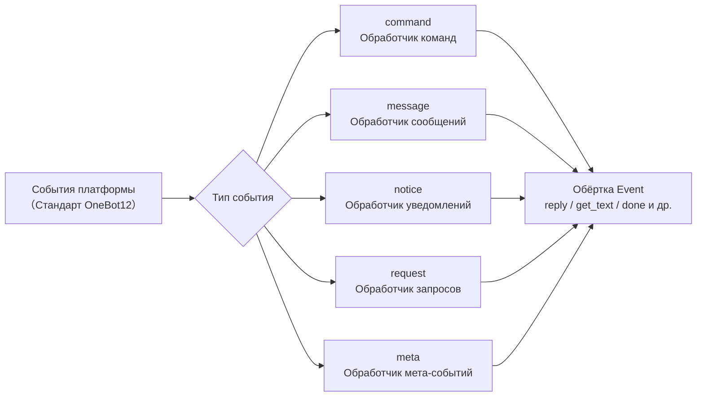

## Модуль команд Command

### Регистрация команд

```python
from ErisPulse.Core.Event import command

# Базовая команда
@command("hello", help="Отправить приветствие")
async def hello_handler(event):
    await event.reply("Привет!")

# Команда с псевдонимами
@command(["help", "h"], aliases=["помощь"], help="Показать помощь")
async def help_handler(event):
    pass

# Команда с правами доступа
def is_admin(event):
    return event.get("user_id") in admin_ids

@command("admin", permission=is_admin, help="Команда администратора")
async def admin_handler(event):
    pass

# Скрытая команда
@command("secret", hidden=True, help="Секретная команда")
async def secret_handler(event):
    pass

# Группа команд
@command("admin.reload", group="admin", help="Перезагрузить модуль")
async def reload_handler(event):
    pass

# Подкоманда (многословные команды, разделённые пробелами)
# Сопоставление происходит по самому длинному префиксу: /admin add x будет сопоставлено с admin add (args = ["x"]);
# Подкоманды, у которых не объявлен permission, наследуют право доступа от ближайшей родительской команды
@command("admin add", help="Добавить администратора")
async def admin_add_handler(event):
    pass
```

**Правила конфликтов имён**: Имя команды имеет приоритет над псевдонимом. При регистрации псевдонима, совпадающего с существующей командой, этот псевдоним не будет активирован и будет выдано предупреждение; при регистрации команды с именем, совпадающим с существующим псевдонимом, имя команды будет активировано, а старый псевдоним будет удалён — оба типа конфликтов будут иметь WARNING-логи, и не будет тихого перехвата.

### Информация о командах

Все API-запросы к информации о командах поддерживают необязательный **контекст сессии**: передача `event=` (Event или dict) или явные `platform=` / `bot_id=` / `session_id=` (явные параметры имеют приоритет при совмещении с event), то есть фильтрация команд по области действия модуля, исключая команды, недоступные в текущей сессии (см. advanced/scope.md); все параметры необязательны, при их отсутствии сохраняется поведение по умолчанию.

```python
# Получить справку по команде
help_text = command.help()

# Сессионная справка: показать только доступные в текущей сессии команды
help_text = command.help(event=event)

# Получить конкретную команду (возвращает объединённые и перезаписанные параметры; возвращает None, если недоступна в сессии)
cmd_info = command.get_command("admin")
cmd_info = command.get_command("admin", event=event)

# Получить все команды (при сессионной фильтрации исключаются недоступные модули)
all_commands = command.get_commands()
all_commands = command.get_commands(event=event)

# Получить все команды из группы (поддерживает сессионную фильтрацию)
admin_commands = command.get_group_commands("admin")
admin_commands = command.get_group_commands("admin", event=event)

# Получить все видимые команды
visible_commands = command.get_visible_commands()

# Видимые команды с сессионной фильтрацией (достаточно event или любых явных параметров)
visible_commands = command.get_visible_commands(event=event)
visible_commands = command.get_visible_commands(
    platform=event.get("platform"),
    bot_id=event.get_self_account_id(),
    session_id=event.get_session_id(),
)
```

### Ожидание ответа

```python
# Ожидание ответа пользователя
@command("ask", help="Запросить информацию у пользователя")
async def ask_command(event):
    reply = await command.wait_reply(
        event,
        prompt="Пожалуйста, введите ваше имя:",  # уже отправлено выше
        timeout=30.0
    )
    
    if reply:
        name = reply.get_text()
        await event.reply(f"Привет, {name}!")

# Ожидание ответа с проверкой
def validate_age(event_data):
    try:
        age = int(event_data.get_text())
        return 0 <= age <= 150
    except ValueError:
        return False

@command("age", help="Запросить возраст пользователя")
async def age_command(event):
    await event.reply("Пожалуйста, введите ваш возраст:")
    
    reply = await command.wait_reply(
        event,
        timeout=60,
        validator=validate_age
    )
    
    if reply:
        age = int(reply.get_text())
        await event.reply(f"Ваш возраст: {age} лет")

# Ожидание ответа с обратным вызовом
async def handle_confirmation(reply_event):
    text = reply_event.get_text().lower()
    if text in ["да", "yes", "y"]:
        await event.reply("Операция подтверждена!")
    else:
        await event.reply("Операция отменена.")

@command("confirm", help="Подтвердить операцию")
async def confirm_command(event):
    await command.wait_reply(
        event,
        prompt="Введите 'да' или 'нет':",
        callback=handle_confirmation
    )
```

## Модуль Message (Сообщения)

### События сообщений

```python
from ErisPulse.Core.Event import message

# Слушать все сообщения
@message.on_message()
async def message_handler(event):
    sdk.logger.info(f"Получено сообщение: {event.get_text()}")

# Слушать личные сообщения
@message.on_private_message()
async def private_handler(event):
    user_id = event.get_user_id()
    sdk.logger.info(f"Личное сообщение от: {user_id}")

# Слушать сообщения в группе
@message.on_group_message()
async def group_handler(event):
    group_id = event.get_group_id()
    sdk.logger.info(f"Сообщение из группы: {group_id}")

# Слушать сообщения с упоминанием
@message.on_at_message()
async def at_handler(event):
    mentions = event.get_mentions()
    sdk.logger.info(f"Упомянутые пользователи: {mentions}")
```

### Условное слушание

```python
# Использование приоритета для управления порядком выполнения
@message.on_message(priority=10)  # Чем больше значение, тем выше приоритет
async def high_priority_handler(event):
    pass

# Условная фильтрация внутри обработчика
@message.on_message()
async def filtered_handler(event):
    if "ключевое_слово" not in event.get_text():
        return
    # Обработка сообщений, содержащих ключевое слово
    pass
```

## Модуль Notice (Уведомления)

### События уведомлений

```python
from ErisPulse.Core.Event import notice

# Добавление друга
@notice.on_friend_add()
async def friend_add_handler(event):
    user_id = event.get_user_id()
    await event.reply("Спасибо за добавление в друзья!")

# Удаление друга
@notice.on_friend_remove()
async def friend_remove_handler(event):
    user_id = event.get_user_id()
    sdk.logger.info(f"Друг удален: {user_id}")

# Увеличение числа участников группы
@notice.on_group_increase()
async def member_increase_handler(event):
    user_id = event.get_user_id()
    await event.reply(f"Добро пожаловать, новый участник!")

# Уменьшение числа участников группы
@notice.on_group_decrease()
async def member_decrease_handler(event):
    user_id = event.get_user_id()
    sdk.logger.info(f"Участник покинул группу: {user_id}")
```

## Модуль Request (Запросы)

### События запросов

```python
from ErisPulse.Core.Event import request

# Запрос на добавление друга
@request.on_friend_request()
async def friend_request_handler(event):
    user_id = event.get_user_id()
    comment = event.get_comment()
    sdk.logger.info(f"Запрос на добавление друга: {user_id}, комментарий: {comment}")

# Запрос на приглашение в группу
@request.on_group_request()
async def group_request_handler(event):
    group_id = event.get_group_id()
    user_id = event.get_user_id()
    sdk.logger.info(f"Приглашение в группу: {group_id}, от: {user_id}")
```

## Модуль Meta (Мета-события)

### Мета-события

```python
from ErisPulse.Core.Event import meta

# Событие подключения
@meta.on_connect()
async def connect_handler(event):
    platform = event.get_platform()
    sdk.logger.info(f"Успешное подключение к платформе {platform}")

# Событие отключения
@meta.on_disconnect()
async def disconnect_handler(event):
    platform = event.get_platform()
    sdk.logger.info(f"Отключение от платформы {platform}")

# Событие приветствия
@meta.on_heartbeat()
async def heartbeat_handler(event):
    sdk.logger.debug("Получено приветствие")
```

### Состояние бота

После отправки мета-событий адаптером, фреймворк автоматически отслеживает состояние бота. API-запросы и события жизненного цикла см. в [API системы адаптеров - Управление состоянием бота](adapter-system.md#bot-状态管理).

## Обёртка Event

Обработчики событий модуля Event получают экземпляр обёртки Event, которая наследуется от dict и предоставляет удобные методы.

### Основные методы

```python
# Получить информацию о событии
event_id = event.get_id()
event_time = event.get_time()
event_type = event.get_type()
detail_type = event.get_detail_type()
platform = event.get_platform()

# Получить информацию о боте
self_platform = event.get_self_platform()
self_user_id = event.get_self_user_id()
self_info = event.get_self_info()
```

### Идентификаторы сессии

```python
# Единый идентификатор цели: для групповых чатов возвращает group_id, для личных чатов user_id и т.д.
target_id = event.get_target_id()

# Уникальный идентификатор сессии, формат: {platform}:{detail_type}:{target_id}
session_id = event.get_session_id()
# Примеры: "telegram:private:12345", "qq:group:67890"
```

`get_target_id()` возвращает первое непустое значение в следующем порядке: `group_id` → `channel_id` → `guild_id` → `thread_id` → `user_id`. Подходит для управления контекстом, хранения состояния и других сценариев, требующих единообразной идентификации сессии.

### Методы сообщений

```python
# Получить содержимое сообщения
message_segments = event.get_message()
alt_message = event.get_alt_message()
text = event.get_text()

# Получить информацию об отправителе
user_id = event.get_user_id()
nickname = event.get_user_nickname()
sender = event.get_sender()

# Получить информацию о группе
group_id = event.get_group_id()

# Определить тип сообщения
is_msg = event.is_message()
is_private = event.is_private_message()
is_group = event.is_group_message()

# Связанные с упоминаниями
is_at = event.is_at_message()
has_mention = event.has_mention()
mentions = event.get_mentions()
```

### Информация о команде

```python
# Получить информацию о команде
cmd_name = event.get_command_name()
cmd_args = event.get_command_args()
cmd_raw = event.get_command_raw()

# Определить, является ли событие командой
is_cmd = event.is_command()
```

### Функции ответа

```python
# Базовая отправка ответа
await event.reply("Это сообщение")

# Указать способ отправки
await event.reply("http://example.com/image.jpg", method="Image")

# Ответ с @пользователем и упоминанием
await event.reply("Привет", at_users=["user1"], reply_to="msg_id")

# Ответ с @всех
await event.reply("Анонс", at_all=True)

# Использовать специфичные для платформы методы (через параметр via)
await event.reply("Доска", method="Board",
                  via=[("Expire", 3600), ("ForMember", "114514")])

# Получить цепочку отправки, свободно добавлять модификаторы и методы отправки (подходит для последовательных модификаторов / действий)
await event.send_chain().Expire(3600).Board("Доска")
await event.send_chain().DismissBoard()

# Ответ с использованием сегментов OneBot12
from ErisPulse.Core.Event import MessageBuilder
msg = MessageBuilder().text("Hello").image("url").build()
await event.reply_ob12(msg)

# Ожидание ответа
reply = await event.wait_reply(timeout=30)
```

### Проверка возможностей платформы

```python
# Проверить, поддерживает ли платформа метод отправки
if event.supports("Image"):
    await event.reply(url, method="Image")

# Получить список всех доступных методов отправки
methods = event.available_methods()
# ["Text", "Image", "Voice", ...]
```

### Методы ответа

Метод `reply()` поддерживает параметр `method` для указания типа отправки, а также два удобных булевых параметра:

```python
# Простой текстовый ответ
await event.reply("Привет")

# Ответ с @отправителя (автоматически извлекает user_id)
await event.reply("Привет", at_sender=True)

# Ответ с упоминанием текущего сообщения (автоматически извлекает message_id)
await event.reply("Получено", quote=True)

# Комбинированный ответ
await event.reply("Получено", at_sender=True, quote=True)

# Отправка изображения (с помощью параметра method)
if event.supports("Image"):
    await event.reply("http://example.com/img.jpg", method="Image")
else:
    await event.reply("[Изображение] http://example.com/img.jpg")
```

**Описание параметров**:

| Параметр | Тип | Описание |
|------|------|------|
| `content` | str | Отправляемое содержимое |
| `method` | str | Метод отправки, по умолчанию "Text", можно использовать "Image"/"Voice"/"Video"/"File" и др. |
| `at_sender` | bool | Отправить @отправителя (автоматически извлекает user_id) |
| `quote` | bool | Отправить упоминание текущего сообщения (автоматически извлекает message_id) |
| `at_users` | list[str] | Список пользователей для @ |
| `reply_to` | str | Ручное указание ID сообщения для ответа |
| `at_all` | bool | Отправить @всех |

### Интерактивные методы

```python
# confirm — подтверждение диалога (возвращает True/False/None)
if await event.confirm("Вы уверены, что хотите выполнить эту операцию?"):
    await event.reply("Операция подтверждена")

# Использование не-Text метода для отправки подтверждения
if await event.confirm("http://example.com/image.jpg", method="Image"):
    await event.reply("Подтверждение подано")

# choose — выбор из меню (возвращает индекс выбранного пункта или None)
choice = await event.choose("Выберите цвет:", ["красный", "зелёный", "синий"])

# options_format="auto" (по умолчанию) автоматически выбирает стиль в зависимости от method:
# Markdown→непорядковый список (- 1.пункт), Html→упорядоченный список (<ol>), иначе→простой текстовый список
# Для текстовых методов (Markdown/Html и др.) опции по умолчанию добавляются в конец
# merge_prompt=True можно принудительно объединить; placeholder можно настроить
choice = await event.choose(
    "## Выберите\n{options}", ["A", "B"],
    method="Markdown", merge_prompt=True,
)

# collect — сбор формы (возвращает словарь {key: value} или None)
data = await event.collect([
    {"key": "name", "prompt": "Введите имя:"},
    {"key": "age", "prompt": "Введите возраст:",
     "validator": lambda e: e.get_text().isdigit()},
    {"key": "avatar", "prompt": "Отправьте аватар:", "method": "Image"},
])

# wait_for — ожидание события с заданным типом
evt = await event.wait_for(event_type="notice", condition=lambda e: ..., timeout=120)

# conversation — контекст многошагового диалога
conv = event.conversation(timeout=60)
await conv.say("Добро пожаловать!")
```

> Полное описание параметров интерактивных методов и дополнительные примеры см. в [Документации по Event обёртке](../developer-guide/modules/event-wrapper.md) и [Многошаговый диалог](../advanced/conversation.md).

### Вспомогательные методы

```python
# Преобразование в словарь (фильтруются ключи, начинающиеся с _)
event_dict = event.to_dict()

# Получить исходные данные
raw = event.get_raw()
raw_type = event.get_raw_type()
```

### Контроль цепочки

`event.done(claim=, stop=)` объединяет два семантических понятия: "принятие" и "блокировка":

- **Принятие (claim)**: пометка события как обработанного (`_processed`), обработчик команды пропускает его при повторной отправке
- **Блокировка (stop)**: предотвращение распространения события к обработчикам с более низким приоритетом (`_propagation_stopped`)

```python
# Принятие + блокировка (по умолчанию)
event.done()

# Только принятие, без блокировки (низкоприоритетные наблюдатели всё ещё видят событие)
event.done(stop=False)

# Только блокировка, без принятия (например, для брандмауэра / лимитирования)
event.done(claim=False)

# mark_processed — основной метод, done — его алиас
event.mark_processed()             # эквивалент event.done()
event.mark_processed(stop=False)   # эквивалент event.done(stop=False)

# Проверка состояния
event.is_processed()  # был ли принят
event.is_stopped()    # была ли остановлена передача
```

### Платформенные расширения

Адаптеры могут регистрировать платформенные методы для Event, доступные только на экземплярах соответствующей платформы.

#### Пользователь: использование платформенных методов

После регистрации платформенных методов адаптером, вы можете вызывать их непосредственно в обработчиках событий. Методы для каждой платформы различаются, см. соответствующую [документацию платформы](../platform-guide/).

```python
from ErisPulse.Core.Event import message

@message.on_message()
async def handle_message(event):
    platform = event.get_platform()

    # Вызов платформенного метода в зависимости от платформы
    if platform == "email":
        subject = event.get_subject()           # специфичный для электронной почты
        attachments = event.get_attachments()   # специфичный для электронной почты
```

#### Проверка зарегистрированных методов платформы

```python
from ErisPulse.Core.Event import get_platform_event_methods

# Получить список зарегистрированных методов для платформы
methods = get_platform_event_methods("email")
# ["get_subject", "get_from", "get_attachments", ...]

# Динамическая проверка и вызов метода
for method_name in get_platform_event_methods(event.get_platform()):
    method = getattr(event, method_name)
    print(f"{method_name}: {method()}")
```

#### Изоляция платформенных методов

Регистрация методов для разных платформ не влияет друг на друга:

```python
# Почтовое событие - только почтовые методы
event = Event({"platform": "email", "email_raw": {"subject": "Hello"}})
event.get_subject()      # ✅ "Hello"
event.get_chat_type()    # ❌ AttributeError

# Telegram событие - только Telegram методы
event = Event({"platform": "telegram", "telegram_raw": {"chat": {"type": "private"}}})
event.get_chat_type()    # ✅ "private"
event.get_subject()      # ❌ AttributeError
```

#### Поддержка hasattr / dir

```python
hasattr(event, "get_subject")   # возвращает True только при platform="email"
"get_subject" in dir(event)     # аналогично
```

#### Адаптер: регистрация платформенных методов

Адаптер может зарегистрировать платформенные методы для Event с помощью декоратора, первый параметр метода — это self (экземпляр Event), можно свободно обращаться к данным события.

#### Регистрация отдельного метода

```python
from ErisPulse.Core.Event import register_event_method

@register_event_method("email")
def get_subject(self):
    """Получить тему письма"""
    return self.get("email_raw", {}).get("subject", "")

@register_event_method("email")
def get_from(self):
    """Получить отправителя"""
    return self.get("email_raw", {}).get("from", {})
```

#### Массовая регистрация (через Mixin-класс)

При большом количестве методов рекомендуется использовать Mixin-класс для массовой регистрации:

```python
from ErisPulse.Core.Event import register_event_mixin

class EmailEventMixin:
    def get_subject(self):
        return self.get("email_raw", {}).get("subject", "")

    def get_from(self):
        return self.get("email_raw", {}).get("from", {})

    def get_attachments(self):
        return self.get("email_raw", {}).get("attachments", [])

# Регистрация всех методов за один раз
register_event_mixin("email", EmailEventMixin)
```

#### Правила возврата значений

| Сценарий | Возвращаемое значение | Способ использования пользователем |
|------|--------|------------|
| Возврат данных (текст, словарь и т.д.) | Прямое значение | `subject = event.get_subject()` |
| Выполнение операции (отправка сообщения и т.д.) | Возвращает `asyncio.Task` | `task = event.do_something()` (необязательно await) |

> **Рекомендация**: методы, возвращающие не данные, должны возвращать `asyncio.Task`, чтобы пользователь мог решить, следует ли ждать завершения, даже если не await.

```python
@register_event_method("email")
def forward_email(self, to_address: str):
    """Переслать письмо — возвращает Task, пользователь может решить, следует ли await"""
    import asyncio
    return asyncio.create_task(
        self._do_forward(to_address)
    )

# Пользователь может await дождаться результата
await event.forward_email("user@example.com")

# Также можно не await, операция выполнится в фоне
event.forward_email("user@example.com")
```

#### Удаление методов

```python
from ErisPulse.Core.Event import unregister_event_method, unregister_platform_event_methods

# Удаление отдельного метода
unregister_event_method("email", "get_subject")

# Удаление всех методов для платформы (вызывается при завершении адаптера)
unregister_platform_event_methods("email")
```

#### Переопределение встроенных методов

`register_event_mixin` / `register_event_method` поддерживают переопределение встроенных методов Event (например, `confirm`, `choose`, `collect`, `wait_reply`, `reply` и др.). Зарегистрированные платформенные методы имеют приоритет над встроенными, поэтому адаптер может предоставить платформенно-специфичные реализации интерактивных функций.

Встроенные реализации экспортируются как `_builtin_*` функции, переопределяющие методы могут вызывать их как резерв:

```python
from ErisPulse.Core.Event import register_event_mixin, _builtin_choose

class YunhuEventMixin:
    async def choose(self, prompt, options, timeout=60, method="Text"):
        # Платформа Yunhu использует кнопки
        buttons = [[{"text": opt} for opt in options]]
        await self.reply(prompt)
        # ...ожидание нажатия кнопки или текстового ответа...
        # Возврат к встроенной логике
        return await _builtin_choose(self, None, options, timeout, "Text")

register_event_mixin("yunhu", YunhuEventMixin)
```

## Расширение для кросс-платформ (шаблоны)

`register_event_method` и `register_event_mixin` поддерживают передачу `"*"` в качестве имени платформы, регистрируя методы, доступные на **всех платформах**. Подходит для модулей, требующих кросс-платформенного воспроизводства, например, AI-диалогов, управления контекстом и т.д.

### Регистрация кросс-платформенного метода

```python
from ErisPulse.Core.Event.wrapper import register_event_method

@register_event_method("*")
async def ai_chat(self, prompt: str):
    """self — это экземпляр Event, можно свободно обращаться к данным и встроенным методам"""
    await self.reply(f"AI: {prompt}")
```

После регистрации, все платформы могут использовать:

```python
from ErisPulse.Core.Event import message

@message.on_message()
async def handler(event):
    await event.ai_chat(event.get_text())
```

### Приоритет методов

При доступе к методам Event через атрибуты, порядок разрешения:

1. **Платформенно-специфичные методы** (переопределение текущей платформы)
2. **Методы шаблона** (`"*"` — кросс-платформенные методы)
3. **Встроенные методы** (`reply`, `confirm` и др.)
4. **Доступ по ключу словаря**

> Таким образом, методы шаблона могут переопределять встроенные методы (например, `reply`), но будут переопределены платформенно-специфичными методами.

## Система приоритетов

Обработчики событий поддерживают приоритет, чем больше значение, тем выше приоритет:

```python
# Обработчик с высоким приоритетом выполняется первым
@message.on_message(priority=10)
async def high_priority_handler(event):
    pass

# Обработчик с низким приоритетом выполняется последним
@message.on_message(priority=0)
async def low_priority_handler(event):
    pass
```


====
高级主题
====


### Conversation 多轮对话

# Conversation Многоходовой диалог

> [!TIP]
> **Когда нужно прочитать эту статью**: когда требуется состояние машины многоходового диалога и восстановление контрольных точек. Если это не нужно, можно пропустить, это не повлияет на использование других функций.

Класс `Conversation` предоставляет удобные методы для многоходового взаимодействия в рамках одного сеанса, что подходит для реализации пошаговых операций, сбора информации, диалоговых вопросов и ответов и т.д.

## Создание диалога

Создание с помощью метода `conversation()` объекта `Event`:

```python
from ErisPulse.Core.Event import command

@command("quiz")
async def quiz_handler(event):
    conv = event.conversation(timeout=30)

    await conv.say("🎮 Добро пожаловать в викторину!")

    answer = await conv.choose("Первый вопрос: Кто создатель Python?", [
        "Guido van Rossum",
        "James Gosling",
        "Dennis Ritchie",
    ])

    if answer is None:
        await conv.say("Время вышло, попробуйте в другой раз!")
        return

    if answer == 0:
        await conv.say("Правильно!")
    else:
        await conv.say("Неверно, правильный ответ — Guido van Rossum")

    conv.stop()
```

## Основные API

### say(content, **kwargs)

Отправка сообщения, возвращает `self` для цепочечного вызова:

```python
await conv.say("Первая строка").say("Вторая строка").say("Третья строка")
```

Также можно указать метод отправки:

```python
await conv.say("https://example.com/image.jpg", method="Image")
```

### wait(prompt=None, timeout=None)

Ожидание ответа пользователя, возвращает объект `Event` или `None` (при таймауте):

```python
# Простое ожидание
resp = await conv.wait()
if resp:
    text = resp.get_text()

# Ожидание с отправкой подсказки
resp = await conv.wait(prompt="Пожалуйста, введите ваше имя:")

# Использование пользовательского таймаута (переопределяет таймаут диалога)
resp = await conv.wait(prompt="Пожалуйста, ответьте в течение 10 секунд:", timeout=10)
```

### confirm(prompt=None, **kwargs)

Ожидание подтверждения пользователя (да/нет), возвращает `True` / `False` / `None` (при таймауте):

```python
result = await conv.confirm("Вы уверены, что хотите удалить все данные?")
if result is True:
    await conv.say("Удалено")
elif result is False:
    await conv.say("Отменено")
else:
    await conv.say("Таймаут, ответ не получен")
```

Встроенные слова для подтверждения: `да/yes/y/confirm/confirm/ok/true/правильно/да/хорошо/конечно/можно/согласен/нет проблем/в порядке...`

Встроенные слова для отрицания: `нет/no/n/cancel/отменить/не надо/нельзя/отказаться/не правильно/откажись/отказ...`

### choose(prompt, options, **kwargs)

Ожидание выбора пользователя из списка опций, возвращает индекс (начиная с 0) или `None`:

```python
choice = await conv.choose("Пожалуйста, выберите цвет:", ["красный", "зеленый", "синий"])
if choice is not None:
    colors = ["красный", "зеленый", "синий"]
    await conv.say(f"Вы выбрали {colors[choice]}")
```

Пользователь может выбрать, введя номер (`1`/`2`/`3`) или текст опции (`красный`).

`options_format="auto"` (по умолчанию) автоматически выбирает стиль в зависимости от метода: Markdown→ненумерованный список, Html→нумерованный список, иначе→простой текстовый список.
Также поддерживаются `"list"`、`"inline"`、`"md"`、`"html"` или пользовательская функция.

Поддержка `merge_prompt=True` для объединения в одно сообщение, а также поддержка плейсхолдера для позиционирования списка опций (по умолчанию `{options}`, можно изменить с помощью `placeholder`):

```python
choice = await conv.choose(
    "## Пожалуйста, выберите\n{options}",
    ["Вариант A", "Вариант B"],
    method="Markdown",
    merge_prompt=True,
)

# Пользовательский плейсхолдер
choice = await conv.choose(
    "Выберите: [choices]",
    ["Вариант A", "Вариант B"],
    placeholder="[choices]",
)
```

### collect(fields, **kwargs)

Сбор информации в несколько шагов, возвращает словарь данных или `None`:

```python
data = await conv.collect([
    {"key": "name", "prompt": "Пожалуйста, введите имя"},
    {"key": "age", "prompt": "Пожалуйста, введите возраст",
     "validator": lambda e: e.get("alt_message", "").strip().isdigit(),
     "retry_prompt": "Возраст должен быть числом, пожалуйста, повторите ввод"},
    {"key": "city", "prompt": "Пожалуйста, введите город"},
])

if data:
    await conv.say(f"Регистрация успешна!\nИмя: {data['name']}\nВозраст: {data['age']}\nГород: {data['city']}")
else:
    await conv.say("Процесс регистрации прерван")
```

Конфигурация полей:

| Параметр | Описание | Значение по умолчанию |
|----------|----------|------------------------|
| `key` | Ключ поля (обязательно) | - |
| `prompt` | Подсказка | `"Пожалуйста, введите {key}"` |
| `validator` | Функция валидации, принимает Event, возвращает bool | Нет |
| `retry_prompt` | Подсказка при ошибке валидации | `"Ввод неверен, пожалуйста, повторите ввод"` |
| `max_retries` | Максимальное количество попыток | 3 |
| `condition` | Функция условия, принимает словарь уже собранных данных, возвращает bool | Нет |

**Условные поля**: Использование `condition` позволяет реализовать динамическую форму, поле собирается только при выполнении условия:

```python
data = await conv.collect([
    {"key": "has_car", "prompt": "У вас есть машина? (да/нет)"},
    {"key": "car_brand", "prompt": "Пожалуйста, введите марку автомобиля",
     "condition": lambda d: d.get("has_car", "").lower() in ("да", "yes", "y")},
])
```

### stop()

Ручное завершение диалога, устанавливает `is_active` в `False`:

```python
conv.stop()
```

### is_active

Является ли диалог активным:

```python
if conv.is_active:
    await conv.say("Диалог продолжается")
```

## Управление активным состоянием

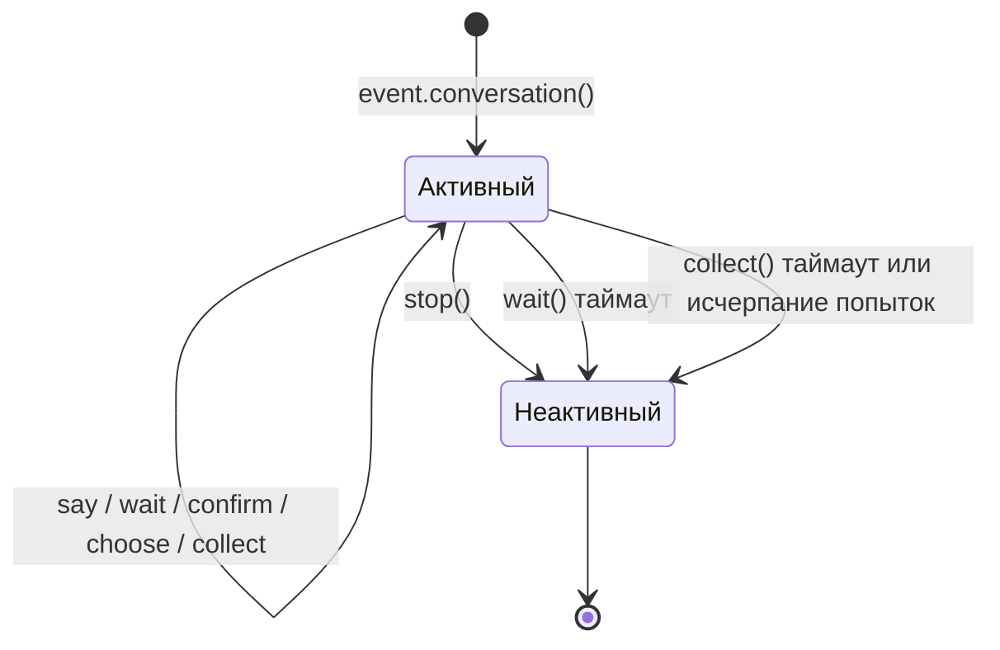

Диалог автоматически становится неактивным в следующих случаях:

1. Вызов метода `stop()`
2. `wait()` возвращает `None` по таймауту
3. `collect()` возвращает `None` из-за таймаута или исчерпания попыток

После перехода в неактивное состояние все методы взаимодействия (`wait`/`confirm`/`choose`/`collect`) немедленно возвращают `None`, не ожидая ответа пользователя.

## Ветвление и переходы

### @conv.branch(name) декоратор

Использование `branch()` для регистрации ветви диалога, переход между ветвями с помощью `goto()`:

```python
@command("menu")
async def menu_handler(event):
    conv = event.conversation(timeout=60)

    @conv.branch("main")
    async def main_menu():
        await conv.say("=== Главное меню ===\n1. Личная информация\n2. Настройки\n3. Выход")
        resp = await conv.wait()
        if resp is None:
            return
        text = resp.get_text().strip()
        if text == "1":
            await conv.goto("profile")
        elif text == "2":
            await conv.goto("settings")
        elif text == "3":
            await conv.say("До свидания!")
            conv.stop()

    @conv.branch("profile")
    async def profile():
        await conv.say("=== Личная информация ===\nИмя: Alice\n0. Вернуться")
        resp = await conv.wait()
        if resp and resp.get_text().strip() == "0":
            await conv.goto("main")

    @conv.branch("settings")
    async def settings():
        await conv.say("=== Настройки ===\n1. Переключатель уведомлений\n0. Вернуться")
        resp = await conv.wait()
        if resp and resp.get_text().strip() == "0":
            await conv.goto("main")

    await conv.start()  # Начинаем с первой зарегистрированной ветви
```

### conv.start(name=None)

Запуск диалога, по умолчанию с первой зарегистрированной ветви:

```python
await conv.start()          # Начинаем с первой ветви
await conv.start("settings") # Начинаем с указанной ветви
```

## Контекст и сохранение

### conv.context

Внутренний словарь `context` каждого экземпляра диалога используется для обмена состоянием между ветвями:

```python
@conv.branch("step1")
async def step1():
    conv.context["username"] = resp.get_text().strip()
    await conv.goto("step2")

@conv.branch("step2")
async def step2():
    name = conv.context.get("username", "неизвестный")
    await conv.say(f"Привет, {name}!")
```

### save() / resume() / clear_saved()

Диалог поддерживает сохранение, что позволяет возобновить его после таймаута или прерывания:

```python
# Сохранение состояния диалога (обычно не нужно вызывать вручную, см. "Автоматические контрольные точки")
await conv.save()

# ... позже в том же сеансе ...
conv2 = event.conversation()
if await conv2.resume():
    await conv2.say("Добро пожаловать обратно! Продолжим предыдущий диалог")
else:
    await conv2.say("Нет сохраненного диалога")

# Очистка сохраненного диалога
await conv.clear_saved()
```

Ключ сохранения содержит измерение `target` (`conversation:{platform}:{user_id}:{target_id}`), диалоги одного пользователя в разных сессиях не перезаписываются друг друга; старые архивы без `target` автоматически мигрируются при `resume()`.

## Автоматические контрольные точки и восстановление после перезапуска

### Автоматическое архивирование

Фреймворк автоматически поддерживает контрольные точки в следующих случаях, обычно нет необходимости вызывать `save()` вручную:

| Событие | Действие |
|------|------|
| `goto()` / `start()` переход в ветвь | Автоматически сохранить (текущая ветвь + context) |
| `stop()` / `wait()` таймаут / `collect()` неудача | Автоматически удалить (конечное состояние диалога) |

### TTL контрольной точки

Архивы содержат метку времени, и архивы, превышающие `ErisPulse.interaction.checkpoint_ttl` (по умолчанию 24 часа), будут удалены:

- **Ленивое удаление**: при восстановлении, если обнаружено, что архив просрочен, он автоматически удаляется
- **Активная фоновая очистка**: фреймворк имеет периодическую задачу сборки мусора (лениво запускается после первого использования контрольной точки), которая перечисляет и удаляет просроченные архивы, предотвращая бесконечное накопление просроченных контрольных точек в хранилище при длительной работе. Если архив был активно удален, но позже приходит сообщение сессии, он обрабатывается как "без контрольной точки"

```toml
[ErisPulse.interaction]
checkpoint_ttl = 86400  # секунд
```

### Автоматическое восстановление после перезапуска

После перезапуска фреймворка, выполняющиеся диалоги (восстановление в памяти ожидающих корутин) будут потеряны, но контрольные точки останутся. Через `register_resume_handler` зарегистрируйте **фабрику восстановления**, и фреймворк сможет автоматически продолжить диалог при получении первого сообщения от сессии после перезапуска:

```python
from ErisPulse.Core.Event.wrapper import Conversation

@Conversation.register_resume_handler()  # можно передать platform="onebot11" для ограничения платформой
def make_conversation(event) -> Conversation:
    # Задача фабрики: восстановить диалог и заново зарегистрировать все ветви
    conv = event.conversation(timeout=60)

    @conv.branch("menu")
    async def menu(conv, event):
        ...

    return conv
```

После регистрации, когда пользователь, находившийся в ветви `menu` перед перезапуском, отправит первое сообщение, фреймворк автоматически: восстановит context → захватит это сообщение → продолжит диалог из сохраненной ветви. При отсутствии зарегистрированной фабрики эта механизм не несёт никаких дополнительных затрат.

### Восстановление и передача управления

При успешном `resume()` фреймворк автоматически выполняет две вещи:

1. **Передача управления сессией**: автоматически acquire аренды исключительного доступа к сессии — другие модули могут определить "этот пользователь занят диалогом" с помощью `sdk.interaction.get_owner_of(event)`; если сессия уже занята другим модулем, восстановление отменяется (возвращается False), предотвращая конфликт диалогов
2. **Восстановление истории**: из почтового ящика сессии извлекаются последние 10 сообщений в `conv.recent_history` (контекст LLM не обрывается при восстановлении модуля AI); `resume(with_history=0)` можно использовать для отключения

```python
if await conv.resume(with_history=20):
    for m in conv.recent_history:
        print(m["role"], ":", m["text"])
```

### Ручное восстановление (при отключении автоматического механизма)

```python
@command("continue")
async def continue_handler(event):
    conv = event.conversation()
    # ... регистрация ветвей ...
    if await conv.resume():
        conv.goto(conv.get_current_branch())
```

## Типичные сценарии диалога

### Навигационная регистрация

```python
@command("register")
async def register_handler(event):
    conv = event.conversation(timeout=60)

    await conv.say("Добро пожаловать на регистрацию!")

    data = await conv.collect([
        {"key": "username", "prompt": "Пожалуйста, введите имя пользователя (от 3 до 20 символов)",
         "validator": lambda e: 3 <= len(e.get_text().strip()) <= 20},
        {"key": "email", "prompt": "Пожалуйста, введите адрес электронной почты",
         "validator": lambda e: "@" in e.get_text() and "." in e.get_text(),
         "retry_prompt": "Неверный формат электронной почты, повторите ввод"},
    ])

    if not data:
        await event.reply("Регистрация отменена")
        return

    confirmed = await conv.confirm(
        f"Подтвердите регистрационную информацию?\nИмя пользователя: {data['username']}\nЭлектронная почта: {data['email']}"
    )

    if confirmed:
        await conv.say("✅ Регистрация успешна!")
    else:
        await conv.say("❌ Регистрация отменена")
```

### Циклический диалог

```python
@command("chat")
async def chat_handler(event):
    conv = event.conversation(timeout=120)
    await conv.say("Вход в диалоговый режим, введите «выход» для завершения")

    while conv.is_active:
        resp = await conv.wait()
        if resp is None:
            await conv.say("Таймаут, диалог завершен")
            break

        text = resp.get_text().strip()

        if text == "выход":
            await conv.say("До свидания!")
            conv.stop()
        elif text == "помощь":
            await conv.say("Доступные команды: выход, помощь, статус")
        elif text == "статус":
            await conv.say("Диалог активен")
        else:
            await conv.say(f"Вы сказали: {text}")
```


### 交互会话系统

# Система интерактивных сессий

> [!TIP]
> **Когда нужно читать эту статью**: если нужны `wait_reply`, многоконтактные диалоги,定时овые напоминания, сессионная изоляция или трассировка цепочки. Если не нужно, пропустите, это не повлияет на использование других функций.

> [!NOTE]
> В этой главе требуется ErisPulse **2.8.0+**.

ErisPulse реализует "постоянное взаимодействие с пользователями" на уровне фреймворка: от одной `wait_reply`, до定时овых напоминаний, многоканального ожидания, сессионной изоляции и восстановления после перезапуска — всё это управляется единым **менеджером интерактивных сессий** (`Core/Event/interaction.py`, `sdk.interaction`).

{!--< tips >!--}
Каждая из описанных в этой статье возможностей имеет **владельца (owner)**: ожидание, аренда, таймеры — всё это записывается с именем модуля при регистрации, и при выгрузке модуля / отключении адаптера фреймворк автоматически очищает ожидания, и ожидаемый получатель немедленно получает уведомление, а не ждёт таймаута. Это расширение системы владения на интерактивную ось (см. [систему владения](ownership.md)).
{!--< /tips >!--}

## Ожидание ответа: wait_reply

`wait_reply` — основа интерактивных сессий: приостанавливает текущий корутин, ожидая, что целевой пользователь ответит следующим сообщением.

```python
from ErisPulse.Core.Event import command

@command("ask")
async def ask_command(event):
    reply = await event.wait_reply(prompt="Пожалуйста, введите ваше имя:", timeout=30)
    if reply is None:
        await event.reply("Таймаут")
        return
    await event.reply(f"Привет, {reply.get_text()}!")
```

### Полный список параметров

| Параметр | Описание | По умолчанию |
|------|------|------|
| `prompt` | Сообщение, отправленное перед приостановкой | None |
| `timeout` | Время ожидания (секунды) | 60 |
| `pattern` | Фильтрация с помощью шаблона (glob, `*` / `?` / `[seq]`), если не совпадает — продолжить ожидание | None |
| `regex` | Фильтрация с помощью регулярного выражения (должно совпадать, если заданы и pattern и regex), если не совпадает — продолжить ожидание | None |
| `validator` | Функция проверки (принимает Event, возвращает bool), если провал — продолжить ожидание | None |
| `callback` | Колбэк при получении ответа (альтернативный способ вместо возвращения значения) | None |
| `method` | Метод отправки prompt | "Text" |
| `session` | **Сессионное ожидание**: ответ любого участника в той же сессии (группа / канал) может быть принят | False |

```python
# Принимает только числовую сумму, иначе продолжает ожидание
reply = await event.wait_reply("Введите сумму:", regex=r"\d+\s*元", timeout=30)

# Сессионное ожидание: сценарий сотрудничества в группе, любой участник может ответить
reply = await event.wait_reply(session=True, prompt="Кто-нибудь может помочь ответить?")
```

### Граница между ожиданием и командами (проникновение команд)

Во время ожидания, если приходит сообщение с **зарегистрированной командой** (например, `/cancel`), по умолчанию оно передаётся диспетчеру команд и не считается ответом (параметр `ErisPulse.event.wait_reply.cmdpass`, при `True` — наоборот — сообщение всегда считается ответом). Текст сообщения сравнивается с командой так же, как и в диспетчере команд: `alt_message` имеет приоритет, если отсутствует — используется строка из сообщения (с 2.10.1 работает и для адаптеров, где сообщение состоит только из `message`).

### Когда ожидание будет отменено

Ожидание больше не "только ждать таймаута" — следующие ситуации немедленно **прекращают** ожидание (`wait_reply` возвращает `None`), а не заставляют вызывающий код ждать таймаута:

| Причина | Причина отмены (reason типа `InteractionCancelled`) | Описание |
|------|------|------|
| Модуль-владелец был выгружен / отключен | `owner_unload` | Очистка владения: тот, кто зарегистрировал ожидание, при исчезновении модуля ожидание также удаляется |
| Адаптер был остановлен / перезапущен | `platform_stop` | Все ожидания в рамках этой платформы отменяются |
| В той же сессии появилось новое ожидание / аренда | `conflict` | См. ниже "арбитраж сессий" |
| Ответивший пользователь был заблокирован / владелец модуля был отвязан | `revoked` | Проверка прав доступа: проверка по идентификатору участника + модуля |
| Ответ был принят | — | Нормальный путь, возвращает событие ответа |

Внутреннее исключение — `InteractionCancelled` (входит в систему исключений `InteractionError`), `wait_reply` уже преобразует его в возвращение `None`; если нужно получить причину, вызывающий код может использовать низкоуровневый API `sdk.interaction.register()`.

### Полная цепочка проверки принятия ответа

При получении сообщения ответа менеджер интерактивных сессий проверяет его в следующем порядке (выполняется **до** командного распознавания, приоритет сохранения диалога — даже если сообщение было распознано другим обработчиком с высоким приоритетом, приостановленный диалог может быть завершён):

```
Соответствие сессионного ключа (точный user-уровень → возврат к сессионному ожиданию)
  → фильтрация текста с помощью pattern / regex (если не совпадает — продолжить ожидание)
  → проверка validator (если провал — продолжить ожидание)
  → проверка прав доступа (по идентификатору участника + модуля, если провал — завершить ожидание)
  → пробуждение ожидаемого получателя + подтверждение события (mark_processed)
```

## Декларативные многоконтактные диалоги: `.got()` цепочка (2.11+)

`@command` возвращает **прокси для многоконтактного управления**, с помощью `.got()` можно последовательно объявлять этапы сбора данных — функции этапов получают уже собранные значения (включая параметры входной команды) по именам параметров, типы автоматически определяются по `type=` или аннотациям. Всё это компилируется в `Conversation`: каждый этап — это ветвь, переходы автоматически сохраняют контрольные точки, **после перезапуска пользовательский ответ продолжится с сохранённого этапа** (фабрика восстановления автоматически регистрируется при декорировании и автоматически удаляется при выгрузке модуля).

```python
@command("weather")
async def weather(event):
    pass  # Вход: первый .got автоматически отправит prompt, не нужно спрашивать вручную

@weather.got("city", prompt="Пожалуйста, введите название города")
async def weather_city(event, city: str):
    await event.reply(f"{city}: ясно, 25℃")

@weather.got("days", prompt="На сколько дней прогнозировать?", type=int, retry_prompt="Введите число")
async def weather_days(event, city: str, days: int):
    await event.reply(f"{city} прогноз на {days} дней...")
```

### Параметры

| Параметр | Описание |
|------|------|
| `name` | Имя значения (имя параметра в последующих функциях этапов; уникально в рамках процесса, повторное объявление вызовет ошибку при регистрации) |
| `prompt` | Автоматически отправляемый вопрос при переходе на этот этап |
| `timeout` | Время ожидания на этапе (секунды или строка длительности, например, "90s" / "1h30m", по умолчанию 60s) |
| `type` | Тип значения (`int` / `float` / `str`…; если парсинг провалится, автоматически повторно отправляется `retry_prompt`, максимум `max_retries` раз) |
| `validator` / `pattern` / `regex` | Фильтрация и проверка ответа (семантика и [`wait_reply`](#ожидание-ответа-wait_reply)) |
| `session` | Сессионное ожидание (ответ любого участника в той же сессии может быть принят) |
| `cmdpass` | Трёхзначный режим пропуска команд (по умолчанию команды, такие как `/cancel`, выполняются в ожидании) |

### Семантика и границы

- **Любой этап завершается таймаутом / прерыванием → вся цепочка завершается** и контрольные точки удаляются (семантика совпадает с `wait_reply`); в функциях этапов можно в любое время использовать `event.reply(...)` для вывода промежуточных результатов
- **У одного пользователя может быть только одна приостановленная интеракция** — вторая цепочка ожидания отменяет предыдущую (`InteractionCancelled("conflict")`); для уведомления о конфликте используйте [сессионную аренду](#сессионная-изоляцияacquire--hold--get_owner_of)
- Собранные значения существуют только в рамках процесса; для сложных состояний, требующих сохранения между перезапусками, используйте [Conversation](conversation.md) (с `context` + `branch/goto` + ручные контрольные точки)
- `@command` возвращает прокси-объект: поведение, `__name__`, docstring и пользовательские атрибуты полностью идентичны оригинальному объекту; `command.unregister(прокси)` автоматически распаковывает

## Сессионные таймеры: remind / escalate

Превращает "таймаут" из возвращаемого значения в компилируемую примитивную конструкцию. Таймеры привязаны к интерактивной сессии и автоматически отменяются при выгрузке модуля / остановке адаптера, лимит активных remind на сессию — 5 штук.

### remind: напоминание при отсутствии ответа

```python
@command("ticket")
async def ticket_command(event):
    await event.reply("Заявка принята, результаты будут здесь")
    # Если нет ответа за 5 минут, мягко напомнить; любой ответ пользователя автоматически отменит напоминание
    event.remind(300, "Есть ли ещё что-то? Результат будет сообщён сразу")
    reply = await event.wait_reply(timeout=3600)
    ...
```

- `event.remind(delay, text=None, *, callback=None)`: при истечении срока отправляет `text` (или выполняет `callback(event)`, поддерживает синхронные / асинхронные функции) в текущую сессию. **Обязательная проверка**: `text` и `callback` должны быть выбраны (не заданы — выброс `ValueError`)
- Возвращает `Reminder` дескриптор: `reminder.cancel()` для ручной отмены, `reminder.expired` для проверки состояния
- Ответ пользователя в этой сессии **автоматически отменяет напоминание** — это и есть смысл "напоминания": напоминание появляется только, когда пользователь молчит
- В `Conversation` также можно использовать: `conv.remind(120, "Ещё думаете?")`

### escalate: гарантированное уведомление по истечении срока

```python
event.escalate(1800, lambda e: notify_master(f"Заявка не обработана 30 минут: {event.get_command_args()}"))
```

Единственное отличие от `remind`: **не отменяется ответом пользователя** — уведомление (уведомление владельца, передача в ручную поддержку) — это "гарантированное уведомление по истечении срока", отменяется только ручной `cancel()` / выгрузкой модуля / остановкой адаптера.

| | `remind` | `escalate` |
|---|---|---|
| Действие по истечении срока | Отправка текста / выполнение callback | Выполнение callback |
| Ответ пользователя | **Автоматически отменяет** | Не влияет |
| Очистка владения (выгрузка / остановка платформы) | Отменяет | Отменяет |
| Лимит на сессию | 5 | Не ограничен (очистка по владению) |

## Многоканальное ожидание: expect + select

Приостанавливает несколько ожиданий одновременно, **первое поступившее событие — первое обслуживается** — типичный сценарий: ожидание одобрения администратором и одновременно ожидание отмены пользователем, голосование с участием нескольких человек.

```python
which, reply = await event.select(
    event.expect(pattern="同意*", user="10001"),
    event.expect(pattern="拒绝*", user="10002"),
    event.expect(validator=lambda e: e.get_text() == "搁置", session=True),
    timeout=60,
)
if which is None:
    await event.reply("В течение 60 секунд не получено ни одного результата")
elif which == 0:
    await event.reply("Утверждено")
elif which == 1:
    await event.reply("Отклонено")
```

- `event.expect(...)` создаёт **описание ожидания** (не регистрирует никаких ожиданий): поддерживает `pattern` / `regex` / `validator` / `user` (ограничение ответившего) / `session` (ответ может быть принят любым)
- `event.select(*expectations, timeout=60)`: регистрирует все ожидания → при первом совпадении возвращает `(индекс, событие ответа)` → несовпавшие ожидания автоматически отменяются; при таймауте возвращается `(None, None)`. **Обязательная проверка**: нужно передать хотя бы одно ожидание, иначе выброс `ValueError`
- Полученное событие уже подтверждено фреймворком (mark_processed), не будет повторно обработано другими обработчиками

{!--< tips >!--}
`select` по сравнению с ручной компиляцией с помощью `asyncio.wait` в многопоточном режиме: автоматическая очистка несовпавших ожиданий, автоматическое подтверждение полученных событий, автоматическая проверка прав доступа и очистка владения — всё это работает без необходимости вручную управлять Future.
{!--< /tips >!--}

> [!NOTE]
> С 2.10.1 `select` стал **агрегирующим ожиданием**: все ожидания объединяются в одно с пользовательским правилом совпадения, одновременные ожидания (например, два разных pattern для одного user) больше не отменяют друг друга, первое совпадение возвращает результат. Текст ответа сравнивается по `alt_message` с приоритетом + возврат к сообщению (семантика совпадает с диспетчером команд).
>
> Ограничения: `event.wait_for(...)` привязан к событию адаптера, **не проходит** через промежуточные обработчики и фильтры `detail_type` (вход по идентификатору участника обеспечивается входом в диспетчер); для полной цепочки ожидания используйте `wait_reply` / `select`.

## Сессионная изоляция: acquire / hold / get_owner_of

Владение расширяется от "ресурсов" до "сессий" — "кто сейчас занят этим пользователем" становится первостепенным вопросом.

```python
# Запрос: кто сейчас взаимодействует с этой сессией? (если свободна, возвращает None)
owner = sdk.interaction.get_owner_of(event)
if owner and owner != "MyModule":
    return  # Другой модуль уже взаимодействует, избегать мешать

# Исключительная аренда: эксклюзивная сессия (политика deny, если занята возвращает None)
lease = sdk.interaction.acquire(event)          # По умолчанию TTL 1 час, можно передать ttl=
if lease is None:
    return  # Уже занято
try:
    ...  # Эксклюзивное взаимодействие
finally:
    lease.release()
```

Форма контекстного менеджера (при неудаче выбрасывает `SessionOccupiedError`):

```python
with sdk.interaction.hold(event) as lease:
    ...  # Автоматически освобождается при выходе
```

Аренда поддерживает `renew(ttl)` для продления; TTL惰性过期 — истёкшие аренды автоматически очищаются при следующем обращении.

`Conversation.resume()` при восстановлении диалога автоматически приобретает аренду (см. [многоконтактные диалоги в Conversation](conversation.md) "восстановление — это захват") — восстановленный диалог автоматически владеет сессией, другие модули не смогут вмешаться.

## Сессионный ящик: event.history

> Стратегия хранения (7 дней / лимит на сообщения) и API для управления во время выполнения, риски и аудит см. в специальной статье [Сессионный ящик](transcript.md).

Единая запись недавних сообщений для каждой сессии (со стороны пользователя и бота), служит в качестве **общей базы фактов** для модулей, работающих с ИИ, предотвращения повторного ввода, анализа поведения — каждый модуль больше не хранит историю отдельно.

```python
messages = await event.history(20)   # Последние 20 сообщений текущей сессии, в порядке возрастания времени
for m in messages:
    print(m["role"], ":", m["text"])  # role: "user" / "bot"
```

- Автоматически записывается: входящие сообщения (role=user) + текстовые ответы бота (role=bot)
- Хранение: отдельная таблица SQLite, стратегия хранения = лимит на сессию (по умолчанию 50) + глобальный TTL (по умолчанию 7 дней)
- Запись: буфер в памяти + фоновая пакетная запись на диск (задержка до 1 секунды), интерфейс запроса автоматически объединяет не записанные строки — чтение из буфера в том же процессе не влияет; при нормальном завершении (`sdk.uninit` / выход из процесса) буфер автоматически записывается. **В случае жёсткого завершения / принудительного убийства процесса последние ~1 секунды записи могут быть потеряны**: эта база данных предназначена для кэширования недавних контекстов, не подходит для аудита или долгосрочного хранения
- Конфигурация: `ErisPulse.transcript = {enabled = true, max_per_session = 50, ttl_hours = 168}`
- API менеджера: `sdk.transcript.append() / get() / clear()`, `aflush()` / `flush()` для ручной записи

## Транзакции сообщений: message_tx

Все отправленные сообщения в рамках транзакции автоматически записываются в журнал; **при выходе с ошибкой автоматически отменяются отправленные сообщения в обратном порядке** (если адаптер не реализует `delete_message`, отмена пропускается, журнал всё равно записывается).

```python
async with event.message_tx():
    await event.reply("Обработка, пожалуйста, подождите")
    result = await do_something()          # Здесь выбрасывается исключение →
    await event.reply(f"Готово: {result}") # Предыдущее "Обработка" автоматически отменяется
```

Отправка вне транзакции не записывается (нулевая накладная); `get_send_receipts()` позволяет просмотреть уже отправленные в текущей транзакции сообщения.

## Трассировка цепочки: trace-id

Каждому входящему событию автоматически присваивается идентификатор трассировки (используется `event["id"]`, если отсутствует — генерируется), который проходит через:

- контекст обработчика (`get_current_trace_id()` для чтения)
- отправку сообщений (строки лога `[Send]` с `[trace:...]`), поле `trace_id` в хуках `message.sending/sent`
- данные жизненного цикла (dict автоматически дополняется `_trace_id`)
- направленные события (`lifecycle.emit(..., to=...)`) и транзакционные чеки сообщений

При обработке одного сообщения несколькими модулями, вся цепочка может быть связана одним и тем же ID (для логов / медленных запросов / аудита).

## Связь с другими системами

- **Владение**: ожидание / аренда / таймеры записывают владельца, при выгрузке — очищение (см. [систему владения](ownership.md))
- **Область видимости**: проверка прав доступа при ответе по идентификатору участника + модуля; аудит вызовов между модулями по направлению выхода (см. [область видимости](scope.md))
- **Conversation**: многоконтактный диалог — это конечный автомат на основе интерактивной сессии (см. [Conversation](conversation.md)), его ожидания также имеют все отмены / проверки / владения, описанные на этой странице


### 模块间通信

# Коммуникация между модулями

> [!TIP]
> **Когда читать эту статью**: когда нужно вызывать модули между собой (RPC), использовать контракты сервисов, направлять события или воспроизводить события при холодном запуске. Если не нужно — можно пропустить, это не повлияет на использование других функций.

> [!NOTE]
> В этой главе требуется ErisPulse **2.8.0+**.

В ErisPulse между модулями существует **трехуровневая схема коммуникации**, расположенная по принципу "точка-точка → направленный → широковещательный":

| Уровень | API | Семантика | Типичные сценарии |
|---|---|---|---|
| **RPC** | `await sdk.module.call("Chat", "get_history", ...)` | Точечный запрос-ответ с контрактом / аудитом / таймаутом | Вызов возможностей другого модуля (получить историю, перевести, вернуть деньги) |
| **Направленные события** | `await lifecycle.emit("message_received", {...}, to="Chat")` | Доставка только модулям, зарегистрированным в хуках жизненного цикла | Уведомление о состоянии от верхнего уровня к нижнему (например, "новое сообщение получено") |
| **Рассылка** | `await lifecycle.emit("config.updated", {...})` | События жизненного цикла, видимые по всей системе | Горячее обновление конфигурации, модули включаются / выключаются |

{!--< tips >!--}
Правило выбора: **для получения значения используйте `call`, для уведомления конкретного модуля используйте `emit(..., to=...)`, для уведомления всех — `emit(...)`**.
{!--< /tips >!--}

## RPC: module.call

```python
result = await sdk.module.call("Chat", "get_history", session_id, n=20)
```

Различия между `module.call()` и прямым доступом к атрибуту `sdk.module.Chat.get_history(...)` (без изменений):

| | `module.call()` | Прямой доступ к атрибуту |
|---|---|---|
| Целевой модуль не зарегистрирован / не активирован | Выбрасывает `ModuleNotAvailableError` | Выбрасывает `AttributeError` |
| Ленивая загрузка модуля | **Автоматически активируется** (модули, управляемые событиями, используют блокировку активации) | Асинхронная инициализация модуля выбрасывает RuntimeError |
| `current_owner` | Присваивается **целевому модулю** (его внутренние wait_reply / отправка / логи корректно привязаны) | Сохраняется вызывающий модуль |
| Таймаут | По умолчанию 30 секунд (`timeout=` позволяет перезаписать, `None` отключает таймаут) | Нет |
| scope аудит | Вызыватель проходит через контрольный пункт `actions.<вызыватель>.call` | Нет |
| Проверка контракта | Белый список `meta.services` | Нет |

### Система исключений

```
ModuleError                      # Базовый класс исключений модульной системы
└── ModuleCallError              # Базовый класс для вызовов между модулями (содержит атрибуты module / method)
    ├── ModuleNotAvailableError  # Целевой модуль не зарегистрирован / не активирован / активация не удалась
    ├── ServiceNotProvidedError  # Метод не в белом списке / приватный метод / не существует
    └── ModuleCallTimeoutError   # Время ожидания асинхронного метода истекло
```

Все исключения входят в систему `ErisPulseError`, можно поймать их через `from ErisPulse.Core import ModuleCallError`.

## Контракт сервиса: meta.services

Поставщик сервиса объявляет белый список предоставляемых методов в `get_meta()` (в симметрии с `commands`):

```python
from ErisPulse.Core.Bases import BaseModule, ModuleMeta

class ChatModule(BaseModule):
    @staticmethod
    def get_meta() -> ModuleMeta:
        return ModuleMeta(
            name="聊天",
            services=[
                "get_history",                                       # Простая форма
                {"name": "translate", "description": "把文本翻译成指定语言"},  # С описанием
            ],
        )

    async def get_history(self, session_id, n=20): ...
    async def translate(self, text, target_lang): ...
    def _internal_helper(self): ...   # Методы с подчеркиванием всегда запрещены для внешнего вызова
```

**По умолчанию разработчик не замечает**:

- Если `services` не объявлен → все **публичные** методы по умолчанию доступны для `module.call()` (как и при прямом доступе к атрибуту),
  без необходимости каких-либо объявления
- После объявления → доступ сужается до белого списка, вызов за пределами списка выбрасывает `ServiceNotProvidedError` — используется для маркировки
  "эти методы — те, что публично обещаны"
- Основной контроль за ограничениями находится у пользователя: `scope.actions` определяет "кто может вызывать кого" (см. аудит ниже),
  `services` модуля автора — лишь объявление сервиса, два уровня не заменяют друг друга

**Описание сервиса**: для каждого сервиса можно добавить описание, читаемое человеком / ИИ — если не нужно, ничего не пишите,
описание автоматически берется из **первой строки docstring** (рамка уже требует стиля docstring):

```python
async def translate(self, text, target_lang):
    """把文本翻译成指定语言"""    # ← Эта строка автоматически становится описанием сервиса
    ...
```

**Подсказки по параметрам**: вызывающей стороне (особенно ИИ-агентам) нужно знать, что означает каждый параметр. Если не нужно, ничего не пишите,
подсказки автоматически берутся из **`:param:` строк docstring**:

```python
async def render_card(self, html, width=800, height=0):
    """渲染 HTML 为图片文件

    :param html: 要渲染的 HTML 文本          ← Автоматически становится подсказкой параметра
    :param width: 画布宽度像素，0 为按内容自适应
    :param height: 画布高度像素，0 为按内容自适应
    """
```

Для тонкой настройки (переопределение docstring / мультиязычность) используйте словарь для описания `description` и `parameters`
(оба поддерживают словарь i18n; `parameters` объединяется с docstring по параметрам, при явном объявление параметра в словаре он имеет приоритет,
объявленные параметры, которых нет в сигнатуре, будут отфильтрованы):

```python
services=[
    {"name": "translate", "description": "把文本翻译成指定语言"},
    {"name": "summarize", "description": {"i18n": "Chat.meta.svc.summarize", "default": "摘要对话"}},
    {
        "name": "render_card",
        "description": "渲染 HTML 为图片文件",
        "parameters": {"html": "HTML 文本", "width": "宽度像素，0 为自适应"},
    },
]
```

## Служба каталога: services()

```python
sdk.module.services()
# {'Chat': [{'name': 'get_history', 'signature': '(session_id, n=20)',
#            'description': '把文本翻译成指定语言',
#            'parameters': {'session_id': '会话 ID', 'n': '返回条数'}}]}

sdk.module.services("Chat")   # Только для определенного модуля
```

- В каталоге перечислены **только модули с явно объявленным** `meta.services` (модули без объявления не появляются в каталоге)
- Каждый сервис снабжен строкой сигнатуры метода (`inspect.signature`), описанием и подсказками по параметрам
- **Ленивые модули также попадают в каталог** (обнаружение сервисов происходит до загрузки) — вызывающая сторона может решить,
  нужно ли `call()` для активации целевого модуля
- Также включены в топологию: `sdk.module.get_topology()` для каждого модуля содержит поле `services`

{!--< tips >!--}
**Путь к MCP**: каталог сервисов (имя + сигнатура + описание + подсказки по параметрам) — это форма MCP tool —
каждый сервис по сути имеет вид ``{"name", "description", "parameters"}``.
В будущем фреймворк может напрямую экспортировать ``services()`` как конечную точку MCP-сервера, чтобы ИИ мог обнаруживать и вызывать возможности модуля;
``scope.actions.call`` аудит становится естественным брандмауэром безопасности для вызовов ИИ.
{!--< /tips >!--}

## Аудит исходящих вызовов: кто может вызывать кого

Каждый вызов `module.call()` проходит через контрольный пункт `scope` исходящих вызовов **от имени вызывающего модуля**:

```toml
[ErisPulse.scope.actions.CallerModule.call]
deny = ["Chat.get_history"]        # Запретить CallerModule вызывать Chat.get_history
# allow = ["Chat.get_*"]           # Или белый список: разрешить вызывать только сервисы Chat, начинающиеся на get_
```

- Формат `name` — `<目标模块>.<方法名>`, поддерживает точное / шаблон / `re:` регулярное выражение
- Вызовы фреймворка (без контекста owner, например, запуск скриптов) не подвергаются аудиту
- Отказ в вызове выбрасывает `ModuleCallError` (TRACE лог `core.module.call_denied`)

Способы настройки см. в [Scope](scope.md) в разделе исходящего аудита.

## Направленные события: параметр to в lifecycle.emit

События жизненного цикла поддерживают направленную передачу: указание `to` для целевого владельца (owner) заставляет событие доставляться только хукам, зарегистрированным с этим
владельцем (хуки, зарегистрированные в `on_load`, автоматически присваиваются владельцу модуля),
остальные модули и обработчики с `*` не получают уведомления.

```python
from ErisPulse.Core.lifecycle import lifecycle

# Отправитель: событие доставляется только хукам, зарегистрированным модулем Chat
await lifecycle.emit("message_received", {"text": "hi", "from": "u1"}, to="Chat")

# Подписчик (внутри модуля Chat): регистрирует хук с таким же именем, owner автоматически записывается при регистрации
@lifecycle.on("message_received")
async def on_message_received(data): ...

@lifecycle.on("message")          # Префикс родительского события также действует (фильтруется по owner)
async def on_any(data): ...
```

Семантические детали:

- Если у целевого владельца нет зарегистрированных хуков → событие **тихо отбрасывается** (не отправляется туда, где его нет),
  можно заранее проверить наличие хуков с помощью `lifecycle.has_handlers("message_received")`
- Если `data` — словарь, автоматически добавляется `_trace_id` (не перезаписывает уже существующее значение), интегрируется с системой трассировки
- Широковещательные и направленные события используют одну и ту же систему регистрации хуков: `emit(...)` без `to` рассылает по всей системе,
  с `to` — одно и то же событие видно только целевому модулю
- `emit_sync` / `submit_event` (совместимый API) также поддерживают параметр `to=`

> [!NOTE]
> Направленные события — это лёгкие уведомления, **не проверяются на существование целевого модуля и не активируют ленивую загрузку**; если нужно проверить существование цели,
> аудит контракта или получить возвращаемое значение, используйте [RPC: module.call](#rpcmodulecall).

## Ленивая загрузка и вызов

`module.call()` прозрачно активирует ленивые модули:

- Модули, управляемые событиями (`activate_on` объявлен) → используют блокировку активации `_activate()`, после активации stub-триггер автоматически удаляется
- Обычные ленивые модули → синхронная инициализация или обычный путь загрузки (идемпотентно)
- Активация не удалась → `ModuleNotAvailableError`

То есть: **вызывающий модуль не должен заботиться о том, загружен ли целевой модуль**, и не нужно ждать какого-либо события для его активации.

Направленные события (`lifecycle.emit(..., to=...)`) не активируют ленивую загрузку — если целевой модуль не загружен, у него нет хуков,
событие тихо отбрасывается; если нужно гарантировать доставку, используйте `module.call()`.

## Воспроизведение при холодном запуске

Новый / перезапущенный модуль пропустил часть чата — `get_load_strategy(replay=...)` позволяет фреймворку после готовности модуля
**воспроизвести последние сообщения из почтового ящика сессии** для этого модуля:

```python
from ErisPulse.loaders import ModuleLoadStrategy

class MyAIModule(BaseModule):
    @staticmethod
    def get_load_strategy():
        return ModuleLoadStrategy(
            lazy_load=False,
            priority=100,
            replay="5m",        # Воспроизвести последние 5 минут (возможны и другие форматы: "1h" / "300" секунд)
        )

    async def on_load(self, event):
        @message.on_message()
        async def handle(e):
            if e.get("replayed"):
                # Синтезированное событие: только для восстановления контекста, не вызывает побочных эффектов, таких как отправка
                ...
```

Семантические детали:

- Источник данных — [почтовый ящик сессии](interaction.md#会话收件箱eventhistory) (`sdk.transcript.recent()`),
  воспроизведение происходит в фоне после загрузки модуля, не блокируя запуск
- Синтезированное событие снабжается флагом `replayed: True`, полными `platform / detail_type / user_id / alt_message`,
  **доставляется только обработчикам этого модуля** — другие модули не затрагиваются воспроизведением
- Если почтовый ящик не включен / нет записей / указано недопустимое время воспроизведения (`replay_invalid` предупреждение) — тихо пропускается

## Дедупликация событий

При повторном подключении websocket-платформы часто повторно отправляются одни и те же события (с одинаковым `event["id"]`) — на входе распределения по id делается
LRU-дедупликация (емкость 4096), одно и то же событие доставляется только один раз.

```toml
[ErisPulse.framework]
event_dedupe = true   # По умолчанию включено; в тестовой среде можно отключить для фиксированных id синтезированных событий
```

При регистрации адаптера (начало жизненного цикла нового подключения) автоматически сбрасывается кэш дедупликации.


### MessageBuilder 详解

# MessageBuilder подробно

> [!TIP]
> **Когда нужно читать эту статью**: при построении сложных или многочастных сообщений. Если не нужно, можно пропустить, это не повлияет на использование других функций.

`MessageBuilder` — это инструмент построения сообщений стандарта OneBot12, предоставляемый ErisPulse, предназначенный для построения структурированного содержимого сообщений в сочетании с использованием `Send.Raw_ob12()`.

## Способы импорта

`MessageBuilder` поддерживает два способа импорта (результат одинаковый, рекомендуется использовать первый):

```python
from ErisPulse.Core.Event import MessageBuilder        # Рекомендуется, через пакет
from ErisPulse.Core.Event.message_builder import MessageBuilder  # Прямой импорт модуля
```

## Двухрежимная система

MessageBuilder предоставляет два режима использования, реализованных с помощью механизма описателей Python (`__get__`), обеспечивающих различное поведение на уровне класса и экземпляра: при вызове метода через класс `__get__` возвращает результат выполнения статического метода; при вызове через экземпляр возвращает `self`, что поддерживает цепочечный вызов.

### Режим цепочечного вызова (экземпляр)

Используется путем создания экземпляра `MessageBuilder()`. Каждый метод возвращает `self`, что поддерживает цепочечный вызов, и в конце `.build()` используется для получения списка сообщений:

```python
from ErisPulse.Core.Event.message_builder import MessageBuilder

segments = (
    MessageBuilder()
    .text("Привет!")
    .image("https://example.com/photo.jpg")
    .build()
)
# [
#     {"type": "text", "data": {"text": "Привет!"}},
#     {"type": "image", "data": {"file": "https://example.com/photo.jpg"}}
# ]
```

### Режим быстрого построения (статический)

Методы вызываются напрямую через класс, каждый метод возвращает список сообщений напрямую, что подходит для одиночных сообщений:

```python
# Возвращает list[dict] напрямую, без необходимости использовать .build()
segments = MessageBuilder.text("Привет!")
# [{"type": "text", "data": {"text": "Привет!"}}]
```

## Типы сегментов сообщений

| Метод | Тип | Параметры данных | Описание |
|------|------|---------|------|
| `text(text)` | text | `text` | Текстовое сообщение |
| `image(file)` | image | `file` | Сообщение с изображением |
| `audio(file)` | audio | `file` | Аудиосообщение |
| `video(file)` | video | `file` | Видеосообщение |
| `file(file, filename?)` | file | `file`, `filename` | Сообщение с файлом |
| `mention(user_id, user_name?)` | mention | `user_id`, `user_name` | Упоминание пользователя |
| `at(user_id, user_name?)` | mention | `user_id`, `user_name` | Синоним `mention` |
| `reply(message_id)` | reply | `message_id` | Ответ на сообщение |
| `at_all()` | mention_all | - | Упоминание всех участников |
| `custom(type, data)` | пользовательский | пользовательский | Пользовательский сегмент сообщения |

## Использование с Send

Построенный список сообщений отправляется с помощью `Send.Raw_ob12()`:

```python
from ErisPulse import sdk
from ErisPulse.Core.Event.message_builder import MessageBuilder

# Построение и отправка сообщения с использованием цепочки вызовов
segments = (
    MessageBuilder()
    .mention("user123", "张三")
    .text(" Пожалуйста, посмотрите на это изображение")
    .image("https://example.com/photo.jpg")
    .build()
)
await sdk.adapter.myplatform.Send.To("group", "group456").Raw_ob12(segments)
```

### Использование с Event для ответа

```python
from ErisPulse.Core.Event import command

@command("report")
async def report_handler(event):
    await event.reply_ob12(
        MessageBuilder()
        .text("📊 Сводка ежедневного отчёта\n")
        .text("Задачи, выполненные сегодня: 5\n")
        .text("Задачи, находящиеся в процессе: 3")
        .build()
    )
```

## Утилитные методы

### copy()

Копирует текущий билдер, используется для создания нескольких вариантов сообщений на основе одного и того же базового содержания:

```python
base = MessageBuilder().text("Базовое содержание").mention("admin")

# Создание разных сообщений на основе одного и того же префикса
msg1 = base.copy().text(" Вариант A").build()
msg2 = base.copy().text(" Вариант B").image("img.jpg").build()
```

### clear()

Очищает добавленные части сообщения, позволяет повторно использовать один и тот же билдер:

```python
builder = MessageBuilder()

for user_id in ["user1", "user2", "user3"]:
    builder.clear()
    msg = builder.mention(user_id).text(" Привет!").build()
    await adapter.Send.To("user", user_id).Raw_ob12(msg)
```

### len() / bool()

```python
builder = MessageBuilder()
print(bool(builder))   # False

builder.text("Hello")
print(len(builder))    # 1
print(bool(builder))   # True
```

## Пользовательские сообщения

Используйте метод `custom()`, чтобы добавить расширенный сегмент сообщения для конкретной платформы:

```python
# Добавление сегмента сообщения, специфичного для платформы
segments = (
    MessageBuilder()
    .text("Пожалуйста, заполните форму:")
    .custom("yunhu_form", {"form_id": "12345"})
    .build()
)
```

> Пользовательские сегменты сообщений действительны только в адаптерах соответствующих платформ, другие адаптеры игнорируют неизвестные сегменты сообщений.

## Полный пример

### Многоэлементное сообщение

```python
segments = (
    MessageBuilder()
    .reply(event.get_id())                    # Ответить на оригинальное сообщение
    .mention(event.get_user_id())             # Упомянуть отправителя
    .text(" Это результат вашего запроса:\n") # Текст
    .image("https://example.com/chart.png")   # Изображение
    .text("\nПодробные данные см. во вложении:")
    .file("https://example.com/data.csv", filename="data.csv")
    .build()
)
await event.reply_ob12(segments)
```

### Статический фабричный метод + цепочечная смесь

```python
# Быстрое создание односегментного сообщения
simple_msg = MessageBuilder.text("Простой текст")

# Цепочечное создание сложного сообщения
complex_msg = (
    MessageBuilder()
    .at_all()
    .text(" 📢 Объявление:")
    .text("Сегодня в 15:00 собрание")
    .build()
)
```


### HTTP 客户端

# Сетевой клиент

> [!TIP]
> **Когда нужно читать эту статью**: при необходимости исходящих HTTP / WebSocket-запросов. Если не нужно, можно пропустить, это не повлияет на использование других функций.

ErisPulse предоставляет унифицированный сетевой клиент, объединяющий HTTP-запросы, WebSocket-соединения и управление пулами соединений. Модули и адаптеры **должны использовать** этот клиент, а не самостоятельно импортировать сторонние библиотеки, такие как `aiohttp`, `httpx`, `requests`.

## Обзор

Основные функции сетевого клиента:

- **Единый интерфейс**: предоставляет методы `get` / `post` / `put` / `delete` / `patch` / `request`
- **WebSocket-клиент**: установление WebSocket-соединения с помощью `ws_connect`
- **Автоматическая запись логов**: все запросы автоматически записываются в логи и статистику
- **Интеграция с жизненным циклом**: каждый запрос вызывает событие жизненного цикла `client.request`, а подключение WebSocket — событие `client.ws.connect`
- **Поддержка повторных попыток**: можно настроить количество и интервал автоматических повторных попыток
- **Управление тайм-аутами**: независимые тайм-ауты подключения и запроса
- **Повторное использование пула соединений**: управление пулом соединений на основе aiohttp.ClientSession
- **Система исключений**: исключения aiohttp автоматически преобразуются в исключения ErisPulse (система ClientError)

## Быстрый старт

### HTTP-запросы

```python
from ErisPulse.Core import client

# GET-запрос
resp = await client.get("https://httpbin.org/get")
data = await resp.json()
print(resp.status)  # 200

# POST-запрос
resp = await client.post(
    "https://httpbin.org/post",
    json={"key": "value"},
)
data = await resp.json()
```

### WebSocket-соединение

```python
from ErisPulse import client   # Импорт с корня (с версии 2.10, совместим с глубоким ErisPulse.Core.client)

ws = await client.ws_connect("wss://example.com/ws")

async for text in ws.iter_text():
    await ws.send_text(f"Echo: {text}")
```

#### Автоматическая регистрация исходящих соединений в пуле (с версии 2.10)

Соединения, созданные через `ws_connect`, **по умолчанию автоматически регистрируются** в пуле соединений фреймворка (отключение посредством `track=False`):
их можно просматривать с помощью `connections.list(owner=...)`, рассылать сообщения; при закрытии соединения или разрыве удалённой стороны оно автоматически удаляется из пула;
**при выгрузке модуля / остановке адаптера фреймворк автоматически закрывает** все исходящие соединения, связанные с ним, предотвращая утечки.

```python
from ErisPulse import client, connections

ws = await client.ws_connect("wss://example.com/ws")
print(ws.id, ws.owner)   # Уже зарегистрировано: id соединения и владелец

# При отсутствии контекста owner (например, в обратном вызове из рабочего потока) явно укажите владельца, чтобы корректно произошла автоматическая выгрузка:
ws2 = await client.ws_connect("wss://example.com/ws2", owner="MyAdapter")
```

См. подробнее [Пул соединений и трансляция](connections.md).

## HttpResponse

Все методы запроса возвращают объект `HttpResponse`:

```python
from ErisPulse.Core import client

resp = await client.get("https://httpbin.org/get")

resp.status       # int - HTTP-код состояния (например, 200, 404)
resp.reason       # str | None - описание состояния (например, "OK")
resp.headers      # заголовки ответа (без учета регистра)
resp.content_type # str | None - Content-Type
resp.url          # окончательный URL (может измениться из-за перенаправления)
resp.raw          # базовый необработанный объект ответа (в настоящее время aiohttp.ClientResponse)

# Чтение тела ответа
body = await resp.read()       # bytes
text = await resp.text()       # str
data = await resp.json()       # разбор JSON
text = await resp.text("gbk")  # указать кодировку
```

## Методы запроса

### GET

```python
from ErisPulse.Core import client

resp = await client.get(
    "https://api.example.com/users",
    params={"page": "1", "limit": "10"},
    headers={"Authorization": "Bearer token"},
)
```

### POST

```python
from ErisPulse.Core import client

# Тело запроса в формате JSON
resp = await client.post(
    "https://api.example.com/users",
    json={"name": "Alice", "age": 30},
)

# Тело запроса в формате формы
resp = await client.post(
    "https://api.example.com/login",
    data={"username": "admin", "password": "123"},
)

# Сырые данные
resp = await client.post(
    "https://api.example.com/upload",
    data=b"raw bytes",
    headers={"Content-Type": "application/octet-stream"},
)

# Загрузка файлов (используя параметр files, без необходимости импортировать aiohttp)
# Формат: {имя_поля: файл/bytes/(имя_файла, файл)/(имя_файла, файл, тип_содержимого)}
resp = await client.post(
    "https://api.example.com/upload",
    data={"description": "Аватар"},            # Необязательно: можно передавать обычные поля формы
    files={
        "file": ("photo.png", open("photo.png", "rb"), "image/png"),
    },
)

# Упрощённый синтаксис: передача объекта файла напрямую
resp = await client.post(
    "https://api.example.com/upload",
    files={"file": open("photo.png", "rb")},
)

# Загрузка данных из памяти (без сохранения на диск)
import io

resp = await client.post(
    "https://api.example.com/upload",
    files={"file": ("data.txt", io.BytesIO(b"file content"), "text/plain")},
)
```

### PUT / DELETE / PATCH

```python
from ErisPulse.Core import client

resp = await client.put("https://api.example.com/users/1", json={"name": "Bob"})
resp = await client.delete("https://api.example.com/users/1")
resp = await client.patch("https://api.example.com/users/1", json={"age": 31})
```

### Общий request

```python
from ErisPulse.Core import client

resp = await client.request(
    "OPTIONS",
    "https://api.example.com/resource",
    headers={"Origin": "https://example.com"},
)
```

## Параметры

### Параметры HTTP-запроса

| Параметр | Тип | Описание |
|------|------|------|
| `url` | `str` | URL-адрес запроса |
| `params` | `dict[str, str]` | Параметры запроса (необязательно) |
| `headers` | `dict[str, str]` | Дополнительные заголовки запроса (необязательно) |
| `data` | `Any` | Тело запроса (форма или необработанные данные) (необязательно) |
| `json` | `Any` | Тело запроса в формате JSON (необязательно) |
| `files` | `dict[str, Any]` | Поля для загрузки файлов (необязательно, автоматически создает multipart/form-data) |
| `timeout` | `float` | Таймаут запроса (секунды) (необязательно, переопределяет значение по умолчанию) |
| `max_retries` | `int` | Максимальное количество повторных попыток запроса (необязательно, переопределяет значение по умолчанию) |

### Параметры ws_connect

| Параметр | Тип | Описание |
|------|------|------|
| `url` | `str` | URL-адрес WebSocket-сервера |
| `headers` | `dict[str, str]` | Дополнительные заголовки запроса (необязательно) |
| `heartbeat` | `float` | Интервал в секундах для отправки心跳 (необязательно) |

## Тайм-ауты и повторные попытки

```python
from ErisPulse.Core import Client

# Создание клиента с пользовательскими тайм-аутами
client = Client(
    timeout=60,           # Общий тайм-аут запроса 60 секунд
    connect_timeout=5,    # Тайм-аут подключения 5 секунд
    max_retries=3,        # Автоматические повторные попытки при сбое 3 раза
    retry_delay=2,        # Интервал между повторными попытками 2 секунды
)

# Переопределение тайм-аута для одного запроса
resp = await client.get("https://slow-api.example.com/data", timeout=120)
```

> [!NOTE]
> Класс клиента с версии 2.8.0 переименован в `Client` (имя свойства `sdk.client` остается неизменным); старое имя `HttpClient` сохранено как совместимый псевдоним, поэтому старый код не требует изменений.

## Пользовательские заголовки по умолчанию

```python
client = Client(
    headers={
        "Authorization": "Bearer token",
        "X-App-Id": "my-app",
    },
    user_agent="MyBot/1.0",
)
```

## Статистика запросов

```python
from ErisPulse.Core import client

# Просмотр статистики
stats = client.stats
# {"total_requests": 42, "total_errors": 1, "total_bytes_sent": 0, "total_bytes_received": 0}

# Сброс статистики
client.reset_stats()
```

## Жизненный цикл событий

### События HTTP-запросов

Событие `client.request` срабатывает после завершения каждого запроса и может использоваться для мониторинга:

```python
from ErisPulse.Core import lifecycle

@lifecycle.on("client.request")
async def on_request(event_data):
    print(f"{event_data['method']} {event_data['url']} -> {event_data['status']} ({event_data['elapsed']}s)")
```

### События WebSocket-соединений

Событие `client.ws.connect` срабатывает после установления каждого WebSocket-соединения:

```python
from ErisPulse.Core import lifecycle

@lifecycle.on("client.ws.connect")
async def on_ws_connect(event_data):
    print(f"WS соединение: {event_data['url']}")
```

## Управление контекстом

```python
# Использование как контекстный менеджер для автоматического закрытия сессии
async with Client(timeout=30) as client:
    resp = await client.get("https://httpbin.org/get")
    data = await resp.json()
```

## WebSocket клиент

Создайте WebSocket-клиентское соединение с помощью `client.ws_connect()`, возвращается объект `ClientWebSocket`. Клиентские и серверные WebSocket-соединения используют один и тот же базовый класс `WebSocketConnectionBase`, интерфейсы send/receive/iter полностью совпадают.

### Основное использование

```python
from ErisPulse.Core import client

ws = await client.ws_connect("wss://example.com/ws", heartbeat=30)

await ws.send_text("Hello")
await ws.send_bytes(b"\x00\x01\x02")
await ws.send_json({"type": "ping"})
```

### Получение сообщений

#### Высокоуровневые методы (рекомендуется)

Автоматически фильтрует типы сообщений и при разрыве соединения выбрасывает `WebSocketDisconnect`:

```python
from ErisPulse.Core import client
from ErisPulse.Core.Bases.errors import WebSocketDisconnect

ws = await client.ws_connect("wss://example.com/ws")

# Получение одного сообщения
text = await ws.receive_text()    # str
data = await ws.receive_bytes()   # bytes
obj = await ws.receive_json()     # dict / list

# Итерация по сообщениям (автоматически останавливается при разрыве соединения)
async for text in ws.iter_text():
    print(text)

async for data in ws.iter_bytes():
    print(data)

async for obj in ws.iter_json():
    print(obj)
```

#### Низкоуровневые методы

Используйте `receive()` и `iter_messages()` для обработки необработанных типов сообщений, можно различать TEXT / BINARY / CLOSE / ERROR:

```python
from ErisPulse.Core import client
from ErisPulse.Core.Bases.websocket import WSMessage

ws = await client.ws_connect("wss://example.com/ws")

# Получение одного необработанного сообщения
msg = await ws.receive()
# msg.type  -> WSMessage.TEXT / WSMessage.BINARY / WSMessage.CLOSE / WSMessage.ERROR
# msg.data  -> str | bytes | None

# Итерация по необработанным сообщениям (автоматически останавливается при CLOSE/ERROR)
async for msg in ws.iter_messages():
    if msg.type == WSMessage.TEXT:
        print(f"Текст: {msg.data}")
    elif msg.type == WSMessage.BINARY:
        print(f"Двоичные данные: {len(msg.data)} байт")
```

### WSMessage

`WSMessage` — это единый тип WebSocket-сообщения, не зависящий от базовой библиотеки:

| Свойство | Тип | Описание |
|------|------|------|
| `type` | `str` | Тип сообщения: `WSMessage.TEXT` / `WSMessage.BINARY` / `WSMessage.CLOSE` / `WSMessage.ERROR` |
| `data` | `Any` | Данные сообщения |

### Свойства ClientWebSocket

| Свойство | Тип | Описание |
|------|------|------|
| `url` | `URL` | URL соединения |
| `headers` | `Headers` | Заголовки ответа |
| `closed` | `bool` | Закрыто ли соединение |
| `raw` | `object` | Низкоуровневый объект (aiohttp.ClientWebSocketResponse) |

### Жизненный цикл

Поддерживает такие же хуки, как и `серверное WebSocketConnection`, включая `on_disconnect` и `on_error`:

```python
from ErisPulse.Core import client

ws = await client.ws_connect("wss://example.com/ws")

@ws.on_disconnect
async def handle_disconnect(ws, reason="unknown"):
    print(f"Соединение разорвано: {reason}")

@ws.on_error
async def handle_error(ws, error=""):
    print(f"Ошибка соединения: {error}")
```

### Закрытие соединения

```python
await ws.close(code=1000, reason="Нормальное закрытие")
```

## Система исключений

ErisPulse определяет единый иерархический уровень исключений, при этом запросы, инициированные через `sdk.client`, автоматически преобразуют исключения aiohttp в исключения ErisPulse.

> **Обратная совместимость**: Старые модули/адаптеры, использующие напрямую `aiohttp.ClientSession`, остаются неизменными. Преобразование исключений действует только при запросах через `sdk.client`, при прямом использовании aiohttp код по-прежнему будет перехватывать исключения, такие как `aiohttp.ClientError`. Оба способа могут сосуществовать.

### Иерархия исключений

```
ErisPulseError
├── ClientError                  # Базовый класс для всех исключений HTTP/WS клиентских запросов
│   ├── ClientConnectionError    # Ошибка подключения (неудачное разрешение DNS, отказ в подключении, недоступность сети)
│   ├── ClientTimeoutError       # Ошибка таймаута подключения или запроса
│   └── HTTPStatusError          # Ошибка HTTP 4xx/5xx кода состояния
└── WebSocketError               # Базовый класс исключений WebSocket
    └── WebSocketDisconnect      # Отключение WebSocket (общее для клиента и сервера)
```

### Обработка исключений

```python
from ErisPulse.Core import client
from ErisPulse.Core.Bases.errors import (
    ClientError,
    ClientConnectionError,
    ClientTimeoutError,
    HTTPStatusError,
    WebSocketDisconnect,
    WebSocketError,
)

# Обработка исключений при HTTP-запросах
try:
    resp = await client.get("https://api.example.com/data")
    data = await resp.json()
except ClientConnectionError:
    print("Невозможно подключиться к серверу")
except ClientTimeoutError:
    print("Запрос превысил лимит времени")
except ClientError as e:
    print(f"Запрос не удался: {e}")

# Обработка исключений при WebSocket
try:
    ws = await client.ws_connect("wss://example.com/ws")
    async for text in ws.iter_text():
        await ws.send_text(f"Echo: {text}")
except WebSocketDisconnect as e:
    print(f"Соединение разорвано: code={e.code}, reason={e.reason}")
except WebSocketError as e:
    print(f"Ошибка WebSocket: {e}")
```

### Общее перехватывание

Для общего перехвата всех исключений HTTP/WS клиентских запросов можно использовать `ClientError`:

```python
from ErisPulse.Core.Bases.errors import ClientError

try:
    resp = await client.get("https://api.example.com/data")
except ClientError as e:
    print(f"Ошибка клиента: {e}")
```

### HTTPStatusError

Если нужно вручную проверить код состояния после запроса и выбросить исключение, можно использовать `HTTPStatusError`:

```python
from ErisPulse.Core.Bases.errors import HTTPStatusError

resp = await client.get("https://api.example.com/data")
if resp.status >= 400:
    raise HTTPStatusError(resp.status, await resp.text())
```

## Использование в адаптере

Адаптер может использовать глобальный клиент или создать экземпляр клиента для отправки запросов к API платформы:

```python
from ErisPulse.Core import client
from ErisPulse.Core.Bases import BaseAdapter
from ErisPulse.Core.Bases.errors import ClientError

class MyAdapter(BaseAdapter):
    async def call_api(self, endpoint, **params):
        try:
            resp = await client.post(
                f"https://api.platform.com/{endpoint}",
                json=params,
                headers={"Authorization": f"Bearer {self.token}"},
            )
            return await resp.json()
        except ClientError as e:
            self.logger.error(f"Ошибка вызова API: {e}")
            raise
```

> Также можно использовать `sdk.client` через `from ErisPulse import sdk`, результат будет таким же.

## Рекомендации по лучшим практикам

1. **Предпочтение глобального клиента**: Используйте `from ErisPulse.Core import client` для получения глобального синглтона, что облегчает единое управление и мониторинг в рамках фреймворка
2. **Избегайте прямого импорта aiohttp**: Используйте `client` вместо `aiohttp.ClientSession`, чтобы в будущем, при смене базовой реализации, не пришлось изменять код. Старый код, использующий напрямую aiohttp, будет продолжать работать корректно, и оба способа могут сосуществовать
3. **Использование исключений ErisPulse**: При использовании `sdk.client` перехватывайте `ClientError`, а не `aiohttp.ClientError`, чтобы код не зависел от конкретной библиотеки HTTP. Старый код, использующий напрямую aiohttp, не будет затронут
4. **Разумная установка таймаутов**: Устанавливайте разумные значения таймаутов в зависимости от скорости ответа API, чтобы избежать длительных блокировок
5. **Использование механизма повтора запросов**: Включайте повтор запросов для нестабильных API, чтобы повысить надежность
6. **Мониторинг статистики запросов**: Мониторинг состояния запросов осуществляется через `sdk.client.stats` или события жизненного цикла `client.request`
7. **Использование WebSocket с помощью высоконадежных методов**: Предпочтение следует отдавать высоконадежным методам, таким как `iter_text` / `iter_json`, и использовать `iter_messages` только в том случае, если требуется различать типы сообщений


### SQL 查询构建器

# SQL 查询构建器

> [!TIP]
> **Когда нужно читать эту статью:** при необходимости цепочечного SQL-запроса или при использовании пользовательского хранилища. Если не нужно, пропустите, это не повлияет на использование других функций.

Модуль Storage в ErisPulse предоставляет универсальный SQL-построитель запросов с цепочечным вызовом, поддерживающий создание, запрос, обновление и удаление пользовательских таблиц.

## Архитектура

```
Bases/storage.py                    Core/storage.py
┌─────────────────────┐             ┌──────────────────────────┐
│  BaseStorage (ABC)  │◄────────────│  StorageManager          │
│  BaseQueryBuilder   │             │  (backend dispatch:      │
│    (ABC)            │             │   sqlite/mysql/postgres) │
└─────────────────────┘             │  SQLiteQueryBuilder      │
                                    │  AlterTableBuilder       │
                                    └──────────────────────────┘
```

- `BaseStorage` / `BaseQueryBuilder` — абстрактные базовые классы, определяющие единый интерфейс; встроенные реализации SQLite / MySQL / PostgreSQL (возможно расширение пользовательских бэкендов по этому шаблону, см. [Хранилище](storage-backends.md))
- `StorageManager` по настройке `ErisPulse.storage.backend` выбирает конкретный бэкенд, по умолчанию SQLite, полностью обратно совместим

## Импорт

```python
from ErisPulse import sdk
# или
from ErisPulse.Core import storage

# ABC базовые классы (для типизации или пользовательских реализаций)
from ErisPulse.Core.Bases.storage import BaseStorage, BaseQueryBuilder
```

## Управление таблицами

### Создание таблицы

```python
sdk.storage.CreateTable("users", {
    "id": "INTEGER PRIMARY KEY AUTOINCREMENT",
    "name": "TEXT NOT NULL",
    "age": "INTEGER DEFAULT 0",
    "email": "TEXT"
})
```

### Проверка существования таблицы

```python
if sdk.storage.HasTable("users"):
    print("Таблица users уже существует")
```

### Удаление таблицы

```python
sdk.storage.DropTable("users")
```

### Изменение структуры таблицы

```python
# Добавление столбца
sdk.storage.AlterTable("users").AddColumn("email", "TEXT").Execute()

# Переименование таблицы
sdk.storage.AlterTable("users").RenameTo("members").Execute()

# Цепочка нескольких операций
sdk.storage.AlterTable("users") \
    .AddColumn("phone", "TEXT") \
    .AddColumn("address", "TEXT") \
    .Execute()
```

## Цепочечный запрос

### Вставка данных

```python
# Вставка одной строки (словарь)
sdk.storage.Table("users").Insert({"name": "Alice", "age": 30}).Execute()

# Массовая вставка (список словарей)
sdk.storage.Table("users").InsertMulti([
    {"name": "Bob", "age": 25},
    {"name": "Charlie", "age": 35},
    {"name": "Dave", "age": 40}
]).Execute()
```

### Запрос данных

> **Важно:** `Select()` возвращает `list[tuple]` (список кортежей), а не словарь. Необходимо использовать индекс для доступа к столбцам.

```python
# Запрос всех столбцов
rows = sdk.storage.Table("users").Select().Execute()
# rows: [(1, "Alice", 30), (2, "Bob", 25), ...]

# Запрос определённых столбцов
rows = sdk.storage.Table("users").Select("name", "age").Execute()
# rows: [("Alice", 30), ("Bob", 25), ...]

# Получение значений по индексу
for row in rows:
    name = row[0]   # "Alice"
    age = row[1]    # 30
```

#### Преобразование кортежей в словари

Рекомендуется использовать `ToDict()` в цепочке, результат SELECT будет автоматически возвращаться в виде словаря (имя столбца → значение):

```python
# ToDict цепочка: результат list[dict], имена столбцов получены из метаданных запроса (SELECT * также поддерживается)
rows = sdk.storage.Table("users").Select("name", "age").ToDict().Execute()
# rows: [{"name": "Alice", "age": 30}, {"name": "Bob", "age": 25}, ...]

for row in rows:
    print(row["name"], row["age"])

# ExecuteOne также работает
row = sdk.storage.Table("users").Select("name", "age") \
    .Where("id = ?", 1) \
    .ToDict() \
    .ExecuteOne()
# row: {"name": "Alice", "age": 30} или None
```

> `ToDict()` — это маркер цепочки (возвращает self): цепочка, где не вызван `ToDict()`, сохраняет поведение `list[tuple]`, полностью обратно совместима; `copy()` сохраняет этот флаг.

Ручной способ zip (эквивалентен ToDict, подходит для случаев, где нельзя изменить цепочку):

```python
columns = ["id", "name", "age"]
rows = sdk.storage.Table("users").Select(*columns).Execute()

# Способ 1: цикл с zip
for row in rows:
    record = dict(zip(columns, row))
    print(record["name"], record["age"])

# Способ 2: однократное преобразование в список словарей
records = [dict(zip(columns, row)) for row in rows]
```

#### Получение одной записи

```python
row = sdk.storage.Table("users").Select("name", "age") \
    .Where("id = ?", 1) \
    .ExecuteOne()

# row — кортеж или None
if row is not None:
    name = row[0]  # "Alice"
    age = row[1]   # 30
```

### Условия фильтрации

> `Where(condition, *params)` поддерживает передачу нескольких параметров, соответствующих нескольким знакам `?`.

```python
# Одно условие (один знак ?, один параметр)
rows = sdk.storage.Table("users").Select("name") \
    .Where("age > ?", 18) \
    .Execute()

# Один Where с несколькими знаками `?`
rows = sdk.storage.Table("users").Select("name") \
    .Where("age > ? AND age < ?", 20, 40) \
    .Execute()

# Несколько вызовов Where (AND соединение)
rows = sdk.storage.Table("users").Select("name") \
    .Where("age > ?", 20) \
    .Where("age < ?", 40) \
    .Execute()
```

### Сортировка, пагинация

```python
# Сортировка по возрастанию
rows = sdk.storage.Table("users").Select("name", "age") \
    .OrderBy("name") \
    .Execute()

# Сортировка по убыванию
rows = sdk.storage.Table("users").Select("name") \
    .OrderBy("age", desc=True) \
    .Execute()

# Пагинация
rows = sdk.storage.Table("users").Select("name") \
    .OrderBy("id") \
    .Limit(10) \
    .Offset(20) \
    .Execute()
```

### Обновление данных

```python
# Обновление по условию
sdk.storage.Table("users") \
    .Update({"age": 31}) \
    .Where("name = ?", "Alice") \
    .Execute()

# Полное обновление
sdk.storage.Table("users") \
    .Update({"status": "active"}) \
    .Execute()
```

### Удаление данных

```python
# Удаление по условию
sdk.storage.Table("users") \
    .Delete() \
    .Where("name = ?", "Bob") \
    .Execute()

# Полное удаление
sdk.storage.Table("users").Delete().Execute()
```

### Подсчёт и проверка существования

```python
# Подсчёт
count = sdk.storage.Table("users").Count()
count = sdk.storage.Table("users").Where("age > ?", 18).Count()

# Проверка существования
exists = sdk.storage.Table("users").Where("name = ?", "Alice").Exists()
```

## Восстановление условий запроса

Используйте `copy()` для глубокого копирования построитель, чтобы восстановить базовые условия:

```python
base = sdk.storage.Table("users").Where("age > ?", 20)

# Запрос с теми же условиями
rows = base.copy().Select("name").OrderBy("name").Limit(5).Execute()

# Подсчёт с теми же условиями
count = base.copy().Count()

# Проверка существования с теми же условиями
exists = base.copy().Where("name = ?", "Alice").Exists()
```

## Сброс построителя

```python
builder = sdk.storage.Table("users").Select("name").Where("age > ?", 18)
builder.clear()

# Перестроение запроса
builder.Select("name", "age").Where("name = ?", "Alice")
rows = builder.Execute()
```

## Использование в транзакциях

Цепочечные операции полностью поддерживают транзакции:

```python
# Подтверждение транзакции
with sdk.storage.transaction():
    sdk.storage.Table("users").Insert({"name": "Eve", "age": 22}).Execute()
    sdk.storage.Table("users").Update({"age": 23}).Where("name = ?", "Eve").Execute()

# Пример отката
try:
    with sdk.storage.transaction():
        sdk.storage.Table("users").Delete().Where("name = ?", "Alice").Execute()
        raise Exception("force rollback")
except Exception:
    pass
# Запись Alice всё ещё существует
```

## Асинхронный API

Начиная с версии 2.8.0, хранилище использует асинхронный API как основной интерфейс, все методы имеют соответствующие асинхронные версии с префиксом `a`, рекомендуется использовать в асинхронных обработчиках (чтобы избежать кратковременного блокирования цикла событий):

```python
# Асинхронная транзакция
async with sdk.storage.atransaction():
    await sdk.storage.aset("key1", "value1")
    await sdk.storage.aset("key2", {"nested": True})

# Асинхронный цепочечный запрос
rows = await sdk.storage.Table("users").Select("name", "age").ToDict().aExecute()
row = await sdk.storage.Table("users").Select("*").Where("id = ?", 1).aExecuteOne()
total = await sdk.storage.Table("users").Where("age > ?", 18).aCount()
exists = await sdk.storage.Table("users").Where("name = ?", "Alice").aExists()

# Асинхронный KV
await sdk.storage.aset("app.name", "MyApp")
value = await sdk.storage.aget("app.name")
keys = await sdk.storage.aget_all_keys()
```

| Синхронный (совместимый) | Асинхронный |
|------|------|
| `get` / `set` / `delete` | `aget` / `aset` / `adelete` |
| `get_all_keys` / `clear` | `aget_all_keys` / `aclear` |
| `get_multi` / `set_multi` / `delete_multi` | `aget_multi` / `aset_multi` / `adelete_multi` |
| `transaction()` | `atransaction()` |
| `CreateTable` / `DropTable` / `HasTable` | `aCreateTable` / `aDropTable` / `aHasTable` |
| `Execute` / `ExecuteOne` / `Count` / `Exists` | `aExecute` / `aExecuteOne` / `aCount` / `aExists` |

## Описание возвращаемых значений

| Операция | Тип возвращаемого значения | Описание |
|------|---------|------|
| `Select().Execute()` | `list[tuple]` | Список кортежей, упорядоченных по столбцам |
| `Select().ExecuteOne()` | `tuple \| None` | Одна строка как кортеж или None |
| `Insert().Execute()` | `int` | Количество затронутых строк |
| `InsertMulti().Execute()` | `int` | Количество вставленных строк |
| `Update().Execute()` | `int` | Количество затронутых строк |
| `Delete().Execute()` | `int` | Количество удалённых строк |
| `Count()` | `int` | Количество соответствующих строк |
| `Exists()` | `bool` | Существует ли запись |

### Примеры обработки возвращаемых значений

```python
# Select возвращает кортежи, значения по индексу
rows = sdk.storage.Table("users").Select("name", "age").Execute()
first_name = rows[0][0]  # Первый столбец первой строки name
first_age = rows[0][1]   # Второй столбец первой строки age

# Рекомендуется: использовать список имён столбцов и zip для преобразования в словарь, код более читаем
cols = ["name", "age"]
rows = sdk.storage.Table("users").Select(*cols).Execute()
for row in rows:
    d = dict(zip(cols, row))
    print(d["name"], d["age"])

# ExecuteOne возвращает одну строку как кортеж или None
row = sdk.storage.Table("users").Select("name").Where("id = ?", 1).ExecuteOne()
name = row[0] if row else None

# Insert/Update/Delete возвращают количество затронутых строк
affected = sdk.storage.Table("users").Delete().Where("age < ?", 18).Execute()
print(f"Удалено {affected} записей")
```

## Параметризованный запрос

Все параметры WHERE используют знак `?` как плейсхолдер, параметры передаются как последующие аргументы в `Where()` (а **не** как кортеж или список):

```python
# Правильно ✓ — несколько параметров передаются по отдельности
sdk.storage.Table("users").Where("age > ? AND name = ?", 18, "Alice").Execute()

# Правильно ✓ — несколько вызовов Where
sdk.storage.Table("users").Where("age > ?", 18).Where("name = ?", "Alice").Execute()

# Неправильно ✗ — не передавайте кортеж
sdk.storage.Table("users").Where("age > ? AND name = ?", (18, "Alice")).Execute()
# Это приведёт к передаче всего кортежа как значения первого плейсхолдера

# Неправильно ✗ — существует риск SQL-инъекции
sdk.storage.Table("users").Where(f"name = '{user_input}'").Execute()
```

### Правила передачи параметров Where

```python
# Where(condition: str, *params: Any)
# params — переменное количество аргументов, передаются по отдельности

# Один параметр
.Where("name = ?", "Alice")

# Несколько параметров
.Where("age > ? AND age < ?", 18, 60)

# Запрос LIKE
.Where("name LIKE ?", "A%")

# Запрос IN (необходимо вручную составить плейсхолдеры)
.Where("name IN (?, ?, ?)", "Alice", "Bob", "Charlie")
```

## Пользовательский хранилище

Начиная с версии 2.8.0, абстрактный уровень использует **асинхронные методы как основной контракт**: наследуйте `BaseStorage` и реализуйте асинхронные абстрактные методы, синхронные `get/set/Execute` и т.д. предоставляются автоматически базовым классом:

```python
from ErisPulse.Core.Bases.storage import BaseStorage, BaseQueryBuilder

class MyQueryBuilder(BaseQueryBuilder):
    async def aExecute(self):
        # Реализация конкретной логики выполнения
        ...

    async def aExecuteOne(self):
        ...

    async def aCount(self):
        ...

    async def aExists(self):
        ...


class MyStorage(BaseStorage):
    async def aget(self, key, default=None):
        ...

    async def aset(self, key, value):
        ...

    # Реализация других асинхронных абстрактных методов и hook транзакций ...
    def Table(self, table_name):
        return MyQueryBuilder(self, table_name)
```

> [!TIP]
> Если не хотите реализовывать маршрутизацию транзакций (ключевой параметр `conn`), оставьте атрибут класса `_SUPPORTS_CONN_ROUTING = False` (по умолчанию), функционал транзакций всё ещё доступен (ограничена изоляция). Для чисто SQL-бэкендов можно напрямую наследовать `Core/Bases/sql_base.py` `SQLStorageBase` + `SQLQueryBuilder`, достаточно предоставить управление соединением и диалект выполнения, подробнее см. [Хранилище](storage-backends.md).


### 路由系统

# Маршрутизатор

> [!TIP]
> **Когда нужно читать эту статью**: при необходимости маршрутизации HTTP / WebSocket / SSE (включая трансляцию с использованием пула соединений). В противном случае можно пропустить, это не повлияет на использование других функций.

Маршрутизатор ErisPulse предоставляет единое управление маршрутизацией HTTP и WebSocket, поддерживает регистрацию маршрутов для нескольких адаптеров и управление их жизненным циклом. В основе лежит абстрактный уровень封装 (в настоящее время FastAPI + Uvicorn)

## Обзор

Основные функции менеджера маршрутизации:

- **Декораторы маршрутов**: поддержка декораторов `@http` / `@get` / `@post` / `@put` / `@delete` / `@ws` для быстрой регистрации
- **Автоматическая инъекция**: обработчики маршрутов не требуют импорта типов FastAPI, фреймворк автоматически инжектирует абстрактные объекты
- **Группировка маршрутов**: поддержка `RouteGroup` с префиксом и версией
- **Маршрутизационные промежуточные обработчики**: поддержка глобального шаблонного сопоставления запросов
- **Ограничение скорости**: встроенный алгоритм скользящего окна
- **Поддержка CORS**: возможность включить кросс-доменные ресурсы одним кликом
- **Безопасные заголовки**: автоматическое добавление безопасных заголовков ответа
- **Автоматическая документация**: интерактивная документация на основе OpenAPI
- **Поддержка WebSocket**: полное управление WebSocket соединениями, пользовательская аутентификация и хуки жизненного цикла
- **Интеграция жизненного цикла**: глубокая интеграция с системой жизненного цикла ErisPulse
- **Поддержка SSL/TLS**: поддержка HTTPS и WSS безопасных соединений
- **Главная страница**: возможность регистрации модуля на корневом маршруте `/` с кнопками быстрого доступа, поддержка локализации

## Абстрактные типы

ErisPulse предоставляет абстрактные типы для серверной части, позволяя модулям не зависеть напрямую от FastAPI:

| Абстрактный тип | Соответствие в FastAPI | Описание |
|-----------------|------------------------|----------|
| `HttpRequest` | `fastapi.Request` | Обертка для HTTP-запроса, интерфейс полностью совместим |
| `WebSocketConnection` | `fastapi.WebSocket` | Обертка для WebSocket-соединения, дополнительно предоставляет хуки жизненного цикла |
| `WebSocketDisconnect` | `fastapi.WebSocketDisconnect` | Исключение разрыва WebSocket-соединения |

> `WebSocketConnection` наследуется от `WebSocketConnectionBase` и разделяет с клиентским WebSocket (`ClientWebSocket`) одинаковые интерфейсы send/receive/iter/close. Клиентский и серверный WebSocket могут использовать одинаковый бизнес-логический код.
>
> Через свойство `.raw` можно получить доступ к базовому объекту FastAPI. Код, использующий типы FastAPI напрямую, также полностью совместим.

## Декораторы маршрутов (рекомендуется)

### Регистрация маршрутов: одиночный и двойной параметры

Декораторы маршрутов поддерживают два способа регистрации, **рекомендуется использовать одиночный параметр** — он автоматически присваивает пространство имен текущему модулю:

```python
from ErisPulse import router

# Одиночный параметр (рекомендуется): автоматически присваивается модуль/hello → фактический путь /my_module/hello
@router.get("/hello")
async def hello():
    return {"ok": True}

# Одиночный WebSocket: @ws("chat") → /my_module/chat
@router.ws("chat")
async def chat(ws):
    ...

# Двойной параметр: явно указать имя модуля (используется при регистрации в других модулях/инструментальном коде)
@router.get("other_module", "/info")
async def get_info(request):
    return {"method": request.method, "path": str(request.url)}
```

> [!NOTE]
> При использовании одиночного параметра требуется регистрация в контексте загрузки модуля/адаптера (фреймворк уже инжектирует принадлежность); вызов вне контекста загрузки приведет к выбросу `ValueError` и указанию на необходимость явного указания имени модуля.

### HTTP декораторы

```python
from ErisPulse import router, HttpRequest

# Можно также явно указать абстрактный тип
@router.post("/data")
async def post_data(request: HttpRequest):
    data = await request.json()
    return {"received": data}

@router.put("/data/{item_id}")
async def update_data(request):
    return {"updated": True}

@router.delete("/data/{item_id}")
async def delete_data(request):
    return {"deleted": True}
```

> **Правила автоматической инъекции**: если первый параметр обработчика называется `request` или `req` и не имеет аннотации типа FastAPI, фреймворк автоматически инжектирует `HttpRequest`. Обработчики без параметров или с другими именами параметров не затрагиваются.

#### Соглашение о возвращаемых значениях (2.10+)

Возвращаемые значения обработчиков поддерживают **кортежное соглашение** (рекомендуемый способ, позволяет четко контролировать код состояния), а также dict/str/Response по-прежнему допустимы:

```python
@router.post("/login")
async def login(request):
    if not check_token(request):
        # (тело, код_состояния) → 401 JSON
        return {"error": "unauthorized", "message": "неверный токен"}, 401
    # (тело, код_состояния, заголовки) также можно добавить заголовки ответа
    return {"user_id": 1}, 200, {"X-Request-Cost": "12ms"}

# Или с помощью вспомогательной функции respond() (сообщение автоматически объединяется в тело ответа)
from ErisPulse import respond

@router.get("/me")
async def me():
    return respond({"user_id": 1}, status_code=200, message="ok")
```

Параметры пути / запроса можно использовать через оригинальные аннотации FastAPI (`item_id: int`, `page: int = 1`), промежуточные обработчики см. в разделе [Маршрутизационные промежуточные обработчики](#маршрутизационные-промежуточные-обработчики).

### WebSocket декораторы

```python
from ErisPulse import WebSocketConnection, WebSocketDisconnect

# Базовый WebSocket (одиночный параметр)
@router.ws("ws")
async def websocket_handler(ws):
    async for msg in ws.iter_text():
        await ws.send_text(f"Echo: {msg}")

# WebSocket с хуками жизненного цикла
@router.ws("/ws/chat")
async def chat(ws: WebSocketConnection):
    @ws.on_disconnect
    async def on_disconnect(ws, reason="unknown"):
        print(f"Пользователь отключился: {reason}")

    @ws.on_error
    async def on_error(ws, error=""):
        print(f"Ошибка соединения: {error}")

    async for msg in ws.iter_text():
        await ws.send_text(f"Echo: {msg}")

# WebSocket с аутентификацией
async def ws_auth(ws: WebSocketConnection) -> bool:
    token = ws.query_params.get("token")
    return token == "secret"

@router.ws("secure_ws", auth_handler=ws_auth)
async def secure_ws_handler(ws):
    while True:
        data = await ws.receive_text()
        await ws.send_text(f"Echo: {data}")
```

> **Важно**: обработчики WebSocket и аутентификации также поддерживают автоматическую инъекцию. Нет необходимости аннотировать параметры, чтобы получить `WebSocketConnection`. Указание `fastapi.WebSocket` также допустимо для передачи оригинального объекта, но рекомендуется использовать абстрактный тип.

### Автоматическая регистрация подключений (пул подключений, 2.10+)

Подключения, созданные с помощью `@ws` / `@sse`, **по умолчанию регистрируются** в пуле подключений фреймворка (отключение возможно с помощью `track=False`):  
внутри обработчика доступны `ws.id` / `ws.join_group(...)`, произвольный модуль может  
`connections.list(namespace=...)` просматривать подключения текущего модуля и рассылать сообщения группам.  
См. [Пул подключений и рассылка](connections.md).

## Традиционный способ регистрации

```python
async def hello_handler(request):
    return {"message": "Hello World"}

# Базовая регистрация
router.register_http_route(
    module_name="my_module",
    path="/hello",
    handler=hello_handler,
    methods=["GET"],
)

# С ограничением скорости и информацией о документации
router.register_http_route(
    module_name="my_module",
    path="/api/data",
    handler=data_handler,
    methods=["POST"],
    rate_limit="10/minute",
    summary="Данные API",
    tags=["API"],
)
```

### Регистрация WebSocket

```python
from ErisPulse.Core import WebSocketConnection

async def websocket_handler(ws: WebSocketConnection):
    async for msg in ws.iter_text():
        await ws.send_text(f"Echo: {msg}")

# Базовая регистрация
router.register_websocket(
    module_name="my_module",
    path="/ws",
    handler=websocket_handler,
)

# Регистрация с аутентификацией (рекомендуется)
async def auth_handler(ws: WebSocketConnection) -> bool:
    token = ws.query_params.get("token")
    return token == "secret"

router.register_websocket(
    module_name="my_module",
    path="/secure_ws",
    handler=websocket_handler,
    auth_handler=auth_handler,
)
```

**Описание параметров:**

| Параметр | Описание | Значение по умолчанию |
|----------|----------|-----------------------|
| `module_name` | Имя модуля (обязательно) | - |
| `path` | Путь WebSocket | - |
| `handler` | Обработчик | - |
| `auth_handler` | Функция аутентификации, возвращает `False`, чтобы автоматически закрыть соединение | `None` |
| `auto_accept` | Автоматически ли принимать соединение | `True` |

> **Рекомендуется**: использовать `auth_handler` для подтверждения соединения, а не отключать `auto_accept`. Только если вам нужно полностью контролировать процесс соединения, устанавливайте `auto_accept=False`.

## Хуки жизненного цикла WebSocket

`WebSocketConnection` предоставляет обратные вызовы для отключения и ошибок, без необходимости вручную использовать try/catch:

```python
from ErisPulse.Core import WebSocketConnection

@router.ws("my_module", "/ws")
async def my_ws(ws: WebSocketConnection):
    # Регистрация через декоратор
    @ws.on_disconnect
    async def on_close(ws, reason="unknown"):
        print(f"Причина отключения: {reason}")

    # Также можно вызывать напрямую
    async def on_err(ws, error=""):
        print(f"Ошибка: {error}")
    ws.on_error(on_err)

    # Основная бизнес-логика
    async for msg in ws.iter_text():
        await ws.send_text(f"Echo: {msg}")
```

## Группировка маршрутов

```python
# Создание маршрутов с префиксом
group = router.group("my_module", prefix="/v1")

@group.get("/users")
async def list_users(request):
    return {"users": []}

@group.post("/users")
async def create_user(request):
    return {"created": True}

# Фактический путь: /my_module/v1/users
```

## Маршрутизационные промежуточные обработчики

Промежуточные обработчики поддерживают шаблоны glob для сопоставления путей:

```python
@router.middleware("/my_module/*")
async def auth_middleware(request, call_next):
    token = request.headers.get("Authorization")
    if not token:
        return {"error": "Unauthorized"}
    return await call_next(request)

@router.middleware("/my_module/admin/*")
async def admin_middleware(request, call_next):
    return await call_next(request)
```

## Идентификатор запроса (X-Request-ID)

Начиная с версии 2.7.0, каждый HTTP-запрос будет содержать уникальный `X-Request-ID`, используемый для логирования и трассировки цепочек:

- **Правило генерации**: приоритетно используется `X-Request-ID` из заголовка запроса (для распределённой трассировки); в противном случае генерируется UUID
- **Заголовок ответа**: ответ будет возвращать `X-Request-ID`, что позволяет клиенту сопоставить запрос с логами
- **События жизненного цикла**: в данных событий `server.request` и `server.response` добавлено поле `request_id`

```python
# В модуле отслеживание событий запроса по request_id для последовательного отображения запроса-ответа
@sdk.lifecycle.on("server.request")
async def on_request(data):
    print(f"[{data['request_id']}] {data['method']} {data['path']}")

@sdk.lifecycle.on("server.response")
async def on_response(data):
    print(f"[{data['request_id']}] -> {data['status_code']}")
```

Клиент может задать собственный ID для трассировки между сервисами:

```bash
curl -H "X-Request-ID: my-trace-id" http://localhost:8080/my_module/health
```

## Ограничение скорости

Используется алгоритм скользящего окна для ограничения скорости маршрутов:

```python
@router.get("my_module", "/limited", rate_limit="10/minute")
async def limited_endpoint(request):
    return {"ok": True}

@router.post("my_module", "/submit", rate_limit="5/minute")
async def submit_data(request):
    return {"submitted": True}
```

Формат ограничения скорости: `{количество}/{временной_интервал}`, например `10/minute`, `100/hour`.

## Настройка CORS

```python
router.setup_cors(
    allow_origins=["https://example.com"],
    allow_methods=["GET", "POST"],
    allow_headers=["*"],
)
```

Также можно настроить через `config.toml`:

```toml
[router.cors]
allow_origins = ["https://example.com"]
allow_methods = ["GET", "POST"]
allow_headers = ["*"]
```

## Безопасные заголовки

```python
router.setup_security_headers()
```

Автоматически добавляются безопасные заголовки, такие как `X-Content-Type-Options`, `X-Frame-Options`, `X-XSS-Protection` и другие.

Также можно настроить через `config.toml`:

```toml
[router.security]
enabled = true
```

## Автоматическая документация

Router по умолчанию включает интерактивную документацию на основе OpenAPI:

```python
# Отключение документации
router.disable_docs()

# Настройка информации документации
router.set_docs_info(
    title="My API",
    description="API文档",
    version="1.0.0"
)
```

## Обработка путей

Маршруты автоматически добавляют префикс с именем модуля, чтобы избежать конфликтов:

```python
# Регистрация пути "/api" для модуля "my_module"
# Фактический путь доступа: "/my_module/api"
router.register_http_route("my_module", "/api", handler)
```

> [!WARNING]
> Маршруты (включая префикс с именем модуля) **чувствительны к регистру**. Имя модуля должно быть в том же регистре, что и при регистрации: если имя модуля `Test`, путь `/api` будет `/Test/api`, а обращение `/test/api` вернет 404.

## Системные маршруты

Менеджер маршрутизации автоматически предоставляет следующие системные маршруты:

### Проверка здоровья

```
GET /health
# Возвращает:
{"status": "ok", "service": "ErisPulse Router"}
```

### Главная страница

```
GET /
# Возвращает страницу бренда ErisPulse
```

Главная страница `/` отображает страницу бренда ErisPulse, автоматически проверяет доступность Dashboard и добавляет кнопку входа.

## Главная кнопка

Менеджер маршрутизации позволяет внешним модулям регистрировать кнопки быстрого доступа на главной странице `/`, что позволяет пользователям быстро открывать страницы управления модулями.

### Регистрация кнопки

```python
# Простая регистрация
router.register_home_entry(
    name="Моя панель",
    url="/mymodule/admin",
)

# Регистрация с иконкой (SVG)
router.register_home_entry(
    name="Консоль",
    url="/console",
    icon_svg='<svg width="18" height="18" viewBox="0 0 24 24" fill="none" stroke="currentColor" stroke-width="1.8"><path d="M4 17l6-6-6-6"/><path d="M12 19h8"/></svg>',
)

# Поддержка локализации (формат словаря i18n проекта)
router.register_home_entry(
    name={"i18n": "mymodule.home.entry", "default": "Моя панель"},
    url="/mymodule/admin",
)
```

**Описание параметров:**

| Параметр | Тип | Описание | Обязательно |
|----------|------|----------|------|
| `name` | `str` / `dict` | Текст отображения кнопки; при передаче словаря `{"i18n": "key", "default": "текст"}` используется локализация | Да |
| `url` | `str` | Адрес ссылки кнопки | Да |
| `icon_svg` | `str` | Необязательный SVG-иконка | Нет |

### Автоматическая регистрация Dashboard

При обнаружении доступности `sdk.Dashboard` менеджер маршрутизации автоматически добавляет кнопку Dashboard в начало списка входов, без необходимости ручной регистрации.

## Интеграция жизненного цикла

```python
from ErisPulse.Core import lifecycle

@lifecycle.on("server.start")
async def on_server_start(event):
    print(f"Сервер запущен: {event['data']['base_url']}")

@lifecycle.on("server.stop")
async def on_server_stop(event):
    print("Сервер останавливается...")
```

## Рекомендуемые практики

1. **Использование абстрактных типов**: замените `fastapi.Request` / `fastapi.WebSocket` на `HttpRequest` / `WebSocketConnection`, чтобы избежать жесткой зависимости
2. **Использование автоматической инъекции**: если первый параметр обработчика называется `request` или `req`, без аннотации типа FastAPI, получите `HttpRequest`
3. **Явное указание module_name**: первый параметр декоратора должен быть именем модуля, его нельзя опускать
4. **Использование группировки маршрутов**: организуйте несколько маршрутов одного модуля с помощью `group()`
5. **Рассмотрение безопасности**: реализуйте механизмы аутентификации и безопасные заголовки для чувствительных операций
6. **Разумное ограничение скорости**: установите ограничение скорости для частых интерфейсов
7. **Использование хуков жизненного цикла**: обрабатывайте ошибки WebSocket с помощью `@ws.on_disconnect` / `@ws.on_error`, избегайте ручного try/catch


### 生命周期管理

# Управление жизненным циклом

> [!TIP]
> **Когда нужно читать эту статью**: если необходимо подписаться на события жизненного цикла фреймворка (запуск / загрузка / изменение состояния). Если не нужно, можете пропустить, это не повлияет на использование других функций.

ErisPulse предоставляет унифицированную систему хуков/жизненного цикла, которая используется для мониторинга состояния работы компонентов системы, а также для реализации аудита, статистики, пользовательской логики и других расширений.

Система поддерживает три способа вызова:
- `await lifecycle.emit("event", data)` — упрощённая версия, передача произвольных данных (`to="Owner"` — направление доставки)
- `lifecycle.emit_sync("event", data)` — синхронная версия (для не-асинхронных контекстов)
- `await lifecycle.submit_event("event", ...)` — совместимость со старой версией, автоматическое построение стандартного формата события

## Механизм обработки событий

### Регистрация обработчика

```python
from ErisPulse import sdk

# Регистрация через декоратор
@sdk.lifecycle.on("module.load")
async def on_module_load(data):
    print(f"Модуль загружен: {data}")

# Программная регистрация
sdk.lifecycle.register("module.load", on_module_load, priority=10)

# Отмена регистрации
sdk.lifecycle.unregister("module.load", on_module_load)

# Массовая отмена регистрации по владельцу (рамка автоматически вызывает при выгрузке модуля/адаптера)
removed = sdk.lifecycle.unregister_by_owner("MyModule")
print(f"Удалено {removed} хуков жизненного цикла")
```

### Приоритет

Обработчики поддерживают параметр `priority`, чем больше значение, тем раньше он выполняется (аналогично загрузчику модулей):

```python
@sdk.lifecycle.on("adapter.event.receive", priority=10)  # Выполняется первым
async def first_handler(data):
    pass

@sdk.lifecycle.on("adapter.event.receive", priority=0)  # Выполняется позже
async def second_handler(data):
    pass
```

### События с точечной структурой

При триггере конкретного события также триггерятся его родительские события:
- При триггере `module.load` также триггерится `module`
- При триггере `adapter.event.receive` также триггерятся `adapter.event` и `adapter`

### Шаблон звездочки

Регистрация `*` для захвата всех событий:

```python
@sdk.lifecycle.on("*")
async def on_anything(data):
    print(f"Получено событие: {data}")
```

### Направленная рассылка (emit to=)

> [!NOTE]
> Эта функция доступна в ErisPulse **2.8.0+**.

При указании параметра `to` в `emit()` происходит направленная рассылка: событие доставляется только обработчикам, зарегистрированным с владельцем (владелец при регистрации в `on_load` автоматически присваивается модулю), другие модули и обработчики со шаблоном `*` не получают событие.

```python
# Отправитель: событие доставляется только хукам, зарегистрированным модулем Chat
await sdk.lifecycle.emit("message_received", {"text": "hi"}, to="Chat")

# Подписчик (внутри модуля Chat): регистрация хуков с тем же именем, владелец автоматически сохраняется при регистрации
@sdk.lifecycle.on("message_received")
async def on_message_received(data): ...

@sdk.lifecycle.on("message")   # Родительские префиксы с точкой также действуют (фильтрация по владельцу)
async def on_any(data): ...
```

- Если у владельца нет зарегистрированных хуков → событие **не обрабатывается** (можно заранее проверить с помощью `has_handlers()`)
- При `data` в виде словаря автоматически добавляется `_trace_id` (без перезаписи уже существующего значения)
- `emit_sync` / `submit_event` также поддерживают параметр `to=`
- Модель взаимодействия между модулями (RPC / направленная / широковещательная) см. в [Взаимодействие между модулями](module-communication.md)

### Однократная регистрация (once)

Начиная с версии 2.7.0, хуки, зарегистрированные через `lifecycle.once()`, автоматически удаляются после выполнения один раз, что подходит для "первичной готовности" и подобных однократных триггеров:

```python
@sdk.lifecycle.once("core.init.complete")
async def on_first_ready(data):
    print("Первичная готовность, дальнейшие триггеры не будут запускаться")
```

- Имеет ту же семантику параметра приоритета `priority`, что и `on()` (чем больше значение `priority`, тем раньше выполняется)
- Автоматически удаляется, без необходимости ручной `unregister`
- Поддерживает как синхронные, так и асинхронные обработчики

### Запрос слушателя (has_handlers)

Для сценариев с короткими горячими путями можно использовать `has_handlers()` для проверки наличия слушателей, чтобы избежать ненужного перебора событий и запуска задач:

```python
if sdk.lifecycle.has_handlers("message.sending"):
    await sdk.lifecycle.emit("message.sending", send_ctx)
```

- Проверяет **точное имя события, шаблон `*`, родительские события**
- Возвращает `False`, если слушателей нет, безопасно пропустить `emit`

## Список точек хуков

Типичный порядок событий жизненного цикла при получении сообщения от платформы до его обработки:

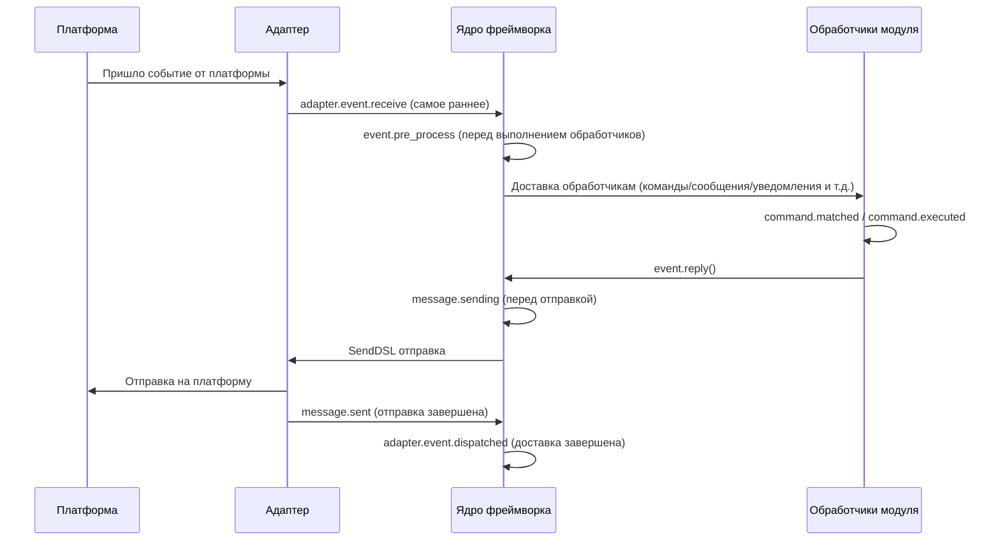

Фреймворк предоставляет следующие точки хуков, которые можно прослушивать с помощью `@sdk.lifecycle.on()` для реализации пользовательской логики.

### Ядро инициализации

| Имя хука | Триггер | Данные |
|---------|---------|------|
| `core.init.start` | Начало инициализации SDK | `{}` |
| `core.init.stage` | Начало этапа инициализации (выpusкается в фоне) | `{"stage": str}`, значения: `discovery` / `adapter_register` / `adapter_start` / `module_register` / `module_init` / `adapter_start_deferred` / `router_start` |
| `core.init.complete` | Завершение инициализации SDK | `{"duration": float, "success": bool, "stages": {stage: float}, "adapters": {"enabled": [str], "disabled": [str]}, "modules": {"enabled": [str], "disabled": [str]}, "error": str (только при ошибке)}` |
| `core.uninit.complete` | Завершение обратной инициализации SDK | `{"duration": float, "success": bool, "adapters_closed": int, "modules_unloaded": int, "module_properties_cleared": int, "module_properties_to_clear": [str], "error": str (только при ошибке)}` |

**Пример: отображение прогресса запуска**

```python
@sdk.lifecycle.on("core.init.stage")
def show_stage(data):
    print(f"[Запуск] Вход в этап: {data['stage']}")
```

### Изменение конфигурации

| Имя хука | Триггер | Данные |
|---------|---------|------|
| `config.set` | Изменение конфигурационного параметра | `{"key": str, "old_value": Any, "new_value": Any}` |
| `config.updated` | После изменения config.toml обнаружено изменение всей конфигурации | `{"old_config": dict, "new_config": dict, "config_file": str}` |

**Пример: аудит конфигурации**

```python
@sdk.lifecycle.on("config.set")
def audit_config(data):
    print(f"[Аудит] {data['key']}: {data['old_value']} -> {data['new_value']}")
```

### Жизненный цикл модуля

| Имя хука | Триггер | Данные |
|---------|---------|------|
| `module.register` | Регистрация класса модуля в менеджере | `{"module_name": str, "success": bool}` |
| `module.load` | Завершение загрузки модуля (успешное инстанцирование); в случае ошибки payload дополнительно содержит `"error": str, "traceback": str` (сценарий ошибки можно также получить через `module.last_error(имя)` | `{"module_name": str, "success": bool}` |
| `module.init` | Завершение инициализации модуля (включая ленивую загрузку) | `{"module_name": str, "success": bool}` |
| `module.before_unload` | Первая стадия выгрузки (до `on_unload` и освобождения ресурсов; модульные хуки `on_before_unload` срабатывают синхронно) | `{"module_name": str, "reason": str}`; `reason` значения: `unload` / `reload` / `disable` / `cascade` / `dormant` |
| `module.sleep` | Завершение сна модуля (ленивая загрузка: ресурсы освобождены, при обращении автоматически пробуждается) | `{"module_name": str, "success": bool}` |
| `module.unload` | Завершение выгрузки модуля | `{"module_name": str, "success": bool}` |
| `module.reload` | Завершение горячей перезагрузки модуля (включая перезагрузку зависимостей) | `{"module_name": str, "success": bool, "full": bool, "duration_ms": int}`; для одиночного модуля дополнительно содержит `"identity_changed": bool` (False = в процессе возможно всё ещё работает старый код, например, кэш C-расширений) и `"version_old": str, "version_new": str`; при полной перезагрузке (`reload_all`) `module_name` равен `"All"`, payload дополнительно содержит `"results": dict[str, bool]` |

> **Модульный хук `on_before_unload`**: соответствующий событию `module.before_unload` необязательный метод жизненного цикла — `event["reason"]` указывает причину, подходит для сохранения состояния в `sdk.storage` перед освобождением ресурсов, восстановление при пробуждении / перезагрузке происходит в `on_load` (состояние ленивой загрузки продолжается благодаря этому). Ошибка хука лишь предупреждает, не блокирует процесс выгрузки.

### Жизненный цикл адаптера

| Имя хука | Триггер | Данные |
|---------|---------|------|
| `adapter.load` | Завершение регистрации адаптера | `{"platform": str, "success": bool}` |
| `adapter.reload` | Завершение горячей перезагрузки кода адаптера | `{"adapter_name": str, "success": bool, "full": bool, "duration_ms": int, "identity_changed": bool, "version_old": str, "version_new": str, "was_started": bool, "source": str}`; `identity_changed=False` = в процессе возможно всё ещё работает старый код |
| `adapter.start` | Запуск адаптера | `{"platforms": [str]}` |
| `adapter.status.change` | Изменение состояния адаптера | `{"platform": str, "status": str, "retry_count": int, "error": str (только при ошибке)}`; полные значения `status`: `starting` / `started` / `start_failed` / `stopping` / `stopped` / `stop_failed` / `skipped-dependency` / `disabled` |
| `adapter.stop` | Остановка адаптера | `{"platforms": [str]}` |
| `adapter.stopped` | Завершение остановки адаптера | `{"platforms": [str]}` |
| `adapter.bot.online` | Онлайн бота | `{"platform": str, "bot_id": str, "info": dict, "status": str}` |
| `adapter.bot.offline` | Оффлайн бота | `{"platform": str, "bot_id": str, "status": str}` |

### Прием и обработка событий

| Имя хука | Триггер | Данные |
|---------|---------|------|
| `adapter.event.receive` | Получено событие с внешней платформы (самый ранний) | `{"platform": str, "event_type": str, "raw_event_type": str}` |
| `adapter.event.blocked` | Промежуточный слой отклонил событие (возврат `False`, событие отбрасывается и не поступает в обработчики) | `{"middleware": str, "platform": str, "event_type": str, "detail_type": str, "event": dict, "_trace_id": str}` |
| `adapter.event.dispatched` | Завершение доставки события | `{"platform": str, "event_type": str, "raw_event_type": str, "onebot_handlers_count": int}` |
| `event.pre_process` | Перед началом выполнения обработчиков события | `{"event_type": str, "platform": str, "detail_type": str}` |

**Пример: статистика событий**

```python
event_counter = {}

@sdk.lifecycle.on("adapter.event.receive")
def count_events(data):
    platform = data["platform"]
    event_counter[platform] = event_counter.get(platform, 0) + 1

@sdk.lifecycle.on("adapter.event.dispatched")
def log_unhandled(data):
    if data["onebot_handlers_count"] == 0:
        print(f"[Необработано] {data['platform']}/{data['event_type']}")
```

### Отправка сообщений

| Имя хука | Триггер | Данные |
|---------|---------|------|
| `message.sending` | Сообщение готовится к отправке | `{"platform": str, "method": str, "detail_type": str, "target_id": str, "bot_id": str}` |
| `message.sent` | Сообщение отправлено | `{"platform": str, "method": str, "detail_type": str, "target_id": str, "bot_id": str}` |

**Пример: аудит отправки сообщений**

```python
@sdk.lifecycle.on("message.sending")
def log_sending(data):
    print(f"[Отправка] -> {data['platform']}/{data['detail_type']}/{data['target_id']} через {data['method']}")
```

### Командная система

| Имя хука | Триггер | Данные |
|---------|---------|------|
| `command.matched` | Команда совпала и готовится к выполнению | `{"command": str, "args": list[str], "platform": str, "user_id": str}` |
| `command.executed` | Команда выполнена | `{"command": str, "args": list[str], "platform": str, "user_id": str, "success": bool, "error": str (только при ошибке)}` |

**Пример: статистика команд**

```python
@sdk.lifecycle.on("command.matched")
def count_commands(data):
    print(f"[Команда] /{data['command']} от {data['user_id']}@{data['platform']}")
```

### HTTP-роутинг

| Имя хука | Триггер | Данные |
|---------|---------|------|
| `server.request` | Получен HTTP-запрос | `{"method": str, "path": str, "client_ip": str}` |
| `server.response` | Отправлен HTTP-ответ | `{"method": str, "path": str, "status_code": int, "client_ip": str}` |

**Пример: логирование запросов**

```python
@sdk.lifecycle.on("server.response")
def log_http(data):
    print(f"[HTTP] {data['method']} {data['path']} -> {data['status_code']}")
```

### WebSocket

| Имя хука | Триггер | Данные |
|---------|---------|------|
| `server.start` | Запуск сервера маршрутизации | `{"base_url": str, "host": str, "port": int, "success": bool, "error": str (только при ошибке)}` |
| `server.stop` | Остановка сервера маршрутизации | `{}` |
| `server.websocket.connect` | Установлено WebSocket-соединение | `{"path": str, "module_name": str, "client_ip": str}` |
| `server.websocket.disconnect` | Отключено WebSocket-соединение | `{"path": str, "module_name": str, "reason": str, "error": str (только при аномалии)}` |

**Пример: мониторинг WebSocket-соединений**

```python
@sdk.lifecycle.on("server.websocket.connect")
def on_ws_connect(data):
    print(f"[WS] Подключение: {data['path']} от {data['client_ip']}")

@sdk.lifecycle.on("server.websocket.disconnect")
def on_ws_disconnect(data):
    print(f"[WS] Отключение: {data['path']} ({data['reason']})")
```

### Состояние подключения к хранилищу

Создание пула подключений, сбои и восстановление хранилища (все события происходят в фоне, не блокируют операции с хранилищем):

| Имя хука | Триггер | Данные |
|---------|---------|------|
| `storage.ready` | Пул подключений к хранилищу готов (первое успешное создание пула в каждом цикле событий) | `{"backend": str}` |
| `storage.unreachable` | Повторные попытки соединения исчерпаны, включен период охлаждения (операции быстро завершаются ошибкой) | `{"backend": str, "error": str, "cooldown": float}` |
| `storage.recovered` | Период охлаждения закончен, соединение восстановлено, хранилище доступно | `{"backend": str}` |

**Пример: предупреждение о сбое хранилища**

```python
@sdk.lifecycle.on("storage.unreachable")
def alert_storage_down(data):
    print(f"[Предупреждение] Хранилище {data['backend']} недоступно: {data['error']}, автоматическая переподключение через {data['cooldown']}s")

@sdk.lifecycle.on("storage.recovered")
def notify_storage_back(data):
    print(f"[Восстановление] Хранилище {data['backend']} снова доступно")
```

### HTTP-клиент

События запросов и подключений `sdk.client` (все события происходят в фоне):

| Имя хука | Триггер | Данные |
|---------|---------|------|
| `client.request.success` | HTTP-запрос выполнен успешно | `{"method": str, "url": str, "status": int, "elapsed": float}` |
| `client.request.failed` | HTTP-запрос не удался после исчерпания попыток | `{"method": str, "url": str, "error": str, "attempts": int, "elapsed": float}` |
| `client.ws.connect` | Установлено WebSocket-соединение | `{"url": str}` |

### Межкультурная локализация

| Имя хука | Триггер | Данные |
|---------|---------|------|
| `i18n.language.changed` | Смена языка фреймворка (`i18n.set_language`) | `{"language": str, "previous": str}` |

## Стандартное определение событий

```python
STANDARD_EVENTS = {
    "core": ["init.start", "init.stage", "init.complete", "uninit.complete"],
    "module": ["load", "before_unload", "init", "sleep", "unload", "register", "reload"],
    "adapter": [
        "load", "start", "status.change", "reload", "stop", "stopped",
        "event.receive", "event.blocked", "event.dispatched",
        "bot.online", "bot.offline",
    ],
    "server": [
        "start", "stop",
        "request", "response",
        "websocket.connect", "websocket.disconnect",
    ],
    "event": ["pre_process"],
    "message": ["sending", "sent"],
    "command": ["matched", "executed"],
    "config": ["set", "updated"],
    "storage": ["ready", "unreachable", "recovered"],
    "client": ["request.success", "request.failed", "ws.connect"],
    "i18n": ["language.changed"],
}
```

## Полная справочная документация API

### Регистрация и отмена

| Метод | Описание |
|------|------|
| `@lifecycle.on(event, *, priority=0)` | Регистрация обработчика через декоратор |
| `lifecycle.register(event, handler, *, priority=0)` | Программная регистрация |
| `lifecycle.unregister(event, handler=None)` | Отмена регистрации (если handler=None, отменяются все обработчики события) |

### Триггер событий

| Метод | Описание |
|------|------|
| `await lifecycle.emit(event, data=None, *, to=None)` | Асинхронный триггер, обработчики выполняются **параллельно** (не блокируют друг друга, возвращается, когда все завершены), возвращаемые значения, отличные от None, по приоритету перезаписывают data в цепочке; `to` указывает владельца при направленной доставке |
| `lifecycle.fire(event, data=None, *, to=None)` | **Фоновая отправка (бросить в корзину и уйти)**: обработчики выполняются в фоновых задачах параллельно, без ожидания, без возвращаемого значения; при отсутствии слушателей — нулевые затраты. Подходит для частых горячих путей и чистого наблюдения; триггеры, чувствительные к последовательности (например, `config.set`) используйте `emit` |
| `lifecycle.emit_sync(event, data=None, *, to=None)` | Синхронный триггер, асинхронные обработчики запускаются через create_task |
| `await lifecycle.submit_event(event_type, *, source, msg, data, to=None, background=False)` | Совместимость со старой версией, автоматически строит стандартный формат события; `background=True` — фоновая отправка через `fire` |

### Инструменты

| Метод | Описание |
|------|------|
| `lifecycle.start_timer(timer_id)` | Начать таймер |
| `lifecycle.get_duration(timer_id)` | Получить продолжительность (в секундах) |
| `lifecycle.stop_timer(timer_id)` | Остановить таймер и вернуть продолжительность |
| `lifecycle.list_hooks()` | Вывести все зарегистрированные хуки и количество обработчиков |
| `lifecycle.clear()` | Очистить все обработчики и таймеры |

## Пример использования в модуле

```python
from ErisPulse.Core.Bases import BaseModule
from ErisPulse import sdk

class Main(BaseModule):
    async def on_load(self, event):
        # Реализация простой статистики сообщений
        self.msg_count = 0
        
        @sdk.lifecycle.on("adapter.event.receive")
        async def count(data):
            if data["event_type"] == "message":
                self.msg_count += 1
        
        # Мониторинг всех команд
        @sdk.lifecycle.on("command.matched")
        async def log_cmd(data):
            sdk.logger.info(f"Выполнение команды: /{data['command']} от {data['user_id']}")
        
        # Аудит изменений конфигурации
        @sdk.lifecycle.on("config.set")
        def audit(data):
            sdk.logger.info(f"Изменение конфигурации: {data['key']} = {data['new_value']}")
```

## Принадлежность фоновых задач и автоматическая отмена

> [!NOTE]
> Эта функция доступна в ErisPulse **2.8.0+**.

Фоновые задачи, созданные модулем, если не отменены в `on_unload`, будут держать ссылку на `self`, что приведет к невозможности сборки мусора модуля (оставшиеся экземпляры после горячей перезагрузки). Фреймворк предоставляет следующие механизмы:

- **`self.spawn(coro)`** (рекомендуется использовать в модуле): задача автоматически привязывается к имени модуля, при выгрузке модуля фреймворк **автоматически отменяет** не завершенные задачи и записывает предупреждение после `on_unload`
- **`spawn_background(coro)`** (`ErisPulse.runtime`): автоматически захватывает контекст `owner_scope`; `cancel_owner_tasks(owner)` отменяет задачи по принадлежности, `cancel_all_background_tasks()` используется для отмены всех фоновых задач в `sdk.uninit()`
- **Адаптеры**: при остановке отменяются фоновые задачи по имени платформы

```python
async def on_load(self, event):
    # Рекомендуется: фоновые задачи использовать self.spawn(), фреймворк автоматически отменяет их при выгрузке
    self.spawn(self._poll())

async def on_unload(self, event):
    # В сценариях с тонким контролем все равно рекомендуется вручную отменить и дождаться завершения
    if self._poll_task:
        self._poll_task.cancel()
        await asyncio.gather(self._poll_task, return_exceptions=True)

async def _poll(self):
    while True:
        await asyncio.sleep(60)
        ...
```

> [!IMPORTANT]
> Фреймворк принудительно отменяет задачи (`cancel_owner_tasks`), это происходит после возврата `on_unload`. Поэтому задачи, требующие аккуратного завершения (flush буфера, сохранение состояния, закрытие соединений) **обязательно** должны быть вручную отменены и завершены в `on_unload` — не рассчитывайте на автоматическую отмену. Фреймворк гарантирует только «не оставление задач, держащих ссылку на `self»`, но не гарантирует «аккуратное» завершение. Задачи, требующие `await` результата, следует вызывать напрямую `await`, а не передавать в фоновую задачу.

## Примечания

1. **Обработчики могут быть синхронными или асинхронными**: система автоматически распознает и правильно вызывает
2. **Передача данных**: в режиме `emit()` возвращаемое обработчиком значение, отличное от None, изменяет передаваемые последующим обработчикам данные
3. **Нормализация имен событий**: рекомендуется использовать точечную структуру для имен событий, что упрощает использование родительских слушателей
4. **Изоляция ошибок**: ошибка одного обработчика не влияет на выполнение других обработчиков
5. **Ограничения синхронного триггера**: в `emit_sync()` асинхронные обработчики запускаются в режиме fire-and-forget, возвращаемые значения не могут быть переданы обратно
6. **Очистка жизненного цикла**: при вызове `sdk.uninit()` все зарегистрированные обработчики и таймеры будут очищены
7. **Приоритет загрузки**: если необходимо подписаться на события на этапе инициализации фреймворка, рекомендуется установить высокий приоритет и отключить ленивую загрузку


### 懶加载系统

# Ленивая система загрузки модулей

> [!TIP]
> **Когда нужно прочитать эту статью**: при использовании ленивой загрузки модулей или активации по событию `activate_on`. Если не требуется, можно пропустить, это не повлияет на использование других функций.

ErisPulse SDK предоставляет мощную систему ленивой загрузки модулей, которая позволяет инициализировать модули только тогда, когда они действительно нужны, что значительно ускоряет запуск приложения и повышает эффективность использования памяти.

## Обзор

Система ленивого загрузки модулей является одной из ключевых особенностей ErisPulse. Она работает следующим образом:

- **Отложенная инициализация**: модуль загружается и инициализируется только при первом обращении
- **Прозрачное использование**: для разработчиков ленивые модули практически не отличаются от обычных модулей
- **Автоматическое управление зависимостями**: зависимости модуля автоматически инициализируются при использовании
- **Поддержка жизненного цикла**: для модулей, унаследованных от `BaseModule`, автоматически вызываются методы жизненного цикла

## Принцип работы

### Класс LazyModule

Основой системы ленивой загрузки является класс `LazyModule`, который является обёрткой, фактически инициализирующей модуль только при первом обращении.

### Процесс инициализации

При первом обращении к модулю `LazyModule` выполняет следующие действия:

1. Получает информацию о параметрах `__init__` класса модуля
2. Определяет, следует ли передавать ссылку на `sdk`
3. Устанавливает атрибут `moduleInfo` модуля
4. Для модулей, унаследованных от `BaseModule`, вызывает метод `on_load`
5. Запускает событие жизненного цикла `module.init`

## Событийная ленивая активация (activate_on)

> [!NOTE]  
> Эта функция требует ErisPulse **2.8.0+**.

Модули с `lazy_load=True` по умолчанию загружаются только при **первом обращении к атрибуту**. Если модуль зарегистрировал обработчики команд/событий, традиционный подход требует `lazy_load=False` для немедленной загрузки. `activate_on` предоставляет третий вариант: **объявить триггер, и при первом совпадающем событии/команде модуль будет автоматически активирован** — он не будет постоянно в памяти, но при этом не потеряет вход для триггера.

```python
from ErisPulse.loaders import ModuleLoadStrategy

class MyModule(BaseModule):
    @staticmethod
    def get_load_strategy():
        return ModuleLoadStrategy(
            lazy_load=True,
            activate_on=[
                # ---- Событийные триггеры (пассивные, без участия пользователя) ----
                "message",                                    # Тип события: любое сообщение
                {"notice": "group_member_increase"},          # Тип + один detail_type
                {"message": ["private", "group"]},            # Тип + несколько detail_type

                # ---- Командные триггеры (активные, ввод пользователя, видны в Help) ----
                {"command": "roll"},                          # Сокращённая форма: имя команды
                {"command": ["roll", "dice"]},                # Список имён команд
                {"command": {                                 # Форма dict (обязателен name)
                    "name": "dice",
                    "help": "Бросить кубик",
                    "usage": "/dice",
                    "group": "Развлечения",
                    "aliases": ["d"],
                    "hidden": False,
                }},
            ],
        )
```

### Параметры команды в формате dict

Форма dict отражает пользовательские параметры декоратора `@command()`, позволяя зарегистрировать заглушку команды ещё до загрузки модуля:

| Параметр | Тип | Значение по умолчанию | Описание |
|----------|------|----------------------|----------|
| `name` | `str` | **Обязательно** | Имя команды; должно совпадать с `name` в `@command()` внутри `on_load`, иначе заглушка будет удалена, и команда не будет найдена |
| `help` | `str` | Цепочка возврата | Описание в Help; если не указано, используется цепочка возврата (см. ниже) |
| `usage` | `str` | Автоматически | Пример использования, по умолчанию `{prefix}{name}` |
| `group` | `str` | `None` | Группа команды |
| `aliases` | `list[str]` | `[]` | Алиасы, которые также регистрируются — **ввод алиаса также активирует модуль** |
| `hidden` | `bool` | `False` | Если `True`, заглушка будет скрыта (согласуется с поведением скрытых команд после активации); пользователи, знающие имя команды, могут активировать её вводом |

**Не поддерживаются** `priority` / `permission` / `master`: заглушка команды предназначена только для активации, проверка прав осуществляется после активации настоящей командой (в противном случае проверка прав на этапе заглушки приведёт к потере функциональности "активация по команде").

### Цепочка возврата для Help заглушки команды

Описание команды в Help, отображаемое до загрузки модуля, берётся по следующему порядку (первое найденное значение используется):

1. `help` из объявления команды в формате dict (наиболее точное)
2. `description` из `get_meta()`
3. Атрибут `__description__`
4. `Summary` из метаданных пакета (краткое описание на PyPI)
5. Общее сообщение: «Эта команда из лениво загружаемого модуля X, первый вызов активирует модуль»

### Семантика триггеров

- **Заглушка события**: регистрируется с низким приоритетом (`ACTIVATION_STUB_PRIORITY`) в соответствующий менеджер событий, срабатывает в качестве резервного обработчика после всех обычных; после активации событие пересылается настоящему обработчику модуля
- **Заглушка команды**: регистрируется как заглушка команды; после активации заглушка удаляется, настоящая команда обрабатывает текущий вызов
- **Защита от повторного запуска**: `asyncio.Lock` гарантирует, что модуль активируется только один раз при одновременных триггерах
- **Фильтрация по области действия**: заглушка имеет идентификатор владельца модуля, триггер не срабатывает, если модуль не включён для данного бота/сессии/платформы
- **Семантика ошибок**: при неудачной активации модуль переходит в период охлаждения (`ACTIVATE_RETRY_COOLDOWN_SECS`, 30 секунд), события в течение этого времени игнорируются, чтобы избежать повторных попыток; по истечении времени модуль автоматически перезапускается, заглушка остаётся активной
- **Удаление дубликатов**: при смешанном объявлении команд (сокращённая форма + dict) дубликаты удаляются (dict имеет приоритет); если в dict отсутствует `name` или `detail_type` события указан неверно, выводится предупреждение и объявление игнорируется

> Архитектурная диаграмма и полная семантика доступны в [Обзоре архитектуры](../architecture.md#архитектура-событийной-ленивой-активации-activate_on-триггеры).

## Задержка активации (dormant_after)

> [!NOTE]
> Эта функция доступна в ErisPulse **2.11.0+**.

После длительного бездействия модули, активированные с задержкой, могут быть **уснувшими**: фреймворк освобождает ресурсы (задачи, соединения, регистрация событий),
но сохраняет ленивый загрузочный прокси и структуру регистрации — модуль возвращается в состояние "зарегистрирован, но не загружен", и при следующем обращении к свойству /
`module.call` / событию `activate_on` **прозрачно активируется** (переинициализируется и выполняется `on_load`),
без необходимости вызывать какие-либо API активации. После усыпления состояние системы идентично состоянию "никогда не активированный".

### Способ объявления

```python
@staticmethod
def get_load_strategy():
    return ModuleLoadStrategy(
        lazy_load=True,
        dormant_after="30m",   # Автоматическое усыпление после 30 минут бездействия; отсутствие объявления = никогда не усыплять (по умолчанию)
    )
```

Синтаксис длительности идентичен синтаксису `cooldown` в командном управлении (например, `90s` / `1h30m` / `1d`). Сканер проверяет состояние с фиксированным интервалом (60 секунд),
фактическое время усыпления = порог + максимум один интервал сканирования; также можно усыпить вручную в любой момент:
`await sdk.module.sleep("имя модуля")`. Явный вызов `unload` по-прежнему означает полную разгрузку (удаляются все ленивые прокси).

### Продолжение состояния

Перед усыпанием фреймворк вызывает `on_before_unload(reason="dormant")` (первый шаг в цепочке разгрузки, ресурсы все еще целы),
модуль сохраняет состояние в `sdk.storage`; при активации в `on_load` восстанавливает:

```python
async def on_before_unload(self, event):
    if event["reason"] in ("dormant", "reload", "disable"):
        await self.sdk.storage.aset(f"{self._module_name}:counter", self._count)

async def on_load(self, event):
    self._count = await self.sdk.storage.aget(f"{self._module_name}:counter") or 0
```

### Семантика и границы

- **Безопасность для зависимых модулей**: Зависимые модули получают доступ к ленивым модулям через постоянный прокси (`sdk.<Name>`) или `module.call`,
  поведение одинаково до и после усыпания; непосредственное хранение ссылки на реальный экземпляр является противоположным подходом (видно в аудите утечек)
- **Отсутствие событий**: Усыпленные модули больше не получают события — модули, которым нужно событие для активации, должны также объявить `activate_on`
  (событие сначала активирует, затем пересылает); при диагностике "команды не отвечают" проверяйте, находится ли модуль в состоянии усыпления
- **Самовосстановление при неудачной активации**: При неудачной активации (повторной инициализации) модуль переходит в 30-секундный период охлаждения, после чего при повторном обращении автоматически повторяет попытку,
  модуль не может быть навсегда неактивным

## Конфигурация ленивой загрузки

### Глобальная конфигурация

В файле конфигурации включите/отключите глобальную ленивую загрузку:

```toml
[ErisPulse.framework]
enable_lazy_loading = true  # true=включить ленивую загрузку (по умолчанию), false=отключить ленивую загрузку
```

### Управление на уровне модуля

Модуль может контролировать стратегию загрузки, реализовав статический метод `get_load_strategy()`:

```python
from ErisPulse.Core.Bases import BaseModule
from ErisPulse.loaders import ModuleLoadStrategy

class MyModule(BaseModule):
    @staticmethod
    def get_load_strategy():
        """Возвращает стратегию загрузки модуля"""
        return ModuleLoadStrategy(
            lazy_load=False,  # Возвращает False для немедленной загрузки
            priority=100      # Приоритет загрузки, чем больше значение, тем выше приоритет
        )
```

## Использование модулей с ленивой загрузкой

### Основное использование

Для разработчиков использование модулей с ленивой загрузкой практически не отличается от обычных модулей:

```python
# Доступ к модулю с ленивой загрузкой через SDK
from ErisPulse import sdk

# Следующий вызов инициирует ленивую загрузку модуля
result = await sdk.my_module.my_method()
```

### Единый вход для получения модуля

Независимо от того, получаете ли вы модуль через свойство SDK, свойство менеджера модулей или с помощью `module.get()`, для "зарегистрированных, но еще не загруженных" модулей с ленивой загрузкой будет возвращаться один и тот же прокси-объект ленивой загрузки. Инициализация происходит только при обращении к его свойствам:

```python
# Все три способа возвращают один и тот же прокси-объект ленивой загрузки (когда модуль еще не загружен), поведение одинаково и для пользователя прозрачно
sdk.my_module          # Точка входа для инициации загрузки
sdk.module.my_module   # Также возвращает прокси-объект ленивой загрузки
sdk.module.get("my_module")  # Также возвращает прокси-объект ленивой загрузки, сам вызов не инициирует загрузку

# Инициализация модуля происходит только при обращении к свойству прокси-объекта
result = await sdk.my_module.my_method()
```

`module.get()` — это **интерфейс для запроса**, сам вызов не инициирует загрузку:
- Если модуль уже загружен → возвращается реальный экземпляр
- Если модуль зарегистрирован, но не загружен → возвращается прокси-объект ленивой загрузки (инициализация происходит при обращении к свойству)
- Если модуль не зарегистрирован → возвращается `None`

Если необходимо явно инициировать загрузку, используйте `await sdk.load_module("my_module")`.

### Асинхронная инициализация

Для модулей, требующих асинхронной инициализации, рекомендуется сначала явно загрузить модуль:

```python
# Сначала явно загрузите модуль
await sdk.load_module("my_module")

# Затем используйте модуль
result = await sdk.my_module.my_method()
```

### Синхронная инициализация

Для модулей, не требующих асинхронной инициализации, можно обращаться напрямую:

```python
# Прямое обращение автоматически инициирует синхронную инициализацию
result = sdk.my_module.some_sync_method()
```

## Рекомендуемые практики

При выборе стратегии загрузки можно использовать следующий процесс принятия решений:

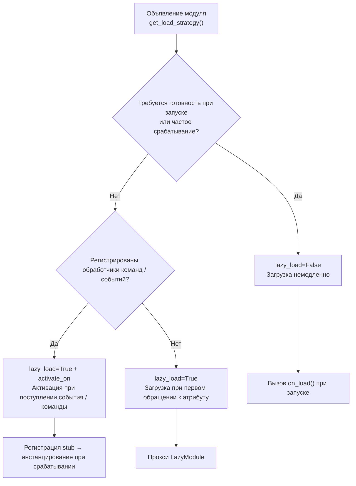

### Рекомендованные сценарии использования ленивой загрузки (lazy_load=True)

- Инструментальные классы, вызываемые пассивно (например, модуль запросов данных, преобразователи форматов и т.д., которые нужны только при вызове из других модулей)
- Модули, зарегистрировавшие обработчики команд / событий, но используемые нечасто — в сочетании с `activate_on` можно объявить триггер, автоматически активирующий модуль при поступлении первого соответствующего события / команды, без отказа от ленивой загрузки

### Рекомендованные сценарии отключения ленивой загрузки (lazy_load=False)

- Модули, требующие готовности при запуске (например, основные модули, предоставляющие базовые сервисы другим модулям)
- Часто вызываемые слушатели (каждое сообщение должно обрабатываться) — `activate_on` имеет небольшую стоимость активации, поэтому для сценариев с высокой частотой вызовов прямая загрузка предпочтительнее
- Модули с планировщиком задач
- Модули, требующие инициализации при запуске приложения

> Параметр `priority` управляет порядком инициализации модулей, загруженных немедленно: чем больше значение, тем раньше модуль будет инициализирован. Модули с одинаковым приоритетом загружаются в порядке их регистрации.

## Примечания

1. Если ваш модуль использует ленивую загрузку, и если другие модули никогда не вызывались внутри ErisPulse, ваш модуль никогда не будет инициализирован.
2. Если ваш модуль содержит такие компоненты, как модули, слушающие события, или другие активно слушающие модули, у вас есть два варианта: объявить триггер `activate_on` (сохранить ленивую загрузку, автоматически активировать при поступлении события) или объявить, что он должен быть загружен немедленно (`lazy_load=False`), иначе это повлияет на нормальное функционирование вашего модуля.
3. Мы не рекомендуем отключать ленивую загрузку, если только у вас нет особых потребностей, иначе это может привести к проблемам с зависимостями и событиями жизненного цикла.
4. В командном словаре `activate_on` объявления, `name` должен совпадать с реальным именем команды, зарегистрированной в модуле `on_load` с помощью `@command()` — в противном случае, после активации модуля, команда-заполнитель будет отменена, и команда, объявленная не соответствующая реализации, не будет существовать.


### 国际化（i18n）系统

# Система международной локализации (i18n)

> [!TIP]
> **Когда нужно это читать**: при необходимости многоязычного контента, регистрации переводов или определения языка. Если не нужно, пропустите, это не повлияет на использование других функций.

Начиная с версии ErisPulse v2.5.0, встроенная поддержка международной локализации. Ядро фреймворка и интерфейс CLI могут автоматически переключать отображаемый текст в соответствии с языком вашей системы, а также поддерживают регистрацию переводов внешними модулями.

## Поддерживаемые языки

| Язык | Код | Описание |
|------|------|------|
| 简体中文 | `zh-CN` | Основной язык (оригинальный язык фреймворка) |
| 繁體中文 | `zh-TW` | Традиционный китайский (Гонконг/Макао/Тайвань) |
| English | `en` | Английский (язык по умолчанию) |
| 日本語 | `ja` | Японский |
| Русский | `ru` | Русский |

## Быстрый опыт

### Через переменные окружения

```bash
# Windows PowerShell
$env:ERISPULSE_LANG = "en"
epsdk run

# macOS / Linux
ERISPULSE_LANG=ja epsdk run
```

### Через файл конфигурации

В файле `config/config.toml` добавьте:

```toml
[ErisPulse.i18n]
language = "zh-TW"
```

Установка значения `"auto"` (значение по умолчанию) включает автоматическое определение языка системы.

### В коде вручную

```python
from ErisPulse import i18n

# Ручная установка языка
i18n.set_language("en")
print(i18n.get_language())  # "en"

# Сброс на автоматическое определение
i18n.reset_language()
```

---

## Механизм определения языка

Фреймворк определяет язык пользователя по следующему приоритету:

1. **Переменная окружения `ERISPULSE_LANG`** — наивысший приоритет, используется для тестирования и временного переключения
2. **Windows API** — `GetUserDefaultLocaleName` (только Windows, не подвергается влиянию таких инструментов, как Git Bash, которые могут переопределить `LANG`)
3. **Переменные окружения** — `LANGUAGE` > `LC_ALL` > `LC_MESSAGES` > `LANG` (стандарт Unix/macOS)
4. **Системная локаль** — `locale.getlocale()` / `locale.getdefaultlocale()`
5. **Обратный путь** — en (английский)

### Принцип ближайшего соответствия

При обнаружении языка, не являющегося точным совпадением, используется принцип ближайшего соответствия:

- `zh-TW`, `zh-HK`, `zh-MO`, `zh-Hant` → **Традиционный китайский**
- Все остальные `zh-*` (например, `zh-CN`, `zh-SG`) → **Упрощённый китайский**
- `en-US`, `en-GB`, `en-AU` и т.д. → **Английский**
- `ja-JP` → **Японский**
- `ru-RU` → **Русский**
- Нераспознанные языки → **Упрощённый китайский (обратный путь)**

---

## Использование i18n в модулях

Вы можете зарегистрировать переводы для своих модулей, чтобы сделать их также поддерживаемыми в нескольких языках.

### Рекомендуемый способ: объявление ключей перевода через I18nClass (v2.7.0+)

Начиная с версии v2.7.0, модули/адаптеры могут объявлять ключи перевода, как объявление `ConfigClass`, с помощью вложенного класса `I18nClass`. Фреймворк автоматически зарегистрирует все объявленные ключи перевода при загрузке, без необходимости вызывать `i18n.register()` вручную.

```python
from dataclasses import dataclass, field

from ErisPulse.Core.Bases import BaseConfig, BaseI18n, BaseModule, I18nKey


class MyModule(BaseModule):
    # Класс конфигурации (опционально)
    @dataclass
    class ConfigClass(BaseConfig):
        welcome_msg: str = field(
            default="欢迎",
            metadata={
                # Здесь используется i18n-ключ mymodule.welcome_msg
                "description": {"i18n": "mymodule.welcome_msg", "default": "欢迎消息"},
            },
        )

    # Класс набора ключей перевода (опционально)
    # Объявленные ключи будут автоматически зарегистрированы фреймворком, с приоритетом над генерацией дефолтных значений ConfigClass
    class I18nClass(BaseI18n):
        # Имя атрибута автоматически объединяется в полный путь ключа: <имя модуля>.<имя атрибута>
        welcome_msg: I18nKey = I18nKey(
            default="Welcome Message",   # Языко-независимый резервный вариант, не регистрируется ни в один язык
            zh_CN="欢迎消息",
            en="Welcome Message",
            ja="ウェルカムメッセージ",
            ru="Приветственное сообщение",
            zh_TW="歡迎訊息",
        )
        # Другие ключи перевода, используемые в бизнес-логике
        hello: I18nKey = I18nKey(
            default="Hello, {name}!",
            zh_CN="你好，{name}！",
            zh_TW="你好，{name}！",
            en="Hello, {name}!",
            ja="こんにちは、{name}！",
            ru="Привет, {name}!",
        )

        # Можно явно указать полный путь ключа (без использования имени атрибута)
        custom: I18nKey = I18nKey(
            key="mymodule.deep.nested.key",
            default="Default text",
            zh_CN="默认文本",
            zh_TW="預設文本",
            en="Default text",
            ja="デフォルトテキスト",
            ru="Текст по умолчанию",
        )
```

#### Почему рекомендуется I18nClass?

| Сценарий | Ручная i18n.register() | Декларативный I18nClass |
|------|-----------------------|------------------|
| Описание конфигурации с использованием i18n-ключа | Требуется ручная регистрация, и нужно успеть до генерации конфигурации | Фреймворк автоматически регистрирует до генерации конфигурации |
| Объявление многоязычных переводов | Распространяется по on_load() | Централизовано в классе, легко читается |
| Согласованность именования ключей | Легко допускаются опечатки | Имя атрибута используется как суффикс ключа, IDE может подсказывать |
| Очистка при отключении | Требуется ручная unregister_domain() | Фреймворк использует единый домен для регистрации |

#### Правила пути ключей I18nClass

- **По умолчанию**: Используется ``<имя регистрации модуля>.<имя атрибута>`` как полный путь ключа
  - Пример: Имя модуля ``MyModule``, атрибут ``welcome`` → Путь ключа ``MyModule.welcome``
- **Явно**: Через параметр ``I18nKey(key="...")`` можно указать любой точечный путь
  - Подходит для глубоко вложенных ключей (например, ``mymodule.config.basic.token``)

#### Использование в адаптерах

Адаптеры также поддерживают `I18nClass`, и способ использования полностью идентичен:

```python
from ErisPulse.Core import BaseAdapter
from ErisPulse.Core.Bases import BaseConfig, BaseI18n, I18nKey


class MyAdapter(BaseAdapter):
    @dataclass
    class ConfigClass(BaseConfig):
        endpoint: str = field(
            default="",
            metadata={
                # Описание конфигурации ссылается на ключ adapter.MyAdapter.endpoint
                "description": {"i18n": "MyAdapter.endpoint", "default": "API 地址"},
            },
        )

    class I18nClass(BaseI18n):
        # Централизованное объявление ключей перевода, используемых в описании конфигурации и других бизнес-ключах
        endpoint: I18nKey = I18nKey(
            default="API Endpoint",
            zh_CN="API 地址",
            zh_TW="API 位址",
            en="API Endpoint",
            ja="APIアドレス",
            ru="API адрес",
        )
```

`I18nClass` адаптера автоматически регистрируется на этапе `__init__` (до генерации шаблона конфигурации), обеспечивая доступность ключей перевода, используемых в описании конфигурации.

### Ручная регистрация пользовательских переводов (старый способ)

Если вы не используете `I18nClass`, вы можете напрямую вызвать `i18n.register()` для регистрации переводов.

```python
from ErisPulse import i18n

# Регистрация китайского перевода
i18n.register("zh-CN", {
    "my_module.welcome": "欢迎使用我的模块！",
    "my_module.goodbye": "再见！",
    "my_module.hello": "你好，{name}！",
}, domain="my_module")

# Регистрация английского перевода
i18n.register("en", {
    "my_module.welcome": "Welcome to my module!",
    "my_module.goodbye": "Goodbye!",
    "my_module.hello": "Hello, {name}!",
}, domain="my_module")
```

### Использование перевода

```python
from ErisPulse import i18n

# Простой перевод
i18n.t("my_module.welcome")  # Автоматически использует текущий язык

# С параметрами форматирования
i18n.t("my_module.hello", name="Alice")

# Указание значения по умолчанию (возвращается, если ключ перевода отсутствует)
i18n.t("my_module.unknown_key", default="默认文本")
```

### Использование в классе модуля

```python
from dataclasses import dataclass, field
from ErisPulse import i18n
from ErisPulse.Core.Bases import BaseConfig, BaseModule

@dataclass
class MyModuleConfig(BaseConfig):
    welcome_msg: str = field(
        default="欢迎",
        metadata={
            "description": {"i18n": "my_module.welcome_msg", "default": "欢迎消息"},
            "ui": {"widget": "text", "group": "basic", "order": 1},
        },
    )

class MyModule(BaseModule):
    ConfigClass = MyModuleConfig

    async def on_load(self, event):
        # Динамическое чтение конфигурации (каждый доступ отражает последнее значение)
        self.logger.info(self.cfg.welcome_msg)
        self.logger.info(i18n.t("my_module.welcome"))

    @command("hello")
    async def hello_handler(self, event):
        name = event.get_user_nickname() or "friend"
        await event.reply(i18n.t("my_module.hello", name=name))

    async def on_unload(self, event):
        pass
```

### Отмена регистрации перевода

```python
# Отмена регистрации всего домена перевода
i18n.unregister_domain("my_module")
```

---

## Многоязычные поля конфигурации

Начиная с версии v2.5.2, схема конфигурации полностью поддерживает i18n. Все пользовательские текстовые поля могут ссылаться на i18n-ключи, и веб-интерфейс и другие потребители автоматически будут использовать соответствующий текст в зависимости от текущего языка.

### Поддерживаемые i18n-поля

| Поле | Расположение | Описание |
|------|------|------|
| `description` | field metadata | Описание поля |
| `options[].label` | `ui.options` | Метка опций для элемента select |
| `placeholder` | `ui.placeholder` | Заполнитель для поля ввода |
| `group_labels` | `_schema_meta` | Название раздела (заголовок секции в Dashboard) |

Используется единый формат `{"i18n": "key", "default": "текст"}`, строки без i18n-ключа прозрачно передаются (для обратной совместимости).

### Объявление i18n-полей

Все пользовательские текстовые поля поддерживают i18n:

```python
from dataclasses import dataclass, field
from ErisPulse.Core.Bases import BaseConfig

@dataclass
class MyAdapterConfig(BaseConfig):
    # i18n для description
    token: str = field(
        default="",
        metadata={
            "description": {"i18n": "my_adapter.token", "default": "平台 Token"},
            "required": True,
            "secret": True,
            "ui": {
                "widget": "password",
                "group": "basic",
                "order": 1,
                # i18n для placeholder
                "placeholder": {"i18n": "my_adapter.token.ph", "default": "请输入 Token"},
            },
        },
    )
    # i18n для label опций
    mode: str = field(
        default="a",
        metadata={
            "description": {"i18n": "my_adapter.mode", "default": "运行模式"},
            "ui": {
                "widget": "select",
                "group": "basic",
                "order": 2,
                "options": [
                    {"label": {"i18n": "my_adapter.mode.a", "default": "模式A"}, "value": "a"},
                    {"label": {"i18n": "my_adapter.mode.b", "default": "模式B"}, "value": "b"},
                ],
            },
        },
    )

    # i18n для group_labels (название раздела)
    _schema_meta = {
        "group_labels": {
            "basic": {"i18n": "my_adapter.group.basic", "default": "基本设置"},
        }
    }
```

`default` — это резервный текст, отображается, когда перевод не зарегистрирован или поиск не удаётся.

### Скрытие секретных данных и проверка конфигурации

Поля, помеченные как `"secret": True`, автоматически получают **защиту от раскрытия** (начиная с версии 2.7.0):

- **Скрытие при генерации шаблона**: `dataclass_to_toml_with_comments()` при генерации шаблона конфигурации не записывает реальное значение секретных полей (отображается пустой заполнитель), предотвращая попадание конфиденциальной информации на диск
- **Общее средство скрытия**: `redact_secret(value)` заменяет непустое значение на `***`, пустое значение возвращается без изменений, может использоваться для вывода в логи и т.д.

```python
from ErisPulse.Core.Bases.config_schema import redact_secret

redact_secret("sk-xxxxxx")  # '***'
redact_secret("")           # ''
```

**Проверка конфигурации** (`validate_config()`) помимо проверки `required` на непустоту, начиная с версии 2.7.0, поддерживает:

| Проверка | Метаданные | Пример |
|--------|--------|------|
| Совпадение типа | Тип поля | Ошибка, если в поле int передано строковое значение |
| Ограничение перечисления | `ui.options` или顶层 `options` | Значение должно принадлежать разрешённым опциям |
| Диапазон значений |顶层 `min` / `max` | `metadata={"min": 1, "max": 65535}` |

```python
from ErisPulse.Core.Bases.config_schema import validate_config

@dataclass
class C(BaseConfig):
    mode: str = field(default="a", metadata={"ui": {"widget": "select", "options": ["a", "b"]}})
    port: int = field(default=80, metadata={"min": 1, "max": 65535})

errors = validate_config(C(mode="x", port=70000))  # Две ошибки: перечисление + диапазон
```

### Регистрация перевода конфигурации

Ключи перевода конфигурации и обычные ключи перевода одинаковы, используют `i18n.register()` для регистрации:

```python
from ErisPulse import i18n

# Регистрация китайского (согласуется с default, но может отличаться)
i18n.register("zh-CN", {
    "my_adapter.token": "平台 Token",
}, domain="my_adapter")

# Регистрация английского
i18n.register("en", {
    "my_adapter.token": "Platform Token",
}, domain="my_adapter")
```
> **Рекомендуемый способ**: Использование `I18nClass` для объявления ключей перевода, фреймворк автоматически регистрирует (см. раздел "Рекомендуемый способ" выше),
> нет необходимости вызывать `i18n.register()` или `register_config_i18n()` вручную.

Также предоставлена удобная функция `register_config_i18n()`, которая автоматически извлекает ключи и регистрирует их из класса конфигурации:

```python
from ErisPulse.Core.Bases.config_schema import register_config_i18n

# Автоматически извлекает description.default как перевод для zh-CN
register_config_i18n(MyAdapterConfig, "zh-CN")

# Ручная передача английского перевода
register_config_i18n(MyAdapterConfig, "en", {
    "my_adapter.token": "Platform Token",
})
```

### Как WebUI потребляет

`get_config_schema()` возвращает схему, в которой словарь i18n передаётся без изменений. Фронтенд WebUI может использовать `i18n.t()` для разрешения текущего языка.

Если требуется, чтобы серверная часть разрешила текст в строку (например, для возврата клиенту, который не поддерживает i18n), используйте `resolve_config_schema()`, который разрешит все поля `description`, `options[].label`, `placeholder`, `group_labels` в текст текущего языка:

```python
from ErisPulse.Core.Bases.config_schema import resolve_config_schema

# Все поля i18n разрешены в текст текущего языка
schema = resolve_config_schema(MyAdapterConfig)
print(schema["fields"]["token"]["description"])    # "平台 Token" или "Platform Token"
print(schema["fields"]["token"]["placeholder"])   # "请输入 Token" или "Enter Token"
print(schema["fields"]["mode"]["options"][0]["label"])  # "模式A" или "Mode A"
print(schema["group_labels"]["basic"])             # "基本设置" или "Basic"
```

> `BaseConfig`, `BotAccountConfig`, `register_config_i18n()`, `resolve_config_schema()`
> и другие типы и функции инструментария фактически определены в `ErisPulse.Core.Bases.config_schema`.
> `ErisPulse.runtime.config_schema` сохраняется как совместимый shim,
> **рекомендуется импортировать из `ErisPulse.Core.Bases`** (за исключением типов, связанных с i18n-ключами, они находятся в `ErisPulse.Core.Bases.i18n_schema`).

## Справочник API

### I18nManager

#### Основные методы

| Метод | Описание |
|------|------|
| `t(key, default=None, **kwargs)` | Получить текст перевода (`gettext()` — синоним) |
| `set_language(lang)` | Ручная установка языка |
| `get_language()` | Получить текущий язык |
| `reset_language()` | Сброс на автоматическое определение (и повторное определение среды) |
| `get_supported_languages()` | Получить список всех поддерживаемых языков |
| `has_translation(key, lang=None)` | Проверить наличие перевода ключа |
| `register(lang, translations, domain)` | Зарегистрировать пользовательский перевод |
| `unregister_domain(domain)` | Удалить все переводы указанного домена |
| `reload()` | Перезагрузить встроенные переводы и повторно определить язык |

#### Подробности метода `t()`

```python
def t(self, key, /, default=None, **kwargs):
```

- `key` — ключ перевода (только позиционный аргумент, не конфликтует с `**kwargs` с `key=`)
- `default` — значение по умолчанию, возвращается, если перевод отсутствует, по умолчанию `None` (возвращается сам ключ)
- `**kwargs` — параметры форматирования, используются для заполнения `{placeholder}` в переводе

Пример:

```python
# Перевод: "greeting": "你好，{name}！欢迎来到{place}。"
i18n.t("greeting", name="Alice", place="ErisPulse")
# Возвращает: "你好，Alice！欢迎来到ErisPulse。"
```

### BaseI18n / I18nKey (декларативные ключи перевода)

Начиная с версии v2.7.0, `ErisPulse.Core.Bases` предоставляет инструменты декларативного объявления ключей перевода на основе атрибутов класса (рекомендуется импортировать из `ErisPulse.Core.Bases`):

> ``I18nKey.default`` — это **языко-независимый резервный текст**, не регистрируется ни в один язык.
> Чтобы перевод был активен, необходимо явно передать хотя бы один параметр языка (``zh_CN=`` / ``en=`` / ``ja=`` и т.д.).
> Таким образом, разработчики из разных стран могут свободно использовать свой родной язык для заполнения ``default``, фреймворк не делает никаких предположений.

| Название | Описание |
|------|------|
| `I18nKey(default, *, key=None, zh_CN, zh_TW, en, ja, ru)` | Объявление одного ключа перевода, `default` — резервный текст без привязки к языку |
| `BaseI18n` | Базовый класс для набора ключей перевода (имя соответствует `BaseConfig`), подклассы объявляют несколько `I18nKey` как атрибуты класса |
| `BaseI18n.register(prefix="", domain="app")` | Метод класса: регистрирует все объявленные ключи в системе i18n |
| `key` | Алиас `I18nKey` (более краткая запись)

Пример использования:

```python
from ErisPulse.Core.Bases import BaseI18n, key

class MyKeys(BaseI18n):
    # Упрощённая запись с алиасом
    hello = key(
        default="Hello",
        zh_CN="你好",
        zh_TW="你好",
        en="Hello",
        ja="こんにちは",
        ru="Привет",
    )
    bye = key(
        default="Bye",
        zh_CN="再见",
        zh_TW="再見",
        en="Bye",
        ja="さようなら",
        ru="До свидания",
    )

# Использование отдельно (ручная регистрация)
MyKeys.register(prefix="myapp.", domain="myapp")
```

### Доступ через экземпляр SDK

```python
from ErisPulse import sdk

# sdk.i18n и i18n, импортированный напрямую, — это один и тот же объект
sdk.i18n.set_language("en")
print(sdk.i18n.t("core.sdk.init.starting"))
```

---

## Конфигурация во время выполнения

### Чтение i18n-конфигурации через API конфигурации

```python
from ErisPulse.Core.Bases import I18nConfig
from ErisPulse.runtime import get_i18n_config

config = get_i18n_config()
print(config["language"])  # "auto" или код языка

# I18nConfig — это dataclass, может использоваться для генерации шаблона конфигурации
schema = I18nConfig.__dataclass_fields__
```

### Описание конфигурационных параметров

В секции `[ErisPulse.i18n]` файла `config/config.toml`:

```toml
[ErisPulse.i18n]
# Язык отображения, возможные значения:
# - "auto"      — автоматическое определение языка системы (по умолчанию)
# - "zh-CN"     — упрощённый китайский
# - "zh-TW"     — традиционный китайский
# - "en"        — английский
# - "ja"        — японский
# - "ru"        — русский
language = "auto"
```

---

## Лучшие практики

### Именование ключей перевода

Рекомендуется использовать формат с разделением точкой:

```
<имя модуля>.<категория>.<описание>
```

Например: `my_module.command.hello_desc`, `core.adapter.start_failed`

### Многоязычное покрытие

Не обязательно предоставлять переводы для всех языков сразу; отсутствующие языки автоматически возвращаются к английскому, если английского тоже нет, отображается сам ключ.

### Динамический контент

Для динамически генерируемого контента (например, имен пользователей, количества и т.д.) используйте формат `{placeholder}`:

```python
# Определение перевода
"user_count": "当前在线用户：{count} 人"

# Использование
i18n.t("user_count", count=len(users))
```

### Журналы сообщений

Если ваш модуль использует логгер фреймворка, эти сообщения также будут автоматически использовать текущий язык:

```python
self.logger.info(i18n.t("my_module.startup"))
```

---

## Отношение к i18n в CLI

CLI имеет **независимый** модуль международной локализации (`ErisPulse.CLI.i18n`), полностью развязанный с модулем международной локализации ядра фреймворка.

- **Core i18n** — используется ядром фреймворка, внешние модули могут регистрировать переводы
- **CLI i18n** — используется внутренним интерфейсом командной строки, не делится данными перевода с Core

Такая архитектура гарантирует, что изменения в переводах CLI не повлияют на стабильность ядра фреймворка.


### 统一控制面（scope）

# Scope

> [!TIP]
> **When to read this**: When you need to control module availability, event acceptance, or outbound action restrictions. Skip if not needed, it does not affect the use of other features.

> [!NOTE]
> This feature requires ErisPulse **2.8.0+**.

Scope answers four questions: **which modules are available, whether to accept events from whom, what text a module processes, and what outbound actions a module can perform**. Control is fully given to the user: at the upper level of module / adapter / processor / outbound call registration (configuration `ErisPulse.scope` or runtime `sdk.scope`), it is declared uniformly, and the event pipeline automatically reads and executes at the entry, processor filtering, and outbound gate.

| Dimension | What is controlled | Rejection behavior | Configuration path |
|------|---------|---------|---------|
| **① Module** | Which modules are available (platform / Bot / session three levels) | The filtered modules do not trigger or reply (intercept broadcast `scope.blocked` event; the matched command is still claimed and blocked) | `scope.platforms / bots / sessions` |
| **② Identity** | Whether to accept events (adapter / Bot / session / user four levels) | The entry completely discards (intercept broadcast `scope.blocked` event) | `scope.identity.*` |
| **③ Outbound** | Which outbound calls a module can initiate (message / API / request, method-level white and black lists) | Failure response (retcode=34601) | `scope.actions` |

> **Related systems**: Commands are special message event processors, their user black and white lists (ACL) and implementation parameter overwrites are self-managed by the command system (`ErisPulse.event.command`), see [Event Handling Introduction](../getting-started/event-handling.md) and [Configuration Guide](../user-guide/configuration.md).

{!--< tips >!--}
1. Import the singleton via `from ErisPulse.Core import scope` (`sdk.scope` refers to the same object)
2. Check: `scope.is_allowed(...)` / `scope.is_identity_allowed(...)` / `scope.is_action_allowed(...)` correspond to the three gates ①②③
3. Read and write: Dimensional parameter methods (IDE can complete) — `scope.set_module(...)` / `scope.set_identity(...)` / `scope.set_action(...)`; there is also a dictionary-style fallback `scope.get(path)` / `scope.set(path, v)` / `scope.delete(path)`
4. Event handler text condition overwrite is described in [Event Handling Introduction · Event Overwrite](../getting-started/event-handling.md#Event Overwrite: Overwrite behavior of any event type without changing module code); command ACL / parameter overwrite is described in [Event Handling Introduction](../getting-started/event-handling.md)
{!--< /tips >!--}

## Matching entry syntax (unified across the system)

All "name lists" in scope (module names, identity keys, outbound entries) use the same matching syntax (`ErisPulse.Core.text_match`):

| Syntax | Example | Description |
|------|------|------|
| Exact name | `"Chat"` | Full value comparison, **case-insensitive** |
| Glob | `"Tool*"`、`"spam_*"` | `*` for any string / `?` for single character / `[seq]` for character set, case-insensitive |
| Regular expression | `"re:^Danger.*"` | Declared with `re:` prefix, regular expression `search` match, default case-insensitive |

- Invalid regular expressions **silently degrade** to "no match" (no error thrown, no crash)
- Decorator parameters (`pattern=` / `regex=`) have fixed semantics: `pattern` is a glob, `regex` is the regular expression source (without `re:` prefix); regular expression entries in scope configuration **must** have the `re:` prefix

## Global fallback: `default_allow`

`default_allow` is the **single global fallback switch** (default `true`), affecting two decision dimensions:

- **Module dimension**: If no binding is matched → `default_allow` determines allow or deny
- **Identity dimension**: If no policy is matched → `default_allow` determines allow or deny

Setting it to `false` enables "implicit deny strict mode": whitelist-style management, **all not explicitly allowed are denied**.

> **Exception**: The ③ outbound dimension is **not affected** by `default_allow` — it is an independent tightening switch, defaulting to full allow, restricting only with explicit rules (framework-level owner-empty calls are always allowed). This strict global mode will not accidentally cut off all module message replies. Command ACL has an independent `ErisPulse.event.command.default_allow` fallback, unaffected by each other.

## Configuration file

```toml
[ErisPulse.scope]
default_allow = true        # Global fallback (false = implicit deny strict mode)
cache_size = 1024           # LRU cache size

# ── ① Module dimension (priority: session > Bot > platform) ──
[ErisPulse.scope.platforms.onebot11]
modules = ["Chat", "Tool*"]   # Whitelist: exact name / glob / re: regular expression
blocked = ["re:^Danger"]
[ErisPulse.scope.bots.onebot11."123456"]
modules = ["Chat"]
merge = true                  # Append on top of platform-level binding (default is overall override)
[ErisPulse.scope.sessions.onebot11."789012345"]
modules = ["Chat"]

# ── ② Identity dimension (priority: user > session > Bot > adapter) ──
[ErisPulse.scope.identity.adapters.onebot11]
deny = true                   # Discard all events from this adapter
[ErisPulse.scope.identity.bots.onebot11."123456"]
deny = true
[ErisPulse.scope.identity.sessions.onebot11."g_blocked"]
deny = true
[ErisPulse.scope.identity.users.onebot11]
allow = ["u_admin"]           # User keys support glob / re: regular expression
deny = ["u_bad", "spam_*"]

# ── ③ Outbound dimension (default full allow, restrict only with explicit rules) ──
[ErisPulse.scope.actions.MyModule]
send = { deny = true }                                    # Disable all sending
api = { allow = ["get_*"] }                               # Only allow standard query APIs
request = { deny = true }                                 # Disable request handling
```

## ① Module Dimension

Answers "which modules are available in a given context." By default, all are open; filtering begins only after configuration binding; **modules and adapters require no changes**.

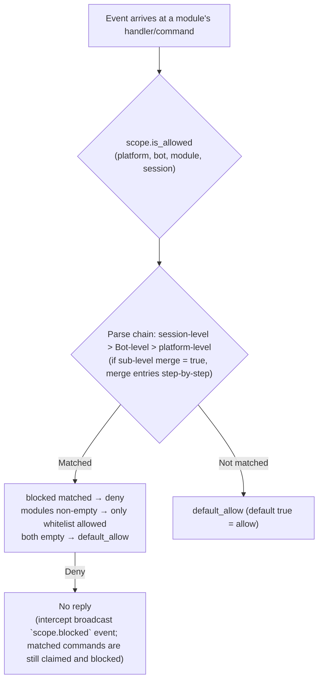

- **Parse priority**: session-level > Bot-level > platform-level, higher priority bindings **fully override** lower priority; if sub-level binding sets `merge = true`, it changes to **entry-by-entry union** with lower priority (modules / blocked are merged individually, `merge` itself is a control key, not counted as an entry)
- **Default semantics**: The commands and handlers of filtered modules do not trigger or reply, TRACE-level logs are visible (`core.scope.denied`); interception also broadcasts the `scope.blocked` lifecycle event (subscribing allows observation of who is blocked and why); matched **commands** are still claimed and blocked — command text is no longer leaked to lower-level message handlers, eliminating the ambiguity of "double response" where the command is rejected but the message handler responds again
- **Framework-level handlers** (`scope_exempt=True` or owner is empty) are unaffected; module names that are empty (framework-level resources) are always allowed
- **Session-aware help and command query**: Command query APIs (`command.help` / `get_command` / `get_commands` / `get_group_commands` / `get_visible_commands`, and `module.get_commands_overview`) all support optional `event=` or explicit `platform=` / `bot_id=` / `session_id=` keywords — commands of modules unavailable in the current session no longer appear in the results (return `None` for `get_command`, handle as "unregistered" for single command help, consistent with default semantics); if no context is provided, full behavior is maintained

### Binding Inheritance (merge)

The default semantics of full override are clear and predictable; when you need to **append** on top of an upper-level binding, set `merge = true` in the sub-level:

```toml
[ErisPulse.scope.platforms.onebot11]
modules = ["Chat", "Tool"]      # Platform-level: allow Chat, Tool

[ErisPulse.scope.bots.onebot11."123456"]
modules = ["Music"]
merge = true                    # The effective modules for this Bot = ["Chat", "Tool", "Music"]
```

- **Merge rules**: `modules` and `blocked` each take the **union**; `blocked` in the binding still takes precedence over `modules`
- **Chained merging**: Platform → Bot → Session, each level independently decides `merge` or override

## ② Identity Dimension (Event Admission)

Answers "whose events are accepted or rejected." Events that are rejected are **completely discarded at the distribution entry** — they do not enter middleware or any handler (including framework-level), and are only visible in TRACE-level logs (`core.scope.identity_denied`).

- **Parse priority**: user > session > Bot > adapter, take the most specific configured policy; deny takes precedence over allow
- Each level's binding is a binary policy: `{ allow = true }` or `{ deny = true }`
- User keys support glob / regular expression (e.g., `"spam_*"` to block a batch of spam users)
- Typical usage — deny at the upper level, allow at the personal level for "exceptional allowance":

```toml
[ErisPulse.scope.identity.adapters.onebot11]
deny = true
[ErisPulse.scope.identity.users.onebot11]
allow = ["u_admin"]   # Even if adapter-level is denied, events from u_admin are still allowed
```

## ③ Outbound Dimension (Restricting Module Outbound Calls)

Restricts **outbound actions** initiated by modules: message sending / standard API actions / request operations. Three types of actions correspond to the underlying DSL: `Event.reply` and `Send` (send), `Api` / `call_api` (api), `Request`'s accept/reject (request). Outbound calls initiated by modules during event handler execution carry the module owner, and are uniformly judged by this dimension.

### Rule Form (Inline Table)

Each action's rule is an inline table: `{ allow = [...], deny = true|[...] }`. Only one rule of the same action is allowed (TOML keys are not repeatable, choose between full deny and fine-grained):

```toml
[ErisPulse.scope.actions.MyModule]
send = { deny = true }                                  # Disable all sending (Event.reply / Send DSL)
# Or fine-grained by method: send = { allow = ["Text", "Image*"], deny = ["File"] }
api = { allow = ["get_*"] }                             # Only allow query-type standard APIs
# Or blacklist by action: api = { deny = ["set_*", "leave_*"] }
request = { deny = true }                               # Disable request handling accept/reject
```

- `send` entries match **send method names** (Text / Image / File ...), `api` entries match **standard action names** (get_group_info / set_group_name ...)
- Entries support exact names / glob / `re:` regular expressions (consistent with the unified system syntax, case-insensitive)
- Writing a single string as `allow` is equivalent to a single entry list: `send = { allow = "Text" }`

### Decision Semantics

**Default is full allow** — if not configured, or owner is empty (internal framework calls), allow. After configuring rules, the following order is used for judgment:

1. `deny = true` → deny
2. `deny` list matches the call name → deny
3. `allow` list is non-empty and the call name is not matched (or the call has no name) → deny
4. Otherwise, allow

Denied calls do not initiate any network requests, directly returning the standard failure response (`retcode = 34601`, see [api-response §5.3](../standards/api-response.md#53-Framework-Extension-Return-Codes-34xxx-Platform-Error-Segment-Low-Three-Bits-User-Defined)).

The three actions are independent, and only one can be restricted.

```python
# Runtime API
sdk.scope.set_action("MyModule", "send", deny=True)              # Disable all message sending
sdk.scope.set_action("MyModule", "send", allow=["Text"])         # Allow only text messages
sdk.scope.is_action_allowed("MyModule", "send", name="Image")    # False
sdk.scope.is_action_allowed("MyModule", "api", name="get_user_info")  # Judged by rules
sdk.scope.delete_action("MyModule", "send")                      # Restore allow
sdk.scope.get_action("MyModule", "send")                         # Current rule for this action
```

## Runtime API

The scope runtime API is divided into three layers: **decision** (three questions), **dimensional read/write** (each dimension `set` / `get` / `delete` parameterized methods, fully type-annotated, IDE can complete), and **dictionary-style fallback** (point path to any section).

```python
from ErisPulse import sdk

scope = sdk.scope
```

### Decision (Three Questions)

```python
scope.is_allowed("onebot11", "123456", "Chat")                 # ① Module dimension
scope.is_allowed("onebot11", "123456", "Chat", "789012345")    # With session level
scope.is_allowed("onebot11", "123456", None)                   # Framework-level resources -> True

scope.is_identity_allowed("onebot11", "123456", "group_9", "u1")   # ② Identity dimension

scope.is_action_allowed("MyModule", "send")                    # ④ Outbound dimension
scope.is_action_allowed("MyModule", "send", name="Image")      # Fine-grained by method
```

### ① Module Dimension

```python
# Binding (hierarchy determined by parameters: session_id > bot_id > platform level)
scope.set_module("onebot11", bot_id="123456", modules=["Chat", "Tool*"])
scope.set_module("onebot11", blocked=["re:^Danger"])                       # Platform level
scope.set_module("onebot11", bot_id="123456", session_id="g9", modules=["Chat"])  # Session level
scope.set_module("onebot11", bot_id="123456", modules=["Music"], merge=True)      # Union with existing entries
scope.set_module("onebot11", bot_id="123456", modules=["Chat"], persist=False)    # Runtime only

# Read / Delete
scope.get_module("onebot11", bot_id="123456")   # {"modules": ["Chat"], "blocked": []}
scope.delete_module("onebot11", bot_id="123456")
```

> `merge=True` is **write-time union** (merge entries with existing bindings at this level); `merge = true` configuration key during cross-level parsing is described above in [Binding Inheritance](#binding inheritance merge) — these are independent mechanisms.

> **Runtime binding (persist=False) semantics**: Runtime bindings are saved in a separate overlay layer, **any subsequent configuration writes / hot reload of configuration files will not overwrite them** (the configuration tree is rebuilt and automatically replayed in the order of writes, including runtime deletions). They do not persist to disk and are lost after process restart; when the module is unloaded, the runtime bindings written by the module are cleaned up by default. Subsequently executing `persist=True` writes (user persistence semantics) will replace the runtime rules.

### ② Identity Dimension

```python
# Binding strategy (hierarchy determined by parameters: user > session > bot > adapter; allow / deny mutually exclusive)
scope.set_identity("onebot11", user_id="u_bad", deny=True)
scope.set_identity("onebot11", user_id="spam_*", deny=True)    # Key supports glob / re: regular expression
scope.set_identity("onebot11", bot_id="123456", session_id="g9", allow=True)

# Read / Delete
scope.get_identity("onebot11", user_id="u_bad")   # {"deny": True}
scope.delete_identity("onebot11", user_id="u_bad")
```

### ③ Outbound Dimension

```python
# Set restriction rules (allow: str|list; deny: bool|str|list; replacement semantics for whole rule)
scope.set_action("MyModule", "send", deny=True)                    # Disable all sending
scope.set_action("MyModule", "send", allow=["Text"])               # Allow only text messages
scope.set_action("MyModule", "api", deny=["set_*", "leave_*"])     # Disable management APIs

# Read / Delete
scope.get_action("MyModule", "send")       # {"allow": ["Text"]} original rule
scope.delete_action("MyModule", "send")    # Remove single action
scope.delete_action("MyModule")            # Remove all action restrictions for this module
```

### General

```python
scope.get("platforms")   # Dictionary-style fallback: read any section by dot path
scope.topology()         # Full configuration tree (for Dashboard)
scope.stats()
# {"module_calls": .., "module_filtered": .., "identity_checks": .., "identity_denied": ..,
#  "action_checks": .., "action_denied": .., "cache_hits": .., "cache_misses": ..}
scope.reset_stats()
scope.clear()           # Clear all configurations (only in-memory effect)
```

### Advanced: Dictionary-style dot path fallback

Dimensional methods cover daily scenarios; when you need to directly access any node (or future added dimensions), you can use the dictionary-style API — `get` / `set` / `delete` accepts dot paths (deep dict merge, immediate read after write), and provides `scope[path]` / `scope[path] = v` / `del scope[path]` / `path in scope` protocol:

```python
scope.set("bots.onebot11.123456", {"modules": ["Chat"], "blocked": []})
scope.set("identity.users.onebot11.u_bad", {"deny": True})
scope.get("actions.MyModule.send")

scope["platforms.onebot11"]        # Read (raises KeyError if not exists)
scope["platforms.onebot11"] = {...}  # Write
del scope["platforms.onebot11"]      # Delete
"actions.MyModule" in scope          # Existence check
```

## Intercept Observability: `scope.blocked` Event

When scope interception (module filtering / identity rejection) occurs, the lifecycle event **`scope.blocked`** is broadcast, making "who is blocked, at which level" subscribable, statable, and presentable in the Dashboard — interception does not reply by default, but is no longer an unknowable black box.

| Field | Description |
|------|------|
| `dimension` | `"module"` (module dimension filtering) / `"identity"` (identity admission rejection) |
| `module` | The filtered module name (only in module dimension) |
| `platform` / `bot_id` / `session_id` / `user_id` | The context where the interception occurred |

```python
from ErisPulse.Core.lifecycle import lifecycle

@lifecycle.on("scope.blocked")
def on_blocked(data):
    print(f"Blocked: {data['dimension']} {data.get('module') or data.get('user_id')}")
```

- The event is broadcast in the background via `fire` (zero overhead if no listeners, does not slow down hot paths)
- Repeated interception with the same cache hit **does not** broadcast again — the same combination is only broadcast once when the cache expires
- Distinct from `adapter.event.blocked` (event-level discard): this event is the module / identity filter at the scope admission gate

## Cache and Hot Update

- `is_allowed` / `is_identity_allowed` / `is_action_allowed` results are cached with **LRU cache** (`scope.cache_size` is adjustable), `set` / `delete` / configuration hot update (`config.updated` / `config.set`) automatically invalidate
- All dimension configurations take effect **immediately**, no restart required
- Scope is "per-event" judgment, does not remember across events: configuration changes, next event follows new rules

## Configuration Format Validation

Configuration format is validated section by section during loading / hot update: type errors in sections (e.g., `platforms` written as a string), invalid outbound rules (e.g., `allow` written as a number), unknown action names, unknown top-level keys (e.g., `alow` spelling error) will output **WARNING** and ignore corresponding sections / entries, while other valid configurations remain effective — writing errors no longer silently fail.

## Common Issues and Notes

### 1. Configuration Hierarchy and Overriding

- Module dimension: session level > Bot level > platform level, **full override** (if sub-level `merge = true`, entries are merged step by step). To "platform allows Chat, Bot adds Music", set `merge = true` in the Bot level, or list both simultaneously
- Identity dimension: user > session > Bot > adapter, take the **most specific** configured policy (can do exception allowance)
- Command user black and white lists: exact command names take precedence over glob keys (see `event.command.acl`)

### 2. Module/Command Not Responding

First suspect scope rather than the module itself:

```python
from ErisPulse import sdk

print(sdk.scope.is_allowed(event.get_platform(), bot_id, "MyModule", session_id))
print(sdk.scope.is_identity_allowed(event.get_platform(), bot_id, session_id, user_id))
print(sdk.scope.stats())   # module_filtered / identity_denied > 0 indicates there are blocking records
```

Being filtered defaults to no reply (module dimension and identity dimension, avoiding rule exposure), but broadcasts the `scope.blocked` lifecycle event, and statistics continue to accumulate; commands rejected by ACL will explicitly reply "insufficient permissions".

### 3. Troubleshooting Outbound Actions Being Rejected

```python
from ErisPulse import sdk

print(sdk.scope.get("actions.MyModule"))
print(sdk.scope.stats())   # action_denied > 0 indicates there are blocked calls
```

The interception is **explicit**: rejected calls return the standard failure response (`retcode = 34601` without initiating network requests).

### 4. Session Identifier Isolation Across Platforms

The `(platform, session_id)` combination is the unique identifier. `scope.sessions.onebot11."789"` only affects onebot11, not the same `789` session on Telegram. The same applies to identity dimension user keys.

## Topology Tree API

`ModuleManager.get_topology()` and `AdapterManager.get_topology()` provide module/adapter ownership relationship data, and `sdk.get_topology()` aggregates them (including scope):

```python
from ErisPulse import sdk

topology = sdk.get_topology()
# {
#   "modules": {                                   # Module → owned resources
#     "Chat": {
#       "loaded": True, "enabled": True,
#       "commands": ["chat", "translate"],
#       "handlers": {"message": 2, "notice": 1},
#       "routes": {"http": ["/Chat/api"], "ws": [], "sse": []},
#       "lifecycle_hooks": 3,
#     }
#   },
#   "adapters": {                                  # Adapter → Bot → Scope
#     "onebot11": {
#       "status": "started", "enabled": True,
#       "bots": {"123456": {"status": "online", "scope": {...}}},
#       "scope": {"modules": [...], "blocked": [...]},
#     }
#   },
#   "scope": {                                     # Scope (module / identity / outbound actions)
#     "platforms": {...}, "bots": {...}, "sessions": {...},
#     "identity": {"adapters": {...}, "bots": {...}, "sessions": {...}, "users": {...}},
#     "actions": {...},
#   },
# }
```

- Module topology aggregates the commands, event handlers, HTTP/WS/SSE routes, and lifecycle hooks registered by the module, facilitating the drawing of the module resource tree.
- Adapter topology aggregates the status of each adapter, the status of its subordinate Bots, and the platform-level/Bot-level scope bindings (module dimension).
- **JSON-safe output**: `get_topology(json_safe=...)` defaults to `True`, returning a structure that can be directly `json.dumps` — the module `info` retains only the pure data `meta` sub-table (discarding `module_class` / `strategy` runtime objects), and other nodes (including arbitrary objects inserted by adapter authors into Bot `info`) are sanitized by default (class objects take `__name__`, unserializable objects are replaced with `str()`). Dashboard/WebUI can directly serialize the return; if original objects are needed, pass `json_safe=False`.


### 归属权（owner）系统

# Система собственности (owner)

> [!TIP]
> **Когда читать эту статью**: при диагностике утечек ресурсов, при изучении цепочки очистки при отключении или при декларировании ресурсов собственности. Если не нужно, можно пропустить, это не повлияет на использование других функций.

Собственность является основой "plug-and-play" модулей: все ресурсы фреймворка, зарегистрированные во время загрузки модуля, автоматически именуются, и при отключении/отключении модуля они автоматически возвращаются — автор модуля должен просто декларировать ресурсы, не нужно писать логику очистки вручную.

> **Связанные системы**: область действия (scope) определяет, "действует ли ресурс" при рассылке событий, а собственность определяет, "кому принадлежит ресурс и кто будет очищен при отключении" в течение жизненного цикла. Область действия можно найти в [Единой контрольной поверхности (scope)](scope.md), фоновые задачи — в [Управлении жизненным циклом](lifecycle.md#принадлежность-фоновых-задач-и-автоматический-отмена).

{!--< tips >!--}
1. Собственность **в момент регистрации** автоматически записывается по `current_owner`, код модуля не требует изменений
2. Отключение/отключение используют одну и ту же цепочку очистки (`_cleanup_module_registrations`), каждая неудача вызывает только предупреждение, но не прерывает процесс
3. Ресурсы, определённые пользовательскими настройками (постоянное перезаписывание / правила scope / ACL команд) **не** очищаются при отключении модуля
4. Внешние дескрипторы, предоставленные инструментальным модулем, можно добавить в цепочку очистки с помощью `on_cleanup(cb)`, и они будут автоматически вызываться при отключении другого модуля (см. [Руководство по инструментальным модулям](#инструментальные-модули-руководство-по-передаче-дескрипторов-другим-модулям))
{!--< /tips >!--}

## Механизм контекста owner

owner передаётся через переменную контекста `current_owner` (`ErisPulse.runtime.context`):

```python
from ErisPulse.runtime import owner_scope, get_current_owner

with owner_scope("MyModule"):
    # Все зарегистрированные ресурсы в этом диапазоне автоматически привязываются к MyModule
    assert get_current_owner() == "MyModule"
```

Фреймворк автоматически вставляет owner в следующие моменты (код модуля/адаптера не требует ручного обёртывания):

| Момент | Значение owner | Позиция |
|------|----------|------|
| Модуль `load()` | Имя модуля | Весь процесс инстанцирования + `on_load` |
| Адаптер `start()` / `restart()` | Имя платформы | Весь процесс запуска адаптера |
| Регистрация stub'а для ленивой загрузки `activate_on` | Имя модуля | Зарезервированная регистрация команд/обработчиков |
| Выполнение обработчика событий | Имя модуля, к которому принадлежит обработчик | Перезапись контекста в handler / точку входа команды |

Перезапись контекста во время выполнения означает: обработчики команд, объявленные в `on_load`, при вызове API регистрации (например, `sdk.adapter.on()` или `overrides.*.set(persist=False)`) во время выполнения также автоматически привязываются к текущему модулю.

## Обзор ресурсов

Все ресурсы, зарегистрированные в контексте загрузки модуля, записываются с привязкой к владельцу и автоматически освобождаются при выгрузке/отключении:

| Ресурс | Способ регистрации | Вызов очистки |
|------|----------|----------|
| Команды | `@command()` / объявление команды в виде dict | `command.unregister_by_owner()` |
| Обработчики событий | `@message` / `@notice` / `@request` / `@meta` | `handler.unregister_by_owner()` |
| Слушатели событий адаптера | `sdk.adapter.on()` / `raw=True` | `adapter.unregister_handlers_by_owner()` |
| Промежуточные обработчики адаптера | `@sdk.adapter.middleware` | То же |
| Маршруты (HTTP/WS/SSE) | `router.http()` / `websocket()` / `sse()` | Двойная очистка по пространству имён и владельцу |
| Промежуточные обработчики маршрутов | `@router.middleware()` / `add_middleware()` | `router.unregister_all_by_owner()` |
| Вход на главную панель | `router.register_home_entry()` | `unregister_home_entries_by_owner()` |
| Пользовательские типы сессий | `register_custom_type()` | `unregister_custom_types_by_owner()` |
| Методы событий платформы | `register_event_method()` / `register_event_mixin()` | `unregister_event_methods_by_owner()` (при выгрузке модуля автоматически освобождаются, старые замыкания не утекают) |
| Задачи в фоне | `self.spawn()` | `cancel_owner_tasks()` |
| Внешние очистки ресурсов (инструментальный модуль) | `runtime.on_cleanup(cb)` | `run_owner_cleanups()` (запускается при выгрузке/отключении/остановке адаптера) |
| Жизненный цикл | `lifecycle.register()` | `lifecycle.unregister_by_owner()` |
| Провайдер источника главного | `master.provider` | `master.unregister_by_owner()` |
| Переводы i18n | Объявление `I18nClass` (domain=имя модуля) | `i18n.unregister_domain()` |
| Переопределение событий (во время выполнения) | `overrides.*.set(persist=False)` | `overrides.unregister_by_owner()` |
| Интерактивные сессии (ожидание wait_reply / аренды) | `event.wait_reply()` / `sdk.interaction.acquire()` | `interaction.cancel_by_owner()` (ожидающая сторона получает немедленное отмену) |
| Контекстные данные | `runtime/context` с привязкой к владельцу | Точный сброс по модулю |

Ресурсы со стороны адаптера (с именем платформы в качестве владельца) при `shutdown()` / `restart()` адаптера очищаются методом `_cleanup_adapter_resources`, а также включают:

| Ресурс | Вызов очистки |
|------|----------|
| Собственные `on()` обработчики и промежуточные обработчики адаптера | `adapter.unregister_handlers_by_owner(platform)` |
| Расширения методов событий платформы (`EventMixin`) | `unregister_platform_event_methods(platform)` |
| Пользовательские типы сессий | `unregister_custom_types_by_owner(platform)` |
| Интерактивные сессии (ожидание wait_reply / аренды на платформе) | `interaction.cancel_by_platform(platform)` |
| Переводы i18n (domain=ключ конфигурации) | `i18n.unregister_domain(ключ конфигурации)` |
| Маршруты с мелкозернистым пространством имён | `router.unregister_all_by_owner(platform)` |

## Удаление / отключение последовательности очистки

`unload()` и `disable()` используют одну и ту же цепочку очистки (каждый шаг обернут в try/except, ошибки записываются в лог, **не прерывают последующую очистку**):

```mermaid
flowchart TD
    A["unload / disable"] --> B["on_unload()（с защитой от таймаута）"]
    B --> C["Отмена фоновых задач по умолчанию (cancel_owner_tasks）"]
    C --> C1["Внешние хуки очистки по принадлежности<br/>（регистрация в on_cleanup модуля инструментов, запуск через run_owner_cleanups）"]
    C1 --> D["_cleanup_module_registrations<br/>＝ reclaim_sync() фасада ownership"] 
    D --> D1["Области перевода i18n"]
    D1 --> D2["Маршрутизация: пространство имён + owner по умолчанию<br/>（удаление по точному совпадению объекта маршрута,<br/>включая промежуточные обработчики и главный вход）"]
    D2 --> D3["Обработчики событий адаптеров / промежуточные обработчики"]
    D3 --> D4["Обработчики команд + событий"]
    D4 --> D5["Пользовательские типы сессий"]
    D5 --> D5b["Внедрение методов платформенных событий"]
    D5b --> D6["Переопределение событий во время выполнения (persist=False）"]
    D6 --> D7["Провайдер источника владельца"]
    D7 --> D8["Жизненный цикл хуки"]
    D8 --> E["Удаление свойств SDK + ленивые загрузки"]
    E --> F["Автоматическая легкая аудитория: предупреждение о "орphaned" owner"]
```

При выходе `sdk.uninit()` есть дополнительный глобальный хук: остановка всех адаптеров → загрузка всех модулей → `router.stop()` (очистка маршрутов / промежуточных обработчиков / главного входа) → `cancel_all_background_tasks()` → очистка обработчиков событий и хуков.

## Поверхность унификации прав собственности (ownership)

Шестнадцать шагов очистки цепочки сходятся под поверхностью унификации прав собственности `ErisPulse.Core.ownership`, четыре глагола охватывают "отмену, подсчет, сканирование, аудит" — функции `*_by_owner` отдельных подсистем остаются без изменений, служа внутренней реализацией поверхности:

| Глагол | Назначение |
|------|------|
| `ownership.reclaim(owner)` | Унифицированная отмена всех ресурсов владельца (отмена задач → чистящие хуки → ресурсы регистраций; асинхронная полная версия) |
| `ownership.reclaim_sync(owner)` | Отмена ресурсов регистраций (синхронная версия, для синхронного пути выгрузки) |
| `ownership.counts(owner=None)` | Только чтение: подсчет ресурсов владельца (если None, то подсчет всех владельцев) |
| `ownership.orphans()` | Сканирование сирот: ресурсы в реестре, но владельцы уже отменены (список подтвержденных утечек) |
| `ownership.audit(owner, deep=)` | Отчет по аудиту утечек (подсчет + сироты + необязательное полное исследование gc экземпляров) |

```python
from ErisPulse.Core import ownership

ownership.reclaim_sync("MyModule")       # {'commands': 1, 'routes_http': 2, ...}
ownership.counts("MyModule")             # Подсчет ресурсов владельца
ownership.orphans()                      # [{"owner": "ghost", "total": 2, ...}]
```

**Точка входа аудита**:

- **Легкий автоматический аудит** после выгрузки / перезагрузки: обнаружение сирот-ресурсов владельца вызывает предупреждение (без дополнительных затрат, сканирование подсчета)
- `sdk.module.audit(name, deep=True)`: исследование gc экземпляров модуля — при невозможности сборки мусора экземпляра указывается тип источника ссылки (определение "кто держит старый экземпляр"); имеет глобальные накладные расходы, используется только для явного устранения неисправностей
- Глубокое исследование — явная операция, не имеет ключа конфигурации и не выполняет автоматическое исправление

## Откат при неудачной горячей перезагрузке

Горячая перезагрузка теперь реализована по схеме "**Создание снимка перед выгрузкой → Автоматический откат при сбое**": при синтаксических ошибках в новой версии, отсутствии зависимостей или сбое загрузки, старый экземпляр и зарегистрированные состояния (записи в реестре, свойства sdk, записи в sys.modules) автоматически восстанавливаются, сервис не прерывается, в логах появляется сообщение "Восстановлен старый экземпляр, продолжение работы".

Ограничения семантики "стараться изо всех сил" (документированные границы):

- Неотменяемые побочные эффекты, выполненные в `on_unload` (разорванные соединения, отмененные задачи) — после восстановления старый экземпляр находится в состоянии "уже завершен", требуется повторный запуск загрузки для полной доступности
- Ручные ссылки на старый экземпляр, созданные сторонними компонентами во время выполнения, не восстанавливаются
- Если пакет уже был выгружен (исчез entry-point), это считается успешной выгрузкой, откат не производится

## Пределы принадлежности: какие ресурсы не удаляются при выгрузке

Принадлежность удаляет **только ресурсы, зарегистрированные кодом модуля**. Ресурсы, относящиеся к **семантике пользовательских настроек** (управление на стороне пользователя, возможно, намеренно настроенные), сохраняются после выгрузки модуля:

| Ресурс | Семантика | Описание |
|------|------|------|
| `overrides.*.set(persist=True)` | Постоянное переопределение | Записано в конфигурационный файл, сохраняется при перезапуске; не удаляется при выгрузке модуля (явно настроен пользователем) |
| `scope.set_action()` и другие правила области видимости | Правила контрольной плоскости | Управляются пользователем/Dashboard, не удаляются при выгрузке модуля |
| `overrides.acl.set(persist=True)` | ACL команд | То же самое |
| `Conversation.save()` (постоянное сохранение) | Многоконтекстные диалоги | Данные сохраняются и не удаляются |

Временные данные, записанные с `persist=False`, удаляются вместе с owner-ом — **разница между "активными данными модуля" и "активными данными пользователя"**.

## Внутренняя реализация: как работает принадлежность

Система принадлежности состоит из **двух независимых цепочек**, понимание их разделения необходимо для отладки проблем с принадлежностью:

### Цепочка привязки (contextvar-передача)

`runtime/context.py` `current_owner` и другие `ContextVar` отвечают за **привязку** — "кому принадлежит ресурс, зарегистрированный в данный момент". Правила передачи соответствуют семантике `contextvars` в Python:

| Выполнение | Передача контекста | Результат привязки |
|---------|----------------|---------|
| Синхронные вызовы / `await` цепочки | ✅ Передаётся | Правильная привязка |
| `owner_scope` внутри `asyncio.create_task` | ✅ Передаётся (task копирует контекст на момент создания) | Правильная привязка внутри задачи |
| `run_in_executor` / обычные потоки | ❌ Не передаётся | Потеря привязки |
| Самостоятельно созданный цикл событий | ❌ Не передаётся | Потеря привязки |

> Привязка ≠ регистрация: передача контекста влияет только на "кому принадлежит", а возможность очистки зависит от того, попал ли ресурс в цепочку отмены.

### Цепочка отмены (таблица задач)

`runtime/tasks.py` `_owner_tasks` отвечает за **жизненный цикл** — "какие задачи принадлежат owner и как их отменить при выгрузке модуля". Задачи попадают в таблицу следующими путями:

1. **Явный запуск**: `spawn_background()` / `self.spawn()` — при создании захватывается `current_owner` (или явно заданный параметр `owner=`) и задача регистрируется;
2. **Автоматическая регистрация Task Factory** (2.8.3): `install_owner_task_factory()` устанавливается при запуске фреймворка в главный цикл событий — **любая** задача (включая внутренние `create_task` сторонних библиотек) проходит через фабрику и читает `current_owner`, если не None — задача регистрируется.

Таблица автоматически очищается: каждая задача имеет `done_callback`, при завершении удаляется из таблицы, утечек нет.

### Последовательность отмены (выгрузка модуля)

```
module.unload()
  → on_unload(event)                    # Собственная очистка модуля (ограничение по времени)
  → Фреймворк отменяет команды/обработчики/хуки/роутеры этого owner
  → cancel_owner_tasks(owner)           # Отмена задач по таблице
      → task.cancel()                   # Исключая саму задачу, отменяющую логику
      → await gather(pending, timeout)  # Ожидание завершения (ограничение по времени)
```

### Стратегия отладки

- **Ресурс не был очищен** → проверьте таблицу: `get_owner_tasks("MyModule")` содержит ли задачу; если нет — путь регистрации не прошёл через цепочку принадлежности (import-период / поток / независимый цикл), сверьтесь с таблицей выше.
- **Неправильная привязка** → проверьте `get_current_owner()` в момент ошибки; для асинхронных задач/колбэков привязка берётся из контекста на момент создания, а не выполнения.

## Руководство для авторов модулей

### Рекомендуемый стиль

```python
from ErisPulse import sdk
from ErisPulse.Core.Event import command
from ErisPulse.runtime import owner_scope, spawn_background

class MyModule(BaseModule):
    async def on_load(self, event):
        # Ресурсы фреймворка: автоматически привязываются, не требуют ручной очистки
        self.task = self.spawn(self.polling())      # Фоновая задача
        sdk.router.register_home_entry("Мой модуль", "/my")  # Вход на панель управления

        # Собственные ресурсы модуля: вложите в owner_scope для включения в систему принадлежности
        with owner_scope("MyModule"):
            self.client.on_event(self._handle)      # Пример пользовательской регистрации

    async def on_unload(self, event):
        # Ресурсы фреймворка уже были автоматически удалены, очищайте только собственные ресурсы вне owner_scope
        await self.client.close()
```

### Важные замечания

- **Регистрация в момент импорта без принадлежности**: Регистрация хуков/обработчиков на уровне модуля (в момент импорта) происходит до `owner_scope`, и такие ресурсы считаются принадлежащими фреймворку (owner=None) и **не удаляются**. Все регистрации должны быть в `on_load()`.
- **Регистрация i18n с пользовательским domain**: `i18n.register(domain=...)` с domain, не равным имени модуля, не будет автоматически удалена, сохраняйте domain=имя модуля.
- **Рекомендуется использовать `self.spawn()` для фоновых задач**: с версии 2.8.3 `asyncio.create_task` также **автоматически** привязывается (Task Factory автоматически регистрирует, отменяет при выгрузке); но `self.spawn()` всё ещё рекомендуется — поддерживает запуск вне главного цикла, явное указание `owner=` и предотвращение GC. **В версиях до 2.8.3** негарантированная принадлежность, нужно использовать `self.spawn()`.
- Цепочка очистки "сбой только предупреждение": ошибка на одном этапе не прерывает очистку остальных ресурсов, логи видны на уровнях DEBUG/WARNING, для отладки можно включить TRACE.

### Сравнение сценариев регистрации → результат принадлежности

| Сценарий регистрации | Результат принадлежности | Описание |
|---------|---------|------|
| Регистрация внутри `on_load()` через API фреймворка (команды/обработчики/lifecycle/роутер) | Принадлежит модулю | Автоматически удаляется при выгрузке |
| Регистрация на уровне модуля (в момент импорта) | **Без принадлежности** (owner=None) | Не удаляется, не используйте |
| Создание фоновой задачи с `self.spawn()` | Принадлежит модулю | Автоматически отменяется при выгрузке |
| Регистрация внутри `owner_scope("Name")` через API сторонней библиотеки | Принадлежит модулю | Зависит от синхронного выполнения колбэка внутри scope |
| Негарантированная принадлежность `asyncio.create_task` (включая `loop.create_task` / `ensure_future`) | **Автоматически привязывается** (Task Factory, 2.8.3+) | Мгновенно захватывает `current_owner`, автоматически регистрируется, отменяется при выгрузке; см. [Внутренняя реализация](#Внутренняя реализация-как-работает-принадлежность) |
| Задачи, созданные в асинхронных колбэках сторонних библиотек (aiohttp / APScheduler и др.) | **Автоматически привязывается** (Task Factory, 2.8.3+) | Если `current_owner` уже установлен (например, во время выполнения обработчика фреймворка), задача автоматически регистрируется |
| `run_in_executor` (пул потоков) | **Без принадлежности** (не asyncio.Task) | Потоки не управляются Task Factory, жизненным циклом нужно управлять самостоятельно |
| Регистрация в независимом цикле событий | **Без принадлежности** | Task Factory устанавливается только в главный цикл; contextvars также не передаются между циклами |

> Принцип: **принадлежность следует за `current_owner` на момент регистрации**; любая асинхронная задержка, пул потоков или независимый цикл событий отключает этот контекст — при необходимости принадлежности явно используйте `owner_scope`.

## Руководство по модулю-инструменту: обработка ссылок на другие модули

**Сценарий**: модули-инструменты, такие как таймеры, реестры и пулы соединений, хранят ссылки на другие модули —
например, при вызове `sdk.Cron.on_trigger(handler)` в `on_load` модулем, ваш контейнер сохраняет
ссылку на экземпляр этого модуля. Фреймворк автоматически очищает все ресурсы, зарегистрированные модулем, но не может очистить
**вашу частную ссылку в контейнере**: после отключения модуля ваш контейнер по-прежнему ссылается на его экземпляр, и он не может быть
удалён сборщиком мусора (утечка памяти, `purge` диагностика сообщает "неперемещаемый").

**Решение**: в той же функции, где вы регистрируете объекты другого модуля, вызовите `on_cleanup()`,
фреймворк автоматически вызовет вашу функцию очистки при отключении / отключении модуля:

```python
from ErisPulse.Core.Bases import BaseModule
from ErisPulse.runtime import off_cleanup, on_cleanup

class CronModule(BaseModule):
    def __init__(self):
        self._entries = {}  # {имя модуля: список обработчиков, предоставленных модулем}

    def on_trigger(self, handler):
        # Автоматически определяет имя вызывающего модуля (работает как при прямом вызове, так и через module.call()),
        # возвращает имя модуля, которое можно использовать как ключ
        owner = on_cleanup(self._drop)
        self._entries.setdefault(owner, []).append(handler)

    def _drop(self, owner: str):
        """Вызывается фреймворком автоматически при отключении/отключении модуля: просто удаляем его ссылки"""
        self._entries.pop(owner, None)

    async def on_unload(self, event):
        off_cleanup(self._drop)  # ③ Удаляем хук перед выгрузкой, чтобы избежать удержания ссылки на self
```

Обеспечиваемые фреймворком поведения:

| Аспект | Поведение |
|--------|-----------|
| Время срабатывания | При отключении модуля unload / disable, или при закрытии адаптера — все события происходят в рамках цепочки очистки, до диагностики утечек памяти purge |
| Определение вызывающего модуля | При прямом вызове используется `current_owner`; при вызове через `module.call()` — `current_caller`; можно также явно указать `on_cleanup(cb, owner="имя модуля")`. **Обязательная проверка**: если имя модуля не может быть определено (все три источника отсутствуют), выбрасывается `ValueError` — частные модули-инструменты должны регистрировать хуки в контексте загрузки собственного модуля |
| Подпись обратного вызова | `cb(owner: str)`, синхронный / асинхронный; асинхронный вызов защищён таймаутом (`CLEANUP_CALLBACK_TIMEOUT_SECS`, по умолчанию 10 секунд) |
| Обработка ошибок | Ошибка или таймаут одного обратного вызова записываются в лог, не влияя на остальные хуки и цепочку очистки |
| Повторная регистрация | Одна и та же пара `(owner, callback)` регистрируется только один раз |

**Когда не нужно использовать**: если модуль регистрирует ресурсы фреймворка (команды, обработчики событий, маршруты,
фоновые задачи и т.д.), фреймворк уже автоматически очищает их (см. выше [Обзор ресурсов](#обзор-ресурсов)).
Только ссылки на объекты других модулей, хранящиеся в вашем частном контейнере, требуют `on_cleanup`.
Сводка для разработчиков модулей доступна в [Рекомендациях · Инструментальные модули](../developer-guide/modules/best-practices.md#инструментальные-модули-при-хранении-объектов-других-модулей-нужно-реагировать-на-уведомления-об-отключении).


### 影子模块与灰度转正

# Теневые модули и постепенный переход

> [!TIP]
> **Когда следует прочитать эту статью**: при необходимости постепенного релиза — параллельной тестовой работы новой версии, сравнения поведения и принятия решения о переходе или откате. Если это не требуется, можно пропустить эту статью, это не повлияет на использование других функций.

Теневой модуль = **новая версия** одного и того же модуля, которая параллельно работает с текущей версией под другим владельцем (например, `roll_shadow`). Он получает **копии** реальных событий, а его исходящие вызовы **перехватываются и отслеживаются**, вместо того чтобы посылаться наружу. В `shadow_diff` сравниваются поведения двух версий, и после подтверждения их безопасности можно одним действием `promote` перевести теневую версию в статус основной, или `dismiss` — в любой момент отказаться от неё. **Код модуля не изменяется, вся работа происходит через API во время выполнения**: подобно `load / unload / reload`, действия администрирования можно вызывать через Dashboard или пользовательские модули управления, без необходимости ручного написания каких-либо настроек.

{!--< tips >!--}
1. Запуск: ``await sdk.module.shadow_start("roll", source="путь/к/v2")``
   —— новая версия кода работает параллельно со старой под другим владельцем (по умолчанию имя владельца берётся из пути)
2. Теневой модуль не участвует в реальной маршрутизации и зависимостях: одноимённые команды выполняются в директории теневого модуля, маршрутизация только регистрируется, но не привязывается, тихая трансляция жизненного цикла, а `module.call` и разрешение зависимостей по-прежнему указывают на v1
3. Принятие решения о переходе всегда принимает человек: ``await sdk.module.promote_shadow("roll")``, в случае ошибки автоматически происходит откат к старой версии; ``dismiss_shadow`` — отмена теневого модуля в любой момент
{!--< /tips >!--}

## Быстрый старт

```python
# Код v2: обычный модуль, без теневого режима (любой каталог, например downloads/roll_v2/)
```

```python
# В онлайн-боте (через Dashboard / модуль управления), запуск грейд-теста одной строкой:
await sdk.module.shadow_start("roll", source="downloads/roll_v2")
# → Теневой модуль с отдельным owner "roll_v2" параллельно работает с v1, исходящие сообщения перехватываются и записываются

# Сравнение поведения во время тестирования:
report = sdk.module.shadow_diff("roll")
# {"shadow_owner": "roll_v2", "count": 3, "aligned": [...]}
```

- **v1 фактическая отправка**: из бот-таймлайна в инбоксе (transcript)
- **v2 предполагаемая отправка**: теневой отчёт (запись в исходящем трафике о "что хотели отправить")
- Оба сопоставляются по `trace_id` — для одного и того же сообщения, почему один и другой вариант сработали/не сработали, что хотели отправить/что отправили — всё видно

После проверки без ошибок:

```python
await sdk.module.promote_shadow("roll")   # Промоутить, при ошибке автоматически откатить к v1
await sdk.module.dismiss_shadow("roll")   # Или отменить теневой режим
```

## Пять изолирующих барьеров

| Барьер | Механизм |
|----|------|
| Копия события | Теневой обработчик получает **независимую копию** события (с меткой `shadow`) — изменения / признание / остановка распространения теневого события влияют только на копию, не затрагивая оригинальную цепочку событий |
| Выходная дверь | Все вызовы DSL `Send` и `Api` теневого события перехватываются и регистрируются (возвращается фиктивный ответ), событие не отправляется наружу — теневой обработчик не будет повторно отвечать |
| Слой перекрытия хранилища | Запись KV теневого события происходит в слое перекрытия в памяти и не сохраняется в базу данных; чтение сначала проверяет слой перекрытия, при неудаче — обращается к реальной базе данных (灰度 процесс работает с реальными данными); удаление помечается как "могильный камень" |
| Блокировка маршрутизации | HTTP/WS/SSE маршруты теневого события регистрируются, но не подключаются; команды с тем же именем записываются в каталог теневых команд, методы платформенных событий запрещены к вставке |
| Тихий жизненный цикл | Теневой обработчик не транслирует собственные события жизненного цикла и не участвует в экосистемной зависимости (вызовы `module.call` и разрешение зависимостей по-прежнему указывают на v1, чтобы избежать зависимости от незавершённого продукта) |

Наследование конфигурации: теневой обработчик по умолчанию **наследует конфигурационные разделы оригинального модуля** (иначе серая версия будет отличаться от оригинала), после перевода в основной режим конфигурация применяется на месте.

## Честные границы (не остановить)

- Отправка / API / хранилище KV / единый HTTP-клиент через фреймворк **всё можно остановить**;
  модули, обходящие фреймворк, запускают `aiohttp` напрямую, создают потоки и пишут во внешние системы — фреймворк не может остановить
- **Чтение и запись ORM не входят в область покрытия** (по строкам overlay невозможно реализовать чисто на уровне SQL) —
  в период теневого режима рекомендуется избегать зависимости от ORM для обеспечения изоляции
- **Источник теневого режима — локальный путь**: новая версия кода импортируется по пути, загружается отдельным владельцем; один и тот же пакет PyPI
  в одном и том же интерпретаторе ограничен ключом `sys.modules`, не позволяя одновременно использовать две версии
- Аудитор утечек (`sdk.module.audit`) видит принадлежность теневых ресурсов; побочные эффекты от обхода фреймворка
  по крайней мере не будут бесшумными

## Промотирование и откат

Процесс `promote`: создание снимка текущей версии (включая все зависимые модули) → полное удаление → регистрация теневого экземпляра с настоящим именем → загрузка → при сбое на любом этапе автоматический откат, старый экземпляр продолжает обслуживать запросы (семантика "по возможности": эффекты, вызванные уже выполненным `on_unload`, не могут быть отменены, после отката старый экземпляр находится в состоянии завершения). После успешного промотирования теневые ресурсы утилизируются, и связь снимается; конфигурация оригинального модуля применяется на месте.

**Примечание о сохранении изменений**: промотирование происходит в режиме выполнения — после перезапуска будет продолжать работать версия v2. Необходимо **сохранить новую версию** (установить новую версию с помощью `pip install -U` или заменить файлы плагина). Переключение в режиме выполнения не заменяет пакетный менеджер.


### 启动流程与手动控制

# Процесс запуска и ручное управление

> [!TIP]
> **Когда нужно читать эту статью**: когда требуется вручную управлять цепочкой запуска, настраивать порядок запуска или устранять проблемы с запуском. Если это не требуется, можно пропустить, это не повлияет на использование других функций.

В ErisPulse `await sdk.run()` / `await sdk.init()` объединяют всю цепочку запуска в "одну строку кода". Однако, когда требуется полностью настроить процесс запуска (например, частичная загрузка, динамическая регистрация, горячая замена, внедрение пользовательской стратегии загрузки), необходимо понимать, что происходит внутри этой цепочки и как вручную управлять каждым шагом.

В этой статье цепочка запуска разбивается на отдельные этапы, описываются их обязанности, порядок вызова, а также приводится пример ручного полного запуска.

> В этой статье предполагается, что вы уже запустили [первого робота](../getting-started/first-bot.md) и знакомы с двумя режимами `sdk.run(keep_running=True/False)`. В этой статье акцент делается на разборе внутренней цепочки `init()`, а также более низкоуровневых входных точек `init()`/`init_task()`/`init_sync()`.

## Обзор верхнего уровня SDK

Помимо двух режимов `keep_running` для `run()`, SDK предоставляет несколько более низкоуровневых точек входа, которые отличаются **асинхронностью, возвращаемым значением и обработкой исключений**:

| Точка входа | Асинхронность | Возвращаемое значение | Обработка исключений | Сценарий использования |
|-------------|---------------|------------------------|----------------------|-------------------------|
| `await sdk.run(True)` | async, блокирующий | `None` (автоматически `uninit` при остановке) | Ошибки модулей/адаптеров перехватываются, не приводят к сбою процесса | Простое приложение-бот |
| `await sdk.run(False)` | async, не блокирующий | `None` (не автоматически выгружается) | То же самое | Инициализация, затем выполнение пользовательской логики |
| `await sdk.init()` | async, требует `await` | `bool` | Внутренние исключения компонентов перехватываются, в случае неудачи возвращается `False` | Ручное управление жизненным циклом (с `uninit()`) |
| `sdk.init_task()` | async, возвращает `Task` без блокировки | `asyncio.Task` | То же, что и `init()` | Параллельное выполнение других инициализаций или когда цикл событий еще не запущен |
| `sdk.init_sync()` | **Синхронный**, блокирует текущий поток | `bool` | То же, что и `init()` | Сценарии командной строки, синхронный вход без цикла событий |

> **Распространённое заблуждение**: `await sdk.init()` **не эквивалентно** `await sdk.run(keep_running=False)`. Есть два различия: ① `init()` возвращает `bool` (в случае неудачи возвращает `False`), `run()` возвращает `None`; ② `init()` выполняет только инициализацию и **не производит автоматическую выгрузку**, `run()` автоматически вызывает `uninit()` при завершении цикла событий. Поэтому, если требуется ручное управление жизненным циклом или выгрузкой, используйте `init()` + `uninit()`.

## Обзор запуска

`sdk.init()` (точнее, его внутренний `Initializer.init()`) запускает всю систему в следующем порядке:

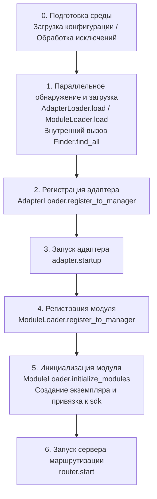

Соответствующие основные компоненты:

| Уровень | Компонент | Ответственность |
|----|------|------|
| Обнаружение | `AdapterFinder` / `ModuleFinder` | **Обнаружение** адаптеров/модулей из entry-points установленных пакетов |
| Загрузка | `AdapterLoader` / `ModuleLoader` | Обнаружение + импорт + чтение метаданных + проверка включения/отключения, возвращает список объектов |
| Регистрация | `*Loader.register_to_manager` | Запись объектов в соответствующий менеджер |
| Управление | `sdk.adapter` / `sdk.module` | Хранение экземпляров адаптеров/модулей, предоставление интерфейсов запуска/остановки |
| Инициализация | `ModuleLoader.initialize_modules` | Создание экземпляров модулей и привязка к `sdk` (обработка топологической сортировки зависимостей) |
| Маршрутизация | `sdk.router` | HTTP / WebSocket сервер |

> **Важно**: `Finder` и `Loader` — это два уровня. `Loader` внутри **уже содержит** `Finder` (`AdapterLoader` содержит `AdapterFinder`, `ModuleLoader` содержит `ModuleFinder`). В большинстве случаев вам достаточно использовать `Loader`, а `Finder` применяется только тогда, когда нужно "только перечислить, но не импортировать".

[Документация на русском языке](docs/ru/quick-start.md)

## Подробное описание каждого этапа

### 1. Уровень обнаружения: Finder

Finder отвечает только за "поиск пакетов, предоставляющих адаптеры/модули", не импортирует и не создает экземпляры.

```python
from ErisPulse.finders import AdapterFinder, ModuleFinder

adapter_finder = AdapterFinder()
module_finder = ModuleFinder()

# Поиск всех установленных entry-points для адаптеров/модулей
adapter_entries = adapter_finder.find_all()    # list[EntryPoint]
module_entries = module_finder.find_all()      # list[EntryPoint]

# Поиск по имени
entry = module_finder.find_by_name("MyModule")  # EntryPoint | None
```

Каждый `EntryPoint` можно загрузить через `.load()`, чтобы получить соответствующий класс, но обычно это делает Loader автоматически.

### 2. Уровень загрузки: Loader

Loader на основе Finder выполняет "импорт + чтение метаданных + проверку включения/отключения".

```python
from ErisPulse.loaders import AdapterLoader, ModuleLoader
from ErisPulse import sdk

adapter_loader = AdapterLoader()
module_loader = ModuleLoader()

# Внутри load(): вызывается finder.find_all() → обработка entry-point → возврат тройки
adapter_objs, enabled_adapters, disabled_adapters = await adapter_loader.load(sdk.adapter)
module_objs, enabled_modules, disabled_modules = await module_loader.load(sdk.module)
```

Тройка, возвращаемая `load()`:

| Возвращаемое значение | Значение |
|-----------------------|----------|
| `objs` (`dict`)       | Сопоставление названия → объекта (класс адаптера / обёртка модуля) |
| `enabled` (`list[str]`) | Названия, включённые (не отключены в конфигурации) |
| `disabled` (`list[str]`) | Названия, отключённые |

#### Информация о диагностике при сбое загрузки

Если при загрузке или инициализации модуля/адаптера возникает исключение, фреймворк пропускает этот компонент и продолжает загрузку остальных, выводя **сводку пользовательских фреймов кода**, чтобы вы могли локализовать проблему на уровне INFO, без необходимости вручную включать DEBUG:

```
[ERROR] [ModuleLoader] Загрузка модуля MyModule из entry-point не удалась, пропущено: 'NoneType' object has no attribute 'platform'
  → MyModule/Core.py:42 in on_load
      adapter = sdk.platform
  → AttributeError: 'NoneType' object has no attribute 'platform'
  → Подсказка: Увеличьте уровень логирования до DEBUG для просмотра полного стека; проверьте реализацию модуля MyModule
```

Диагностическая информация генерируется через модуль `ErisPulse.runtime.diagnostics` и автоматически фильтрует внутренние фреймы фреймворка, оставляя только фреймы вашего кода. При необходимости можно повторно использовать это в пользовательской логике загрузки:

```python
from ErisPulse.runtime import log_diagnostic

try:
    risky_init()
except Exception as e:
    log_diagnostic(e)  # Автоматически извлекает фреймы пользовательского кода и записывает в ERROR-лог
```

Модуль также предоставляет два вспомогательных метода: `extract_user_frame()` (возвращает структурированную информацию о фрейме) и `format_diagnostic_block()` (возвращает многострочную текстовую строку).

### 3. Регистрация: register_to_manager

Регистрация объектов, созданных Loader, в менеджере, чтобы `sdk.adapter` / `sdk.module` могли их распознавать.

```python
# Регистрация адаптеров (возвращает bool, означающий, успешно ли все прошли)
await adapter_loader.register_to_manager(enabled_adapters, adapter_objs, sdk.adapter)

# Регистрация модулей
await module_loader.register_to_manager(enabled_modules, module_objs, sdk.module)
```

После регистрации адаптеры зарегистрированы в менеджере адаптеров, а модули — в менеджере модулей, но **ни один из них ещё не запущен/не создан экземпляр**.

### 4. Запуск адаптеров

```python
# Запуск всех зарегистрированных адаптеров
await sdk.adapter.startup()
# Или указать платформу
await sdk.adapter.startup("yunhu")
await sdk.adapter.startup(["yunhu", "telegram"])
```

> Регистрация ≠ Запуск. `register_to_manager` — это просто регистрация; `startup` вызывает метод `start()` адаптера и устанавливает соединение с платформой.

### 5. Инициализация модулей

Модули требуют дополнительного шага — **инициализацию** и привязку к `sdk` (чтобы вы могли обращаться к `sdk.MyModule.xxx`). Этот шаг также обрабатывает зависимости между модулями и сортирует их в топологическом порядке.

```python
success = await module_loader.initialize_modules(
    enabled_modules, module_objs, sdk.module, sdk
)
```

После успешной инициализации модуль появится в `sdk.<ModuleName>`.

### 6. Запуск сервера маршрутизации

```python
await sdk.router.start(
    host="0.0.0.0",
    port=8000,
    ssl_certfile=None,
    ssl_keyfile=None,
)
```

Сервер маршрутизации отвечает за получение обратных вызовов Webhook / WebSocket от адаптеров. Без запуска сервера, адаптеры в режиме сервера не смогут получать сообщения.

## Полный пример ручного запуска

Следующий код **эквивалентен** основному процессу `await sdk.init()`, но каждая его часть доступна для ручного управления, что позволяет вставить пользовательскую логику в любой момент:

```python
import asyncio
from ErisPulse import sdk
from ErisPulse.loaders import AdapterLoader, ModuleLoader

async def manual_startup():
    # 0. Подготовка окружения (загрузка конфигурации, регистрация обработки исключений)
    #    _prepare_environment — это внутренний шаг init(); если использовать ручной процесс,
    #    его необходимо вызвать до Loader, иначе Loader не сможет прочитать конфигурацию,
    #    и все адаптеры/модули будут ошибочно признаны отключенными.
    if not await sdk._prepare_environment():
        print("Ошибка при подготовке окружения")
        return False

    # 1. Создание загрузчиков (внутри каждый загрузчик содержит Finder)
    adapter_loader = AdapterLoader()
    module_loader = ModuleLoader()

    # 2. Параллельное обнаружение и загрузка (аналогично внутреннему gather в init())
    (adapter_objs, enabled_adapters, disabled_adapters), \
    (module_objs, enabled_modules, disabled_modules) = await asyncio.gather(
        adapter_loader.load(sdk.adapter),
        module_loader.load(sdk.module),
    )

    # 3. Регистрация адаптеров
    await adapter_loader.register_to_manager(
        enabled_adapters, adapter_objs, sdk.adapter
    )

    # 4. Запуск адаптеров
    if enabled_adapters:
        await sdk.adapter.startup()

    # 5. Регистрация модулей
    await module_loader.register_to_manager(
        enabled_modules, module_objs, sdk.module
    )

    # 6. Инициализация модулей (инстанцирование + привязка к sdk)
    if enabled_modules:
        await module_loader.initialize_modules(
            enabled_modules, module_objs, sdk.module, sdk
        )

    # 7. Запуск сервера маршрутизации
    await sdk.router.start(host="0.0.0.0", port=8000)

    print("Ручной запуск завершен")
    return True

async def main():
    ok = await manual_startup()
    if ok:
        # Блокировка для поддержания работы (ручной процесс не блокирует автоматически)
        await asyncio.Event().wait()

if __name__ == "__main__":
    asyncio.run(main())
```

### Когда использовать ручной запуск?

В большинстве случаев **ручной запуск не требуется**, так как `await sdk.run()` уже выполняет все вышеперечисленные шаги. Ручной запуск имеет смысл только в следующих сценариях:

- **Частичная загрузка**: загрузить только указанные адаптеры/модули, пропустив остальные
- **Динамическая регистрация**: регистрировать новые адаптеры/модули во время выполнения в зависимости от условий
- **Собственный порядок**: изменить стандартный порядок загрузки (например, запустить модуль до запуска адаптера)
- **Внедрение стратегий**: внедрить в Loader пользовательские менеджеры строгого режима, стратегии загрузки и т. д.
- **Отладка/диагностика**: при сбое на каком-либо этапе, ручной запуск позволяет локализовать проблему

## Контроль на уровне выполнения

Даже после использования `sdk.run()` для запуска, вы всё ещё можете управлять отдельными подсистемами в процессе выполнения, без необходимости перезапуска всего SDK:

### Горячая перезагрузка адаптеров

```python
# Горячая перезагрузка одного из адаптеров (исправление подключения, не влияет на другие платформы)
await sdk.adapter.shutdown("yunhu")
await sdk.adapter.startup("yunhu")

# Запуск новой платформы в процессе выполнения
await sdk.adapter.startup("telegram")

# Временное отключение определённой платформы
await sdk.adapter.shutdown("telegram")
```

> `adapter.startup()` требует, чтобы адаптер **был зарегистрирован** в менеджере. Регистрация происходит внутри `init()`/`run()`, поэтому это и есть тонкое управление, которое возможно **после** запуска.

### Сервер маршрутизации

```python
# Временное отключение сервера webhook
await sdk.router.stop()

# Перезапуск (например, при смене порта)
await sdk.router.start(host="0.0.0.0", port=9000)
```

### Загрузка модулей по требованию

```python
# Ручная загрузка модуля (возможно, ленивой загрузки)
await sdk.load_module("MyModule")
```

## Грациозное завершение

Начиная с версии 2.7.0, `sdk.shutdown()` обеспечивает **программное грациозное завершение**: установка события завершения, которое заставляет основной цикл, зависший в `await sdk.run(keep_running=True)`, вернуться, что приводит к запуску `uninit()` и завершению очистки ресурсов.

```python
# Вызывается в любой корутине, вызывает грациозный выход (run() зависший возвращает и автоматически выполняет uninit)
sdk.shutdown()
```

Типичное применение:

```python
async def shutdown_after_idle():
    await asyncio.sleep(3600)
    sdk.shutdown()  # Грациозное завершение после 1 часа бездействия
```

**Обработка сигналов**: `run()` внутри регистрирует обработчики `SIGTERM` / `SIGHUP`, преобразуя системные сигналы в грациозное завершение — при остановке контейнеров (Docker `docker stop`) или остановке службы `systemd` процесс будет выполнять `uninit()` для очистки, а не будет принудительно убит.

- На Windows не поддерживается `loop.add_signal_handler`, обработчик сигналов будет автоматически пропущен (можно использовать `sdk.shutdown()` или Ctrl+C для вызова завершения)
- Повторный вызов `sdk.shutdown()` безопасен (при уже установленном событии повторные вызовы не выполняют никаких действий)

## Процесс удаления

Обратной операцией запуска является `await sdk.uninit()`, которая очищает в обратном порядке:

1. Закрытие всех адаптеров (`adapter.shutdown()`)
2. Удаление всех модулей
3. Очистка всех обработчиков событий
4. Очистка модульных свойств менеджеров и SDK

В ручных сценариях запуска не забудьте вызвать `uninit()` перед выходом для обеспечения корректного завершения:

```python
try:
    await asyncio.Event().wait()   # Поддержание работы
finally:
    await sdk.uninit()
```

## Перезапуск

SDK предоставляет два способа перезапуска, и вам не нужно вручную удалять — фреймворк сам всё обработает:

| Способ | Вызов | Поведение | Сценарий использования |
|------|------|------|----------|
| Горячий перезапуск | `await sdk.restart()` | **Горячая перезагрузка кода на уровне компонентов** в одном и том же процессе: все модули и адаптеры проходят единый путь перезагрузки (предварительная проверка синтаксиса / откат снимка / проверка идентичности), без полного `uninit()` / `init()` | После обновления компонентов через pip, чтобы код применился, горячая перезагрузка модулей |
| Жёсткий перезапуск | `await sdk.hard_restart()` | `uninit()` и выход с кодом 42, после чего внешний супервизор запускает новый процесс | При подозрении на утечку памяти/ресурсов, требуется полная перезагрузка |

```python
# Горячий перезапуск: перезагрузка кода на уровне компонентов (наиболее часто используемый способ)
await sdk.restart()

# Жёсткий перезапуск: выход из процесса, передача управления внешнему супервизору (см. руководство по супервизору ниже)
await sdk.hard_restart()
```

> **Два важных момента**:
> 1. Оба метода выполняют перезапуск в фоновом режиме, **немедленно возвращая `True` означает, что "задача перезапуска запланирована"**, а не "перезапуск завершён". Фактический перезапуск происходит в фоне, чтобы не прерывать текущую цепочку событий.
> 2. Принцип `hard_restart()` заключается в следующем: после отключения и сохранения конфигурации, процесс завершается с **кодом 42** (`HARD_RESTART_EXIT_CODE`) — **сам он не запускает новый процесс**, необходимо, чтобы внешний супервизор обнаружил код 42 и перезапустил. Если запускать напрямую через `python main.py` без какого-либо супервизора, процесс завершится с кодом 42 и **не будет автоматически перезапущен** (фреймворк выдаст предупреждение).

### Когда использовать жёсткий перезапуск?

Жёсткий перезапуск — это не просто "более полный перезапуск", он более подходит и даже эффективнее в следующих сценариях:

- **Побочные эффекты бинарных библиотек (C-расширений)**: Горячий перезапуск происходит в одном и том же процессе, и не может освободить ресурсы на уровне процесса, такие как C-расширения, открытые дескрипторы файлов, потоки и т.д.; жёсткий перезапуск создает новый процесс, и таким образом полностью очищает эти побочные эффекты.
- **Выявление утечек ресурсов**: При подозрении на утечку памяти или дескрипторов, жёсткий перезапуск обеспечивает чистую среду.
- **Частые перезапуски с высокой производительностью**: Жёсткий перезапуск избегает накладных расходов на отключение и повторную загрузку в одном и том же процессе, фактически более эффективен, чем горячий перезапуск.

> Функция "перезапуск фреймворка" в панели управления Dashboard, в нижнем слое вызывает именно `hard_restart()`.

### Контракт с кодом выхода 42

Жёсткий перезапуск — это взаимодействие между процессами: **SDK отвечает за выход (код 42), супервизор за перезапуск**.

| Роль | Действие |
|------|------|
| SDK (при жёстком перезапуске) | `uninit()` → сохранение конфигурации → `os._exit(42)` |
| Супервизор | Обнаружение кода выхода подпроцесса 42 → перезапуск той же команды |

> `sdk.is_supervised()` позволяет проверить, был ли текущий процесс запущен супервизором (проверка переменной окружения `ERISPULSE_SUPERVISED`). Команда CLI `run` автоматически вставляет этот маркер при запуске подпроцесса; внешние супервизоры, такие как systemd или Docker, не вставляют его, `is_supervised()` возвращает `False`, и в этом случае после жёсткого перезапуска фреймворк выдаёт предупреждение «не обнаружен супервизор».

### Руководство по супервизору

Выберите подходящий супервизор, чтобы жёсткий перезапуск действительно работал:

#### 1. Команда CLI run (разработка / простое развертывание, рекомендуется)

`epsdk run main.py` содержит встроенный цикл супервизора: он отслеживает код выхода подпроцесса, при коде 42 немедленно перезапускает; при других кодах ошибок выполняет автоматическую повторную попытку с экспоненциальной задержкой; `Ctrl+C` сначала корректно завершает подпроцесс (код 0 считается нормальным выходом, и больше не запускается).

```bash
epsdk run main.py
```

#### 2. systemd (серверы Linux)

`RestartForceExitStatus=42` заставляет код выхода 42 также вызывать перезапуск (по умолчанию `on-failure` работает только для ненулевых кодов):

```ini
[Service]
ExecStart=/usr/bin/python3 /opt/mybot/main.py
Restart=on-failure
RestartForceExitStatus=42
RestartSec=2
User=mybot
```

#### 3. Docker / docker-compose

Внутри контейнера PID 1 — это приложение, и при выходе с кодом 42 контейнер завершается — используйте стратегию `restart`, чтобы он автоматически перезапускался:

```yaml
services:
  bot:
    build: .
    restart: unless-stopped   # перезапуск при любом выходе (включая 42)
```

#### 4. PM2 (экосистема Node.js)

```bash
pm2 start main.py --name mybot --interpreter python3
# 42 считается кодом выхода, PM2 по умолчанию перезапускает; настройте restart_delay для защиты от ложных срабатываний
pm2 set mybot.restart_delay 2000
```

#### 5. supervisord

```ini
[program:mybot]
command=python3 /opt/mybot/main.py
autorestart=true
exitcodes=0,2,42    # 42 также считается "нормальным выходом, требующим перезапуска"
```

#### 6. Супервизор на чистом Python

```python
import subprocess, sys, time

while True:
    p = subprocess.Popen([sys.executable, "main.py"])
    code = p.wait()
    if code == 42:          # запрос на жёсткий перезапуск
        time.sleep(0.5)
        continue
    if code == 0:           # нормальный выход
        break
    time.sleep(3)           # ошибка выхода, задержка и повторная попытка
```

> **Поведение при отсутствии супервизора**: При прямом запуске `python main.py` вызов `hard_restart()` приводит к завершению процесса с кодом 42 и **не перезапускает**. В этом случае необходимо подключить любой из перечисленных супервизоров.


====
技术标准
====


### 会话类型标准

# Стандарт типов сессий ErisPulse

Данный документ определяет стандарты типов сессий, поддерживаемых ErisPulse, включая типы событий приема и типы целей отправки.

## 1. Основные понятия

### 1.1 Типы получения и отправки

ErisPulse различает два типа сессий:

- **Тип получения (Receive Type)**: поле `detail_type` события, используемое для получения
- **Тип отправки (Send Type)**: тип назначения метода `Send.To()` при отправке сообщения

### 1.2 Соответствие типов

```
Тип получения (detail_type)     Тип отправки (Send.To)
─────────────────        ────────────────
private                 →        user
group                   →        group
channel                 →        channel
guild                   →        guild
thread                  →        thread
user                    →        user
```

**Ключевые моменты**:
- `private` — это тип получения, при отправке необходимо использовать `user`
- `group`, `channel`, `guild`, `thread` — типы одинаковы при получении и отправке
- Система автоматически выполняет преобразование типов, без необходимости ручного вмешательства (это означает, что вы можете напрямую использовать полученный тип получения для отправки), на самом деле, вам не нужно беспокоиться об этом, поскольку существует обёртка события, и вы можете напрямую использовать метод `event.reply()`, не задумываясь о преобразовании типов

## 2. Стандартные типы сессий

### 2.1 Стандартные типы OneBot12

#### private
- **Тип получения**: `private`
- **Тип отправки**: `user`
- **Описание**: Личное сообщение в один на один
- **Поле ID**: `user_id`
- **Поддерживаемые платформы**: Все платформы, поддерживающие личные сообщения

#### group
- **Тип получения**: `group`
- **Тип отправки**: `group`
- **Описание**: Сообщение в группе, включая различные формы групп (например, супергруппы в Telegram)
- **Поле ID**: `group_id`
- **Поддерживаемые платформы**: Все платформы, поддерживающие групповые сообщения

#### user
- **Тип получения**: `user`
- **Тип отправки**: `user`
- **Описание**: Тип пользователя, некоторые платформы (например, Telegram) представляют личные сообщения как `user`, а не `private`
- **Поле ID**: `user_id`
- **Поддерживаемые платформы**: Telegram и другие платформы

### 2.2 Расширенные типы ErisPulse

#### channel
- **Тип получения**: `channel`
- **Тип отправки**: `channel`
- **Описание**: Сообщение в канале, поддерживает широковещательные сообщения для нескольких пользователей
- **Поле ID**: `channel_id`
- **Поддерживаемые платформы**: Discord, Telegram, Line и другие

#### guild
- **Тип получения**: `guild`
- **Тип отправки**: `guild`
- **Описание**: Сообщение в сервере/сообществе, обычно используется для событий уровня Discord Guild
- **Поле ID**: `guild_id`
- **Поддерживаемые платформы**: Discord и другие

#### thread
- **Тип получения**: `thread`
- **Тип отправки**: `thread`
- **Описание**: Сообщение в теме/подканале, используется для подразделов обсуждений в сообществах
- **Поле ID**: `thread_id`
- **Поддерживаемые платформы**: Подканалы Discord, темы Telegram и другие

## 3. Типы платформ

### 3.1 Принципы отображения

Адаптер отвечает за сопоставление нативных типов платформ с типами стандарта ErisPulse:

```
Нативный тип платформы → Тип стандарта ErisPulse → Тип отправки
```

### 3.2 Примеры распространённых платформ

#### Telegram
```
Тип Telegram           Тип приёма ErisPulse    Тип отправки
─────────────────      ────────────────       ───────────
private                private                 user
group                  group                   group
supergroup             group                   group  # Сопоставлено с group
channel                channel                 channel
```

#### Discord
```
Тип Discord            Тип приёма ErisPulse    Тип отправки
─────────────────      ────────────────       ───────────
Direct Message         private                user
Text Channel           channel                channel
Guild                  guild                  guild
Thread                 thread                 thread
```

#### OneBot11
```
Тип OneBot11           Тип приёма ErisPulse    Тип отправки
─────────────────      ────────────────       ───────────
private                private                user
group                  group                  group
discuss                group                  group  # Сопоставлено с group
```

## 4. Расширение пользовательских типов

### 4.1 Регистрация пользовательского типа

Адаптер может зарегистрировать пользовательский тип сессии:

```python
from ErisPulse.Core.Event import register_custom_type

# Регистрация пользовательского типа
register_custom_type(
    receive_type="my_custom_type",
    send_type="custom",
    id_field="custom_id",
    platform="MyPlatform"
)
```

### 4.2 Использование пользовательского типа

После регистрации система будет автоматически обрабатывать преобразование и определение этого типа:

```python
# Автоматическое определение
receive_type = infer_receive_type(event, platform="MyPlatform")
# Возвращает: "my_custom_type"

# Преобразование в тип отправки
send_type = convert_to_send_type(receive_type, platform="MyPlatform")
# Возвращает: "custom"

# Получение соответствующего ID
target_id = get_target_id(event, platform="MyPlatform")
# Возвращает: event["custom_id"]
```

### 4.3 Отмена регистрации пользовательского типа

```python
from ErisPulse.Core.Event import unregister_custom_type

unregister_custom_type("my_custom_type", platform="MyPlatform")
```

## 5. Автоматическое определение типа

Когда у события отсутствует явное поле `detail_type`, система автоматически определяет тип по наличию идентификатора:

> [!NOTE]
> **Изменение поведения в 2.7.0+**: `detail_type` используется напрямую только в том случае, если он представляет собой **известный тип сессии** (стандартный или пользовательский). У событий `notice` и `request` `detail_type` (например, `group_member_increase`, `friend_increase`) является **семантическим подтипом**, а не типом сессии, и в этом случае тип сессии определяется по идентификатору.

### 5.1 Приоритет определения

```
Приоритет (от высокого к низкому):
1. group_id     → group
2. channel_id   → channel
3. guild_id     → guild
4. thread_id    → thread
5. user_id      → private
```

### 5.2 Примеры использования

```python
# У события есть только group_id
event = {"group_id": "123", "user_id": "456"}
receive_type = infer_receive_type(event)
# Возвращает: "group" (group_id используется с приоритетом)

# У события есть только user_id
event = {"user_id": "123"}
receive_type = infer_receive_type(event)
# Возвращает: "private"

# У события notice detail_type является семантическим подтипом, начиная с 2.7.0 будет использоваться определение по идентификатору
event = {"type": "notice", "detail_type": "group_member_increase", "group_id": "123"}
receive_type = infer_receive_type(event)
# Возвращает: "group" (а не "group_member_increase")
```

## 6. Примеры использования API

### 6.1 Отправка сообщений

```python
from ErisPulse import adapter

# Отправка пользователю
await adapter.myplatform.Send.To("user", "123").Text("Hello")

# Отправка в группу
await adapter.myplatform.Send.To("group", "456").Text("Hello")

# Автоматическое преобразование private → user (не рекомендуется, может вызвать проблемы совместимости)
await adapter.myplatform.Send.To("private", "789").Text("Hello")
# Внутри автоматически преобразуется в: Send.To("user", "789") # Использование user в качестве типа сессии является более предпочтительным выбором
```

### 6.2 Ответ на событие

```python
from ErisPulse.Core.Event import Event

# Event.reply() автоматически обрабатывает преобразование типа
await event.reply("Содержание ответа")
# Внутри автоматически используется правильный тип отправки
```

### 6.3 Обработка команд

```python
from ErisPulse.Core.Event import command

@command(name="test")
async def handle_test(event):
    # Система автоматически обрабатывает тип сессии
    # Не нужно вручную проверять group_id или user_id
    await event.reply("Команда выполнена успешно")
```

## 7. Основная API-справка

### 7.1 Преобразование типов

```python
from ErisPulse.Core.Event import convert_to_send_type, convert_to_receive_type

# Тип получения → Тип отправки
convert_to_send_type("private")  # → "user"
convert_to_send_type("group")    # → "group"

# Тип отправки → Тип получения
convert_to_receive_type("user")   # → "private"
convert_to_receive_type("group")  # → "group"
```

### 7.2 Запрос полей ID

```python
from ErisPulse.Core.Event import get_id_field, get_receive_type

get_id_field("group")    # → "group_id"
get_id_field("private")  # → "user_id"

get_receive_type("group_id")  # → "group"
get_receive_type("user_id")   # → "private"
```

### 7.3 Получение информации для отправки одним шагом

```python
from ErisPulse.Core.Event import get_send_type_and_target_id

event = {"detail_type": "private", "user_id": "123"}
send_type, target_id = get_send_type_and_target_id(event)
# send_type = "user", target_id = "123"

# Непосредственно используется в Send.To()
await adapter.Send.To(send_type, target_id).Text("Hello")
```

### 7.4 Получение идентификатора цели

```python
from ErisPulse.Core.Event import get_target_id

event = {"detail_type": "group", "group_id": "456"}
get_target_id(event)  # → "456"
```

## 8. Утилитарные методы

```python
from ErisPulse.Core.Event import (
    is_standard_type,
    is_valid_send_type,
    get_standard_types,
    get_send_types,
    clear_custom_types,
)

is_standard_type("private")     # True
is_standard_type("custom_type") # False

is_valid_send_type("user")      # True
is_valid_send_type("invalid")   # False

get_standard_types()  # {"private", "group", "channel", "guild", "thread", "user"}
get_send_types()      # {"user", "group", "channel", "guild", "thread"}

clear_custom_types()                # Очистить все
clear_custom_types(platform="discord")  # Очистить только для указанной платформы
```

## 9. Лучшие практики

### 7.1 Разработчики адаптеров

1. **Использование стандартных маппингов**: по возможности маппите на стандартные типы, а не создавайте новые типы
2. **Правильное преобразование**: убедитесь, что маппинг между типами приема и отправки корректен
3. **Сохранение исходных данных**: сохраняйте исходный тип события в `{platform}_raw`
4. **Описание в документации**: в документации адаптера укажите отношения между типами

### 7.2 Разработчики модулей

1. **Использование вспомогательных методов**: используйте вспомогательные методы, такие как `get_send_type_and_target_id()`
2. **Избегайте жесткого кодирования**: не пишите код вида `if group_id else "private"`
3. **Учет всех типов**: код должен поддерживать все стандартные типы, а не только private/group
4. **Гибкое проектирование**: используйте методы оберток событий, а не прямой доступ к полям

### 9.3 Вывод типов

- **Предпочтение detail_type**: если есть четкое поле, не проводите вывод
- **Разумное использование вывода**: используйте вывод только в отсутствие явного типа
- **Внимание к приоритетам**: знайте приоритеты вывода, чтобы избежать неожиданных результатов

## 10. Часто задаваемые вопросы

### В1: Почему при отправке `private` нужно преобразовывать в `user`?

О: Это требование стандарта OneBot12. `private` — это понятие, относящееся к получению, при отправке использование `user` более соответствует семантике.

### В2: Как поддержать новые типы сессий?

О: Зарегистрируйте пользовательский тип с помощью `register_custom_type()` или используйте стандартные типы, такие как `channel`, `guild` и т.д.

### В3: Что делать, если у события нет `detail_type`?

О: Система автоматически определит тип на основе существующих полей ID. Приоритет определяется следующим образом: group > channel > guild > thread > user.

### В4: Как адаптер отображает Telegram supergroup?

О: В логике преобразования адаптера `supergroup` отображается в стандартный тип `group`.

### В5: Как обрабатывать специальные платформы, такие как электронная почта?

О: Для неуниверсальных или платформенно-специфичных типов используйте `{platform}_raw` и `{platform}_raw_type` для сохранения исходных данных, а адаптер будет обрабатывать их самостоятельно.

## 11. Связанные документы

- [Стандарт преобразования событий](event-conversion.md) - Полное описание стандарта преобразования событий
- [Спецификация методов отправки](send-method-spec.md) - Назначение и параметры методов класса Send
- [Руководство по разработке адаптеров](../developer-guide/adapters/) - Полное руководство по разработке адаптеров


====
生态模块
====


### ErisPulse-App 安装与使用

# ErisPulse-App

[ErisPulse-App](https://github.com/ErisPulse/ErisPulse-App) — это **официальный многоплатформенный клиент**, поддерживаемый напрямую ErisDev (выпущены версии для Android / Windows / Linux / macOS),  
предоставляющий полностью нативный графический интерфейс управления: создание, запуск и управление несколькими экземплярами ботов на телефоне или компьютере,  
без необходимости использования терминала и отдельной установки среды Python.

> [!IMPORTANT]  
> ErisPulse-App — это **независимо устанавливаемая клиентская программа**, а не модуль, установленный с помощью `epsdk install`.  
> Он включает в себя встроенную среду выполнения Python и ErisPulse SDK, установка и использование — сразу: **на телефоне можно запускать напрямую**.

## Функциональные возможности

- **Управление несколькими экземплярами**: создание/запуск/остановка/удаление нескольких экземпляров, автоматическое распределение портов и токенов доступа, поддержка новых сред или клонирование существующих
- **Панель инструментов**: статистика адаптеров/модулей/онлайн-роботов/общего количества событий, изменение цвета индикаторов при превышении использования CPU/памяти
- **Магазин модулей**: поиск и фильтрация по тегам, установка/обновление/удаление одним нажатием, установка определённой версии, поддержка pip-реестров и Git-пакетов
- **Поток событий + конструктор событий**: просмотр событий в реальном времени, визуальное построение тестовых событий и отправка их адаптеру
- **Мониторинг**: объединённый вид логов/жизненного цикла/аудита
- **Управление командами**: глобальные настройки префиксов и псевдонимов, включение/отключение и чёрные/белые списки платформ
- **Обзор роботов/конфигурация/управление файлами**: прямое управление экземплярами через родной интерфейс
- **Работа в фоновом режиме**: фоновый сервис для Android для поддержания активности; Windows минимизируется в системный трей, закрытие окна не прерывает экземпляр
- **Динамическое окно модуля**: автоматическое появление страниц, зарегистрированных модулем, в боковом навигационном меню (в той же группе, что и Dashboard), переход по клику

## Поддерживаемые платформы

Все установочные пакеты можно скачать на [GitHub Releases](https://github.com/ErisPulse/ErisPulse-App/releases), выберите нужный по своему усмотрению:

| Платформа | Установочный пакет | Описание |
|-----------|--------------------|----------|
| Android | `online-*.apk` / `offline-*.apk` | **Запуск непосредственно на телефоне**, без компьютера |
| Windows | `windows-x64-setup.exe` / `windows-x64.zip` | Установочный / портативный вариант |
| Linux | `linux-x64.tar.gz` | Распаковать и использовать |
| macOS | `macos-arm64.zip` | Apple Silicon (arm64) |

Один код Flutter-приложения поддерживает все платформы.

## Способы установки (Android / запуск напрямую с телефона)

Скачайте APK-файл с [GitHub Releases](https://github.com/ErisPulse/ErisPulse-App/releases) и установите его. Существует два варианта сборки:

| Сборка | Образ среды выполнения | Сценарий использования |
|------|-----------|---------|
| `erispulse-app-online-*.apk` | Скачивается при первом запуске | Установочный пакет меньше по размеру, подходит для хорошего интернет-соединения |
| `erispulse-app-offline-*.apk` | Упакован в APK | Полностью автономный, после установки не требуется подключение к интернету |

Оба варианта имеют одинаковые шаги установки:

1. Скачайте и установите APK-файл, при запуске разрешите разрешение на уведомления (необходимо для поддержания работы фоновых сервисов)
2. После появления на главной странице баннера инициализации нажмите "Запустить" для выполнения первой инициализации (с прогресс-баром и логами)
3. Создайте экземпляр и запустите его
4. Настройте адаптеры и API-ключ модели в встроенном интерфейсе управления приложения

> Оффлайн-пакет автономный — после установки не требуется подключение к интернету. Если при первом запуске загрузка медленная или ненадежная, можно переключить источник загрузки на зеркало (ghfast / gh-proxy) в настройках.

### Способы установки (десктоп: Windows / Linux / macOS)

1. Скачайте установочный пакет для соответствующей платформы с [GitHub Releases](https://github.com/ErisPulse/ErisPulse-App/releases)
   (Windows `setup.exe` или безустановочный `zip`, Linux `tar.gz`, macOS `zip`)
2. Установите и запустите
3. На странице приветствия выберите версию ErisPulse SDK для установки (по умолчанию последняя) и установите её
4. Создайте экземпляр и запустите его

---

## Принцип работы

```
┌────────────────────────────────────────────────────┐
│  ErisPulse-App (Flutter)                            │
│                                                    │
│  Нативный интерфейс ── REST / WebSocket API панели │
│       │                                            │
│       ├── Android: фоновый сервис + proot + Ubuntu rootfs│
│       │        + Python + экземпляр ErisPulse       │
│       └── Десктоп: встроенный Python + прямое управление процессами │
└────────────────────────────────────────────────────┘
```

- **Android**: экземпляр запускается в фоновом сервисе (background isolate), обёрнутом в proot (chroot в пользовательском режиме)
  после закрытия интерфейса бот продолжает работать, при падении автоматически перезапускается
- **Десктоп**: экземпляр запускается как прямой дочерний процесс приложения; поддержка Windows в минимизированном состоянии в системной панели (закрытие окна не прерывает экземпляр), при перезапуске приложения автоматически восстанавливает управление экземплярами, которые продолжают работать, при выходе из приложения останавливает все экземпляры
- Нативный интерфейс на всех платформах взаимодействует с экземпляром через REST / WebSocket API по адресу `127.0.0.1:<port>/Dashboard/*`, используя тот же API, что и [ErisPulse-Dashboard](docs/ru/dashboard.md)

## Отношение к SDK

- Встроенный в приложение ErisPulse SDK: Android-версия упакована в образ Ubuntu, десктопная версия устанавливается из PyPI  
  (при выборе версии на начальном экране, по умолчанию — последняя)
- Экземпляры в приложении эквивалентны экземплярам, созданным с помощью командной строки `epsdk`, можно использовать одинаковые модули / адаптеры
- Разработчики модулей могут зарегистрировать собственные страницы через [окно Dashboard](dashboard.md):  
  Окно автоматически появится в боковой навигации приложения (группировка соответствует Dashboard), при нажатии происходит переход на соответствующую страницу и рендеринг

---


### Dashboard 使用与视窗注册

# ErisPulse-Dashboard

[ErisPulse-Dashboard](https://pypi.org/project/ErisPulse-Dashboard/) — это **веб-панель управления**, поддерживаемая напрямую ErisDev, которая предоставляет визуальный интерфейс для управления ErisPulse в режиме выполнения: запуск и остановка модулей, редактирование конфигурации, просмотр логов, мониторинг событий и т.д.

> [!IMPORTANT]
> Dashboard **не является** встроенной функцией ErisPulse, его необходимо устанавливать отдельно:
>
> ```bash
> epsdk install Dashboard
> ```

Dashboard также поддерживает регистрацию пользовательских страниц управления другими модулями ErisPulse в боковом меню. После регистрации пользователь может переключаться на специальные окна модуля прямо в Dashboard, без необходимости разработки отдельного пользовательского интерфейса.

> [!NOTE]
> Регистрация окон является **необязательной функцией**.
>
> - Если модуль Dashboard **не установлен** или **не загружен**, вызов `sdk.Dashboard.register_view()` приведет к исключению
> - Обязательно используйте `try/except` для обработки кода регистрации, чтобы другие функции модуля не были затронуты
> - Рекомендуется проверять доступность Dashboard перед регистрацией: `hasattr(sdk, 'Dashboard') and sdk.Dashboard`

---

## Принцип работы

```
Модуль on_load()
  → Вызов sdk.Dashboard.register_view(...)
  → Dashboard сохраняет информацию о окне на бэкенде
  → WebSocket уведомляет фронтенд
  → Фронтенд динамически создает элемент навигации в боковом меню + контейнер страницы
  → Пользователь может переключиться на окно модуля, нажав на элемент
```

---

## API регистрации

```python
sdk.Dashboard.register_view(
    id="MyModule",                    # Обязательный параметр, уникальный идентификатор
    title="Мой модуль",               # Название на китайском
    title_en="My Module",             # Название на английском
    icon_svg='<svg>...</svg>',        # SVG-иконка для бокового меню
    html_content='<div>...</div>',    # HTML-контент страницы (режим встраивания)
    js_content='function xxx() {}',   # JavaScript-логика страницы
    css_content='.my-style {}',        # Необязательный пользовательский CSS
    iframe_url='',                    # URL для режима iframe (выбирается один из html_content или iframe_url)
    loader="loadMyModuleView",        # Имя JS-функции, вызываемой при переключении на эту страницу
    group="group_extensions",         # Идентификатор группы бокового меню
    group_title="",                   # Название группы на китайском (необязательно)
    group_title_en="",                # Название группы на английском (необязательно)
)
```

### Описание параметров

| Параметр | Тип | Обязательный | Описание |
|------|------|------|------|
| `id` | `str` | Да | Уникальный идентификатор окна, рекомендуется использовать название модуля |
| `title` | `str` | Нет | Название для отображения на китайском, по умолчанию используется `id` |
| `title_en` | `str` | Нет | Название для отображения на английском, по умолчанию используется `title` |
| `icon_svg` | `str` | Нет | Полный SVG-код иконки для бокового меню |
| `html_content` | `str` | Нет* | HTML-контент страницы (режим встраивания) |
| `js_content` | `str` | Нет | JavaScript-код страницы |
| `css_content` | `str` | Нет | Пользовательский CSS-стиль страницы |
| `iframe_url` | `str` | Нет* | URL для режима iframe (если задан, html_content игнорируется) |
| `loader` | `str` | Нет | Имя JS-функции, вызываемой при активации страницы |
| `group` | `str` | Нет | Идентификатор группы бокового меню, по умолчанию `group_extensions` |
| `group_title` | `str` | Нет | Название группы на китайском (необязательно) |
| `group_title_en` | `str` | Нет | Название группы на английском (необязательно) |

> *Должен быть предоставлен хотя бы один из параметров `html_content` или `iframe_url`, иначе страница будет пустой.

---

## Два режима встраивания

### Режим 1: Встраивание HTML/JS (рекомендуется)

Непосредственно предоставьте строки HTML, JS и CSS, Dashboard вставит их в страницу. Этот режим полностью соответствует стилям Dashboard, рекомендуется использовать классы CSS, предоставленные Dashboard.

```python
sdk.Dashboard.register_view(
    id="HelloPage",
    title="Приветствие", title_en="Hello",
    icon_svg='<svg viewBox="0 0 24 24" fill="none" stroke="currentColor" stroke-width="2"><circle cx="12" cy="12" r="10"/></svg>',
    html_content='<h1 class="page-title">Hello World</h1><div class="card"><div class="card-body">Это пример страницы</div></div>',
    group="group_tools",
)
```

> Полный пример модуля погоды (включая API-маршруты, взаимодействие JS и т.д.) см. ниже [Полный пример модуля](#полный-пример-модуля).

### Режим 2: Встраивание iframe

Модуль предоставляет собственный URL HTML-страницы (необходимо зарегистрировать маршрут), Dashboard встраивает его в iframe. Подходит для случаев, когда требуется полностью независимый UI или сложные взаимодействия.

```python
sdk.Dashboard.register_view(
    id="MyVisualizer",
    title="Визуализация данных", title_en="Data Visualizer",
    iframe_url="/MyVisualizer/view",
    group="group_tools",
)
```

> В режиме iframe автоматически добавляется параметр `token` в URL для аутентификации.

---

## Группы бокового меню

Модуль может указать группу, в которую будет добавлено окно. Dashboard содержит следующие встроенные группы:

| Идентификатор группы | Название на китайском | Позиция |
|---------|--------|------|
| `group_overview` | Обзор | 1-я группа |
| `group_events` | События | 2-я группа |
| `group_extensions` | Расширения | 3-я группа (по умолчанию) |
| `group_system` | Система | 4-я группа |
| `group_tools` | Инструменты | 5-я группа |

Использование встроенных названий групп добавит окно в конец соответствующей группы:

```python
group="group_tools"  # Добавление в группу "Инструменты"
```

Также можно использовать пользовательские группы (не начинающиеся с `group_`), Dashboard создаст новую группу:

```python
group="my_group",
group_title="Моя группа",
group_title_en="My Group",
```

---

## Общие CSS-классы

При использовании режима встраивания HTML модуль может использовать уже существующие CSS-классы Dashboard для обеспечения визуальной согласованности:

| Класс | Назначение |
|------|------|
| `page-title` | Заголовок страницы, например `<h1 class="page-title">Заголовок</h1>` |
| `card` | Контейнер карточки |
| `card-header` | Заголовок карточки |
| `card-body` | Тело карточки |
| `grid-2` | Двухколоночное сеточное расположение |
| `grid-3` | Трехколоночное сеточное расположение |
| `btn` | Базовая кнопка |
| `btn-primary` | Основная кнопка (синяя) |
| `btn-secondary` | Второстепенная кнопка |
| `btn-icon` | Кнопка с иконкой |
| `btn-danger` | Кнопка опасного действия |

Dashboard использует CSS-переменные для управления темой, которые можно использовать в модуле:

| CSS-переменная | Назначение |
|----------|------|
| `var(--bg-p)` | Основной цвет фона |
| `var(--bg-s)` | Вторичный цвет фона |
| `var(--bg-t)` | Третичный цвет фона (карточки и т.д.) |
| `var(--tx-p)` | Основной цвет текста |
| `var(--tx-s)` | Вторичный цвет текста |
| `var(--tx-t)` | Вспомогательный цвет текста |
| `var(--bd)` | Цвет границ |
| `var(--accent)` | Подчеркивающий цвет |
| `var(--ok-c)` | Цвет успеха |
| `var(--er-c)` | Цвет ошибки |

Эти переменные автоматически переключаются в зависимости от темы Dashboard (светлая/темная), модулю не нужно их дополнительно обрабатывать.

---

## Аутентификация и вызов API

При вызове API модуля из JavaScript в окне Dashboard необходимо передавать токен Dashboard для аутентификации:

```javascript
var token = localStorage.getItem('__ep_tk__');
var resp = await fetch('/YourModule/api/data', {
    headers: { 'Authorization': 'Bearer ' + token }
});
var data = await resp.json();
```

Модуль может самостоятельно решить, проверять ли токен. При необходимости проверки можно извлечь его из заголовка:

```python
async def _api_data(self, request):
    token = request.headers.get("Authorization", "").replace("Bearer ", "")
    if not token:
        return {"error": "Unauthorized"}, 401
    return {"data": "hello"}
```

---

## Полный пример модуля

Ниже приведен полный пример модуля погоды, демонстрирующий регистрацию окна, предоставление данных API, а также очистку ресурсов при выгрузке:

```python
from ErisPulse import sdk
from ErisPulse.Core.Bases import BaseModule
from ErisPulse.Core.Event import command


class Main(BaseModule):
    def __init__(self):
        self.sdk = sdk
        self.logger = sdk.logger.get_child("Weather")
        self.config = self._load_config()

    @staticmethod
    def get_load_strategy():
        from ErisPulse.loaders import ModuleLoadStrategy
        return ModuleLoadStrategy(lazy_load=False, priority=50)

    async def on_load(self, event):
        self._register_routes()
        self._register_dashboard_view()
        self.logger.info("Модуль погоды загружен")

    async def on_unload(self, event):
        self._unregister_routes()
        if hasattr(self.sdk, 'Dashboard') and self.sdk.Dashboard:
            self.sdk.Dashboard.unregister_view("Weather")
        self.logger.info("Модуль погоды выгружен")

    def _load_config(self):
        config = self.sdk.config.getConfig("Weather")
        if not config:
            default = {"city": "Пекин", "api_key": ""}
            self.sdk.config.setConfig("Weather", default)
            return default
        return config

    def _register_routes(self):
        r = self.sdk.router
        r.register_http_route("Weather", "/api/current",
                              handler=self._api_current, methods=["GET"])

    def _unregister_routes(self):
        r = self.sdk.router
        try:
            r.unregister_http_route("Weather", "/api/current")
        except Exception:
            pass

    async def _api_current(self, request):
        return {
            "city": self.config.get("city", "Пекин"),
            "temp": 25,
            "humidity": 60,
        }

    def _register_dashboard_view(self):
        try:
            dashboard = self.sdk.Dashboard
            dashboard.register_view(
                id="Weather",
                title="Погода", title_en="Weather",
                icon_svg='<svg viewBox="0 0 24 24" fill="none" stroke="currentColor" stroke-width="2"><circle cx="12" cy="12" r="5"/><line x1="12" y1="1" x2="12" y2="3"/><line x1="12" y1="21" x2="12" y2="23"/><line x1="4.22" y1="4.22" x2="5.64" y2="5.64"/><line x1="18.36" y1="18.36" x2="19.78" y2="19.78"/><line x1="1" y1="12" x2="3" y2="12"/><line x1="21" y1="12" x2="23" y2="12"/><line x1="4.22" y1="19.78" x2="5.64" y2="18.36"/><line x1="18.36" y1="5.64" x2="19.78" y2="4.22"/></svg>',
                html_content='''
                    <h1 class="page-title">Погода</h1>
                    <p style="color:var(--tx-s);margin-bottom:16px">Просмотр текущей информации о погоде</p>
                    <div class="grid-2">
                        <div class="card">
                            <div class="card-header">Текущая погода</div>
                            <div class="card-body">
                                <div id="weather-info" style="font-size:14px;color:var(--tx-s)">Нажмите, чтобы обновить</div>
                            </div>
                        </div>
                        <div class="card">
                            <div class="card-header">Действия</div>
                            <div class="card-body">
                                <button class="btn btn-primary" onclick="refreshWeather()">Обновить</button>
                            </div>
                        </div>
                    </div>
                ''',
                js_content='''
                    async function loadWeatherView() { await refreshWeather(); }
                    async function refreshWeather() {
                        var el = document.getElementById('weather-info');
                        if (!el) return;
                        el.textContent = 'Загрузка...';
                        try {
                            var resp = await fetch('/Weather/api/current', {
                                headers: { 'Authorization': 'Bearer ' + localStorage.getItem('__ep_tk__') }
                            });
                            var data = await resp.json();
                            el.innerHTML = '<p>Город: ' + (data.city || '--') + '</p>' +
                                           '<p>Температура: ' + (data.temp || '--') + '°C</p>' +
                                           '<p>Влажность: ' + (data.humidity || '--') + '%</p>';
                        } catch (e) {
                            el.textContent = 'Загрузка не удалась: ' + e.message;
                        }
                    }
                ''',
                loader="loadWeatherView",
                group="group_tools",
            )
        except Exception as e:
            self.logger.warning(f"Ошибка регистрации окна Dashboard: {e}")
```

---

## Удаление окна

При выгрузке модуля следует вызвать `unregister_view()` для очистки зарегистрированного окна:

```python
async def on_unload(self, event):
    if hasattr(self.sdk, 'Dashboard') and self.sdk.Dashboard:
        self.sdk.Dashboard.unregister_view("Weather")
```

После удаления окно будет удалено из бокового меню и контента фронтенда Dashboard через WebSocket в реальном времени, без необходимости обновления страницы.

---

## Примечания

1. **Порядок загрузки** — Приоритет загрузки Dashboard установлен на `99999` (высокий приоритет), приоритет вашего модуля должен быть ниже этого значения (например, `50`), чтобы убедиться, что Dashboard загружен первым
2. **Защитное программирование** — Используйте `try/except` при регистрации окна, так как модуль Dashboard может быть не установлен или не загружен
3. **Очистка ресурсов** — В `on_unload` вызывайте `unregister_view()`, чтобы удалить зарегистрированное окно
4. **Уникальность ID** — Параметр `id` должен быть уникальным во всем Dashboard, рекомендуется использовать имя модуля
5. **SVG-иконка** — `icon_svg` должен быть полным тегом `<svg>`, рекомендуется использовать размер `viewBox="0 0 24 24"`, и использовать `stroke="currentColor"`, чтобы унаследовать тему Dashboard
6. **Имя функции JS** — Имя функции в `js_content` должно быть уникальным (например, `loadWeatherView`), чтобы избежать конфликта с другими модулями
7. **Динамическое обновление** — После регистрации или удаления окна Dashboard обновит боковое меню в реальном времени через WebSocket, без необходимости обновления страницы


### Cron 定时任务

# ErisPulse-Cron

[ErisPulse-Cron](https://github.com/wsu2059q/ErisPulse-Cron) — это **модуль планировщика задач** в экосистеме ErisPulse, предоставляющий единый API для других модулей: поддерживает три типа задач — однократные, интервальные и по Cron-выражениям, передачу параметров обратного вызова, а также сохранение в SQLite (задачи не теряются при перезапуске).

> [!IMPORTANT]
> Cron **не** является встроенной функцией фреймворка ErisPulse, его необходимо установить отдельно:
>
> ```bash
> epsdk install Cron
> ```

После установки доступ к интерфейсу осуществляется через `sdk.Cron`.

---

## Функциональные возможности

- **Три типа планирования**: однократные (`once`), интервальные (`interval`) и по Cron-выражениям (`cron`)
- **Передача параметров обратного вызова**: при создании задачи передается `callback_data`, при срабатывании возвращается без изменений, что помогает идентифицировать источник задачи
- **Сохранение данных**: задачи хранятся в SQLite (через `sdk.storage`), автоматически восстанавливаются после перезапуска фреймворка
- **Стратегия обработки пропущенных задач**: немедленное срабатывание / пропуск / перепланирование, выбор стратегии возможен на уровне задачи
- **Управление задачами**: приостановка, возобновление, отмена, ручное срабатывание, очистка просроченных задач
- **Интеграция с Dashboard**: при установке [ErisPulse-Dashboard](dashboard.md) автоматически регистрируется окно управления

---

## Быстрый старт

```python
from ErisPulse import sdk

# 1. Регистрация обработчика обратного вызова
@sdk.Cron.on_trigger
async def handle_trigger(info):
    data = info["callback_data"]
    print(f"Задача запущена: {info['task_id']}, данные: {data}")

# 2. Создание планируемой задачи
task_id = sdk.Cron.once(
    delay=60,
    callback_data={"type": "напоминание", "msg": "Пора пить воду"},
)
```

---

## Обзор API

### Создание задач

```python
# Однократная задача: срабатывает через 600 секунд
sdk.Cron.once(delay=600, callback_data={"order_id": "123"}, label="Напоминание о просрочке заказа")

# Интервальная задача: срабатывает каждые 300 секунд, максимум 100 раз
sdk.Cron.interval(interval_seconds=300, callback_data={"monitor": "server-1"}, max_runs=100)

# Задача по Cron-выражению: каждый будний день в 9:30
sdk.Cron.cron(expression="30 9 * * 1-5", callback_data={"type": "ежедневный отчет"})

# Общие опциональные параметры: trigger_at (абсолютное время), delay (отсрочка до первого запуска), timezone,
# max_runs (0=бесконечно), label, source (имя модуля-создателя), missed_policy (стратегия обработки пропусков)
```

Часто используемые Cron-выражения: `*/5 * * * *` (каждые 5 минут), `0 8 * * *` (каждый день в 8 утра), `30 9 * * 1-5` (в 9:30 в будние дни), `0 0 1 * *` (1-е число каждого месяца).

### Обратный вызов

```python
@sdk.Cron.on_trigger
async def my_handler(info):
    # info содержит task_id / task_type / callback_data / label / source /
    # run_count / max_runs / created_at / last_run / trigger_time
    ...
```

Поддерживается регистрация нескольких обработчиков, все они вызываются последовательно, ошибка одного обработчика не влияет на другие.

### Управление задачами

```python
sdk.Cron.cancel(task_id)                  # Отмена задачи
sdk.Cron.pause(task_id)                   # Приостановка задачи
sdk.Cron.resume(task_id)                  # Возобновление (reschedule=True пересчитывает следующее срабатывание)
await sdk.Cron.trigger_now(task_id)       # Ручное немедленное срабатывание (не влияет на план)
sdk.Cron.get_task(task_id)                # Получение информации о задаче
sdk.Cron.list_tasks(source="MyModule")    # Получение списка задач (поддержка фильтрации по source/status/task_type)
sdk.Cron.delete_task(task_id)             # Удаление записи задачи
sdk.Cron.cleanup()                        # Очистка задач, завершенных или отмененных более 7 дней назад
```

### Стратегия обработки пропущенных задач (`missed_policy`)

После перезапуска фреймворка для задач, пропущенных по времени срабатывания:

| Стратегия | Действие |
|----------|----------|
| `fire_immediately` | Срабатывает немедленно (по умолчанию) |
| `skip` | Пропускает текущее срабатывание, ждет следующего |
| `reschedule` | Перепланирование с текущего времени |

---

## Поведение при отключении модуля

Данные задач Cron являются **постоянными**: удаление или отключение модуля-создателя не приводит к удалению уже созданных задач. Однако обработчики обратного вызова, зарегистрированные этим модулем, будут удалены — благодаря системе принадлежности ([внешние очистительные хуки](../advanced/ownership.md#инструкция по использованию инструментальных модулей для управления обработчиками других модулей)), Cron автоматически отслеживает принадлежность обратных вызовов, и при отключении/удалении модуля его обработчики будут автоматически удалены, обеспечивая корректное удаление экземпляра модуля.

- После перезагрузки модуля-создателя он может снова зарегистрировать `on_trigger` и восстановить прием срабатываний
- Ненужные задачи можно удалить с помощью `sdk.Cron.cancel(task_id)` / `delete_task(task_id)`

---


### Takumi 图片渲染

# ErisPulse-Takumi

[ErisPulse-Takumi](https://pypi.org/project/ErisPulse-Takumi/) — это **пользовательский модуль рендеринга изображений**, поддерживаемый ccd2s, основанный на [takumi-py](https://github.com/BalconyJH/takumi-py). Он позволяет боту преобразовывать HTML, дерево узлов, шаблоны Jinja, SVG и анимации в изображения. Модуль **включает в себя шрифты на китайском и английском языках** (Noto Sans SC / Roboto / Source Code Pro), поэтому дополнительная настройка не требуется.

> [!IMPORTANT]
> Takumi **не входит** в состав фреймворка ErisPulse и требует отдельной установки:
>
> ```bash
> epsdk install Takumi
> ```

Применение:

- Преобразование данных/статистики в изображения карточек
- Преобразование Markdown / длинного текста в изображения с устойчивым форматированием, чтобы избежать различий в стилях платформы
- Генерация SVG / анимаций для реализации динамических визуальных эффектов
- Генерация изображений с текстом на китайском и английском языках (встроенные шрифты готовы к использованию без дополнительной настройки)

## Установка и включение

```bash
epsdk install Takumi
```

После установки модуль будет автоматически загружен. Убедитесь, что он включен в конфигурации:

```toml
[Takumi]
enabled = true
```

---

## Быстрый старт

После автоматической загрузки модуля, получите его через менеджер модулей или используйте сокращение `sdk`:

```python
from ErisPulse import sdk

takumi = sdk.module.get("Takumi")
# Эквивалентная запись: takumi = sdk.Takumi
```

### Отображение HTML

```python
png = takumi.render_html(
    """
    <div class="card">
      <h1>Привет, ErisPulse</h1>
      <p>Отрендерено Takumi</p>
    </div>
    """,
    stylesheets=["""
    .card {
      width: 800px;
      padding: 48px;
      color: white;
      background: #111827;
      font-family: "Noto Sans SC";
    }
    """],
    width=800,
    height=None,   # Автоматически подстраивается по содержимому
    lang="zh-CN",
)
```

### Отображение узлового дерева

```python
png = takumi.render_node(
    {
        "type": "text",
        "text": "Можно отображать как китайский, так и английский текст напрямую",
        "style": {"fontSize": 48, "color": "#111827"},
    },
    width=800,
    height=None,
    lang="zh-CN",
)
```

`png` является `bytes`, который можно отправить с помощью `event.reply(png, method="Image")` (см. [Отправка результата рендеринга](#отправка-результата-рендеринга)).

---

## API рендеринга

`sdk.Takumi` делегирует все возможности базового `takumi_py.Renderer`: все методы рендеринга, измерения, SVG, анимации и шаблонов доступны напрямую в `sdk.Takumi`. При вызове этих методов модуль автоматически вставляет встроенный стек шрифтов по умолчанию (`takumi.families`), без необходимости явного передачи `font_families`; если шрифты переданы явно, то приоритет отдается настройкам вызывающей стороны.

### Обзор методов

| Категория | Метод | Возвращаемое значение | Описание |
|------|------|------|------|
| Статический рендеринг | `render_html(html, ...)` | `bytes` | Рендеринг строки HTML |
| | `render_node(node, ...)` | `bytes` | Рендеринг дерева узлов (dict) |
| | `render_template(name, ctx, ...)` | `bytes` | Рендеринг шаблона Jinja |
| | `render_compiled(node, ...)` | `bytes` | Рендеринг предварительно скомпилированного узла |
| SVG-вывод | `render_svg_html(html, ...)` | `str` | Вывод SVG (вход HTML) |
| | `render_svg_node(node, ...)` | `str` | Вывод SVG (вход дерево узлов) |
| | `render_svg_template(name, ctx, ...)` | `str` | Вывод SVG (вход шаблон) |
| | `render_svg_compiled(node, ...)` | `str` | Вывод SVG (вход предварительно скомпилированный) |
| Анимация | `render_animation(scenes, ...)` | `bytes` | Кодирование многокадровой анимации |
| | `render_sequence_at_time(scenes, time_ms, ...)` | `bytes` | Получение кадра последовательности в определённый момент времени |
| Измерение | `measure_node(node, ...)` | `dict` | Измерение макета дерева узлов |
| | `measure_html(html, ...)` | `dict` | Измерение макета HTML |
| | `measure_compiled(node, ...)` | `dict` | Измерение предварительно скомпилированного узла |
| Компиляция | `compile_node(node)` | `CompiledNode` | Компиляция дерева узлов |
| | `compile_html(html, ...)` | `CompiledNode` | Компиляция HTML |
| Шрифты | `register_font(font)` | `list[str]` | Регистрация пользовательского шрифта, возвращает список family |
| | `register_fonts(fonts)` | `list[str]` | Массовая регистрация шрифтов |

> `CompiledNode` предоставляет метод `resource_urls()`, который позволяет заранее обнаружить ссылки на HTTP(S) изображения, что полезно для предварительной подготовки ресурсов.

### Общие параметры

Следующие параметры применимы к статическим методам рендеринга и SVG (методы анимации имеют свои параметры, такие как `fps`, см. соответствующие примеры):

| Параметр | Тип | Значение по умолчанию | Описание |
|------|------|--------|------|
| `stylesheets` | `list[str]` | `None` | Список строк CSS для документа; встроенные `style` всё ещё анализируются вместе с HTML |
| `width` | `int \| None` | `1200` | Ширина области просмотра (пиксели); `None` означает автоматическое определение по макету |
| `height` | `int \| None` | `630` | Высота холста (пиксели); `None` означает автоматическое растягивание по содержимому (см. [Размеры области просмотра и формат вывода](#Размеры-области-просмотра-и-формат-вывода)) |
| `lang` | `str \| None` | `None` | Языковой тег BCP-47 (например, `zh-CN`), влияет на форматирование текста и перенос строк |
| `font_families` | `list[str]` | Автоматически вставляется | Стек шрифтов по умолчанию; в удобных методах автоматически вставляется встроенный шрифт |
| `format` | `str` | `"png"` | Формат вывода (см. [Размеры области просмотра и формат вывода](#Размеры-области-просмотра-и-формат-вывода)) |
| `device_pixel_ratio` | `float` | `1.0` | Соотношение физических пикселей, контролирует разрешение вывода |
| `time_ms` | `int` | `0` | Время выборки для анимации (миллисекунды) |
| `dithering` | `str` | `"none"` | Алгоритм дithering: `none` / `ordered-bayer` / `floyd-steinberg` |
| `quality` | `int \| None` | `None` | Качество кодирования с потерями |
| `lossless` | `bool \| None` | `None` | Использовать ли без потерь кодирование |
| `images` | `list` | `None` | Ресурсы изображений для текущего рендеринга (объекты `ImageResource` или кортежи `(src, bytes)`) |
| `keyframes` | `Mapping` | `None` | Структурированные ключевые кадры, не требует записи в `@keyframes` |
| `options` | `RenderOptions` | — | Агрегация параметров в виде `RenderOptions(...)`, поля соответствуют таблице выше |

Полное определение полей доступно в `takumi_py.RenderOptions`.

### Пример дерева узлов

```python
png = takumi.render_node(
    {
        "type": "container",
        "style": {"padding": "32px", "backgroundColor": "#111827"},
        "children": [
            {"type": "text", "text": "Заголовок", "style": {"fontSize": 32, "color": "white"}},
            {"type": "text", "text": "Основной текст", "style": {"fontSize": 18, "color": "#9ca3af"}},
        ],
    },
    width=800,
    height=None,
    lang="zh-CN",
)
```

### Пример Jinja-шаблона

```python
png = takumi.render_template(
    "card.html.jinja",
    {"title": "Takumi", "subtitle": "Jinja to image"},
    stylesheets=["""
    .card {
      width: 800px;
      padding: 48px;
      color: white;
      background: #111827;
    }
    """],
    width=800,
    height=None,
    lang="zh-CN",
)
```

> Можно добавить пользовательские фильтры Jinja через `filters={...}` или передать полный `jinja2.Environment` через `environment=...`. Дополнительные сведения о настройке шаблонов см. в [документации по шаблонам takumi-py](https://github.com/BalconyJH/takumi-py/blob/main/docs/guides/templates.md).

### Пример SVG-вывода

```python
svg = takumi.render_svg_html(
    '<div class="card">Hello</div>',
    stylesheets=[".card { width: 800px; color: black; }"],
    width=800,
    height=None,
)
```

### Пример анимации

```python
from takumi_py import AnimationScene

webp = takumi.render_animation(
    [
        AnimationScene(
            {"type": "container", "style": {"width": "100%", "height": "100%", "backgroundColor": "black"}},
            duration_ms=100,
        ),
        AnimationScene(
            {"type": "container", "style": {"width": "100%", "height": "100%", "backgroundColor": "white"}},
            duration_ms=100,
        ),
    ],
    width=64,
    height=64,
    fps=20,
    format="webp",
)
```

> Каждый кадр состоит из `AnimationScene(node, duration_ms=...)`, где `duration_ms` должен быть положительным числом.

## Видимая область и формат вывода

### Формат вывода

| Сценарий | Значение `format` |
|---------|-------------------|
| Статичные изображения | `png` (по умолчанию) / `jpeg` / `jpg` / `webp` / `ico` / `raw` |
| Анимация | `webp` (по умолчанию) / `apng` / `gif` |

`format="raw"` возвращает байтовый поток RGBA в порядке строк, для пользовательской обработки пикселей.

### О ширинах и высотах

Роли `width` и `height` несимметричны:

- `width` — это **ширина области просмотра**, по ней происходит перенос и перерасчет текста и макета. **Должна быть фиксированной** (например, `800`), иначе холст будет растягиваться по ширине содержимого, текст не будет переноситься, и размеры станут неконтролируемыми.
- `height` — это **высота холста**, она увеличивается по мере роста содержимого. Значение по умолчанию для `height` — `630`; при передаче `height=None` Takumi **автоматически растянет холст** (автоматическая видимая область).

> [!TIP]
> **Рекомендуемое сочетание: фиксированная `width` + `height=None`.** Только в случае необходимости фиксированного размера холста или эффекта обрезки следует указывать конкретное значение `height`.

> [!NOTE]
> Технически, `width` / `height` может быть передано как `None`, чтобы их размеры определялись по макету (например, если размеры узлов уже указаны); если заданы оба значения, размеры вывода будут определенными.

## Шрифты

### Встроенные шрифты

| Шрифт | Семейство | Категория |
|------|--------|------|
| Noto Sans SC | `Noto Sans SC` | sans-serif |
| Roboto | `Roboto` | sans-serif |
| Roboto Italic | `Roboto` | sans-serif (курсив) |
| Source Code Pro | `Source Code Pro` | monospace |
| Source Code Pro Italic | `Source Code Pro` | monospace (курсив) |

Модульные свойства:

| Свойство | Описание |
|------|------|
| `takumi.fonts` | Список имен встроенных шрифтов |
| `takumi.families` | Список зарегистрированных семейств шрифтов |

### Автоматическая вставка

Все методы рендеринга, измерения, SVG, анимации и шаблонов на `sdk.Takumi` автоматически вставляют `takumi.families` в качестве стека резервных шрифтов. Если напрямую вызывать `takumi.renderer` (оригинальный экземпляр) или создавать независимый экземпляр с помощью `create_renderer()`, необходимо вручную передавать `font_families=takumi.families`.

### Пользовательские шрифты

```python
from takumi_py import FontResource

families = takumi.renderer.register_font(
    FontResource(
        font_bytes,
        name="MyFont",
        weight=400,
        style="normal",
        generic_family="sans-serif",
    )
)
```

Метод `register_font` возвращает список зарегистрированных имен семейств шрифтов, которые можно передавать в качестве `font_families` при последующем рендеринге.

## Экземпляр рендерера

### Оригинальный рендерер

`takumi.renderer` — это оригинальный экземпляр `takumi_py.Renderer`. При прямом вызове необходимо вручную передавать `font_families`:

```python
png = takumi.renderer.render_html(
    "<div>你好</div>",
    font_families=takumi.families,
    lang="zh-CN",
)
```

### Независимый рендерер

Для изоляции кэша шрифтов / изображений / ресурсов (длинные жизненные циклы процессов, сценарии с несколькими пользователями) можно создать независимый `Renderer`, встроенные шрифты которого автоматически регистрируются:

```python
renderer = takumi.create_renderer(cache_max_bytes=64 * 1024 * 1024)

png = renderer.render_html(
    "<div>Независимый рендерер</div>",
    font_families=takumi.families,
    width=800,
    height=None,
    lang="zh-CN",
)
```

`create_renderer()` принимает параметры конструктора `takumi_py.Renderer`:

| Параметр | Тип | Значение по умолчанию | Описание |
|---------|------|----------------|----------|
| `load_default_fonts` | `bool` | `False` | Загружать ли встроенные шрифты takumi-py (встроенные шрифты всегда загружаются) |
| `fonts` | `list[FontResource]` | `None` | Дополнительно зарегистрированные пользовательские шрифты |
| `cache_max_bytes` | `int \| None` | `None` | Верхний предел кэша ресурсов (в байтах); `0` отключает кэширование |
| `persistent_images` | `list` | `None` | Ресурсы изображений, сохраняемые в постоянном хранилище |

> Независимые экземпляры не проходят через модульный прокси, поэтому для сохранения единой стековой обратной связи встроенных шрифтов необходимо явно передавать `font_families=takumi.families`. Если явно передать `font_families`, модуль будет уважать настройки вызывающей стороны и не будет вставлять стек по умолчанию; то же самое касается `RenderOptions(font_families=...)`.

## Отправка результата рендеринга

Изображения, полученные в результате рендеринга, представляют собой `bytes`, и их можно отправить напрямую с помощью ответа на событие:

```python
from ErisPulse import sdk

takumi = sdk.Takumi
png = takumi.render_html("<div>hello</div>", lang="zh-CN")

# Способ 1: Отправка с помощью метода Image
await event.reply(png, method="Image")

# Способ 2: Отправка с помощью сегмента сообщения OneBot12
from ErisPulse.Core.Event import MessageBuilder
await event.reply_ob12(
    MessageBuilder().image(png).build()
)
```

> Разные платформы обрабатывают изображения через адаптеры. Подробнее см. [Разбор MessageBuilder](../advanced/message-builder.md) и [Спецификация методов отправки](../standards/send-method-spec.md).

---

## Конфигурация

```toml
[Takumi]
enabled = true
```

---


====
平台概览
====


### 平台特性与 SendDSL 通用语法

# Документация по функциям платформы ErisPulse

> Базовый протокол: [OneBot12](https://12.onebot.dev/) 
> 
> В этом документе содержится **руководство по платформенно-специфичным функциям**, включающее:
> - Примеры цепочки вызовов метода Send для каждого адаптера
> - Объяснение платформенно-специфичных форматов событий/сообщений
> 
> Общие методы использования см. в:
> - [Основные концепции](../getting-started/basic-concepts.md)
> - [Стандарт преобразования событий](../standards/event-conversion.md)  
> - [Спецификация ответов API](../standards/api-response.md)

---

## Платформо-специфичные функции

Эта часть поддерживается разработчиками адаптеров и предназначена для описания отличий и расширений адаптера по сравнению со стандартом OneBot12. Пожалуйста, ознакомьтесь с подробной документацией для каждой платформы:

- [Заметки по поддержке](maintain-notes.md)

- [Особенности платформы Yunhu](yunhu.md)
- [Особенности пользовательской платформы Yunhu](yunhu_user.md)
- [Особенности платформы Telegram](telegram.md)
- [Особенности платформы OneBot11](onebot11.md)
- [Особенности платформы OneBot12](onebot12.md)
- [Особенности платформы SnowLuma](snowluma.md)
- [Особенности платформы Email](email.md)
- [Особенности платформы Kook (开黑啦)](kook.md)
- [Особенности платформы Matrix](matrix.md)
- [Особенности официальной платформы QQ-бота](qqbot.md)
- [Кофейня Huafen](ideaura.md)
- [Discord](discord.md)
- [Мост протокола Webhook](webhook.md)
- [WeChat Official Account](wechatmp.md)

> Кроме того, существует адаптер `sandbox`, но для него не требуется документация по платформо-специфичным функциям

---

## Общие интерфейсы

### Chain-вызов Send
Все адаптеры поддерживают следующий стандартный способ вызова:

> **Важно:** `{AdapterName}` в документации нужно заменить на фактическое имя адаптера (например, `yunhu`, `telegram`, `onebot11`, `email` и т.д.).

1. Указание типа и идентификатора: `To(type,id).Func()`
   ```python
   # Получение экземпляра адаптера
   my_adapter = adapter.get("{AdapterName}")
   
   # Отправка сообщения
   await my_adapter.Send.To("user", "U1001").Text("Hello")
   
   # Например:
   yunhu = adapter.get("yunhu")
   await yunhu.Send.To("user", "U1001").Text("Hello")
   ```
2. Только указание идентификатора: `To(id).Func()`
   ```python
   my_adapter = adapter.get("{AdapterName}")
   await my_adapter.Send.To("U1001").Text("Hello")
   
   # Например:
   telegram = adapter.get("telegram")
   await telegram.Send.To("U1001").Text("Hello")
   ```
3. Указание отправляющего аккаунта: `Using(account_id)`
   ```python
   my_adapter = adapter.get("{AdapterName}")
   await my_adapter.Send.Using("bot1").To("U1001").Text("Hello")
   
   # Например:
   onebot11 = adapter.get("onebot11")
   await onebot11.Send.Using("bot1").To("U1001").Text("Hello")
   ```
4. Прямой вызов: `Func()`
   ```python
   my_adapter = adapter.get("{AdapterName}")
   await my_adapter.Send.Text("Broadcast message")
   
   # Например:
   email = adapter.get("email")
   await email.Send.Text("Broadcast message")
   ```

#### Асинхронная отправка и обработка результатов

Методы Send DSL возвращают объект `asyncio.Task`, что означает, что вы можете выбрать, нужно ли немедленно ожидать результат:

```python
# Получение экземпляра адаптера
my_adapter = adapter.get("{AdapterName}")

# Не ждать результата, сообщение отправляется в фоне
task = my_adapter.Send.To("user", "123").Text("Hello")

# Если нужно получить результат отправки, можно ожидать позже
result = await task
```

#### Декораторы правил отправки

В реальном разработке часто требуется: выполнять последующую логику только после успешной отправки, автоматически повторять отправку при сбое, отменять при таймауте, отслеживать прогресс отправки и т.д. В Send DSL встроена система декораторов правил отправки, которые можно добавлять цепочкой методов:

| Метод | Описание |
|--------|------|
| `.Hook(callback)` | Выполняется после успешной отправки (можно вызывать несколько раз) |
| `.Retry(times=1)` | Автоматически повторяет отправку N раз (включая первую, всего N+1 раз) |
| `.Timeout(seconds)` | Останавливает отправку при превышении времени (можно использовать вместе с Retry) |
| `.Defer(seconds)` | Откладывает отправку (внутрипроцессное таймерное ожидание, не сохраняется) |
| `.OnProgress(callback)` | Вызывает обратный вызов на каждом этапе, передаёт SendContext |
| `.OnError(callback)` | Вызывается при окончательном сбое (вызывается только один раз) |

```python
yunhu = adapter.get("yunhu")

# Вычитание баллов только после успешной отправки
await (yunhu.Send.To("user", "123")
       .Hook(lambda r: deduct_points("123"))
       .Text("Успешная покупка"))

# Повтор отправки + отмена при таймауте + отслеживание прогресса
def on_progress(ctx):
    print(f"Этап: {ctx.stage}, Попытка: {ctx.attempt + 1}/{ctx.max_attempts}")

task = (yunhu.Send.To("user", "123")
        .Retry(3)              # Повторяет до 3 раз
        .Timeout(10)           # Каждая отправка имеет таймаут 10 секунд
        .OnProgress(on_progress)
        .OnError(lambda ctx: notify_admin(ctx.error))
        .Text("Важное уведомление"))
```

Методы правил возвращают `self`, и их необходимо вызывать до отправки методов (Text/Image и т.д.). `SendContext` содержит поля `stage` (pending/sending/retrying/success/failed/timeout), `attempt`, `elapsed`, `error`, `result` и т.д., что полезно для отслеживания.

#### Режим построения пакетов (Build)

В одной цепочке можно построить несколько методов отправки, а затем выполнить их все сразу. Подходит для сценариев "отправить несколько сообщений за один раз":

```python
yunhu = adapter.get("yunhu")

# Строим несколько сообщений и отправляем их одновременно
results = await (yunhu.Send.To("user", "123")
                .Build()                     # Переходим в режим построения
                .Text("Уведомление 1")
                .Image("pic.jpg")
                .Text("Уведомление 2")
                .send_all())                 # Выполняем все сообщения
# results = [результат Text, результат Image, результат Text]
```

`.send_all()` по умолчанию выполняется **параллельно** (параллельная отправка, высокая эффективность). Если нужно гарантировать порядок доставки, вызовите `.Sequential()` для последовательного выполнения:

```python
# Последовательное выполнение (гарантирует порядок) + повтор при сбое
await (yunhu.Send.To("group", "456")
       .Build()
       .Sequential()                # Отправка по порядку
       .Retry(2)                     # Каждая неудачная отправка будет повторена
       .Text("Первое сообщение").Text("Второе сообщение")
       .send_all())
```

Пакетная отправка использует стратегию "продолжать при сбое": если одна отправка не удалась, это не прерывает другие, и неудачные сообщения автоматически повторяются. Пакетная отправка также поддерживает `Hook` для всех успешных отправок, `OnError` при наличии ошибок и `OnProgress` для обратного вызова о прогрессе.

> Подробное описание правил и построения пакетов см. в разделе [SendDSL详解](../developer-guide/adapters/send-dsl.md).

### Обработка событий
Существует три способа обработки событий:

1. Обработка событий на уровне платформы:
   ```python
   from ErisPulse.Core import adapter, logger
   
   @adapter.on("event_type", raw=True, platform="{AdapterName}")
   async def handler(data):
       logger.info(f"Получено событие от {AdapterName}: {data}")
   ```

2. Обработка стандартных событий OneBot12:
   ```python
   from ErisPulse.Core import adapter, logger

   # Обработка стандартного события OneBot12
   @adapter.on("event_type")
   async def handler(data):
       logger.info(f"Получено стандартное событие: {data}")

   # Обработка стандартного события для конкретной платформы
   @adapter.on("event_type", platform="{AdapterName}")
   async def handler(data):
       logger.info(f"Получено событие от {AdapterName}: {data}")
   ```

3. Обработка событий через модуль `Event`:
    События в модуле `Event` основаны на функции `adapter.on()`, поэтому формат событий, предоставляемых `Event`, соответствует стандарту OneBot12.

    ```python
    from ErisPulse.Core.Event import message, notice, request, command

    message.on_message()(message_handler)
    notice.on_notice()(notice_handler)
    request.on_request()(request_handler)
    command("hello", help="Отправить приветственное сообщение", usage="hello")(command_handler)

    async def message_handler(event):
        logger.info(f"Получено сообщение: {event}")
    async def notice_handler(event):
        logger.info(f"Получено уведомление: {event}")
    async def request_handler(event):
        logger.info(f"Получен запрос: {event}")
    async def command_handler(event):
        logger.info(f"Получена команда: {event}")
    ```

Наиболее рекомендуемый способ обработки событий — использование модуля `Event`, поскольку он предоставляет богатый набор типов событий и методов обработки.

## Стандартный формат
Для удобства справки здесь приведён простой формат событий. Для получения подробной информации, пожалуйста, обратитесь к ссылкам выше.

> **Примечание:** Ниже представлен базовый стандартный формат OneBot12, который может быть дополнен адаптерами. Для получения подробной информации, пожалуйста, обратитесь к описанию специфических функций каждого адаптера.

### Стандартный формат событий
Формат преобразования событий, который должен реализовать каждый адаптер:
```json
{
  "id": "event_123",
  "time": 1752241220,
  "type": "message",
  "detail_type": "group",
  "platform": "example_platform",
  "self": {"platform": "example_platform", "user_id": "bot_123"},
  "message_id": "msg_abc",
  "message": [
    {"type": "text", "data": {"text": "Привет"}}
  ],
  "alt_message": "Привет",
  "user_id": "user_456",
  "user_nickname": "ExampleUser",
  "group_id": "group_789"
}
```

### Стандартный формат ответа
#### Успешная отправка сообщения
```json
{
  "status": "ok",
  "retcode": 0,
  "data": {
    "message_id": "1234",
    "time": 1632847927.599013
  },
  "message_id": "1234",
  "message": "",
  "echo": "1234",
  "{platform}_raw": {...}
}
```

#### Неудачная отправка сообщения
```json
{
  "status": "failed",
  "retcode": 10003,
  "data": null,
  "message_id": "",
  "message": "Отсутствуют необходимые параметры",
  "echo": "1234",
  "{platform}_raw": {...}
}
```

## Ссылки
Проект ErisPulse:
- [Основной репозиторий](https://github.com/ErisPulse/ErisPulse/)
- [Библиотека адаптера Yunhu](https://github.com/ErisPulse/ErisPulse-YunhuAdapter)
- [Библиотека адаптера Telegram](https://github.com/ErisPulse/ErisPulse-TelegramAdapter)
- [Библиотека адаптера OneBot](https://github.com/ErisPulse/ErisPulse-OneBotAdapter)

Связанная официальная документация:
- [Официальная документация протокола OneBot V11](https://github.com/botuniverse/onebot-11)
- [Официальная документация Telegram Bot API](https://core.telegram.org/bots/api)
- [Официальная документация Yunhu](https://www.yhchat.com/document/1-3)

## Участие в разработке

Мы приветствуем больше разработчиков, желающих участвовать в написании и поддержке документации адаптеров! Пожалуйста, выполните следующие шаги, чтобы отправить свой вклад:
1. Сделайте форк репозитория [ErisPuls](https://github.com/ErisPulse/ErisPulse).
2. Создайте файл Markdown в каталоге `docs/platform-features/` и назовите его в формате `<platform-name>.md`.
3. Добавьте ссылку на ваш вклад в адаптер и соответствующую официальную документацию в этот файл `README.md`.
4. Отправьте Pull Request.

Благодарим за вашу поддержку!

