以下是 ErisPulse SDK 模块开发文档（知识库）。请基于文档内容回答；
文档未覆盖的 API 以 SDK 源码 docstring 为准，不要编造不存在的接口或行为。


---


================
ErisPulse 模块开发指南
================


====
框架理解
====


### 架构概览

# Обзор архитектуры

> [!TIP]
> **Когда читать эту статью**: если вы хотите понять, что происходит за кулисами фреймворка — как проходит сообщение, в каком порядке инициализируются модули, что происходит при горячем перезагрузке, или если вы хотите разобраться, почему фреймворк ведёт себя так, как он ведёт. Если вы хотите просто писать обработчики, достаточно прочитать [Введение в обработку событий](getting-started/event-handling.md); если нет необходимости, можете пропустить эту статью.

Сообщение от пользователя до ответа бота проходит через адаптеры, промежуточные слои, фильтрацию по сферам, распределение по приоритетам и другие этапы; модули также не загружаются сразу при запуске. В этой статье мы используем диаграммы, чтобы показать эту цепочку и объяснить, что вы можете изменить на каждом этапе.

## Основная архитектура SDK

Ниже представлена диаграмма основных модулей SDK и их взаимосвязей:

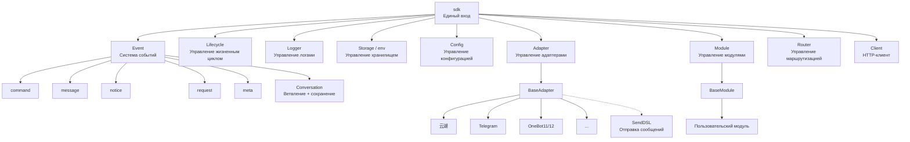

### Описание основных модулей

| Модуль | Описание |
|------|------|
| **Event** | Система событий, предоставляющая обработку событий command / message / notice / request / meta, а также Conversation для многократных диалогов |
| **Adapter** | Менеджер адаптеров, отвечает за регистрацию, запуск и остановку адаптеров для различных платформ |
| **Module** | Менеджер модулей, отвечает за регистрацию, загрузку и выгрузку плагинов, поддерживает объявление зависимостей и топологическую сортировку |
| **Lifecycle** | Менеджер жизненного цикла, предоставляет обработчики жизненного цикла на основе событий |
| **Storage** | Хранилище на основе SQLite, поддерживающее общие SQL-запросы с цепочечной синтаксической структурой |
| **Config** | Управление конфигурационными файлами в формате TOML |
| **Logger** | Модульная система логирования, поддерживающая под-логгеры |
| **Router** | Управление маршрутизацией HTTP/WebSocket, через абстракцию обертывает底层后端 (в настоящее время FastAPI + Uvicorn), поддерживает маршрутизацию с помощью декораторов, промежуточные слои, группировку, ограничение скорости, CORS |
| **Client** | Единый HTTP/WS-клиент (до версии 2.8.0 был `HttpClient`, оставлен как совместимый псевдоним), через абстракцию обертывает底层请求库 (в настоящее время aiohttp), предоставляет статистику запросов, повторные попытки, логирование, WebSocket-клиент, систему исключений ErisPulse. WebSocket-клиент и серверная часть WebSocket используют общий базовый класс `WebSocketConnectionBase` |

## Процесс инициализации

Ниже представлена диаграмма полного процесса инициализации `sdk.init()`:

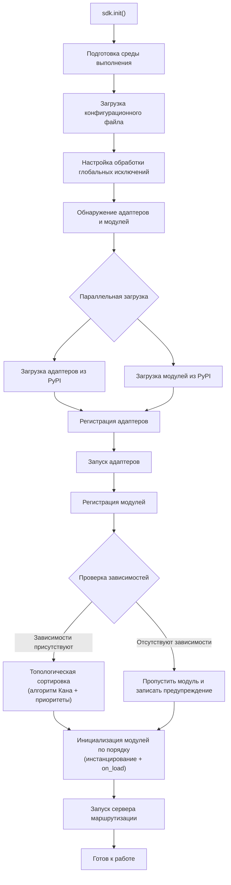

### Подробное описание этапов инициализации

> Полная цепочка инициализации (Finder / Loader / Manager / Router), базовые входные точки (`init()` / `init_task()` / `init_sync()`) и ручной полный запуск см. в [Процесс запуска и ручное управление](advanced/startup.md).

## Процесс обработки событий

Ниже представлена диаграмма полного пути сообщения от платформы до обработчика:

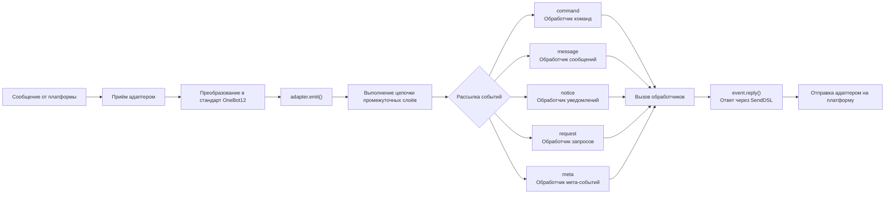

### Подробное описание цепочки обработки событий

На этой диаграмме показан результат; ниже разобрано, что происходит "за кадром" после вызова `adapter.emit()` — это трёхуровневая цепочка рассылки:

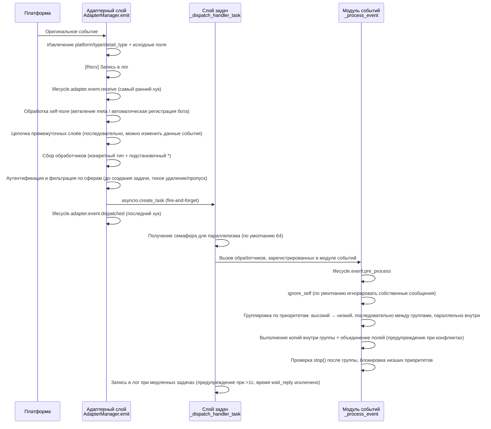

**Что делает фреймворк и что вы можете изменить:**

| Этап | Что делает фреймворк | Что вы можете изменить |
|------|-------------|-----------|
| Приём | Извлекает стандартные поля, сохраняет `{platform}_raw` исходные данные; записывает `[Recv]` лог | Наблюдение за `adapter.event.receive` для получения самого раннего события |
| self-поле | Для мета-событий ветвление connect/disconnect/heartbeat; для обычных событий автоматическая регистрация бота и запуск `adapter.bot.online` | Наблюдение за `adapter.bot.online` / `bot.offline` |
| Промежуточные слои | **Последовательно** выполняются, если возвращаемое значение не None, то заменяется событие | Регистрация промежуточных слоёв для изменения/перехвата события |
| Сбор обработчиков | Сначала берётся конкретный тип обработчика, затем `*` подстановочный обработчик | — |
| Аутентификация | Определяется, принимать ли событие по пользователю>сессии>боту>адаптеру (`scope.is_identity_allowed`), **отклонённые события удаляются** | `ErisPulse.scope.identity` привязка |
| Фильтрация по сферам | Определяется по владельцу модуля (`scope.is_allowed`), сессионный>бот>платформенный уровень, **не прошедшие фильтр тихо пропускаются** | Настройка белого/чёрного списка сфер |
| Планирование | Каждый обработчик запускается в отдельной `asyncio.Task`, `emit()` **не ждёт завершения обработчика** | — |
| Приоритеты | Высокий приоритет выполняется первым; **между группами последовательно, внутри групп параллельно** (каждая группа получает копию события, изменения объединяются, конфликты предупреждаются) | `@command(..., priority=N)` / указание при регистрации |
| Блокировка | После обработки группы проверяется `event.is_stopped()`, если true, то **выполняются только более высокие приоритеты** | `event.mark_processed(stop=True)` / `event.done()` |

> **Распространённые заблуждения**:
> 1. **Фильтрация по сферам тихая** — отфильтрованные обработчики не вызывают ошибок и не отвечают, только в логах TRACE видно (`core.scope.denied`). При "мой модуль не получает сообщения" сначала проверьте привязку сфер.
> 2. **Обработчики обрабатываются параллельно** — фреймворк уже создал для каждого обработчика отдельную задачу, вам **не нужно** дополнительно оборачивать в `asyncio.create_task`.
> 3. **Блокировка не действует внутри группы** — `mark_processed(stop=True)` блокирует только более низкие приоритеты, обработчики в одной группе не прерываются.
> 4. **Порог медленного лога фиксирован 1 секунда** — если обработчик затрачивает более 1 секунды, в логе появляется предупреждение (время `wait_reply` исключено), но выполнение не прерывается.

> Подробнее о привязке сфер, аутентификации и ограничениях действий см. в [Сфера (scope)](advanced/scope.md); о текстовом фильтре сфер и ACL пользователя команд см. в [Введение в обработку событий](getting-started/event-handling.md); о настройке верхнего лимита параллелизма см. в [Руководство по конфигурации](user-guide/configuration.md#Конфигурация_фреймворка).

## События жизненного цикла

Ниже представлена диаграмма последовательности событий жизненного цикла компонентов фреймворка:

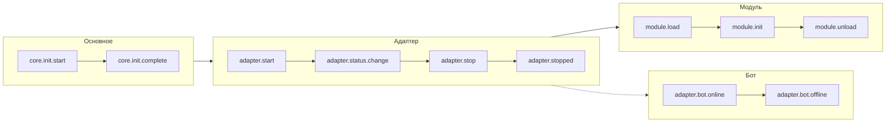

### Наблюдение за событиями жизненного цикла

> Полный список методов наблюдения за событиями (`lifecycle.on()` / `once()` / `has_handlers()`), все события жизненного цикла и формат данных см. в [Управление жизненным циклом](advanced/lifecycle.md).

## Стратегии загрузки модулей

ErisPulse поддерживает три стратегии загрузки модулей, возвращаемые `get_load_strategy()` в виде `ModuleLoadStrategy`:

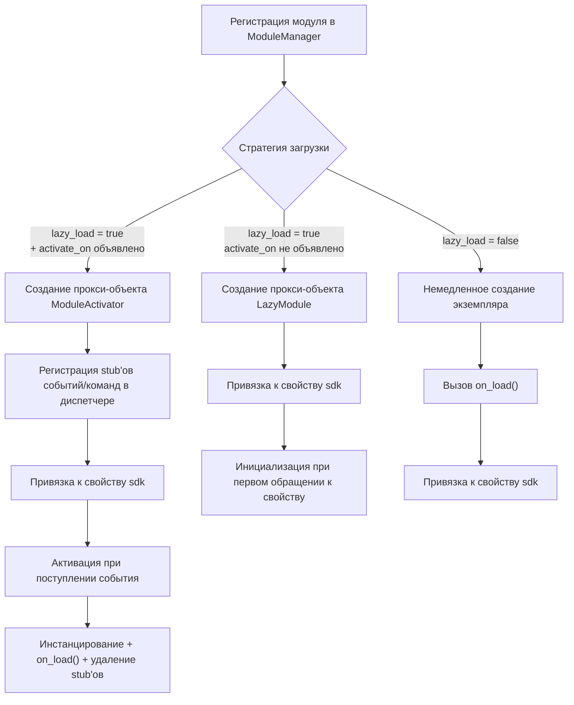

> Подробнее смотрите [Систему ленивой загрузки](advanced/lazy-loading.md), [Управление жизненным циклом](advanced/lifecycle.md) и документацию модуля.

### Архитектура ленивой активации по событиям (`activate_on`)

> [!NOTE]
> Эта функция доступна в ErisPulse **с версии 2.8.0**.

`activate_on` позволяет модулю загружаться **только при первом поступлении соответствующего события/команды**, что позволяет избежать постоянного использования памяти и гарантирует, что события не будут потеряны:

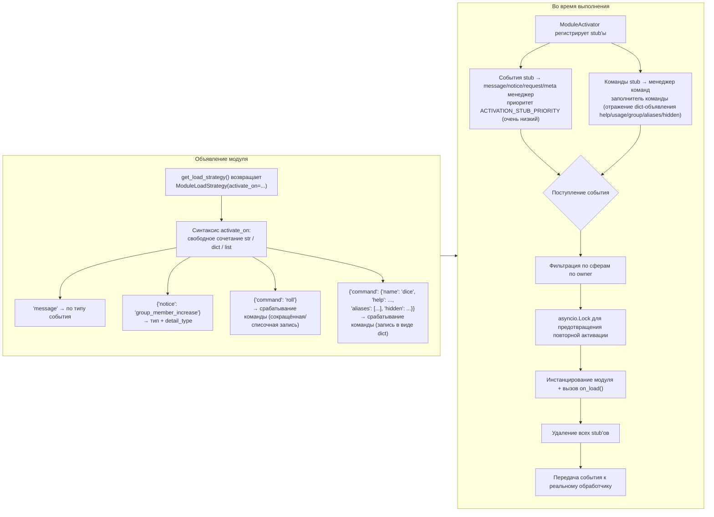

**Ключевые моменты семантики триггера:**

> Полный синтаксис `activate_on` (str / dict / list), объявление команды в виде dict, цепочка отката help для заполнителя команды, фильтрация по сферам и семантика неудачи см. в [Системе ленивой загрузки](advanced/lazy-loading.md#Ленивая_активация_по_событиям_activate_on).

## Архитектура локальной папки плагинов

> [!NOTE]
> Эта функция доступна в ErisPulse **с версии 2.8.0**.

Локальные плагины (папка `plugins/`) не требуют публикации и автоматически обнаруживаются и загружаются при запуске фреймворка:

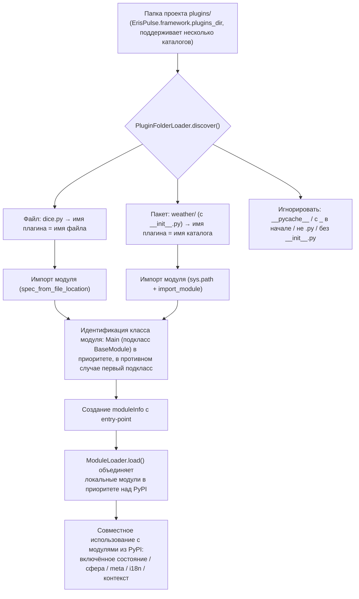

**Соглашения и особенности:**

- Имя плагина: для файла — имя файла, для пакета — имя каталога
- Для локального плагина `moduleInfo.meta.source == "plugin_folder"`, он совместим с модулями из PyPI
- При совпадении имен локальный модуль имеет приоритет (удобно для отладки), при отключении удаляется и entry-point

## Архитектура горячей перезагрузки модулей

Горячая перезагрузка применяется ко **всем источникам модулей** одинаково: локальные плагины (`plugins/`), модули, зарегистрированные во время выполнения (`sdk.module.register()`), и модули из PyPI, которые можно перезагрузить через `sdk.reload_module()` / `sdk.module.reload()` — **по умолчанию полная перезагрузка** (очистка кэша импорта по имени пакета и повторный импорт зависимостей, `full=False` — лёгкий выход); `sdk.reload_all_modules()` / `sdk.module.reload_all()` может перезагрузить все зарегистрированные модули за один раз (например, после обновления пакетов через pip):

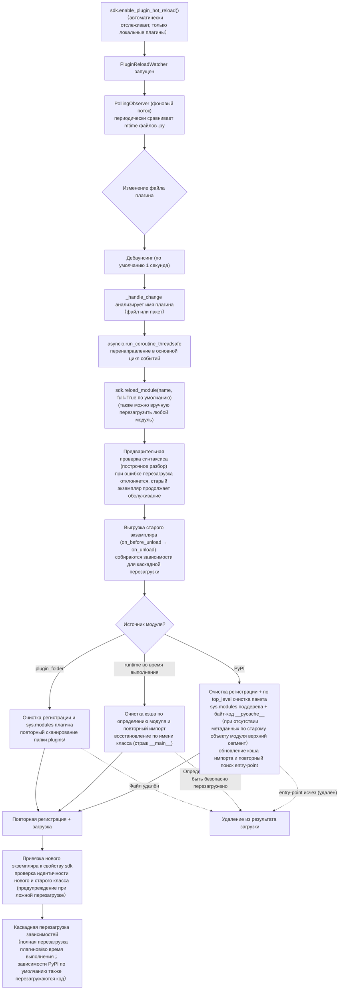

**Различия между тремя источниками только на этапе обнаружения**, предварительная проверка, выгрузка и каскадная перезагрузка идентичны:

- **Локальные плагины** (`moduleInfo.meta.source == "plugin_folder"`): после очистки sys.modules соответствующего имени плагина повторно сканируется папка `plugins/`; если файл удалён, он удаляется из результата загрузки
- **Модули, зарегистрированные во время выполнения** (`source == "runtime"`): повторный импорт по определению модуля, восстановление по имени класса и повторная регистрация; классы, определённые в `__main__` / без исходного файла отклоняются от перезагрузки (страж предупреждения, чтобы избежать повторного выполнения скрипта входной точки)
- **Пакеты из PyPI**: по `meta.top_level` очищается поддерево sys.modules пакета, обновляется кэш импорта (преодоление кэша entry-point на 60 секунд) и повторно импортируется; если entry-point исчез (pip-удалён), он удаляется из результата загрузки

**Стандартная семантика и гарантии надёжности (2.11):**

- **reload = полная перезагрузка**: по умолчанию очищается sys.modules по имени пакета и повторно импортируются зависимости; `full=False` — только очистка метаданных, зависимости PyPI повторно инстанцируются (выход для производительности при больших зависимостях)
- **Предварительный барьер синтаксической проверки**: перед началом выгрузки происходит построчная синтаксическая проверка, при ошибке перезагрузка отклоняется — старый экземпляр не выгружается и продолжает обслуживание, синтаксические ошибки никогда не приведут модуль в "полумёртвое состояние" (при большом количестве файлов превышает лимит)
- **Кэш-поддержка**: при отсутствии метаданных `top_level` используется двойная генерация очистки по старому объекту модуля `__name__` префикс → модульному классу `__module__` префикс; при перезагрузке также очищаются байт-коды исходных файлов (в __pycache__), даже небольшие изменения в тот же секунду и с одинаковой длиной вступают в силу
- **Проверка идентичности**: после успешной перезагрузки утверждается изменение идентичности нового и старого класса, если не изменилось (например, C-расширения, кэш не очищается) — явное предупреждение и событие `module.reload` с `identity_changed: false`; `module.get_info()` с полями `running_identity` / `stale` показывает "зарегистрированная версия ≠ текущая версия"
- **Проверка ошибок**: при неудачной загрузке (исключение + traceback) можно напрямую получить через `module.last_error(имя)` / `get_info()["last_error"]`, при этом очищается кэш импорта модуля — "измените код и перезагрузите ещё раз" обязательно прочитает новый код
- Перезагрузка заставляет модуль, который был лениво загружен, активироваться (явное логирование); `reload_all_modules()` сохраняет стратегию ленивой загрузки, только модули, которые были загружены до перезагрузки, повторно активируются, модули, находящиеся в спящем состоянии, остаются в спящем состоянии
- `reload_all_modules()` перезагружает в порядке зависимостей, при неудаче одного модуля записывается диагностика и пропускается (без общей отката —副作用 on_unload не отменить, семантика как у горячей перезагрузки одного модуля); при неудаче перезагрузки, когда старый экземпляр уже откатился, лог будет явно указывать, что старый экземпляр находится в состоянии завершения

## Архитектура горячей перезагрузки адаптеров

Горячая перезагрузка адаптеров на уровне кода (2.11) идентична цепочке модулей: `sdk.adapter.reload(название_платформы)` / `sdk.reload_adapter(название_платформы)` применяется ко **локальным плагинам** и **пакетам из PyPI**:

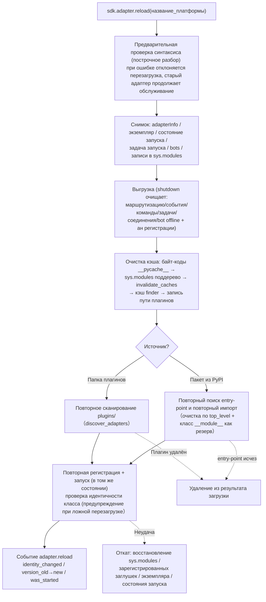

**Различия с цепочкой модулей:**

- У адаптеров нет ленивой загрузки и каскадной перезагрузки зависимостей: перезагрузка **не распространяется** на другие адаптеры, которые от него зависят (только предупреждение — зависимые через реестр косвенно используют, без семантики каскада экземпляров)
- Запуск асинхронный (через `startup` через `_run_adapter`, включая пропуск зависимостей и экспоненциальную отмену с повторными попытками): временный сбой запуска **не считается неудачей перезагрузки** (код уже обновлён), результат передаётся через `adapter.status.change`
- Ловушка повторного использования экземпляра register (если классы совпадают, старый экземпляр повторно используется) решается "очисткой pyc + sys.modules + проверкой идентичности"
- События жизненного цикла: `adapter.reload` (payload содержит `adapter_name` / `success` / `full` / `duration_ms` / `identity_changed` / `version_old→new` / `was_started` / `source`)


====
快速上手
====


### 快速开始

# Быстрый старт

> **Это ваш первый шаг.** Запустите робота ErisPulse за 5 минут — сначала посмотрите результат, а затем разберитесь с каждым шагом.

## Эффект за 60 секунд: заставьте бота сначала ответить вам

**1. Установка** (Python >= 3.10):

```bash
pip install ErisPulse
```

**2. Инициализация проекта.** Мастер запросит имя проекта, позволит выбрать платформу адаптера и завершит настройку, после чего сгенерирует `main.py` и `config/config.toml`:

```bash
epsdk init
```

**3. Откройте `main.py` и замените его на эти 9 строк кода**:

```python
from ErisPulse import sdk
from ErisPulse.Core.Event import command

@command("ping", help="Проверка, работает ли бот")
async def ping_handler(event):
    await event.reply("Pong! Бот работает нормально.")

if __name__ == "__main__":
    import asyncio
    asyncio.run(sdk.run(keep_running=True))
```

**4. Запуск**:

```bash
epsdk run main.py
```

В терминале появятся логи запуска фреймворка и информация о подключении адаптера. Теперь, если вы отправите боту `/ping` на подключенной платформе, он ответит:

> Pong! Бот работает нормально.

Если вы увидели этот ответ, значит, цепочка фреймворка, адаптера и обработки событий заработала. Если не получилось, просто перейдите в конец документа по ссылке [Возникли проблемы](#вопросы); если всё прошло успешно, читайте дальше, чтобы узнать, какие ещё есть варианты на каждом этапе.

## Установка ErisPulse: три способа

Выше использовался самый прямой способ — pip. Выбирайте в зависимости от вашей среды:

### Установка с помощью pip

Убедитесь, что у вас установлен Python версии >= 3.10, затем установите с помощью pip:

```bash
pip install ErisPulse
```

Если у вас установлен [uv](https://github.com/astral-sh/uv), можно использовать `uv pip install ErisPulse` — установка будет быстрее.

Если вы хотите установить команду `epsdk` глобально, чтобы не загрязнять окружение проекта, рекомендуется использовать `uv tool install`:

```bash
uv tool install ErisPulse
```

После установки команда `epsdk` будет доступна глобально: при запуске в директории проекта автоматически определяется `.venv` проекта (команда `epsdk install` устанавливает в окружение проекта, `epsdk run` запускает в окружении проекта), а сам фреймворк предоставляется из окружения инструмента. Подробнее см. [руководство по установке](docs/ru/installation.md).

### Сценарий установки за один клик (рекомендуется для новых сред)

Сценарий автоматически определяет вашу среду (Docker, Python, uv) и предлагает наиболее подходящий способ установки, поддерживает несколько языков (китайский/English/日本語/Русский/繁體中文).

Windows (PowerShell):
```powershell
irm https://get.erisdev.com/install.ps1 -OutFile install.ps1; powershell -ExecutionPolicy Bypass -File install.ps1
```

macOS / Linux:
```bash
curl -fsSL https://get.erisdev.com/install.sh -o install.sh && chmod +x install.sh && ./install.sh
```

Сценарий поможет вам выполнить следующие действия:

- **Установка через Docker** (рекомендуется, если Docker обнаружен): выбор источника образа (Docker Hub / GHCR), канал версий (стабильный / предварительный), настройка панели управления Dashboard, настройка портов
- **Установка глобального CLI (uv tool, рекомендуется)**: установка `epsdk` как глобальной команды, без виртуального окружения, uv автоматически управляет Python (даже если версия системы слишком низкая); при запуске в директории проекта автоматически определяется `.venv`
- **Традиционная установка**: автоматическое создание виртуального окружения, выбор версии ErisPulse, необязательная установка модуля панели управления Dashboard

### Использование Docker

В Docker-образе уже включён фреймворк ErisPulse и панель управления Dashboard, поддерживается архитектура `linux/amd64` и `linux/arm64`.

```bash
# Скачайте docker-compose.yml
curl -O https://raw.githubusercontent.com/ErisPulse/ErisPulse/main/docker-compose.yml

# Установите токен панели управления и запустите
ERISPULSE_DASHBOARD_TOKEN=your-token docker compose up -d
```

<details>
<summary>Не работает Docker Hub?</summary>

Используйте образ из GitHub Container Registry, изменив `image` в `docker-compose.yml`:

```yaml
image: ghcr.io/erispulse/erispulse:latest
```

</details>

После запуска перейдите по адресу `http://<host>:8000/Dashboard` и войдите, используя установленный токен.

## Инициализация проекта

### Интерактивная инициализация (рекомендуется)

```bash
epsdk init
```

Это запустит интерактивное руководство, которое поможет вам выполнить следующие шаги:
- Настройка имени проекта
- Настройка уровня логирования
- Настройка сервера (хост и порт)
- Выбор и настройка адаптера
- Создание структуры проекта

### Быстрая инициализация

```bash
# Быстрый режим с указанием имени проекта
epsdk init -q -n my_bot

# Или просто указание имени проекта
epsdk init -n my_bot
```

### Создание проекта вручную

Если вы предпочитаете создавать проект вручную:

```bash
mkdir my_bot && cd my_bot
epsdk init
```

## Установка модуля

### Установка через CLI

```bash
epsdk install Yunhu AIChat
```

### Просмотр доступных модулей

```bash
epsdk list-remote
```

### Интерактивная установка

При отсутствии имени пакета открывается интерактивный интерфейс установки:

```bash
epsdk install
```

## Запуск проекта

```bash
# Обычный запуск
epsdk run main.py

# Режим горячей перезагрузки (рекомендуется при разработке)
epsdk run main.py --reload
```

## Включение автодополнения в IDE (по желанию)

Динамически обнаруживаемые модули/адаптеры ErisPulse не поддерживаются автодополнением в IDE по умолчанию.
Запустите следующую команду для генерации типовых заглушек:

```bash
epsdk types
```

После генерации, используйте импортированные типы для аннотации переменных, чтобы получить точное автодополнение (подробнее см. [Руководство по автодополнению в IDE](./getting-started/ide-completion.md)):

```python
from _ep_types import Yunhu
from ErisPulse import sdk

adapter: Yunhu = sdk.adapter.get("yunhu")
await adapter.Send.To("group", "123").Board(...)  # Автодополнение методов, специфичных для платформы
```

## Структура проекта

Структура проекта после инициализации:

```
my_bot/
├── config/
│   └── config.toml          # Файл конфигурации
└── main.py                  # Точка входа

```

## Конфигурационный файл

Базовый конфигурационный файл `config.toml`:

```toml
[ErisPulse.server]
host = "0.0.0.0"
port = 8000

[ErisPulse.logger]
level = "INFO"

[Yunhu_Adapter]
# Конфигурация адаптера
```


### 创建第一个机器人

# Создание первого бота

> [!TIP]
> **Когда стоит читать эту статью**: бот уже запускается, и вы хотите написать первый обработчик команды `/hello`, а также разобраться, что именно делают `sdk.run` и декораторы команд. Если вы ещё не установили ErisPulse и не инициализировали проект, сначала выполните три шага из [быстрого старта за 5 минут](../quick-start.md): «Установка», «Инициализация проекта» и «Запуск проекта»; если всё готово — пропустите.

Успешно пройденный быстрый старт — это лишь первый шаг. Эта статья поможет вам написать первый обработчик команды и объяснит, что происходит с каждой строкой кода внутри фреймворка.

## Шаг первый: написание первой команды

Откройте `main.py` и напишите простой обработчик команды:

```python
from ErisPulse import sdk
from ErisPulse.Core.Event import command

@command("hello", help="Отправить приветственное сообщение")
async def hello_handler(event):
    """Обработка команды hello"""
    user_name = event.get_user_nickname() or "друг"
    await event.reply(f"Привет, {user_name}! Я бот ErisPulse.")

@command("ping", help="Проверить, работает ли бот")
async def ping_handler(event):
    """Обработка команды ping"""
    await event.reply("Pong! Бот работает нормально.")

async def main():
    """Основная точка входа"""
    print("Запуск ErisPulse...")
    
    # keep_running=True (по умолчанию): фреймворк блокируется и продолжает работу, пока не получит сигнал о завершении (например, Ctrl+C)
    await sdk.run(keep_running=True)

if __name__ == "__main__":
    import asyncio
    asyncio.run(main())
```

### Параметр `keep_running`

Параметр `sdk.run(keep_running)` управляет тем, блокируется ли фреймворк для поддержания работы:

- **`keep_running=True` (по умолчанию)**: `run()` будет блокироваться до тех пор, пока не получит сигнал о завершении (например, Ctrl+C), подходит для чистых ботов.
- **`keep_running=False`**: `run()` завершит инициализацию и немедленно вернёт управление. **Фреймворк не будет остановлен** — запущенные адаптеры/модули продолжат обрабатывать события сообщений в фоновом режиме, вы можете продолжить выполнять собственную логику, пока цикл событий не завершится и фреймворк не закроется. Например:

```python
async def main():
    await sdk.run(keep_running=False)   # Инициализация завершена, немедленно возвращаем управление
    # Фреймворк уже работает в фоне, здесь можно делать что-то ещё
    while True:
        await asyncio.sleep(3600)
        print("Проверка каждый час")
```

> Помимо двух режимов `run()`, существуют более тонкие способы управления жизненным циклом, такие как `init()`/`uninit()` для ручного управления, а также отдельный запуск и остановка адаптеров/маршрутизации. Подробнее см. [Жизненный цикл и ручное управление](../advanced/startup.md).

## Шаг второй: Запуск робота

```bash
# Обычный запуск
epsdk run main.py

# Режим разработки (поддержка горячей перезагрузки)
epsdk run main.py --reload
```

## Шаг 3: Тестирование бота

Отправьте команду в вашей системе общения:

```
/hello
```

Вы должны получить ответ от бота.

## Описание кода

### Декоратор команды

```python
@command("hello", help="Отправить приветственное сообщение")
```

- `hello`: имя команды, вызывается пользователем с помощью `/hello`
- `help`: описание команды, отображается в команде `/help`

### Параметры события

```python
async def hello_handler(event):
```

Параметр `event` представляет собой объект Event, содержащий:
- Текст сообщения: `event.get_text()`
- Информация о отправителе: `event.get_user_id()`, `event.get_user_nickname()`
- Информация о платформе: `event.get_platform()`
- Информация о группе: `event.get_group_id()`
- Исходные данные: `event.get_raw()`

> Полный список методов объекта Event см. в разделе [Подробное описание Event-объекта](../developer-guide/modules/event-wrapper.md).

### Отправка ответа

```python
await event.reply("Содержимое ответа")
```

Метод `event.reply()` — это удобный способ отправки сообщения отправителю.

## Расширение: добавление дополнительных функций

ErisPulse предоставляет богатые возможности для обработки событий и данных:

- **Прослушивание сообщений**: используйте `@message.on_message()` для прослушивания различных сообщений → [Введение в обработку событий](event-handling.md)
- **Прослушивание уведомлений**: используйте `@notice.on_friend_add()` и другие для прослушивания системных уведомлений → [Введение в обработку событий](event-handling.md)
- **Хранение данных**: используйте `sdk.storage.get/set` для постоянного хранения данных → [Примеры распространенных задач](common-tasks.md)

## Часто задаваемые вопросы

### Команда не отвечает?

1. Проверьте, правильно ли настроен адаптер, убедитесь, что `status` адаптера в файле `config/config.toml` установлен в `true`
2. Проверьте вывод логов в терминале, убедитесь, что нет ошибок (особенно сообщений уровня `ERROR`)
3. Убедитесь, что префикс команды верный (по умолчанию это `/`), можно проверить в разделе `[ErisPulse.event.command]` файла конфигурации
4. Убедитесь, что имя команды написано правильно, обратите внимание на настройки чувствительности к регистру

### Как изменить префикс команды?

Добавьте в `config.toml` следующее:

```toml
[ErisPulse.event.command]
prefix = "!"
case_sensitive = false
```

### Как поддерживать несколько платформ?

ErisPulse использует стандарт OneBot12 для унификации формата событий на разных платформах. Обработчики, зарегистрированные с помощью `@command` и `@message`, автоматически получают события со всех платформ. С помощью `event.get_platform()` можно определить источник платформы:

```python
@command("hello")
async def hello_handler(event):
    platform = event.get_platform()
    
    if platform == "yunhu":
        await event.reply("Привет! От Юньху")
    elif platform == "telegram":
        await event.reply("Hello! От Telegram")
    else:
        await event.reply("Привет!")
```

> Дополнительные советы по адаптации под несколько платформ можно найти в разделе [Примеры типичных задач](common-tasks.md#многоплатформенная-адаптация).

## Следующие шаги

- **Продолжайте по учебному пути**: прочитайте [Основные концепции](basic-concepts.md), чтобы понять, что фреймворк делает «под капотом» обработчиков команд
- **Хотите реагировать на больше типов сообщений**: [Введение в обработку событий](event-handling.md) — как писать обработчики для сообщений / уведомлений / запросов / мета-событий
- **Хотите добавить практичные функции**: [Примеры распространённых задач](common-tasks.md) — готовый код для персистентности, задач по расписанию и контроля прав доступа


### 基础概念

# Основные концепции

> [!NOTE]
> **Обязательно к прочтению для L1 Core** — 2-я из «Пяти статей L1 Core» на главной странице документации (Введение в разработку модулей → **Основные концепции** → Класс-обёртка Event → Описание файлов конфигурации → Перехват исключений).

Какие компоненты проходит сообщение от отправки пользователем до ответа бота? За что отвечают адаптеры и за что модули? Прочитав эту статью, вы сможете самостоятельно отвечать на вопросы по дизайну, возникающие при написании обработчиков, вместо того чтобы просто копировать примеры.

## Событийно-ориентированная архитектура

ErisPulse использует событийно-ориентированную архитектуру: все взаимодействия передаются и обрабатываются через события.

### Поток событий

```
Пользователь отправляет сообщение
      │
      ▼
Платформа принимает
      │
      ▼
Адаптер принимает нативное событие платформы
      │
      ▼
Преобразование в стандартное событие OneBot12
      │
      ▼
Передача в систему событий
      │
      ▼
Распределение зарегистрированным обработчикам
      │
      ▼
Модуль обрабатывает событие
      │
      ▼
Отправка ответа через адаптер
      │
      ▼
Платформа отображает пользователю
```

### Стандарт OneBot12

ErisPulse использует OneBot12 в качестве основного стандарта событий. OneBot12 — это универсальный стандарт интерфейса приложений чат-ботов, определяющий единый формат событий.

Все адаптеры преобразуют события, специфичные для платформы, в формат OneBot12, обеспечивая согласованность кода.

## Основные компоненты

### 1. Объект SDK

SDK — это единая точка входа для всей функциональности, предоставляющая доступ к основным компонентам.

```python
from ErisPulse import sdk

# Доступ к основным модулям
sdk.storage    # Система хранения
sdk.config     # Система конфигурации
sdk.logger     # Система логирования
sdk.adapter    # Система адаптеров
sdk.module     # Система модулей
sdk.router     # Система маршрутизации
sdk.client     # HTTP-клиент
sdk.lifecycle  # Система жизненного цикла
```

> [!WARNING]
> **Импортируйте единообразно из корня**: `from ErisPulse.Core import adapter` / `import ErisPulse.Core.adapter`
> Такая запись привязывается к **экземпляру менеджера** (синглтону `AdapterManager`), а не к субмодулю —
> re-export пакета `ErisPulse.Core` затеняет одноимённый субмодуль. При написании тестов, патчинге или
> когда требуется сам объект модуля, всегда используйте корневой импорт `from ErisPulse import sdk`
> (`sdk.adapter` — это и есть экземпляр менеджера).

### 2. Объект Event

Объект Event инкапсулирует данные события и предоставляет удобные методы доступа.

```python
@command("info")
async def info_handler(event):
    # Получение информации о событии
    event_id = event.get_id()
    user_id = event.get_user_id()
    platform = event.get_platform()
    text = event.get_text()
    
    # Отправка ответа
    await event.reply(f"Пользователь: {user_id}, платформа: {platform}")
```

### 3. Адаптеры

Адаптеры — это мост между ErisPulse и внешними платформами.

**Обязанности:**
- Приём нативных событий платформы
- Преобразование в стандартный формат OneBot12
- Отправка событий в стандартном формате на платформу

**Примеры адаптеров:**
- Адаптер Yunhu: взаимодействие с платформой Юньху
- Адаптер Telegram: взаимодействие с Telegram Bot API
- Адаптер OneBot11: взаимодействие с приложениями, совместимыми с OneBot11
- Адаптер Email: обработка отправки и получения электронной почты

### 4. Модули

Модули — это базовые единицы расширения функциональности, которые могут:

- регистрировать обработчики событий
- реализовывать бизнес-логику
- вызывать адаптеры для отправки сообщений
- использовать сервисы, предоставляемые основными модулями

#### Механизм обнаружения модулей

ErisPulse обнаруживает установленные модули с помощью Python-механизма `importlib.metadata.entry_points`. Модуль объявляет точку входа в `pyproject.toml`:

```toml
[project.entry-points."erispulse.module"]
MyModule = "my_package:Main"
```

При инициализации SDK сканируются все точки входа группы `erispulse.module`, классы модулей регистрируются в `ModuleManager`, а затем инициализируются по очереди после топологической сортировки по зависимостям.

#### Минимальный рабочий модуль

```python
from ErisPulse.Core.Bases import BaseModule
from ErisPulse import sdk

class Main(BaseModule):
    def __init__(self):
        self.sdk = sdk
        self.logger = sdk.logger.get_child("MyModule")

    async def on_load(self, event):
        self.logger.info("Модуль загружен")

    async def on_unload(self, event):
        self.logger.info("Модуль выгружен")
```

#### Жизненный цикл модуля

- **Регистрация**: SDK обнаруживает класс модуля и регистрирует его в менеджере
- **Загрузка**: создаётся экземпляр модуля, вызывается `on_load(event)` (`event = {"module_name": "MyModule"}`)
- **Выгрузка**: вызывается `on_unload(event)`, ресурсы очищаются

#### Стратегия загрузки

Поведение загрузки модуля объявляется через `get_load_strategy()`:

```python
from ErisPulse.loaders import ModuleLoadStrategy

class Main(BaseModule):
    @staticmethod
    def get_load_strategy():
        return ModuleLoadStrategy(
            lazy_load=True,   # Ленивая загрузка (по умолчанию True)
            priority=0        # Приоритет загрузки; чем больше число, тем раньше инициализация
        )
```

- **`lazy_load=True` (по умолчанию)**: модуль инициализируется только при первом обращении через `sdk.MyModule`, что сокращает время запуска
- **`lazy_load=False`**: модуль инициализируется сразу при запуске SDK; подходит для модулей, которым нужно прослушивать события жизненного цикла или выполнять запланированные задачи
- **`priority`**: модули с одинаковым приоритетом загружаются в порядке регистрации; чем больше число, тем раньше инициализация

> Подробное описание механизма ленивой загрузки см. в [Система ленивой загрузки](../advanced/lazy-loading.md).

## Типы событий

ErisPulse поддерживает 5 типов событий:

| Тип события | Декоратор | Описание |
|---------|--------|------|
| События сообщений | `@message.on_message()` | Любые сообщения, отправленные пользователями (личные и групповые чаты) |
| События команд | `@command("name")` | Сообщения, начинающиеся с префикса команды (например, `/hello`) |
| События уведомлений | `@notice.on_friend_add()` и др. | Системные уведомления (добавление в друзья, изменение участников группы и т.д.) |
| События запросов | `@request.on_friend_request()` и др. | Запросы пользователей (заявки в друзья, приглашения в группы) |
| Мета-события | `@meta.on_connect()` и др. | События системного уровня (подключение, отключение, heartbeat) |

> Подробное использование и примеры кода для каждого типа событий см. в [Введение в обработку событий](event-handling.md).

## Основные модули

### Storage (Хранилище)

Система хранения пар "ключ-значение", основанная на SQLite, для постоянного хранения данных.

```python
# Установка значения
sdk.storage.set("key", "value")

# Получение значения
value = sdk.storage.get("key", "default_value")

# Массовая операция
sdk.storage.set_multi({
    "key1": "value1",
    "key2": "value2"
})

# Транзакция
with sdk.storage.transaction():
    sdk.storage.set("key1", "value1")
    sdk.storage.set("key2", "value2")
```

### Config (Конфигурация)

Управление конфигурационными файлами в формате TOML.

```python
# Получение конфигурации
config = sdk.config.getConfig("MyModule", {})

# Установка конфигурации
sdk.config.setConfig("MyModule", {"key": "value"})

# Чтение вложенной конфигурации
value = sdk.config.getConfig("MyModule.subkey", "default")
```

### Logger (Журналирование)

Модульная система журналирования.

```python
# Запись в лог
sdk.logger.info("Это информационное сообщение")
sdk.logger.warning("Это предупреждение")
sdk.logger.error("Это ошибка")

# Получение поджурнала
child_logger = sdk.logger.get_child("submodule")
child_logger.info("Журнал подмодуля")
```

**Синтаксис доступа по атрибутам**

Помимо использования метода `get_child()`, вы можете использовать **атрибутный доступ** для создания поджурнала, что является более компактным **синтаксическим сахаром**:

```python
# Создание поджурнала через атрибутный доступ
sdk.logger.mymodule.info("Сообщение модуля")

# Поддержка вложенного доступа
sdk.logger.mymodule.database.info("Сообщение базы данных")
```

### Router (Маршрутизация)

Управление маршрутизацией HTTP и WebSocket, основанное на FastAPI + Uvicorn. Поддерживает маршрутизацию с помощью декораторов, промежуточные слои, группировку, ограничение скорости, CORS.

```python
from ErisPulse.Core import HttpRequest

@sdk.router.get("MyModule", "/api")
async def handler(request: HttpRequest):
    data = await request.json()
    return {"status": "ok"}
```

> Полный API маршрутизатора (WebSocket, промежуточные слои, ограничение скорости, CORS и т.д.) см. в [Маршрутизаторе](../advanced/router.md).

### Client (Сетевой клиент)

Единый сетевой клиент, объединяющий HTTP-запросы, WebSocket-соединения, управление пула соединений, автоматические повторы, таймауты, статистику запросов и интеграцию событий жизненного цикла.

```python
from ErisPulse.Core import client

# HTTP-запрос
resp = await client.get("https://api.example.com/users")
data = await resp.json()

# С повторами и таймаутом
resp = await client.get(url, timeout=30, max_retries=3)

# WebSocket-соединение
ws = await client.ws_connect("wss://example.com/ws")
async for text in ws.iter_text():
    await ws.send_text(f"Эхо: {text}")
```

> Полный API сетевого клиента см. в [Сетевом клиенте](../advanced/client.md).

## Отправка сообщений SendDSL

Адаптеры предоставляют интерфейс отправки сообщений в виде цепочки вызовов.

### Базовая отправка

```python
# Получение экземпляра адаптера
yunhu = sdk.adapter.get("yunhu")

# Отправка сообщения
await yunhu.Send.To("user", "U1001").Text("Hello")

# Указание аккаунта для отправки
await yunhu.Send.Using("bot1").To("group", "G1001").Text("Сообщение в группу")
```

### Цепочка модификаторов

```python
# Упоминание пользователя
await yunhu.Send.To("group", "G1001").At("U2001").Text("@сообщение")

# Ответ на сообщение
await yunhu.Send.To("group", "G1001").Reply("msg123").Text("Ответ")

# Упоминание всех
await yunhu.Send.To("group", "G1001").AtAll().Text("Объявление")
```

### Методы ответа Event

Объект Event предоставляет удобные методы ответа:

```python
@command("test")
async def test_handler(event):
    # Простой текстовый ответ
    await event.reply("Содержимое ответа")
    
    # Отправка изображения
    await event.reply("http://example.com/image.jpg", method="Image")
    
    # Отправка голосового сообщения
    await event.reply("http://example.com/voice.mp3", method="Voice")
```

## Система ленивой загрузки

ErisPulse по умолчанию включает ленивую загрузку модулей: модуль инициализируется только при первом обращении (например, `sdk.MyModule`), что значительно ускоряет запуск.

```python
from ErisPulse.loaders import ModuleLoadStrategy

class Main(BaseModule):
    @staticmethod
    def get_load_strategy():
        return ModuleLoadStrategy(
            lazy_load=True,   # Включение ленивой загрузки (по умолчанию)
            priority=0        # Приоритет загрузки; чем больше число, тем раньше инициализация
        )
```

**Сценарии, требующие отключения ленивой загрузки (`lazy_load=False`):**
- Модули, прослушивающие события жизненного цикла (например, `core.init.complete`)
- Модули, запускающие запланированные задачи или фоновые сервисы
- Модули, которым необходимо завершить инициализацию до загрузки других модулей

> Подробное описание механизма ленивой загрузки и важных замечаний см. в [Система ленивой загрузки](../advanced/lazy-loading.md).

## Следующие шаги

- **Продолжайте по пути L1**: следующая статья — [Класс-обёртка Event](../developer-guide/modules/event-wrapper.md); освойте все методы чтения и записи объекта события
- **Хотите учиться в процессе написания кода**: [Введение в обработку событий](event-handling.md) содержит готовые к копированию варианты обработчиков для каждого типа событий; [Примеры типовых задач](common-tasks.md) охватывает сохранение данных, запланированные задачи, контроль прав доступа и другие распространённые функции


### 事件处理入门

# Введение в обработку событий

> [!TIP]
> **Когда стоит прочитать эту статью**: когда вы хотите, чтобы бот реагировал на сообщения, команды, уведомления, запросы, или когда нужно реализовать ожидание ответа / многоконтурный диалог, или при диагностике "почему команда не срабатывает". Если вам нужно просто понять архитектуру фреймворка, посмотрите [Основные понятия](basic-concepts.md); если не нужно, пропустите эту статью.

Обработчики событий — это место, где бот "понимает" пользователя и реагирует на него. В этой статье приведены готовые шаблоны для пяти типов событий, а также рассмотрены такие практические сценарии, как анализ параметров, управление правами, ограничение частоты и многоконтурные взаимодействия.

## Обзор типов событий

ErisPulse поддерживает следующие типы событий:

| Тип события | Описание | Применение |
|---------|------|---------|
| События сообщений | Любое сообщение, отправленное пользователем | Чат-боты, фильтрация контента |
| События команд | Сообщения, начинающиеся с префикса команды | Обработка команд, точки входа функций |
| События уведомлений | Системные уведомления (добавление в друзья, изменение участников группы и т.д.) | Приветственные сообщения, уведомления о статусе |
| События запросов | Запросы пользователей (заявки в друзья, приглашения в группу) | Автоматическая обработка запросов |
| Мета-события | События системного уровня (подключение, heartbeat) | Мониторинг соединений, проверка состояния |

> Для каждого типа существуют общие регистраторы: `notice.on_notice()` / `request.on_request()` / `meta.on_meta()`
> (принимают все события данного типа); специализированные декораторы (например, `on_group_increase`) подписываются только на соответствующий подтип — предпочтительнее использовать специализированные декораторы.

## Обработка событий сообщений

> **Настоятельно рекомендуется**: добавлять к параметру `event` обработчика событий аннотацию типа `Event` — во время выполнения код работает и без неё (при диспетчеризации фреймворк передаёт именно экземпляр Event); аннотация нужна для автодополнения в IDE и статического анализа. Чтобы получить автодополнение для **пользовательских методов модулей/адаптеров**, один раз выполните в корне проекта `epsdk types` для генерации заглушек типов (см. [Автодополнение в IDE](../getting-started/ide-completion.md)).

### Слушать все сообщения

```python
from ErisPulse.Core.Event import message, Event

@message.on_message()
async def message_handler(event: Event):
    text = event.get_text()
    user_id = event.get_user_id()
    sdk.logger.info(f"Получено сообщение от {user_id}: {text}")
```

### Слушать личные сообщения

```python
from ErisPulse.Core.Event import Event
@message.on_private_message()
async def private_handler(event: Event):
    user_id = event.get_user_id()
    await event.reply(f"Привет, {user_id}! Это личное сообщение.")
```

### Слушать групповые сообщения

```python
from ErisPulse.Core.Event import Event
@message.on_group_message()
async def group_handler(event: Event):
    group_id = event.get_group_id()
    user_id = event.get_user_id()
    sdk.logger.info(f"{user_id} отправил сообщение в группе {group_id}")
```

### Слушать @упоминания

```python
from ErisPulse.Core.Event import Event
@message.on_at_message()
async def at_handler(event: Event):
    # Получить список упомянутых (@) пользователей
    mentions = event.get_mentions()
    await event.reply(f"Вы упомянули этих пользователей: {mentions}")
```

### Прослушивание с подстановочными знаками и регулярными выражениями

Все четыре декоратора сообщений (`on_message` / `on_private_message` / `on_group_message` /
`on_at_message`) поддерживают `pattern` (glob-подстановочные знаки) и `regex` (регулярные выражения); несовпадающие сообщения **не будут** вызывать обработчик:

```python
from ErisPulse.Core.Event import Event
# glob-подстановочные знаки: * любая последовательность, ? один символ, [seq] набор символов
@message.on_message(pattern="чек-ин*")
async def signin_handler(event: Event):
    await event.reply("Чек-ин выполнен успешно")

# Регулярное выражение: сопоставление денежной суммы
@message.on_message(regex=r"\d+\s*юаней")
async def price_handler(event: Event):
    await event.reply(f"Получена сумма: {event.get_text()}")

# Указаны и pattern, и regex → должны совпасть оба
@message.on_message(pattern="*юаней", regex=r"\d+\s*юаней")
async def combined_handler(event: Event):
    pass
```

`wait_reply` также поддерживает эти два параметра (см. [Ожидание ответа](../developer-guide/modules/event-wrapper.md#функция-ожидания-ответа)).

## Обработка событий команд

### Основные команды

```python
from ErisPulse.Core.Event import command

@command("help", help="Отображает справочную информацию")
async def help_handler(event):
    help_text = """
Доступные команды:
/help - Показать справку
/ping - Тест подключения
/info - Просмотр информации
    """
    await event.reply(help_text)
```

### Псевдонимы команд

```python
@command(["help", "h"], aliases=["помощь"], help="Отображает справочную информацию")
async def help_handler(event):
    await event.reply("Справочная информация...")
```

Пользователь может вызывать команду любым из следующих способов:
- `/help`
- `/h`
- `/помощь`

### Аргументы команд

```python
@command("echo", help="Вернуть сообщение")
async def echo_handler(event):
    # Получить аргументы команды
    args = event.get_command_args()
    
    if not args:
        await event.reply("Введите сообщение для повтора")
    else:
        await event.reply(f"Вы сказали: {' '.join(args)}")
```

Аргументы сохраняют оригинальный регистр ввода пользователя (даже если настройки нечувствительны к регистру, нормализация имени команды не влияет на содержимое аргументов).

### Декларативные аргументы и опции (args= / options=)

Ручная обработка аргументов требует ручного преобразования типов и сообщений об ошибках. При декларации `args=` / `options=` фреймворк автоматически анализирует аргументы команды и **внедряет их по именам в обработчик** после прохождения проверки прав доступа; при неверном вводе пользователем автоматически возвращаются локализованные сообщения и инструкции (без выброса исключений и аварийного завершения), а команда `/help <команда>` автоматически отображает инструкции:

```python
@command(
    "roll",
    args="<count:int> [sides:int=6]",
    options={"verbose": "-v/--verbose", "label": "--label"},
    help="Бросить кубик",
)
async def roll_handler(event, count: int, sides: int = 6, verbose: bool = False, label: str = ""):
    total = sum(random.randint(1, sides) for _ in range(count))
    await event.reply(f"Бросил {count} раз {sides}-гранного кубика, общее количество очков: {total}")
```

Синтаксис позиционных аргументов `args=`: `<count:int>` обязательный, `[sides:int=6]` необязательный (с значением по умолчанию). Поддерживаемые типы:

| Тип | Пример ввода | Описание |
|------|---------|------|
| `str` | `hello` | Текст (тип по умолчанию) |
| `int` / `float` | `3` / `0.5` | Число |
| `bool` | `да` / `yes` / `はい` / `да` / `true` / `no` / `отмена` | Логическое значение, использует таблицу подтверждения из `Event.confirm()` |
| `literal` | `<mode:literal=fast|slow>` | Перечисление, принимает только перечисленные значения; по умолчанию берётся первое |
| `duration` | `90s`、`1h30m`、`1d` | Продолжительность, преобразуется в секунды как float |
| `rest` | `<text:rest>` | Остальной текст (должен быть последним) |

`options=` опции объявляются в виде словаря: ключ — имя параметра обработчика, значение — формат флагов (множество алиасов через `/`). Параметры с аннотацией `bool` — это булевы флаги (появление означает `True`); остальные (по умолчанию как `str`) — опции со значениями, поддерживают `--label hello` и `--label=hello` для значений, тип соответствует аннотации обработчика. Опции сначала распознаются и удаляются, оставшиеся токены обрабатываются по `args=` (остаток `rest` покрывает оставшийся текст после удаления опций).

**Особенности поведения**:

- Проверка прав доступа выполняется до анализа аргументов — пользователи без прав не запускают анализ
- При неудачном анализе (неправильный тип / отсутствие параметров / слишком много параметров / неизвестная опция) автоматически возвращается локализованное сообщение об ошибке + инструкция, команда всё равно считается выполненной
- Имена декларированных параметров должны присутствовать в сигнатуре обработчика, иначе при регистрации возникает `ValueError`
- При отсутствии `args=` / `options=` поведение команды не меняется (обратная совместимость)

### Управление командами (cooldown= / rate_limit= / usage_limit= / deprecated=)

Ручная реализация таймеров, ограничения скорости, лимитов использования и устаревших команд может быть заменена декларациями, все четыре параметра могут быть комбинированы.

**Таймер** — синтаксис длительности аналогичен типу `duration` в `args=` (например, `"30s"`、`"1h30m"`、`"1d"`):

```python
@command("daily", cooldown="1d", cooldown_key="user", cooldown_reply="Вы уже отметились сегодня")
async def daily_handler(event):
    await event.reply("Отметка успешно выполнена!")
```

**Ограничение скорости** — декларация скользящего окна в формате `"количество/окно"` (например, `"5/minute"`、`"10/s"`、`"3/2m"`):

```python
@command("search", rate_limit="5/minute", rate_limit_key="user")
async def search_handler(event):
    await event.reply("Результаты поиска")
```

**Лимит использования** — максимальное количество вызовов в периоде (например, `"100/day"`、`"10/hour"`、`"500/30d"`), при превышении лимита выполнение отклоняется:

```python
@command("translate", usage_limit="100/day", usage_limit_key="user",
         usage_limit_reply="Лимит переводов на сегодня исчерпан")
async def translate_handler(event):
    ...
```

В отличие от таймера и ограничения скорости, лимит использования **сохраняется в хранилище** (ключ `erispulse.usage.<key>`, не теряется при перезапуске):
при недоступности хранилища автоматически переходит в чисто инкрементный счётчик в памяти с предупреждением (в этом случае лимит сбрасывается при перезапуске). Счётчик сбрасывается при смене периода лимита, при выгрузке модуля — очищается.
**Устаревание** — при вызове автоматически возвращается сообщение устаревания, `deprecated_reject=True` отклоняет выполнение:

```python
@command("oldcmd", deprecated="Пожалуйста, используйте /newcmd", deprecated_reject=True)
async def old_handler(event): ...
```

Гранулярность ключей (`cooldown_key=` / `rate_limit_key=`): `"user"` (по умолчанию, общие для одного пользователя), `"session"` (общие для одной сессии, например, в одной группе), `"global"` (общие для всех пользователей и сессий).

**Особенности поведения**:

- При срабатывании таймера / ограничения скорости / лимита использования по умолчанию **молча отбрасываются** (в соответствии с областью действия); при декларации `cooldown_reply=` / `rate_limit_reply=` / `usage_limit_reply=` при срабатывании возвращается соответствующее сообщение
- Команда считается выполненной при срабатывании — управление не пропускает команду низкому приоритету
- Проверка управления происходит после всех проверок прав доступа и анализа аргументов, перед фактическим выполнением: пользователи без прав не запускают анализ, ошибки аргументов не уменьшают лимит
- При одновременной декларации таймера и ограничения скорости сначала проверяется таймер (срабатывание таймера не занимает окно ограничения скорости); лимит использования проверяется после таймера и ограничения скорости
- `deprecated=` по умолчанию возвращает сообщение и **продолжает выполнение**; `deprecated_reject=True` отклоняет выполнение (钩子 `command.executed` записывает `success=False, error="deprecated"`)
- В списке `/help` и справке по команде автоматически отображаются метки и сообщения устаревания
- Состояние таймера и ограничения скорости хранится в памяти процесса; при выгрузке модуля автоматически очищается; распределённое хранение и сохранение при перезапуске не поддерживаются (кроме **счётчика лимита использования** — сохраняется в хранилище, см. выше)
- Проверка деклараций происходит на этапе регистрации (fail-fast): синтаксис не соответствует, значение гранулярности ключа не в белом списке, reply не сопровождается основной декларацией — возникает `ValueError`

### Ограничение скорости обработчиков (throttle=) и дебаунсинг (debounce=)

Декларация обработчиков сообщений для защиты от спама — события с одинаковым ключом обрабатываются максимум один раз за интервал, остальные молча отбрасываются:

```python
from ErisPulse import sdk

@sdk.message.on_message(throttle="2s", throttle_key="user")
async def handler(event): ...
```

Дебаунсинг и ограничение скорости дополняют друг друга: **в окне выполняется только последнее событие**, предыдущие задачи автоматически отменяются (подходит для сценариев, где нужно обрабатывать только после окончания ввода, например, автозаполнение поиска):

```python
@sdk.message.on_message(debounce="2s", debounce_key="user")
async def search(event): ...
```

`on_message` / `on_private_message` / `on_group_message` / `on_at_message` поддерживаются; `throttle_key=` / `debounce_key=` используют ту же гранулярность ключей, что и управление командами (user / session / global), синтаксис длительности аналогичен `duration`. Ограничение скорости и `pattern=` / `regex=` и другие условия работают в совокупности (все должны выполняться, чтобы сработало); в интервале отбрасываются события, записываются в лог TRACE; декларации проверяются на этапе регистрации; `throttle=` и `debounce=` семантически взаимоисключающие (одновременная декларация вызывает `ValueError`).

> **Дебаунсинг не прерывает бизнес-логику**: только задачи, которые ещё не пересекли окно ожидания, отменяются; уже пересекшие окно и выполняющиеся обработчики не отменяются новыми событиями (избегает остановки на любом await-точке и частичных побочных эффектов).

### Внедрение зависимостей (Depends)

Общие зависимости (сессия базы данных, чтение конфигурации и т.д.) можно вынести в функции зависимостей, обработчики объявляют параметры с `Depends(функция_зависимости)` в качестве значения по умолчанию, фреймворк автоматически вызывает функцию зависимости с объектом контекста и внедряет результат по именам перед вызовом:

```python
from ErisPulse.Core import Depends

async def get_session(event):
    return await sdk.module.call("DB", "get_session")

@command("admin")
async def admin_handler(event, db=Depends(get_session)):
    ...
```

По умолчанию включено **кэширование на уровне запроса**: в рамках одной обработки события одна и та же функция зависимости вызывается только один раз, результаты всех точек внедрения разделяются (например, `get_db` в рамках одного события создает только одну сессию базы данных); между запросами кэш не используется. Можно отключить кэш для отдельной зависимости с `Depends(get_db, use_cache=False)`.

Охватывает все точки внедрения фреймворка — обработчики команд, обработчики событий (`message.on_message()` и т.д.), жизненный цикл (`sdk.lifecycle.on`), обработчики маршрутов SSE. Первый параметр функции зависимости — объект контекста точки внедрения (в случае события — `Event`, в случае жизненного цикла — `data`, в случае маршрута — `HttpRequest` / `SseEmitter`); можно объявлять как синхронные, так и асинхронные функции зависимости.

**Синтаксический сахар для объявления сервисов других модулей**:

```python
@command("query")
async def query_handler(event, session=Depends.module("DB", "get_session")):
    ...
```

`Depends.module(имя_модуля, имя_метода, *постоянные_аргументы)` эквивалентно вызову `sdk.module.call(...)` внутри функции зависимости. Инициализация модуля (`__init__`) не входит в область охвата — при инициализации нет объекта контекста; для маршрутов HTTP, использующих FastAPI, используйте оригинальный `fastapi.Depends` фреймворка FastAPI.

**Особенности поведения**:

- Декларации проверяются на этапе регистрации (fail-fast): при невозможности вызова зависимости или при повторном имени с `args=` / `options=` возникает `ValueError`
- Исключения, возникающие в функции зависимости, обрабатываются так же, как и исключения в обработчике (ошибка команды автоматически возвращается пользователю)
- Обработчики без декларации `Depends` не имеют накладных расходов (на этапе маршрутизации нет отражения)
- Для маршрутов HTTP, использующих FastAPI, используйте оригинальный `fastapi.Depends`

### Группы команд

```python
@command("admin.reload", group="admin", help="Перезагрузить модуль")
async def reload_handler(event):
    await event.reply("Модуль перезагружен")

@command("admin.stop", group="admin", help="Остановить бота")
async def stop_handler(event):
    await event.reply("Бот остановлен")
```

Параметр `group` используется только для группировки в справке; в примере выше `admin.reload` — это **единое имя команды** (точка — стиль именования, пользователь должен ввести `/admin.reload`).

### Подкоманды

Имена команд поддерживают **многотокенную** структуру с разделением пробелами, реализуя подкоманды вроде `/admin add`, `/admin user ban`:

```python
@command("admin", help="Команды администрирования")
async def admin_handler(event):
    await event.reply("Синтаксис: /admin add | /admin remove")

@command("admin add", help="Добавить администратора")
async def admin_add_handler(event):
    target = event.get_command_args()[0]
    await event.reply(f"Добавлен {target}")

@command("admin remove", aliases=["a remove"], help="Удалить администратора")
async def admin_remove_handler(event):
    await event.reply("Удалён")
```

Правила сопоставления (максимальное префиксное совпадение):

- `/admin add x` сначала попадает в `admin add`, `event.get_command_args()` возвращает `["x"]` (параметры после подкоманды)
- Если зарегистрирована только `admin`, то `/admin add x` попадает в `admin`, `get_command_args()` возвращает `["add", "x"]` (старое поведение не меняется)
- Алиасы поддерживают многотокенную форму (например, `a remove`), также можно использовать однотокенные алиасы (например, `a`) для указания подкоманды
- При регистрации родительской и подкоманды, не зарегистрированная подкоманда (например, `/admin list x`) возвращается к родительской команде

**Наследование прав доступа**: если подкоманда не декларирует `permission`, она автоматически наследует ближайшую родительскую команду, декларирующую `permission` — защита `/admin` автоматически защищает все её подкоманды; при декларации `permission` в подкоманде она имеет приоритет:

```python
def is_admin(event):
    return event.get_user_id() in {"user123"}

@command("admin", permission=is_admin, help="Команды администрирования")
async def admin_handler(event):
    ...

# permission не нужно декларировать повторно, наследуется is_admin
@command("admin add", help="Добавить администратора")
async def admin_add_handler(event):
    ...
```

Примечание: `master=True` и `hidden` **не** наследуются, при необходимости декларируйте отдельно в подкоманде; пользовательские ACL (списки разрешений/запретов) сопоставляются по полному имени команды, шаблоны glob, например, `"admin*"` могут охватывать целую группу подкоманд.

В обзоре команд `/help` подкоманды автоматически отображаются вложенно под видимыми родительскими командами (например, `admin` → `admin add` с отступом на один уровень, `admin user` → `admin user ban` с отступом на два уровня).

### Права доступа и управление доступом команд

Права доступа команд определяются на трёх уровнях, проверяются сверху вниз (если верхний уровень отклоняет, нижние уровни не проверяются):

```python
# ① ACL команды (конфигурация со стороны пользователя): по белому и чёрному списку пользователей для команды, при отказе возвращается "Недостаточно прав"
# ② master=True — только владелец фреймворка может выполнить (фреймворк автоматически проверяет, при отказе возвращается "Недостаточно прав")
@command("restart", master=True, help="Перезапустить модуль")
async def restart_handler(event):
    await event.reply("Модуль перезапущен")

# ③ permission=вызов функции — логика управления доступом команды (выполняется, если функция возвращает True)
def is_admin(event):
    return event.get_user_id() in {"user123", "user456"}

@command("panel", permission=is_admin, help="Панель управления")
async def panel_handler(event):
    await event.reply("Добро пожаловать на панель управления")
```

**ACL пользователей команды** (`ErisPulse.event.command.acl`): пользователь может настроить белый и чёрный списки пользователей для любой команды, имена команд поддерживают точное и шаблонное сопоставление (например, `"roll*"`), при отказе возвращается "Недостаточно прав":

```toml
# config.toml — разрешить только 123456 выполнить restart; 666 всегда запрещён
[ErisPulse.event.command.acl.restart]
allow = ["onebot11:123456"]
deny = ["onebot11:666"]
```

Порядок проверки: если `deny` совпадает → отказ; если `allow` не пуст и не совпадает → отказ; если ACL не настроен, используется `event.command.default_allow` (`false` = строгий режим, без ACL — отказ; `true` — передаётся разработчику по умолчанию `master=True` / `permission`). API во время выполнения (поддержка шаблонов для имен команд):

```python
from ErisPulse.Core.Event import command

command.allow_user("restart", "onebot11", "123456")   # список разрешённых
command.deny_user("restart", "onebot11", "666")       # список запрещённых
command.remove_acl("restart")                          # очистить белый и чёрный списки
command.get_acl("restart")                             # получить текущий список
```

> Обработчики команд импортируются из пакета событий: `from ErisPulse.Core.Event import command`; также доступны через пакет SDK: `sdk.Event.command` (оба являются одним и тем же экземпляром).
> Обычно в модуле уже импортируются вместе с декоратором команды (`from ErisPulse.Core.Event import command`).

Управление доступом на уровне события (для конкретного пользователя / группы / бота) — через **идентификационные области действия** (`scope.identity`); управление доступностью модуля — через **модульные области** (`scope.platforms / bots / sessions`).
См. [Области действия (scope)](../advanced/scope.md).

> Рекомендация: для взаимодействия с бизнес-логикой внутри команды используйте `master=True` / `permission`; для управления доступом по пользователю / группе используйте идентификационные области; для управления доступностью модуля используйте модульные области.

### Приоритет команд

```python
# Чем больше значение приоритета, тем раньше выполнение
@message.on_message(priority=10)
async def high_priority_handler(event):
    await event.reply("Обработчик высокого приоритета")

@message.on_message(priority=1)
async def low_priority_handler(event):
    await event.reply("Обработчик низкого приоритета")
```

### Параллельная обработка событий

Система событий ErisPulse использует модель **параллельной обработки в пределах одного приоритета, последовательной между разными приоритетами**:

```
Событие поступило
    ↓
группа с приоритетом 10: [обработчик C || обработчик D] параллельно → объединить результаты
    ↓ (если не прервано)
группа с приоритетом 0: [обработчик A || обработчик B] параллельно → объединить результаты
    ↓
...
```

- **Параллельно в пределах одного приоритета**: обработчики с одинаковым приоритетом выполняются одновременно, повышая пропускную способность
- **Последовательно между приоритетами**: группы с разными приоритетами выполняются по порядку (чем больше значение, тем раньше), обеспечивая выполнение обработчиков высокого приоритета первыми
- **Копирование по требованию**: обработчики не создают копию, если не изменяют данные, обеспечивая нулевые накладные расходы
- **Обработка конфликтов**: при одновременном изменении одного поля несколькими обработчиками используется последнее значение и записывается предупреждение в лог
- **Механизм прерывания**: при вызове `event.done()` (по умолчанию) или `event.done(claim=False)` любым обработчиком, выполнение последующих групп с низким приоритетом пропускается. Разница между присвоением и блокировкой описана в разделе [Управление цепочкой: присвоение и блокировка](#управление-цепочкой-присвоение-и-блокировка)

```python
# Пример: параллельное выполнение обработчиков с одинаковым приоритетом
@message.on_message(priority=0)
async def handler_a(event):
    # Обработка задачи A
    event['result_a'] = process_a()

@message.on_message(priority=0)
async def handler_b(event):
    # Выполняется параллельно с handler_a
    event['result_b'] = process_b()

# Последовательное выполнение с разными приоритетами
@message.on_message(priority=10)
async def handler_c(event):
    # Наивысший приоритет, выполняется первым
    pass
```

> **Ограничение параллелизма**: все соответствующие задачи немедленно создаются, но ограничиваются сигналом, ограничивающим количество одновременно выполняемых задач, по умолчанию **64** (`ErisPulse.framework.handler_max_concurrency`, поддержка горячего обновления). Задачи, превышающие лимит, ждут в очереди на сигнале, пока предыдущие не завершатся. Это ваш "сброс давления" при пиковых нагрузках.
>
> **Медленные логи**: если обработка одной задачи занимает более **1 секунды**, фреймворк записывает предупреждение в лог (`handler_slow`). Время ожидания `wait_reply` исключается из времени выполнения, чтобы "ожидание ответа" не приводило к ложным предупреждениям о медленной обработке.

## Мидлвары: изменение или отклонение до распределения

Мидлвары выполняются **до** распределения событий по порядку, это правильное место для реализации сценариев, таких как брандмауэр, ограничение скорости, удаление конфиденциальных данных из событий:

```python
from ErisPulse.Core import adapter

@adapter.middleware
async def firewall(data):
    if _is_banned(data.get("user_id")):
        return False          # Отклонение: событие отбрасывается, не попадает ни в один обработчик, без побочных эффектов
    data["checked"] = True    # Возврат dict: изменение данных события (сохранение старого поведения)
    # Возврат None: пропуск, данные события не меняются (старое поведение)
    return data
```

| Возвращаемое значение | Действие |
|--------|------|
| `False` | **Отклонение**: событие немедленно отбрасывается, не попадает ни в один обработчик |
| `dict` | Изменение данных события и продолжение распределения |
| `None` | Пропуск, данные события не меняются |

При отклонении фреймворк выводит трассировочный лог и запускает хук жизненного цикла `adapter.event.blocked` (с именем мидлвары и полным событием), что полезно для аудита "почему событие не ответило".

## Цепочка принятия решений при диспетчеризации команд: почему команда не сработала

Командное сообщение последовательно проходит через этапы: **определение текста команды → совпадение имени/псевдонима команды (при несовпадении — подсказки по написанию) → захват при совпадении → область действия → ACL пользователя → владелец → разрешения → кулдаун/лимитирование частоты → квота (usage) → устаревание (deprecated, notice/rejected) → разбор параметров → выполнение** (middleware может отклонить команду на уровне событий, см. предыдущий раздел). Если какой-либо этап не пройден, обработка прекращается; срабатывание механизмов контроля (кулдаун/лимитирование/квота) по умолчанию приводит к молчаливому отклонению, отказы, связанные с разрешениями, получают ответ пользователю, а устаревшие команды в зависимости от объявления либо отвечают, либо отклоняются.

В тестировании `dispatch()` из `ErisPulse-Testing` напрямую возвращает эту цепочку решений (`DispatchTrace`, `trace.explain()` выводит построчную причинно-следственную связь); в производственной среде те же записи можно собирать с помощью `ErisPulse.Core.Event.start_dispatch_trace()`.

Кроме того, `ErisPulse.runtime` предоставляет три группы диагностических API для поиска неисправностей: `explain_module(имя_модуля)` отвечает на вопрос «почему модуль не загрузился» (не зарегистрирован / ленивая загрузка / отключён конфигурацией / отсутствуют зависимости / версия SDK не удовлетворяет требованиям — с объяснением по каждому пункту), `explain_event(событие)` отвечает на вопрос «почему событие не получило отклика» (адаптер не зарегистрирован / идентификатор добавлен в чёрный список / блокировка сессии модуля / команда не найдена), `explain_trace(trace_id)` отвечает на вопрос «почему на полученное сообщение не последовал ответ» — по trace-id агрегирует полную временную шкалу входящих и исходящих сообщений из transcript сессии и выдаёт заключение (получено без ответа / отвечено / transcript не включён); вместе с ним используется `format_report()` для отображения удобочитаемого заключения. `explain_trace` зависит от [транскрипции сессий](../advanced/transcript.md); если она не включена, API явно возвращает соответствующее заключение вместо пустого результата.

## Фильтрация области: почему мой модуль не получил сообщение

После поступления события есть два **молчаливых** фильтра (ни один не отвечает, не выдает ошибки):

1. **Идентификационное измерение** (`ErisPulse.scope.identity`): при входе события в точку распределения проверяется, получает ли оно сообщение по пользователю > группе > боту > адаптеру.
   Отклоненные **все события** немедленно отбрасываются, ни один обработчик (включая распределитель команд) не срабатывает.
2. **Модульное измерение** (`ErisPulse.scope`): при поступлении события в обработчик модуля проверяется, доступен ли модуль по сеансу > боту > платформе, **если не проходит, молча пропускается**.

```toml
# Пример 1: все сообщения в группе не распространяются
[ErisPulse.scope.identity.sessions.onebot11."group_123"]
deny = true

# Пример 2: блокировка MyModule для определенного бота
[ErisPulse.scope.bots.onebot11."123456"]
blocked = ["MyModule"]
```

В этом случае события в группе не будут доставлены обработчикам команд и модуля MyModule. Это не ошибка, а механизм фильтрации — при диагностике "модуль не реагирует" сначала проверьте фильтрацию области по идентификатору и привязке модуля.

- Логи фильтрации видны только на уровне **TRACE** (`core.scope.identity_denied` / `core.scope.denied`), по умолчанию на уровне INFO следов нет
- Фреймворк-обработчики (например, распределитель команд `scope_exempt=True`) не подвержены влиянию **модульного измерения**, но подвержены влиянию **идентификационного измерения** (все событие уже отброшено)
- Перед выполнением команды есть третий фильтр: пользовательский ACL команды (при отклонении отображается "Недостаточно прав", см. предыдущий раздел)
- Четвертый фильтр — **перезапись события** (см. следующий раздел)

> [!NOTE]
> **Отношение между фильтрацией области и присвоением события (claim)**: оба молчаливых фильтра происходят **до** вызова обработчика — обработчики, пропущенные фильтрацией, не имеют возможности выполниться, следовательно, не участвуют в состоянии `event.done()` / `mark_processed()`. Событие считается присвоенным только **фактически выполненными** обработчиками (присвоение командой, присвоение ответом, явный вызов); фильтрация области сама по себе ни присваивает, ни блокирует (молча пропускает, сообщение продолжает проходить оставшуюся цепочку распределения).

> Конфигурация области, сопоставление, API времени выполнения смотрите в [Области (scope)](../advanced/scope.md).

## Перезапись событий: без изменения кода модуля, перезаписать поведение любого типа событий

> [!NOTE]
> Эта функция требует ErisPulse **2.8.0+**.

Параметры, объявленные при регистрации обработчика событий (например, `pattern` / `regex` / `master` / `hidden`), являются **по умолчанию для разработчика**.
Система унифицированной перезаписи позволяет пользователю перезаписать поведение любого модуля по типу события — стандартные типы OneBot12 (meta / message / notice / request) и расширенные типы ErisPulse (command) имеют собственные перезаписываемые параметры:

| Тип события | Перезаписываемые параметры | Действие |
|---------|-----------|------|
| `message` | `pattern` / `regex` / `detail_types` | Условия срабатывания текста + белый список подтипов сообщений |
| `notice` | `detail_types` / `pattern` / `regex` | Белый список подтипов уведомлений + текстовые условия |
| `request` | `detail_types` / `pattern` / `regex` | Белый список подтипов запросов + текстовые условия |
| `meta` | `detail_types` | Белый список подтипов мета-событий (connect / heartbeat и т.д.) |
| `command` | `master` / `hidden` / `aliases` / `prefix` / `help` / `usage` | Параметры реализации команды (приоритет для пользователя) |
| `acl` (специфично для command) | `allow` / `deny` | Белый и черный списки пользователей команды (по шаблону имени команды) |

```toml
# message: перезапись условия срабатывания текста (и с условиями в коде AND)
[ErisPulse.event.overrides.message.ChatModule]
pattern = "闲聊*"

# notice: только определенные подтипы уведомлений
[ErisPulse.event.overrides.notice.MyModule]
detail_types = ["group_increase"]

# command: перезапись параметров реализации (приоритет для пользователя — можно ужесточить или ослабить настройки разработчика)
[ErisPulse.event.overrides.command.MyModule.restart]
master = true
hidden = true

# acl: черно-белые списки пользователей команды (для нескольких команд glob)
[ErisPulse.event.overrides.acl."roll*"]
allow = ["onebot11:u_vip"]

# ACL по умолчанию (false = строгий режим: без ACL — отклонить)
acl_default_allow = true
```

API во время выполнения (``from ErisPulse.Core.Event import overrides`` или ``sdk.Event.overrides``,
**типы подпространства имен** — симметричные `set` / `get` / `delete` для каждого типа)：

```python
from ErisPulse.Core.Event import overrides

overrides.message.set("ChatModule", pattern="闲聊*")   # условие текста message
overrides.notice.set("MyModule", detail_types=["group_increase"])
overrides.command.set("MyModule", "restart", master=True)  # параметры команды
overrides.acl.set("roll*", deny=["onebot11:u_bad"])    # черный список пользователей команды

overrides.message.get("ChatModule")     # {"pattern": "闲聊*"}
overrides.message.delete("ChatModule")  # восстановить настройки разработчика
```

- Условия перезаписи и условия в обработчике кода **одновременно действуют** (AND семантика); `command` параметры и объявления разработчика **глубоко объединяются** (приоритет перезаписи)
- `detail_types`: событие без `detail_type` разрешается (не ошибочно удаляет неизвестные события)
- `pattern` / `regex`: события без текста (connect / heartbeat и т.д.) не ограничиваются, сразу разрешаются
- `command` ключ перезаписи `master` синхронизируется с ключом хранения `must_master`; отключение команды происходит через `acl` deny
- **Ключ маппинга**: `overrides.command.set("My", "restart", master=True)` ключ `master` является просто псевдонимом конфигурации, фактический ключ хранения и ключ возвращаемого значения `get()` унифицирован как **`must_master`** (в `get()` возвращается `{"must_master": true}`) — при чтении во время выполнения используется ключ хранения, не используйте ключ `master` для чтения
- Изменения конфигурации применяются немедленно (горячее обновление), формат проверяется (неизвестные параметры / плохие записи игнорируются)

## Управление цепочкой: присвоение и блокировка

> [!NOTE]
> Параметры `event.done()` / `event.mark_processed()` `claim=` / `stop=` для этой функции требуют ErisPulse **2.7.1+**.

ErisPulse разделяет два ортогональных понятия "присвоение" и "блокировка", объединяя их через `event.done()`, что удобно для добавления слоев наблюдения (логирование, аудит, права доступа) вокруг обработки команд.

**Точное определение двух понятий:**

- **Присвоение (claim)**: пометить событие как обработанное данным обработчиком (записать `_processed`). Распределитель команд видит уже присвоенное событие и **пропускает повторную обработку** — предотвращает дублирование обработки одного сообщения несколькими обработчиками команд. Типичный сценарий: после успешного сопоставления команды присвоить, чтобы распределитель команд больше не вмешивался.
- **Блокировка (stop)**: предотвратить распространение события **ниже по приоритету** обработчиков (записать `_propagation_stopped`). Обработчики с более низким приоритетом больше не увидят это событие. Типичный сценарий: высокоприоритетный обработчик полностью обработал событие, не желая, чтобы низкоприоритетные обработчики выполнялись.

| `event.done(...)` | Присвоение | Блокировка | Сценарий |
|-------------------|------|------|------|
| `event.done()` | ✔ | ✔ | Стандартный подход после обработки команды / обработчика |
| `event.done(stop=False)` | ✔ | ✘ | Только присвоение: низкоприоритетные наблюдатели (логирование / статистика) по-прежнему видят |
| `event.done(claim=False)` | ✘ | ✔ | Только блокировка (например, брандмауэр / ограничение скорости), но не делает дедупликацию |

`event.done(claim=, stop=)` является псевдонимом `event.mark_processed(claim=, stop=)`, параметры и поведение полностью эквивалентны.

```python
@command("help")
async def help_cmd(event):
    event.done()            # Присвоение + блокировка (стандартный подход после обработки команды)

@message.on_message(priority=50)
async def observer(event):
    event.done(stop=False)  # Только присвоение: низкоприоритетные обработчики по-прежнему выполняются (логирование / статистика)

@message.on_message(priority=100)
async def firewall(event):
    if denied(event):
        event.done(claim=False)  # Только блокировка: низкоприоритетные обработчики не выполняются, но дедупликация не делается
```

### Настройка блокировки для команд и ответов

**Присвоение при сопоставлении команды**: как только сообщение сопоставляется с зарегистрированным именем команды (включая подкоманды/псевдонимы), оно будет присвоено и по умолчанию заблокировано распространению — команды, отклоненные правами, больше не будут переданы низкоприоритетным обработчикам сообщений (устранение "повторного ответа" при сопоставлении команды, затем повторном срабатывании `on_message`).

Можно разрешить блокировку, чтобы низкоприоритетные наблюдатели (логирование / аудит / права) по-прежнему видели эти сообщения:

```toml
[ErisPulse.event.command]
block = false   # Сообщения команд продолжают распространяться до низкоприоритетных обработчиков (присвоение не влияет, повторная обработка невозможна)

[ErisPulse.event.wait_reply]
block = false   # Ответы, потребленные wait_reply, продолжают распространяться до низкоприоритетных обработчиков
```

> Примечание: `block` контролирует только **блокировку** (stop), не влияет на **присвоение** (claim) — сопоставленные команды никогда не будут повторно обработаны обработчиками сообщений; сообщения, не сопоставленные ни одной команде, по-прежнему распространяются до обработчиков сообщений.

## Обработка событий уведомлений

### Добавление в друзья

```python
from ErisPulse.Core.Event import notice

@notice.on_friend_add()
async def friend_add_handler(event):
    user_id = event.get_user_id()
    nickname = event.get_user_nickname() or "Новый друг"
    await event.reply(f"Добро пожаловать, {nickname}, добавьте меня в друзья!")
```

### Увеличение участников группы

```python
@notice.on_group_increase()
async def member_increase_handler(event):
    group_id = event.get_group_id()
    user_id = event.get_user_id()
    await event.reply(f"Добро пожаловать, {user_id}, в группу {group_id}")
```

### Уменьшение участников группы

```python
@notice.on_group_decrease()
async def member_decrease_handler(event):
    group_id = event.get_group_id()
    user_id = event.get_user_id()
    await event.reply(f"Пользователь {user_id} покинул группу {group_id}")
```

## Обработка событий запросов

### Запрос на добавление в друзья

```python
from ErisPulse.Core.Event import request

@request.on_friend_request()
async def friend_request_handler(event):
    user_id = event.get_user_id()
    comment = event.get_comment()
    
    sdk.logger.info(f"Получен запрос на добавление в друзья: {user_id}, комментарий: {comment}")
    
    # Можно обработать запрос через API адаптера
    # Конкретная реализация см. в документации каждого адаптера
```

### Запрос на группу

```python
@request.on_group_request()
async def group_request_handler(event):
    group_id = event.get_group_id()
    user_id = event.get_user_id()
    
    await event.reply(f"Получено приглашение в группу {group_id} от {user_id}")
```

## Обработка мета-событий

### Событие подключения

```python
from ErisPulse.Core.Event import meta

@meta.on_connect()
async def connect_handler(event):
    platform = event.get_platform()
    sdk.logger.info(f"{platform} платформа подключена")

@meta.on_disconnect()
async def disconnect_handler(event):
    platform = event.get_platform()
    sdk.logger.warning(f"{platform} платформа отключена")
```

### Событие сердцебиения

```python
@meta.on_heartbeat()
async def heartbeat_handler(event):
    platform = event.get_platform()
    sdk.logger.debug(f"{platform} сердцебиение")
```

### Запрос состояния бота

После того как адаптер отправляет мета-событие, фреймворк автоматически отслеживает состояние бота, и вы можете в любой момент проверить его:

```python
from ErisPulse import sdk

# Проверить, онлайн ли определенный бот
if sdk.adapter.is_bot_online("telegram", "123456"):
    telegram = sdk.adapter.get("telegram")
    await telegram.Send.To("user", "123456").Text("Бот онлайн")

# Вывести список всех онлайн ботов
bots = sdk.adapter.list_bots()
for platform, bot_list in bots.items():
    for bot_id, info in bot_list.items():
        print(f"{platform}/{bot_id}: {info['status']}")

# Получить полную сводку состояния
summary = sdk.adapter.get_status_summary()
```

## Интерактивная обработка

### Использование метода reply для отправки ответа

Метод `event.reply()` поддерживает различные модификаторы, удобные для отправки сообщений с упоминанием, ответом и т.д.:

```python
# Простой ответ
await event.reply("Привет")

# Отправка различных типов сообщений
await event.reply("http://example.com/image.jpg", method="Image")  # изображение
await event.reply("http://example.com/voice.mp3", method="Voice")  # голосовое сообщение

# Упоминание одного пользователя
await event.reply("Привет", at_users=["user123"])

# Упоминание нескольких пользователей
await event.reply("Всем привет", at_users=["user1", "user2", "user3"])

# Ответ на сообщение
await event.reply("Содержание ответа", reply_to="msg_id")

# Упоминание всех пользователей
await event.reply("Анонс", at_all=True)

# Комбинирование: упоминание пользователей + ответ на сообщение
await event.reply("Содержание", at_users=["user1"], reply_to="msg_id")
```

### Ожидание ответа пользователя

```python
@command("ask", help="Спросить пользователя")
async def ask_handler(event):
    await event.reply("Введите ваше имя:")
    
    # Ожидание ответа пользователя, таймаут 30 секунд
    reply = await event.wait_reply(timeout=30)
    
    if reply:
        name = reply.get_text()
        await event.reply(f"Привет, {name}!")
    else:
        await event.reply("Таймаут ожидания, пожалуйста, повторите ввод.")
```

> [!TIP]
> **Во время ожидания команды остаются доступными** (2.8.3+): сообщения, начинающиеся с префикса команды и соответствующие уже зарегистрированной команде (например, `/cancel`) **выполняются**, а не рассматриваются как ответ, ожидание продолжает зависеть — пользователь может в любой момент отменить/переключиться, команда выполнится, и можно продолжить ответ. Для старого поведения, когда "ожидание поглощает весь текст", настройте `ErisPulse.event.wait_reply.cmdpass = true` или однократно `wait_reply(cmdpass=True)`.

### Ожидание с проверкой

```python
@command("age", help="Спросить возраст")
async def age_handler(event):
    def validate_age(event_data):
        """Проверка возраста на валидность"""
        try:
            age = int(event_data.get_text())
            return 0 <= age <= 150
        except ValueError:
            return False
    
    await event.reply("Введите ваш возраст (0-150):")
    
    reply = await event.wait_reply(
        timeout=60,
        validator=validate_age
    )
    
    if reply:
        age = int(reply.get_text())
        await event.reply(f"Ваш возраст: {age} лет")
    else:
        await event.reply("Неверный ввод или таймаут")
```

### Ожидание с обратным вызовом

```python
@command("confirm", help="Подтвердить действие")
async def confirm_handler(event):
    async def handle_confirmation(reply_event):
        text = reply_event.get_text().lower()
        
        if text in ["是", "yes", "y"]:
            await event.reply("Действие подтверждено!")
        else:
            await event.reply("Действие отменено.")
    
    await event.reply("Подтвердить выполнение этого действия? (是/否)")
    
    await event.wait_reply(
        timeout=30,
        callback=handle_confirmation
    )
```

### Подтверждение диалога (confirm)

Ожидание подтверждения или отрицания пользователя, автоматически распознаются встроенные слова подтверждения на китайском и английском:

```python
@command("confirm", help="Подтвердить действие")
async def confirm_handler(event):
    if await event.confirm("Вы уверены, что хотите выполнить это действие?"):
        await event.reply("Подтверждено, выполняется...")
    else:
        await event.reply("Отменено")

# Пользовательские слова подтверждения
if await event.confirm("Продолжить?", yes_words={"go", "继续"}, no_words={"stop", "停止"}):
    pass
```

### Выбор меню (choose)

Пользователь может ответить номером опции или текстом опции:

```python
@command("choose", help="Выбрать")
async def choose_handler(event):
    choice = await event.choose(
        "Выберите цвет:",
        ["красный", "зеленый", "синий"]
    )
    
    if choice is not None:
        colors = ["красный", "зеленый", "синий"]
        await event.reply(f"Вы выбрали: {colors[choice]}")
    else:
        await event.reply("Таймаут выбора")
```

**Объединенный режим**: `merge_prompt=True` вставляет опции в сообщение-подсказку, отправляя все в одном сообщении с указанным методом:

```python
# Отправить объединенную подсказку + опции в Markdown
choice = await event.choose(
    "## Выберите цвет\n{options}\nПожалуйста, введите номер",
    ["красный", "зеленый", "синий"],
    method="Markdown",
    merge_prompt=True,
)
```

> `{options}` — подстановочный знак для указания позиции вставки опций; если не указан, добавляется в конец подсказки.
> Можно настроить подстановочный знак через параметр `placeholder` (например, `placeholder="[choices]"`).
> `options_format="auto"` (по умолчанию) автоматически выбирает стиль в зависимости от метода: Markdown → маркированный список, Html → нумерованный список, другие → простой список.
> Для текстовых методов (Text/Markdown/Html и т.д.) по умолчанию объединяются опции в конец; для не-текстовых методов (Image и т.д.) по умолчанию отправляются две отдельные сообщения.

### Сбор анкеты (collect)

Сбор ввода пользователя в несколько шагов:

```python
@command("register", help="Регистрация")
async def register_handler(event):
    data = await event.collect([
        {"key": "name", "prompt": "Введите имя:"},
        {"key": "age", "prompt": "Введите возраст:", 
         "validator": lambda e: e.get_text().isdigit()},
        {"key": "email", "prompt": "Введите email:"}
    ])
    
    if data:
        await event.reply(f"Регистрация прошла успешно!\nИмя: {data['name']}\nВозраст: {data['age']}\nEmail: {data['email']}")
    else:
        await event.reply("Таймаут регистрации или неверный ввод")
```

### Ожидание произвольного события (wait_for)

Ожидание события, соответствующего определенным условиям, независимо от пользователя:

```python
@command("wait_member", help="Ожидание нового участника")
async def wait_member_handler(event):
    await event.reply("Ожидание нового участника в группе...")
    
    evt = await event.wait_for(
        event_type="notice",
        condition=lambda e: e.get_detail_type() == "group_member_increase",
        timeout=120
    )
    
    if evt:
        await event.reply(f"Добро пожаловать, {evt.get_user_id()}!")
    else:
        await event.reply("Таймаут ожидания")
```

### Многошаговый диалог (conversation)

Создание интерактивного многошагового диалогового контекста:

```python
@command("survey", help="Опрос")
async def survey_handler(event):
    conv = event.conversation(timeout=60)
    
    await conv.say("Добро пожаловать в опрос!")
    
    while conv.is_active:
        reply = await conv.wait()
        
        if reply is None:
            await conv.say("Диалог истек, до свидания!")
            break
        
        text = reply.get_text()
        
        if text == "выход":
            await conv.say("До свидания!")
            break
        
        await conv.say(f"Вы сказали: {text}, продолжайте ввод или ответьте 'выход' для завершения")
```

### Встроенные слова подтверждения

ErisPulse включает в себя набор встроенных слов подтверждения на китайском и английском:

- **Слова подтверждения** (`CONFIRM_YES_WORDS`): 是, yes, y, confirmed, confirmed, ok, true, correct, agreed, no problem...
- **Слова отрицания** (`CONFIRM_NO_WORDS`): 否, no, n, canceled, not, don't, not, cancel, false, wrong, rejected, not allowed...

## Доступ к данным события

### Часто используемые методы объекта Event

```python
@command("info")
async def info_handler(event):
    # Основная информация
    event_id = event.get_id()
    event_time = event.get_time()
    event_type = event.get_type()
    detail_type = event.get_detail_type()
    
    # Информация отправителя
    user_id = event.get_user_id()
    nickname = event.get_user_nickname()
    
    # Содержимое сообщения
    message_segments = event.get_message()
    alt_message = event.get_alt_message()
    text = event.get_text()
    
    # Информация о группе
    group_id = event.get_group_id()
    
    # Информация о боте
    self_id = event.get_self_user_id()
    self_platform = event.get_self_platform()
    
    # Оригинальные данные
    raw_data = event.get_raw()
    raw_type = event.get_raw_type()
    
    # Информация о платформе
    platform = event.get_platform()
    
    # Определение типа сообщения
    is_private = event.is_private_message()
    is_group = event.is_group_message()
    is_at = event.is_at_message()
    
    # Информация о команде
    if event.is_command():
        cmd_name = event.get_command_name()
        cmd_args = event.get_command_args()
        cmd_raw = event.get_command_raw()
```

### Платформенно-специфические методы

Помимо встроенных методов, каждый адаптер платформы регистрирует платформенно-специфические методы, удобные для доступа к платформенно-специфическим данным.

```python
from ErisPulse.Core.Event import message

@message.on_message()
async def handle_message(event):
    platform = event.get_platform()

    # Вызов платформенно-специфических методов в зависимости от платформы
    if platform == "telegram":
        chat_type = event.get_chat_type()      # Telegram специфичный метод
    elif platform == "email":
        subject = event.get_subject()           # Email специфичный метод
```

Если не уверены, зарегистрирован ли для платформы определенный метод, можно запросить, какие методы зарегистрированы для определенной платформы:

```python
from ErisPulse.Core.Event import get_platform_event_methods

methods = get_platform_event_methods("telegram")
# ["get_chat_type", "is_bot_message", ...]
```

> Список платформенно-специфических методов см. в соответствующей [документации платформы](../platform-guide/)。

## Лучшие практики обработки событий

### 1. Обработка исключений

```python
@command("process")
async def process_handler(event):
    try:
        # бизнес-логика
        result = await do_some_work()
        await event.reply(f"Результат: {result}")
    except ValueError as e:
        # ожидаемая бизнес-ошибка
        await event.reply(f"Ошибка параметра: {e}")
    except Exception as e:
        # неожиданная ошибка
        sdk.logger.error(f"Обработка не удалась: {e}")
        await event.reply("Произошла ошибка, попробуйте позже")
```

### 2. Логирование

```python
@message.on_message()
async def message_handler(event):
    user_id = event.get_user_id()
    text = event.get_text()
    
    sdk.logger.info(f"Обработка сообщения: {user_id} - {text}")
    
    # Использование собственного логгера модуля
    from ErisPulse import sdk
    logger = sdk.logger.get_child("MyHandler")
    logger.debug(f"Подробная отладочная информация")
```

### 3. Условная обработка

```python
@message.on_message(priority=0)
async def conditional_handler(event):
    """Условная обработка - проверка внутри обработчика"""
    # Обрабатывать только сообщения определенных пользователей
    if event.get_user_id() in ["bot1", "bot2"]:
        return
    
    # Обрабатывать только сообщения с определенным ключевым словом
    if "ключевое слово" not in event.get_text():
        return
    
    await event.reply("Условие выполнено, обрабатываем сообщение")
```


### IDE 补全

# Генерация типовых заглушек (дополнение IDE)

> [!TIP]  
> **Когда следует читать эту статью**: если IDE не предлагает дополнение для методов платформы, специфичных для адаптера (например, `Board` в Yunhu), или для пользовательских методов модуля, выполните команду `epsdk types`, чтобы сгенерировать файл типовых заглушек; если не нужно, пропустите.

ErisPulse использует динамическое обнаружение модулей/адаптеров через entry-points, и точки входа не могут быть известны на статическом уровне конкретные типы пользовательских классов.  
Команда `epsdk types` сканирует установленные модули/адаптеры и генерирует файл типовых заглушек, позволяя использовать эти типы в аннотациях переменных и получать дополнение в IDE.

## Основные принципы проектирования

Заглушечные файлы **экспортируют только типы**, не предоставляя каких-либо экземпляров во время выполнения:

- Все импорты находятся внутри ``TYPE_CHECKING``, **без накладных расходов во время выполнения, без изменения поведения**
- Имена типов используют PascalCase, соответствующий названию entry-point (например, ``yunhu`` → ``Yunhu``), что соответствует названию, передаваемому в ``sdk.adapter.get()`` / ``sdk.module.get()``
- Пользователи в коде по-прежнему используют ``sdk.module.get(...)`` / ``sdk.adapter.get(...)`` для получения экземпляров, просто используя импортированные типы для **аннотации переменных**

## Основное использование

Запустите в корневом каталоге проекта:

```bash
epsdk types
```

В текущем каталоге будет создан файл `_ep_types.py`, содержащий типы всех установленных модулей/адаптеров.

## Использование в коде

```python
from _ep_types import MyModule, Yunhu
from ErisPulse import sdk

# Используя импортированные типы для аннотации переменных, IDE будет предлагать методы этого класса
my_mod: MyModule = sdk.module.get("MyModule")
my_mod.hello()                  # ← IDE предлагает hello

my_adapter: Yunhu = sdk.adapter.get("yunhu")
await my_adapter.Send.To("group", "123").Board(...)   # ← Предложения специфичных методов платформы
```

## Работа

1. Сканирование entry-points `erispulse.adapter` / `erispulse.module`
2. Инспекция в целевой среде Python через дочерний процесс для сбора информации о фактических классах каждого адаптера/модуля (включая путь модуля и полное имя)
3. Генерация `.py` файла, в котором:
   - Все ``from xxx import Yyy as Zzz`` находятся в ``TYPE_CHECKING``
   - ``Zzz`` представляет собой имя entry-point в формате PascalCase
4. IDE читает часть ``TYPE_CHECKING`` для предоставления автодополнения; во время выполнения никакой код не выполняется

Пример сгенерированных заглушек:

```python
# _ep_types.py (автоматически сгенерировано)
from typing import TYPE_CHECKING

if TYPE_CHECKING:
    # Адаптеры
    from MyAdapter.Core import MyAdapter as MyAdapter
    from YunhuAdapter.Core import YunhuAdapter as Yunhu

    # Модули
    from MyModule.Core import Main as MyModule

    __all__ = ['MyAdapter', 'Yunhu', 'MyModule']
```

## Параметры командной строки

| Параметр | Описание |
|------|------|
| `-o, --output PATH` | Указывает путь к выходному файлу (по умолчанию `./_ep_types.py`) |
| `--force` | Перезаписывает существующие файлы-заглушки |
| `--adapters-only` | Сканирует только адаптеры |
| `--modules-only` | Сканирует только модули |

## Когда перегенерировать

- После установки или удаления новых модулей или адаптеров
- После обновления публичного API модуля/адаптера
- Когда автодополнение IDE перестаёт работать или типы устаревают

## Отношение к стандартным методам SendDSL

Базовый класс `SendDSL` уже содержит стандартные методы отправки (Text/Image/Voice/Video/File), и любой полученный экземпляр SendDSL может дополнить эти методы.
Команда `types` в основном используется для дополнения **методов, специфичных для платформы** (например, `Board` для Yunhu, `Dice` для Sandbox) и **методов, специфичных для модуля**.


====
模块开发
====


### 模块开发入门

# Введение в разработку модулей

> [!NOTE]
> **Обязательно к прочтению на уровне L1** — одна из пяти ключевых статей в разделе "Путь чтения" на главной странице. Необходима для разработки модулей.

Следуя этой статье, вы получите запускаемый модуль, который будет отвечать на команду `/hello`, и узнаете структуру проекта модуля, способ регистрации и обработчики загрузки/выгрузки — все последующие документы по модулям строятся на этой основе.

## Структура проекта

Стандартная структура модуля:

```
MyModule/
├── pyproject.toml
├── README.md
├── LICENSE
└── MyModule/
    ├── __init__.py
    └── Core.py
```

## Конфигурация pyproject.toml

```toml
[project]
name = "ErisPulse-MyModule"
version = "1.0.0"
description = "Описание функционала модуля"
readme = "README.md"
requires-python = ">=3.10"
license = { file = "LICENSE" }
authors = [ { name = "yourname", email = "your@mail.com" } ]
dependencies = []

[project.urls]
"homepage" = "https://github.com/yourname/MyModule"

[project.entry-points."erispulse.module"]
"MyModule" = "MyModule:Main"
```

## __init__.py

```python
from .Core import Main
```

## Core.py - Базовый модуль

```python
from ErisPulse import sdk
# Рекомендуется корневой импорт (Python 3.10+): часто используемые символы импортируются напрямую из корневого пакета, но и глубокие пути по-прежнему поддерживаются
from ErisPulse import BaseModule, command

class Main(BaseModule):
    def __init__(self, sdk):
        self.sdk = sdk
        self.logger = sdk.logger.get_child("MyModule")
        self.storage = sdk.storage
    
    @staticmethod
    def get_load_strategy():
        """Возвращает стратегию загрузки модуля"""
        from ErisPulse.loaders import ModuleLoadStrategy
        return ModuleLoadStrategy(
            lazy_load=True,
            priority=0,
            depends=[],  # Необязательно: список модулей, от которых зависит данный модуль
            # Необязательно: ленивая активация по событиям — объявите триггеры, модуль автоматически загрузится при первом совпадении события/команды
            # activate_on=[{"command": {"name": "hello", "help": "Отправить приветствие"}}],
        )
    
    async def on_load(self, event):
        """Вызывается при загрузке модуля"""
        @command("hello", help="Отправить приветствие")
        async def hello_command(event):
            name = event.get_user_nickname() or "друг"
            await event.reply(f"Привет, {name}!")
        
        self.logger.info("Модуль загружен")
    
    async def on_unload(self, event):
        """Вызывается при выгрузке модуля"""
        self.logger.info("Модуль выгружен")
```

> **Чтение конфигурации**: в приведённом базовом примере конфигурация не используется. При необходимости чтения конфигурации рекомендуется объявить вложенный класс `ConfigClass` и читать данные в реальном времени через `self.cfg` (см. [Основные концепции модуля](docs/ru/core-concepts.md#рекомендуемая-декларативная-конфигурация)). Старый способ — ручной вызов `_load_config()` — устарел.

## Тестирование модуля

### Локальное тестирование

```bash
# Установите модуль в директории проекта
epsdk install ./MyModule

# Запустите проект
epsdk run main.py --reload
```

### Тестовая команда

Отправьте команду для тестирования:

```
/hello
```

## Основные концепции

### Базовый класс BaseModule

Все модули должны наследоваться от `BaseModule`, предоставляя следующие методы:

| Метод | Описание | Обязательно |
|------|------|------|
| `__init__(self, sdk)` | Конструктор (фреймворк передаёт экземпляр `sdk`) | Нет |
| `get_load_strategy()` | Возвращает стратегию загрузки | Нет |
| `get_meta()` | Возвращает метаинформацию о модуле (необязательно) | Нет |
| `on_load(self, event)` | Вызывается при загрузке модуля | Да |
| `on_unload(self, event)` | Вызывается при выгрузке модуля | Да |

### Метаинформация модуля

> [!NOTE]
> Эта функция доступна начиная с ErisPulse **2.8.0+**.

Метаинформация модуля — это описание того, для чего он предназначен, к какой категории относится и т.д. Метаинформация — это **общие сведения о модуле**, которые используются различными интерфейсами и экосистемными модулями, такими как модуль help, список модулей в Dashboard, магазин модулей и т.д.

Как и в случае с `get_load_strategy()`, возвращайте экземпляр класса `ModuleMeta` (с поддержкой типизации и автодополнения в IDE), но также допускается возвращать словарь:

```python
class MyModule(BaseModule):
    @staticmethod
    def get_meta() -> ModuleMeta:
        return ModuleMeta(
            name="Погода",               # Отображаемое имя (по умолчанию имя регистрации)
            description="Получение погоды в городе",  # Описание модуля
            version="1.0.0",
            author="ErisDev",
            group="Инструменты",               # Категория функционала
            tags=["Погода", "Поиск"],
        )
```

Совместимый способ (через словарь):

```python
class MyModule(BaseModule):
    @staticmethod
    def get_meta() -> dict:
        return {
            "name": "Погода",
            "description": "Получение погоды в городе",
            "version": "1.0.0",
            "author": "ErisDev",
            "group": "Инструменты",
            "tags": ["Погода", "Поиск"],
        }
```

- `module.get_meta("MyModule")` читает уже разобранные метаданные (приоритет класса > регистрационной информации, автоматически дополняет имена команд модуля).
- `module.get_commands_overview()` объединяет "метаинформацию модуля + зарегистрированные команды (псевдонимы/группы/описания)" и организует обзор всех команд по модулям.
- Владелец команды можно получить через `cmd_info["owner"]` (автоматически вставляется контекстной системой при регистрации).

#### Поддержка i18n для полей метаинформации

Значения полей метаинформации могут быть простыми строками или словарями i18n `{"i18n": "key.path", "default": "текст по умолчанию"}` (согласно соглашению для `description` в конфигурации).
Ключи перевода объявляются через `I18nClass`, а при чтении `module.get_meta()` автоматически разрешаются в текст текущего языка:

```python
class MyModule(BaseModule):
    class I18nClass(BaseI18n):
        meta_description: I18nKey = I18nKey(
            default="Weather lookup",
            zh_CN="查询城市天气",
            en="Weather lookup",
        )

    @staticmethod
    def get_meta() -> ModuleMeta:
        return ModuleMeta(
            name="Погода",
            description={"i18n": "MyModule.meta_description", "default": "Weather lookup"},
        )
```

### Объект SDK

Доступ к основным функциям осуществляется через объект `sdk`:

```python
from ErisPulse import sdk

sdk.storage    # Система хранения
sdk.config     # Система конфигурации
sdk.logger     # Система логирования
sdk.adapter    # Система адаптеров
sdk.router     # Система маршрутизации
sdk.lifecycle  # Система жизненного цикла
```


### 模块核心概念

# Основные концепции модуля

> [!NOTE]
> **Обязательный к прочтению для L1** — одна из пяти основных документов в разделе "Путь чтения" на главной странице, необходима для разработки модуля.

В этой статье подробно объясняется полный жизненный цикл модуля от загрузки до выгрузки, методы объявления конфигурации и хранения данных — что делает за вас фреймворк, а что вам нужно написать самостоятельно. Прочитав статью, вы получите полное представление.

## Жизненный цикл модуля

### Стратегия загрузки

```python
from ErisPulse.Core.Bases import BaseModule
from ErisPulse.loaders import ModuleLoadStrategy

class MyModule(BaseModule):
    @staticmethod
    def get_load_strategy():
        """Возвращает стратегию загрузки модуля"""
        return ModuleLoadStrategy(
            lazy_load=True,   # ленивая или немедленная загрузка
            priority=0,       # приоритет загрузки (чем больше число, тем раньше загружается)
            depends=["OtherModule"]  # необязательно: объявление зависимостей от других модулей
        )
```

> Если модуль, указанный в `depends`, не зарегистрирован, текущий модуль будет пропущен с записью предупреждения. Порядок загрузки определяется топологической сортировкой, внутри одного уровня — по убыванию `priority`.

> [!NOTE]
> **Каскадная выгрузка / каскадная перезагрузка** (ErisPulse **2.8.0+**): при выгрузке модуля, от которого зависят другие модули, зависящие от него модули **сначала выгружаются каскадом** (в журнале описывается цепочка каскада); при горячей перезагрузке любого модуля (локальный плагин / регистрация во время выполнения / пакет, установленный через PyPI) зависящие от него модули также **перезагружаются каскадом**, чтобы зависимые модули не продолжали работу, держа недействительные ссылки на экземпляры. Циклические зависимости отклоняются при загрузке с `RuntimeError`.
>
> **reload — это полная перезагрузка** (ErisPulse **2.11.0+**): `reload()` по умолчанию очищает кэш импорта по имени верхнеуровневого пакета и повторно импортирует код зависимых модулей; перед выгрузкой автоматически выполняется предварительная проверка синтаксиса (при неудаче выгрузка отклоняется, старый экземпляр продолжает работать), после успеха сверяется идентичность кода (предупреждение о ложной перезагрузке / метка `stale`); место сбоя при загрузке можно напрямую запросить через `sdk.module.last_error(имя)` (включая traceback).

### Метод on_load

Вызывается при загрузке модуля, используется для инициализации ресурсов и регистрации обработчиков событий:

```python
async def on_load(self, event):
    # Регистрация обработчиков событий
    @command("hello", help="команда приветствия")
    async def hello_handler(event):
        await event.reply("Привет!")
    
    # Использование встроенного HTTP-клиента SDK (автоматическое управление пулом соединений, не нужно вручную создавать session)
    # Отправлять запросы можно прямо через sdk.client
```

### Метод on_unload

Вызывается при выгрузке модуля, используется для очистки ресурсов:

```python
async def on_unload(self, event):
    # Очистка пользовательских ресурсов
    # sdk.client управляется фреймворком, закрывать вручную не нужно
    
    # Отмена обработчиков событий (фреймворк обработает это автоматически)
    self.logger.info("Модуль выгружен")
```

> Создание и очистка фоновых задач (`self.spawn()` / гарантированная отмена фреймворком) подробно описаны в разделе [Управление жизненным циклом](../../advanced/lifecycle.md#принадлежность-фоновых-задач-и-автоматическая-отмена).

### Метод on_before_unload

> [!NOTE]
> Для этого хука требуется ErisPulse **2.11.0+**.

Необязательный хук, срабатывающий на **первом шаге** конвейера выгрузки (до `on_unload` и освобождения ресурсов) — в этот момент все ресурсы модуля ещё целы, поэтому удобно сохранить состояние в `sdk.storage` перед выгрузкой / уходом в спящий режим / перезагрузкой и восстановить его при следующем `on_load` (именно на этом основано возобновление состояния при спящем режиме ленивой загрузки):

```python
async def on_before_unload(self, event):
    # event["reason"] указывает причину вызова: unload / reload / disable / cascade / dormant
    if event["reason"] in ("reload", "dormant"):
        await self.state.aset("snapshot", self.collect_state())
```

Сбой хука лишь фиксируется предупреждением и не блокирует процесс выгрузки; поведение модулей, не объявивших этот хук, не меняется. Семантика перехода в спящий режим / пробуждения подробно описана в разделе [Спящий режим ленивой загрузки](../../advanced/lazy-loading.md#спящий-режим-ленивой-загрузки-dormant_after).

### Выгрузка и полное удаление (purge)

> [!NOTE]
> Для этой функции требуется ErisPulse **2.8.0+**.

По умолчанию `unload()` только **отменяет загрузку** (выгружает экземпляр и ресурсы), но сохраняет заглушку регистрации (класс модуля и метаданные) — модуль по-прежнему может быть заново обнаружен через discover и повторно инстанцирован через `load()` без повторного `register()`.

Когда требуется **полное удаление** (освобождение ссылок на класс модуля, очистка `sys.modules`, чтобы плагин и его эксклюзивные зависимости могли быть собраны GC), передайте `purge=True`:

```python
# Только отмена загрузки: заглушка регистрации сохраняется, можно в любой момент заново выполнить load()
await sdk.module.unload("MyModule")

# Полное удаление: удаление заглушки регистрации + очистка sys.modules (источник — плагин)
await sdk.module.unload("MyModule", purge=True)
```

| Семантика | `unload()` по умолчанию | `unload(purge=True)` |
|------|-----------------|----------------------|
| Выгрузка экземпляра и ресурсов (события/task/маршруты/lifecycle/i18n) | ✅ | ✅ |
| Сохранение заглушки регистрации (класс модуля и метаданные) | ✅ | ❌ удаляется |
| Очистка `sys.modules` (только для модулей из папки плагина) | ❌ | ✅ |
| Класс модуля может быть собран GC | ❌ | ✅ |
| Повторная загрузка | `load()` доступна сразу | Сначала требуется `register()` + `load()` |

> При `purge=True` зависимые модули, выгруженные каскадом, также подвергаются purge; после выгрузки фреймворк вызывает `gc.collect()` и проверяет, поддаются ли сборке класс/экземпляр модуля — оставшиеся ссылки фиксируются предупреждением в журнале (с указанием держателей ссылок, уровень DEBUG).

### Полная картина жизненного цикла

Соединяя описанные выше методы воедино — **всё, что фреймворк делает для вас за кулисами** при загрузке и выгрузке модуля:

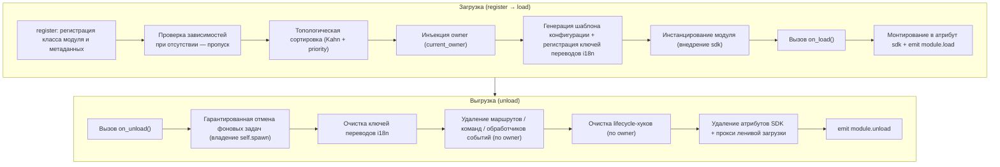

**Что фреймворк делает за вас при загрузке** (вам достаточно написать `on_load`, всё остальное выполняется автоматически):

| Этап | Что фреймворк делает автоматически |
|------|-------------|
| Инъекция owner | Во время инстанцирования имя модуля оборачивается в `owner_scope` — команды/события/хуки/фоновые задачи, зарегистрированные в вашем `on_load`, **автоматически принадлежат данному модулю**; при выгрузке они очищаются по owner в один клик |
| Шаблон конфигурации | Для модулей с объявленным `ConfigClass` фреймворк автоматически генерирует/заполняет секцию конфигурации `ErisPulse.<ModuleName>` |
| Ключи переводов i18n | Для модулей с объявленным `I18nClass` ключи переводов регистрируются автоматически (при выгрузке автоматически отменяются) |
| Топология зависимостей | Сортировка согласно объявлениям `depends`, гарантирующая, что модули-зависимости загружаются первыми; циклические зависимости отклоняются с `RuntimeError` |
| Монтирование SDK | После инстанцирования модуль монтируется в `sdk.<ModuleName>`, благодаря чему вы можете обращаться к нему через `sdk.MyModule.xxx` |

**Что фреймворк очищает за вас при выгрузке** (соответствует U1→U7 выше): после завершения `on_unload` выполняется гарантированная очистка — принудительная отмена фоновых задач (созданных через `self.spawn`; аккуратное завершение делайте сами в `on_unload`), ключей i18n, маршрутов, обработчиков команд/событий, lifecycle-хуков, и в конце удаляются атрибуты SDK. При `purge=True` дополнительно удаляется заглушка регистрации + очищается `sys.modules`.

> Именно эта автоматическая очистка даёт уверенность, что «достаточно написать `on_load`/`on_unload`, ручной unregister не нужен» — фреймворк через принадлежность owner превратил принцип «кто зарегистрировал — тот и очищает» в действие одним шагом.

## Объект SDK

### Доступ к основным модулям

```python
from ErisPulse import sdk

# Доступ ко всем основным модулям через объект sdk
sdk.logger.info("Лог")
sdk.storage.set("key", "value")

# Для собственного малого состояния модуля (счётчики/переключатели/время последнего запуска) предпочтительно использовать self.state —
# ключи автоматически получают префикс module.state.<имя модуля>. и сохраняются после выгрузки и перезагрузки модуля:
count = self.state.get("runs", 0) + 1
self.state.set("runs", count)            # синхронно (в любом контексте)
await self.state.aset("runs", count)     # асинхронный путь
await self.state.aget("runs", 0)
config = sdk.config.getConfig("MyModule")
```

### Взаимодействие между модулями

```python
# Доступ к другим модулям
other_module = sdk.OtherModule
result = await other_module.some_method()
```

## Методы отправки адаптера

В связи с новым стандартным требованием использовать перегрузку метода `__getattr__` для реализации метода отправки по умолчанию, невозможно использовать `hasattr` для проверки наличия метода. Начиная с версии `2.3.5`, добавлена функция для проверки методов отправки.

### Список поддерживаемых методов отправки

```python
# Вывести список всех методов отправки, поддерживаемых платформой
methods = sdk.adapter.list_sends("onebot11")
# Возвращает: ["Text", "Image", "Voice", "Markdown", ...]
```

### Получение подробной информации о методе

```python
# Получить подробную информацию о методе
info = sdk.adapter.send_info("onebot11", "Text")
# Возвращает:
# {
#     "name": "Text",
#     "parameters": [
#         {"name": "text", "type": "str", "default": null, "annotation": "str"}
#     ],
#     "return_type": "Awaitable[Any]",
#     "docstring": "Отправка текстового сообщения..."
# }
```

## Управление конфигурацией

### Декларативная конфигурация (рекомендуется)

Начиная с v2.5.2, модули могут объявлять класс конфигурации с помощью `ConfigClass`, используя ту же систему схем конфигурации, что и адаптеры. Конфигурация читается в реальном времени через `self.cfg`, и любые изменения применяются немедленно:

```python
from dataclasses import dataclass, field
from ErisPulse.Core.Bases import BaseModule
from ErisPulse.Core.Bases import BaseConfig

@dataclass
class MyModuleConfig(BaseConfig):
    api_key: str = field(
        default="",
        metadata={
            "description": {"i18n": "my_module.api_key", "default": "API ключ"},
            "required": True,
            "secret": True,
            "ui": {"widget": "password", "group": "basic", "order": 1},
        },
    )
    timeout: int = field(
        default=30,
        metadata={
            "description": {"i18n": "my_module.timeout", "default": "Время ожидания (секунды)"},
            "ui": {"widget": "number", "group": "advanced", "order": 2},
        },
    )

class MyModule(BaseModule):
    ConfigClass = MyModuleConfig

    def __init__(self, sdk):
        self.sdk = sdk
        self.logger = sdk.logger.get_child("MyModule")

    async def on_load(self, event):
        self.logger.info("Модуль загружен")

    async def on_unload(self, event):
        pass

    async def do_something(self):
        cfg = self.cfg  # Чтение в реальном времени, типобезопасно
        api_key = cfg.api_key
        timeout = cfg.timeout
```

`BaseConfig` — это универсальный базовый класс конфигурации, подходящий для адаптеров, модулей, внешних проектов и любых других сценариев. Поля конфигурации поддерживают многоязычные описания с помощью i18n (см. [документацию по i18n](../../advanced/i18n.md#многоязычные-описания-полей-конфигурации)).

> [!NOTE]
> Жизненный цикл модуля (включая загрузку, выгрузку, запуск и остановку) управляется фреймворком (модульный менеджер / scope предоставляет API для запросов и управления). `ConfigClass` должен содержать только бизнес-параметры, и модулю не нужно вкладывать внутрь логику проверки "нужно ли мне запускаться".

Система схем конфигурации также поддерживает (с v2.8.0, см. [основные понятия адаптеров](../adapters/core-concepts.md#метаданные-конвенции)):

- **Автоматическое создание описания полей из docstring**: если `metadata` `description` не объявлен, автоматически извлекается из docstring с помощью `:ivar 字段: 说明` или раздела `Attributes:`
- **Вложенные dataclass-конфигурации**: если тип поля — вложенный dataclass, схема/шаблон/валидация обрабатываются рекурсивно, веб-интерфейс отображает вложенные группы
- **Поле `example`, не сохраняемое на диск**: поля с `metadata={"example": True}` не записываются в `config.toml`, а только сохраняются в `config.full.example` (подходит для сложных и редко используемых расширенных параметров), пользовательские настройки сохраняются как обычные

### Горячая перезагрузка конфигурации (on_config_update)

После реализации модулем и адаптером метода `on_config_update(old, new)` фреймворк автоматически вызывает его при **фактическом изменении конфигурации модуля** (не нужно самостоятельно подписываться на события конфигурации), и такие параметры, как токен, переключатели или лимиты, применяются без перезапуска:

```python
class MyModule(BaseModule):
    ConfigClass = MyModuleConfig

    def on_config_update(self, old_config, new_config):
        # При объявлении ConfigClass это типобезопасный объект конфигурации (если не объявлен, то dict);
        # при вызове setConfig() old_config будет None (только new будет иметь значение)
        if old_config is None or new_config.api_key != old_config.api_key:
            self.logger.info("API ключ обновлен, пересоздание клиента")
            self._client = build_client(new_config.api_key)
```

Источники вызова и правила маршрутизации:

- **Запись во время выполнения** (код или Dashboard вызывает `setConfig()`): маршрутизация по префиксу ключа конфигурации — только запись в ключи конфигурации модуля (или их подключей) вызывает событие, при этом `old_config` будет `None`
- **Редактирование файла конфигурации** (отслеживание изменений): событие срабатывает, если старая и новая конфигурация отличаются, при этом `old` / `new` — объекты до и после изменения
- Исключения, возникающие внутри обработчика, перехватываются фреймворком и регистрируются, но не влияют на саму запись конфигурации

Использование:

- `self.cfg` — чтение в реальном времени — для простых параметров, которые не требуют пересоздания состояния (например, время ожидания в секундах), значение обновляется сразу в следующей строке кода, без необходимости вручную синхронизировать в этом хуке
- Для ресурсов, требующих пересоздания (клиентское соединение, пул соединений, таймеры) обработка выполняется в этом хуке

### Декларативные ключи перевода (v2.7.0+)

Начиная с v2.7.0, модули могут объявлять ключи перевода так же, как и `ConfigClass`, с помощью вложенного класса `I18nClass`. Фреймворк автоматически регистрирует все объявленные ключи перевода при загрузке, без необходимости вызывать `i18n.register()` вручную, и регистрирует их до генерации шаблона конфигурации, обеспечивая доступность ключей i18n, используемых в описаниях конфигурации.

```python
from ErisPulse.Core.Bases import BaseConfig, BaseI18n, I18nKey

class MyModule(BaseModule):
    # Класс конфигурации (необязательно)
    @dataclass
    class ConfigClass(BaseConfig):
        welcome_msg: str = field(
            default="Добро пожаловать",
            metadata={
                "description": {"i18n": "mymodule.welcome_msg", "default": "Сообщение приветствия"},
            },
        )

    # Класс коллекции ключей перевода (необязательно)
    class I18nClass(BaseI18n):
        # Имя свойства автоматически объединяется в полный путь ключа: <имя_модуля>.<имя_свойства>
        welcome_msg: I18nKey = I18nKey(
            default="Welcome Message",   # Языковонезависимый запасной вариант
            zh_CN="欢迎消息",
            zh_TW="歡迎訊息",
            en="Welcome Message",
            ja="ウェルカムメッセージ",
            ru="Приветственное сообщение",
        )
        hello: I18nKey = I18nKey(
            default="Hello, {name}!",
            zh_CN="你好，{name}！",
            zh_TW="你好，{name}！",
            en="Hello, {name}!",
            ja="こんにちは、{name}！",
            ru="Привет, {name}!",
        )
```

Подробнее см. [рекомендуемый способ написания i18n](../../advanced/i18n.md#рекомендуемый-способ-через-i18nclass-объявление-ключей-перевода-v270).

### Ручное чтение конфигурации (устарело)

> **Устарело**: используйте [декларативную конфигурацию](#декларативная-конфигурация-рекомендуется) + `self.cfg` для чтения в реальном времени.

```python
class MyModule(BaseModule):
    def __init__(self, sdk):
        self.sdk = sdk

    def _load_config(self):
        config = self.sdk.config.getConfig("MyModule")
        if not config:
            self.sdk.config.setConfig("MyModule", {"api_key": "", "timeout": 30})
            return {"api_key": "", "timeout": 30}
        return config
```

## Система хранения

### Основное использование

```python
# Сохранить данные
sdk.storage.set("user:123", {"name": "张三"})

# Получить данные
user = sdk.storage.get("user:123", {})

# Удалить данные
sdk.storage.delete("user:123")
```

### Использование транзакций

```python
# Использовать транзакцию для обеспечения согласованности данных
with sdk.storage.transaction():
    sdk.storage.set("key1", "value1")
    sdk.storage.set("key2", "value2")
    # Если любая операция завершится с ошибкой, все изменения будут отменены
```

## Обработка событий

### Регистрация обработчиков событий

```python
from ErisPulse.Core.Event import command, message

# Регистрация команды
@command("info", help="Получить информацию")
async def info_handler(event):
    await event.reply("Это информация")

# Регистрация обработчика сообщений
@message.on_group_message()
async def group_handler(event):
    sdk.logger.info(f"Получено групповое сообщение: {event.get_text()}")
```

### Жизненный цикл обработчиков событий

Фреймворк автоматически управляет регистрацией и удалением обработчиков событий, вам нужно только зарегистрировать их в `on_load`.

## Механизм ленивой загрузки

### Принцип работы

```python
# Модуль инициализируется только при первом обращении
result = await sdk.my_module.some_method()
# ↑ Здесь будет инициирована инициализация модуля
```

### Немедленная загрузка

Для модулей, требующих немедленной инициализации (например, триггеры, таймеры):

```python
@staticmethod
def get_load_strategy():
    return ModuleLoadStrategy(
        lazy_load=False,  # Немедленная загрузка
        priority=100
    )
```

## Обработка ошибок

### Перехват исключений

```python
async def handle_event(self, event):
    try:
        # Бизнес-логика
        await self.process_event(event)
    except ValueError as e:
        self.logger.warning(f"Ошибка параметра: {e}")
        await event.reply(f"Ошибка параметра: {e}")
    except Exception as e:
        self.logger.error(f"Обработка не удалась: {e}")
        raise
```

### Запись в лог

```python
# Использование разных уровней логирования
self.logger.debug("Отладочная информация")    # Подробная отладочная информация
self.logger.info("Состояние работы")      # Информация о нормальной работе
self.logger.warning("Предупреждение")  # Предупреждение
self.logger.error("Ошибка")    # Ошибка
self.logger.critical("Критическая ошибка") # Критическая ошибка
```


### Event 包装类详解

# Документация по классу Event

> [!NOTE]
> **Обязательный материал уровня L1** — одна из пяти основных статей в разделе "Путь обучения" на главной странице. Необходима для разработки модулей.

Параметр `event` в обработчиках, который позволяет напрямую вызывать `.get_text()` / `.reply()` / `.wait_reply()`, работает благодаря классу-обёртке Event. В данной статье представлен полный список методов — используйте его при написании обработчиков событий, методы и их поведение должны соответствовать описанию ниже.

## Добавление аннотации типа для параметра event

Параметр `event` в обработчиках событий представляет собой **обёртку Event** (подкласс dict). **Рекомендуется** добавлять аннотацию типа `Event` (аннотации не влияют на выполнение, но помогают IDE и статической проверке):

```python
from ErisPulse.Core.Event import Event

@message.on_private_message()
async def handler(event: Event):
    text = event.get_text()   # IDE автоматически подсказывает все удобные методы
    await event.reply(text)   # Опечатки будут обнаружены на этапе статической проверки
```

Без аннотации IDE не распознаёт методы Event (`get_text()` / `reply()` / `wait_reply()` / дополнительные методы платформы), и всё придётся запоминать наизусть.

> **Обратите внимание:** `event` в обработчике событий — это **обёртка Event** (аннотация `Event`); `event` в методах жизненного цикла модуля `on_load` / `on_unload` — это обычный **dict** (аннотация `dict`), не путайте их.

## Основные особенности

- **Полная совместимость с dict**: Event наследуется от dict
- **Удобные методы**: предоставляет множество удобных методов
- **Доступ точкой**: поддерживает доступ к полям события через точку
- **Обратная совместимость**: все методы являются необязательными

## Основные поля и методы

```python
from ErisPulse.Core.Event import command, Event

@command("info")
async def info_command(event: Event):
    event_id = event.get_id()
    platform = event.get_platform()
    time = event.get_time()
    print(f"ID: {event_id}, платформа: {platform}, время: {time}")
```

## Методы сообщений

```python
from ErisPulse.Core.Event import message, Event

@message.on_private_message()
async def private_handler(event: Event):
    text = event.get_text()
    user_id = event.get_user_id()
    nickname = event.get_user_nickname()
    await event.reply(f"Привет, {nickname}!")
```

## Определение типа сообщения

```python
from ErisPulse.Core.Event import message, Event

@message.on_group_message()
async def group_handler(event: Event):
    is_private = event.is_private_message()
    is_group = event.is_group_message()
    is_at = event.is_at_message()
    await event.reply(f"Тип: {'личное сообщение' if is_private else 'группа'}")
```

## Ответы

```python
from ErisPulse.Core.Event import command, Event

@command("ask")
async def ask_command(event: Event):
    await event.reply("Пожалуйста, введите ваше имя:")
    reply = await event.wait_reply(timeout=30)
    if reply:
        name = reply.get_text()
        await event.reply(f"Привет, {name}!")

@command("price")
async def price_command(event: Event):
    await event.reply("Пожалуйста, введите сумму (например: 5元):")
    # Ответ должен соответствовать регулярному выражению, иначе ждём дальше до тайм-аута
    reply = await event.wait_reply(timeout=30, regex=r"\d+\s*元")
    if reply:
        await event.reply(f"Получена сумма: {reply.get_text()}")
```

#### reply и send_chain

Для сценариев, где `reply()` не подходит — платформенные методы с модификаторами (например, Expire/Board), последовательные модификаторы, действия без параметров содержимого — используйте `event.send_chain`, чтобы получить цепочку отправки, уже настроенную на цель и аккаунт, и добавляйте модификаторы перед отправкой:

```python
await event.send_chain.At(event.user_id).Text("Содержимое")     # Цепочка модификаторов + отправка
```

Список методов модификаторов см. в [Спецификации методов отправки](../../standards/send-method-spec.md).

## Расширенная интерактивность

> [!NOTE]
> Эти возможности доступны в ErisPulse **2.8.0+**.

```python
# Напоминание: через 5 минут без ответа напоминаем, пользователь отвечает — отменяем
reminder = event.remind(300, "Ещё здесь? Если не хотите общаться, напишите «выход»")
reminder.cancel()  # Можно и вручную отменить

# Превышение тайм-аута: по истечении времени обязательно уведомить, например, если задача не обработана, уведомить администратора
event.escalate(1800, lambda e: notify_master("Задача просрочена"))

# Ожидание нескольких событий: одновременно ждём "согласие" и "отказ", первое поступившее событие — ответ
which, reply = await event.select(
    event.expect(pattern="согласие*", user="10001"),
    event.expect(pattern="отказ*", user="10002"),
    timeout=60,
)
if which is None:
    await event.reply("Тайм-аут, ответ не получен")

# Ожидание в сессии: ответы от любого участника той же группы (для группового сотрудничества)
reply = await event.wait_reply(session=True, prompt="Кто-нибудь, помогите, ответьте, пожалуйста?")

# История сообщений в сессии: последние 20 сообщений в текущей сессии (включая сообщения бота, контекст для ИИ, база для предотвращения повторов)
messages = await event.history(20)

# Транзакции сообщений: при исключении автоматически отменяются отправленные сообщения в рамках транзакции
async with event.message_tx():
    await event.reply("Обработка, пожалуйста, подождите...")
    result = await do_something()
    await event.reply(f"Завершено: {result}")
```

## Получение информации о команде

```python
from ErisPulse.Core.Event import command, Event

@command("cmdinfo")
async def cmdinfo_command(event: Event):
    cmd_name = event.get_command_name()
    cmd_args = event.get_command_args()
    await event.reply(f"Команда: {cmd_name}, аргументы: {cmd_args}")
```

## Методы уведомлений

```python
from ErisPulse.Core.Event import notice, Event

@notice.on_friend_add()
async def friend_add_handler(event: Event):
    await event.reply("Добро пожаловать! Добавьте меня в друзья.")
```

## Справочник методов

### Основные методы

#### Информация об событии
- `get_id()` - Получить ID события
- `get_time()` - Получить временной штамп события (Unix в секундах)
- `get_type()` - Получить тип события (message/notice/request/meta)
- `get_detail_type()` - Получить подробный тип события (private/group/friend и т.д.)
- `get_platform()` - Получить название платформы

#### Информация о боте
- `get_self_platform()` - Получить название платформы бота
- `get_self_user_id()` - Получить ID пользователя бота
- `get_self_account_id()` - Получить ID аккаунта бота (режим множественных ботов)
- `get_self_info()` - Получить полную информацию о боте в виде словаря

#### Идентификаторы сессии
- `get_target_id()` - Получить уникальный идентификатор цели (для групповых чатов возвращает `group_id`, для каналов `channel_id`, для личных сообщений `user_id`, возвращается первый непустой из `group → channel → guild → thread → user`)
- `get_session_id()` - Получить уникальный идентификатор сессии, формат: `{platform}:{detail_type}:{target_id}`

### Методы сообщений

#### Содержимое сообщения
- `get_message()` - Получить массив сегментов сообщения (формат OneBot12)
- `get_alt_message()` - Получить альтернативный текст сообщения
- `get_text()` - Получить текстовое содержимое (псевдоним `get_alt_message()`)
- `get_message_text()` - Получить текстовое содержимое (псевдоним `get_alt_message()`)

#### Информация об отправителе
- `get_user_id()` - Получить ID отправителя
- `get_user_nickname()` - Получить никнейм отправителя
- `get_sender()` - Получить полную информацию об отправителе в виде словаря

#### Информация о группе/канале
- `get_group_id()` - Получить ID группы (для сообщений в группе)
- `get_channel_id()` - Получить ID канала (для сообщений в канале)
- `get_guild_id()` - Получить ID сервера (для сообщений на сервере)
- `get_thread_id()` - Получить ID темы/подканала (для сообщений в теме)

#### Относящиеся к упоминаниям
- `has_mention()` - Содержит ли сообщение упоминание бота
- `get_mentions()` - Получить список всех ID упомянутых пользователей

### Типы сообщений

#### Базовые проверки
- `is_message()` - Является ли событие сообщением
- `is_private_message()` - Является ли сообщение личным
- `is_group_message()` - Является ли сообщение групповым
- `is_at_message()` - Является ли сообщение упоминанием (псевдоним `has_mention()`)

### Методы уведомлений

#### Информация об операторе
- `get_operator_id()` - Получить ID оператора
- `get_operator_nickname()` - Получить никнейм оператора

#### Типы уведомлений
- `is_notice()` - Является ли событие уведомлением
- `is_group_member_increase()` - Событие увеличения участников группы
- `is_group_member_decrease()` - Событие уменьшения участников группы
- `is_friend_add()` - Событие добавления друга (соответствует `detail_type == "friend_increase"`)
- `is_friend_delete()` - Событие удаления друга (соответствует `detail_type == "friend_decrease"`)

### Методы запросов

#### Информация о запросе
- `get_comment()` - Получить комментарий к запросу

#### Типы запросов
- `is_request()` - Является ли событие запросом
- `is_friend_request()` - Является ли запросом дружбы
- `is_group_request()` - Является ли запросом группы

#### Одобрение/отклонение запроса (approve / reject)

Регистрация обработчика запроса и принятие решения:

```python
from ErisPulse.Core.Event import request

@request.on_friend_request()
async def handle_friend(event):
    request_id = event.get_request_id()   # Идентификатор запроса (при отсутствии приведёт к ValueError)
    if event.get_comment() == "пароль":
        result = await event.approve()    # Одобрить (можно добавить комментарий: approve(comment="добро пожаловать")）
    else:
        result = await event.reject()     # Отклонить
    if result.get("status") != "ok":
        # Стандартный формат ответа, при ошибке message объясняет причину (например, 34001 запрос просрочен)
        pass

@request.on_group_request()               # Запрос на вступление в группу / приглашение
async def handle_group(event):
    await event.approve()
```

> Действия одобрения/отклонения выполняются через DSL адаптера `Request`; формат ответа, коды ошибок и требования к реализации адаптера см. в [Спецификации действий запроса](../../standards/request-action-spec.md). Доступен также универсальный регистратор `request.on_request()` (без различения типов).

#### Контроль цепочки (done / is_processed / is_stopped)

- `done(claim=True)` - Заявить (по умолчанию) или просто заблокировать последующие обработчики с низким приоритетом
- `is_processed()` - Было ли событие уже заявлено
- `is_stopped()` - Была ли цепочка обработки события заблокирована

Полная семантика заявки и блокировки (взаимодействие приоритетов, заявка команд) см. в [Введение в обработку событий · Контроль цепочки: заявка и блокировка](../../getting-started/event-handling.md#链路控制认领与阻断).

### Ответы

#### Основные ответы
- `reply(content, method="Text", at_sender=False, quote=False, at_users=None, reply_to=None, at_all=False, via=None, **kwargs)` - Общий метод ответа
  - `content`: содержимое отправки (текст, URL и т.д.)
  - `method`: метод отправки, по умолчанию "Text", можно "Image"/"Voice"/"Video"/"File" и т.д.
  - `at_sender`: упоминать ли отправителя (автоматически извлекается user_id)
  - `quote`: цитировать ли текущее сообщение (автоматически извлекается message_id)
  - `at_users`: список упоминаний пользователей, например `["user1", "user2"]`
  - `reply_to`: вручную указать ID сообщения для ответа
  - `at_all`: упоминать ли всех участников
  - `**kwargs`: дополнительные параметры (например, user_id для метода Mention)

- `reply_ob12(message)` - Ответ с использованием OneBot12 сегментов сообщения
  - `message`: список или словарь сегментов OneBot12, можно использовать MessageBuilder для построения

#### Проверка поддержки платформой
- `supports(method)` - Проверить, поддерживает ли платформа метод отправки (например, `"Image"`), возвращает `bool`
- `available_methods()` - Список всех доступных методов отправки на платформе, возвращает список названий методов

#### Пересылка

> **Внимание**: функция пересылки должна быть реализована через DSL отправки адаптера, Event-обёртка не предоставляет прямого метода пересылки.

```python
# Переслать сообщение в группу
adapter = sdk.adapter.get(event.get_platform())
target_id = event.get_group_id()  # или указать другой ID группы
await adapter.Send.To("group", target_id).Text(event.get_text())
```

> **Развертывание на нескольких аккаунтах**: отправка в рамках обработки события **не требует явного указания аккаунта** — фреймворк вносит идентификатор аккаунта, вызвавшего событие, в контекст вызова, и `Send` / `Api` / `Request` цепочки при отсутствии явного указания автоматически привязываются к аккаунту, вызвавшему событие (явный `Using()` всегда имеет приоритет; в сценариях таймеров и других без контекста события используется аккаунт по умолчанию). То есть, в примере выше пересылка будет выполнена от аккаунта, получившего это событие, без дополнительного кода.

#### Повторная обработка на разных аккаунтах

При развертывании нескольких аккаунтов в одной группе одно физическое сообщение может быть получено каждым аккаунтом. Фреймворк обрабатывает это по `ErisPulse.framework.cross_account_policy` (по умолчанию `off` — не ассоциировать):

- `mark`: последующие копии будут по-прежнему распределяться, но в верхнем уровне события будет вставлено поле `multi_receipt` (например, `{"event_id": id первого обработанного события, "self_id": первый обработанный аккаунт}`) — модуль может использовать это поле для принятия решения о пропуске ответа
- `drop`: копии будут отбрасываться на этапе распределения, модуль не будет знать об этом

### Ожидание ответа

- `wait_reply(prompt=None, timeout=60.0, callback=None, validator=None, method="Text", pattern=None, regex=None)` - Ожидание ответа пользователя
  - `prompt`: сообщение-подсказка, если указано, будет отправлено пользователю
  - `timeout`: время ожидания (секунды), по умолчанию 60
  - `callback`: функция обратного вызова, выполняется при получении ответа
  - `validator`: функция проверки, для проверки, является ли ответ действительным
  - `method`: метод отправки подсказки, по умолчанию "Text", можно "Image"/"Markdown" и т.д.
  - `pattern`: шаблон подстановки (glob, `*` / `?` / `[seq]`), текст ответа должен соответствовать, иначе ожидание продолжается
  - `regex`: регулярное выражение, текст ответа должен соответствовать (один из `pattern` или `regex`), иначе ожидание продолжается
  - Возвращает объект Event ответа пользователя, при тайм-ауте возвращает `None`

#### Интерактивные методы

- `confirm(prompt=None, timeout=60.0, yes_words=None, no_words=None, method="Text", hint=False)` - Подтверждение диалога
  - Возвращает `True` (подтверждение), `False` (отказ), `None` (тайм-аут)
  - Встроенные слова подтверждения на китайском и английском языках автоматически распознаются, можно задать собственный набор слов
  - `method`: метод отправки, по умолчанию "Text"; поддерживает "Image"/"Markdown" и другие не-текстовые способы отправки подсказки
  - `hint`: добавлять ли в конец подсказки автоматически подсказку по словам подтверждения (например, "（是/否）"）， по умолчанию False

- `choose(prompt, options, timeout=60.0, method="Text", options_format="auto", merge_prompt=False, placeholder="{options}")` - Выбор меню
  - `options`: список текстов вариантов
  - Возвращает индекс варианта (начиная с 0), при тайм-ауте возвращает `None`
  - `method`: метод отправки, по умолчанию "Text"; текстовые методы (Text/Markdown/md/Html/h5) по умолчанию объединяют варианты в конец
  - `options_format`: формат вариантов (по умолчанию: "auto", автоматически выбирается встроенный стиль в зависимости от method)
    - `"auto"`: Markdown→нумерованный список (например, `- 1. Вариант`), Html→упорядоченный список (например, `<ol>`), другие→простой список
    - `"list"`: каждый вариант на отдельной строке, например ``1. Вариант A\n2. Вариант B``
    - `"inline"`: варианты отображаются в одну строку, например ``1.A | 2.B``
    - `"md"`: Markdown нумерованный список
    - `"html"`: Html упорядоченный список
    - `callable`: пользовательская функция, принимает ``list[str]`` и возвращает ``str``
  - `merge_prompt`: принудительное объединение в одно сообщение, по умолчанию False
    - `False` (по умолчанию): текстовые методы объединяют автоматически; не-текстовые методы сначала отправляют prompt, затем Text-варианты
    - `True`: независимо от method объединяются в одно сообщение, отправляется с указанным method
  - `placeholder`: маркер для вставки вариантов, по умолчанию `{options}`; если в prompt встречается этот маркер, он заменяется на текст вариантов, если пустая строка, всегда добавляется в конец

- `collect(fields, timeout_per_field=60.0)` - Сбор формы
  - `fields`: список полей, каждое поле содержит `key`, `prompt`, необязательный `validator`, необязательный `method`
  - Возвращает словарь `{key: value}`, при тайм-ауте любого поля возвращает `None`
  - Каждое поле может иметь `method`, например, для сбора изображения: `{"key": "avatar", "prompt": "Пожалуйста, отправьте аватар", "method": "Image"}`
  - Каждое поле может иметь `options` (список), если задано, поле становится выбором (автоматически вызывается логика choose)
  - Каждое поле может иметь `options_format`, `merge_prompt`, `placeholder`, чтобы управлять форматом вариантов, поведением объединения сообщений и маркером

- `wait_for(event_type="message", condition=None, timeout=60.0)` - Ожидание произвольного события
  - `condition`: фильтрующая функция, возвращает `True` при совпадении
  - Возвращает соответствующий Event, при тайм-ауте возвращает `None`

- `conversation(timeout=60.0)` - Создать контекст многократного диалога
  - Возвращает объект `Conversation`, поддерживающий `say()`/`wait()`/`confirm()`/`choose()`/`collect()`/`stop()`
  - Свойство `is_active` указывает, активен ли диалог

#### Примеры интерактивных методов

**confirm() - Подтверждение диалога:**

```python
from ErisPulse.Core.Event import Event
@command("delete", help="Удалить данные")
async def delete_handler(event: Event):
    if await event.confirm("Вы уверены, что хотите удалить все данные?"):
        sdk.storage.delete("all_data")
        await event.reply("Данные удалены")
    else:
        await event.reply("Отменено")
```

**confirm() - С подсказкой:**

```python
# hint=True добавит в конец подсказки "（是/否）"
if await event.confirm("Продолжить? ", hint=True):
    await event.reply("Продолжено")
# Пользователь увидит: Продолжить? （是/否）
```

**choose() - Выбор меню:**

```python
from ErisPulse.Core.Event import Event
@command("color", help="Выбрать цвет")
async def color_handler(event: Event):
    choice = await event.choose("Выберите цвет: ", ["красный", "зелёный", "синий"])
    if choice is not None:
        colors = ["красный", "зелёный", "синий"]
        await event.reply(f"Вы выбрали: {colors[choice]}")
```

**choose() - Форматирование и объединение сообщений:**

```python
# inline формат: варианты отображаются в одной строке
choice = await event.choose("Выберите: ", ["A", "B", "C"], options_format="inline")
# Вывод: 1.A | 2.B | 3.C

# Пользовательская функция форматирования
choice = await event.choose("Выберите: ", ["кот", "собака"],
    options_format=lambda opts: " / ".join(opts))
# Вывод: кот / собака

# options_format="auto" (по умолчанию): в зависимости от method автоматически выбирается встроенный стиль
# Markdown → нумерованный список
choice = await event.choose(
    "## Выберите", ["кот", "собака"],
    method="Markdown",  # auto автоматически определяет как md список
)
# Вывод:
# ## Выберите
# - 1. кот
# - 2. собака

# Html → упорядоченный список
choice = await event.choose(
    "<h2>Выберите</h2>", ["кот", "собака"],
    method="Html", merge_prompt=True,  # auto автоматически определяет как html список
)
# Вывод:
# <h2>Выберите</h2>
# <ol><li>1. кот</li><li>2. собака</li></ol>

# Режим объединения + маркер
choice = await event.choose(
    "## Выберите\n{options}\nОтветьте номером",
    ["кот", "собака"],
    method="Markdown", merge_prompt=True,
)

# Пользовательский маркер
choice = await event.choose(
    "Выберите: [choices]",
    ["кот", "собака"],
    placeholder="[choices]",
)
```

**collect() - Сбор формы:**

```python
from ErisPulse.Core.Event import Event
@command("register", help="Зарегистрироваться")
async def register_handler(event: Event):
    data = await event.collect([
        {"key": "name", "prompt": "Введите имя: "},
        {"key": "age", "prompt": "Введите возраст:",
         "validator": lambda e: e.get_text().isdigit()},
    ])
    if data:
        await event.reply(f"Регистрация успешна! {data['name']}, {data['age']} лет")
```

**reply с не-Text методами:**

```python
await event.reply("http://example.com/img.jpg", method="Image")
await event.reply("http://example.com/audio.mp3", method="Voice")

from ErisPulse.Core.Event import MessageBuilder
segments = MessageBuilder.text("Посмотрите на эту картинку:").image("http://example.com/img.jpg").build()
await event.reply_ob12(segments)
```

> Полное использование многократного диалога с помощью Conversation см. в [Многократный диалог с помощью Conversation](../../advanced/conversation.md).

### Информация о команде

#### Основы команд
- `get_command_name()` - Получить имя команды
- `get_command_args()` - Получить список аргументов команды
- `get_command_raw()` - Получить исходный текст команды
- `get_command_info()` - Получить полную информацию о команде в виде словаря
- `is_command()` - Является ли событие командой

### Исходные данные

- `get_raw()` - Получить исходные данные события платформы
- `get_raw_type()` - Получить тип исходных данных события платформы

### Платформенные расширения

Адаптеры могут регистрировать платформенные методы для класса Event. Методы доступны только на Event-экземплярах соответствующей платформы, при попытке доступа с других платформ будет выброшено `AttributeError`.

Платформенные методы переопределяют встроенные методы через `Event.__getattribute__`, поэтому можно переопределить встроенные методы интеракции, такие как `confirm`, `choose`, `collect`, `wait_reply`, предоставляя специфичные реализации для платформы (например, кнопки, карточки). Встроенные реализации экспортируются как `_builtin_*` функции для переопределения.

```python
# Почтовое событие — только почтовые методы
event = Event({"platform": "email", "email_raw": {"subject": "Hello"}})
event.get_subject()      # ✅ Возвращает "Hello"
event.get_chat_type()    # ❌ AttributeError

# Telegram событие — только Telegram методы
event = Event({"platform": "telegram", "telegram_raw": {"chat": {"type": "private"}}})
event.get_chat_type()    # ✅ Возвращает "private"
event.get_subject()      # ❌ AttributeError

# Встроенные методы всегда доступны
event.get_text()         # ✅ На любой платформе
event.reply("hi")        # ✅ На любой платформе
```

### Проверка зарегистрированных методов

```python
from ErisPulse.Core.Event import get_platform_event_methods

methods = get_platform_event_methods("email")
# ["get_subject", "get_from", ...]
```

### Поддержка hasattr и dir

```python
hasattr(event, "get_subject")   # Возвращает True только при platform="email"
"get_subject" in dir(event)     # То же самое
```

### Расширение для всех платформ (шаблон)

`register_event_method` и `register_event_mixin` поддерживают передачу `"*"` в качестве имени платформы, регистрируя методы, доступные на **всех платформах**. Подходит для функций, требующих кросс-платформенного повторного использования, таких как ИИ-диалоги, управление контекстом и т.д.

```python
from ErisPulse.Core.Event.wrapper import register_event_method

@register_event_method("*")
async def ai_chat(self, prompt: str):
    # self — экземпляр Event, доступен к событиям и встроенным методам
    await self.reply(f"ИИ: {prompt}")
```

После регистрации любой обработчик события на любой платформе может вызывать `event.ai_chat(...)`. 

Приоритет методов (от высокого к низкому): методы платформы → методы шаблона → встроенные методы → доступ по ключу словаря.

> Способ регистрации расширений адаптерами см. в [API системы событий - Кросс-платформенное расширение (шаблон)](../../api-reference/event-system.md#跨平台扩展通配符).


### 模块开发最佳实践

# Лучшие практики разработки модулей

> [!TIP]
> **Когда стоит читать этот документ**: рекомендуется прочитать после написания первого модуля (инженерные лучшие практики). Если это не нужно — пропустите, на использование остального функционала это не влияет.


Здесь собраны инженерные соглашения по написанию модулей: асинхронные операции не блокируют цикл событий, конфигурация объявляется декларативно, ресурсы, взятые на хранение у других модулей, освобождаются при выгрузке — следуя этим правилам, вы избежите самых частых проблем разработки модулей: утечек памяти, остаточных фоновых задач и неработающей горячей перезагрузки.

## Проектирование модулей

### 1. Принцип единственной ответственности

Каждый модуль должен отвечать только за одну ключевую функцию:

```python
# Хорошая архитектура: каждый модуль отвечает за одну функцию
class WeatherModule(BaseModule):
    """Модуль запроса погоды"""
    pass

class NewsModule(BaseModule):
    """Модуль запроса новостей"""
    pass

# Плохая архитектура: один модуль отвечает за несколько несвязанных функций
class UtilityModule(BaseModule):
    """Содержит погоду, новости, шутки и другой функционал"""
    pass
```

### 2. Соглашения об именовании модулей

```toml
[project]
name = "ErisPulse-ModuleName"  # Используйте префикс ErisPulse-
```

### 3. Понятное управление конфигурацией

Рекомендуется использовать декларативную конфигурацию (`ConfigClass` + `BaseConfig`) — она даёт типобезопасность, автоматическую генерацию шаблонов, поддержку форм WebUI и другие возможности:

```python
from dataclasses import dataclass, field
from ErisPulse.Core.Bases import BaseConfig

@dataclass
class MyModuleConfig(BaseConfig):
    api_url: str = field(default="https://api.example.com", metadata={
        "description": {"i18n": "my_module.api_url", "default": "Адрес API"},
    })
    timeout: int = field(default=30, metadata={
        "description": {"i18n": "my_module.timeout", "default": "Тайм-аут (в секундах)"},
    })
    cache_ttl: int = field(default=3600, metadata={
        "description": {"i18n": "my_module.cache_ttl", "default": "Время жизни кэша (в секундах)"},
    })

class MyModule(BaseModule):
    ConfigClass = MyModuleConfig

    async def do_something(self):
        cfg = self.cfg  # Типобезопасно, чтение в реальном времени
        await self._fetch(cfg.api_url, timeout=cfg.timeout)
```

При желании можно продолжать использовать ручной способ чтения/записи хранилища конфигурации (см. [Основные концепции модулей](core-concepts.md#управление-конфигурацией)).

### Декларативные ключи перевода (v2.7.0+)

Модули могут централизованно объявлять ключи перевода через `I18nClass` — фреймворк автоматически зарегистрирует их в системе i18n, вручную вызывать `i18n.register()` не нужно.

```python
from ErisPulse.Core.Bases import BaseI18n, I18nKey

class MyModule(BaseModule):
    class I18nClass(BaseI18n):
        # Бизнес-ключи перевода с заполнителями
        welcome: I18nKey = I18nKey(
            default="Welcome, {name}!",
            zh_CN="欢迎你，{name}！",
            zh_TW="歡迎你，{name}！",
            en="Welcome, {name}!",
            ja="ようこそ、{name}！",
            ru="Добро пожаловать, {name}!",
        )
        # Переводы описаний полей конфигурации
        api_url: I18nKey = I18nKey(
            default="API URL",
            zh_CN="API 地址",
            zh_TW="API 位址",
            en="API URL",
            ja="API URL",
            ru="API URL",
        )
```

Подробности использования см. в [документации i18n](../../advanced/i18n.md#рекомендуемый-подход-объявление-ключей-перевода-через-i18nclass-v270).

## Асинхронное программирование

### 1. Используйте асинхронные библиотеки

```python
# Рекомендуется встроенный HTTP-клиент SDK (асинхронный, с автоматическим логированием и статистикой)
from ErisPulse.Core import client

class MyModule(BaseModule):
    async def fetch_data(self, url):
        resp = await client.get(url)
        return await resp.json()

# Также можно использовать через sdk.client (эффект тот же)
from ErisPulse import sdk

class MyModule(BaseModule):
    async def fetch_data(self, url):
        resp = await sdk.client.get(url)
        return await resp.json()

# Не импортируйте aiohttp напрямую (это затрудняет централизованное управление со стороны фреймворка)
import aiohttp

class MyModule(BaseModule):
    async def fetch_data(self, url):
        async with aiohttp.ClientSession() as session:
            async with session.get(url) as response:
                return await response.json()

# Не используйте requests (синхронная библиотека, блокирует цикл событий)
import requests

class MyModule(BaseModule):
    def fetch_data(self, url):
        return requests.get(url).json()  # Блокирует цикл событий
```

### 2. Правильные асинхронные операции

```python
from ErisPulse.Core.Event import Event  # аннотация event: Event настоятельно рекомендуется; автодополнение кастомных методов — см. epsdk types

async def handle_command(self, event: Event):
    # Долгие операции, результат которых нужно дождаться: прямой await (прозрачный жизненный цикл)
    result = await self._long_operation()

async def on_load(self, event: dict):
    # Фоновые задачи (опрос/таймеры/fire-and-forget): используйте self.spawn(),
    # при выгрузке модуля фреймворк гарантированно отменяет их после on_unload, предотвращая утечку из-за удержания self
    self.spawn(self._poll())
```

> [!NOTE]
> Для фоновых задач рекомендуется `self.spawn()` (ErisPulse **2.8.0+**). Начиная с **2.8.3** «голый» `asyncio.create_task`
> также автоматически и неявно привязывается к модулю (Task Factory регистрирует задачи автоматически, при выгрузке гарантируется отмена — утечка ссылки `self` больше не возникает);
> `self.spawn()` остаётся рекомендуемым способом — он поддерживает планирование из сторонних потоков обратно в главный цикл и явное указание `owner=`.
> В версиях **до 2.8.3** «голые» задачи не привязываются к модулю и удерживают ссылку `self`, из-за чего экземпляр модуля не может быть собран
> (утечка при горячей перезагрузке), обязательно используйте `self.spawn()`. Подробнее см. [Управление жизненным циклом](../../advanced/lifecycle.md#принадлежность-фоновых-задач-и-автоматическая-отмена).

### 3. Управление ресурсами

```python
async def on_load(self, event):
    # SDK-клиент автоматически управляет пулом соединений, вручную создавать session не нужно
    pass
    
async def on_unload(self, event):
    # Если используете собственный клиент — не забудьте освободить ресурсы
    pass
```

## Обработка событий

### 1. Используйте класс-обёртку Event

```python
from ErisPulse.Core.Event import Event
# Используйте удобные методы класса-обёртки Event
@command("info")
async def info_command(event: Event):
    user_id = event.get_user_id()
    nickname = event.get_user_nickname()
    await event.reply(f"Привет, {nickname}!")

# Вместо прямого доступа к словарю
@command("info")
async def info_command(event: Event):
    user_id = event["user_id"]  # Менее наглядно, легко ошибиться
```

### 2. Разумное использование ленивой загрузки

```python
# Модуль редких команд: объявите триггеры activate_on — автоматическая активация при поступлении первой совпавшей команды (ленивая загрузка сохраняется)
class CommandModule(BaseModule):
    @staticmethod
    def get_load_strategy():
        return ModuleLoadStrategy(lazy_load=True, activate_on=[
            {"command": {"name": "dice", "help": "Бросить кубик", "aliases": ["d"]}},
        ])

# Модуль-слушатель с редкими событиями: объявите триггеры событий — автоматическая активация при поступлении события
class ListenerModule(BaseModule):
    @staticmethod
    def get_load_strategy():
        return ModuleLoadStrategy(lazy_load=True, activate_on=[
            {"notice": "group_member_increase"},
        ])

# Модули с частыми срабатываниями (нужно обрабатывать каждое сообщение) или модули, которые должны быть готовы сразу при запуске: немедленная загрузка
class HotListenerModule(BaseModule):
    @staticmethod
    def get_load_strategy():
        return ModuleLoadStrategy(lazy_load=False)

# Утилитарным модулям подходит ленивая загрузка
class UtilityModule(BaseModule):
    @staticmethod
    def get_load_strategy():
        return ModuleLoadStrategy(lazy_load=True)
```

> Полный синтаксис `activate_on` (три формы событий / краткая запись команд и объявление через dict / цепочка отката help) см. в
> [Системе ленивой загрузки модулей](../../advanced/lazy-loading.md#событийная-ленивая-активацияactivate_on).

### 3. Регистрация обработчиков событий

```python
from ErisPulse.Core.Event import Event
async def on_load(self, event):
    # Регистрация обработчиков событий в on_load
    @command("hello")
    async def hello_handler(event: Event):
        await event.reply("Привет!")
    
    @message.on_group_message()
    async def group_handler(event: Event):
        self.logger.info("Получено сообщение в группе")
    
    # Ручная отмена регистрации не нужна — фреймворк сделает это автоматически
```

## Утилитарные модули: обрабатывайте «уведомления о выгрузке», когда храните данные других модулей

**Когда это нужно**: ваш модуль хранит что-то за другие модули (колбэки по таймеру, подписчиков, соединения, записи кэша и т.д.). Если после выгрузки модуля-владельца эти ссылки продолжают удерживаться, его экземпляр никогда не сможет быть освобождён — это самый частый источник утечек памяти в утилитарных модулях.

```python
from ErisPulse.Core.Bases import BaseModule
from ErisPulse.runtime import off_cleanup, on_cleanup

class MyToolModule(BaseModule):
    def __init__(self):
        self._entries = {}  # {имя модуля: хранимые данные}

    def register(self, entry):
        owner = on_cleanup(self._drop)   # ① При регистрации встаём в цепочку очистки, вызывающий определяется автоматически
        self._entries.setdefault(owner, []).append(entry)

    def _drop(self, owner: str):
        self._entries.pop(owner, None)   # ② Вызывается фреймворком автоматически при выгрузке чужого модуля: отбрасываем его данные

    async def on_unload(self, event):
        off_cleanup(self._drop)          # ③ Отменяем регистрацию хука перед собственной выгрузкой
```

И это всё — фреймворк гарантирует:

- При **выгрузке / отключении** чужого модуля (или закрытии адаптера) `_drop("имя чужого модуля")` гарантированно будет вызван
- **Определение вызывающего полностью автоматическое**: вызывающий будет корректно опознан и при прямом вызове `sdk.MyToolModule.register(...)` в `on_load`, и при вызове через `sdk.module.call("MyToolModule", "register", ...)`
- Не нужно заботиться о моменте срабатывания — хук срабатывает внутри цепочки очистки фреймворка, до диагностики утечек, без ложных срабатываний

Последствия отказа от интеграции: при полной выгрузке чужого модуля через `purge` его экземпляр не может быть освобождён (диагностика утечек сообщит «не подлежит освобождению»); если чужой модуль к тому же сам не отменяет регистрацию у вас в своём `on_unload`, утечка становится постоянной.

**Обычным модулям (не хранящим данные других модулей) об этом беспокоиться не нужно** — очистка ресурсов фреймворка (команд / обработчиков / маршрутов / фоновых задач и т.д.) при выгрузке выполняется полностью автоматически.

> Подробности о моменте срабатывания, правилах определения вызывающего, тайм-аутах и отказоустойчивости см. в
> [Системе владения · Руководстве по утилитарным модулям](../../advanced/ownership.md#руководство-по-утилитарным-модулямхранение-дескрипторов-других-модулей).

## Обработка ошибок

### 1. Обработка исключений по категориям

```python
from ErisPulse.Core.Event import Event
from ErisPulse.Core.Bases.errors import ClientError

async def handle_event(self, event: Event):
    try:
        result = await self._process(event)
    except ValueError as e:
        # Ожидаемая бизнес-ошибка
        self.logger.warning(f"Бизнес-предупреждение: {e}")
        await event.reply(f"Ошибка параметров: {e}")
    except ClientError as e:
        # Сетевая ошибка (исключения aiohttp нижележащего уровня sdk.client уже автоматически преобразованы)
        self.logger.error(f"Сетевая ошибка {e.method} {e.url}: {e}")
        await event.reply("Сетевой запрос не удался, попробуйте позже")
    except Exception as e:
        # Неожиданная ошибка
        self.logger.error(f"Неизвестная ошибка: {e}", exc_info=True)
        await event.reply("Обработка не удалась, обратитесь к администратору")
        raise
```

### 2. Обработка тайм-аутов

```python
# Рекомендуется встроенный клиент SDK (со встроенными тайм-аутами и повторами)
from ErisPulse.Core import client
from ErisPulse.Core.Bases.errors import ClientTimeoutError

async def fetch_with_timeout(self, url, timeout=30):
    try:
        resp = await client.get(url, timeout=timeout)
        return await resp.json()
    except ClientTimeoutError:
        self.logger.warning(f"Тайм-аут запроса: {url}")
        raise
```

## Система хранения данных

### 1. Используйте транзакции

```python
# Используйте транзакции для обеспечения согласованности данных
async def update_user(self, user_id, data):
    with self.sdk.storage.transaction():
        self.sdk.storage.set(f"user:{user_id}:profile", data["profile"])
        self.sdk.storage.set(f"user:{user_id}:settings", data["settings"])

# ❌ Без транзакций возможна несогласованность данных
async def update_user(self, user_id, data):
    self.sdk.storage.set(f"user:{user_id}:profile", data["profile"])
    # Если здесь возникнет ошибка, предыдущие установки не удастся откатить
    self.sdk.storage.set(f"user:{user_id}:settings", data["settings"])
```

### 2. Пакетные операции

```python
# Используйте пакетные операции для повышения производительности
def cache_multiple_items(self, items):
    self.sdk.storage.set_multi({
        f"item:{k}": v for k, v in items.items()
    })

# ❌ Многократные вызовы неэффективны
def cache_multiple_items(self, items):
    for k, v in items.items():
        self.sdk.storage.set(f"item:{k}", v)
```

## Логирование

### 1. Разумное использование уровней логов

```python
# DEBUG: подробная отладочная информация (только при разработке)
self.logger.debug(f"Входные параметры: {params}")

# INFO: информация о нормальной работе
self.logger.info("Модуль загружен")
self.logger.info(f"Обработка запроса: {request_id}")

# WARNING: предупреждения, не влияющие на основной функционал
self.logger.warning(f"Параметр конфигурации {key} не задан, используется значение по умолчанию")
self.logger.warning("API отвечает медленно, возможно, нужна оптимизация")

# ERROR: сообщения об ошибках
self.logger.error(f"Ошибка запроса к API: {e}")
self.logger.error(f"Не удалось обработать событие: {e}", exc_info=True)

# CRITICAL: критическая ошибка, требуется немедленная обработка
self.logger.critical("Не удалось подключиться к базе данных, бот не может нормально работать")
```

### 2. Структурированные логи

```python
# Используйте структурированные логи для удобного разбора
self.logger.info(f"Обработка запроса: request_id={request_id}, user_id={user_id}, duration={duration}ms")

# ❌ Неструктурированные логи
self.logger.info(f"Запрос обработан, от пользователя {user_id}, занял {duration} мс")
```

## Оптимизация производительности

### 1. Используйте кэш

```python
class MyModule(BaseModule):
    def __init__(self):
        self._cache = {}
        self._cache_lock = asyncio.Lock()
    
    async def get_data(self, key):
        async with self._cache_lock:
            if key in self._cache:
                return self._cache[key]
            
            # Получение из базы данных
            data = await self._fetch_from_db(key)
            
            # Кэширование данных
            self._cache[key] = data
            return data
```

### 2. Избегайте блокирующих операций

```python
from ErisPulse.Core.Event import Event
# Используйте асинхронные операции
async def process_message(self, event: Event):
    # Асинхронная обработка
    await self._async_process(event)

# ❌ Блокирующая операция
async def process_message(self, event: Event):
    # Синхронная операция, блокирует цикл событий
    result = self._sync_process(event)
```

## Безопасность

### 1. Защита чувствительных данных

```python
# Чувствительные данные хранятся в конфигурации (декларативный ConfigClass, поля secret не попадают в логи/экспорт)
from dataclasses import dataclass, field
from ErisPulse.Core.Bases import BaseModule, BaseConfig

@dataclass
class MyModuleConfig(BaseConfig):
    api_key: str = field(
        default="",
        metadata={"description": "API-ключ", "secret": True},
    )

class MyModule(BaseModule):
    ConfigClass = MyModuleConfig

    def check_api_key(self):
        if not self.cfg.api_key or self.cfg.api_key == "YOUR_API_KEY_HERE":
            raise ValueError("Настройте действительный API-ключ в config.toml")

# ❌ Жёсткое кодирование чувствительных данных
class MyModule(BaseModule):
    API_KEY = "sk-1234567890"  # Так делать нельзя!
```

### 2. Валидация входных данных

```python
from ErisPulse.Core.Event import Event
# Валидация пользовательского ввода
async def process_command(self, event: Event):
    user_input = event.get_text()
    
    # Проверка длины ввода
    if len(user_input) > 1000:
        await event.reply("Ввод слишком длинный, введите заново")
        return
    
    # Проверка формата ввода
    if not re.match(r'^[a-zA-Z0-9]+$', user_input):
        await event.reply("Неверный формат ввода")
        return
```

## Тестирование

### 1. Юнит-тесты

```python
import pytest
from ErisPulse.Core.Bases import BaseModule

class TestMyModule:
    def test_config_defaults(self):
        """Тестирование значений конфигурации по умолчанию"""
        config = MyModule.ConfigClass()
        assert config.timeout == 30
```

### 2. Интеграционные тесты

```python
@pytest.mark.asyncio
async def test_command_handling():
    """Тестирование обработки команд"""
    module = MyModule()
    await module.on_load({})
    
    # Имитация события команды
    event = create_test_command_event("hello")
    await module.handle_command(event)
```

## Жизненный цикл HTTP-маршрутов

Жизненный цикл HTTP/WebSocket-маршрутов, регистрируемых модулем через `router`, автоматически управляется фреймворком по **принципу принадлежности**:

- Пространство имён, указанное при регистрации, является идентификатором принадлежности; **при reload / unload фреймворк автоматически очищает все маршруты и ресурсы соединений этой принадлежности**, ручная отмена регистрации не нужна
- Поэтому **в `on_load` нужно безусловно перерегистрировать маршруты**. Не используйте булевы флаги уровня экземпляра для оптимизации «регистрировать только один раз»: горячая перезагрузка конфигурации вызывает stop/start и **повторно использует тот же экземпляр**, остаточный флаг приведёт к **безвозвратной потере** маршрутов после их очистки — это проявляется как 404 от API и устраняется только перезапуском процесса

```python
class MyModule(BaseModule):
    async def on_load(self):
        # Перерегистрация при каждой загрузке безусловно
        router.register_http_route("MyModule", "/api/panel", self._panel, methods=["GET"])
```

Если нужно заранее вручную выгрузить маршрут (например, динамически отключить какую-то точку входа), можно отменить регистрацию вручную:

```python
from ErisPulse.Core import router

router.unregister_http_route("MyModule", "/api/panel")
```

- Фронтенд/вызывающая сторона в окне горячей перезагрузки может получать от маршрутов 404 — это временное явление; для интерактивных страниц, ориентированных на браузер, рекомендуется настроить ограниченное число автоматических повторов при 404

## Развёртывание

### 1. Управление версиями

```toml
[project]
name = "ErisPulse-MyModule"
version = "1.0.0"
```

Придерживайтесь семантического версионирования:
- MAJOR.MINOR.PATCH
- Мажорная версия: несовместимые изменения API
- Минорная версия: новые функции с обратной совместимостью
- Патч-версия: исправления ошибок с обратной совместимостью

### 2. Шапка README

В README, сгенерированном командой `epsdk create`, уже встроена шапка ErisPulse (логотип + строка бейджей). Два рекомендуемых варианта:

**Вариант A — только логотип ErisPulse (по умолчанию):**

```markdown
<div align="center">


# MyModule

**Описание в одну фразу**

<p>
  <a href="https://pypi.org/project/ErisPulse-MyModule/"></a>
  <a href="https://pypi.org/project/ErisPulse-MyModule/"></a>
  <a href="./LICENSE"></a>
  <a href="https://github.com/ErisPulse/ErisPulse"></a>
</p>

</div>
```

**Вариант B — иконка модуля × логотип ErisPulse (при наличии собственной иконки):**

```markdown
<div align="center">


<span style="font-size:44px;color:#c8c8c8;margin:0 18px;vertical-align:middle;">×</span>


# MyModule
(строка бейджей как выше)
</div>
```

При необходимости можно добавить бейджи GitHub Stars, Downloads и другие. Логотип также можно скачать локально в проект (`.github/assets/ErisPulseLogo.png`) и ссылаться на него по относительному пути.


### 数据模型层（ORM）

# Уровень модели данных (ORM)

> [!TIP]
> **Когда читать эту статью**: Когда вам нужны модели данных, автоматическое создание таблиц или сопоставление отношений. Если не нужно, пропустите, это не повлияет на использование других функций.

> [!NOTE]
> **ORM является асинхронным по умолчанию**: Все методы CRUD (`create` / `get` / `save` / `delete` / `create_table` / операции QuerySet) являются `async def`, и их можно вызывать с помощью `await` в цикле событий — базовый драйвер — aiosqlite / aiomysql / asyncpg (в зависимости от хранилища), синхронный блокирующий код отсутствует. Синхронные `get`/`set` для хранилища ключ-значение — это совместимый слой, не имеющий отношения к ORM.

Начиная с версии 2.9.0, фреймворк включает декларативный уровень моделей данных: унаследовавшись от `Model` и объявив поля с помощью `Field`, вы получаете возможность автоматического создания таблиц и CRUD-операций. Модели строятся на базе встроенного хранилища — SQLite / MySQL / PostgreSQL определяются параметром `ErisPulse.storage.backend`, **переключение хранилища не требует изменения кода моделей**.

## Декларация моделей

```python
from ErisPulse.Core.Bases import Model, Field

class User(Model):
    id: int = Field(primary_key=True, autoincrement=True)
    name: str = Field(max_length=64)
    age: int = Field(default=0, ge=0, le=150)
    role: str = Field(default="user", choices=["user", "admin"])
    tags: list = Field(default_factory=list)          # JSON-столбец, автоматическая сериализация при чтении/записи
    bio: str = Field(default="", description={"i18n": "user.bio", "default": "Биография"})
```

- Имя таблицы по умолчанию — snake_case от имени класса (`UserProfile → user_profile`), можно переопределить с помощью `__tablename__ = "xxx"`
- Параметры ограничений `Field` идентичны параметрам декларативного класса конфигурации (`choices` / `ge` / `le` / `max_length`, `description` поддерживает словарь i18n); движок проверки и конфигурации совпадает

## Параметры поля

| Параметр | Описание |
|------|------|
| `default` | Значение по умолчанию (обязательно, если не указано и не автоинкремент → NOT NULL) |
| `default_factory` | Фабрика для изменяемых значений по умолчанию (например, `list`) |
| `primary_key` | Первичный ключ (если несколько — составной ключ, объединяется в `PRIMARY KEY (a, b)` на уровне таблицы) |
| `autoincrement` | Автоинкрементный первичный ключ (является первичным ключом, значение автоматически возвращается после `create`; используется только для одного столбца, исключает составной ключ) |
| `max_length` | Максимальная длина строки (генерирует `VARCHAR(n)`, проверка при записи) |
| `nullable` | Разрешить NULL (по умолчанию False) |
| `index` | Создать обычный индекс |
| `unique` | Уникальное ограничение |
| `choices` / `ge` / `le` | Перечисление / диапазон значений (проверка при записи) |
| `description` | Описание (словарь i18n, формат аналогичен классу конфигурации) |
| `column_type` | Переопределить определение типа SQL-столбца |
| `foreign_key` | Ограничение внешнего ключа на уровне столбца (в формате `"таблица.столбец"`, генерирует `REFERENCES`) |
| `on_delete` | Действие при удалении: `CASCADE` / `SET NULL` / `RESTRICT` / `NO ACTION` / `SET DEFAULT` |
| `auto_now_add` | Автоматически записывать текущую метку времени (в секундах с начала эпохи) при вставке |
| `auto_now` | Автоматически записывать текущую метку времени при вставке и при вызове `save()` (не срабатывает при пакетном обновлении `QuerySet.update`) |

## Составной ключ и совместная уникальность

Несколько полей с `primary_key=True` образуют составной ключ, `get` / `save` / `delete` определяются по всем столбцам первичного ключа;
`__unique_together__` объявляет группу совместной уникальности (может быть несколько групп):

```python
class Membership(Model):
    __tablename__ = "memberships"
    __unique_together__ = (("user_id", "group_id"),)

    user_id: int = Field(primary_key=True)
    group_id: int = Field(primary_key=True)
    role: str = Field(default="member")

m = await Membership.get(user_id=1, group_id=2)
```

- `autoincrement` и составной ключ исключают друг друга, при совместном использовании модель не будет создана
- `__unique_together__` реализуется с помощью уникального индекса (`uq_` — префикс имени индекса): при создании таблицы индекс создается автоматически, **для существующих таблиц `create_table()` автоматически добавляет индекс, без необходимости пересоздания**
- Модели с составным ключом пока не поддерживают сопоставление отношений (has-many / belongs-to), при попытке доступа будет явная ошибка

## Создание таблицы и CRUD

```python
await User.create_table()                      #幂等（IF NOT EXISTS）

user = await User.create(name="Alice", age=20) # Вставка (автоинкрементный первичный ключ автоматически возвращается)
got = await User.get(id=user.id)               # Поиск по значению

users = await User.where(User.age > 18).order_by("-age").limit(10).all()
first = await User.where(User.name == "Alice").first()
total = await User.count(User.age > 18)

user.age = 21
await user.save()                              # Обновление по первичному ключу (сначала проверка ограничений); если первичный ключ отсутствует, переходит в режим вставки (автоинкрементный ключ также возвращается в экземпляр)
await user.save(update_fields=["age"])         # Частичное обновление (белый список, остальные поля не записываются)
await user.delete()                            # Удаление по первичному ключу

user, created = await User.get_or_create({"age": 20}, name="Alice")      # Если найдено — вернуть; если нет — создать
user, created = await User.update_or_create({"age": 21}, name="Alice")   # Если найдено — обновить по defaults и сохранить; если нет — создать

await User.update_all(User.age > 18, role="adult")  # Пакетное обновление
await User.delete_all(User.age > 100)               # Пакетное удаление
```

> [!NOTE]
> `get_or_create` / `update_or_create` при одновременном конкурентном доступе могут оба корутины попасть в ветку создания — уникальные ограничения (первичный ключ / `unique` / `__unique_together__`) приведут к тому, что последний получит `StorageOperationError`; при необходимости幂等ной семантики перехватите исключение и выполните повторный запрос.

Выражения запросов поддерживают `> >= < <= == !=` и `in_([...])`, а также `&` (и) / `|` (или) для комбинации:

```python
await User.where((User.age > 18) & User.name.in_(["Alice", "Bob"])).all()
```

## Транзакции

ORM и хранилище фреймворка используют одну и ту же систему маршрутизации транзакций: если внутри `storage.atransaction()`, `create` / `save` / `delete` и запросы автоматически используют транзакцию, и все действия подчиняются единым `commit` или `rollback`, без независимого подтверждения.

```python
async with storage.atransaction():
    await User.create(name="Alice")
    ...  # Если в блоке возникнет исключение, все вышеуказанные INSERT будут откатиться
```

## Связь с декларативным классом конфигурации

Декларация модели и `ConfigClass` (`@dataclass + field(metadata=...)`) **разделяют один и тот же底层** — словарь ограничений, движок проверки (`validate_field_constraints`), регистр типов (`python_type_category`); но базовые классы намеренно разделены: поля конфигурации — обычные значения (TOML-формат, однократная загрузка с горячим обновлением), поля модели — дескрипторы столбцов (доступ к классу = выражение запроса, доступ к экземпляру = значение строки). Одна и та же декларация, два разных базовых класса.

### Когда использовать какой тип декларации

| Аспект | Поля конфигурации `field(metadata=...)` | Поля модели `Field()` |
|------|------------------------------|---------------------|
| Сценарий | Параметры модуля (малое количество, человекочитаемые, нуждаются в горячем обновлении) | Данные бизнес-объектов (много строк, программный доступ, нуждаются в запросах) |
| Формат хранения | `config.toml` (сохранение комментариев,往返 TOML) | Таблицы базы данных (автоматическое создание таблиц, SQL-диалекты) |
| Формат значения | Обычные значения (прямой доступ через свойства dataclass) | Дескрипторы (доступ к классу = выражение столбца, доступ к экземпляру = значение строки) |
| Ограничения | `metadata={"choices": ..., "min": ..., "max": ...}` | `Field(choices=..., ge=..., le=..., max_length=...)` |
| Общий底层 | Движок проверки + словарь ограничений + регистр типов (одинаковые) | Тот же |

Эмпирическое правило: **"как модуль работает" — используйте класс конфигурации, "какие данные создал пользователь" — используйте модель**.

## Ограничения и замечания

- Хранилище определяется глобальной конфигурацией; модель может переопределить `__storage__` для использования пользовательского экземпляра `BaseStorage` (для тестирования)
- Поля `list` / `dict` (включая параметризованные типы, например `list[int]`, `dict[str, int]`) хранятся в виде текста JSON, при чтении и записи автоматически сериализуются
- При записи (`create` / `save`) автоматически выполняется проверка ограничений, при ошибке выбрасывается `ValueError` (локализованные сообщения)
- Автоматическое миграция реализуется для сценариев **добавления новых столбцов** (см. ниже); изменения типа столбца и удаление столбцов требуют ручного вмешательства
- При сбое подключения к хранилищу поведение соответствует слою хранилища: фреймворк не падает, после охлаждения автоматически переподключается

## Автоматическая миграция (этап 2)

`create_table()` при наличии таблицы автоматически сравнивает существующие столбцы с полями модели: **новые поля** автоматически выполняют `ALTER TABLE ADD COLUMN` (удаляется ограничение `NOT NULL`, заполняются NULL), индекс для новых полей с `index=True` создается одновременно. Не требуется ручной миграционный скрипт.

```python
# После выхода v1 модели эволюционируют: добавляются поля email / bio
class User(Model):
    __tablename__ = "orm_users"

    id: int = Field(primary_key=True, autoincrement=True)
    name: str = Field(max_length=64)
    age: int = Field(default=0)
    email: str = Field(default="")     # Новое: при следующем create_table() автоматически добавит столбец
    bio: str = Field(default="")

await User.create_table()              #幂等: только миграция новых столбцов
```

**Ограничения**: Поддерживается только добавление столбцов; изменения первичного ключа, типа столбца и удаление столбцов требуют ручного вмешательства (чтобы избежать разрушительных ALTER-операций).

## Внешние ключи (основа сопоставления отношений)

`foreign_key="таблица.столбец"` объявляет ограничение внешнего ключа на уровне столбца, DDL генерирует подфразу `REFERENCES`; `on_delete` объявляет действие при удалении (например, `"CASCADE"` — каскадное удаление связанных строк):

```python
class Post(Model):
    __tablename__ = "posts"

    id: int = Field(primary_key=True, autoincrement=True)
    author: int = Field(foreign_key="orm_users.id", on_delete="CASCADE")

    content: str = Field(max_length=255)
```

## Сопоставление отношений (relationship)

В теле класса модели объявляется `relationship()` в виде атрибута класса, **направление определяется автоматически по месту объявления внешнего ключа**:

```python
from ErisPulse.Core.Bases import Model, Field, relationship

class User(Model):
    __tablename__ = "orm_users"

    id: int = Field(primary_key=True, autoincrement=True)
    name: str = Field(max_length=64)

    posts = relationship("Post", foreign_key="author")   # Внешний ключ в другой таблице → has-many

class Post(Model):
    __tablename__ = "posts"

    id: int = Field(primary_key=True, autoincrement=True)
    author: int = Field(foreign_key="orm_users.id")
    content: str = Field(max_length=255)

    writer = relationship("User", foreign_key="author")  # Внешний ключ в текущей таблице → belongs-to
```

**has-many**: Атрибут экземпляра возвращает набор запросов, доступны все возможности `QuerySet`, `create` автоматически возвращает первичный ключ текущей таблицы в столбец внешнего ключа другой таблицы:

```python
alice = await User.get(name="Alice")

posts = await alice.posts.all()                          # Все статьи пользователя
latest = await alice.posts.order_by("-id").first()
total = await alice.posts.count()
hot = await alice.posts.where(Post.content != "").all()  # Дополнительные условия по столбцам другой таблицы
await alice.posts.delete()                               # Удалить только статьи пользователя

new_post = await alice.posts.create(content="hi")        # author автоматически = alice.id
```

**belongs-to**: Прямой `await` возвращает экземпляр другой модели (если нет соответствия или внешний ключ NULL — возвращает `None`):

```python
post = await Post.get(id=1)
writer = await post.writer          # Экземпляр User или None
await writer.posts.count()          # Двусторонняя связь
```

**Особенности**:

- `related` принимает строку с именем класса (ленивое разрешение по регистру моделей, порядок определения не имеет значения) или непосредственно модель
- Запросы отношений и модели используют свои хранилища (не поддерживается JOIN между разными хранилищами — запросы отношений — это отдельные SQL-запросы)
- Запросы отношений не кэшируются, каждый вызов — это немедленный запрос; для произвольных запросов можно использовать `User.where(...)`


=====
发布与工具
=====


### 发布模块到模块商店

# Руководство по публикации и магазину модулей

> [!TIP]
> **Когда читать этот документ**: при публикации вашей работы на PyPI / в магазин модулей. Если это не требуется, пропустите — это не повлияет на использование других функций.

Опубликуйте разработанные вами модули или адаптеры в магазине модулей ErisPulse, чтобы другие пользователи могли легко находить и устанавливать их.

## Обзор магазина модулей

Магазин модулей ErisPulse — это централизованный реестр модулей, где пользователи могут через CLI-инструменты просматривать, искать и устанавливать модули и адаптеры, добавленные сообществом.

### Просмотр и обнаружение

```bash
# Показать все доступные удалённые пакеты
epsdk list-remote

# Показать только модули
epsdk list-remote -t modules

# Показать только адаптеры
epsdk list-remote -t adapters

# Принудительно обновить список удалённых пакетов
epsdk list-remote -r
```

Вы также можете просматривать магазин модулей онлайн в разделе «Список модулей» на [официальном сайте ErisPulse](https://www.erisdev.com/#market) или в [ErisPulse Workbench](https://workbench.erisdev.com/).

### Поддерживаемые типы публикаций

| Тип | Описание | Группа entry-point |
|------|------|----------------|
| Модуль (Module) | Расширяет функциональность бота, реализует бизнес-логику | `erispulse.module` |
| Адаптер (Adapter) | Подключает новые платформы обмена сообщениями | `erispulse.adapter` |

## Быстрая публикация

Весь процесс состоит всего из трёх шагов: настройка проекта → публикация на PyPI → отправка в магазин модулей.

### 1. Настройка pyproject.toml

Убедитесь, что каталог проекта содержит `pyproject.toml` и `README.md`, и настройте entry-points в соответствии с типом:

#### Модуль

```toml
[project]
name = "ErisPulse-MyModule"
version = "1.0.0"
description = "Описание функциональности модуля"
requires-python = ">=3.10"
license = { text = "MIT" }
authors = [ { name = "yourname" } ]
dependencies = [
    "ErisPulse>=2.0.0",
]

[project.entry-points."erispulse.module"]
"MyModule" = "MyModule:Main"
```

#### Адаптер

```toml
[project]
name = "ErisPulse-MyAdapter"
version = "1.0.0"
description = "Описание функциональности адаптера"
requires-python = ">=3.10"

[project.entry-points."erispulse.adapter"]
"myplatform" = "MyAdapter:MyAdapter"
```

> **Примечание**: рекомендуется, чтобы имя пакета начиналось с `ErisPulse-` — так пользователям проще его узнать. Имя ключа entry-point (например, `"MyModule"`) будет использоваться как имя для доступа к модулю в SDK.

### 2. Публикация на PyPI

```bash
# Сборка + публикация (требуется аккаунт PyPI)
pip install build twine
python -m build
python -m twine upload dist/*
```

После успешной публикации проверьте установку:

```bash
pip install ErisPulse-MyModule
```

### 3. Отправка в магазин модулей (ErisPulse Workbench)

Приём и верификация модулей централизованно выполняются через **ErisPulse Workbench**: **[https://workbench.erisdev.com/](https://workbench.erisdev.com/)**. После отправки данные через `repository_dispatch` передаются в репозиторий индекса модулей; после завершения workflow модуль появляется в магазине (обычно в течение нескольких минут).

#### Способ 1: отправка через веб-интерфейс (рекомендуется при первом использовании)

1. Откройте Workbench и войдите с помощью аккаунта **GitHub / Codeberg** (модули из прежних периодов можно вернуть себе на странице модуля через «Заявить права на этот модуль»)
2. Слева «Отправить новый модуль» → заполните форму: название / тип (module · adapter) / имя пакета на PyPI / описание (≥10 символов) / автор / адрес репозитория (github.com или codeberg.org) / категория (1 Инструменты · 2 Развлечения · 3 Управление · 4 Уведомления · 5 AI · 6 Платформы · 7 Аналитика) / теги / минимальная версия SDK
3. После отправки модуль сразу активируется и получает статус «Не проверен» (это означает лишь, что официальная проверка ещё не проводилась; при установке пользователи получат предупреждение о риске, требующее подтверждения); после прохождения «аудита верификации» статус меняется на «Проверен»

#### Способ 2: самостоятельная отправка через API (сценарии CLI / CI)

**① Генерация токена доступа**: страница «Открытый API → Токены доступа» в Workbench → введите название → «Сгенерировать токен». Формат: `epat_` + 40 шестнадцатеричных символов, **отображается только один раз при создании**; для аккаунтов с включённой двухфакторной аутентификацией можно установить флажок «Без одноразового кода», после чего чувствительные endpoints больше не будут требовать `totp_code`.

**② Правила вызова**:

```http
Authorization: Bearer epat_…
Content-Type: application/json
```

Тело запроса должно быть **JSON в кодировке UTF-8**. Терминал Windows по умолчанию использует GBK, и китайские символы будут записаны как байты, отличные от UTF-8, из-за чего сервер сразу отклонит запрос (вернёт ошибку `415 ENCODING_INVALID` и укажет проблемное поле) — сначала выполните `chcp 65001`, либо сохраните тело запроса в файл в UTF-8 и отправьте его через `curl --data-binary @body.json`.

**③ Отправка модуля**:

```bash
curl -X POST https://workbench.erisdev.com/api/modules/submit \
  -H "Authorization: Bearer epat_…" \
  -H "Content-Type: application/json" \
  -d '{
    "name": "MyModule",
    "type": "module",
    "package": "ErisPulse-MyModule",
    "description": "Описание модуля, не менее 10 символов",
    "author": "Your Name",
    "repository": "https://github.com/you/MyModule",
    "category": 1,
    "tags": ["Инструменты"],
    "i18n": ["zh", "en"],
    "min_sdk_version": ">=2.7.0"
  }'
```

**④ Запросы и управление**: `GET /api/modules/ops?name=MyModule&type=module` — проверить статус отправки/проверки; `POST /api/modules/manage` — редактирование / верификация / удаление; `POST /api/modules/batch` — массовые операции. Полная таблица endpoints приведена во встроенной «Документации по использованию» Workbench (токены / заявка на права владения / управление модулями / FAQ).

### 4. Управление опубликованными модулями

Войдите в Workbench → «Список модулей» → страница вашего модуля, где можно редактировать описание, репозиторий, теги и т.д. (номер версии синхронизируется с PyPI автоматически), удалить модуль, подать заявку на права владения; через API — endpoints `manage` / `batch`.

> Только что отправленный модуль может появиться в списке через несколько минут.

## Обновление опубликованного модуля

1. Обновите `version` в `pyproject.toml`
2. Пересоберите и загрузите: `python -m build && python -m twine upload dist/*`
3. Магазин модулей автоматически синхронизирует последнюю версию с PyPI

Пользователи могут обновиться с помощью `epsdk upgrade MyModule`.

## Чек-лист перед публикацией

Перед публикацией на PyPI проверьте по пунктам следующее:

### Качество кода

- [ ] Все публичные API имеют аннотации типов (сигнатуры функций и возвращаемые значения)
- [ ] Все публичные методы имеют docstring (формат `"""..."""` с `:param` / `:return` / `:raises`)
- [ ] Пройден `ruff check` (без предупреждений)
- [ ] Покрытие тестами ≥ 80%
- [ ] Все тесты в `pytest` пройдены успешно

### Совместимость

- [ ] В `pyproject.toml` объявлена минимальная версия SDK: `dependencies = ["ErisPulse>=x.y.z"]`
- [ ] Модуль объявляет минимальную версию SDK во время выполнения через `ModuleMeta(min_sdk_version="x.y.z")` в `get_meta()` (для адаптеров — атрибут класса `min_sdk_version`) — если версия SDK в окружении пользователя слишком низкая, фреймворк на этапе загрузки выдаст понятную ошибку и пропустит модуль, а не вызовет трудноотслеживаемое исключение во время выполнения
- [ ] Протестировано на Python 3.10 / 3.11 / 3.12 / 3.13
- [ ] Протестировано на целевых ОС (Windows / Linux / macOS, если применимо)
- [ ] Отсутствуют циклические импорты

### Конфигурация

- [ ] Если используется декларативная конфигурация (`ConfigClass` + `BaseConfig` / `BotAccountConfig`), поля конфигурации имеют `description` (рекомендуется формат i18n) и метаданные `ui`
- [ ] Если зарегистрированы ключи i18n-переводов, они покрыты для всех 5 языков (zh-CN / zh-TW / en / ja / ru)
- [ ] Чувствительные поля помечены `secret=True`

### Документация

- [ ] В `README.md` есть инструкции по установке и базовые примеры использования
- [ ] В `README.md` описан способ конфигурации (пример конфигурационного файла + переменные окружения)
- [ ] В `CHANGELOG.md` зафиксированы все изменения
- [ ] Для адаптера обновлена документация по возможностям платформы (поддерживаемые типы Send, типы событий и т.д.)

### Публикация

- [ ] Номер версии в `pyproject.toml` обновлён
- [ ] Сборка прошла успешно: `python -m build`
- [ ] Загружено на PyPI: `python -m twine upload dist/*`
- [ ] Проверка установки пройдена: `pip install ErisPulse-xxx && epsdk run`

## Тестирование в режиме разработки

Перед официальной публикацией можно протестировать локально в режиме редактируемой установки (editable):

```bash
epsdk install -e /path/to/MyModule
# или
pip install -e /path/to/MyModule
```

## Часто задаваемые вопросы

### Должно ли имя пакета начинаться с `ErisPulse-`?

Это не обязательно, но настоятельно рекомендуется. Это помогает пользователям находить пакеты экосистемы ErisPulse на PyPI.

### Может ли один пакет регистрировать несколько модулей?

Да. Достаточно настроить несколько пар «ключ–значение» в `entry-points`:

```toml
[project.entry-points."erispulse.module"]
"ModuleA" = "MyPackage:ModuleA"
"ModuleB" = "MyPackage:ModuleB"
```

### Сколько времени занимает проверка?

Обычно проверка завершается в течение 1–3 рабочих дней. Статус верификации можно посмотреть в магазине модулей в разделе «Мои модули».

## Распространение приложений через Docker-образы

Если ваше приложение не подходит для публикации на PyPI (например, содержит приватные зависимости или требует преднастроенное окружение), можно опубликовать Docker-образ через **GitHub Container Registry (GHCR)**, чтобы другие пользователи могли запустить его одной командой `docker pull`.

### Сценарии применения

- У вас есть **полноценное бот-приложение** (модуль + конфигурация + входной скрипт), которое вы хотите распространять одним действием
- Модуль/адаптер зависит от **приватных пакетов** или имеет особый процесс установки, что не подходит для PyPI
- Вы хотите предоставить решение для развёртывания **«из коробки»**, снизив порог входа для пользователей

### 1. Создание Dockerfile

Соберите образ на базе официального образа ErisPulse, добавив лишь ваш модуль:

```dockerfile
FROM erispulse/erispulse:latest

LABEL org.opencontainers.image.title="ErisPulse-MyModule" \
      org.opencontainers.image.description="Описание модуля" \
      org.opencontainers.image.url="https://github.com/yourname/ErisPulse-MyModule" \
      org.opencontainers.image.source="https://github.com/yourname/ErisPulse-MyModule"

COPY pyproject.toml README.md ./
COPY MyModule/ ./MyModule/

RUN uv pip install --system -e .
```

Если модулю требуются дополнительные системные зависимости (например, SSH-клиент), добавьте после `RUN uv pip install`:

```dockerfile
RUN apt-get update && apt-get install -y --no-install-recommends \
    openssh-client \
    && rm -rf /var/lib/apt/lists/*
```

> `erispulse/erispulse:latest` уже содержит ErisPulse, ErisPulse-Dashboard, среду выполнения Python и uv, повторная установка не требуется.

### 2. Создание workflow для GitHub Actions

Создайте в `.github/workflows/docker-publish.yml`:

```yaml
name: Публикация Docker-образа

on:
  workflow_dispatch:
  push:
    branches:
      - main
    tags:
      - "v*"

permissions:
  contents: read
  packages: write

env:
  REGISTRY: ghcr.io
  IMAGE_NAME: ${{ github.repository_owner }}/my-bot

jobs:
  docker-publish:
    runs-on: ubuntu-latest

    steps:
      - name: Извлечение кода
        uses: actions/checkout@v4

      - name: Настройка QEMU (поддержка нескольких архитектур)
        uses: docker/setup-qemu-action@v3

      - name: Настройка Docker Buildx
        uses: docker/setup-buildx-action@v3

      - name: Вход в GitHub Container Registry
        uses: docker/login-action@v3
        with:
          registry: ${{ env.REGISTRY }}
          username: ${{ github.actor }}
          password: ${{ secrets.GITHUB_TOKEN }}

      - name: Извлечение метаданных Docker
        id: meta
        uses: docker/metadata-action@v5
        with:
          images: ${{ env.REGISTRY }}/${{ env.IMAGE_NAME }}
          tags: |
            type=semver,pattern={{version}}
            type=semver,pattern={{major}}.{{minor}}
            type=raw,value=latest

      - name: Сборка и публикация Docker-образа
        uses: docker/build-push-action@v6
        with:
          context: .
          file: ./Dockerfile
          platforms: linux/amd64,linux/arm64
          push: true
          tags: ${{ steps.meta.outputs.tags }}
          labels: ${{ steps.meta.outputs.labels }}
          cache-from: type=gha
          cache-to: type=gha,mode=max
```

> `GITHUB_TOKEN` предоставляется автоматически GitHub Actions, создавать секрет вручную не нужно.

### 3. Запуск сборки

Сборка запускается автоматически при отправке кода или создании тега:

```bash
# Запуск при отправке в ветку main
git push origin main

# Или запуск при создании тега
git tag v1.0.0
git push origin v1.0.0
```

Также можно запустить вручную на странице **Actions** репозитория GitHub.

### 4. Установка образа как публичного

Образы в GHCR по умолчанию **приватные (private)**; чтобы другие пользователи могли скачивать их без авторизации, нужно установить Public в настройках GitHub:

1. Перейдите в репозиторий → **Packages** → нажмите на соответствующий Package
2. **Package settings** → **Danger Zone** → **Change visibility** → **Public**

### 5. Использование пользователями

После завершения сборки пользователи могут запустить образ одной командой `docker run`:

```bash
docker run -d \
  --name my-bot \
  -p 8000:8000 \
  -v $(pwd)/config:/app/config \
  -e TZ=Asia/Shanghai \
  -e ERISPULSE_DASHBOARD_TOKEN=your-token \
  --restart unless-stopped \
  ghcr.io/<your-username>/my-bot:latest
```

Или с помощью `docker-compose.yml`:

```yaml
services:
  my-bot:
    image: ghcr.io/<your-username>/my-bot:latest
    container_name: my-bot
    ports:
      - "8000:8000"
    volumes:
      - ./config:/app/config
    environment:
      - TZ=Asia/Shanghai
      - ERISPULSE_DASHBOARD_TOKEN=${ERISPULSE_DASHBOARD_TOKEN:-}
    restart: unless-stopped
```

### Одновременная публикация на Docker Hub

Расширьте workflow, добавив вход в Docker Hub перед шагом авторизации, и добавьте адрес Docker Hub в `images`:

```yaml
      - name: Вход в Docker Hub
        uses: docker/login-action@v3
        with:
          registry: docker.io
          username: ${{ secrets.DOCKERHUB_USERNAME }}
          password: ${{ secrets.DOCKERHUB_TOKEN }}

      - name: Извлечение метаданных Docker
        id: meta
        uses: docker/metadata-action@v5
        with:
          images: |
            docker.io/<your-dockerhub-username>/my-bot
            ghcr.io/${{ github.repository_owner }}/my-bot
```

> Необходимо добавить `DOCKERHUB_USERNAME` и `DOCKERHUB_TOKEN` в **Settings → Secrets** репозитория.

### Docker-образ vs публикация на PyPI

| Характеристика | Docker-образ (GHCR) | Публикация на PyPI |
|------|---------------------|-----------|
| Способ распространения | Запуск одной командой `docker pull` | `pip install` + ручная настройка |
| Область применения | Полные приложения/решения | Отдельные модули/адаптеры |
| Приватные зависимости | Поддерживаются естественно | Требуется приватный PyPI-репозиторий |
| Магазин модулей | Неприменимо | Можно отправить в магазин модулей |
| Мультиархитектурность | Поддержка amd64/arm64 | Независимо от архитектуры |

Эти два способа не противоречат друг другу — вы можете одновременно публиковать модули через PyPI в магазин модулей и предоставлять готовые к использованию Docker-образы через GHCR.

## Что дальше

### Проверка качества перед публикацией

- [Тестирование модулей (ErisPulse-Testing)](testing.md) — прогоните приведённый выше чек-лист с помощью автоматизированных тестов
- [Лучшие практики модулей](modules/best-practices.md) / [Лучшие практики адаптеров](adapters/best-practices.md) — финальная инженерная подготовка перед публикацией

### После публикации: помогите пользователям начать работу

- [Команды CLI](../user-guide/cli-reference.md) — поведение `epsdk install` / `epsdk upgrade` на стороне пользователя
- [Руководство по возможностям платформ](../platform-guide/README.md) — куда авторам адаптеров помещать документацию по платформам


### 模块测试（ErisPulse-Testing）

# Тестирование модулей (ErisPulse-Testing)

> [!TIP]
> **Когда стоит читать этот документ**: при написании автоматических тестов для собственного модуля. Если это не нужно, пропустите — на использование остальных функций это не влияет.

[ErisPulse-Testing](https://github.com/ErisPulse/ErisPulse-Testing) — официальный набор инструментов для тестирования:
предоставляет `TestBot`, фабрику тестовых событий, перехват исходящих сообщений и интерфейс утверждений, благодаря чему тестирование модулей так же просто, как написание обычного pytest.

```bash
pip install ErisPulse-Testing
```

> Инструмент этапа разработки с односторонней зависимостью от фреймворка, во время выполнения не вмешивается в работу вовсе. Для smoke-тестов с реальным подключением к платформе адаптеров используйте `tests/devs/test_adapter.py` из репозитория фреймворка.

## Быстрый старт

```python
import pytest
from ErisPulse.Core.Event.command import command
from ErisPulse_Testing import TestBot, create_command_event

async def test_daily(make_testbot):
    async with make_testbot(prefix="/") as bot:
        @command("daily", cooldown="1d", cooldown_reply="Вы уже отмечались сегодня")
        async def daily(event):
            await event.reply("Вы успешно отметились!")

        await bot.dispatch(create_command_event("daily", user_id="123"))
        assert bot.last_reply.text == "Вы успешно отметились!"

        await bot.dispatch(create_command_event("daily", user_id="123"))
        bot.assert_reply_contains("Вы успешно отметились")   # второй вызов попадает в кулдаун
```

`TestBot` рекомендуется использовать через `async with`: при запуске регистрируется MockAdapter (перехватывает все исходящие сообщения),
отключается дедупликация событий, применяются переопределения конфигурации; при выходе автоматически очищается глобальное состояние фреймворка, что исключает взаимное загрязнение тестовых случаев.

Поставляемые pytest-фикстуры (доступны автоматически после установки):

- `testbot`: стандартный TestBot уровня function (platform=`test`, префикс `/`)
- `make_testbot(**kwargs)`: фабрика с настраиваемыми параметрами (`prefix` / `config` / `platform` / `bot_id` ...)

Рекомендуется настроить `asyncio_mode = "auto"` в конфигурации тестового проекта (`[tool.pytest.ini_options]`)
или добавлять к тестам `@pytest.mark.asyncio`.

## Фабрика событий

| Функция | Описание |
|------|------|
| `create_message_event(text, user_id=..., group_id=None, ...)` | Событие сообщения; если `group_id` пуст — личный чат |
| `create_command_event("roll 3", prefix="/")` | Сообщение-команда (префикс добавляется автоматически; если он уже есть, повторно не добавляется) |
| `create_notice_event(type, ...)` | Событие уведомления (например, `friend_add`) |
| `create_request_event(type, ...)` | Событие запроса (например, заявка в друзья) |
| `create_meta_event("connect", ...)` | Мета-событие (`connect` переводит бота в онлайн) |

Все события используют уникальный `id` на основе uuid, что естественным образом обходит дедупликацию событий во фреймворке.

Примечание: синтетические события **не содержат исходных данных платформы** (`event.get_raw()` возвращает пустой dict). Для определения сценария
(групповой или личный чат и т. п.) используйте аксессоры `event.is_group_message()` / `event.get_detail_type()` /
`event.get_group_id()` и подобные, не читайте raw.

## TestBot API

### Диспетчеризация

```python
trace = await bot.dispatch(event)          # диспетчеризует и ждёт завершения обработчиков, возвращает цепочку решений
await bot.dispatch(event, drain=False)     # первое сообщение интеракции: без ожидания (обработчик wait_reply остаётся активным)
await bot.send_message("Привет")           # быстрый способ диспетчеризации сообщения
await bot.reply_as("18", user_id="u1")     # имитирует ответ пользователя в wait_reply (автоматически ждёт готовности waiter)
```

`dispatch()` после emit собирает (gather) все находящиеся в полёте задачи обработчиков; возврат означает завершение обработки — **в тестах не нужен sleep**.

### Утверждения для исходящих сообщений

```python
bot.replies                # все исходящие (список SentMessage)
bot.last_reply.text        # текст последнего ответа
bot.replies_to("123")      # фильтрация по адресату
bot.clear_replies()        # изоляция утверждений между этапами
bot.assert_replied()                       # исходящие есть
bot.assert_replied(contains="отметились", to="123")
bot.assert_not_replied()                   # нет ни одного исходящего
bot.assert_reply_contains("Вы успешно отметились")   # есть исходящее, содержащее указанный текст
await bot.wait_for_reply(timeout=2)        # дождаться появления асинхронного ответа
```

Поля `SentMessage`: `text` (первый сегмент типа text), `segments` (полные сегменты сообщения),
`target_type` / `target_id` / `bot_id` (контекст отправки), `has_modifier("at")` и др.

### Загрузка модулей

```python
await bot.load_module("MyModule")   # имя уже зарегистрированного модуля (нужно, чтобы фреймворк выполнил sdk.init() и завершил обнаружение entry-point)
await bot.load_module(MyModule)     # или подкласс BaseModule (автоматические register + load, рекомендуется)
await bot.unload_module("MyModule")
```

Команды / обработчики событий, зарегистрированные внутри `on_load`, принадлежат модулю и автоматически очищаются при выгрузке — можно напрямую проверять утверждение «после выгрузки команда перестаёт работать».
Примечание: строковая форма **не выполняет сканирование entry-point** (TestBot не инициализирует процесс обнаружения фреймворка); для тестирования модулей с мягкой зависимостью передавайте непосредственно объект класса (или после самостоятельного `module.register` передавайте имя).

### Подмена зависимостей (требуется EP>=2.9.0-dev)

```python
with bot.patch_dependency(get_session, fake_session) as mock:
    await bot.dispatch(create_command_event("query"))
    assert mock.called
```

Заменяется функция, на которую ссылается объявление `Depends(get_session)` в реестре команд; при выходе из `with` всё автоматически восстанавливается.

### Переопределение конфигурации

```python
bot = TestBot(prefix="//", config={
    "ErisPulse.event.command.case_sensitive": False,
    "MyModule.api_key": "test-key",     # конфигурация модуля (доступна через self.cfg)
})
```

Значения внедряются через слой конфигурации в памяти; префикс команд и т. п. вступают в силу немедленно, как при горячем обновлении. Два замечания:

1. **Запись на диск**: переопределения согласно стратегии отложенной записи фреймворка (по умолчанию около 5 секунд) попадают в
   `config/config.toml` в cwd — добавьте `config/` в `.gitignore` репозитория тестируемого проекта;
2. **Конфликт с записью конфигурации модулем во время выполнения (известное ограничение)**: когда тестируемый модуль записывает конфигурацию целыми секциями
   (`self.cfg = ...`, например список подписок) одновременно с точечными переопределениями здесь, возникает проблема
   согласованности чтения/записи в ConfigManager — при чтении целой секции модуль может не увидеть значения переопределений,
   а переопределения могут быть затёрты записью целой секции при сохранении на диск (исправлено в ErisPulse 2.9.0-dev.2, версии 2.8.x всё ещё затронуты). Для тестов, связанных
   с «записью конфигурации во время выполнения», в 2.8.x рекомендуется сбрасывать соответствующие секции конфигурации в fixture путём записи целой секции.

## Цепочка решений диспетчеризации (диагностика «почему команда не сработала»; требуется EP>=2.9.0-dev)

`dispatch()` возвращает `DispatchTrace` — причинно-следственную цепочку каждой точки проверки, пройденной при данной диспетчеризации:

```python
trace = await bot.dispatch(create_command_event("dailyx", user_id="123"))

trace.verdict        # executed / rejected / dropped / failed / no_match / passed
trace.explain()      # построчное причинно-следственное пояснение (на текущем языке)
trace.command        # имя совпавшей команды (None, если совпадения нет)
trace.steps("cooldown")  # фильтрация записей решений по этапам

trace.assert_executed("daily")  # утверждение выполнения (при ошибке прикладывается полная цепочка)
trace.assert_rejected()         # утверждение отклонения по решению, связанному с правами
trace.assert_dropped()          # утверждение тихого отбрасывания (кулдаун и т. п.)
trace.assert_no_match()         # утверждение отсутствия совпадения с командой
```

Покрытие решений: проверка текста команды, совпадение команды (при несовпадении даются подсказки по написанию), область действия, ACL пользователя,
проверка владельца, функции прав, тихое отбрасывание при кулдауне, разбор аргументов, результат выполнения, вето middleware.

В производственной среде для сбора и отображения цепочки решений также можно использовать встроенный в фреймворк `ErisPulse.Core.Event.trace`
(`start_dispatch_trace()` / `format_dispatch_trace()`).

## Что дальше

### Тесты выявили проблемы типа «команда не сработала»


### Тесты пройдены, готовимся к публикации

- [Основные концепции модулей](modules/core-concepts.md) — восполнить детали архитектуры модулей и объявления конфигурации
- [Руководство по публикации и магазину модулей](publishing.md) — полный процесс публикации на PyPI и в магазине модулей


### CLI 命令参考

# Справочник командной строки

> [!TIP]
> **Когда нужно читать эту страницу**: забыли параметры команды `epsdk`, хотите добавить управление компонентами в скрипт, или хотите контролировать поведение `run` / `stop` / `restart`. Для повседневного использования `init` / `install` / `run` достаточно знать одну команду: `epsdk <команда> --help` — всегда можно посмотреть описание параметров, не читая всю статью.

`epsdk` — это инструмент командной строки ErisPulse: инициализация проекта, установка / обновление модулей и адаптеров, интерактивная настройка компонентов, запуск и остановка робота, диагностика среды — всё это доступно одной командой.

> **Совет**: `epsdk` (без команды) показывает основную справку по категориям: **Проект** (init / create / run), **Управление компонентами** (install / uninstall / upgrade / list / list-remote / types), **Конфигурация и диагностика** (config / doctor / i18n), **Прочее** (self-update / version).

---

## Команды управления пакетами

| Команда | Алиас | Параметры | Описание |
|------|------|------|------|
| `install` | `i`, `add` | `[пакет]... [--upgrade/-U] [--pre] [-e ПУТЬ] [--user] [--no-deps] [-t КАТАЛОГ] [--index-url URL] [--extra-index-url URL] [--no-cache-dir] [-r ФАЙЛ] [-c ФАЙЛ] [--force-reinstall] [--ignore-installed] [--compile/--no-compile] [--prefix КАТАЛОГ] [--src КАТАЛОГ] [--config-settings НАСТРОЙКИ] [--no-binary ФОРМАТ] [--only-binary ФОРМАТ] [--prefer-binary] [--build-isolation/--no-build-isolation] [--upgrade-strategy {eager,only-if-needed,to-satisfy-only}] [--break-system-packages] [--no-uv]` | Установка модуля/адаптера |
| `uninstall` | `rm`, `remove` | `<пакет>... [--no-uv]` | Удаление модуля/адаптера |
| `upgrade` | `up` | `[пакет]... [--force/-f] [--pre] [--no-uv]` | Обновление указанного модуля или всех |
| `self-update` | `su`, `update` | `[версия] [--pre] [--force/-f] [--no-uv]` | Обновление SDK |

## Команды диагностики

| Команда | Алиас | Параметры | Описание |
|------|------|------|------|
| `doctor` | `diag` | `[--verbose] [--fix]` | Диагностика среды и вывод отчета о состоянии; `--fix` пытается автоматически исправить |

### install

Установка пакетов модуля или адаптера ErisPulse. Если имя пакета не указано, запускается интерактивный установщик.

**Алиас:** `i`, `add`

> **Связь с uv** (2.11.1+): в проектах, управляемых uv (существует `uv.lock` или `[tool.uv]`), `install` / `upgrade` / `uninstall` автоматически используют `uv add` / `uv remove` — зависимости записываются в `pyproject.toml` и `uv.lock`, `uv sync` больше не удаляет компоненты, установленные через epsdk; в случае сбоя автоматически возвращается к uv pip / pip. Параметры, не поддерживаемые uv, например `--user`, используют pip. Порядок определения целевой среды: `ERISPULSE_PYTHON` → `UV_PROJECT_ENVIRONMENT` → `.venv` проекта → `UV_PYTHON` → `VIRTUAL_ENV` → текущий интерпретатор (команда `epsdk doctor` показывает полную цепочку).

**Параметры:**

| Параметр | Краткий | Описание |
|------|--------|------|
| `[пакет]...` | | Имя пакета для установки, можно указать несколько |
| `--upgrade` | `-U` | Обновить до последней версии |
| `--pre` | | Разрешить установку предварительных версий |
| `--editable` | `-e` | Установить в режиме редактирования (требует указания пути) |
| `--user` | | Установить в каталог site-packages пользователя |
| `--no-deps` | | Не устанавливать зависимости |
| `--target` | `-t` | Установить в указанный каталог |
| `--index-url` | | Указать URL зеркала PyPI |
| `--extra-index-url` | | Дополнительный URL зеркала PyPI (можно указать несколько) |
| `--no-cache-dir` | | Отключить кэш |
| `--requirement` | `-r` | Установка из файла requirements |
| `--constraint` | `-c` | Установка из файла ограничений |
| `--force-reinstall` | | Принудительная переустановка |
| `--ignore-installed` | | Игнорировать уже установленные пакеты |
| `--compile` | | Компилировать .pyc файлы после установки |
| `--no-compile` | | Не компилировать .pyc файлы после установки |
| `--prefix` | | Установить в указанный префикс каталога |
| `--src` | | Каталог исходного кода для установки в режиме редактирования |
| `--config-settings` | | Передача конфигурации сборочному бэкенду (можно указать несколько) |
| `--no-binary` | | Ограничение использования бинарных пакетов (например, `:all:`) |
| `--only-binary` | | Ограничение использования только бинарных пакетов (например, `:all:`) |
| `--prefer-binary` | | Предпочтение бинарных пакетов |
| `--build-isolation` | | Включить изоляцию сборки |
| `--no-build-isolation` | | Отключить изоляцию сборки |
| `--upgrade-strategy` | | Стратегия обновления: `eager`, `only-if-needed`, `to-satisfy-only` |
| `--break-system-packages` | | Разрешить изменение системных пакетов |
| `--no-uv` | | Использовать pip вместо uv |

**Примеры:**

```bash
# Установка одного модуля
epsdk install Weather

# Установка нескольких модулей
epsdk install Yunhu Weather

# Установка из зеркала и обновление
epsdk install Weather -U --index-url https://pypi.tuna.tsinghua.edu.cn/simple

# Установка в режиме редактирования (для разработки)
epsdk install -e ./my-adapter
```

### uninstall

Удаление установленного модуля или адаптера ErisPulse. Если имя пакета не указано, запускается интерактивный удалитель.

**Алиас:** `rm`, `remove`

**Параметры:**

| Параметр | Описание |
|------|------|
| `<пакет>...` | Имя пакета для удаления, можно указать несколько |
| `--no-uv` | Использовать pip вместо uv |

**Примеры:**

```bash
# Удаление одного модуля
epsdk uninstall Weather

# Удаление нескольких модулей
epsdk uninstall Yunhu Weather
```

### upgrade

Обновление установленных компонентов ErisPulse. Если имя пакета не указано, запускается интерактивное обновление всех.

**Алиас:** `up`

**Параметры:**

| Параметр | Краткий | Описание |
|------|--------|------|
| `[пакет]...` | | Имя пакета для обновления, можно указать несколько |
| `--force` | `-f` | Принудительное обновление, без подтверждения |
| `--pre` | | Разрешить обновление до предварительных версий |
| `--no-uv` | | Использовать pip вместо uv |

**Примеры:**

```bash
# Обновление всех пакетов
epsdk upgrade

# Обновление указанного пакета
epsdk upgrade Weather

# Принудительное обновление (без подтверждения)
epsdk upgrade -f
```

### self-update

Обновление самого ErisPulse SDK до последней версии.

**Алиас:** `su`, `update`

**Параметры:**

| Параметр | Краткий | Описание |
|------|--------|------|
| `[версия]` | | Указать номер целевой версии |
| `--pre` | | Разрешить обновление до предварительных версий |
| `--force` | `-f` | Принудительное обновление, без подтверждения |
| `--no-uv` | | Использовать pip вместо uv |

**Примеры:**

```bash
# Обновление до последней стабильной версии
epsdk self-update

# Обновление до указанной версии
epsdk self-update 1.2.3

# Разрешить предварительные версии
epsdk self-update --pre

# Принудительное обновление
epsdk self-update -f
```

> [!NOTE]
> При установке через `uv tool install ErisPulse` команда автоматически заменяется на `uv tool upgrade ErisPulse` (при указании версии — `uv tool install ErisPulse==<версия> --force`), прямое обновление с помощью pip приведёт к восстановлению инвентаря uv. На Windows обновление выполняется в новом окне консоли: текущий CLI должен быть завершён для освобождения файлов инструментального окружения, после завершения обновления откройте терминал заново.

---

## Команды для просмотра информации

| Команда | Алиас | Параметры | Описание |
|------|------|------|------|
| `list` | `l`, `ls` | `[--type/-t {modules,adapters,all}] [--outdated/-o]` | Вывод списка установленных компонентов |
| `list-remote` | `lsr` | `[--type/-t {modules,adapters,all}] [--refresh/-r]` | Вывод списка доступных удалённых компонентов |
| `version` | `ver` | | Вывод информации о версии SDK и Python (эквивалентно `-V`) |

### list

Вывод списка установленных модулей и адаптеров ErisPulse.

**Алиас:** `l`, `ls`

**Параметры:**

| Параметр | Краткий | Описание |
|------|--------|------|
| `--type` | `-t` | Указать тип: `modules`, `adapters`, `all` (по умолчанию) |
| `--outdated` | `-o` | Вывести только обновляемые пакеты |

**Примеры:**

```bash
# Вывод всех установленных компонентов
epsdk list

# Только модули
epsdk list -t modules

# Только адаптеры
epsdk list -t adapters

# Только обновляемые пакеты
epsdk list -o
```

### list-remote

Вывод списка доступных удалённых модулей и адаптеров ErisPulse.

**Алиас:** `lsr`

**Параметры:**

| Параметр | Краткий | Описание |
|------|--------|------|
| `--type` | `-t` | Указать тип: `modules`, `adapters`, `all` (по умолчанию) |
| `--refresh` | `-r` | Принудительное обновление кэша удалённых пакетов |

**Примеры:**

```bash
# Вывод всех доступных удалённых компонентов
epsdk list-remote

# Только удалённые модули
epsdk list-remote -t modules

# Обновление кэша и вывод
epsdk list-remote -r
```

---

## Команды конфигурации

| Команда | Алиас | Параметры | Описание |
|------|------|------|------|
| `config` | `cfg`, `conf` | `[имя] [--list/-l] [--json]` | Интерактивная конфигурация адаптера/модуля |

### config

Интерактивное заполнение конфигурационных параметров адаптера/модуля. Визуальный помощник генерируется на основе класса конфигурации (ConfigClass / AccountConfigClass), автоматически создаёт форму и проводит валидацию, без необходимости ручного редактирования config.toml.

Адаптеры дополнительно поддерживают управление несколькими аккаунтами (бот-аккаунтами): добавление/редактирование/удаление аккаунтов, а также включение/отключение.

**Алиас:** `cfg`, `conf`

**Параметры:**

| Параметр | Краткий | Описание |
|------|--------|------|
| `[имя]` | | Имя цели (название платформы адаптера или модуля), оставить пустым — переход в интерактивный выбор |
| `--list` | `-l` | Вывести только состояние всех целей, без запуска помощника |
| `--json` | | Вывести состояние всех целей в формате JSON (для CI / скриптов), без запуска помощника |

**Примеры:**

```bash
# Просмотр состояния всех адаптеров/модулей
epsdk config --list

# Вывод состояния в JSON (для CI / скриптов)
epsdk config --json

# Интерактивный выбор цели для конфигурации
epsdk config

# Конфигурация указанного адаптера
epsdk config yunhu

# Конфигурация указанного модуля
epsdk config MyModule
```

**Описание:**

- Состояние конфигурации делится на четыре категории: `Готово` (валидация пройдена), `Незавершено` (отсутствуют обязательные поля или валидация не пройдена), `Не настроено` (никогда не генерировалось), `Нет конфигурации` (цель не объявляет класс конфигурации)
- Значения полей снабжены пометками источника: уже настроенные отображаются как `（当前:значение）`, не настроенные — как `（默认:значение）`; просто нажмите Enter, чтобы сохранить значение
- Секретные поля (объявленные как `secret`) не отображаются при вводе, нажатие Enter сохраняет установленное значение
- В режиме интерактивного выбора, после завершения одного помощника, возвращается в меню выбора (состояние обновлено), можно настроить несколько целей подряд, нажатие Enter завершает
- При неудачной валидации формы и отказе от повторного ввода, текущий помощник завершается без сохранения конфигурации (избегает состояния "включено, но конфигурация не полна")
- После сохранения конфигурация немедленно записывается в `config/config.toml`, видна в Dashboard и запущенном SDK; для применения новой конфигурации аккаунта в работающем адаптере перезапустите процесс
- `epsdk install` (интерактивная установка) и `epsdk init` после успешной установки адаптера автоматически запускают помощник конфигурации, если обнаружено объявление конфигурации; при установке по имени пакета в командной строке выводится только подсказка о конфигурации

---

## Команды управления выполнением

> [!TIP]
> `epsdk run` автоматически обнаруживает и использует виртуальное окружение `.venv` в каталоге проекта для запуска робота
> (также можно явно указать интерпретатор с помощью переменной среды `ERISPULSE_PYTHON`). Команды `epsdk install` /
> `uninstall` / `upgrade` / `list` также действуют на виртуальное окружение проекта.

| Команда | Алиас | Параметры | Описание |
|------|------|------|------|
| `run` | `r` | `[script] [--reload] [--strict/--no-strict]` | Запуск указанного скрипта или SDK |
| `stop` | — | `[--force] [--pid PID]` | Остановка работающего экземпляра (запущенного с помощью `epsdk run`) |
| `restart` | — | `[--force] [--pid PID]` | Перезапуск работающего экземпляра (остановка и запуск с теми же параметрами) |

### run

Запуск скрипта проекта ErisPulse или прямой запуск SDK. Поддерживает режим горячей перезагрузки.

**Алиас:** `r`

**Параметры:**

| Параметр | Описание |
|------|------|
| `[script]` | Запускаемый файл скрипта, если не указан, запускается SDK |
| `--reload` | Включение режима горячей перезагрузки: отслеживание изменений файлов и автоматическое триггерное обновление кода на уровне компонентов (без перезапуска всего процесса); по умолчанию каталоги `.venv`/`.git` игнорируются (можно настроить через `ErisPulse.framework.watch_ignore_dirs`), каталог плагинов обрабатывается точным обновлением плагина-наблюдателя |
| `--strict` / `--no-strict` | Временное включение / выключение строгого режима (действует только на этот запуск, не сохраняется в конфигурации); по умолчанию следует `ErisPulse.framework.strict_mode` |

**Примеры:**

```bash
# Прямой запуск SDK
epsdk run

# Запуск указанного файла скрипта
epsdk run main.py

# Горячая перезагрузка (автоматическое обновление кода при изменении файлов)
epsdk run main.py --reload

# Горячая перезагрузка SDK
epsdk run --reload

# Временный строгий режим: завершение с ошибкой при предварительной проверке, уровень строгости фреймворка повышается до минимум 1 на этот запуск
epsdk run main.py --strict

# Временный нейтральный режим (в конфигурации включен strict_mode, но на этот запуск хочется запуститься)
epsdk run main.py --no-strict
```

**Предварительная проверка при запуске:** `run` выполняет быструю проверку `config/config.toml` на возможность парсинга и обязательных конфигураций установленных компонентов, строгость по умолчанию следует `ErisPulse.framework.strict_mode` (при ненулевом значении ошибка проверки приводит к завершению, при нулевом — только предупреждение и продолжение). Отсутствие конфигурационного файла считается нормальным для первого запуска, только предупреждение, не ошибка. `--strict` временно включает: предварительная проверка завершается с ошибкой, уровень строгости фреймворка повышается до минимум 1 (пропуск несоответствующих компонентов, через переменную среды `ERISPULSE_FRAMEWORK_STRICT_MODE` передается в процесс запуска, не сохраняется в файл конфигурации); `--no-strict` временно понижает до нейтрального. При возникновении исключений в самой предварительной проверке автоматически пропускается, не включает проверку сети, не блокирует запуск.

> **Структура наблюдения `--reload`** (начиная с версии 2.11.1): `epsdk run --reload` запускается в виде «надзорного процесса + подпроцесс перезагрузки». Сохранение `.py` файлов вызывает горячую перезагрузку в подпроцессе (исключительный последовательный режим, объединение шторма изменений); синтаксические ошибки в модуле будут отклонены предварительной проверкой, старый экземпляр продолжит обслуживание. При вызове `sdk.hard_restart()` подпроцесс завершается с кодом 42, надзорный процесс отображает причину и автоматически перезапускает новый подпроцесс — после обновления фреймворка новая версия кода сразу применяется.

### stop

Остановка работающего экземпляра ErisPulse (запущенного с помощью `epsdk run` и выполненного в том же каталоге проекта). `run` при запуске записывает PID надзорного процесса, PID текущего подпроцесса фреймворка и исходную команду запуска в файл `.erispulse/runtime.json`, `stop` использует эти данные для определения экземпляра.

**Порядок остановки:** В POSIX-системах сначала отправляется сигнал SIGINT (аналогичный Ctrl+C — путь к элегантному завершению, автоматически завершается подпроцесс фреймворка по цепочке finally), при таймауте постепенно повышаются до SIGTERM / SIGKILL; в Windows нет семантики сигналов процесса, сначала останавливается подпроцесс фреймворка, затем надзорный процесс (чтобы избежать ошибочного восстановления при принудительном завершении).

**Параметры:**

| Параметр | Описание |
|------|------|
| `--force` | Пропуск элегантной остановки, прямое принудительное завершение |
| `--pid PID` | Прямое указание PID целевого процесса (перезаписывает файл состояния, используется для нестандартных способов запуска) |

**Примеры:**

```bash
# Остановка текущего запущенного экземпляра проекта
epsdk stop

# Принудительное завершение
epsdk stop --force
```

### restart

Перезапуск работающего экземпляра ErisPulse: остановка по семантике `stop`, затем запуск с использованием **исходной команды запуска**, записанной в файле состояния (захватывает текущий терминал, новый экземпляр записывает новый файл состояния).

**Экземпляр в контейнере (PID 1):** Если экземпляр, записанный в файле состояния, является главным процессом контейнера (PID == 1, например, в официальном образе `CMD ["epsdk", "run"]`), то остановка и перезапуск невозможны — выход PID 1 приводит к завершению контейнера. В этом случае отправляется сигнал `SIGUSR1` процессу фреймворка, вызывая **горячий перезапуск внутри процесса** (`sdk.restart()`): код модулей и адаптеров обновляется на уровне кода, адаптеры, установленные через `ep i`, сразу применяются, контейнер остается онлайн. Для полного перезапуска процесса (обновление фреймворка, структурные изменения конфигурации) перезапустите контейнер (`docker restart <контейнер>`). Подробнее см. [Развертывание → Перезапуск в контейнере (экземпляр с PID 1)](deployment.md#перезапуск-в-контейнере-pid-1-экземпляр).

**Параметры:** такие же, как у `stop` (`--force` / `--pid PID`).

**Пример:**

```bash
# Элегантный перезапуск (после обновления адаптера/модуля через pip для применения кода; модули, запущенные в процессе, также можно обновить с помощью `sdk.reload_module` / `sdk.adapter.reload` на уровне кода, без перезапуска)
epsdk restart
```

> [!NOTE]
> Запуск с помощью `python main.py` и других способов, не использующих `epsdk run`, не записывает файл состояния запуска — такие процессы управляются системными инструментами или с помощью `epsdk stop --pid <PID>`, указав PID.

---

## Команды управления проектом

| Команда | Алиас | Параметры | Описание |
|------|------|------|------|
| `init` | — | `[путь] [--project-name/-n <имя>] [--path <каталог>] [--adapter/-a <имя>] [--quick/-q] [--force/-f] [--here] [--no-uv] [--no-venv]` | Инициализация проекта ErisPulse |
| `create` | — | `{module,adapter,pack} [--name/-n <имя>] [--description/-d <описание>] [--author/-a <имя>] [--email/-e <почта>] [--homepage <сайт>] [--output/-o <каталог>] [--force/-f] [--local]` | Создание шаблона модуля/адаптера; `pack` преобразует локальный плагин в публикуемый проект |

### init

Инициализация нового проекта ErisPulse. Поддерживает интерактивный и быстрый режим, начиная с 2.8.4 создаёт `pyproject.toml` (список зависимостей), по умолчанию создаёт виртуальное окружение `.venv` и устанавливает фреймворк и адаптер, поддерживает **указание произвольного каталога**.

**Параметры:**

| Параметр | Краткий | Описание |
|------|--------|------|
| `[путь]` | | Целевой путь (может включать родительские каталоги, например `../apps/mybot`; имя без пути эквивалентно `--project-name`) |
| `--project-name` | `-n` | Имя проекта |
| `--path` | | Родительский каталог проекта (в сочетании с `-n` указывает путь создания) |
| `--adapter` | `-a` | Предварительно выбранный адаптер (можно передавать несколько раз или через запятую), при передаче пропускает выбор адаптера |
| `--quick` | `-q` | Быстрый режим, пропускает интерактивное руководство (по умолчанию создаёт `.venv` и устанавливает зависимости) |
| `--force` | `-f` | Принудительное перезапись существующих файлов конфигурации |
| `--here` | | Инициализация в текущем каталоге, без создания подкаталога |
| `--no-uv` | | Использование pip вместо uv |
| `--no-venv` | | Пропуск создания виртуального окружения и установки зависимостей |

**Примеры:**

```bash
# Интерактивная инициализация
epsdk init

# Быстрая инициализация (создаёт my_bot/ в текущем каталоге, с `pyproject.toml` + `.venv`)
epsdk init -q -n my_bot

# Быстрая инициализация с предустановленными адаптерами (без интеракции, для скриптов / CI)
epsdk init -q -n my_bot --adapter yunhu,telegram

# Инициализация в произвольном каталоге (../apps/mybot)
epsdk init ../apps/mybot

# Комбинация родительского каталога и имени проекта
epsdk init -n my_bot --path ../apps

# Принудительная перезапись конфигурации
epsdk init -f

# Инициализация в текущем каталоге
epsdk init --here -n my_bot

# Создание только структуры проекта, без виртуального окружения
epsdk init --no-venv -n my_bot
```

Результат инициализации: `main.py`, `pyproject.toml` (список зависимостей), `config/config.toml` + `config.full.example`, `config/ssl/`, `logs/`, `.gitignore`, `README.md`; при выборе создания виртуального окружения дополнительно создаётся `.venv` и устанавливаются `erispulse` и выбранные адаптеры.

> [!NOTE]
> `.gitignore` — шаблон с группировкой: байт-коды и результаты сборки, виртуальные окружения и `.env`, кэш инструментов, файлы редактора и системы, и **полностью исключает каталоги `config/` и `logs/`** — `config.toml` содержит токены адаптеров и другие чувствительные данные, не рекомендуется включать в репозиторий; для совместного использования шаблона конфигурации используйте `config.full.example`.

> [!WARNING]
> **Не используйте `uv run epsdk run` для запуска робота**. `uv run` в каталоге без `pyproject.toml` создает **изолированную среду для однократного запуска** — адаптеры, установленные через `epsdk install`, не будут сохранены. Используйте `epsdk run` в каталоге проекта (автоматически использует `.venv`), или активируйте виртуальное окружение перед запуском.

### create

Создание шаблона модуля или адаптера ErisPulse; подкоманда `pack` преобразует локальный плагин (`plugins/` каталог) в публикуемый стандартный проект.

**Параметры:**

| Параметр | Краткий | Описание |
|------|--------|------|
| `{module,adapter,pack}` | | Тип для создания: `module` / `adapter` / `pack` (преобразование плагина в проект) |
| `--name` | `-n` | Имя проекта (в стиле PascalCase) |
| `--description` | `-d` | Описание проекта |
| `--author` | `-a` | Имя автора |
| `--email` | `-e` | Электронная почта автора |
| `--homepage` | | URL-адрес проекта |
| `--output` | `-o` | Каталог вывода (по умолчанию текущий каталог) |
| `--force` | `-f` | Принудительная перезапись существующего каталога |
| `--local` | | Создание локального плагина (доступно для `module` / `adapter`): генерирует структуру `plugins/<имя>/`, без установки через пакет |

**Примеры:**

```bash
# Интерактивное создание (выводит выбор типа и заполняет информацию)
epsdk create

# Прямое создание проекта модуля
epsdk create module -n MyModule

# Создание локального плагина (в каталог `plugins/` проекта, автоматически обнаруживается при запуске)
epsdk create module -n MyModule --local

# Создание локального адаптера плагина (аналогично, без установки через пакет)
epsdk create adapter -n MyAdapter --local

# Прямое создание проекта адаптера
epsdk create adapter -n MyAdapter

# Преобразование локального плагина в публикуемый проект (интерактивный выбор плагина → заполнение метаинформации → генерация стандартного проекта)
epsdk create pack

# Полные параметры
epsdk create module -n MyModule -d "Описание модуля" -a "Автор" -e "mail@example.com"

# Указание каталога вывода
epsdk create module -n MyModule -o ./projects

# Принудительная перезапись существующего каталога
epsdk create module -n MyModule -f
```

---

## Команды языка

| Команда | Алиас | Параметры | Описание |
|------|------|------|------|
| `i18n` | `language`, `lang` | `[язык] [--list/-l]` | Просмотр или смена языка отображения CLI |

### i18n

Просмотр текущего языка CLI, список поддерживаемых языков, смена языка отображения. Если параметр не указан, запускается интерактивное меню выбора.

**Алиас:** `language`, `lang`

**Параметры:**

| Параметр | Краткий | Описание |
|------|--------|------|
| `[язык]` | | Код языка для смены (например, `zh-CN`, `en`, `ja`, `ru`) |
| `--list` | `-l` | Вывод списка всех поддерживаемых языков |

**Примеры:**

```bash
# Интерактивный выбор языка
epsdk i18n

# Смена на английский
epsdk i18n en

# Смена на японский
epsdk i18n ja

# Вывод списка всех поддерживаемых языков
epsdk i18n --list
```

---

## Команды для генерации типовых аннотаций

| Команда | Алиас | Параметры | Описание |
|------|------|------|------|
| `types` | `t`, `stub` | `[--output/-o <путь>] [--force] [--adapters-only] [--modules-only]` | Генерация файлов аннотаций типов для автодополнения в IDE |

### types

Сканирование установленных модулей и адаптеров ErisPulse, генерация файлов `.pyi` с аннотациями типов, для получения точного автодополнения и проверки типов в IDE.

**Алиас:** `t`, `stub`

**Параметры:**

| Параметр | Краткий | Описание |
|------|--------|------|
| `--output` | `-o` | Путь вывода (по умолчанию `ep-stubs/` в текущем каталоге) |
| `--force` | | Принудительная перезапись существующих файлов аннотаций |
| `--adapters-only` | | Генерировать только аннотации для адаптеров |
| `--modules-only` | | Генерировать только аннотации для модулей |

> **Важно:** `--adapters-only` и `--modules-only` взаимоисключительны, при одновременном указании последний параметр имеет приоритет.

**Примеры:**

```bash
# Генерация аннотаций для всех установленных модулей и адаптеров
epsdk types

# Только аннотации для адаптеров
epsdk types --adapters-only

# Вывод в указанный каталог
epsdk types -o ./typings

# Принудительная перезапись файлов
epsdk types --force
```

---

## Глобальные параметры

Следующие параметры применимы ко всем командам:

| Параметр | Краткий | Описание |
|------|--------|------|
| `--help` | `-h` | Показать справку |
| `--version` | `-V` | Показать информацию о версии |
| `--verbose` | `-v` | Показать подробный вывод (можно повторять `-vv`/`-vvv`) |
| `--no-color` | | Отключить цветной вывод (подходит для CI / сбора логов) |
| `--no-banner` | | Пропустить стартовый баннер (скриптовое использование / CI; в неинтерактивных терминалах и при `ERISPULSE_NO_BANNER=1` автоматически скрыт) |
| `--yes` | `-y` | Автоматическое подтверждение всех интерактивных запросов (без интеракции) |

---

## Диагностика окружения

### doctor

> [!NOTE]
> Эта команда доступна в ErisPulse **2.7.0+**.

Диагностика текущей среды CLI, вывод отчета о состоянии. Используется для выявления проблем "почему не устанавливается / не подключается".

| Параметр | Описание |
|------|------|
| `--verbose` | Показать подробную диагностику |
| `--fix` | Диагностировать и попытаться автоматически исправить исправимые проблемы |

**Проверяемые пункты:**
- **Python**: версия и путь интерпретатора
- **Установщик**: используется `uv` или `pip`
- **Целевой интерпретатор**: фактическая среда, куда установлены пакеты
- **Конфигурационный файл**: существует ли `config/config.toml`
- **Конфигурация компонентов**: полнота обязательных полей конфигурации установленных компонентов ("установлен, но не запущен" часто из-за отсутствующих обязательных полей)
- **Загрязнение конфигурации** (2.11.1+): поиск остаточных ключей от прошлых обновлений (тени состояния, привязанные к старой версии, отдельные конфигурационные секции), при обнаружении — предупреждение
- **Доступность PyPI**: можно ли подключиться к PyPI (и показать количество обнаруженных компонентов)
- **Системный прокси**: обнаружен ли прокси

**Автоматическое исправление (`--fix`):**
- Отсутствует `config.toml` → генерируется начальный конфигурационный файл на основе текущего языка (так же, как при `init`)
- Конфигурация компонента "незавершена" → поочередно запускает интерактивный помощник конфигурации для заполнения обязательных полей (в неинтерактивной среде — подсказка использовать `epsdk config <имя>`)
- Остаточные ключи загрязнения конфигурации → перечисление источников и удаление после подтверждения (без потери порядка и комментариев)
- Проблемы с низкой версией Python, недоступностью PyPI и т.д. — только рекомендации по действию

```bash
# Диагностика среды
epsdk doctor

# Алиас
epsdk diag

# Диагностика и автоматическое исправление
epsdk doctor --fix
```

---

## Интерактивная установка

Запуск `epsdk install` без указания пакета ведёт к интерактивной установке:

```bash
epsdk install
```

Интерфейс предоставляет:
1. Выбор адаптера
2. Выбор модуля
3. Пользовательская установка

## Общие способы использования

### Установка модуля

```bash
# Установка одного модуля
epsdk install Weather

# Установка нескольких модулей
epsdk install Yunhu Weather

# Обновление модуля
epsdk install Weather -U
```

### Вывод списка компонентов

```bash
# Вывод всех компонентов
epsdk list

# Только адаптеры
epsdk list -t adapters

# Только обновляемые компоненты
epsdk list -o

# Вывод доступных удалённых компонентов
epsdk list-remote
```

### Удаление компонентов

```bash
# Удаление одного компонента
epsdk uninstall Weather

# Удаление нескольких компонентов
epsdk uninstall Yunhu Weather
```

### Конфигурация компонентов

```bash
# Просмотр состояния конфигурации
epsdk config --list

# Интерактивный выбор цели для конфигурации
epsdk config

# Конфигурация указанного адаптера
epsdk config yunhu
```

### Обновление компонентов

```bash
# Обновление всех компонентов
epsdk upgrade

# Обновление указанного компонента
epsdk upgrade Weather

# Принудительное обновление
epsdk upgrade -f
```

### Запуск проекта

```bash
# Обычный запуск
epsdk run main.py

# Горячая перезагрузка
epsdk run main.py --reload
```

### Смена языка

```bash
# Интерактивный выбор языка
epsdk i18n

# Прямая смена на английский
epsdk i18n en

# Вывод списка поддерживаемых языков
epsdk i18n --list
```

### Генерация типовых аннотаций

```bash
# Генерация всех типовых аннотаций
epsdk types

# Только типовые аннотации для модулей
epsdk types --modules-only
```

### Инициализация проекта

```bash
# Интерактивная инициализация
epsdk init

# Быстрая инициализация
epsdk init -q -n my_bot
```

### Создание шаблона

```bash
# Интерактивное создание (выводит выбор типа и заполняет информацию)
epsdk create

# Прямое создание проекта модуля
epsdk create module -n MyModule

# Прямое создание проекта адаптера
epsdk create adapter -n MyAdapter

# Полные параметры
epsdk create module -n MyModule -d "Описание модуля" -a "Автор" -e "mail@example.com"

# Принудительная перезапись существующего каталога
epsdk create module -n MyModule -f
```


======
API 参考
======


### 核心模块 API

# API основных модулей

> [!TIP]
> **Когда следует читать эту статью**: когда вам нужно использовать основные возможности, такие как хранилище, конфигурация, логирование, управление модулями, маршрутизация, HTTP-клиент и т.д., и вы не помните точные сигнатуры методов, обратитесь к этой статье для быстрого ознакомления. Если не нужно, пропустите.

Документация предоставляет быструю справочную информацию по API основных модулей ErisPulse, включая сигнатуры методов и краткие пояснения. Для подробного использования и примеров щелкните по ссылкам "Полная документация" для каждого модуля.

## Модуль Storage

Система хранения пар ключ-значение на основе настраиваемого бэкенда (SQLite/MySQL/PostgreSQL), поддерживающая общие SQL-цепные запросы, бэкенд можно переключить одним кликом, подробнее см. [Хранилище бэкендов](../advanced/storage-backends.md).

### Основные операции

```python
from ErisPulse import sdk

sdk.storage.set("key", "value")
value = sdk.storage.get("key", default_value)
keys = sdk.storage.keys()
sdk.storage.delete("key")
```

### Пакетные операции

```python
sdk.storage.set_multi({"key1": "val1", "key2": "val2"})
values = sdk.storage.get_multi(["key1", "key2"])
sdk.storage.delete_multi(["key1", "key2"])
```

### Транзакционные операции

```python
with sdk.storage.transaction():
    sdk.storage.set("key1", "value1")
    sdk.storage.set("key2", "value2")
```

### Доступ по свойствам

```python
sdk.storage.my_key          # эквивалентно sdk.storage.get("my_key")
sdk.storage.my_key = "val"  # эквивалентно sdk.storage.set("my_key", "val")
```

### SQL-цепные запросы

Модуль Storage предоставляет гибкий API для построения SQL-запросов в стиле цепных вызовов, поддерживающий CRUD-операции для пользовательских таблиц.

```python
sdk.storage.CreateTable("users", {
    "id": "INTEGER PRIMARY KEY AUTOINCREMENT",
    "name": "TEXT NOT NULL",
})

sdk.storage.Table("users").Insert({"name": "Alice"}).Execute()
rows = sdk.storage.Table("users").Select("name").Where("id > ?", 0).Execute()
```

> Полный API цепных SQL-запросов (Select/Insert/Update/Delete/Where/OrderBy/Limit, AlterTable, транзакции и т.д.) см. в [SQL-построителе запросов](../advanced/sql-builder.md).

### Абстракция хранилища бэкендов

`StorageManager` наследуется от абстрактного базового класса `BaseStorage`, поддерживает расширение другими хранилищами (Redis, MySQL и т.д.).

```python
from ErisPulse.Core.Bases.storage import BaseStorage, BaseQueryBuilder
```

### Асинхронный интерфейс

Модули Storage и Config предоставляют асинхронные методы (префикс `a`): **асинхронные методы являются основными, синхронные методы являются совместимыми слоем** (внутренне мостятся к фоновому циклу событий для выполнения). Существующий синхронный код не требует изменений; новые коды в асинхронных обработчиках следует использовать асинхронные методы.

```python
# Асинхронное хранилище
value = await sdk.storage.aget("key")
await sdk.storage.aset("key", "value")
await sdk.storage.adelete("key")
keys = await sdk.storage.aget_all_keys()
await sdk.storage.aclear()

# Асинхронные пакетные операции
values = await sdk.storage.aget_multi(["k1", "k2"])
await sdk.storage.aset_multi({"k1": "v1", "k2": "v2"})
await sdk.storage.adelete_multi(["k1", "k2"])

# Асинхронная конфигурация
value = await sdk.config.agetConfig("MyModule.key")
await sdk.config.asetConfig("MyModule.key", "value")
await sdk.config.aforce_save()
await sdk.config.areload()
```

## Модуль Config

Управление конфигурационными файлами в формате TOML, поддерживает ключевые пути с разделением точками.

### Обзор API

| Метод | Описание |
|------|------|
| `getConfig(key, default)` | Чтение конфигурации, поддерживает пути с точками, например `"MyModule.subkey"` |
| `getAllConfig()` | Полный снимок конфигурации (глубокая копия, включая незаписанные значения) |
| `setConfig(key, value, immediate=False)` | Запись конфигурации. `immediate=True` немедленно сохраняет в файл |
| `delConfig(key, immediate=False)` | Удаление ключа конфигурации (в отличие от установки в пустое значение), удаляет из файла; вызывает событие `config.set` (`new_value=None`) |
| `force_save()` | Принудительное сохранение конфигурации из памяти в файл |
| `reload()` | Перезагрузка конфигурации из файла |
| `agetConfig(key, default)` | Асинхронное чтение конфигурации |
| `agetAllConfig()` | Асинхронный получение полного снимка конфигурации |
| `asetConfig(key, value, immediate)` | Асинхронная запись конфигурации |
| `adelConfig(key, immediate)` | Асинхронное удаление ключа конфигурации (поведение аналогично `delConfig`) |
| `aforce_save()` | Асинхронное принудительное сохранение |
| `areload()` | Асинхронная перезагрузка |

### Примеры

```python
config = sdk.config.getConfig("MyModule", {})
value = sdk.config.getConfig("MyModule.timeout", 30)

snapshot = sdk.config.getAllConfig()          # Полный снимок (глубокая копия)
sdk.config.delConfig("MyModule.deprecated")  # Удаление ключа (отложенная запись)

sdk.config.setConfig("MyModule", {"key": "value"})
sdk.config.setConfig("MyModule.timeout", 60, immediate=True)

# Асинхронный интерфейс (в асинхронных обработчиках предпочтительно использовать)
snapshot = await sdk.config.agetAllConfig()
await sdk.config.adelConfig("MyModule.deprecated")  # Асинхронное удаление ключа
```

> `setConfig` по умолчанию использует отложенную запись (каждые 5 секунд пакетное сохранение), установка `immediate=True` немедленно сохраняет в конфигурационный файл. Изменения конфигурации вызывают событие жизненного цикла `config.set`.
> `delete` также поддерживает отложенную запись и событие `config.set` (`new_value=None`), существующие слушатели `on_config_update` без изменений могут обнаруживать удаление.

## Модуль Logger

Модульная система логирования, основанная на Rich, поддерживает под-логгеры и контроль на уровне модуля.

### Основное использование

```python
sdk.logger.debug("Отладочная информация")
sdk.logger.info("Информация о работе")
sdk.logger.warning("Предупреждение")
sdk.logger.error("Ошибка")
sdk.logger.critical("Критическая ошибка")
```

### Под-логгеры

```python
child_logger = sdk.logger.get_child("MyModule")
child_logger.info("Лог под-модуля")

child_logger.get_child("utils")  # Поддержка вложенности
```

### Управление уровнем логирования

```python
sdk.logger.set_level("DEBUG")                          # Глобальный уровень
sdk.logger.set_module_level("MyModule", "DEBUG")       # Уровень на уровне модуля

# Поддерживаемые уровни (от низкого к высокому):
# TRACE, DEBUG, INFO, WARNING, ERROR, CRITICAL
# TRACE - самый низкий уровень, выводит подробную отладочную информацию (распределение событий, регистрация маршрутов и т.д.)
sdk.logger.set_level("TRACE")                          # Включить все логи
```

### Подписка на логи (режим push)

Для модулей, таких как Dashboard, для получения структурированных логов в реальном времени, поддерживаются фильтрация по уровню и историческое восстановление.

> **Явная подписка на низкий уровень логирования**: подписчик может иметь `min_level` ниже глобального уровня логирования. В этом случае логи низкого уровня **отправляются только соответствующему подписчику**, не выводятся в консоль и не записываются в память, чтобы избежать загрязнения основного потока логов.
>
> ```python
> # Глобально INFO, но можно отдельно подписаться на DEBUG логи
> @sdk.logger.handler("debug-tracer", min_level="DEBUG")
> def on_debug(log_data: dict): ...
> ```

```python
# Способ декоратора
@sdk.logger.handler("my-handler", min_level="INFO")
def on_log(log_data: dict):
    # log_data = {
    #     "timestamp": "2026-06-29T22:00:00.123456",
    #     "level": "WARNING", "level_num": 30,
    #     "module": "ErisPulse.Core.adapter",
    #     "message": "Строгий режим:...",
    # }
    pass

# Прямой вызов
sdk.logger.handler("my-handler", min_level="INFO")(on_log)
sdk.logger.remove_handler("my-handler")
```

| Метод | Описание |
|------|------|
| `handler(id, *, min_level)(func)` | Декоратор/прямой вызов. `id` пустой, берется имя функции. `min_level` может быть ниже глобального уровня (логи низкого уровня отправляются только подписчику, не идут в консоль/память). При регистрации автоматически восстанавливает исторические логи |
| `remove_handler(id)` | Удалить подписчика |

### Управление выводом

```python
sdk.logger.set_output_file("app.log")
sdk.logger.save_logs("log.txt")
sdk.logger.get_logs("MyModule")
sdk.logger.set_memory_limit(1000)
```

## Модуль Adapter

Менеджер адаптеров, управляет регистрацией, запуском и остановкой адаптеров для различных платформ.

### Обзор API

| Метод | Описание |
|------|------|
| `get(platform)` | Получить экземпляр адаптера |
| `exists(platform)` | Проверить, зарегистрирован ли адаптер |
| `enable(platform)` / `disable(platform)` | Включить/выключить адаптер |
| `is_enabled(platform)` | Проверить, включен ли |
| `startup(platforms)` / `shutdown(platforms)` | Запустить/остановить адаптеры |
| `is_running(platform)` | Проверить, запущен ли адаптер |
| `list_running()` | Перечислить все запущенные адаптеры |
| `platforms` | Получить список всех платформ |
| `get_info(platform)` | Информация о зарегистрированном адаптере (json-safe: meta + имя класса) |
| `get_meta(platform, resolve_i18n=True)` | Метаинформация адаптера (согласование с `module.get_meta`, поддержка i18n解析) |

### События адаптера

```python
@sdk.adapter.on("message")
async def handle_message(event):
    pass

@sdk.adapter.on("message", platform="yunhu")
async def handle_yunhu_message(event):
    pass
```

### Запрос статуса бота

```python
sdk.adapter.get_bot_info("telegram", "123456")
sdk.adapter.list_bots("telegram")
sdk.adapter.is_bot_online("telegram", "123456")
sdk.adapter.get_status_summary()
```

> Полный API управления адаптерами см. в [API системы адаптеров](adapter-system.md).

## Модуль Module

Менеджер модулей, управляет регистрацией, загрузкой и выгрузкой плагинов.

### Обзор API

| Метод | Описание |
|------|------|
| `get(name)` | Получить экземпляр модуля или ленивый загрузочный прокси (при регистрации, но не загрузке, возвращается прокси) |
| `exists(name)` | Проверить, зарегистрирован ли |
| `is_loaded(name)` | Проверить, загружен ли |
| `is_enabled(name)` | Проверить, включен ли |
| `enable(name)` / `disable(name)` | Включить/выключить модуль |
| `load(name)` / `unload(name)` | Загрузить/выгрузить модуль |
| `call(module, method, *args, timeout=None, **kwargs)` | Вызов метода сервиса другого модуля (протоколизированный RPC) |
| `list_registered()` | Перечислить зарегистрированные модули |
| `list_loaded()` | Перечислить загруженные модули |
| `get_info(name)` | Получить информацию о модуле |
| `get_status_summary()` | Получить сводку состояния модуля |

### Доступ по свойствам

```python
module = sdk.module.get("ModuleName")
module = sdk.module.ModuleName
module = sdk.ModuleName  # Эквивалентный сокращенный способ
```

### Вызов между модулями (RPC)

```python
# Протоколизированный вызов: типизированные ошибки / ленивые модули автоматически пробуждаются / owner присваивается / семантика таймаута
result = await sdk.module.call("Chat", "get_history", session_id, n=20)
```

Различия между `module.call()` и прямым доступом к свойству:

| | `module.call()` | Прямой доступ к свойству |
|---|---|---|
| Цель не зарегистрирована/не включена | Выбрасывает `ModuleNotAvailableError` | Выбрасывает `AttributeError` |
| Ленивая загрузка модуля | Автоматически пробуждается | Асинхронная инициализация модуля выбрасывает RuntimeError |
| `current_owner` | Присваивается к целевому модулю | Сохраняется вызывающий модуль |
| Таймаут | По умолчанию 30 секунд, можно перекрыть | Нет |
| Проверка scope | `actions.<вызывающий модуль>.call` | Нет |

### Сервисный контракт (meta.services)

Сервисная сторона в `get_meta()` в поле `services` объявляет белый список для внешнего доступа (симметрично `commands`), после объявления доступ к вызову сужается:

```python
class ChatModule(BaseModule):
    @staticmethod
    def get_meta() -> ModuleMeta:
        return ModuleMeta(services=["get_history", "translate"])

    async def get_history(self, session_id, n=20): ...
```

- **По умолчанию = для разработчика незаметно**: если не объявлен `services`, доступны любые **публичные** методы (для обратной совместимости), методы с подчеркиванием всегда запрещены; основной контроль доступа находится в настройках scope пользователя
- После объявления: доступны только методы из белого списка, при выходе за пределы выбрасывается `ServiceNotProvidedError`
- Ограничение вызывающей стороны: `scope.set_action("CallerModule", "call", deny="Chat.get_history")`

**Описание сервиса (description)**: `services` поддерживает словарную форму для описания каждого сервиса (поддерживает чистую строку или словарь i18n), для каталога сервисов / потребления описания точек вызова AI:

```python
return ModuleMeta(
    services=[
        "get_history",                              # Простая форма: описание автоматически берется из первой строки docstring метода
        {"name": "translate", "description": "Перевести текст на указанный язык"},
        {"name": "summarize", "description": {"i18n": "Chat.meta.svc.summarize", "default": "Суммаризировать диалог"}},
    ],
)
```

Приоритет разбора описания: **явное описание (i18n разбирается на текущий язык) > первая строка docstring метода > пустая строка**.

### Каталог сервисов (services)

```python
sdk.module.services()
# {'Chat': [{'name': 'get_history', 'signature': '(session_id, n=20)',
#            'description': 'Получить историю сессии'}]}

sdk.module.services("Chat")  # Получить только для указанного модуля
```

Перечисляются только модули с явно объявленным `meta.services`; каждый сервис сопровождается строкой сигнатуры метода и описанием текста, что обеспечивает данные для MCP (экспозиция точек вызова для AI).

> Направленная отправка событий относится к уровню жизненного цикла: `lifecycle.emit(event, data, to="ModuleName")`, подробнее см. [Взаимодействие между модулями](../advanced/module-communication.md).

## Модуль Lifecycle

Система управления жизненным циклом на основе событий, предоставляет функции отправки и прослушивания событий.

### Обзор API

| Метод | Описание |
|------|------|
| `on(event, priority=0)` | Декоратор для регистрации обработчика событий, поддерживает точечные совпадения и подстановочные знаки `*` |
| `register(event, handler, priority=0)` | Функциональная регистрация обработчика |
| `unregister(event, handler=None)` | Удаление обработчика |
| `emit(event, data, to=None)` | Асинхронная отправка события; `to` указывает на владельца, если направлена отправка |
| `emit_sync(event, data, to=None)` | Синхронная отправка события (в асинхронных обработчиках с помощью create_task) |
| `submit_event(event_type, msg, data, source, to=None)` | Подача стандартного события (совместимость со старыми версиями) |
| `start_timer(id)` / `stop_timer(id)` | Таймер производительности |

### Примеры

```python
@sdk.lifecycle.on("module.init")
async def handle_module_init(event_data):
    print(f"Инициализация модуля: {event_data}")

@sdk.lifecycle.on("module")
async def handle_any_module_event(event_data):
    print(f"Событие модуля: {event_data}")

await sdk.lifecycle.emit("custom.event", {"key": "value"})

# Направленная отправка: отправка только обработчикам, зарегистрированным в модуле Chat
await sdk.lifecycle.emit("message_received", {"text": "hi"}, to="Chat")
```

> Полный список стандартных событий и подробное использование см. в [Управление жизненным циклом](../advanced/lifecycle.md).

## Модуль Router

Менеджер маршрутизации HTTP/WebSocket, на основе FastAPI + Uvicorn, поддерживает маршрутизацию с декораторами, промежуточные обработчики, группировку, ограничение скорости, CORS.

> Полная документация API маршрутизатора (маршрутизация с декораторами, WebSocket, промежуточные обработчики, ограничение скорости, CORS, заголовки безопасности и т.д.) см. в [Менеджер маршрутизации](../advanced/router.md).

### Краткий справочник

```python
# HTTP маршрутизация
@sdk.router.get("MyModule", "/api")
async def handler(request: HttpRequest):
    return {"status": "ok"}

# WebSocket маршрутизация
@sdk.router.ws("MyModule", "/ws")
async def ws_handler(ws: WebSocketConnection):
    async for text in ws.iter_text():
        await ws.send_text(f"Echo: {text}")

# Группировка маршрутов
group = sdk.router.group("MyModule", prefix="/v1")
@group.get("/users")
async def list_users(request: HttpRequest):
    return {"users": []}
```

## Модуль HTTP Client

Единый клиент для сетевых запросов, объединяет HTTP-запросы, WebSocket-соединения, управление пула соединений, автоматические повторные попытки, статистику запросов и интеграцию событий жизненного цикла.

> Полная документация сетевого клиента (методы запросов, объекты ответов, WebSocket-клиент, иерархия исключений и т.д.) см. в [Сетевой клиент](../advanced/client.md).

### Краткий справочник

```python
from ErisPulse.Core import client

# HTTP запрос
resp = await client.get("https://api.example.com/users")
data = await resp.json()

# WebSocket
ws = await client.ws_connect("wss://example.com/ws")
async for text in ws.iter_text():
    await ws.send_text(f"Echo: {text}")
```

## SDK отладка

### dump_state()

Экспорт снимка текущего состояния работы фреймворка, используется для отладки и диагностики.

```python
import json
state = sdk.dump_state()
print(json.dumps(state, indent=2, ensure_ascii=False, default=str))
```

Возвращаемая структура содержит состояние следующих подсистем:

| Поле | Описание |
|------|------|
| `sdk` | Состояние инициализации SDK, версия Python, платформа, временная метка |
| `adapters` | Список зарегистрированных/запущенных адаптеров, статус онлайн-бота каждой платформы |
| `modules` | Список зарегистрированных/включенных/отключенных/лениво загружаемых модулей |
| `events` | Количество обработчиков различных типов событий (message/notice/request/meta/commands) |
| `router` | Статус сервера, количество HTTP/WebSocket маршрутов |

> [!NOTE]
> Добавлено в ErisPulse **2.5.2+**

## Взаимодействие (Interaction)

Управление ожиданием wait_reply и сеансовыми взаимосвязями (sdk.interaction).

### Основные методы

```python
# Таймер напоминания сеанса: если нет ответа в течение 5 минут, напомнить, ответ пользователя автоматически отменяет
reminder = event.remind(300, "Еще здесь?")
reminder.cancel()  # Ручная отмена

# Превышение таймаута: обязательно срабатывает по истечении времени (не отменяется ответом)
event.escalate(1800, lambda e: notify_master("Не обработано 30 минут"))

# Ожидание нескольких путей: первый, кто ответит, побеждает
which, reply = await event.select(
    event.expect(pattern="同意*", user="A"),
    event.expect(pattern="拒绝*", user="B"),
    timeout=60,
)

# Сеансовое ожидание: любой ответ в группе может быть принят
reply = await event.wait_reply(session=True, prompt="Кто-нибудь может помочь ответить?")

# Запрос текущего владельца сеанса (кто взаимодействует с пользователем)
owner = sdk.interaction.get_owner_of(event)

# Заявление сеансового взаимосвязи (если занято, возвращает None)
lease = sdk.interaction.acquire(event)
if lease:
    try:
        ...  # Исключительное взаимодействие
    finally:
        lease.release()

# Форма контекстного менеджера (если занято, выбрасывается SessionOccupiedError)
with sdk.interaction.hold(event) as lease:
    ...

# Статистика сеансов
sdk.interaction.counts()  # {'waits': 2, 'leases': 1, 'timers': 3, 'owners': {'Chat': 3}}
```

При выгрузке модуля/остановке адаптера ожидания и таймеры автоматически отменяются (ожидание немедленно возвращает `None`), при срабатывании ответа автоматически проверяется разрешение scope (если пользователь исключен/модуль отключен, ожидание прекращается).

> [!NOTE]
> Функциональность в этом разделе добавлена в ErisPulse **2.8.0+**

## Транскрипт (Transcript)

Автоматическая запись и запрос последних сообщений для каждого сеанса (sdk.transcript), используется как база для модулей контекстной памяти, таких как AI-диалоги и предотвращение повторений.

### Основные методы

```python
# Удобный запрос (рекомендуется): последние 20 сообщений текущего сеанса (включая пользователя и бота, по возрастанию времени)
messages = await event.history(20)
for m in messages:
    print(m["role"], ":", m["text"])

# Методы менеджера
sdk.transcript.append(event, "user", "Текст")
sdk.transcript.get(event, n=20)
sdk.transcript.clear(event)
```

Конфигурация (`ErisPulse.transcript`): `enabled` (по умолчанию включено), `max_per_session` (максимум на сеанс, по умолчанию 50), `ttl_hours` (время жизни по умолчанию, по умолчанию 168 часов). Данные хранятся в отдельной таблице SQLite, при превышении лимита или истечении срока удаляются лениво.

> [!NOTE]
> Функциональность в этом разделе добавлена в ErisPulse **2.8.0+**


### 事件系统 API

# API системы событий

> [!TIP]
> **Когда нужно читать эту статью**: когда вам нужно зарегистрировать команду, слушать события сообщений/уведомлений/запросов или использовать методы взаимодействия с событиями, такие как `event.reply()` / `wait_reply()` / `confirm()` и т.д. Если это не нужно, пропустите.

В этой документации подробно описывается API системы событий ErisPulse.

Система событий распределяет платформенные события по типам в пять категорий обработчиков:

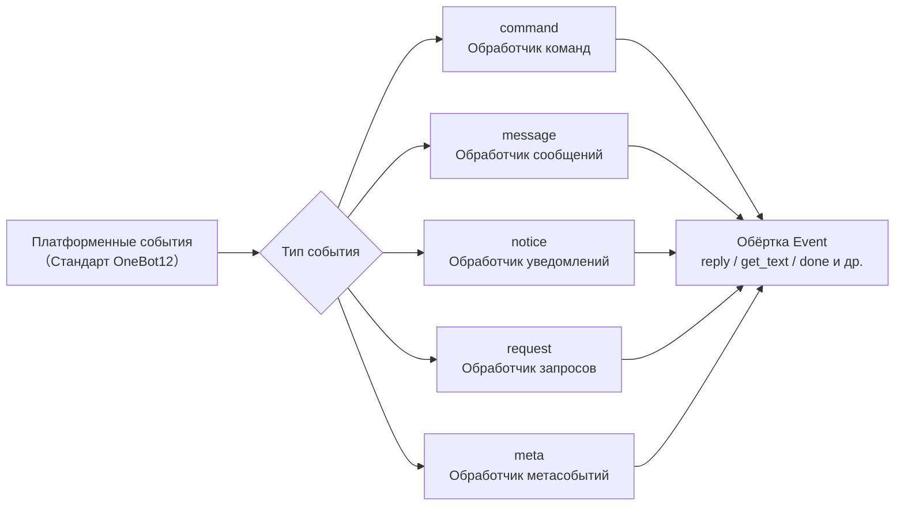

## Модуль Command (Команды)

### Регистрация команд

```python
from ErisPulse.Core.Event import command

# Базовая команда
@command("hello", help="Отправить приветствие")
async def hello_handler(event):
    await event.reply("Привет!")

# Команда с алиасами
@command(["help", "h"], aliases=["помощь"], help="Отобразить помощь")
async def help_handler(event):
    pass

# Команда с правами доступа
def is_admin(event):
    return event.get("user_id") in admin_ids

@command("admin", permission=is_admin, help="Команда администратора")
async def admin_handler(event):
    pass

# Скрытая команда
@command("secret", hidden=True, help="Секретная команда")
async def secret_handler(event):
    pass

# Группа команд
@command("admin.reload", group="admin", help="Перезагрузить модуль")
async def reload_handler(event):
    pass

# Подкоманда (многословные команды с пробелами)
# Сопоставление происходит по самому длинному префиксу: /admin add x сначала совпадает с admin add (args = ["x"]);
# Подкоманда без объявленного permission наследует право доступа от ближайшего предка с объявленным правом
@command("admin add", help="Добавить администратора")
async def admin_add_handler(event):
    pass
```

**Правила конфликтов имён**: Имя команды имеет приоритет над алиасом. При регистрации алиаса с уже существующим именем команда не будет зарегистрирована, и будет выдано предупреждение; при регистрации команды с именем, совпадающим с уже существующим алиасом, имя команды будет иметь приоритет, и мёртвый алиас будет автоматически удалён — оба типа конфликтов имеют WARNING-логи, и не будут молча перехватывать.

### Информация о командах

Все API для запроса информации о командах поддерживают необязательный **контекст сессии**: передача `event=` (Event или dict) или явные `platform=` / `bot_id=` / `session_id=` (при совмещении с event, явные параметры имеют приоритет), т.е. фильтрация по области действия модуля, исключая команды, недоступные в текущей сессии (см. advanced/scope.md); все параметры необязательны, если не переданы, поведение остаётся прежним.

```python
# Получить справку по команде
help_text = command.help()

# Сессионная справка: отобразить только доступные в текущей сессии команды
help_text = command.help(event=event)

# Получить конкретную команду (возвращает объединённые параметры; возвращает None, если недоступна в сессии)
cmd_info = command.get_command("admin")
cmd_info = command.get_command("admin", event=event)

# Получить все команды (при сессионной фильтрации исключаются недоступные модули)
all_commands = command.get_commands()
all_commands = command.get_commands(event=event)

# Получить все команды в группе (поддержка сессионной фильтрации)
admin_commands = command.get_group_commands("admin")
admin_commands = command.get_group_commands("admin", event=event)

# Получить все видимые команды
visible_commands = command.get_visible_commands()

# Видимые команды с учётом сессии (достаточно event или явных параметров)
visible_commands = command.get_visible_commands(event=event)
visible_commands = command.get_visible_commands(
    platform=event.get("platform"),
    bot_id=event.get_self_account_id(),
    session_id=event.get_session_id(),
)
```

### Ожидание ответа

```python
# Ожидание ответа пользователя
@command("ask", help="Запросить информацию у пользователя")
async def ask_command(event):
    reply = await command.wait_reply(
        event,
        prompt="Пожалуйста, введите ваше имя:",  # Уже отправлено выше
        timeout=30.0
    )
    
    if reply:
        name = reply.get_text()
        await event.reply(f"Привет, {name}!")

# Ожидание ответа с проверкой
def validate_age(event_data):
    try:
        age = int(event_data.get_text())
        return 0 <= age <= 150
    except ValueError:
        return False

@command("age", help="Запросить возраст пользователя")
async def age_command(event):
    await event.reply("Пожалуйста, введите ваш возраст:")
    
    reply = await command.wait_reply(
        event,
        timeout=60,
        validator=validate_age
    )
    
    if reply:
        age = int(reply.get_text())
        await event.reply(f"Ваш возраст: {age} лет")

# Ожидание ответа с колбэком
async def handle_confirmation(reply_event):
    text = reply_event.get_text().lower()
    if text in ["да", "yes", "y"]:
        await event.reply("Операция подтверждена!")
    else:
        await event.reply("Операция отменена.")

@command("confirm", help="Подтвердить операцию")
async def confirm_command(event):
    await command.wait_reply(
        event,
        prompt="Введите 'да' или 'нет':",
        callback=handle_confirmation
    )
```

## Модуль Message (Сообщения)

### События сообщений

```python
from ErisPulse.Core.Event import message

# Отслеживание всех сообщений
@message.on_message()
async def message_handler(event):
    sdk.logger.info(f"Получено сообщение: {event.get_text()}")

# Отслеживание личных сообщений
@message.on_private_message()
async def private_handler(event):
    user_id = event.get_user_id()
    sdk.logger.info(f"Личное сообщение от: {user_id}")

# Отслеживание групповых сообщений
@message.on_group_message()
async def group_handler(event):
    group_id = event.get_group_id()
    sdk.logger.info(f"Групповое сообщение от: {group_id}")

# Отслеживание сообщений с упоминанием
@message.on_at_message()
async def at_handler(event):
    mentions = event.get_mentions()
    sdk.logger.info(f"Упомянутые пользователи: {mentions}")
```

### Условное отслеживание

```python
# Использование приоритета для управления порядком выполнения
@message.on_message(priority=10)  # Чем больше значение, тем выше приоритет
async def high_priority_handler(event):
    pass

# Условная фильтрация внутри обработчика
@message.on_message()
async def filtered_handler(event):
    if "ключевое слово" not in event.get_text():
        return
    # Обработка сообщений, содержащих ключевое слово
    pass
```

## Модуль Notice (Уведомления)

### События уведомлений

```python
from ErisPulse.Core.Event import notice

# Добавление друга
@notice.on_friend_add()
async def friend_add_handler(event):
    user_id = event.get_user_id()
    await event.reply("Спасибо за добавление меня в друзья!")

# Удаление друга
@notice.on_friend_remove()
async def friend_remove_handler(event):
    user_id = event.get_user_id()
    sdk.logger.info(f"Друг удалён: {user_id}")

# Увеличение числа участников группы
@notice.on_group_increase()
async def member_increase_handler(event):
    user_id = event.get_user_id()
    await event.reply(f"Добро пожаловать, новый участник!")

# Уменьшение числа участников группы
@notice.on_group_decrease()
async def member_decrease_handler(event):
    user_id = event.get_user_id()
    sdk.logger.info(f"Участник покинул группу: {user_id}")
```

## Модуль Request (Запросы)

### События запросов

```python
from ErisPulse.Core.Event import request

# Запрос на добавление друга
@request.on_friend_request()
async def friend_request_handler(event):
    user_id = event.get_user_id()
    comment = event.get_comment()
    sdk.logger.info(f"Запрос на добавление друга: {user_id}, комментарий: {comment}")

# Запрос на групповое приглашение
@request.on_group_request()
async def group_request_handler(event):
    group_id = event.get_group_id()
    user_id = event.get_user_id()
    sdk.logger.info(f"Групповое приглашение: {group_id}, от: {user_id}")
```

## Модуль Meta (Метасобытия)

### Метасобытия

```python
from ErisPulse.Core.Event import meta

# Событие подключения
@meta.on_connect()
async def connect_handler(event):
    platform = event.get_platform()
    sdk.logger.info(f"Платформа {platform} успешно подключена")

# Событие отключения
@meta.on_disconnect()
async def disconnect_handler(event):
    platform = event.get_platform()
    sdk.logger.info(f"Платформа {platform} отключена")

# Событие心跳
@meta.on_heartbeat()
async def heartbeat_handler(event):
    sdk.logger.debug("Получено heartbeat")
```

### Запрос состояния бота

После того как адаптер отправляет метасобытия, фреймворк автоматически отслеживает состояние бота. API для запроса и слушатели событий жизненного цикла см. в [API системы адаптеров - Управление состоянием бота](adapter-system.md#bot-状态管理).

## Обёртка Event

Обработчики событий модуля Event получают экземпляр обёртки Event, которая наследуется от dict и предоставляет удобные методы. Полный список методов, сигнатуры параметров и поведение см. в [Подробном описании обёртки Event](../developer-guide/modules/event-wrapper.md); в этом разделе приведён краткий обзор.

### Краткий обзор возможностей

- **Основная информация о событии**: `get_id()` / `get_time()` / `get_type()` / `get_detail_type()` / `get_platform()`
- **Информация о боте**: `get_self_platform()` / `get_self_user_id()` / `get_self_account_id()` / `get_self_info()`
- **Идентификатор сессии**: `get_target_id()` (единый идентификатор цели, берётся первый ненулевой из `group_id` → `channel_id` → `guild_id` → `thread_id` → `user_id`); `get_session_id()` (формат `{platform}:{detail_type}:{target_id}`, например `"telegram:private:12345"`)
- **Содержание сообщения и отправитель**: `get_message()` / `get_alt_message()` / `get_text()` / `get_user_id()` / `get_sender()` / `get_group_id()` и т.д.
- **Проверка типа сообщения**: `is_message()` / `is_private_message()` / `is_group_message()` / `is_at_message()` / `has_mention()` / `get_mentions()`
- **Ответ**: `reply(content, method=..., at_sender=..., quote=..., at_users=..., reply_to=..., at_all=..., via=...)` / `reply_ob12()`; проверка поддержки платформой `supports()` / `available_methods()`; свободная отправка цепочки `send_chain()` см. в [Подробном описании SendDSL](../developer-guide/adapters/send-dsl.md#方式二eventsend_chain)
- **Информация о команде**: `get_command_name()` / `get_command_args()` / `is_command()` и т.д.
- **Интерактивные сессии**: `wait_reply()` / `confirm()` / `choose()` / `collect()` / `wait_for()` / `conversation()`
- **Утилиты**: `to_dict()` (фильтрация внутренних ключей) / `get_raw()` / `get_raw_type()`

> Полное описание параметров и примеров каждого метода см. в [Подробном описании обёртки Event](../developer-guide/modules/event-wrapper.md);
> Дополнительные сведения о многошаговых диалогах см. в [Conversation многошаговые диалоги](../advanced/conversation.md).

### Управление цепочкой

`event.done(claim=, stop=)` единый способ управления двумя ортогональными семантиками «признания» и «блокировки»:

- **Признание (claim)**: пометить событие как обработанное (`_processed`), обработчик команды использует это для пропуска дублирования
- **Блокировка (stop)**: предотвратить распространение события на обработчики с более низким приоритетом (`_propagation_stopped`)

```python
# Признание + блокировка (по умолчанию)
event.done()

# Только признание, не блокировка (низкоприоритетные наблюдатели всё ещё видят)
event.done(stop=False)

# Только блокировка, не признание (например, фаервол / ограничение скорости)
event.done(claim=False)

# mark_processed — основной метод, done — его алиас
event.mark_processed()             # эквивалент event.done()
event.mark_processed(stop=False)   # эквивалент event.done(stop=False)

# Проверка состояния
event.is_processed()  # был ли признан
event.is_stopped()    # был ли заблокирован
```

### Платформенные расширения

Адаптеры могут регистрировать платформенно-специфические методы для Event, доступные только на экземплярах соответствующей платформы.

#### Использование платформенно-специфических методов

После регистрации адаптером платформенно-специфических методов, вы можете вызывать их в обработчике событий. Методы для каждой платформы различаются, см. соответствующую [документацию платформы](../platform-guide/).

```python
from ErisPulse.Core.Event import message

@message.on_message()
async def handle_message(event):
    platform = event.get_platform()

    # Вызов платформенно-специфических методов
    if platform == "email":
        subject = event.get_subject()           # специфичный для email
        attachments = event.get_attachments()   # специфичный для email
```

#### Запрос зарегистрированных методов платформы

```python
from ErisPulse.Core.Event import get_platform_event_methods

# Получить список зарегистрированных методов для платформы
methods = get_platform_event_methods("email")
# ["get_subject", "get_from", "get_attachments", ...]

# Динамический вызов метода
for method_name in get_platform_event_methods(event.get_platform()):
    method = getattr(event, method_name)
    print(f"{method_name}: {method()}")
```

#### Изоляция методов платформ

Регистрируемые методы разных платформ не влияют друг на друга:

```python
# Email событие - только email методы
event = Event({"platform": "email", "email_raw": {"subject": "Hello"}})
event.get_subject()      # ✅ "Hello"
event.get_chat_type()    # ❌ AttributeError

# Telegram событие - только Telegram методы
event = Event({"platform": "telegram", "telegram_raw": {"chat": {"type": "private"}}})
event.get_chat_type()    # ✅ "private"
event.get_subject()      # ❌ AttributeError
```

#### Поддержка hasattr / dir

```python
hasattr(event, "get_subject")   # True только если platform="email"
"get_subject" in dir(event)     # То же самое
```

#### Регистрация платформенно-специфических методов адаптером

Адаптеры могут зарегистрировать платформенно-специфические методы для Event с помощью декоратора, первый параметр метода — self (экземпляр Event), можно свободно обращаться к данным события.

##### Регистрация одного метода

```python
from ErisPulse.Core.Event import register_event_method

@register_event_method("email")
def get_subject(self):
    """Получить тему письма"""
    return self.get("email_raw", {}).get("subject", "")

@register_event_method("email")
def get_from(self):
    """Получить отправителя"""
    return self.get("email_raw", {}).get("from", {})
```

##### Массовая регистрация (через Mixin)

При большом количестве методов рекомендуется использовать Mixin для массовой регистрации:

```python
from ErisPulse.Core.Event import register_event_mixin

class EmailEventMixin:
    def get_subject(self):
        return self.get("email_raw", {}).get("subject", "")

    def get_from(self):
        return self.get("email_raw", {}).get("from", {})

    def get_attachments(self):
        return self.get("email_raw", {}).get("attachments", [])

# Регистрация всех методов сразу
register_event_mixin("email", EmailEventMixin)
```

##### Правила возвращаемых значений

| Сценарий | Возвращаемое значение | Способ использования пользователем |
|------|--------|------------|
| Возврат данных (текст, словарь и т.д.) | Просто возвращаемое значение | `subject = event.get_subject()` |
| Выполнение операции (отправка сообщения и т.д.) | Возвращается `asyncio.Task` | `task = event.do_something()` (необязательно `await`) |

> **Рекомендация**: методы, возвращающие не данные, возвращают `asyncio.Task`, чтобы пользователь мог сам решить, нужно ли `await`, даже если не `await`, операция будет выполнена.

```python
@register_event_method("email")
def forward_email(self, to_address: str):
    """Переслать письмо — возвращает Task, пользователь может сам решить, нужно ли await"""
    import asyncio
    return asyncio.create_task(
        self._do_forward(to_address)
    )

# Пользователь может await и дождаться результата
await event.forward_email("user@example.com")

# Также можно не await, операция выполнится в фоне
event.forward_email("user@example.com")
```

##### Удаление методов

```python
from ErisPulse.Core.Event import unregister_event_method, unregister_platform_event_methods

# Удаление одного метода
unregister_event_method("email", "get_subject")

# Удаление всех методов платформы (вызывается при остановке адаптера)
unregister_platform_event_methods("email")
```

##### Переопределение встроенных методов

`register_event_mixin` / `register_event_method` поддерживают переопределение встроенных методов Event (например, `confirm`, `choose`, `collect`, `wait_reply`, `reply` и т.д.). Зарегистрированные платформенно-специфичные методы через `Event.__getattribute__` имеют приоритет над встроенными, поэтому адаптер может предоставлять платформенно-специфичную реализацию интерактивных функций.

Встроенные реализации экспортируются как `_builtin_*` функции, переопределяющая реализация может вызывать их как резервную:

```python
from ErisPulse.Core.Event import register_event_mixin, _builtin_choose

class YunhuEventMixin:
    async def choose(self, prompt, options, timeout=60, method="Text"):
        # Платформа Yunhu использует кнопки
        buttons = [[{"text": opt} for opt in options]]
        await self.reply(prompt)
        # ...ожидание нажатия кнопки или текстового ответа...
        # Резервная логика
        return await _builtin_choose(self, None, options, timeout, "Text")

register_event_mixin("yunhu", YunhuEventMixin)
```

## Расширение для кросс-платформ (шаблоны)

`register_event_method` и `register_event_mixin` поддерживают передачу `"*"` в качестве названия платформы, регистрируемые методы доступны на всех платформах. Подходит для функций, требующих кросс-платформенного переиспользования, таких как AI-диалоги, управление контекстом и т.д.

### Регистрация кросс-платформенных методов

```python
from ErisPulse.Core.Event.wrapper import register_event_method

@register_event_method("*")
async def ai_chat(self, prompt: str):
    """self — экземпляр Event, можно свободно обращаться к данным и встроенным методам"""
    await self.reply(f"AI: {prompt}")
```

После регистрации все платформы могут использовать метод:

```python
from ErisPulse.Core.Event import message

@message.on_message()
async def handler(event):
    await event.ai_chat(event.get_text())
```

### Приоритет разрешения методов

При доступе к методам Event через атрибуты разрешение происходит в следующем порядке:

1. **Платформенно-специфические методы** (переопределение текущей платформы)
2. **Методы шаблона** (`"*"` — кросс-платформенные методы)
3. **Встроенные методы** (`reply`, `confirm` и т.д.)
4. **Доступ по ключу словаря**

> Таким образом, методы шаблона могут переопределять встроенные методы (например, `reply`), но будут переопределены методами платформенно-специфическими с тем же именем.

## Система приоритетов

Обработчики событий поддерживают приоритет, чем больше значение, тем выше приоритет:

```python
# Обработчик с высоким приоритетом выполняется первым
@message.on_message(priority=10)
async def high_priority_handler(event):
    pass

# Обработчик с низким приоритетом выполняется последним
@message.on_message(priority=0)
async def low_priority_handler(event):
    pass
```


====
高级主题
====


### Conversation 多轮对话

# Conversation: многоходовой диалог

> [!TIP]
> **Когда читать этот документ**: когда нужны конечный автомат многоходового диалога и восстановление из контрольных точек. Если это не нужно — пропустите, на использование остальных функций это не влияет.

Когда команда должна последовательно запрашивать у пользователя информацию в несколько шагов (сбор данных при регистрации, анкеты, мастер настройки), используйте `Conversation`, чтобы выстроить в одной сессии цепочку «вопрос → ожидание ответа → проверка → следующий шаг». После тайм-аута или перезапуска диалог можно восстановить из контрольной точки.

## Создание диалога

Диалог создаётся методом `conversation()` объекта `Event`:

```python
from ErisPulse.Core.Event import command

@command("quiz")
async def quiz_handler(event):
    conv = event.conversation(timeout=30)

    await conv.say("🎮 Добро пожаловать в викторину!")

    answer = await conv.choose("Вопрос 1: кто создатель Python?", [
        "Guido van Rossum",
        "James Gosling",
        "Dennis Ritchie",
    ])

    if answer is None:
        await conv.say("Время вышло, приходите в следующий раз!")
        return

    if answer == 0:
        await conv.say("Правильно!")
    else:
        await conv.say("Неправильно, правильный ответ — Guido van Rossum")

    conv.stop()
```

## Основной API

### say(content, **kwargs)

Отправляет сообщение, возвращает `self`, поддерживая цепочки вызовов:

```python
await conv.say("Первая строка").say("Вторая строка").say("Третья строка")
```

Можно также указать метод отправки:

```python
await conv.say("https://example.com/image.jpg", method="Image")
```

### wait(prompt=None, timeout=None)

Ожидает ответ пользователя, возвращает объект `Event` или `None` (тайм-аут):

```python
# Простое ожидание
resp = await conv.wait()
if resp:
    text = resp.get_text()

# Отправка подсказки и ожидание
resp = await conv.wait(prompt="Пожалуйста, введите ваше имя:")

# Своё время ожидания (переопределяет тайм-аут диалога по умолчанию)
resp = await conv.wait(prompt="Ответьте в течение 10 секунд:", timeout=10)
```

### confirm(prompt=None, **kwargs)

Ожидает подтверждения пользователя (да/нет), возвращает `True` / `False` / `None` (тайм-аут):

```python
result = await conv.confirm("Вы уверены, что хотите удалить все данные?")
if result is True:
    await conv.say("Удалено")
elif result is False:
    await conv.say("Отменено")
else:
    await conv.say("Время ожидания истекло, ответа нет")
```

Встроенные распознаваемые слова подтверждения: `да/yes/y/подтверждаю/точно/хорошо/ok/true/верно/ага/ладно/согласен/без проблем/можно/конечно...`

Встроенные распознаваемые слова отрицания: `нет/no/n/отмена/не/не надо/нельзя/cancel/false/неверно/неправильно/не/отказ...`

### choose(prompt, options, **kwargs)

Ожидает, пока пользователь выберет один из вариантов, возвращает индекс варианта (начиная с 0) или `None`:

```python
choice = await conv.choose("Выберите цвет:", ["Красный", "Зелёный", "Синий"])
if choice is not None:
    colors = ["Красный", "Зелёный", "Синий"]
    await conv.say(f"Вы выбрали {colors[choice]}")
```

Пользователь может выбрать, введя номер (`1`/`2`/`3`) или текст варианта (`Красный`).

`options_format="auto"` (по умолчанию) автоматически выбирает встроенный стиль в зависимости от method: Markdown→маркированный список, Html→нумерованный список, остальные→простой текстовый список.
Также поддерживаются `"list"`, `"inline"`, `"md"`, `"html"` или пользовательская функция.

Поддерживается `merge_prompt=True` для объединения подсказки и вариантов в одно сообщение, а также плейсхолдер, управляющий позицией вставки вариантов (по умолчанию `{options}`, настраивается через `placeholder`):

```python
choice = await conv.choose(
    "## Выберите\n{options}",
    ["Вариант А", "Вариант Б"],
    method="Markdown",
    merge_prompt=True,
)

# Собственное имя плейсхолдера
choice = await conv.choose(
    "Выберите: [choices]",
    ["Вариант А", "Вариант Б"],
    placeholder="[choices]",
)
```

### collect(fields, **kwargs)

Пошаговый сбор информации, возвращает словарь данных или `None`:

```python
data = await conv.collect([
    {"key": "name", "prompt": "Введите имя"},
    {"key": "age", "prompt": "Введите возраст",
     "validator": lambda e: e.get("alt_message", "").strip().isdigit(),
     "retry_prompt": "Возраст должен быть числом, введите ещё раз"},
    {"key": "city", "prompt": "Введите город"},
])

if data:
    await conv.say(f"Регистрация успешна!\nИмя: {data['name']}\nВозраст: {data['age']}\nГород: {data['city']}")
else:
    await conv.say("Процесс регистрации прерван")
```

Конфигурация полей:

| Параметр | Описание | По умолчанию |
|------|------|--------|
| `key` | Ключ поля (обязателен) | - |
| `prompt` | Подсказка | `"Введите {key}"` |
| `validator` | Функция проверки, принимает Event, возвращает bool | нет |
| `retry_prompt` | Подсказка при повторе после неудачной проверки | `"Некорректный ввод, попробуйте ещё раз"` |
| `max_retries` | Максимальное число повторных попыток | 3 |
| `condition` | Функция условия, принимает dict уже собранных данных, возвращает bool | нет |

**Условные поля**: с помощью `condition` можно реализовать динамические формы — поле собирается только при выполнении условия:

```python
data = await conv.collect([
    {"key": "has_car", "prompt": "У вас есть машина? (да/нет)"},
    {"key": "car_brand", "prompt": "Введите марку машины",
     "condition": lambda d: d.get("has_car", "").lower() in ("да", "yes", "y")},
])
```

### stop()

Вручную завершает диалог, устанавливая `is_active` в `False`:

```python
conv.stop()
```

### is_active

Находится ли диалог в активном состоянии:

```python
if conv.is_active:
    await conv.say("Диалог ещё продолжается")
```

## Управление активным состоянием

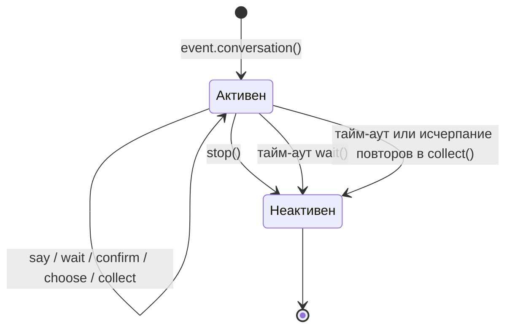

Диалог автоматически переходит в неактивное состояние в следующих случаях:

1. Вызван метод `stop()`
2. `wait()` по тайм-ауту вернул `None`
3. `collect()` вернул `None` из-за тайм-аута на каком-либо шаге или исчерпания повторных попыток

После перехода в неактивное состояние все интерактивные методы (`wait`/`confirm`/`choose`/`collect`) немедленно возвращают `None` и больше не ожидают ввод пользователя.

## Ветвления и переходы

### Декоратор @conv.branch(name)

Метод `branch()` регистрирует ветвь диалога, а `goto()` выполняет переходы между ветвями:

```python
@command("menu")
async def menu_handler(event):
    conv = event.conversation(timeout=60)

    @conv.branch("main")
    async def main_menu():
        await conv.say("=== Главное меню ===\n1. Личные данные\n2. Настройки\n3. Выход")
        resp = await conv.wait()
        if resp is None:
            return
        text = resp.get_text().strip()
        if text == "1":
            await conv.goto("profile")
        elif text == "2":
            await conv.goto("settings")
        elif text == "3":
            await conv.say("До свидания!")
            conv.stop()

    @conv.branch("profile")
    async def profile():
        await conv.say("=== Личные данные ===\nИмя: Alice\n0. Назад")
        resp = await conv.wait()
        if resp and resp.get_text().strip() == "0":
            await conv.goto("main")

    @conv.branch("settings")
    async def settings():
        await conv.say("=== Настройки ===\n1. Переключатель уведомлений\n0. Назад")
        resp = await conv.wait()
        if resp and resp.get_text().strip() == "0":
            await conv.goto("main")

    await conv.start()  # Начало с первой зарегистрированной ветви
```

### conv.start(name=None)

Запускает диалог, по умолчанию — с первой зарегистрированной ветви:

```python
await conv.start()           # С первой ветви
await conv.start("settings") # С указанной ветви
```

## Контекст и персистентность

### conv.context

У каждого экземпляра диалога есть встроенный словарь `context` для обмена состоянием между ветвями:

```python
@conv.branch("step1")
async def step1():
    conv.context["username"] = resp.get_text().strip()
    await conv.goto("step2")

@conv.branch("step2")
async def step2():
    name = conv.context.get("username", "Неизвестно")
    await conv.say(f"Привет, {name}!")
```

### save() / resume() / clear_saved()

Диалог поддерживает персистентность и может быть восстановлен после тайм-аута или прерывания:

```python
# Сохранение состояния диалога (обычно вызывать вручную не нужно, см. «Автоматическое сохранение» ниже)
await conv.save()

# ... позже восстановление в той же сессии ...
conv2 = event.conversation()
if await conv2.resume():
    await conv2.say("С возвращением! Продолжим прерванный диалог")
else:
    await conv2.say("Предыдущий диалог не найден")

# Очистка сохранённого диалога
await conv.clear_saved()
```

Ключ хранения включает измерение target (`conversation:{platform}:{user_id}:{target_id}`), поэтому диалоги одного пользователя в разных сессиях не перезаписывают друг друга; архивы старого формата (без target) автоматически мигрируют при `resume()`.

## Автоматические контрольные точки и восстановление после перезапуска

### Автоматическое сохранение

Фреймворк автоматически поддерживает контрольные точки в следующих случаях; обычно вручную вызывать `save()` не нужно:

| Момент | Поведение |
|------|------|
| Переход между ветвями `goto()` / `start()` | Автосохранение (текущая ветвь + context) |
| `stop()` / тайм-аут `wait()` / сбой `collect()` | Автоочистка (конечное состояние диалога) |

### TTL контрольных точек

Архивы содержат метку времени; архивы старше `ErisPulse.interaction.checkpoint_ttl` (по умолчанию 24 часа) удаляются:

- **Ленивое отбрасывание**: если при восстановлении обнаруживается, что архив просрочен, он автоматически отбрасывается
- **Активная фоновая очистка**: во фреймворке есть периодическая задача GC (лениво запускается после первого использования контрольных точек), которая активно перечисляет и удаляет просроченные архивы, чтобы при долгой работе просроченные контрольные точки не накапливались в storage бесконечно. Если после активной очистки архива в сессию придёт сообщение, оно обрабатывается как «контрольная точка отсутствует»

```toml
[ErisPulse.interaction]
checkpoint_ttl = 86400  # секунды
```

### Автоматическое восстановление после перезапуска

После перезапуска фреймворка идущие диалоги (ожидающие корутины в памяти) теряются, но контрольные точки сохраняются. Если зарегистрировать **фабрику восстановления** через `register_resume_handler`, фреймворк после перезапуска при получении первого сообщения в этой сессии автоматически продолжит диалог:

```python
from ErisPulse.Core.Event.wrapper import Conversation

@Conversation.register_resume_handler()  # можно передать platform="onebot11", чтобы ограничить платформу
def make_conversation(event) -> Conversation:
    # Задача фабрики: заново создать диалог и перерегистрировать все ветви
    conv = event.conversation(timeout=60)

    @conv.branch("menu")
    async def menu(conv, event):
        ...

    return conv
```

После регистрации, когда пользователь, находившийся до перезапуска в ветви `menu`, пришлёт первое сообщение, фреймворк автоматически: восстановит context → захватит это сообщение → продолжит диалог из сохранённой ветви. Без зарегистрированной фабрики этот механизм не создаёт накладных расходов.

### Восстановление означает захват

При успешном `resume()` фреймворк автоматически делает две вещи:

1. **Захват сессии**: автоматически выполняет acquire эксклюзивной аренды сессии — другие модули могут через `sdk.interaction.get_owner_of(event)` узнать, что «этот пользователь занят диалогом»; если сессия уже занята другим модулем, восстановление отменяется (возвращает False), чтобы два диалога не конфликтовали
2. **Возврат истории**: последние 10 сообщений из входящего ящика сессии помещаются в `conv.recent_history` (контекст LLM у AI-модуля не обрывается после восстановления); можно отключить через `resume(with_history=0)`

```python
if await conv.resume(with_history=20):
    for m in conv.recent_history:
        print(m["role"], ":", m["text"])
```

### Ручное восстановление (если не использовать автоматический механизм)

```python
@command("continue")
async def continue_handler(event):
    conv = event.conversation()
    # ... регистрация ветвей ...
    if await conv.resume():
        conv.goto(conv.get_current_branch())
```

## Типовые шаблоны потоков

### Пошаговая регистрация

```python
@command("register")
async def register_handler(event):
    conv = event.conversation(timeout=60)

    await conv.say("Добро пожаловать! Начинаем регистрацию.")

    data = await conv.collect([
        {"key": "username", "prompt": "Введите имя пользователя (3-20 символов)",
         "validator": lambda e: 3 <= len(e.get_text().strip()) <= 20},
        {"key": "email", "prompt": "Введите адрес электронной почты",
         "validator": lambda e: "@" in e.get_text() and "." in e.get_text(),
         "retry_prompt": "Неверный формат email, введите ещё раз"},
    ])

    if not data:
        await event.reply("Регистрация отменена")
        return

    confirmed = await conv.confirm(
        f"Подтвердить данные регистрации?\nИмя пользователя: {data['username']}\nEmail: {data['email']}"
    )

    if confirmed:
        await conv.say("✅ Регистрация успешно завершена!")
    else:
        await conv.say("❌ Регистрация отменена")
```

### Циклический диалог

```python
@command("chat")
async def chat_handler(event):
    conv = event.conversation(timeout=120)
    await conv.say("Включён режим диалога. Введите «выход», чтобы завершить.")

    while conv.is_active:
        resp = await conv.wait()
        if resp is None:
            await conv.say("Время вышло, диалог завершён")
            break

        text = resp.get_text().strip()

        if text == "выход":
            await conv.say("До свидания!")
            conv.stop()
        elif text == "помощь":
            await conv.say("Доступные команды: выход, помощь, статус")
        elif text == "статус":
            await conv.say("Диалог активен")
        else:
            await conv.say(f"Вы сказали: {text}")
```


### 交互会话系统

# Система интерактивного диалога

> [!TIP]
> **Когда это нужно читать**: при необходимости `wait_reply`, многоконтактного диалога, периодических напоминаний, взаимоисключающих сессий или трассировки цепочки. Если не нужно — пропустите, это не повлияет на использование других функций.

> **Что вы узнаете**: полный синтаксис `wait_reply` с параметрами и причинами отмены, декларативная цепочка `.got()`, таймеры сессии (remind / escalate), многоканальное ожидание (expect / select) и сессионные взаимоисключающие аренды.
>
> **В этой статье не рассматривается**: ветвящийся стейт-машинный диалог и восстановление после перезапуска (см. [Conversation многоконтактный диалог](conversation.md)); настройки стратегии сохранения в ящике и перекрытие во время выполнения (см. [Сессионный ящик](transcript.md)).

> [!NOTE]
> В этой главе требуется ErisPulse **2.8.0+**.

ErisPulse реализовал "непрерывное взаимодействие с пользователем" как инфраструктуру на уровне фреймворка: от одной `wait_reply`, до периодических напоминаний, многоканального ожидания, сессионных взаимоисключений и восстановления после перезапуска, все это управляется единым **менеджером интерактивных сессий** (`Core/Event/interaction.py`, `sdk.interaction`).

{!--< tips >!--}
Каждая из описанных в статье возможностей имеет **владельца (owner)**: ожидание, аренда и таймеры регистрируются с указанием имени модуля, при отключении модуля или адаптера фреймворк автоматически очищает их, и ожидание немедленно получает уведомление, а не ждет таймаута — это расширение системы владения на интерактивный уровень (см. [Система владения](ownership.md)).
{!--< /tips >!--}

## Ожидание ответа: wait_reply

**Одной фразой**: приостановить текущую корутину, ожидая следующего сообщения от целевого пользователя, вернуть событие ответа при совпадении, вернуть `None` при таймауте или отмене, `pattern` / `regex` / `validator` могут фильтровать неподходящие ответы.

`wait_reply` — основа интерактивных сессий — приостанавливает текущую корутину, ожидая следующего сообщения от целевого пользователя.

```python
from ErisPulse.Core.Event import command

@command("ask")
async def ask_command(event):
    reply = await event.wait_reply(prompt="Введите ваше имя:", timeout=30)
    if reply is None:
        await event.reply("Таймаут")
        return
    await event.reply(f"Привет, {reply.get_text()}!")
```

### Полный список параметров

| Параметр | Описание | По умолчанию |
|------|------|------|
| `prompt` | Сообщение-подсказка, отправляемое перед приостановкой | None |
| `timeout` | Время ожидания (секунды) | 60 |
| `pattern` | Фильтр по шаблону (glob: `*` / `?` / `[seq]`), если не совпадает — продолжать ожидание | None |
| `regex` | Регулярное выражение для фильтрации (должно совпадать, если заданы и pattern и regex), если не совпадает — продолжать ожидание | None |
| `validator` | Функция валидации (принимает Event, возвращает bool), если не проходит — продолжать ожидание | None |
| `callback` | Колбэк при получении ответа (альтернативный способ вместо возвращаемого значения) | None |
| `method` | Метод отправки подсказки | "Text" |
| `session` | **Сессионное ожидание**: любой ответ в рамках сессии (группа / канал) может быть использован | False |

```python
# Принимать только числовые суммы, иначе продолжать ожидание
reply = await event.wait_reply("Введите сумму:", regex=r"\d+\s*元", timeout=30)

# Сессионное ожидание: сценарий совместной работы в группе, любой участник может ответить
reply = await event.wait_reply(session=True, prompt="Кто-нибудь может помочь ответить?")
```

### Граница между ожиданием и командами (проникновение команд)

Во время ожидания, если поступает сообщение с **зарегистрированной командой** (например, `/cancel`), по умолчанию оно передается диспетчеру команд для выполнения, а не считается ответом (настройка `ErisPulse.event.wait_reply.cmdpass`, при `True` — наоборот — сообщения всегда считаются ответами). Текстовая проверка соответствует правилам диспетчера команд: `alt_message` имеет приоритет, если отсутствует, используется объединение сообщений (с 2.10.1 работает и для адаптеров с чисто message-сегментами).

### Когда ожидание будет отменено

Ожидание больше не ограничено "только таймаутом" — следующие ситуации немедленно **прекращают** ожидание (`wait_reply` возвращает `None`), а не заставляют вызывающую сторону ждать до таймаута:

| Событие | Причина отмены (`InteractionCancelled.reason`) | Описание |
|------|------|------|
| Модуль-владелец отключен / отключен | `owner_unload` | Очистка владельца: кто зарегистрировал ожидание, тот, кто исчезает, автоматически его отменяет |
| Адаптер остановлен / перезапущен | `platform_stop` | Все ожидания на этой платформе отменяются |
| В той же сессии новое ожидание / аренда | `conflict` | См. раздел "Сессионная арбитражная система" |
| Ответивший заблокирован / модуль-владелец отвязан | `revoked` | Проверка прав доступа: по контексту и по модулю |
| Ответ совпадает с ожиданием | — | Нормальный путь, возвращает событие ответа |

Внутреннее исключение — `InteractionCancelled` (входит в иерархию `InteractionError`), `wait_reply` уже преобразует его в возвращение `None`; вызывающие, которым нужна причина, могут использовать низкоуровневый API `sdk.interaction.register()`.

### Полная цепочка проверки ответа

Когда поступает сообщение с ответом, менеджер интеракции проверяет его в следующем порядке (выполняется **до** сопоставления команд, приоритет сохранения диалога — даже если сообщение уже было признано другим процессором более высокого приоритета, приостановленный диалог может быть завершен):

```
Соответствие сессионного ключа (точное соответствие по пользователю → возврат к сессионному ожиданию)
  → Фильтрация текста по pattern / regex (если не совпадает — продолжать ожидание)
  → Валидация по validator (если не проходит — продолжать ожидание)
  → Проверка прав доступа (по контексту и владельцу, если не проходит — отменить ожидание)
  → Пробуждение ожидающей стороны + признание события (mark_processed)
```

## Декларативный многоконтактный диалог: `.got()` цепочка (2.11+)

`@command` возвращает **прокси-объект управления многоконтактным диалогом**, с помощью `.got()` последовательно объявляются шаги сбора — функции шагов принимают уже собранные значения (включая параметры команды) по именам параметров, типы определяются автоматически по `type=` или аннотациям. Всё это компилируется в Conversation: каждый шаг — ветвь, переходы автоматически сохраняют контрольные точки, **при перезапуске пользовательский ответ продолжится с сохраненного шага** (фабрика восстановления автоматически регистрируется при декорировании и автоматически отменяется при отключении модуля).

```python
@command("weather")
async def weather(event):
    pass  # Вход: первый .got автоматически отправит подсказку, не нужно спрашивать вручную

@weather.got("city", prompt="Просто ответьте названием города")
async def weather_city(event, city: str):
    await event.reply(f"{city}: солнечно, 25℃")

@weather.got("days", prompt="На сколько дней прогноз?", type=int, retry_prompt="Введите число")
async def weather_days(event, city: str, days: int):
    await event.reply(f"{city} на ближайшие {days} дней...")
```

### Пояснение параметров

| Параметр | Описание |
|------|------|
| `name` | Имя собранных значений (имя параметра в последующих функциях шагов; уникально в рамках процесса, повторное объявление вызывает ошибку при регистрации) |
| `prompt` | Подсказка, автоматически отправляемая при входе на этот шаг |
| `timeout` | Время ожидания на шаге (секунды или строки типа "90s" / "1h30m", по умолчанию 60s) |
| `type` | Тип значения (`int` / `float` / `str` и т.д.; при ошибке парсинга автоматически повторно отправляется `retry_prompt`, максимум `max_retries` раз) |
| `validator` / `pattern` / `regex` | Фильтрация и валидация ответа (семантика аналогична [`wait_reply`](#ожидание-ответа-wait_reply)) |
| `session` | Сессионное ожидание (ответ может быть получен от любого участника сессии) |
| `cmdpass` | Трёхзначный режим пропуска команд (по умолчанию команды, такие как `/cancel`, выполняются в процессе ожидания) |

### Семантика и границы

- **Любой шаг превышает таймаут / прерывается → вся цепочка завершается** и контрольные точки удаляются (аналогично `wait_reply`); в функциях шагов можно в любое время использовать `event.reply(...)` для вывода промежуточных результатов
- **Один пользователь может иметь только одну приостановленную интеракцию** — вторая цепочка ожидания отменяет предыдущую (`InteractionCancelled("conflict")`); для уведомления о взаимоисключении используйте [Сессионные аренды](#взаимоисключающие-арендыacquire--hold--get_owner_of)
- Собранные значения существуют только в рамках процесса; для сохранения сложного состояния между перезапусками используйте [Conversation](conversation.md) (с `context` + `branch/goto` + ручные контрольные точки)
- `@command` возвращает прокси-объект: поведение, `__name__`, docstring, пользовательские атрибуты полностью идентичны оригинальному функции; `command.unregister(прокси)` автоматически распаковывает

## Сессионные таймеры: remind / escalate

Превращение "таймаута" из возвращаемого значения в управляемую примитивную операцию. Таймеры привязаны к интерактивной сессии, автоматически отменяются при отключении модуля / остановке адаптера, максимальное количество активных remind в одной сессии — 5.

### remind: напоминание при отсутствии ответа

```python
@command("ticket")
async def ticket_command(event):
    await event.reply("Заявка создана, результат будет уведомлен здесь")
    # Если в течение 5 минут нет ответа, мягко напомнить один раз; любой ответ пользователя автоматически отменяет напоминание
    event.remind(300, "Есть ли ещё что-то? Результат будет уведомлен в ближайшее время")
    reply = await event.wait_reply(timeout=3600)
    ...
```

- `event.remind(delay, text=None, *, callback=None)`: при истечении `delay` отправляет `text` в текущую сессию (или выполняет `callback(event)`, поддерживает синхронные / асинхронные функции). **Обязательная проверка**: `text` и `callback` должны быть выбраны (если не заданы, выбрасывается `ValueError`)
- Возвращает `Reminder` — дескриптор: `reminder.cancel()` отменяет вручную, `reminder.expired` проверяет состояние
- После ответа пользователя в этой сессии автоматически отменяется — это и есть смысл "напоминания":
  напоминание появляется только когда пользователь молчит
- В `Conversation` также доступно: `conv.remind(120, "Ещё думаете?")`

### escalate: обязательное уведомление при истечении времени

```python
event.escalate(1800, lambda e: notify_master(f"Заявка не обработана 30 минут: {event.get_command_args()}"))
```

Единственное отличие от `remind`: **не отменяется ответом пользователя** — действие "повышения" (уведомление владельца, перенаправление на человека) — это обязательное уведомление при истечении времени, отменяется только вручную `cancel()` / отключением модуля / остановкой адаптера.

| | `remind` | `escalate` |
|---|---|---|
| Действие при истечении | Отправка текста / выполнение callback | Выполнение callback |
| Ответ пользователя | **Автоматически отменяется** | Не влияет |
| Очистка владения (отключение / остановка платформы) | Отменяется | Отменяется |
| Максимальное количество на сессию | 5 | Не ограничено (очищается при отключении владения) |

## Многоканальное ожидание: expect + select

**Одной фразой**: `expect` только описывает ожидание, не регистрируя ожидание, `select` объединяет несколько ожиданий, при первом совпадении возвращает `(индекс, событие ответа)`, несовпавшие автоматически удаляются.

Ожидание нескольких ожиданий одновременно, **первый пришедший побеждает** — типичный сценарий: ожидание одобрения администратором и одновременно ожидание отмены пользователем, совместное голосование.

```python
which, reply = await event.select(
    event.expect(pattern="同意*", user="10001"),
    event.expect(pattern="拒绝*", user="10002"),
    event.expect(validator=lambda e: e.get_text() == "搁置", session=True),
    timeout=60,
)
if which is None:
    await event.reply("В течение 60 секунд не получено ни одного результата одобрения")
elif which == 0:
    await event.reply("Одобрено")
elif which == 1:
    await event.reply("Отклонено")
```

- `event.expect(...)` конструирует **описание ожидания** (не регистрирует никаких ожиданий): поддерживает `pattern` / `regex` / `validator` / `user` (ограничение ответившего) / `session` (ответ может быть получен от любого участника)
- `event.select(*expectations, timeout=60)`: объединяет ожидания → при первом совпадении возвращает `(индекс, событие ответа)` → несовпавшие ожидания автоматически удаляются; при таймауте возвращается `(None, None)`. **Обязательная проверка**: необходимо передать хотя бы одно ожидание, иначе выбрасывается `ValueError`
- Событие, совпавшее с ожиданием, уже признано фреймворком (mark_processed), не будет повторно обработано другими процессорами

{!--< tips >!--}
`select` по сравнению с ручной компиляцией `asyncio.wait` в многопоточном режиме: автоматическая очистка несовпавших ожиданий, автоматическое признание совпавшего события, все проверки прав доступа и очистка владения активны — не нужно самостоятельно управлять Future.
{!--< /tips >!--}

> [!NOTE]
> Начиная с 2.10.1 `select` является **агрегирующим ожиданием**: все ожидания объединяются в одно, с пользовательским критерием совпадения, ожидания по одному ключу (например, по одному user две разные pattern) больше не отменяют друг друга, первое совпадение возвращает. Критерий совпадения текста сообщения — `alt_message` имеет приоритет, при отсутствии используется объединение сообщений (аналогично правилам диспетчера команд).
>
> Ограничения: `event.wait_for(...)` напрямую привязан к событию адаптера, **не проходит** через промежуточные слои и фильтры `detail_type` (безопасность доступа обеспечивается на уровне входа в диспетчер); для полной цепочки ожидания используйте `wait_reply` / `select`.

## Взаимоисключающие аренды сессий: acquire / hold / get_owner_of

Владение переходит от "ресурса" к "сессии" — "кто сейчас занят этим пользователем" становится первостепенным вопросом.

```python
# Запрос: кто сейчас занят этой сессией? (если свободна, возвращает None)
owner = sdk.interaction.get_owner_of(event)
if owner and owner != "MyModule":
    return  # Другой модуль уже взаимодействует, избегаем мешать

# Взаимоисключающая аренда: эксклюзивная сессия (стратегия deny, если занята возвращает None)
lease = sdk.interaction.acquire(event)          # По умолчанию TTL 1 час, можно передать ttl=
if lease is None:
    return  # Уже занята
try:
    ...  # Эксклюзивное взаимодействие
finally:
    lease.release()
```

Форма с контекстным менеджером (при неудаче выбрасывает `SessionOccupiedError`):

```python
with sdk.interaction.hold(event) as lease:
    ...  # При выходе автоматически освобождается
```

Аренда поддерживает `renew(ttl)` для продления; TTL лениво просрочивается — просроченная аренда автоматически удаляется при следующем обращении.

`Conversation.resume()` при восстановлении диалога автоматически захватывает аренду (см. [Conversation многоконтактный диалог](conversation.md) раздел "Восстановление как захват") — восстановленный диалог автоматически владеет сессией, другие модули не могут вмешаться.

## Сессионный ящик: event.history

> Стратегия сохранения (7 дней / лимит сообщений) и API управления во время выполнения, риски и аудит см. в специальной статье [Сессионный ящик](transcript.md).

Единая запись недавних сообщений в каждой сессии (со стороны пользователя и бота), служит общей базой для контекста ИИ, предотвращения повторений, анализа поведения — **единая база фактов** для модулей, каждый модуль больше не хранит историю отдельно.

```python
messages = await event.history(20)   # Последние 20 сообщений в текущей сессии, по времени в порядке возрастания
for m in messages:
    print(m["role"], ":", m["text"])  # role: "user" / "bot"
```

- Автоматическая запись: входящие сообщения (role=user) + отправленные ботом текстовые сообщения (role=bot)
- Хранение: отдельная таблица SQLite, стратегия хранения = лимит на сессию (по умолчанию 50) + глобальный TTL (по умолчанию 7 дней)
- Запись: буфер в памяти + фоновая пакетная запись на диск (задержка до 1 секунды), интерфейс запроса автоматически объединяет незаписанные буферные строки — чтение из одного процесса не влияет на запись; при нормальном завершении (`sdk.uninit` / выход процесса) автоматически записывается на диск. **В случае жесткого сбоя / принудительного завершения последние около 1 секунды записи могут быть потеряны**: эта база данных предназначена для кэширования недавнего контекста, не подходит для аудита или долгосрочного хранения
- Настройка: `ErisPulse.transcript = {enabled = true, max_per_session = 50, ttl_hours = 168}`
- Интерфейс менеджера: `sdk.transcript.append() / get() / clear()`, `aflush()` / `flush()` для ручной записи на диск

## Транзакции сообщений: message_tx

Все отправки в рамках транзакции автоматически записываются в бухгалтерию; **при выходе с ошибкой автоматически отменяются отправленные сообщения в обратном порядке** (если адаптер не реализует `delete_message`, отмена пропускается, бухгалтерия всё равно записывается).

```python
async with event.message_tx():
    await event.reply("Обработка, подождите")
    result = await do_something()          # Здесь выбрасывается исключение →
    await event.reply(f"Завершено: {result}")   # Предыдущее "Обработка" автоматически отменяется
```

Отправки вне транзакции не записываются (ноль накладных расходов); в транзакции можно в любой момент прочитать бухгалтерию, типичное применение — **автоматическое удаление сообщений ботом** (отправка с расписанием отмены) и аудит отправок:

```python
import asyncio
from ErisPulse.runtime import get_send_receipts

async def delayed_delete(adapter, message_id: str, delay: float):
    await asyncio.sleep(delay)
    await adapter.delete_message(message_id)

async with event.message_tx():
    await event.reply("Временное уведомление")
    for r in get_send_receipts() or []:
        # Каждая бухгалтерия содержит platform / bot_id / message_id / trace_id
        asyncio.create_task(delayed_delete(adapter, r["message_id"], 30))
```

Чтение бухгалтерии — **в пределах транзакции**: только в `message_tx()` возвращает не `None`, вне транзакции всегда `None`; для захвата всех отправок (включая вне транзакции) используйте хуки `message.sending/sent` (см. [Трассировка цепочки](#трассировка-цепочкиtrace-id) поле `trace_id`).

## Трассировка цепочки: trace-id

Каждое входящее событие автоматически получает идентификатор трассировки (переиспользуется `event["id"]`, если отсутствует, генерируется), который проходит через:

- Контекст обработчика (`get_current_trace_id()` для чтения)
- Отправку сообщений (в логах `[Send]` добавляется `[trace:...]`, в хуках `message.sending/sent` поле `trace_id`)
- Данные жизненного цикла (dict автоматически дополняется `_trace_id`)
- Направленные события (`lifecycle.emit(..., to=...)`) и бухгалтерия транзакций сообщений

При обработке сообщения несколькими модулями, по одному идентификатору можно проследить всю цепочку (логи / медленные запросы / аудит).

## Связь с другими системами

- **Владение**: ожидание / аренда / таймеры все регистрируются с указанием владельца, при отключении — очищаются (см. [Система владения](ownership.md))
- **Контекст**: проверка прав доступа при совпадении ответа по контексту и владельцу; аудит вызовов между модулями — по направлению отправки (см. [Контекст](scope.md))
- **Conversation**: многоконтактный диалог — это ветвящийся стейт-машинный диалог над интерактивной сессией (см. [Conversation](conversation.md)), его ожидания также обладают всеми семантиками отмены / проверки / владения из этой страницы


### 模块间通信

# Коммуникация между модулями

> [!TIP]
> **Когда читать эту статью**: при необходимости вызова между модулями (RPC), определении контракта сервиса, целевой рассылке событий или восстановлении при холодном запуске. Если это не требуется — пропустите, это не повлияет на использование других функций.

> **Что вы узнаете**: мнемоника выбора модели коммуникации (RPC / целевое событие / широковещательное), `meta.services` как контракт и каталог сервисов, конфигурация аудита исходящих вызовов, ленивое пробуждение и восстановление при холодном запуске.
>
> **В этой статье не рассматривается**: механизм регистрации / запуска / приоритетов самого события жизненного цикла (см. [Управление жизненным циклом](lifecycle.md)); конфигурация ленивого загрузки и объявление activate_on (см. [Система ленивой загрузки](lazy-loading.md)).

> [!NOTE]
> Содержание этой главы требует ErisPulse **2.8.0+**.

В ErisPulse между модулями существует **трехуровневая модель коммуникации**, отсортированная по "точка-точка → целевая → широковещательная":

| Уровень | API | Семантика | Типичные сценарии |
|---|---|---|---|
| **RPC** | `await sdk.module.call("Chat", "get_history", ...)` | Точечный запрос-ответ с контрактом / аудитом / таймаутом | Вызов функционала другого модуля (получение истории, перевод, возврат средств) |
| **Целевое событие** | `await lifecycle.emit("message_received", {...}, to="Chat")` | Рассылка только модулям, зарегистрировавшим жизненный цикл-хук | Уведомление о состоянии от upstream в downstream ("получено новое сообщение") |
| **Широковещательное событие** | `await lifecycle.emit("config.updated", {...})` | Событие жизненного цикла, видимое по всей рамочной архитектуре | Горячая перезагрузка конфигурации, появление/исчезновение модулей |

{!--< tips >!--}
Мнемоника выбора: **используйте `call`, если нужно получить ответ, используйте `emit(..., to=...)`, если нужно уведомить только один модуль, используйте `emit(...)` для уведомления всех**.
{!--< /tips >!--}

## RPC: module.call

```python
result = await sdk.module.call("Chat", "get_history", session_id, n=20)
```

Различия между `module.call()` и прямым доступом к атрибуту `sdk.module.Chat.get_history(...)` (без изменений):

| | `module.call()` | Прямой доступ к атрибуту |
|---|---|---|
| Целевой модуль не зарегистрирован / не активирован | Выбрасывает `ModuleNotAvailableError` | Выбрасывает `AttributeError` |
| Ленивая загрузка модуля | **Автоматически активируется** (модули, управляемые событиями, используют блокировку активации) | Асинхронная инициализация модуля выбрасывает RuntimeError |
| `current_owner` | Присваивается **целевому модулю** (его внутренние wait_reply / отправка / логи корректно привязаны) | Сохраняется вызывающий модуль |
| Таймаут | По умолчанию 30 секунд (`timeout=` позволяет перезаписать, `None` отключает таймаут) | Нет |
| scope аудит | Вызыватель проходит через контрольный пункт `actions.<вызыватель>.call` | Нет |
| Проверка контракта | Белый список `meta.services` | Нет |

### Система исключений

```
ModuleError                      # Базовый класс исключений модульной системы
└── ModuleCallError              # Базовый класс для вызовов между модулями (содержит атрибуты module / method)
    ├── ModuleNotAvailableError  # Целевой модуль не зарегистрирован / не активирован / активация не удалась
    ├── ServiceNotProvidedError  # Метод не в белом списке / приватный метод / не существует
    └── ModuleCallTimeoutError   # Время ожидания асинхронного метода истекло
```

Все исключения входят в систему `ErisPulseError`, можно поймать их через `from ErisPulse.Core import ModuleCallError`.

## Контракт сервиса: meta.services

Поставщик сервиса объявляет белый список предоставляемых методов в `get_meta()` (в симметрии с `commands`):

```python
from ErisPulse.Core.Bases import BaseModule, ModuleMeta

class ChatModule(BaseModule):
    @staticmethod
    def get_meta() -> ModuleMeta:
        return ModuleMeta(
            name="聊天",
            services=[
                "get_history",                                       # Простая форма
                {"name": "translate", "description": "把文本翻译成指定语言"},  # С описанием
            ],
        )

    async def get_history(self, session_id, n=20): ...
    async def translate(self, text, target_lang): ...
    def _internal_helper(self): ...   # Методы с подчеркиванием всегда запрещены для внешнего вызова
```

**По умолчанию разработчик не замечает**:

- Если `services` не объявлен → все **публичные** методы по умолчанию доступны для `module.call()` (как и при прямом доступе к атрибуту),
  без необходимости каких-либо объявления
- После объявления → доступ сужается до белого списка, вызов за пределами списка выбрасывает `ServiceNotProvidedError` — используется для маркировки
  "эти методы — те, что публично обещаны"
- Основной контроль за ограничениями находится у пользователя: `scope.actions` определяет "кто может вызывать кого" (см. аудит ниже),
  `services` модуля автора — лишь объявление сервиса, два уровня не заменяют друг друга

**Описание сервиса**: для каждого сервиса можно добавить описание, читаемое человеком / ИИ — если не нужно, ничего не пишите,
описание автоматически берется из **первой строки docstring** (рамка уже требует стиля docstring):

```python
async def translate(self, text, target_lang):
    """把文本翻译成指定语言"""    # ← Эта строка автоматически становится описанием сервиса
    ...
```

**Подсказки по параметрам**: вызывающей стороне (особенно ИИ-агентам) нужно знать, что означает каждый параметр. Если не нужно, ничего не пишите,
подсказки автоматически берутся из **`:param:` строк docstring**:

```python
async def render_card(self, html, width=800, height=0):
    """渲染 HTML 为图片文件

    :param html: 要渲染的 HTML 文本          ← Автоматически становится подсказкой параметра
    :param width: 画布宽度像素，0 为按内容自适应
    :param height: 画布高度像素，0 为按内容自适应
    """
```

Для тонкой настройки (переопределение docstring / мультиязычность) используйте словарь для описания `description` и `parameters`
(оба поддерживают словарь i18n; `parameters` объединяется с docstring по параметрам, при явном объявление параметра в словаре он имеет приоритет,
объявленные параметры, которых нет в сигнатуре, будут отфильтрованы):

```python
services=[
    {"name": "translate", "description": "把文本翻译成指定语言"},
    {"name": "summarize", "description": {"i18n": "Chat.meta.svc.summarize", "default": "摘要对话"}},
    {
        "name": "render_card",
        "description": "渲染 HTML 为图片文件",
        "parameters": {"html": "HTML 文本", "width": "宽度像素，0 为自适应"},
    },
]
```

## Служба каталога: services()

```python
sdk.module.services()
# {'Chat': [{'name': 'get_history', 'signature': '(session_id, n=20)',
#            'description': '把文本翻译成指定语言',
#            'parameters': {'session_id': '会话 ID', 'n': '返回条数'}}]}

sdk.module.services("Chat")   # Только для определенного модуля
```

- В каталоге перечислены **только модули с явно объявленным** `meta.services` (модули без объявления не появляются в каталоге)
- Каждый сервис снабжен строкой сигнатуры метода (`inspect.signature`), описанием и подсказками по параметрам
- **Ленивые модули также попадают в каталог** (обнаружение сервисов происходит до загрузки) — вызывающая сторона может решить,
  нужно ли `call()` для активации целевого модуля
- Также включены в топологию: `sdk.module.get_topology()` для каждого модуля содержит поле `services`

{!--< tips >!--}
**Путь к MCP**: каталог сервисов (имя + сигнатура + описание + подсказки по параметрам) — это форма MCP tool —
каждый сервис по сути имеет вид ``{"name", "description", "parameters"}``.
В будущем фреймворк может напрямую экспортировать ``services()`` как конечную точку MCP-сервера, чтобы ИИ мог обнаруживать и вызывать возможности модуля;
``scope.actions.call`` аудит становится естественным брандмауэром безопасности для вызовов ИИ.
{!--< /tips >!--}

## Аудит исходящих вызовов: кто может вызывать кого

Каждый вызов `module.call()` проходит через контрольный пункт `scope` исходящих вызовов **от имени вызывающего модуля**:

```toml
[ErisPulse.scope.actions.CallerModule.call]
deny = ["Chat.get_history"]        # Запретить CallerModule вызывать Chat.get_history
# allow = ["Chat.get_*"]           # Или белый список: разрешить вызывать только сервисы Chat, начинающиеся на get_
```

- Формат `name` — `<目标模块>.<方法名>`, поддерживает точное / шаблон / `re:` регулярное выражение
- Вызовы фреймворка (без контекста owner, например, запуск скриптов) не подвергаются аудиту
- Отказ в вызове выбрасывает `ModuleCallError` (TRACE лог `core.module.call_denied`)

Способы настройки см. в [Scope](scope.md) в разделе исходящего аудита.

## Направленные события: параметр to в lifecycle.emit

События жизненного цикла поддерживают направленную передачу: указание `to` для целевого владельца (owner) заставляет событие доставляться только хукам, зарегистрированным с этим
владельцем (хуки, зарегистрированные в `on_load`, автоматически присваиваются владельцу модуля),
остальные модули и обработчики с `*` не получают уведомления.

```python
from ErisPulse.Core.lifecycle import lifecycle

# Отправитель: событие доставляется только хукам, зарегистрированным модулем Chat
await lifecycle.emit("message_received", {"text": "hi", "from": "u1"}, to="Chat")

# Подписчик (внутри модуля Chat): регистрирует хук с таким же именем, owner автоматически записывается при регистрации
@lifecycle.on("message_received")
async def on_message_received(data): ...

@lifecycle.on("message")          # Префикс родительского события также действует (фильтруется по owner)
async def on_any(data): ...
```

Семантические детали:

- Если у целевого владельца нет зарегистрированных хуков → событие **тихо отбрасывается** (не отправляется туда, где его нет),
  можно заранее проверить наличие хуков с помощью `lifecycle.has_handlers("message_received")`
- Если `data` — словарь, автоматически добавляется `_trace_id` (не перезаписывает уже существующее значение), интегрируется с системой трассировки
- Широковещательные и направленные события используют одну и ту же систему регистрации хуков: `emit(...)` без `to` рассылает по всей системе,
  с `to` — одно и то же событие видно только целевому модулю
- `emit_sync` / `submit_event` (совместимый API) также поддерживают параметр `to=`

> [!NOTE]
> Направленные события — это лёгкие уведомления, **не проверяются на существование целевого модуля и не активируют ленивую загрузку**; если нужно проверить существование цели,
> аудит контракта или получить возвращаемое значение, используйте [RPC: module.call](#rpcmodulecall).

## Ленивая загрузка и вызов

`module.call()` прозрачно активирует ленивые модули:

- Модули, управляемые событиями (`activate_on` объявлен) → используют блокировку активации `_activate()`, после активации stub-триггер автоматически удаляется
- Обычные ленивые модули → синхронная инициализация или обычный путь загрузки (идемпотентно)
- Активация не удалась → `ModuleNotAvailableError`

То есть: **вызывающий модуль не должен заботиться о том, загружен ли целевой модуль**, и не нужно ждать какого-либо события для его активации.

Направленные события (`lifecycle.emit(..., to=...)`) не активируют ленивую загрузку — если целевой модуль не загружен, у него нет хуков,
событие тихо отбрасывается; если нужно гарантировать доставку, используйте `module.call()`.

## Воспроизведение при холодном запуске

Новый / перезапущенный модуль пропустил часть чата — `get_load_strategy(replay=...)` позволяет фреймворку после готовности модуля
**воспроизвести последние сообщения из почтового ящика сессии** для этого модуля:

```python
from ErisPulse.loaders import ModuleLoadStrategy

class MyAIModule(BaseModule):
    @staticmethod
    def get_load_strategy():
        return ModuleLoadStrategy(
            lazy_load=False,
            priority=100,
            replay="5m",        # Воспроизвести последние 5 минут (возможны и другие форматы: "1h" / "300" секунд)
        )

    async def on_load(self, event):
        @message.on_message()
        async def handle(e):
            if e.get("replayed"):
                # Синтезированное событие: только для восстановления контекста, не вызывает побочных эффектов, таких как отправка
                ...
```

Семантические детали:

- Источник данных — [почтовый ящик сессии](interaction.md#会话收件箱eventhistory) (`sdk.transcript.recent()`),
  воспроизведение происходит в фоне после загрузки модуля, не блокируя запуск
- Синтезированное событие снабжается флагом `replayed: True`, полными `platform / detail_type / user_id / alt_message`,
  **доставляется только обработчикам этого модуля** — другие модули не затрагиваются воспроизведением
- Если почтовый ящик не включен / нет записей / указано недопустимое время воспроизведения (`replay_invalid` предупреждение) — тихо пропускается

## Дедупликация событий

При повторном подключении websocket-платформы часто повторно отправляются одни и те же события (с одинаковым `event["id"]`) — на входе распределения по id делается
LRU-дедупликация (емкость 4096), одно и то же событие доставляется только один раз.

```toml
[ErisPulse.framework]
event_dedupe = true   # По умолчанию включено; в тестовой среде можно отключить для фиксированных id синтезированных событий
```

При регистрации адаптера (начало жизненного цикла нового подключения) автоматически сбрасывается кэш дедупликации.


### MessageBuilder 详解

# MessageBuilder подробно

> [!TIP]
> **Когда нужно читать эту статью**: при построении сложных или многочастных сообщений. Если не нужно, можно пропустить, это не повлияет на использование других функций.

`MessageBuilder` — это инструмент построения сообщений стандарта OneBot12, предоставляемый ErisPulse, предназначенный для построения структурированного содержимого сообщений в сочетании с использованием `Send.Raw_ob12()`.

## Способы импорта

`MessageBuilder` поддерживает два способа импорта (результат одинаковый, рекомендуется использовать первый):

```python
from ErisPulse.Core.Event import MessageBuilder        # Рекомендуется, через пакет
from ErisPulse.Core.Event.message_builder import MessageBuilder  # Прямой импорт модуля
```

## Двухрежимная система

MessageBuilder предоставляет два режима использования, реализованных с помощью механизма описателей Python (`__get__`), обеспечивающих различное поведение на уровне класса и экземпляра: при вызове метода через класс `__get__` возвращает результат выполнения статического метода; при вызове через экземпляр возвращает `self`, что поддерживает цепочечный вызов.

### Режим цепочечного вызова (экземпляр)

Используется путем создания экземпляра `MessageBuilder()`. Каждый метод возвращает `self`, что поддерживает цепочечный вызов, и в конце `.build()` используется для получения списка сообщений:

```python
from ErisPulse.Core.Event.message_builder import MessageBuilder

segments = (
    MessageBuilder()
    .text("Привет!")
    .image("https://example.com/photo.jpg")
    .build()
)
# [
#     {"type": "text", "data": {"text": "Привет!"}},
#     {"type": "image", "data": {"file": "https://example.com/photo.jpg"}}
# ]
```

### Режим быстрого построения (статический)

Методы вызываются напрямую через класс, каждый метод возвращает список сообщений напрямую, что подходит для одиночных сообщений:

```python
# Возвращает list[dict] напрямую, без необходимости использовать .build()
segments = MessageBuilder.text("Привет!")
# [{"type": "text", "data": {"text": "Привет!"}}]
```

## Типы сегментов сообщений

| Метод | Тип | Параметры данных | Описание |
|------|------|---------|------|
| `text(text)` | text | `text` | Текстовое сообщение |
| `image(file)` | image | `file` | Сообщение с изображением |
| `audio(file)` | audio | `file` | Аудиосообщение |
| `video(file)` | video | `file` | Видеосообщение |
| `file(file, filename?)` | file | `file`, `filename` | Сообщение с файлом |
| `mention(user_id, user_name?)` | mention | `user_id`, `user_name` | Упоминание пользователя |
| `at(user_id, user_name?)` | mention | `user_id`, `user_name` | Синоним `mention` |
| `reply(message_id)` | reply | `message_id` | Ответ на сообщение |
| `at_all()` | mention_all | - | Упоминание всех участников |
| `custom(type, data)` | пользовательский | пользовательский | Пользовательский сегмент сообщения |

## Использование с Send

Построенный список сообщений отправляется с помощью `Send.Raw_ob12()`:

```python
from ErisPulse import sdk
from ErisPulse.Core.Event.message_builder import MessageBuilder

# Построение и отправка сообщения с использованием цепочки вызовов
segments = (
    MessageBuilder()
    .mention("user123", "张三")
    .text(" Пожалуйста, посмотрите на это изображение")
    .image("https://example.com/photo.jpg")
    .build()
)
await sdk.adapter.myplatform.Send.To("group", "group456").Raw_ob12(segments)
```

### Использование с Event для ответа

```python
from ErisPulse.Core.Event import command

@command("report")
async def report_handler(event):
    await event.reply_ob12(
        MessageBuilder()
        .text("📊 Сводка ежедневного отчёта\n")
        .text("Задачи, выполненные сегодня: 5\n")
        .text("Задачи, находящиеся в процессе: 3")
        .build()
    )
```

## Утилитные методы

### copy()

Копирует текущий билдер, используется для создания нескольких вариантов сообщений на основе одного и того же базового содержания:

```python
base = MessageBuilder().text("Базовое содержание").mention("admin")

# Создание разных сообщений на основе одного и того же префикса
msg1 = base.copy().text(" Вариант A").build()
msg2 = base.copy().text(" Вариант B").image("img.jpg").build()
```

### clear()

Очищает добавленные части сообщения, позволяет повторно использовать один и тот же билдер:

```python
builder = MessageBuilder()

for user_id in ["user1", "user2", "user3"]:
    builder.clear()
    msg = builder.mention(user_id).text(" Привет!").build()
    await adapter.Send.To("user", user_id).Raw_ob12(msg)
```

### len() / bool()

```python
builder = MessageBuilder()
print(bool(builder))   # False

builder.text("Hello")
print(len(builder))    # 1
print(bool(builder))   # True
```

## Пользовательские сообщения

Используйте метод `custom()`, чтобы добавить расширенный сегмент сообщения для конкретной платформы:

```python
# Добавление сегмента сообщения, специфичного для платформы
segments = (
    MessageBuilder()
    .text("Пожалуйста, заполните форму:")
    .custom("yunhu_form", {"form_id": "12345"})
    .build()
)
```

> Пользовательские сегменты сообщений действительны только в адаптерах соответствующих платформ, другие адаптеры игнорируют неизвестные сегменты сообщений.

## Полный пример

### Многоэлементное сообщение

```python
segments = (
    MessageBuilder()
    .reply(event.get_id())                    # Ответить на оригинальное сообщение
    .mention(event.get_user_id())             # Упомянуть отправителя
    .text(" Это результат вашего запроса:\n") # Текст
    .image("https://example.com/chart.png")   # Изображение
    .text("\nПодробные данные см. во вложении:")
    .file("https://example.com/data.csv", filename="data.csv")
    .build()
)
await event.reply_ob12(segments)
```

### Статический фабричный метод + цепочечная смесь

```python
# Быстрое создание односегментного сообщения
simple_msg = MessageBuilder.text("Простой текст")

# Цепочечное создание сложного сообщения
complex_msg = (
    MessageBuilder()
    .at_all()
    .text(" 📢 Объявление:")
    .text("Сегодня в 15:00 собрание")
    .build()
)
```


### 网络客户端

# Сетевой клиент

> [!TIP]
> **Когда нужно читать эту статью**: при необходимости исходящих HTTP / WebSocket-запросов. Если не нужно, пропустите, это не повлияет на использование других функций.

ErisPulse предоставляет единый сетевой клиент, объединяющий HTTP-запросы, WebSocket-соединения и управление пулом соединений. Модули и адаптеры **должны использовать** этот клиент, а не импортировать сторонние библиотеки, такие как `aiohttp` / `httpx` / `requests`.

## Обзор

Основные функции сетевого клиента:

- **Единый интерфейс**: предоставляет методы `get` / `post` / `put` / `delete` / `patch` / `request`
- **WebSocket-клиент**: через `ws_connect` устанавливает клиентское WebSocket-соединение
- **Автоматическое логирование**: все запросы автоматически записываются в логи и собираются статистика
- **Интеграция с жизненным циклом**: каждый запрос вызывает событие `client.request` жизненного цикла, WebSocket-соединение вызывает событие `client.ws.connect`
- **Поддержка повторных попыток**: можно настроить количество и интервал автоматических повторных попыток
- **Управление таймаутами**: отдельные таймауты для подключения и запроса
- **Возможность повторного использования соединений**: управление пулом соединений на основе aiohttp.ClientSession
- **Система исключений**: исключения aiohttp автоматически преобразуются в исключения ErisPulse (система исключений ClientError)

## Быстрый старт

### HTTP-запросы

```python
from ErisPulse.Core import client

# GET-запрос
resp = await client.get("https://httpbin.org/get")
data = await resp.json()
print(resp.status)  # 200

# POST-запрос
resp = await client.post(
    "https://httpbin.org/post",
    json={"key": "value"},
)
data = await resp.json()
```

### WebSocket-соединение

```python
from ErisPulse import client   # Глобальный импорт с версии 2.10+ (глубокие пути ErisPulse.Core.client по-прежнему совместимы)

ws = await client.ws_connect("wss://example.com/ws")

async for text in ws.iter_text():
    await ws.send_text(f"Echo: {text}")
```

#### Автоматическая регистрация исходящих соединений в пуле (с версии 2.10+)

Соединения, созданные через `ws_connect`, **по умолчанию автоматически регистрируются** в пуле соединений фреймворка (отключение возможно с помощью `track=False`). Можно просматривать их с помощью `connections.list(owner=...)`, рассылать сообщения; при закрытии соединения или отключении удалённой стороны оно автоматически удаляется; **при удалении модуля или остановке адаптера фреймворк автоматически закрывает все исходящие соединения**, предотвращая утечки.

```python
from ErisPulse import client, connections

ws = await client.ws_connect("wss://example.com/ws")
print(ws.id, ws.owner)   # Уже зарегистрировано: идентификатор соединения и владелец

# Если контекст owner недоступен (например, в обратном вызове из потока инструментов), явно указывайте владельца, чтобы при удалении он мог быть автоматически освобождён:
ws2 = await client.ws_connect("wss://example.com/ws2", owner="MyAdapter")
```

См. подробнее [Пул соединений и рассылка](connections.md).

## HttpResponse

Все методы запросов возвращают объект `HttpResponse`:

```python
from ErisPulse.Core import client

resp = await client.get("https://httpbin.org/get")

resp.status       # int - HTTP-код состояния (например, 200, 404)
resp.reason       # str | None - описание состояния (например, "OK")
resp.headers      # Заголовки ответа (без учёта регистра)
resp.content_type # str | None - Content-Type
resp.url          # Конечный URL (возможно, изменился из-за перенаправления)
resp.raw          # Нижележащий объект ответа (в настоящий момент aiohttp.ClientResponse)

# Чтение тела ответа
body = await resp.read()       # bytes
text = await resp.text()       # str
data = await resp.json()       # Декодирование JSON
text = await resp.text("gbk")  # Указание кодировки
```

## Методы запросов

### GET

```python
from ErisPulse.Core import client

resp = await client.get(
    "https://api.example.com/users",
    params={"page": "1", "limit": "10"},
    headers={"Authorization": "Bearer token"},
)
```

### POST

```python
from ErisPulse.Core import client

# JSON-тело запроса
resp = await client.post(
    "https://api.example.com/users",
    json={"name": "Alice", "age": 30},
)

# Тело запроса в формате формы
resp = await client.post(
    "https://api.example.com/login",
    data={"username": "admin", "password": "123"},
)

# Сырые данные
resp = await client.post(
    "https://api.example.com/upload",
    data=b"raw bytes",
    headers={"Content-Type": "application/octet-stream"},
)

# Загрузка файлов (используя параметр files, без необходимости импорта aiohttp)
# Формат: {имя_поля: объект_файла/bytes/(имя_файла, файл)/(имя_файла, файл, content_type)}
resp = await client.post(
    "https://api.example.com/upload",
    data={"description": "Аватар"},            # Дополнительно можно передавать обычные поля формы
    files={
        "file": ("photo.png", open("photo.png", "rb"), "image/png"),
    },
)

# Упрощённый синтаксис: передача объекта файла напрямую
resp = await client.post(
    "https://api.example.com/upload",
    files={"file": open("photo.png", "rb")},
)

# Загрузка данных из памяти (без сохранения на диск)
import io

resp = await client.post(
    "https://api.example.com/upload",
    files={"file": ("data.txt", io.BytesIO(b"file content"), "text/plain")},
)
```

### PUT / DELETE / PATCH

```python
from ErisPulse.Core import client

resp = await client.put("https://api.example.com/users/1", json={"name": "Bob"})
resp = await client.delete("https://api.example.com/users/1")
resp = await client.patch("https://api.example.com/users/1", json={"age": 31})
```

### Общий метод request

```python
from ErisPulse.Core import client

resp = await client.request(
    "OPTIONS",
    "https://api.example.com/resource",
    headers={"Origin": "https://example.com"},
)
```

## Параметры

### Параметры HTTP-запроса

| Параметр | Тип | Описание |
|------|------|------|
| `url` | `str` | URL запроса |
| `params` | `dict[str, str]` | Параметры запроса (опционально) |
| `headers` | `dict[str, str]` | Дополнительные заголовки запроса (опционально) |
| `data` | `Any` | Тело запроса (форма или сырые данные) (опционально) |
| `json` | `Any` | Тело запроса в формате JSON (опционально) |
| `files` | `dict[str, Any]` | Поля для загрузки файлов (опционально, автоматически формируется multipart/form-data) |
| `timeout` | `float` | Таймаут запроса (секунды) (опционально, переопределяет значение по умолчанию) |
| `max_retries` | `int` | Максимальное количество повторных попыток (опционально, переопределяет значение по умолчанию) |

### Параметры ws_connect

| Параметр | Тип | Описание |
|------|------|------|
| `url` | `str` | URL сервера WebSocket |
| `headers` | `dict[str, str]` | Дополнительные заголовки запроса (опционально) |
| `heartbeat` | `float` | Интервал в секундах для отправки heartbeat-сообщений (опционально) |

## Таймауты и повторные попытки

```python
from ErisPulse.Core import Client

# Создание клиента с пользовательскими таймаутами
client = Client(
    timeout=60,           # Общий таймаут запроса 60 секунд
    connect_timeout=5,    # Таймаут подключения 5 секунд
    max_retries=3,        # Автоматические повторные попытки при сбое 3 раза
    retry_delay=2,        # Интервал между повторными попытками 2 секунды
)

# Переопределение таймаута для конкретного запроса
resp = await client.get("https://slow-api.example.com/data", timeout=120)
```

> [!NOTE]
> Класс клиента с версии 2.8.0 переименован в `Client` (имя свойства `sdk.client` осталось неизменным); старое имя `HttpClient` сохранено как совместимый псевдоним, старый код не требует изменений.

## Настраиваемые заголовки по умолчанию

```python
client = Client(
    headers={
        "Authorization": "Bearer token",
        "X-App-Id": "my-app",
    },
    user_agent="MyBot/1.0",
)
```

## Статистика запросов

```python
from ErisPulse.Core import client

# Просмотр статистики
stats = client.stats
# {"total_requests": 42, "total_errors": 1, "total_bytes_sent": 0, "total_bytes_received": 0}

# Сброс статистики
client.reset_stats()
```

## События жизненного цикла

### События HTTP-запросов

После завершения каждого запроса вызывается событие `client.request`, которое можно использовать для мониторинга:

```python
from ErisPulse.Core import lifecycle

@lifecycle.on("client.request")
async def on_request(event_data):
    print(f"{event_data['method']} {event_data['url']} -> {event_data['status']} ({event_data['elapsed']}s)")
```

### События WebSocket-соединений

После установления каждого WebSocket-соединения вызывается событие `client.ws.connect`:

```python
from ErisPulse.Core import lifecycle

@lifecycle.on("client.ws.connect")
async def on_ws_connect(event_data):
    print(f"WebSocket-соединение: {event_data['url']}")
```

## Контекстное управление

```python
# Использование как контекстного менеджера, автоматически закрывает сессию
async with Client(timeout=30) as client:
    resp = await client.get("https://httpbin.org/get")
    data = await resp.json()
```

## WebSocket-клиент

Создание WebSocket-клиентского соединения через `client.ws_connect()` возвращает объект `ClientWebSocket`. Клиент и сервер WebSocket разделяют один и тот же базовый класс `WebSocketConnectionBase`, и интерфейсы send/receive/iter полностью совпадают.

### Основное использование

```python
from ErisPulse.Core import client

ws = await client.ws_connect("wss://example.com/ws", heartbeat=30)

await ws.send_text("Hello")
await ws.send_bytes(b"\x00\x01\x02")
await ws.send_json({"type": "ping"})
```

### Получение сообщений

#### Рекомендуемые методы высокого уровня

Автоматически фильтруют типы сообщений, при разрыве соединения выбрасывают `WebSocketDisconnect`:

```python
from ErisPulse.Core import client
from ErisPulse.Core.Bases.errors import WebSocketDisconnect

ws = await client.ws_connect("wss://example.com/ws")

# Получение одного сообщения
text = await ws.receive_text()    # str
data = await ws.receive_bytes()   # bytes
obj = await ws.receive_json()     # dict / list

# Итерация по сообщениям (автоматически останавливается при разрыве соединения)
async for text in ws.iter_text():
    print(text)

async for data in ws.iter_bytes():
    print(data)

async for obj in ws.iter_json():
    print(obj)
```

#### Низкоуровневые методы

Использование `receive()` и `iter_messages()` для обработки необработанных типов сообщений, можно различать TEXT / BINARY / CLOSE / ERROR:

```python
from ErisPulse.Core import client
from ErisPulse.Core.Bases.websocket import WSMessage

ws = await client.ws_connect("wss://example.com/ws")

# Получение одного сообщения
msg = await ws.receive()
# msg.type  -> WSMessage.TEXT / WSMessage.BINARY / WSMessage.CLOSE / WSMessage.ERROR
# msg.data  -> str | bytes | None

# Итерация по сообщениям (автоматически останавливается при CLOSE/ERROR)
async for msg in ws.iter_messages():
    if msg.type == WSMessage.TEXT:
        print(f"Текст: {msg.data}")
    elif msg.type == WSMessage.BINARY:
        print(f"Бинарные данные: {len(msg.data)} байт")
```

### WSMessage

`WSMessage` — это единый тип WebSocket-сообщения, независимый от нижележащей библиотеки:

| Свойство | Тип | Описание |
|------|------|------|
| `type` | `str` | Тип сообщения: `WSMessage.TEXT` / `WSMessage.BINARY` / `WSMessage.CLOSE` / `WSMessage.ERROR` |
| `data` | `Any` | Данные сообщения |

### Свойства ClientWebSocket

| Свойство | Тип | Описание |
|------|------|------|
| `url` | `URL` | URL соединения |
| `headers` | `Headers` | Заголовки ответа |
| `closed` | `bool` | Закрыто ли соединение |
| `raw` | `object` | Нижележащий объект (aiohttp.ClientWebSocketResponse) |

### Хуки жизненного цикла

Аналогично `WebSocketConnection` сервера, поддерживаются обратные вызовы `on_disconnect` и `on_error`:

```python
from ErisPulse.Core import client

ws = await client.ws_connect("wss://example.com/ws")

@ws.on_disconnect
async def handle_disconnect(ws, reason="unknown"):
    print(f"Соединение разорвано: {reason}")

@ws.on_error
async def handle_error(ws, error=""):
    print(f"Ошибка соединения: {error}")
```

### Закрытие соединения

```python
await ws.close(code=1000, reason="Normal closure")
```

## Система исключений

ErisPulse определяет единый иерархический набор исключений, и при запросах, инициированных через `sdk.client`, исключения aiohttp автоматически преобразуются в исключения ErisPulse.

> **Обратная совместимость**: модули/адаптеры, использующие напрямую `aiohttp.ClientSession`, не затронуты. Преобразование исключений происходит только при запросах через `sdk.client`, код, использующий напрямую aiohttp, по-прежнему будет ловить исключения `aiohttp.ClientError` и т.д. Эти два способа могут сосуществовать.

### Иерархия исключений

```
ErisPulseError
├── ClientError                  # Базовый класс для всех исключений HTTP/WS-клиента
│   ├── ClientConnectionError    # Ошибка подключения (ошибка DNS, отказ в подключении, недоступность сети)
│   ├── ClientTimeoutError       # Ошибка таймаута подключения или запроса
│   └── HTTPStatusError          # Ошибка HTTP 4xx/5xx
└── WebSocketError               # Базовый класс исключений WebSocket
    └── WebSocketDisconnect      # Исключение разрыва WebSocket-соединения (общее для клиента и сервера)
```

### Обработка исключений

```python
from ErisPulse.Core import client
from ErisPulse.Core.Bases.errors import (
    ClientError,
    ClientConnectionError,
    ClientTimeoutError,
    HTTPStatusError,
    WebSocketDisconnect,
    WebSocketError,
)

# Обработка исключений HTTP-запросов
try:
    resp = await client.get("https://api.example.com/data")
    data = await resp.json()
except ClientConnectionError:
    print("Невозможно подключиться к серверу")
except ClientTimeoutError:
    print("Таймаут запроса")
except ClientError as e:
    print(f"Запрос не удался: {e}")

# Обработка исключений WebSocket
try:
    ws = await client.ws_connect("wss://example.com/ws")
    async for text in ws.iter_text():
        await ws.send_text(f"Echo: {text}")
except WebSocketDisconnect as e:
    print(f"Соединение разорвано: code={e.code}, reason={e.reason}")
except WebSocketError as e:
    print(f"Ошибка WebSocket: {e}")
```

### Общая обработка

Использование `ClientError` для общей обработки всех исключений HTTP/WS-клиента:

```python
from ErisPulse.Core.Bases.errors import ClientError

try:
    resp = await client.get("https://api.example.com/data")
except ClientError as e:
    print(f"Ошибка клиента: {e}")
```

### HTTPStatusError

Если необходимо проверить код состояния после запроса и выбросить исключение, можно использовать `HTTPStatusError` вручную:

```python
from ErisPulse.Core.Bases.errors import HTTPStatusError

resp = await client.get("https://api.example.com/data")
if resp.status >= 400:
    raise HTTPStatusError(resp.status, await resp.text())
```

## Использование в адаптере

Адаптер может использовать глобальный клиент или создать экземпляр клиента для отправки платформенных API-запросов:

```python
from ErisPulse.Core import client
from ErisPulse.Core.Bases import BaseAdapter
from ErisPulse.Core.Bases.errors import ClientError

class MyAdapter(BaseAdapter):
    async def call_api(self, endpoint, **params):
        try:
            resp = await client.post(
                f"https://api.platform.com/{endpoint}",
                json=params,
                headers={"Authorization": f"Bearer {self.token}"},
            )
            return await resp.json()
        except ClientError as e:
            self.logger.error(f"Ошибка вызова API: {e}")
            raise
```

> Также можно использовать `from ErisPulse import sdk` и `sdk.client`, результат будет идентичен.

## Рекомендуемые практики

1. **Предпочтение глобального клиента**: получите глобальный одиночный экземпляр с помощью `from ErisPulse.Core import client`, что облегчает управление и мониторинг фреймворком
2. **Избегайте прямого импорта aiohttp**: используйте `client` вместо `aiohttp.ClientSession`, что позволит легко заменить нижележащую реализацию без изменения кода. Старый код, использующий напрямую aiohttp, по-прежнему будет работать, оба способа могут сосуществовать
3. **Использование системы исключений ErisPulse**: при использовании `sdk.client` ловите `ClientError`, а не `aiohttp.ClientError`, чтобы убедиться, что код не зависит от конкретной библиотеки HTTP. Код, использующий напрямую aiohttp, не затронут
4. **Разумная настройка таймаутов**: задавайте разумные значения таймаутов в зависимости от скорости ответа API, чтобы избежать длительных блокировок
5. **Использование механизма повторных попыток**: включайте повторные попытки для нестабильных API, чтобы повысить надежность
6. **Мониторинг статистики запросов**: используйте `sdk.client.stats` или события жизненного цикла `client.request` для мониторинга запросов
7. **Использование высокого уровня методов WebSocket**: предпочтительно использовать `iter_text` / `iter_json` и т.д., только при необходимости различать типы сообщений используйте `iter_messages`


### SQL 查询构建器

# SQL 查询构建器

> [!TIP]
> **Когда нужно читать эту статью:** при необходимости цепочечного SQL-запроса или при использовании пользовательского хранилища. Если не нужно, пропустите, это не повлияет на использование других функций.

Модуль Storage в ErisPulse предоставляет универсальный SQL-построитель запросов с цепочечным вызовом, поддерживающий создание, запрос, обновление и удаление пользовательских таблиц.

## Архитектура

```
Bases/storage.py                    Core/storage.py
┌─────────────────────┐             ┌──────────────────────────┐
│  BaseStorage (ABC)  │◄────────────│  StorageManager          │
│  BaseQueryBuilder   │             │  (backend dispatch:      │
│    (ABC)            │             │   sqlite/mysql/postgres) │
└─────────────────────┘             │  SQLiteQueryBuilder      │
                                    │  AlterTableBuilder       │
                                    └──────────────────────────┘
```

- `BaseStorage` / `BaseQueryBuilder` — абстрактные базовые классы, определяющие единый интерфейс; встроенные реализации SQLite / MySQL / PostgreSQL (возможно расширение пользовательских бэкендов по этому шаблону, см. [Хранилище](storage-backends.md))
- `StorageManager` по настройке `ErisPulse.storage.backend` выбирает конкретный бэкенд, по умолчанию SQLite, полностью обратно совместим

## Импорт

```python
from ErisPulse import sdk
# или
from ErisPulse.Core import storage

# ABC базовые классы (для типизации или пользовательских реализаций)
from ErisPulse.Core.Bases.storage import BaseStorage, BaseQueryBuilder
```

## Управление таблицами

### Создание таблицы

```python
sdk.storage.CreateTable("users", {
    "id": "INTEGER PRIMARY KEY AUTOINCREMENT",
    "name": "TEXT NOT NULL",
    "age": "INTEGER DEFAULT 0",
    "email": "TEXT"
})
```

### Проверка существования таблицы

```python
if sdk.storage.HasTable("users"):
    print("Таблица users уже существует")
```

### Удаление таблицы

```python
sdk.storage.DropTable("users")
```

### Изменение структуры таблицы

```python
# Добавление столбца
sdk.storage.AlterTable("users").AddColumn("email", "TEXT").Execute()

# Переименование таблицы
sdk.storage.AlterTable("users").RenameTo("members").Execute()

# Цепочка нескольких операций
sdk.storage.AlterTable("users") \
    .AddColumn("phone", "TEXT") \
    .AddColumn("address", "TEXT") \
    .Execute()
```

## Цепочечный запрос

### Вставка данных

```python
# Вставка одной строки (словарь)
sdk.storage.Table("users").Insert({"name": "Alice", "age": 30}).Execute()

# Массовая вставка (список словарей)
sdk.storage.Table("users").InsertMulti([
    {"name": "Bob", "age": 25},
    {"name": "Charlie", "age": 35},
    {"name": "Dave", "age": 40}
]).Execute()
```

### Запрос данных

> **Важно:** `Select()` возвращает `list[tuple]` (список кортежей), а не словарь. Необходимо использовать индекс для доступа к столбцам.

```python
# Запрос всех столбцов
rows = sdk.storage.Table("users").Select().Execute()
# rows: [(1, "Alice", 30), (2, "Bob", 25), ...]

# Запрос определённых столбцов
rows = sdk.storage.Table("users").Select("name", "age").Execute()
# rows: [("Alice", 30), ("Bob", 25), ...]

# Получение значений по индексу
for row in rows:
    name = row[0]   # "Alice"
    age = row[1]    # 30
```

#### Преобразование кортежей в словари

Рекомендуется использовать `ToDict()` в цепочке, результат SELECT будет автоматически возвращаться в виде словаря (имя столбца → значение):

```python
# ToDict цепочка: результат list[dict], имена столбцов получены из метаданных запроса (SELECT * также поддерживается)
rows = sdk.storage.Table("users").Select("name", "age").ToDict().Execute()
# rows: [{"name": "Alice", "age": 30}, {"name": "Bob", "age": 25}, ...]

for row in rows:
    print(row["name"], row["age"])

# ExecuteOne также работает
row = sdk.storage.Table("users").Select("name", "age") \
    .Where("id = ?", 1) \
    .ToDict() \
    .ExecuteOne()
# row: {"name": "Alice", "age": 30} или None
```

> `ToDict()` — это маркер цепочки (возвращает self): цепочка, где не вызван `ToDict()`, сохраняет поведение `list[tuple]`, полностью обратно совместима; `copy()` сохраняет этот флаг.

Ручной способ zip (эквивалентен ToDict, подходит для случаев, где нельзя изменить цепочку):

```python
columns = ["id", "name", "age"]
rows = sdk.storage.Table("users").Select(*columns).Execute()

# Способ 1: цикл с zip
for row in rows:
    record = dict(zip(columns, row))
    print(record["name"], record["age"])

# Способ 2: однократное преобразование в список словарей
records = [dict(zip(columns, row)) for row in rows]
```

#### Получение одной записи

```python
row = sdk.storage.Table("users").Select("name", "age") \
    .Where("id = ?", 1) \
    .ExecuteOne()

# row — кортеж или None
if row is not None:
    name = row[0]  # "Alice"
    age = row[1]   # 30
```

### Условия фильтрации

> `Where(condition, *params)` поддерживает передачу нескольких параметров, соответствующих нескольким знакам `?`.

```python
# Одно условие (один знак ?, один параметр)
rows = sdk.storage.Table("users").Select("name") \
    .Where("age > ?", 18) \
    .Execute()

# Один Where с несколькими знаками `?`
rows = sdk.storage.Table("users").Select("name") \
    .Where("age > ? AND age < ?", 20, 40) \
    .Execute()

# Несколько вызовов Where (AND соединение)
rows = sdk.storage.Table("users").Select("name") \
    .Where("age > ?", 20) \
    .Where("age < ?", 40) \
    .Execute()
```

### Сортировка, пагинация

```python
# Сортировка по возрастанию
rows = sdk.storage.Table("users").Select("name", "age") \
    .OrderBy("name") \
    .Execute()

# Сортировка по убыванию
rows = sdk.storage.Table("users").Select("name") \
    .OrderBy("age", desc=True) \
    .Execute()

# Пагинация
rows = sdk.storage.Table("users").Select("name") \
    .OrderBy("id") \
    .Limit(10) \
    .Offset(20) \
    .Execute()
```

### Обновление данных

```python
# Обновление по условию
sdk.storage.Table("users") \
    .Update({"age": 31}) \
    .Where("name = ?", "Alice") \
    .Execute()

# Полное обновление
sdk.storage.Table("users") \
    .Update({"status": "active"}) \
    .Execute()
```

### Удаление данных

```python
# Удаление по условию
sdk.storage.Table("users") \
    .Delete() \
    .Where("name = ?", "Bob") \
    .Execute()

# Полное удаление
sdk.storage.Table("users").Delete().Execute()
```

### Подсчёт и проверка существования

```python
# Подсчёт
count = sdk.storage.Table("users").Count()
count = sdk.storage.Table("users").Where("age > ?", 18).Count()

# Проверка существования
exists = sdk.storage.Table("users").Where("name = ?", "Alice").Exists()
```

## Восстановление условий запроса

Используйте `copy()` для глубокого копирования построитель, чтобы восстановить базовые условия:

```python
base = sdk.storage.Table("users").Where("age > ?", 20)

# Запрос с теми же условиями
rows = base.copy().Select("name").OrderBy("name").Limit(5).Execute()

# Подсчёт с теми же условиями
count = base.copy().Count()

# Проверка существования с теми же условиями
exists = base.copy().Where("name = ?", "Alice").Exists()
```

## Сброс построителя

```python
builder = sdk.storage.Table("users").Select("name").Where("age > ?", 18)
builder.clear()

# Перестроение запроса
builder.Select("name", "age").Where("name = ?", "Alice")
rows = builder.Execute()
```

## Использование в транзакциях

Цепочечные операции полностью поддерживают транзакции:

```python
# Подтверждение транзакции
with sdk.storage.transaction():
    sdk.storage.Table("users").Insert({"name": "Eve", "age": 22}).Execute()
    sdk.storage.Table("users").Update({"age": 23}).Where("name = ?", "Eve").Execute()

# Пример отката
try:
    with sdk.storage.transaction():
        sdk.storage.Table("users").Delete().Where("name = ?", "Alice").Execute()
        raise Exception("force rollback")
except Exception:
    pass
# Запись Alice всё ещё существует
```

## Асинхронный API

Начиная с версии 2.8.0, хранилище использует асинхронный API как основной интерфейс, все методы имеют соответствующие асинхронные версии с префиксом `a`, рекомендуется использовать в асинхронных обработчиках (чтобы избежать кратковременного блокирования цикла событий):

```python
# Асинхронная транзакция
async with sdk.storage.atransaction():
    await sdk.storage.aset("key1", "value1")
    await sdk.storage.aset("key2", {"nested": True})

# Асинхронный цепочечный запрос
rows = await sdk.storage.Table("users").Select("name", "age").ToDict().aExecute()
row = await sdk.storage.Table("users").Select("*").Where("id = ?", 1).aExecuteOne()
total = await sdk.storage.Table("users").Where("age > ?", 18).aCount()
exists = await sdk.storage.Table("users").Where("name = ?", "Alice").aExists()

# Асинхронный KV
await sdk.storage.aset("app.name", "MyApp")
value = await sdk.storage.aget("app.name")
keys = await sdk.storage.aget_all_keys()
```

| Синхронный (совместимый) | Асинхронный |
|------|------|
| `get` / `set` / `delete` | `aget` / `aset` / `adelete` |
| `get_all_keys` / `clear` | `aget_all_keys` / `aclear` |
| `get_multi` / `set_multi` / `delete_multi` | `aget_multi` / `aset_multi` / `adelete_multi` |
| `transaction()` | `atransaction()` |
| `CreateTable` / `DropTable` / `HasTable` | `aCreateTable` / `aDropTable` / `aHasTable` |
| `Execute` / `ExecuteOne` / `Count` / `Exists` | `aExecute` / `aExecuteOne` / `aCount` / `aExists` |

## Описание возвращаемых значений

| Операция | Тип возвращаемого значения | Описание |
|------|---------|------|
| `Select().Execute()` | `list[tuple]` | Список кортежей, упорядоченных по столбцам |
| `Select().ExecuteOne()` | `tuple \| None` | Одна строка как кортеж или None |
| `Insert().Execute()` | `int` | Количество затронутых строк |
| `InsertMulti().Execute()` | `int` | Количество вставленных строк |
| `Update().Execute()` | `int` | Количество затронутых строк |
| `Delete().Execute()` | `int` | Количество удалённых строк |
| `Count()` | `int` | Количество соответствующих строк |
| `Exists()` | `bool` | Существует ли запись |

### Примеры обработки возвращаемых значений

```python
# Select возвращает кортежи, значения по индексу
rows = sdk.storage.Table("users").Select("name", "age").Execute()
first_name = rows[0][0]  # Первый столбец первой строки name
first_age = rows[0][1]   # Второй столбец первой строки age

# Рекомендуется: использовать список имён столбцов и zip для преобразования в словарь, код более читаем
cols = ["name", "age"]
rows = sdk.storage.Table("users").Select(*cols).Execute()
for row in rows:
    d = dict(zip(cols, row))
    print(d["name"], d["age"])

# ExecuteOne возвращает одну строку как кортеж или None
row = sdk.storage.Table("users").Select("name").Where("id = ?", 1).ExecuteOne()
name = row[0] if row else None

# Insert/Update/Delete возвращают количество затронутых строк
affected = sdk.storage.Table("users").Delete().Where("age < ?", 18).Execute()
print(f"Удалено {affected} записей")
```

## Параметризованный запрос

Все параметры WHERE используют знак `?` как плейсхолдер, параметры передаются как последующие аргументы в `Where()` (а **не** как кортеж или список):

```python
# Правильно ✓ — несколько параметров передаются по отдельности
sdk.storage.Table("users").Where("age > ? AND name = ?", 18, "Alice").Execute()

# Правильно ✓ — несколько вызовов Where
sdk.storage.Table("users").Where("age > ?", 18).Where("name = ?", "Alice").Execute()

# Неправильно ✗ — не передавайте кортеж
sdk.storage.Table("users").Where("age > ? AND name = ?", (18, "Alice")).Execute()
# Это приведёт к передаче всего кортежа как значения первого плейсхолдера

# Неправильно ✗ — существует риск SQL-инъекции
sdk.storage.Table("users").Where(f"name = '{user_input}'").Execute()
```

### Правила передачи параметров Where

```python
# Where(condition: str, *params: Any)
# params — переменное количество аргументов, передаются по отдельности

# Один параметр
.Where("name = ?", "Alice")

# Несколько параметров
.Where("age > ? AND age < ?", 18, 60)

# Запрос LIKE
.Where("name LIKE ?", "A%")

# Запрос IN (необходимо вручную составить плейсхолдеры)
.Where("name IN (?, ?, ?)", "Alice", "Bob", "Charlie")
```

## Пользовательский хранилище

Начиная с версии 2.8.0, абстрактный уровень использует **асинхронные методы как основной контракт**: наследуйте `BaseStorage` и реализуйте асинхронные абстрактные методы, синхронные `get/set/Execute` и т.д. предоставляются автоматически базовым классом:

```python
from ErisPulse.Core.Bases.storage import BaseStorage, BaseQueryBuilder

class MyQueryBuilder(BaseQueryBuilder):
    async def aExecute(self):
        # Реализация конкретной логики выполнения
        ...

    async def aExecuteOne(self):
        ...

    async def aCount(self):
        ...

    async def aExists(self):
        ...


class MyStorage(BaseStorage):
    async def aget(self, key, default=None):
        ...

    async def aset(self, key, value):
        ...

    # Реализация других асинхронных абстрактных методов и hook транзакций ...
    def Table(self, table_name):
        return MyQueryBuilder(self, table_name)
```

> [!TIP]
> Если не хотите реализовывать маршрутизацию транзакций (ключевой параметр `conn`), оставьте атрибут класса `_SUPPORTS_CONN_ROUTING = False` (по умолчанию), функционал транзакций всё ещё доступен (ограничена изоляция). Для чисто SQL-бэкендов можно напрямую наследовать `Core/Bases/sql_base.py` `SQLStorageBase` + `SQLQueryBuilder`, достаточно предоставить управление соединением и диалект выполнения, подробнее см. [Хранилище](storage-backends.md).


### 路由系统

# Менеджер маршрутов

> [!TIP]
> **Когда стоит читать этот документ**: когда требуются маршруты HTTP / WebSocket / SSE (включая широковещательные рассылки через пул соединений). Если нет — можно пропустить, это не влияет на использование остальных функций.

Менеджер маршрутов ErisPulse предоставляет унифицированное управление маршрутами HTTP и WebSocket, поддерживает регистрацию маршрутов нескольких адаптеров и управление жизненным циклом. В основе лежит уровень абстракции (в настоящее время FastAPI + Uvicorn)

## Обзор

Основные функции менеджера маршрутов:

- **Декораторы маршрутов**: поддержка быстрой регистрации с помощью декораторов `@http` / `@get` / `@post` / `@put` / `@delete` / `@ws`
- **Автоматическое внедрение**: обработчикам маршрутов не требуется импортировать типы FastAPI, фреймворк автоматически внедряет абстрактные объекты
- **Группировка маршрутов**: поддержка `RouteGroup` с префиксом и версией
- **Промежуточные обработчики маршрутов**: поддержка перехвата запросов с сопоставлением по glob-паттернам
- **Ограничение скорости**: встроенное ограничение по алгоритму скользящего окна
- **Поддержка CORS**: включение кросс-доменного обмена ресурсами одним вызовом
- **Заголовки безопасности**: автоматическое добавление заголовков безопасности в ответы
- **Автоматическая документация**: интерактивная документация на основе OpenAPI
- **Поддержка WebSocket**: полное управление соединениями WebSocket, настраиваемая аутентификация и хуки жизненного цикла
- **Интеграция с жизненным циклом**: глубокая интеграция с системой жизненного цикла ErisPulse
- **Поддержка SSL/TLS**: поддержка защищённых соединений HTTPS и WSS
- **Главная страница**: поддержка регистрации модулями кнопок быстрого доступа на корневом маршруте `/`, с поддержкой интернационализации

## Абстрактные типы

ErisPulse предоставляет абстрактные типы серверной части, позволяя модулям не зависеть напрямую от FastAPI:

| Абстрактный тип | Аналог в FastAPI | Описание |
|---------|-------------|------|
| `HttpRequest` | `fastapi.Request` | Обёртка HTTP-запроса, полностью совместимый интерфейс |
| `WebSocketConnection` | `fastapi.WebSocket` | Обёртка соединения WebSocket, дополнительно предоставляет хуки жизненного цикла |
| `WebSocketDisconnect` | `fastapi.WebSocketDisconnect` | Исключение разрыва соединения WebSocket |

> `WebSocketConnection` наследуется от `WebSocketConnectionBase` и разделяет те же интерфейсы send/receive/iter/close с клиентским WebSocket (`ClientWebSocket`). Клиентский и серверный WebSocket могут использовать один и тот же код бизнес-логики.
>
> Через свойство `.raw` можно получить доступ к нативному объекту FastAPI. Код, напрямую использующий типы FastAPI, также полностью совместим.

## Декораторы маршрутов (рекомендуется)

### Формы регистрации: с одним аргументом (рекомендуется) и с двумя

Декораторы маршрутов поддерживают две формы, **рекомендуется форма с одним аргументом** — она согласуется с командами / триггерами событий, пространство имён автоматически привязывается к текущему модулю:

```python
from ErisPulse import router

# С одним аргументом (рекомендуется): автоматическая привязка имя_модуля/hello → фактический путь /my_module/hello
@router.get("/hello")
async def hello():
    return {"ok": True}

# WebSocket с одним аргументом: @ws("chat") → /my_module/chat
@router.ws("chat")
async def chat(ws):
    ...

# С двумя аргументами: явное указание имени модуля (правила не меняются, используется при регистрации из кода других модулей/утилит)
@router.get("other_module", "/info")
async def get_info(request):
    return {"method": request.method, "path": str(request.url)}
```

> [!NOTE]
> Форма с одним аргументом требует регистрации в **контексте загрузки** модуля/адаптера (при загрузке фреймворк уже внедряет привязку);
> вызов вне контекста с привязкой вызывает `ValueError` с подсказкой явно передать имя модуля.

### HTTP-декораторы

```python
from ErisPulse import router, HttpRequest

# Также можно явно указывать абстрактный тип
@router.post("/data")
async def post_data(request: HttpRequest):
    data = await request.json()
    return {"received": data}

@router.put("/data/{item_id}")
async def update_data(request):
    return {"updated": True}

@router.delete("/data/{item_id}")
async def delete_data(request):
    return {"deleted": True}
```

> **Правило автоматического внедрения**: когда имя первого параметра обработчика — `request` или `req` и нет аннотации типа FastAPI, фреймворк автоматически внедряет `HttpRequest`. Обработчики без параметров или с иным именем параметра запроса не затрагиваются.

#### Соглашение о возвращаемых значениях (2.10+)

Возвращаемые значения обработчика поддерживают **соглашение с кортежем** (рекомендуемый способ, явное управление кодом состояния), dict/str/Response работают как прежде:

```python
@router.post("/login")
async def login(request):
    if not check_token(request):
        # (body, status_code) → JSON 401
        return {"error": "unauthorized", "message": "недействительный токен"}, 401
    # (body, status_code, headers) может также содержать заголовки ответа
    return {"user_id": 1}, 200, {"X-Request-Cost": "12ms"}

# Или использовать вспомогательную функцию respond() (message автоматически объединяется в тело ответа)
from ErisPulse import respond

@router.get("/me")
async def me():
    return respond({"user_id": 1}, status_code=200, message="ok")
```

Параметры пути / запроса можно задавать напрямую нативными аннотациями FastAPI (`item_id: int`, `page: int = 1`),
о промежуточных обработчиках см. раздел [Промежуточные обработчики маршрутов](#промежуточные-обработчики-маршрутов).

### WebSocket-декораторы

```python
from ErisPulse import WebSocketConnection, WebSocketDisconnect

# Базовый WebSocket (форма с одним аргументом)
@router.ws("ws")
async def websocket_handler(ws):
    async for msg in ws.iter_text():
        await ws.send_text(f"Echo: {msg}")

# WebSocket с хуками жизненного цикла
@router.ws("/ws/chat")
async def chat(ws: WebSocketConnection):
    @ws.on_disconnect
    async def on_disconnect(ws, reason="unknown"):
        print(f"Пользователь отключился: {reason}")

    @ws.on_error
    async def on_error(ws, error=""):
        print(f"Ошибка соединения: {error}")

    async for msg in ws.iter_text():
        await ws.send_text(f"Echo: {msg}")

# WebSocket с аутентификацией (токен читается из переменной окружения, не хардкодьте его в коде)
import os

async def ws_auth(ws: WebSocketConnection) -> bool:
    token = ws.query_params.get("token")
    expected = os.environ.get("ERISPULSE_WS_TOKEN", "")
    return bool(expected) and token == expected

@router.ws("secure_ws", auth_handler=ws_auth)
async def secure_ws_handler(ws):
    while True:
        data = await ws.receive_text()
        await ws.send_text(f"Echo: {data}")
```

> **Примечание**: обработчики WebSocket и обработчики аутентификации также поддерживают автоматическое внедрение. `WebSocketConnection` можно получить без аннотаций параметров. При аннотации `fastapi.WebSocket` также передаётся нативный объект, но рекомендуется использовать абстрактный тип.

### Автоматическая регистрация соединений (пул соединений, 2.10+)

Соединения, установленные через `@ws` / `@sse`, **по умолчанию автоматически регистрируются** в пуле соединений фреймворка (можно отключить с помощью `track=False`):
внутри handler доступны `ws.id` / `ws.join_group(...)`, любой модуль может
просматривать соединения своего модуля через `connections.list(namespace=...)` и рассылать сообщения группам.
Подробнее см. [Пул соединений и широковещательные рассылки](connections.md).

## Традиционный способ регистрации

```python
async def hello_handler(request):
    return {"message": "Hello World"}

# Базовая регистрация
router.register_http_route(
    module_name="my_module",
    path="/hello",
    handler=hello_handler,
    methods=["GET"],
)

# С ограничением скорости и информацией для документации
router.register_http_route(
    module_name="my_module",
    path="/api/data",
    handler=data_handler,
    methods=["POST"],
    rate_limit="10/minute",
    summary="Интерфейс данных",
    tags=["API"],
)
```

### Регистрация WebSocket

```python
from ErisPulse.Core import WebSocketConnection

async def websocket_handler(ws: WebSocketConnection):
    async for msg in ws.iter_text():
        await ws.send_text(f"Echo: {msg}")

# Базовая регистрация
router.register_websocket(
    module_name="my_module",
    path="/ws",
    handler=websocket_handler,
)

# Регистрация с аутентификацией (рекомендуется)
async def auth_handler(ws: WebSocketConnection) -> bool:
    token = ws.query_params.get("token")
    return token == "secret"

router.register_websocket(
    module_name="my_module",
    path="/secure_ws",
    handler=websocket_handler,
    auth_handler=auth_handler,
)
```

**Описание параметров:**

| Параметр | Описание | Значение по умолчанию |
|------|------|--------|
| `module_name` | Имя модуля (обязательно) | - |
| `path` | Путь WebSocket | - |
| `handler` | Функция-обработчик | - |
| `auth_handler` | Функция аутентификации, возврат `False` автоматически закрывает соединение | `None` |
| `auto_accept` | Выполнять ли автоматический `accept()` | `True` |

> **Рекомендация**: используйте `auth_handler` для подтверждения соединения вместо отключения `auto_accept`. Устанавливайте `auto_accept=False` только если вам нужен полный контроль над процессом соединения.

## Хуки жизненного цикла WebSocket

`WebSocketConnection` предоставляет регистрацию колбэков отключения и ошибок, не требующую ручного try/catch:

```python
from ErisPulse.Core import WebSocketConnection

@router.ws("my_module", "/ws")
async def my_ws(ws: WebSocketConnection):
    # Регистрация через декоратор
    @ws.on_disconnect
    async def on_close(ws, reason="unknown"):
        print(f"Причина отключения: {reason}")

    # Также можно вызвать напрямую
    async def on_err(ws, error=""):
        print(f"Ошибка: {error}")
    ws.on_error(on_err)

    # Обычная бизнес-логика
    async for msg in ws.iter_text():
        await ws.send_text(f"Echo: {msg}")
```

## Группировка маршрутов

```python
# Создание группы маршрутов с префиксом
group = router.group("my_module", prefix="/v1")

@group.get("/users")
async def list_users(request):
    return {"users": []}

@group.post("/users")
async def create_user(request):
    return {"created": True}

# Фактический путь: /my_module/v1/users
```

## Промежуточные обработчики маршрутов

Промежуточные обработчики поддерживают сопоставление путей по glob-паттернам:

```python
@router.middleware("/my_module/*")
async def auth_middleware(request, call_next):
    token = request.headers.get("Authorization")
    if not token:
        return {"error": "Unauthorized"}
    return await call_next(request)

@router.middleware("/my_module/admin/*")
async def admin_middleware(request, call_next):
    return await call_next(request)
```

## Идентификатор корреляции запросов (X-Request-ID)

Начиная с 2.7.0, каждый HTTP-запрос содержит идентификатор корреляции `X-Request-ID`, используемый для связывания логов / трассировки:

- **Правило генерации**: сначала используется заголовок запроса `X-Request-ID`, переданный клиентом (сценарий распределённой трассировки); иначе UUID генерируется автоматически
- **Заголовок ответа**: в ответ записывается `X-Request-ID`, что позволяет клиенту сопоставлять запросы с логами
- **События жизненного цикла**: в данные событий `server.request` и `server.response` добавлено поле `request_id`

```python
# Прослушивание событий запросов в модуле, связывание запрос-ответ по request_id
@sdk.lifecycle.on("server.request")
async def on_request(data):
    print(f"[{data['request_id']}] {data['method']} {data['path']}")

@sdk.lifecycle.on("server.response")
async def on_response(data):
    print(f"[{data['request_id']}] -> {data['status_code']}")
```

Клиент может задать свой ID для трассировки между сервисами:

```bash
curl -H "X-Request-ID: my-trace-id" http://localhost:8080/my_module/health
```

## Ограничение скорости

Ограничение скорости маршрутов с использованием алгоритма скользящего окна:

```python
@router.get("my_module", "/limited", rate_limit="10/minute")
async def limited_endpoint(request):
    return {"ok": True}

@router.post("my_module", "/submit", rate_limit="5/minute")
async def submit_data(request):
    return {"submitted": True}
```

Формат ограничения скорости: `{количество}/{временное_окно}`, например `10/minute`, `100/hour`.

## Настройка CORS

```python
router.setup_cors(
    allow_origins=["https://example.com"],
    allow_methods=["GET", "POST"],
    allow_headers=["*"],
)
```

Также можно настроить через `config.toml`:

```toml
[router.cors]
allow_origins = ["https://example.com"]
allow_methods = ["GET", "POST"]
allow_headers = ["*"]
```

## Заголовки безопасности

```python
router.setup_security_headers()
```

Автоматически добавляются заголовки безопасности, такие как `X-Content-Type-Options`, `X-Frame-Options`, `X-XSS-Protection`.

Также можно настроить через `config.toml`:

```toml
[router.security]
enabled = true
```

## Автоматическая документация

Router по умолчанию включает интерактивную документацию OpenAPI:

```python
# Отключение документации
router.disable_docs()

# Настройка информации о документации
router.set_docs_info(
    title="My API",
    description="Документация API",
    version="1.0.0"
)
```

## Обработка путей

К путям маршрутов автоматически добавляется имя модуля в качестве префикса во избежание конфликтов:

```python
# Регистрация пути "/api" для модуля "my_module"
# Фактический путь доступа: "/my_module/api"
router.register_http_route("my_module", "/api", handler)
```

> [!WARNING]
> Путь маршрута (включая префикс имени модуля) **чувствителен к регистру**. Регистр фактического пути совпадает с регистром имени модуля при регистрации: если имя модуля `Test`, фактический путь для зарегистрированного `/api` будет `/Test/api`, а обращение к `/test/api` вернёт 404.

## Системные маршруты

Менеджер маршрутов автоматически предоставляет следующие системные маршруты:

### Проверка работоспособности

```
GET /health
# Возвращает:
{"status": "ok", "service": "ErisPulse Router"}
```

### Корневая страница

```
GET /
# Возвращает страницу бренда ErisPulse
```

Корневой маршрут `/` отображает страницу бренда ErisPulse, автоматически определяет доступность Dashboard и добавляет кнопку входа.

## Главная страница

Менеджер маршрутов позволяет внешним модулям регистрировать кнопки быстрого доступа на корневом маршруте `/`, что упрощает пользователям быстрый доступ к страницам управления модулей.

### Регистрация точки входа

```python
# Простая регистрация
router.register_home_entry(
    name="Моя панель",
    url="/mymodule/admin",
)

# Регистрация с иконкой (SVG)
router.register_home_entry(
    name="Консоль",
    url="/console",
    icon_svg='<svg width="18" height="18" viewBox="0 0 24 24" fill="none" stroke="currentColor" stroke-width="1.8"><path d="M4 17l6-6-6-6"/><path d="M12 19h8"/></svg>',
)

# Регистрация с поддержкой интернационализации (формат i18n-словаря проекта)
router.register_home_entry(
    name={"i18n": "mymodule.home.entry", "default": "Моя панель"},
    url="/mymodule/admin",
)
```

**Описание параметров:**

| Параметр | Тип | Описание | Обязательный |
|------|------|------|------|
| `name` | `str` / `dict` | Отображаемый текст кнопки; при передаче словаря `{"i18n": "key", "default": "текст"}` используется интернационализация | Да |
| `url` | `str` | Адрес ссылки кнопки | Да |
| `icon_svg` | `str` | Необязательная SVG-иконка | Нет |

### Автоматическая регистрация Dashboard

Когда обнаруживается доступный `sdk.Dashboard`, менеджер маршрутов автоматически добавляет кнопку Dashboard в начало списка точек входа, ручная регистрация не требуется.

## Интеграция с жизненным циклом

```python
from ErisPulse.Core import lifecycle

@lifecycle.on("server.start")
async def on_server_start(event):
    print(f"Сервер запущен: {event['data']['base_url']}")

@lifecycle.on("server.stop")
async def on_server_stop(event):
    print("Сервер останавливается...")
```

## Расширенные свойства объекта запроса

Помимо базовых свойств `method` / `query` / `headers` / `json` / `body`,
`HttpRequest` также предоставляет расширенные возможности (часто используются в middleware аутентификации и длительных задачах с отслеживанием отключений):

| Свойство / метод | Описание |
|-------------|------|
| `request.session` | Словарь сессии (требуется поддержка middleware сессий), сохраняется между запросами |
| `request.auth` | Информация аутентификации (записывается middleware аутентификации) |
| `request.user` | Объект текущего пользователя (записывается middleware аутентификации) |
| `request.url_for(name, **params)` | Обратная маршрутизация: генерация URL по имени маршрута |
| `await request.is_disconnected()` | Отключился ли клиент (для выхода из SSE / длительных задач с опросом) |
| `request.raw` | Нативный объект запроса Starlette («аварийный люк», см. описание совместимости в следующем разделе) |

## Аварийный люк: router.app

`router.app` напрямую предоставляет экземпляр приложения FastAPI (создаётся лениво, при первом обращении загружается
web-стек и регистрируются основные маршруты), покрывая сценарии, недостижимые через декораторы — монтирование подприложений, глобальные middleware,
интеграция с экосистемой FastAPI (StaticFiles / шаблоны фоновых задач и т.д.):

```python
from ErisPulse.Core import router
from starlette.staticfiles import StaticFiles

app = router.app
app.mount("/static", StaticFiles(directory="static"), name="static")
```

> [!WARNING]
> **Границы совместимости**: `router.app` — это аварийный люк, а не стабильный контракт — вы получаете экземпляр текущего
> web-стека (FastAPI/Starlette). Если фреймворк в будущем сменит базовую web-реализацию, код, зависящий
> от внутренней структуры `app` (порядок middleware, специфичные для Starlette API), столкнётся с **критическими
> изменениями**. Приоритетно используйте слой абстракции `@router.http` / `HttpRequest` (аналогично
> `request.raw`) и локализуйте использование `.app` в отдельном адаптерном слое модуля — при миграции потребуется изменить только одну точку.

## Лучшие практики

1. **Приоритетное использование абстрактных типов**: используйте `HttpRequest` / `WebSocketConnection` вместо `fastapi.Request` / `fastapi.WebSocket`, чтобы избежать жёсткой зависимости
2. **Использование автоматического внедрения**: назовите первый параметр обработчика `request` или `req`, и вы получите `HttpRequest` без каких-либо аннотаций типов
3. **Приоритет формы с одним аргументом**: в контексте загрузки модуля предпочтительна форма с одним аргументом (автоматическая привязка пространства имён); при регистрации из кода других модулей/утилит явно передавайте имя модуля
4. **Использование группировки маршрутов**: организуйте несколько маршрутов одного модуля с помощью `group()`
5. **Соображения безопасности**: реализуйте механизмы аутентификации и заголовки безопасности для чувствительных операций
6. **Разумное ограничение скорости**: устанавливайте ограничения скорости для часто вызываемых интерфейсов
7. **Использование хуков жизненного цикла**: обрабатывайте исключения WebSocket через `@ws.on_disconnect` / `@ws.on_error`, избегая ручного try/catch
8. **Ограниченное использование аварийного люка**: `router.app` / `request.raw` используйте только когда слой абстракции не может выразить нужное, и локализуйте зависимости в одной точке, сокращая объём адаптации при миграции базовой реализации фреймворка


### 生命周期管理

# Управление жизненным циклом

> [!TIP]
> **Когда нужно читать эту статью**: когда необходимо подписаться на события жизненного цикла фреймворка (запуск / загрузка / изменение состояния). Если не нужно, пропустите, это не повлияет на использование других функций.

> **Что вы узнаете**: механизм регистрации / триггеров / направленной передачи событий жизненного цикла, различия и выбор между четырьмя наборами API триггеров, а также все предустановленные точки вставки хуков (core / module / adapter / server / message и т.д.), их форматы данных.
>
> **В этой статье не рассматривается**: методы жизненного цикла, которые модуль должен реализовать сам (`on_load` / `on_unload`, см. [Руководство по разработке модулей](../developer-guide/modules/getting-started.md)); подробности о стадиях запуска (см. [Последовательность запуска и ручное управление](startup.md)).

Если вы хотите получать уведомления о таких событиях, как сбой загрузки модуля, изменение конфигурации, отправка сообщения, выполнение команды, и выполнять собственную логику (аудит, статистика, оповещения, взаимодействие), просто подписывайтесь на события жизненного цикла фреймворка — фреймворк предустановил точки вставки хуков в каждом ключевом узле, и вы можете подключиться всего одной строкой `@sdk.lifecycle.on("имя_события")`. В конце статьи приведен полный список точек вставки.

Система поддерживает три способа триггеризации:
- `await lifecycle.emit("event", data)` — упрощённая версия, передача произвольных данных (`to="Owner"` для направленной доставки)
- `lifecycle.emit_sync("event", data)` — синхронная версия (для не-асинхронных контекстов)
- `await lifecycle.submit_event("event", ...)` — совместимость со старой версией, автоматическое построение стандартного формата события

## Механизм обработки событий

### Регистрация обработчиков

```python
from ErisPulse import sdk

# Декораторный способ
@sdk.lifecycle.on("module.load")
async def on_module_load(data):
    print(f"Модуль загружен: {data}")

# Программная регистрация
sdk.lifecycle.register("module.load", on_module_load, priority=10)

# Отмена регистрации
sdk.lifecycle.unregister("module.load", on_module_load)

# Массовая отмена регистрации по владельцу (фреймворк автоматически вызывает при выгрузке модуля/адаптера)
removed = sdk.lifecycle.unregister_by_owner("MyModule")
print(f"Удалено {removed} хуков жизненного цикла")
```

### Приоритет

Обработчики поддерживают параметр `priority`, чем больше значение, тем раньше они выполняются (аналогично загрузчику модулей):

```python
@sdk.lifecycle.on("adapter.event.receive", priority=10)  # Выполняется первым
async def first_handler(data):
    pass

@sdk.lifecycle.on("adapter.event.receive", priority=0)  # Выполняется позже
async def second_handler(data):
    pass
```

### События с точечной структурой

При триггере конкретного события также триггерятся его родительские события:
- При триггере `module.load` также триггерится `module`
- При триггере `adapter.event.receive` также триггерятся `adapter.event` и `adapter`

### Подстановочные знаки

Регистрация `*` ловит все события:

```python
@sdk.lifecycle.on("*")
async def on_anything(data):
    print(f"Получено событие: {data}")
```

### Направленная передача (emit to=)

> [!NOTE]
> Эта функция доступна в ErisPulse **2.8.0+**.

При указании параметра `to` в `emit()` событие переходит в режим направленной передачи: событие доставляется только обработчикам, зарегистрированным с этим владельцем (хуки, зарегистрированные в `on_load` модуля, автоматически принадлежат этому модулю), другие модули и обработчики с подстановочным знаком `*` не получают уведомления.

```python
# Отправитель: событие доставляется только хукам, зарегистрированным модулем Chat
await sdk.lifecycle.emit("message_received", {"text": "hi"}, to="Chat")

# Пользователь (внутри модуля Chat): регистрируем хук с тем же именем, owner автоматически записывается при регистрации
@sdk.lifecycle.on("message_received")
async def on_message_received(data): ...

@sdk.lifecycle.on("message")   # Префикс родительского события также действует (фильтруется по owner)
async def on_any(data): ...
```

- Если у целевого владельца нет зарегистрированных хуков → событие **не будет обработано** (можно заранее проверить с помощью `has_handlers()`)
- При `data` как dict автоматически добавляется `_trace_id` (не перезаписывает уже существующее значение)
- `emit_sync` / `submit_event` также поддерживают параметр `to=`
- Модульное взаимодействие в трехуровневой модели (RPC / направленная / широковещательная) см. в [Модульном взаимодействии](module-communication.md)

### Одноразовая регистрация (once)

Начиная с версии 2.7.0, обработчики, зарегистрированные через `lifecycle.once()`, автоматически отменяются после одного срабатывания, что подходит для одноразовых хуков, таких как "первичная готовность":

```python
@sdk.lifecycle.once("core.init.complete")
async def on_first_ready(data):
    print("Первичная готовность, дальнейшие срабатывания не будут происходить")
```

- Семантика параметра приоритета `priority` такая же, как у `on()`
- Автоматически отменяется, не нужно вручную `unregister`
- Поддерживает как синхронные, так и асинхронные обработчики

### Наблюдение за слушателями (has_handlers)

В сценариях с короткой цепочкой можно сначала использовать `has_handlers()` для проверки наличия слушателей, чтобы избежать ненужного перебора событий и планирования задач:

```python
if sdk.lifecycle.has_handlers("message.sending"):
    await sdk.lifecycle.emit("message.sending", send_ctx)
```

- Охватывает **точное имя события, подстановочный знак `*` и родительские события**
- Возвращает `False`, если нет слушателей, можно безопасно пропустить `emit`

## Список точек останова хуков

Типичный жизненный цикл события, когда сообщение проходит от платформы в фреймворк до завершения обработки:

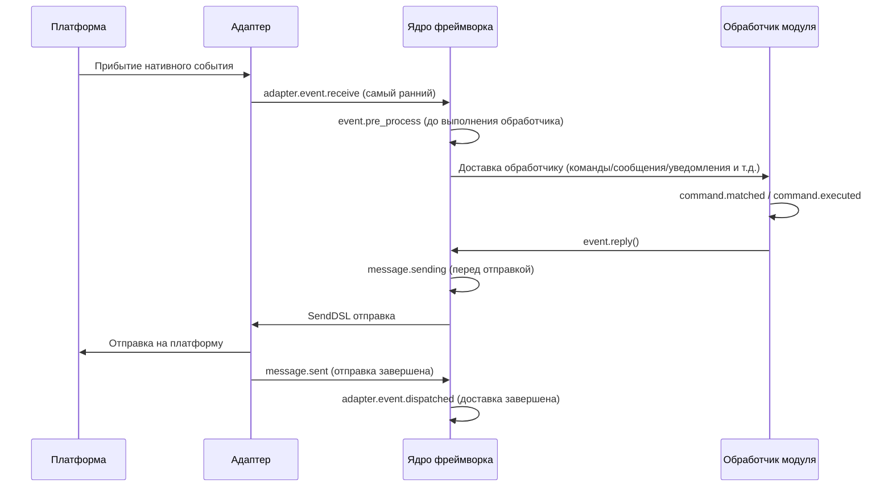

Фреймворк включает следующие точки останова хуков, пользователь может прослушивать любую точку останова, реализуя пользовательскую логику с помощью `@sdk.lifecycle.on()`.

### Инициализация ядра

| Название хука | Точка останова | Данные |
|---------|---------|------|
| `core.init.start` | Начало инициализации SDK | `{}` |
| `core.init.stage` | Начало этапа инициализации (выpusкается в фоновом режиме) | `{"stage": str}`; значения: `discovery` / `adapter_register` / `adapter_start` / `module_register` / `module_init` / `adapter_start_deferred` / `router_start` |
| `core.init.complete` | Завершение инициализации SDK | `{"duration": float, "success": bool, "stages": {stage: float}, "adapters": {"enabled": [str], "disabled": [str]}, "modules": {"enabled": [str], "disabled": [str]}, "error": str (только при неудаче)}` |
| `core.uninit.complete` | Завершение обратной инициализации SDK | `{"duration": float, "success": bool, "adapters_closed": int, "modules_unloaded": int, "module_properties_cleared": int, "module_properties_to_clear": [str], "error": str (только при неудаче)}` |

**Пример: отображение прогресса запуска**

```python
@sdk.lifecycle.on("core.init.stage")
def show_stage(data):
    print(f"[Запуск] Вход в этап: {data['stage']}")
```

### Изменение конфигурации

| Название хука | Точка останова | Данные |
|---------|---------|------|
| `config.set` | Изменение конфигурационного параметра | `{"key": str, "old_value": Any, "new_value": Any}` |
| `config.updated` | После обнаружения изменения всей конфигурации после редактирования config.toml | `{"old_config": dict, "new_config": dict, "config_file": str}` |

**Пример: аудит конфигурации**

```python
@sdk.lifecycle.on("config.set")
def audit_config(data):
    print(f"[Аудит] {data['key']}: {data['old_value']} -> {data['new_value']}")
```

### Жизненный цикл модуля

| Название хука | Точка останова | Данные |
|---------|---------|------|
| `module.register` | Регистрация класса модуля в менеджере | `{"module_name": str, "success": bool}` |
| `module.load` | Завершение загрузки модуля (успешное инстанцирование); при неудаче payload дополнительно содержит `"error": str, "traceback": str` (среда неудачи также может быть получена через `module.last_error(имя)`) | `{"module_name": str, "success": bool}` |
| `module.init` | Завершение инициализации модуля (включая ленивую загрузку) | `{"module_name": str, "success": bool}` |
| `module.before_unload` | Первый шаг в процессе выгрузки (до `on_unload` и освобождения ресурсов; хук модульного экземпляра `on_before_unload` срабатывает синхронно) | `{"module_name": str, "reason": str}`; `reason` принимает значения: `unload` / `reload` / `disable` / `cascade` / `dormant` |
| `module.sleep` | Завершение сна модуля (ленивая загрузка: ресурсы освобождены, автоматическое пробуждение при доступе) | `{"module_name": str, "success": bool}` |
| `module.unload` | Выгрузка или отключение модуля (`disable` и `unload` эквивалентны уведомлению зависимых; контракт `on_dependency_lost` содержит "отключение") | `{"module_name": str, "success": bool, "reason": str}`; `reason` принимает значения: `unload` / `reload` / `disable` / `cascade` / `dormant` |
| `module.rollback` | Завершение отката после неудачной горячей перезагрузки (восстановление снимка + повтор старого экземпляра `on_load`) | `{"module_name": str, "success": bool}`; `success` указывает, успешно ли повтор `on_load` (при False старый экземпляр остается в состоянии завершения) |
| `module.reload` | Завершение горячей перезагрузки модуля (включая перезагрузку зависимых) | `{"module_name": str, "success": bool, "full": bool, "duration_ms": int}`; для отдельного модуля дополнительно содержит `"identity_changed": bool` (False = возможно, старый код все еще выполняется в процессе, например, кэш расширений C) и `"version_old": str, "version_new": str`; при полной перезагрузке (`reload_all`) `module_name` равен `"All"`, payload дополнительно содержит `"results": dict[str, bool]` |

> **Хук экземпляра модуля `on_before_unload`**: соответствующий метод жизненного цикла, связанный с событием `module.before_unload` — `event["reason"]` указывает причину, подходит для сохранения состояния в `sdk.storage` перед освобождением ресурсов, восстановление происходит при пробуждении / перезагрузке в `on_load` (состояние продолжения ленивой загрузки основано на этом). Ошибка хука только предупреждает, не блокирует процесс выгрузки.

### Жизненный цикл адаптера

| Название хука | Точка останова | Данные |
|---------|---------|------|
| `adapter.load` | Завершение регистрации адаптера | `{"platform": str, "success": bool}` |
| `adapter.reload` | Завершение горячей перезагрузки кода адаптера | `{"adapter_name": str, "success": bool, "full": bool, "duration_ms": int, "identity_changed": bool, "version_old": str, "version_new": str, "was_started": bool, "source": str}`; `identity_changed=False` = возможно, старый код все еще выполняется в процессе |
| `adapter.rollback` | Завершение отката после неудачной горячей перезагрузки адаптера (после восстановления старого состояния регистрации) | `{"adapter_name": str, "replayed": bool, "success": bool}`; `replayed=True` означает, что старый экземпляр `start()` был повторен, `success` указывает, успешно ли повтор |
| `adapter.start` | Запуск адаптера | `{"platforms": [str]}` |
| `adapter.status.change` | Изменение состояния адаптера | `{"platform": str, "status": str, "retry_count": int, "error": str (только при неудаче)}`; полные значения status: `starting` / `started` / `start_failed` / `stopping` / `stopped` / `stop_failed` / `skipped-dependency` / `disabled` |
| `adapter.stop` | Остановка адаптера | `{"platforms": [str]}` |
| `adapter.stopped` | Завершение остановки адаптера | `{"platforms": [str]}` |
| `adapter.bot.online` | Онлайн бота | `{"platform": str, "bot_id": str, "info": dict, "status": str}` |
| `adapter.bot.offline` | Оффлайн бота | `{"platform": str, "bot_id": str, "status": str}` |

### Получение и обработка событий

| Название хука | Точка останова | Данные |
|---------|---------|------|
| `adapter.event.receive` | Получение события с внешней платформы (самый ранний) | `{"platform": str, "event_type": str, "raw_event_type": str}` |
| `adapter.event.blocked` | Промежуточный модуль отклоняет событие (возвращает `False`, событие отбрасывается и не попадает в обработчики) | `{"middleware": str, "platform": str, "event_type": str, "detail_type": str, "event": dict, "_trace_id": str}` |
| `adapter.event.dispatched` | Завершение доставки события | `{"platform": str, "event_type": str, "raw_event_type": str, "onebot_handlers_count": int}` |
| `event.pre_process` | Начало выполнения обработчика события | `{"event_type": str, "platform": str, "detail_type": str}` |

**Пример: статистика событий**

```python
event_counter = {}

@sdk.lifecycle.on("adapter.event.receive")
def count_events(data):
    platform = data["platform"]
    event_counter[platform] = event_counter.get(platform, 0) + 1

@sdk.lifecycle.on("adapter.event.dispatched")
def log_unhandled(data):
    if data["onebot_handlers_count"] == 0:
        print(f"[Необработано] {data['platform']}/{data['event_type']}")
```

### Отправка сообщений

| Название хука | Точка останова | Данные |
|---------|---------|------|
| `message.sending` | Сообщение готово к отправке | `{"platform": str, "method": str, "detail_type": str, "target_id": str, "bot_id": str}` |
| `message.sent` | Завершение отправки сообщения | `{"platform": str, "method": str, "detail_type": str, "target_id": str, "bot_id": str}` |

**Пример: аудит отправки сообщений**

```python
@sdk.lifecycle.on("message.sending")
def log_sending(data):
    print(f"[Отправка] -> {data['platform']}/{data['detail_type']}/{data['target_id']} через {data['method']}")
```

### Командная система

| Название хука | Точка останова | Данные |
|---------|---------|------|
| `command.matched` | Команда сопоставлена и готова к выполнению | `{"command": str, "args": list[str], "platform": str, "user_id": str}` |
| `command.executed` | Завершение выполнения команды | `{"command": str, "args": list[str], "platform": str, "user_id": str, "success": bool, "error": str (только при неудаче)}` |

**Пример: статистика команд**

```python
@sdk.lifecycle.on("command.matched")
def count_commands(data):
    print(f"[Команда] /{data['command']} от {data['user_id']}@{data['platform']}")
```

### HTTP-маршрутизация

| Название хука | Точка останова | Данные |
|---------|---------|------|
| `server.request` | Получение HTTP-запроса | `{"method": str, "path": str, "client_ip": str, "request_id": str}` |
| `server.response` | Отправка HTTP-ответа | `{"method": str, "path": str, "status_code": int, "client_ip": str, "request_id": str}` |

> `request_id` — это [идентификатор ассоциации запроса](router.md#запрос-ассоциации-idx-request-id): приоритетно используется заголовок запроса клиента, в противном случае генерируется UUID, с его помощью можно связать событие запроса и ответа.

**Пример: логирование HTTP-запросов**

```python
@sdk.lifecycle.on("server.response")
def log_http(data):
    print(f"[HTTP] {data['method']} {data['path']} -> {data['status_code']}")
```

### WebSocket

| Название хука | Точка останова | Данные |
|---------|---------|------|
| `server.start` | Запуск сервера маршрутизации | `{"base_url": str, "host": str, "port": int, "success": bool, "error": str (только при неудаче)}` |
| `server.stop` | Остановка сервера маршрутизации | `{}` |
| `server.websocket.connect` | Установление соединения WebSocket | `{"path": str, "module_name": str, "client_ip": str}` |
| `server.websocket.disconnect` | Разрыв соединения WebSocket | `{"path": str, "module_name": str, "reason": str, "error": str (только при аномалии)}` |

**Пример: мониторинг подключений WebSocket**

```python
@sdk.lifecycle.on("server.websocket.connect")
def on_ws_connect(data):
    print(f"[WS] Подключение: {data['path']} от {data['client_ip']}")

@sdk.lifecycle.on("server.websocket.disconnect")
def on_ws_disconnect(data):
    print(f"[WS] Разрыв: {data['path']} ({data['reason']})")
```

### Состояние подключения хранилища

Создание пула подключений к хранилищу, сбои и восстановление (все события выпускаются в фоновом режиме, не блокируют операции хранилища):

| Название хука | Точка останова | Данные |
|---------|---------|------|
| `storage.ready` | Пул подключений к хранилищу готов (каждое событие цикла впервые успешно создается) | `{"backend": str}` |
| `storage.unreachable` | Повторные попытки подключения исчерпаны, вступает период охлаждения (в течение которого операции завершаются быстро с ошибкой) | `{"backend": str, "error": str, "cooldown": float}` |
| `storage.recovered` | Охлаждение завершено, повторное подключение успешно, хранилище снова доступно | `{"backend": str}` |

**Пример: предупреждение о сбое хранилища**

```python
@sdk.lifecycle.on("storage.unreachable")
def alert_storage_down(data):
    print(f"[Предупреждение] Хранилище {data['backend']} недоступно: {data['error']}, автоматически переподключится через {data['cooldown']}s")

@sdk.lifecycle.on("storage.recovered")
def notify_storage_back(data):
    print(f"[Восстановлено] Хранилище {data['backend']} снова доступно")
```

### HTTP-клиент

События запросов и подключений `sdk.client` (все события выпускаются в фоновом режиме):

| Название хука | Точка останова | Данные |
|---------|---------|------|
| `client.request.success` | HTTP-запрос успешен | `{"method": str, "url": str, "status": int, "elapsed": float}` |
| `client.request.failed` | HTTP-запрос окончательно завершился неудачей после исчерпания попыток повтора | `{"method": str, "url": str, "error": str, "attempts": int, "elapsed": float}` |
| `client.ws.connect` | Установление соединения WebSocket | `{"url": str}` |

### Международная локализация

| Название хука | Точка останова | Данные |
|---------|---------|------|
| `i18n.language.changed` | Смена языка фреймворка (`i18n.set_language`) | `{"language": str, "previous": str}` |

## Стандартное определение событий

```python
STANDARD_EVENTS = {
    "core": ["init.start", "init.stage", "init.complete", "uninit.complete"],
    "module": ["load", "before_unload", "init", "sleep", "unload", "register", "reload"],
    "adapter": [
        "load", "start", "status.change", "reload", "stop", "stopped",
        "event.receive", "event.blocked", "event.dispatched",
        "bot.online", "bot.offline",
    ],
    "server": [
        "start", "stop",
        "request", "response",
        "websocket.connect", "websocket.disconnect",
    ],
    "event": ["pre_process"],
    "message": ["sending", "sent"],
    "command": ["matched", "executed"],
    "config": ["set", "updated"],
    "storage": ["ready", "unreachable", "recovered"],
    "client": ["request.success", "request.failed", "ws.connect"],
    "i18n": ["language.changed"],
}
```

## Полная справочная документация API

### Регистрация и отмена

| Метод | Описание |
|------|------|
| `@lifecycle.on(event, *, priority=0)` | Декораторная регистрация обработчика |
| `lifecycle.register(event, handler, *, priority=0)` | Программная регистрация |
| `lifecycle.unregister(event, handler=None)` | Отмена регистрации (если handler=None, отменяются все обработчики события) |

### Триггеризация

| Метод | Описание |
|------|------|
| `await lifecycle.emit(event, data=None, *, to=None)` | Асинхронный триггер, обработчики выполняются **параллельно** (взаимно не блокируются, возврат происходит после завершения всех), возвращаемое значение не None возвращается по цепочке с заменой data в порядке приоритета; `to` указывает владельца для направленной доставки |
| `lifecycle.fire(event, data=None, *, to=None)` | **Отправка в фоне (бросить в корзину)**: обработчики выполняются в фоновых задачах параллельно, без ожидания, без возврата; если нет слушателей, нулевые накладные расходы. Подходит для частых горячих путей и чистых наблюдений; для последовательных сценариев и последовательного потребления (например `config.set`) используйте `emit` |
| `lifecycle.emit_sync(event, data=None, *, to=None)` | Синхронный триггер, асинхронные обработчики запускаются через create_task |
| `await lifecycle.submit_event(event_type, *, source, msg, data, to=None, background=False)` | Совместимость со старой версией, автоматическое построение стандартного формата события; `background=True` использует `fire` для фоновой отправки |

**Сравнение четырех триггерных API**:

| Метод | Форма вызова | Ожидание завершения обработчиков | Типичные сценарии |
|------|---------|------------------|---------|
| `emit` | `await` (асинхронно) | **Ожидание** — обработчики выполняются параллельно, возврат происходит после завершения всех, возвращаемое значение возвращается по цепочке | Обычный триггер; последовательное потребление (например `config.set`) и цепочки остановки обязательно должны использовать его |
| `fire` | Прямой вызов (синхронный возврат) | **Не ожидание** — фоновые задачи выполняются параллельно, без возврата; если нет слушателей, нулевые накладные расходы | Частые горячие пути и чистые наблюдения (например `server.request` / `storage.ready`) |
| `emit_sync` | Прямой вызов (синхронно) | Синхронные обработчики завершаются немедленно; асинхронные обработчики запускаются через `create_task` (возвращаемое значение не может быть возвращено) | Триггер события в не-асинхронном контексте (синхронный код) |
| `submit_event` | `await` (асинхронно) | Ожидание (если `background=True`, то как `fire` не ожидает) | Совместимость со старой версией: автоматическое построение стандартного формата события (`source` / `msg` / `timestamp`) |

### Инструменты

| Метод | Описание |
|------|------|
| `lifecycle.start_timer(timer_id)` | Начать таймер |
| `lifecycle.get_duration(timer_id)` | Получить продолжительность (в секундах) |
| `lifecycle.stop_timer(timer_id)` | Остановить таймер и вернуть продолжительность |
| `lifecycle.list_hooks()` | Вывести все зарегистрированные хуки и количество обработчиков |
| `lifecycle.clear()` | Очистить все обработчики и таймеры |

## Пример использования в модуле

```python
from ErisPulse.Core.Bases import BaseModule
from ErisPulse import sdk

class Main(BaseModule):
    async def on_load(self, event):
        # Реализация простой статистики сообщений
        self.msg_count = 0
        
        @sdk.lifecycle.on("adapter.event.receive")
        async def count(data):
            if data["event_type"] == "message":
                self.msg_count += 1
        
        # Мониторинг всех команд
        @sdk.lifecycle.on("command.matched")
        async def log_cmd(data):
            sdk.logger.info(f"Выполнение команды: /{data['command']} от {data['user_id']}")
        
        # Аудит изменений конфигурации
        @sdk.lifecycle.on("config.set")
        def audit(data):
            sdk.logger.info(f"Изменение конфигурации: {data['key']} = {data['new_value']}")
```

## Принадлежность фоновых задач и автоматическое отмена

> [!NOTE]
> Эта функция доступна начиная с ErisPulse **2.8.0+**.

Фоновые задачи asyncio, созданные модулем, если не отменить их в `on_unload`, будут удерживать ссылку на `self`, что приведёт к невозможности сборки мусора для экземпляра модуля (старые экземпляры остаются после горячей перезагрузки). Рамка предоставляет следующие механизмы по умолчанию:

- **`self.spawn(coro)`** (рекомендуется в модуле): задача автоматически привязывается к имени модуля, и при выгрузке модуля рамка в `on_unload` **после** этого автоматически отменяет незавершённые задачи и записывает предупреждение
- **`spawn_background(coro)`** (`ErisPulse.runtime`): автоматически захватывает текущий контекст `owner_scope`; `cancel_owner_tasks(owner)` отменяет задачи по принадлежности, `cancel_all_background_tasks()` используется как резервный механизм в `sdk.uninit()`
- **Адаптеры**: при закрытии также автоматически отменяются фоновые задачи, привязанные к имени платформы

**Задачи, созданные до регистрации основного цикла** (начиная с 2.12): `spawn_background()` и `run_main_loop()`
Если основной цикл не доступен, вместо создания временного цикла событий задачи помещаются в очередь ожидания (максимум `PENDING_TASK_QUEUE_MAX`, по умолчанию 1024). При регистрации основного цикла `sdk.run()` задачи из очереди выполняются. Если очередь заполнена, новые задачи отбрасываются и выводится предупреждение; отмена по `owner` также удаляет из очереди ожидания задачи этого `owner`. При выходе из программы, если остаются задачи в очереди, выводится предупреждение и задачи отбрасываются. `run_main_loop()` возвращает `None`, если задача попала в очередь.

```python
async def on_load(self, event):
    # Рекомендуется: использовать self.spawn() для фоновых задач, рамка автоматически отменит их при выгрузке
    self.spawn(self._poll())

async def on_unload(self, event):
    # В сценариях, требующих точного контроля, рекомендуется отменить задачу и дождаться завершения
    if self._poll_task:
        self._poll_task.cancel()
        await asyncio.gather(self._poll_task, return_exceptions=True)

async def _poll(self):
    while True:
        await asyncio.sleep(60)
        ...
```

> [!IMPORTANT]
> Механизм по умолчанию — **принудительная отмена** (`cancel_owner_tasks`), которая происходит после возврата из `on_unload`. Поэтому задачи, требующие аккуратного завершения (очистка буфера, сохранение состояния, закрытие соединений), **обязательно** должны быть отменены и завершены в `on_unload` — не рассчитывайте на механизм по умолчанию для сохранения логики завершения. Рамка гарантирует только «отсутствие задач, удерживающих ссылку на `self`», но не гарантирует «аккуратное завершение». Задачи, ожидающие результата, следует вызывать напрямую, а не передавать их в фоновые задачи.

## Примечания

1. **Обработчики могут быть синхронными или асинхронными**: система автоматически распознаёт и правильно вызывает
2. **Передача данных**: в режиме `emit()`, если обработчик возвращает ненулевое значение, оно изменяет передаваемые последующим обработчикам данные
3. **Нормализация имен событий**: рекомендуется использовать точечную структуру для именования событий, что упрощает использование родительских слушателей
4. **Изоляция ошибок**: ошибка одного обработчика не влияет на выполнение других обработчиков
5. **Ограничение синхронного триггера**: в `emit_sync()` асинхронные обработчики запускаются в фоне без ожидания, возвращаемое значение не может быть возвращено
6. **Очистка жизненного цикла**: при вызове `sdk.uninit()` все зарегистрированные обработчики и таймеры будут очищены
7. **Приоритет загрузки**: если необходимо слушать события на этапе инициализации фреймворка, рекомендуется установить высокий приоритет и отключить ленивую загрузку


### 懶加载系统

# Система ленивой загрузки модулей

> [!TIP]
> **Когда нужно читать эту статью**: при использовании ленивой загрузки модулей или активации по событию activate_on. Если не нужно, можно пропустить, это не повлияет на использование других функций.

Система ленивой загрузки модулей ErisPulse SDK позволяет отложить инициализацию модулей до **момента их фактического обращения** — на этапе запуска регистрируются только заглушки, а неиспользуемые модули не занимают время запуска и память.

## Обзор

Система ленивого загрузки модулей является одной из ключевых особенностей ErisPulse. Она работает следующим образом:

- **Отложенная инициализация**: модуль загружается и инициализируется только при первом обращении
- **Прозрачное использование**: для разработчиков ленивые модули практически не отличаются от обычных модулей
- **Автоматическое управление зависимостями**: зависимости модуля автоматически инициализируются при использовании
- **Поддержка жизненного цикла**: для модулей, унаследованных от `BaseModule`, автоматически вызываются методы жизненного цикла

## Принцип работы

### Класс LazyModule

Основой системы ленивой загрузки является класс `LazyModule`, который является обёрткой, фактически инициализирующей модуль только при первом обращении.

### Процесс инициализации

При первом обращении к модулю `LazyModule` выполняет следующие действия:

1. Получает информацию о параметрах `__init__` класса модуля
2. Определяет, следует ли передавать ссылку на `sdk`
3. Устанавливает атрибут `moduleInfo` модуля
4. Для модулей, унаследованных от `BaseModule`, вызывает метод `on_load`
5. Запускает событие жизненного цикла `module.init`

## Событийная ленивая активация (activate_on)

> [!NOTE]  
> Эта функция требует ErisPulse **2.8.0+**.

Модули с `lazy_load=True` по умолчанию загружаются только при **первом обращении к атрибуту**. Если модуль зарегистрировал обработчики команд/событий, традиционный подход требует `lazy_load=False` для немедленной загрузки. `activate_on` предоставляет третий вариант: **объявить триггер, и при первом совпадающем событии/команде модуль будет автоматически активирован** — он не будет постоянно в памяти, но при этом не потеряет вход для триггера.

```python
from ErisPulse.loaders import ModuleLoadStrategy

class MyModule(BaseModule):
    @staticmethod
    def get_load_strategy():
        return ModuleLoadStrategy(
            lazy_load=True,
            activate_on=[
                # ---- Событийные триггеры (пассивные, без участия пользователя) ----
                "message",                                    # Тип события: любое сообщение
                {"notice": "group_member_increase"},          # Тип + один detail_type
                {"message": ["private", "group"]},            # Тип + несколько detail_type

                # ---- Командные триггеры (активные, ввод пользователя, видны в Help) ----
                {"command": "roll"},                          # Сокращённая форма: имя команды
                {"command": ["roll", "dice"]},                # Список имён команд
                {"command": {                                 # Форма dict (обязателен name)
                    "name": "dice",
                    "help": "Бросить кубик",
                    "usage": "/dice",
                    "group": "Развлечения",
                    "aliases": ["d"],
                    "hidden": False,
                }},
            ],
        )
```

### Параметры команды в формате dict

Форма dict отражает пользовательские параметры декоратора `@command()`, позволяя зарегистрировать заглушку команды ещё до загрузки модуля:

| Параметр | Тип | Значение по умолчанию | Описание |
|----------|------|----------------------|----------|
| `name` | `str` | **Обязательно** | Имя команды; должно совпадать с `name` в `@command()` внутри `on_load`, иначе заглушка будет удалена, и команда не будет найдена |
| `help` | `str` | Цепочка возврата | Описание в Help; если не указано, используется цепочка возврата (см. ниже) |
| `usage` | `str` | Автоматически | Пример использования, по умолчанию `{prefix}{name}` |
| `group` | `str` | `None` | Группа команды |
| `aliases` | `list[str]` | `[]` | Алиасы, которые также регистрируются — **ввод алиаса также активирует модуль** |
| `hidden` | `bool` | `False` | Если `True`, заглушка будет скрыта (согласуется с поведением скрытых команд после активации); пользователи, знающие имя команды, могут активировать её вводом |

**Не поддерживаются** `priority` / `permission` / `master`: заглушка команды предназначена только для активации, проверка прав осуществляется после активации настоящей командой (в противном случае проверка прав на этапе заглушки приведёт к потере функциональности "активация по команде").

### Цепочка возврата для Help заглушки команды

Описание команды в Help, отображаемое до загрузки модуля, берётся по следующему порядку (первое найденное значение используется):

1. `help` из объявления команды в формате dict (наиболее точное)
2. `description` из `get_meta()`
3. Атрибут `__description__`
4. `Summary` из метаданных пакета (краткое описание на PyPI)
5. Общее сообщение: «Эта команда из лениво загружаемого модуля X, первый вызов активирует модуль»

### Семантика триггеров

- **Заглушка события**: регистрируется с низким приоритетом (`ACTIVATION_STUB_PRIORITY`) в соответствующий менеджер событий, срабатывает в качестве резервного обработчика после всех обычных; после активации событие пересылается настоящему обработчику модуля
- **Заглушка команды**: регистрируется как заглушка команды; после активации заглушка удаляется, настоящая команда обрабатывает текущий вызов
- **Защита от повторного запуска**: `asyncio.Lock` гарантирует, что модуль активируется только один раз при одновременных триггерах
- **Фильтрация по области действия**: заглушка имеет идентификатор владельца модуля, триггер не срабатывает, если модуль не включён для данного бота/сессии/платформы
- **Семантика ошибок**: при неудачной активации модуль переходит в период охлаждения (`ACTIVATE_RETRY_COOLDOWN_SECS`, 30 секунд), события в течение этого времени игнорируются, чтобы избежать повторных попыток; по истечении времени модуль автоматически перезапускается, заглушка остаётся активной
- **Удаление дубликатов**: при смешанном объявлении команд (сокращённая форма + dict) дубликаты удаляются (dict имеет приоритет); если в dict отсутствует `name` или `detail_type` события указан неверно, выводится предупреждение и объявление игнорируется

> Архитектурная диаграмма и полная семантика доступны в [Обзоре архитектуры](../architecture.md#архитектура-событийной-ленивой-активации-activate_on-триггеры).

## Задержка активации (dormant_after)

> [!NOTE]
> Эта функция доступна в ErisPulse **2.11.0+**.

После длительного бездействия модули, активированные с задержкой, могут быть **уснувшими**: фреймворк освобождает ресурсы (задачи, соединения, регистрация событий),
но сохраняет ленивый загрузочный прокси и структуру регистрации — модуль возвращается в состояние "зарегистрирован, но не загружен", и при следующем обращении к свойству /
`module.call` / событию `activate_on` **прозрачно активируется** (переинициализируется и выполняется `on_load`),
без необходимости вызывать какие-либо API активации. После усыпления состояние системы идентично состоянию "никогда не активированный".

### Способ объявления

```python
@staticmethod
def get_load_strategy():
    return ModuleLoadStrategy(
        lazy_load=True,
        dormant_after="30m",   # Автоматическое усыпление после 30 минут бездействия; отсутствие объявления = никогда не усыплять (по умолчанию)
    )
```

Синтаксис длительности идентичен синтаксису `cooldown` в командном управлении (например, `90s` / `1h30m` / `1d`). Сканер проверяет состояние с фиксированным интервалом (60 секунд),
фактическое время усыпления = порог + максимум один интервал сканирования; также можно усыпить вручную в любой момент:
`await sdk.module.sleep("имя модуля")`. Явный вызов `unload` по-прежнему означает полную разгрузку (удаляются все ленивые прокси).

### Продолжение состояния

Перед усыпанием фреймворк вызывает `on_before_unload(reason="dormant")` (первый шаг в цепочке разгрузки, ресурсы все еще целы),
модуль сохраняет состояние в `sdk.storage`; при активации в `on_load` восстанавливает:

```python
async def on_before_unload(self, event):
    if event["reason"] in ("dormant", "reload", "disable"):
        await self.sdk.storage.aset(f"{self._module_name}:counter", self._count)

async def on_load(self, event):
    self._count = await self.sdk.storage.aget(f"{self._module_name}:counter") or 0
```

### Семантика и границы

- **Безопасность для зависимых модулей**: Зависимые модули получают доступ к ленивым модулям через постоянный прокси (`sdk.<Name>`) или `module.call`,
  поведение одинаково до и после усыпания; непосредственное хранение ссылки на реальный экземпляр является противоположным подходом (видно в аудите утечек)
- **Отсутствие событий**: Усыпленные модули больше не получают события — модули, которым нужно событие для активации, должны также объявить `activate_on`
  (событие сначала активирует, затем пересылает); при диагностике "команды не отвечают" проверяйте, находится ли модуль в состоянии усыпления
- **Самовосстановление при неудачной активации**: При неудачной активации (повторной инициализации) модуль переходит в 30-секундный период охлаждения, после чего при повторном обращении автоматически повторяет попытку,
  модуль не может быть навсегда неактивным

## Конфигурация ленивой загрузки

### Глобальная конфигурация

В файле конфигурации включите/отключите глобальную ленивую загрузку:

```toml
[ErisPulse.framework]
enable_lazy_loading = true  # true=включить ленивую загрузку (по умолчанию), false=отключить ленивую загрузку
```

### Управление на уровне модуля

Модуль может контролировать стратегию загрузки, реализовав статический метод `get_load_strategy()`:

```python
from ErisPulse.Core.Bases import BaseModule
from ErisPulse.loaders import ModuleLoadStrategy

class MyModule(BaseModule):
    @staticmethod
    def get_load_strategy():
        """Возвращает стратегию загрузки модуля"""
        return ModuleLoadStrategy(
            lazy_load=False,  # Возвращает False для немедленной загрузки
            priority=100      # Приоритет загрузки, чем больше значение, тем выше приоритет
        )
```

## Использование модулей с ленивой загрузкой

### Основное использование

Для разработчиков использование модулей с ленивой загрузкой практически не отличается от обычных модулей:

```python
# Доступ к модулю с ленивой загрузкой через SDK
from ErisPulse import sdk

# Следующий вызов инициирует ленивую загрузку модуля
result = await sdk.my_module.my_method()
```

### Единый вход для получения модуля

Независимо от того, получаете ли вы модуль через свойство SDK, свойство менеджера модулей или с помощью `module.get()`, для "зарегистрированных, но еще не загруженных" модулей с ленивой загрузкой будет возвращаться один и тот же прокси-объект ленивой загрузки. Инициализация происходит только при обращении к его свойствам:

```python
# Все три способа возвращают один и тот же прокси-объект ленивой загрузки (когда модуль еще не загружен), поведение одинаково и для пользователя прозрачно
sdk.my_module          # Точка входа для инициации загрузки
sdk.module.my_module   # Также возвращает прокси-объект ленивой загрузки
sdk.module.get("my_module")  # Также возвращает прокси-объект ленивой загрузки, сам вызов не инициирует загрузку

# Инициализация модуля происходит только при обращении к свойству прокси-объекта
result = await sdk.my_module.my_method()
```

`module.get()` — это **интерфейс для запроса**, сам вызов не инициирует загрузку:
- Если модуль уже загружен → возвращается реальный экземпляр
- Если модуль зарегистрирован, но не загружен → возвращается прокси-объект ленивой загрузки (инициализация происходит при обращении к свойству)
- Если модуль не зарегистрирован → возвращается `None`

Если необходимо явно инициировать загрузку, используйте `await sdk.load_module("my_module")`.

### Асинхронная инициализация

Для модулей, требующих асинхронной инициализации, рекомендуется сначала явно загрузить модуль:

```python
# Сначала явно загрузите модуль
await sdk.load_module("my_module")

# Затем используйте модуль
result = await sdk.my_module.my_method()
```

### Синхронная инициализация

Для модулей, не требующих асинхронной инициализации, можно обращаться напрямую:

```python
# Прямое обращение автоматически инициирует синхронную инициализацию
result = sdk.my_module.some_sync_method()
```

## Рекомендуемые практики

При выборе стратегии загрузки можно использовать следующий процесс принятия решений:

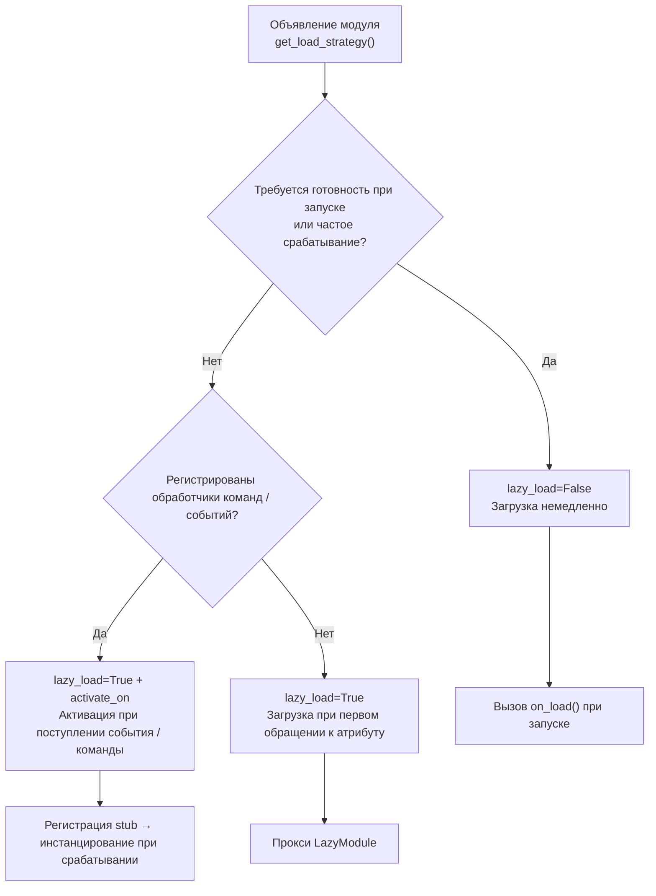

### Рекомендованные сценарии использования ленивой загрузки (lazy_load=True)

- Инструментальные классы, вызываемые пассивно (например, модуль запросов данных, преобразователи форматов и т.д., которые нужны только при вызове из других модулей)
- Модули, зарегистрировавшие обработчики команд / событий, но используемые нечасто — в сочетании с `activate_on` можно объявить триггер, автоматически активирующий модуль при поступлении первого соответствующего события / команды, без отказа от ленивой загрузки

### Рекомендованные сценарии отключения ленивой загрузки (lazy_load=False)

- Модули, требующие готовности при запуске (например, основные модули, предоставляющие базовые сервисы другим модулям)
- Часто вызываемые слушатели (каждое сообщение должно обрабатываться) — `activate_on` имеет небольшую стоимость активации, поэтому для сценариев с высокой частотой вызовов прямая загрузка предпочтительнее
- Модули с планировщиком задач
- Модули, требующие инициализации при запуске приложения

> Параметр `priority` управляет порядком инициализации модулей, загруженных немедленно: чем больше значение, тем раньше модуль будет инициализирован. Модули с одинаковым приоритетом загружаются в порядке их регистрации.

## Примечания

1. Если ваш модуль использует ленивую загрузку, и если другие модули никогда не вызывались внутри ErisPulse, ваш модуль никогда не будет инициализирован.
2. Если ваш модуль содержит такие компоненты, как модули, слушающие события, или другие активно слушающие модули, у вас есть два варианта: объявить триггер `activate_on` (сохранить ленивую загрузку, автоматически активировать при поступлении события) или объявить, что он должен быть загружен немедленно (`lazy_load=False`), иначе это повлияет на нормальное функционирование вашего модуля.
3. Мы не рекомендуем отключать ленивую загрузку, если только у вас нет особых потребностей, иначе это может привести к проблемам с зависимостями и событиями жизненного цикла.
4. В командном словаре `activate_on` объявления, `name` должен совпадать с реальным именем команды, зарегистрированной в модуле `on_load` с помощью `@command()` — в противном случае, после активации модуля, команда-заполнитель будет отменена, и команда, объявленная не соответствующая реализации, не будет существовать.


### 国际化（i18n）系统

# Система международной локализации (i18n)

> [!TIP]
> **Когда нужно это читать**: при необходимости многоязычного контента, регистрации переводов или определения языка. Если не нужно, пропустите, это не повлияет на использование других функций.

Начиная с версии ErisPulse v2.5.0, встроенная поддержка международной локализации. Ядро фреймворка и интерфейс CLI могут автоматически переключать отображаемый текст в соответствии с языком вашей системы, а также поддерживают регистрацию переводов внешними модулями.

## Поддерживаемые языки

| Язык | Код | Описание |
|------|------|------|
| 简体中文 | `zh-CN` | Основной язык (оригинальный язык фреймворка) |
| 繁體中文 | `zh-TW` | Традиционный китайский (Гонконг/Макао/Тайвань) |
| English | `en` | Английский (язык по умолчанию) |
| 日本語 | `ja` | Японский |
| Русский | `ru` | Русский |

## Быстрый опыт

### Через переменные окружения

```bash
# Windows PowerShell
$env:ERISPULSE_LANG = "en"
epsdk run

# macOS / Linux
ERISPULSE_LANG=ja epsdk run
```

### Через файл конфигурации

В файле `config/config.toml` добавьте:

```toml
[ErisPulse.i18n]
language = "zh-TW"
```

Установка значения `"auto"` (значение по умолчанию) включает автоматическое определение языка системы.

### В коде вручную

```python
from ErisPulse import i18n

# Ручная установка языка
i18n.set_language("en")
print(i18n.get_language())  # "en"

# Сброс на автоматическое определение
i18n.reset_language()
```

---

## Механизм определения языка

Фреймворк определяет язык пользователя по следующему приоритету:

1. **Переменная окружения `ERISPULSE_LANG`** — наивысший приоритет, используется для тестирования и временного переключения
2. **Windows API** — `GetUserDefaultLocaleName` (только Windows, не подвергается влиянию таких инструментов, как Git Bash, которые могут переопределить `LANG`)
3. **Переменные окружения** — `LANGUAGE` > `LC_ALL` > `LC_MESSAGES` > `LANG` (стандарт Unix/macOS)
4. **Системная локаль** — `locale.getlocale()` / `locale.getdefaultlocale()`
5. **Обратный путь** — en (английский)

### Принцип ближайшего соответствия

При обнаружении языка, не являющегося точным совпадением, используется принцип ближайшего соответствия:

- `zh-TW`, `zh-HK`, `zh-MO`, `zh-Hant` → **Традиционный китайский**
- Все остальные `zh-*` (например, `zh-CN`, `zh-SG`) → **Упрощённый китайский**
- `en-US`, `en-GB`, `en-AU` и т.д. → **Английский**
- `ja-JP` → **Японский**
- `ru-RU` → **Русский**
- Нераспознанные языки → **Упрощённый китайский (обратный путь)**

---

## Использование i18n в модулях

Вы можете зарегистрировать переводы для своих модулей, чтобы сделать их также поддерживаемыми в нескольких языках.

### Рекомендуемый способ: объявление ключей перевода через I18nClass (v2.7.0+)

Начиная с версии v2.7.0, модули/адаптеры могут объявлять ключи перевода, как объявление `ConfigClass`, с помощью вложенного класса `I18nClass`. Фреймворк автоматически зарегистрирует все объявленные ключи перевода при загрузке, без необходимости вызывать `i18n.register()` вручную.

```python
from dataclasses import dataclass, field

from ErisPulse.Core.Bases import BaseConfig, BaseI18n, BaseModule, I18nKey


class MyModule(BaseModule):
    # Класс конфигурации (опционально)
    @dataclass
    class ConfigClass(BaseConfig):
        welcome_msg: str = field(
            default="欢迎",
            metadata={
                # Здесь используется i18n-ключ mymodule.welcome_msg
                "description": {"i18n": "mymodule.welcome_msg", "default": "欢迎消息"},
            },
        )

    # Класс набора ключей перевода (опционально)
    # Объявленные ключи будут автоматически зарегистрированы фреймворком, с приоритетом над генерацией дефолтных значений ConfigClass
    class I18nClass(BaseI18n):
        # Имя атрибута автоматически объединяется в полный путь ключа: <имя модуля>.<имя атрибута>
        welcome_msg: I18nKey = I18nKey(
            default="Welcome Message",   # Языко-независимый резервный вариант, не регистрируется ни в один язык
            zh_CN="欢迎消息",
            en="Welcome Message",
            ja="ウェルカムメッセージ",
            ru="Приветственное сообщение",
            zh_TW="歡迎訊息",
        )
        # Другие ключи перевода, используемые в бизнес-логике
        hello: I18nKey = I18nKey(
            default="Hello, {name}!",
            zh_CN="你好，{name}！",
            zh_TW="你好，{name}！",
            en="Hello, {name}!",
            ja="こんにちは、{name}！",
            ru="Привет, {name}!",
        )

        # Можно явно указать полный путь ключа (без использования имени атрибута)
        custom: I18nKey = I18nKey(
            key="mymodule.deep.nested.key",
            default="Default text",
            zh_CN="默认文本",
            zh_TW="預設文本",
            en="Default text",
            ja="デフォルトテキスト",
            ru="Текст по умолчанию",
        )
```

#### Почему рекомендуется I18nClass?

| Сценарий | Ручная i18n.register() | Декларативный I18nClass |
|------|-----------------------|------------------|
| Описание конфигурации с использованием i18n-ключа | Требуется ручная регистрация, и нужно успеть до генерации конфигурации | Фреймворк автоматически регистрирует до генерации конфигурации |
| Объявление многоязычных переводов | Распространяется по on_load() | Централизовано в классе, легко читается |
| Согласованность именования ключей | Легко допускаются опечатки | Имя атрибута используется как суффикс ключа, IDE может подсказывать |
| Очистка при отключении | Требуется ручная unregister_domain() | Фреймворк использует единый домен для регистрации |

#### Правила пути ключей I18nClass

- **По умолчанию**: Используется ``<имя регистрации модуля>.<имя атрибута>`` как полный путь ключа
  - Пример: Имя модуля ``MyModule``, атрибут ``welcome`` → Путь ключа ``MyModule.welcome``
- **Явно**: Через параметр ``I18nKey(key="...")`` можно указать любой точечный путь
  - Подходит для глубоко вложенных ключей (например, ``mymodule.config.basic.token``)

#### Использование в адаптерах

Адаптеры также поддерживают `I18nClass`, и способ использования полностью идентичен:

```python
from ErisPulse.Core import BaseAdapter
from ErisPulse.Core.Bases import BaseConfig, BaseI18n, I18nKey


class MyAdapter(BaseAdapter):
    @dataclass
    class ConfigClass(BaseConfig):
        endpoint: str = field(
            default="",
            metadata={
                # Описание конфигурации ссылается на ключ adapter.MyAdapter.endpoint
                "description": {"i18n": "MyAdapter.endpoint", "default": "API 地址"},
            },
        )

    class I18nClass(BaseI18n):
        # Централизованное объявление ключей перевода, используемых в описании конфигурации и других бизнес-ключах
        endpoint: I18nKey = I18nKey(
            default="API Endpoint",
            zh_CN="API 地址",
            zh_TW="API 位址",
            en="API Endpoint",
            ja="APIアドレス",
            ru="API адрес",
        )
```

`I18nClass` адаптера автоматически регистрируется на этапе `__init__` (до генерации шаблона конфигурации), обеспечивая доступность ключей перевода, используемых в описании конфигурации.

### Ручная регистрация пользовательских переводов (старый способ)

Если вы не используете `I18nClass`, вы можете напрямую вызвать `i18n.register()` для регистрации переводов.

```python
from ErisPulse import i18n

# Регистрация китайского перевода
i18n.register("zh-CN", {
    "my_module.welcome": "欢迎使用我的模块！",
    "my_module.goodbye": "再见！",
    "my_module.hello": "你好，{name}！",
}, domain="my_module")

# Регистрация английского перевода
i18n.register("en", {
    "my_module.welcome": "Welcome to my module!",
    "my_module.goodbye": "Goodbye!",
    "my_module.hello": "Hello, {name}!",
}, domain="my_module")
```

### Использование перевода

```python
from ErisPulse import i18n

# Простой перевод
i18n.t("my_module.welcome")  # Автоматически использует текущий язык

# С параметрами форматирования
i18n.t("my_module.hello", name="Alice")

# Указание значения по умолчанию (возвращается, если ключ перевода отсутствует)
i18n.t("my_module.unknown_key", default="默认文本")
```

### Использование в классе модуля

```python
from dataclasses import dataclass, field
from ErisPulse import i18n
from ErisPulse.Core.Bases import BaseConfig, BaseModule

@dataclass
class MyModuleConfig(BaseConfig):
    welcome_msg: str = field(
        default="欢迎",
        metadata={
            "description": {"i18n": "my_module.welcome_msg", "default": "欢迎消息"},
            "ui": {"widget": "text", "group": "basic", "order": 1},
        },
    )

class MyModule(BaseModule):
    ConfigClass = MyModuleConfig

    async def on_load(self, event):
        # Динамическое чтение конфигурации (каждый доступ отражает последнее значение)
        self.logger.info(self.cfg.welcome_msg)
        self.logger.info(i18n.t("my_module.welcome"))

    @command("hello")
    async def hello_handler(self, event):
        name = event.get_user_nickname() or "friend"
        await event.reply(i18n.t("my_module.hello", name=name))

    async def on_unload(self, event):
        pass
```

### Отмена регистрации перевода

```python
# Отмена регистрации всего домена перевода
i18n.unregister_domain("my_module")
```

---

## Многоязычные поля конфигурации

Начиная с версии v2.5.2, схема конфигурации полностью поддерживает i18n. Все пользовательские текстовые поля могут ссылаться на i18n-ключи, и веб-интерфейс и другие потребители автоматически будут использовать соответствующий текст в зависимости от текущего языка.

### Поддерживаемые i18n-поля

| Поле | Расположение | Описание |
|------|------|------|
| `description` | field metadata | Описание поля |
| `options[].label` | `ui.options` | Метка опций для элемента select |
| `placeholder` | `ui.placeholder` | Заполнитель для поля ввода |
| `group_labels` | `_schema_meta` | Название раздела (заголовок секции в Dashboard) |

Используется единый формат `{"i18n": "key", "default": "текст"}`, строки без i18n-ключа прозрачно передаются (для обратной совместимости).

### Объявление i18n-полей

Все пользовательские текстовые поля поддерживают i18n:

```python
from dataclasses import dataclass, field
from ErisPulse.Core.Bases import BaseConfig

@dataclass
class MyAdapterConfig(BaseConfig):
    # i18n для description
    token: str = field(
        default="",
        metadata={
            "description": {"i18n": "my_adapter.token", "default": "平台 Token"},
            "required": True,
            "secret": True,
            "ui": {
                "widget": "password",
                "group": "basic",
                "order": 1,
                # i18n для placeholder
                "placeholder": {"i18n": "my_adapter.token.ph", "default": "请输入 Token"},
            },
        },
    )
    # i18n для label опций
    mode: str = field(
        default="a",
        metadata={
            "description": {"i18n": "my_adapter.mode", "default": "运行模式"},
            "ui": {
                "widget": "select",
                "group": "basic",
                "order": 2,
                "options": [
                    {"label": {"i18n": "my_adapter.mode.a", "default": "模式A"}, "value": "a"},
                    {"label": {"i18n": "my_adapter.mode.b", "default": "模式B"}, "value": "b"},
                ],
            },
        },
    )

    # i18n для group_labels (название раздела)
    _schema_meta = {
        "group_labels": {
            "basic": {"i18n": "my_adapter.group.basic", "default": "基本设置"},
        }
    }
```

`default` — это резервный текст, отображается, когда перевод не зарегистрирован или поиск не удаётся.

### Скрытие секретных данных и проверка конфигурации

Поля, помеченные как `"secret": True`, автоматически получают **защиту от раскрытия** (начиная с версии 2.7.0):

- **Скрытие при генерации шаблона**: `dataclass_to_toml_with_comments()` при генерации шаблона конфигурации не записывает реальное значение секретных полей (отображается пустой заполнитель), предотвращая попадание конфиденциальной информации на диск
- **Общее средство скрытия**: `redact_secret(value)` заменяет непустое значение на `***`, пустое значение возвращается без изменений, может использоваться для вывода в логи и т.д.

```python
from ErisPulse.Core.Bases.config_schema import redact_secret

redact_secret("sk-xxxxxx")  # '***'
redact_secret("")           # ''
```

**Проверка конфигурации** (`validate_config()`) помимо проверки `required` на непустоту, начиная с версии 2.7.0, поддерживает:

| Проверка | Метаданные | Пример |
|--------|--------|------|
| Совпадение типа | Тип поля | Ошибка, если в поле int передано строковое значение |
| Ограничение перечисления | `ui.options` или顶层 `options` | Значение должно принадлежать разрешённым опциям |
| Диапазон значений |顶层 `min` / `max` | `metadata={"min": 1, "max": 65535}` |

```python
from ErisPulse.Core.Bases.config_schema import validate_config

@dataclass
class C(BaseConfig):
    mode: str = field(default="a", metadata={"ui": {"widget": "select", "options": ["a", "b"]}})
    port: int = field(default=80, metadata={"min": 1, "max": 65535})

errors = validate_config(C(mode="x", port=70000))  # Две ошибки: перечисление + диапазон
```

### Регистрация перевода конфигурации

Ключи перевода конфигурации и обычные ключи перевода одинаковы, используют `i18n.register()` для регистрации:

```python
from ErisPulse import i18n

# Регистрация китайского (согласуется с default, но может отличаться)
i18n.register("zh-CN", {
    "my_adapter.token": "平台 Token",
}, domain="my_adapter")

# Регистрация английского
i18n.register("en", {
    "my_adapter.token": "Platform Token",
}, domain="my_adapter")
```
> **Рекомендуемый способ**: Использование `I18nClass` для объявления ключей перевода, фреймворк автоматически регистрирует (см. раздел "Рекомендуемый способ" выше),
> нет необходимости вызывать `i18n.register()` или `register_config_i18n()` вручную.

Также предоставлена удобная функция `register_config_i18n()`, которая автоматически извлекает ключи и регистрирует их из класса конфигурации:

```python
from ErisPulse.Core.Bases.config_schema import register_config_i18n

# Автоматически извлекает description.default как перевод для zh-CN
register_config_i18n(MyAdapterConfig, "zh-CN")

# Ручная передача английского перевода
register_config_i18n(MyAdapterConfig, "en", {
    "my_adapter.token": "Platform Token",
})
```

### Как WebUI потребляет

`get_config_schema()` возвращает схему, в которой словарь i18n передаётся без изменений. Фронтенд WebUI может использовать `i18n.t()` для разрешения текущего языка.

Если требуется, чтобы серверная часть разрешила текст в строку (например, для возврата клиенту, который не поддерживает i18n), используйте `resolve_config_schema()`, который разрешит все поля `description`, `options[].label`, `placeholder`, `group_labels` в текст текущего языка:

```python
from ErisPulse.Core.Bases.config_schema import resolve_config_schema

# Все поля i18n разрешены в текст текущего языка
schema = resolve_config_schema(MyAdapterConfig)
print(schema["fields"]["token"]["description"])    # "平台 Token" или "Platform Token"
print(schema["fields"]["token"]["placeholder"])   # "请输入 Token" или "Enter Token"
print(schema["fields"]["mode"]["options"][0]["label"])  # "模式A" или "Mode A"
print(schema["group_labels"]["basic"])             # "基本设置" или "Basic"
```

> `BaseConfig`, `BotAccountConfig`, `register_config_i18n()`, `resolve_config_schema()`
> и другие типы и функции инструментария фактически определены в `ErisPulse.Core.Bases.config_schema`.
> `ErisPulse.runtime.config_schema` сохраняется как совместимый shim,
> **рекомендуется импортировать из `ErisPulse.Core.Bases`** (за исключением типов, связанных с i18n-ключами, они находятся в `ErisPulse.Core.Bases.i18n_schema`).

## Справочник API

### I18nManager

#### Основные методы

| Метод | Описание |
|------|------|
| `t(key, default=None, **kwargs)` | Получить текст перевода (`gettext()` — синоним) |
| `set_language(lang)` | Ручная установка языка |
| `get_language()` | Получить текущий язык |
| `reset_language()` | Сброс на автоматическое определение (и повторное определение среды) |
| `get_supported_languages()` | Получить список всех поддерживаемых языков |
| `has_translation(key, lang=None)` | Проверить наличие перевода ключа |
| `register(lang, translations, domain)` | Зарегистрировать пользовательский перевод |
| `unregister_domain(domain)` | Удалить все переводы указанного домена |
| `reload()` | Перезагрузить встроенные переводы и повторно определить язык |

#### Подробности метода `t()`

```python
def t(self, key, /, default=None, **kwargs):
```

- `key` — ключ перевода (только позиционный аргумент, не конфликтует с `**kwargs` с `key=`)
- `default` — значение по умолчанию, возвращается, если перевод отсутствует, по умолчанию `None` (возвращается сам ключ)
- `**kwargs` — параметры форматирования, используются для заполнения `{placeholder}` в переводе

Пример:

```python
# Перевод: "greeting": "你好，{name}！欢迎来到{place}。"
i18n.t("greeting", name="Alice", place="ErisPulse")
# Возвращает: "你好，Alice！欢迎来到ErisPulse。"
```

### BaseI18n / I18nKey (декларативные ключи перевода)

Начиная с версии v2.7.0, `ErisPulse.Core.Bases` предоставляет инструменты декларативного объявления ключей перевода на основе атрибутов класса (рекомендуется импортировать из `ErisPulse.Core.Bases`):

> ``I18nKey.default`` — это **языко-независимый резервный текст**, не регистрируется ни в один язык.
> Чтобы перевод был активен, необходимо явно передать хотя бы один параметр языка (``zh_CN=`` / ``en=`` / ``ja=`` и т.д.).
> Таким образом, разработчики из разных стран могут свободно использовать свой родной язык для заполнения ``default``, фреймворк не делает никаких предположений.

| Название | Описание |
|------|------|
| `I18nKey(default, *, key=None, zh_CN, zh_TW, en, ja, ru)` | Объявление одного ключа перевода, `default` — резервный текст без привязки к языку |
| `BaseI18n` | Базовый класс для набора ключей перевода (имя соответствует `BaseConfig`), подклассы объявляют несколько `I18nKey` как атрибуты класса |
| `BaseI18n.register(prefix="", domain="app")` | Метод класса: регистрирует все объявленные ключи в системе i18n |
| `key` | Алиас `I18nKey` (более краткая запись)

Пример использования:

```python
from ErisPulse.Core.Bases import BaseI18n, key

class MyKeys(BaseI18n):
    # Упрощённая запись с алиасом
    hello = key(
        default="Hello",
        zh_CN="你好",
        zh_TW="你好",
        en="Hello",
        ja="こんにちは",
        ru="Привет",
    )
    bye = key(
        default="Bye",
        zh_CN="再见",
        zh_TW="再見",
        en="Bye",
        ja="さようなら",
        ru="До свидания",
    )

# Использование отдельно (ручная регистрация)
MyKeys.register(prefix="myapp.", domain="myapp")
```

### Доступ через экземпляр SDK

```python
from ErisPulse import sdk

# sdk.i18n и i18n, импортированный напрямую, — это один и тот же объект
sdk.i18n.set_language("en")
print(sdk.i18n.t("core.sdk.init.starting"))
```

---

## Конфигурация во время выполнения

### Чтение i18n-конфигурации через API конфигурации

```python
from ErisPulse.Core.Bases import I18nConfig
from ErisPulse.runtime import get_i18n_config

config = get_i18n_config()
print(config["language"])  # "auto" или код языка

# I18nConfig — это dataclass, может использоваться для генерации шаблона конфигурации
schema = I18nConfig.__dataclass_fields__
```

### Описание конфигурационных параметров

В секции `[ErisPulse.i18n]` файла `config/config.toml`:

```toml
[ErisPulse.i18n]
# Язык отображения, возможные значения:
# - "auto"      — автоматическое определение языка системы (по умолчанию)
# - "zh-CN"     — упрощённый китайский
# - "zh-TW"     — традиционный китайский
# - "en"        — английский
# - "ja"        — японский
# - "ru"        — русский
language = "auto"
```

---

## Лучшие практики

### Именование ключей перевода

Рекомендуется использовать формат с разделением точкой:

```
<имя модуля>.<категория>.<описание>
```

Например: `my_module.command.hello_desc`, `core.adapter.start_failed`

### Многоязычное покрытие

Не обязательно предоставлять переводы для всех языков сразу; отсутствующие языки автоматически возвращаются к английскому, если английского тоже нет, отображается сам ключ.

### Динамический контент

Для динамически генерируемого контента (например, имен пользователей, количества и т.д.) используйте формат `{placeholder}`:

```python
# Определение перевода
"user_count": "当前在线用户：{count} 人"

# Использование
i18n.t("user_count", count=len(users))
```

### Журналы сообщений

Если ваш модуль использует логгер фреймворка, эти сообщения также будут автоматически использовать текущий язык:

```python
self.logger.info(i18n.t("my_module.startup"))
```

---

## Отношение к i18n в CLI

CLI имеет **независимый** модуль международной локализации (`ErisPulse.CLI.i18n`), полностью развязанный с модулем международной локализации ядра фреймворка.

- **Core i18n** — используется ядром фреймворка, внешние модули могут регистрировать переводы
- **CLI i18n** — используется внутренним интерфейсом командной строки, не делится данными перевода с Core

Такая архитектура гарантирует, что изменения в переводах CLI не повлияют на стабильность ядра фреймворка.


### 统一控制面（scope）

# Область действия (scope)

> [!TIP]
> **Когда читать этот документ**: когда нужно управлять доступностью модулей, допуском событий или ограничениями исходящих действий. Если это не требуется — пропустите, на использование остальных функций это не повлияет.

> **Прочитав, вы узнаете**: пути конфигурации каждого из трёх измерений области действия (доступность модулей / допуск событий / исходящие действия),
> приоритеты их определения и поведение при отказе, как пользоваться API времени выполнения, а также как наблюдать за перехватом (событие `scope.blocked`).
>
> **Здесь не рассматриваются**: принадлежность ресурсов, их выгрузка и освобождение (см. [Систему владения (owner)](ownership.md));
> ACL команд и переопределение событий (см. [Введение в обработку событий](../getting-started/event-handling.md)).

> [!NOTE]
> Для этой функции требуется ErisPulse **2.8.0+**.

Область действия отвечает на четыре вопроса: **какие модули доступны, чьи события принимать, какой текст обрабатывает тот или иной модуль и что модуль может делать наружу**.
Управление полностью отдаётся пользователю: правила объявляются единым образом на **уровне выше** регистрации модулей / адаптеров / обработчиков / исходящих вызовов (в конфигурации `ErisPulse.scope` или во время выполнения через `sdk.scope`), а конвейер событий автоматически считывает и применяет их на входе, при фильтрации обработчиков и на шлюзе исходящих вызовов.

| Измерение | Что контролирует | Поведение при отказе | Путь конфигурации |
|------|---------|---------|---------|
| **① Модули** | Какие модули доступны (три уровня: платформа / Bot / сессия) | Отфильтрованные модули не срабатывают и не отвечают (перехват транслирует событие `scope.blocked`; совпавшие команды всё равно захватываются и блокируются) | `scope.platforms / bots / sessions` |
| **② Идентичность** | Принимать ли события (четыре уровня: адаптер / Bot / сессия / пользователь) | Полное отбрасывание на входе (перехват транслирует событие `scope.blocked`) | `scope.identity.*` |
| **③ Исходящие** | Какие исходящие вызовы может инициировать модуль (сообщения / API / запросы; белые и чёрные списки на уровне методов) | Ответ с ошибкой (`retcode=34601`) | `scope.actions` |

> **Связанные системы**: команды — это особые обработчики событий сообщений; их пользовательские чёрно-белые списки (ACL) и переопределение параметров реализации поддерживаются системой команд (`ErisPulse.event.command`),
> см. [Введение в обработку событий](../getting-started/event-handling.md) и [Руководство по конфигурации](../user-guide/configuration.md).

{!--< tips >!--}
1. Импортируйте синглтон через `from ErisPulse.Core import scope` (это тот же объект, что и `sdk.scope`)
2. Проверки: `scope.is_allowed(...)` / `scope.is_identity_allowed(...)` /
   `scope.is_action_allowed(...)` соответствуют трём шлюзам ①②③
3. Чтение и запись: параметризованные методы по измерениям (с автодополнением в IDE) —
   `scope.set_module(...)` / `scope.set_identity(...)` / `scope.set_action(...)`;
   кроме того есть словарный запасной вариант `scope.get(path)` / `scope.set(path, v)` / `scope.delete(path)`
4. Переопределение текстовых условий обработчиков событий — см.
   [Введение в обработку событий · Переопределение событий](../getting-started/event-handling.md#переопределение-событий-переопределение-поведения-любого-типа-события-без-изменения-кода-модуля);
   ACL команд / переопределение параметров — см. [Введение в обработку событий](../getting-started/event-handling.md)
{!--< /tips >!--}

## Синтаксис записей сопоставления (единый для всей системы)

Все «списки имён» в области действия (имена модулей, ключи идентичности, записи исходящих действий) используют один и тот же синтаксис сопоставления
(`ErisPulse.Core.text_match`):

| Синтаксис | Пример | Описание |
|------|------|------|
| Точное имя | `"Chat"` | Сравнение полного значения, **без учёта регистра** |
| glob | `"Tool*"`, `"spam_*"` | `*` любая строка / `?` один символ / `[seq]` набор символов, без учёта регистра |
| Регулярное выражение | `"re:^Danger.*"` | Объявляется префиксом `re:`, сопоставление через регулярное `search`, по умолчанию без учёта регистра |

- Некорректные регулярные выражения **молча деградируют** до «не совпадает» (без исключений и сбоев)
- Параметры декораторов (`pattern=` / `regex=`) имеют фиксированную семантику: `pattern` — это glob, `regex` — исходный текст регулярного выражения
  (без префикса `re:`); записи-регулярные выражения в конфигурации области действия **обязаны** иметь префикс `re:`

## Глобальное резервное значение: `default_allow`

`default_allow` — **единственный на всю систему** резервный переключатель (по умолчанию `true`),
единообразно действующий на двух измерениях проверки:

- **Измерение модулей**: ни одна привязка не совпала → решение о пропуске/отказе принимает `default_allow`
- **Измерение идентичности**: ни одна политика не совпала → решение о пропуске/отказе принимает `default_allow`

Установка в `false` включает строгий режим «неявного отказа»: управление в духе белого списка,
**всё, что явно не разрешено, отвергается**.

> **Исключение**: измерение ③ исходящих вызовов **не подчиняется** `default_allow` — это независимый переключатель ужесточения:
> по умолчанию всё разрешено, ограничивают только явные правила (вызовы уровня фреймворка с пустым owner пропускаются всегда).
> Благодаря этому строгий глобальный режим случайно не обрежет ответы всех модулей.
> ACL команд имеет собственный резервный переключатель `ErisPulse.event.command.default_allow`; друг на друга они не влияют.

## Файл конфигурации

```toml
[ErisPulse.scope]
default_allow = true        # Глобальное резервное значение (false = строгий режим неявного отказа)
cache_size = 1024           # Размер LRU-кэша

# ── ① Измерение модулей (приоритет: сессия > Bot > платформа) ──
[ErisPulse.scope.platforms.onebot11]
modules = ["Chat", "Tool*"]   # Белый список: точное имя / glob / re: регулярное выражение
blocked = ["re:^Danger"]
[ErisPulse.scope.bots.onebot11."123456"]
modules = ["Chat"]
merge = true                  # Добавление к привязке уровня платформы (по умолчанию — полная перезапись)
[ErisPulse.scope.sessions.onebot11."789012345"]
modules = ["Chat"]

# ── ② Измерение идентичности (приоритет: пользователь > сессия > Bot > адаптер) ──
[ErisPulse.scope.identity.adapters.onebot11]
deny = true                   # Все события адаптера полностью отбрасываются
[ErisPulse.scope.identity.bots.onebot11."123456"]
deny = true
[ErisPulse.scope.identity.sessions.onebot11."g_blocked"]
deny = true
[ErisPulse.scope.identity.users.onebot11]
allow = ["u_admin"]           # Ключи пользователей поддерживают glob / re: регулярные выражения
deny = ["u_bad", "spam_*"]

# ── ③ Измерение исходящих (по умолчанию всё разрешено, запрещается только явным ужесточением) ──
[ErisPulse.scope.actions.MyModule]
send = { deny = true }                                    # Полный запрет отправки
api = { allow = ["get_*"] }                               # Разрешены только стандартные API-запросы
request = { deny = true }                                 # Запрет обработки запросов
```

## ① Измерение модулей

**Коротко**: с помощью трёхуровневых привязок (платформа / Bot / сессия) контролируется, «какие модули доступны в этом контексте»; отфильтрованные модули не срабатывают и не отвечают (совпавшие команды всё равно захватываются и блокируются).

Отвечает на вопрос «какие модули доступны в данном контексте». По умолчанию всё открыто; фильтрация начинается только после настройки привязок,
**модули и адаптеры не требуют никаких изменений**.

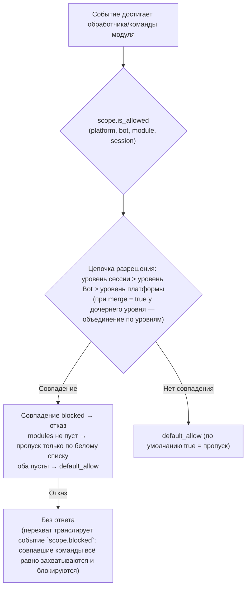

- **Приоритет разрешения: уровень сессии > уровень Bot > уровень платформы**; привязка с более высоким приоритетом **полностью перезаписывает** привязку с более низким;
  если у дочерней привязки указано `merge = true`, вместо этого выполняется **объединение по записям** с более низким приоритетом (modules / blocked объединяются по отдельности;
  сам `merge` — управляющий ключ и записью не считается)
- **Семантика по умолчанию**: команды и обработчики отфильтрованного модуля не срабатывают и не отвечают; это видно в логах уровня TRACE
  (`core.scope.denied`); перехват одновременно транслирует событие жизненного цикла `scope.blocked` (подписавшись, можно наблюдать, кого и почему перехватили); совпавшая **команда** всё равно захватывается и блокируется — текст команды больше не «протекает» к обработчикам сообщений с более низким приоритетом, что устраняет двусмысленность двойного ответа, когда после отказа команды обработчик сообщений реагирует ещё раз
- **Обработчики уровня фреймворка** (`scope_exempt=True` или пустой owner) не затрагиваются; ресурсы с пустым именем модуля (уровень фреймворка) пропускаются всегда
- **Справка и запрос команд с учётом сессии**: API запроса команд (`command.help` /
  `get_command` / `get_commands` / `get_group_commands` / `get_visible_commands`,
  а также `module.get_commands_overview`) поддерживают необязательный `event=` или явные
  ключевые аргументы `platform=` / `bot_id=` / `session_id=` — команды модулей, недоступных
  в текущей сессии, больше не попадают в результаты (`get_command` возвращает None, справка по отдельной команде обрабатывается как «не зарегистрирована»,
  что соответствует семантике по умолчанию); без передачи контекста поведение остаётся полным

### Наследование привязок (merge)

Семантика полной перезаписи по умолчанию ясна и предсказуема; когда нужно **добавить** записи к привязке родительского уровня, укажите `merge = true` на дочернем уровне:

```toml
[ErisPulse.scope.platforms.onebot11]
modules = ["Chat", "Tool"]      # Уровень платформы: разрешены Chat, Tool

[ErisPulse.scope.bots.onebot11."123456"]
modules = ["Music"]
merge = true                    # Фактически действующий список у этого Bot = ["Chat", "Tool", "Music"]
```

- Правила объединения: для `modules` и `blocked` по отдельности берётся **объединение**; внутри привязки `blocked` по-прежнему имеет приоритет над `modules`
- Цепное объединение: платформа → Bot → сессия, уровни накладываются последовательно; каждый уровень независимо решает — объединить (`merge`) или перезаписать

## ② Измерение идентичности (допуск событий)

**Коротко**: согласно четырёхуровневым политикам (пользователь / сессия / Bot / адаптер) на входе диспетчеризации полностью отбрасываются «события, которые не должны приниматься»; deny имеет приоритет над allow.

Отвечает на вопрос «чьи события принимать». Отклонённые события **полностью отбрасываются на входе диспетчеризации** —
они не попадают в middleware и ни к одному обработчику (включая уровень фреймворка), видно только в логах уровня TRACE (`core.scope.identity_denied`).

- **Приоритет разрешения: пользователь > сессия > Bot > адаптер**, берётся самая конкретная настроенная политика; deny имеет приоритет над allow
- Привязка каждого уровня — бинарная политика: `{ allow = true }` или `{ deny = true }`
- Ключи пользователей поддерживают glob / регулярные выражения (например, `"spam_*"` блокирует сразу группу спам-пользователей)
- Типичное применение — deny на верхнем уровне и allow для отдельного пользователя как «исключение»:

```toml
[ErisPulse.scope.identity.adapters.onebot11]
deny = true
[ErisPulse.scope.identity.users.onebot11]
allow = ["u_admin"]   # Даже при отказе на уровне адаптера события от u_admin пропускаются
```

## ③ Измерение исходящих (ограничение исходящих вызовов, инициируемых модулями)

**Коротко**: белые и чёрные списки на уровне методов ограничивают вызовы модуля — сообщения / API / запросы; отклонённые вызовы не порождают никаких сетевых запросов и сразу возвращают `retcode=34601`.

Ограничивает **исходящие действия**, инициируемые модулем: отправку сообщений / стандартные действия API / операции запросов.
Три типа действий соответствуют низкоуровневому DSL: `Event.reply` и `Send` (send), `Api` / `call_api` (api),
accept/reject у `Request` (request). Исходящие вызовы, инициированные модулем во время выполнения обработчика события,
несут owner модуля и единообразно проверяются этим измерением.

### Форма правил (инлайн-таблицы)

Правило для каждого действия — это инлайн-таблица: `{ allow = [...], deny = true|[...] }`.
У одного действия может быть только один вид правила (ключи TOML не могут повторяться: либо полный запрет, либо детализация — выберите одно):

```toml
[ErisPulse.scope.actions.MyModule]
send = { deny = true }                                  # Полный запрет отправки (Event.reply / Send DSL)
# Или детализация по методам: send = { allow = ["Text", "Image*"], deny = ["File"] }
api = { allow = ["get_*"] }                             # Пропускаются только стандартные API-запросы (чтение)
# Или чёрный список по действиям: api = { deny = ["set_*", "leave_*"] }
request = { deny = true }                               # Запрет обработки accept/reject запросов
```

- Записи `send` сопоставляются с **именами методов отправки** (`Text` / `Image` / `File` ...),
  записи `api` — с **именами стандартных действий** (`get_group_info` / `set_group_name` ...)
- Записи поддерживают точные имена / glob / `re:` регулярные выражения (единый синтаксис всей системы, без учёта регистра)
- Одиночная строка в `allow` эквивалентна списку из одной записи: `send = { allow = "Text" }`

### Семантика определения

**По умолчанию всё разрешено** — если правил нет или owner пуст (внутренние вызовы уровня фреймворка), вызовы пропускаются.
После настройки правил проверка идёт в следующем порядке:

1. `deny = true` → отказ
2. Имя вызова совпало со списком `deny` → отказ
3. Список `allow` не пуст, а имя вызова не совпало (или у вызова нет имени) → отказ
4. В остальных случаях — пропуск

Отклонённый вызов не порождает никаких сетевых запросов и сразу возвращает стандартный ответ с ошибкой
(`retcode = 34601`, см. [api-response §5.3](../standards/api-response.md#53-расширенные-коды-возврата-фреймворка-34xxx-младшие-три-цифры-сегмента-ошибок-платформы)).
Три типа действий независимы друг от друга — можно ограничить только один из них.

```python
# API времени выполнения
sdk.scope.set_action("MyModule", "send", deny=True)              # Полный запрет отправки сообщений
sdk.scope.set_action("MyModule", "send", allow=["Text"])         # Разрешена только отправка текста
sdk.scope.is_action_allowed("MyModule", "send", name="Image")    # False
sdk.scope.is_action_allowed("MyModule", "api", name="get_user_info")  # Проверка по правилам
sdk.scope.delete_action("MyModule", "send")                      # Вернуть разрешение
sdk.scope.get_action("MyModule", "send")                         # Текущее правило этого действия
```

## API времени выполнения

API времени выполнения области действия состоит из трёх слоёв: **проверки** (три вопроса), **параметризованное чтение/запись по измерениям** (для каждого измерения — методы `set` / `get` / `delete`, сигнатуры полностью типизированы, с автодополнением в IDE), **словарный запасной вариант** (пути через точку ведут к любому разделу напрямую).

```python
from ErisPulse import sdk

scope = sdk.scope
```

### Проверки (три вопроса)

```python
scope.is_allowed("onebot11", "123456", "Chat")                 # ① Измерение модулей
scope.is_allowed("onebot11", "123456", "Chat", "789012345")    # С учётом уровня сессии
scope.is_allowed("onebot11", "123456", None)                   # Ресурс уровня фреймворка -> True

scope.is_identity_allowed("onebot11", "123456", "group_9", "u1")   # ② Измерение идентичности

scope.is_action_allowed("MyModule", "send")                    # ④ Измерение исходящих
scope.is_action_allowed("MyModule", "send", name="Image")      # Детализация по методам
```

### ① Измерение модулей

```python
# Привязка (уровень определяется аргументами: session_id > bot_id > уровень платформы)
scope.set_module("onebot11", bot_id="123456", modules=["Chat", "Tool*"])
scope.set_module("onebot11", blocked=["re:^Danger"])                       # Уровень платформы
scope.set_module("onebot11", bot_id="123456", session_id="g9", modules=["Chat"])  # Уровень сессии
scope.set_module("onebot11", bot_id="123456", modules=["Music"], merge=True)      # Объединение с текущими записями
scope.set_module("onebot11", bot_id="123456", modules=["Chat"], persist=False)    # Только на время выполнения

# Чтение / удаление
scope.get_module("onebot11", bot_id="123456")   # {"modules": ["Chat"], "blocked": []}
scope.delete_module("onebot11", bot_id="123456")
```

> `merge=True` — это **объединение при записи** (слияние записей с существующей привязкой данного уровня); о ключе конфигурации `merge = true`, работающем при разрешении между уровнями, см. выше раздел [Наследование привязок](#наследование-привязок-merge) — это два независимых механизма.

> **Семантика привязок времени выполнения (`persist=False`)**: привязки времени выполнения хранятся в отдельном слое переопределений,
> **любые последующие записи в конфигурацию / горячее обновление файла конфигурации их не сотрут** (после перестроения дерева конфигурации
> они автоматически воспроизводятся в порядке записи, включая удаления во время выполнения). На диск они не записываются и теряются при перезапуске процесса; при выгрузке модуля записанные им
> привязки времени выполнения подлежат гарантированной очистке. Последующая запись `persist=True` по тому же пути (семантика пользовательского сохранения)
> заменит правило времени выполнения.

### ② Измерение идентичности

```python
# Привязка политики (уровень определяется аргументами: user > session > bot > adapter; allow / deny — только одно из двух)
scope.set_identity("onebot11", user_id="u_bad", deny=True)
scope.set_identity("onebot11", user_id="spam_*", deny=True)    # Ключи поддерживают glob / re: регулярные выражения
scope.set_identity("onebot11", bot_id="123456", session_id="g9", allow=True)

# Чтение / удаление
scope.get_identity("onebot11", user_id="u_bad")   # {"deny": True}
scope.delete_identity("onebot11", user_id="u_bad")
```

### ③ Измерение исходящих

```python
# Задать правило ограничения (allow: str|list; deny: bool|str|list; семантика полной замены правила)
scope.set_action("MyModule", "send", deny=True)                    # Полный запрет отправки
scope.set_action("MyModule", "send", allow=["Text"])               # Разрешена только отправка текста
scope.set_action("MyModule", "api", deny=["set_*", "leave_*"])     # Запрет административных API

# Чтение / удаление
scope.get_action("MyModule", "send")       # {"allow": ["Text"]} исходное правило
scope.delete_action("MyModule", "send")    # Удалить одно действие
scope.delete_action("MyModule")            # Удалить все ограничения действий этого модуля
```

### Общие методы

```python
scope.get("platforms")   # Словарный запасной вариант: чтение любого раздела по пути через точку
scope.topology()         # Полное дерево конфигурации (для Dashboard)
scope.stats()
# {"module_calls": .., "module_filtered": .., "identity_checks": .., "identity_denied": ..,
#  "action_checks": .., "action_denied": .., "cache_hits": .., "cache_misses": ..}
scope.reset_stats()
scope.clear()           # Очистить всю конфигурацию (действует только в памяти)
```

### Продвинутое: словарный запасной вариант с путями через точку

Параметризованные методы покрывают повседневные сценарии; когда нужен прямой доступ к любому узлу (или к измерениям, которые появятся в будущем),
используйте словарный API — `get` / `set` / `delete` принимают пути через точку (глубокое слияние dict, чтение сразу после записи),
а также предоставляются протоколы `scope[path]` / `scope[path] = v` / `del scope[path]` / `path in scope`:

```python
scope.set("bots.onebot11.123456", {"modules": ["Chat"], "blocked": []})
scope.set("identity.users.onebot11.u_bad", {"deny": True})
scope.get("actions.MyModule.send")

scope["platforms.onebot11"]        # Чтение (при отсутствии — KeyError)
scope["platforms.onebot11"] = {...}  # Запись
del scope["platforms.onebot11"]      # Удаление
"actions.MyModule" in scope          # Проверка существования
```

## Наблюдаемость перехвата: событие `scope.blocked`

При срабатывании перехвата области действия (фильтрация модулей / отказ по идентичности) транслируется событие жизненного цикла **`scope.blocked`**,
благодаря которому «кого перехватили и на каком уровне» можно отслеживать по подписке, собирать статистику и показывать в Dashboard — перехват по умолчанию
не отвечает, но больше не является непрозрачным чёрным ящиком.

| Поле | Описание |
|------|------|
| `dimension` | `"module"` (фильтрация по измерению модулей) / `"identity"` (отказ при допуске по идентичности) |
| `module` | Имя отфильтрованного модуля (только измерение модулей) |
| `platform` / `bot_id` / `session_id` / `user_id` | Контекст источника, где произошёл перехват |

```python
from ErisPulse.Core.lifecycle import lifecycle

@lifecycle.on("scope.blocked")
def on_blocked(data):
    print(f"Перехвачено: {data['dimension']} {data.get('module') or data.get('user_id')}")
```

- Событие транслируется в фоне через `fire` (при отсутствии слушателей — нулевые накладные расходы, «горячий путь» не замедляется)
- Повторные перехваты, попавшие в кэш, **не** транслируются повторно — одна и та же комбинация транслируется один раз, лишь при сбросе кэша
- Не путать с `adapter.event.blocked` (вето middleware): то — отбрасывание на уровне события, а это событие — фильтрация модулей / идентичности на входе допуска области действия

## Кэш и горячее обновление

- Результаты `is_allowed` / `is_identity_allowed` / `is_action_allowed` кэшируются в **LRU**
  (размер настраивается через `scope.cache_size`); `set` / `delete` /
  горячее обновление конфигурации (`config.updated` / `config.set`) автоматически инвалидируют кэш
- Изменения конфигурации во всех измерениях **вступают в силу немедленно**, перезагрузка не требуется
- Область действия проверяет «по каждому событию» и не помнит ничего между событиями: изменилась конфигурация — следующее событие уже обрабатывается по новым правилам

## Валидация формата конфигурации

При загрузке / горячем обновлении формат конфигурации проверяется по каждому разделу: разделы с неверным типом (например, `platforms` записана как строка),
недопустимые правила исходящих (например, `allow` записан как число), неизвестные имена действий, неизвестные ключи верхнего уровня (например, опечатка `alow`)
вызовут вывод **WARNING** и игнорирование соответствующего раздела / записи; остальная корректная конфигурация работает как обычно — ошибки больше не «тихо» игнорируются.

## Частые вопросы и важные замечания

### 1. Уровни конфигурации и переопределение

- Измерение модулей: уровень сессии > уровень Bot > уровень платформы, **полная перезапись** (при `merge = true` на дочернем уровне — объединение по записям).
  Если нужно «на уровне платформы разрешить Chat, а на уровне Bot добавить Music», укажите на уровне Bot `merge = true` или перечислите оба в одном списке
- Измерение идентичности: пользователь > сессия > Bot > адаптер, берётся **самая конкретная** настроенная политика (можно делать исключения)
- Пользовательские чёрно-белые списки команд: точные имена команд имеют приоритет над ключами glob (см. `event.command.acl`)

### 2. Модуль/команда не реагирует

Сначала заподозрите область действия, а не сам модуль:

```python
from ErisPulse import sdk

print(sdk.scope.is_allowed(event.get_platform(), bot_id, "MyModule", session_id))
print(sdk.scope.is_identity_allowed(event.get_platform(), bot_id, session_id, user_id))
print(sdk.scope.stats())   # module_filtered / identity_denied > 0 означает наличие записей о перехватах
```

Отфильтрованное по умолчанию не отвечает (измерения модулей и идентичности — чтобы не раскрывать правила), но при этом транслируется событие жизненного цикла `scope.blocked`, а статистика продолжает накапливаться;
при отклонении команды по ACL будет явный ответ «недостаточно прав».

### 3. Диагностика при отклонении исходящих действий

```python
from ErisPulse import sdk

print(sdk.scope.get("actions.MyModule"))
print(sdk.scope.stats())   # action_denied > 0 означает, что были перехваченные вызовы
```

Перехват **явный**: отклонённый вызов возвращает стандартный ответ с ошибкой `retcode = 34601` (сетевой запрос не выполняется).

### 4. Изоляция идентификаторов сессий между платформами

Уникальный идентификатор — это комбинация `(platform, session_id)`. `scope.sessions.onebot11."789"`
действует только для onebot11 и не затрагивает сессию с тем же `789` на telegram. То же верно для ключей пользователей в измерении идентичности.

## API дерева топологии

`ModuleManager.get_topology()` и `AdapterManager.get_topology()` предоставляют данные о принадлежности модулей/адаптеров,
`sdk.get_topology()` агрегирует их одним вызовом (включая область действия `scope`):

```python
from ErisPulse import sdk

topology = sdk.get_topology()
# {
#   "modules": {                                   # модуль → принадлежащие ему ресурсы
#     "Chat": {
#       "loaded": True, "enabled": True,
#       "commands": ["chat", "translate"],
#       "handlers": {"message": 2, "notice": 1},
#       "routes": {"http": ["/Chat/api"], "ws": [], "sse": []},
#       "lifecycle_hooks": 3,
#     }
#   },
#   "adapters": {                                  # адаптер → Bot → область действия
#     "onebot11": {
#       "status": "started", "enabled": True,
#       "bots": {"123456": {"status": "online", "scope": {...}}},
#       "scope": {"modules": [...], "blocked": [...]},
#     }
#   },
#   "scope": {                                     # область действия (модули / идентичность / исходящие действия)
#     "platforms": {...}, "bots": {...}, "sessions": {...},
#     "identity": {"adapters": {...}, "bots": {...}, "sessions": {...}, "users": {...}},
#     "actions": {...},
#   },
# }
```

- Топология модуля агрегирует зарегистрированные этим модулем команды, обработчики событий, маршруты HTTP/WS/SSE и хуки жизненного цикла — удобно для построения дерева ресурсов модуля.
- Топология адаптера агрегирует состояние каждого адаптера, состояние подчинённых Bot и привязки области действия уровня платформы/уровня Bot (измерение модулей).
- **JSON-безопасный вывод**: `get_topology(json_safe=...)` по умолчанию `True`; возвращаемая структура пригодна для прямого `json.dumps` — в `info` модуля остаётся только под-таблица чистых данных `meta` (объекты времени выполнения вроде `module_class` / `strategy` отбрасываются), а остальные узлы (включая любые объекты, вложенные авторами адаптеров в `info` Bot) проходят запасную очистку (у классов берётся `__name__`, несериализуемые объекты деградируют до `str()`). Dashboard / WebUI могут сериализовать результат напрямую; если нужны исходные объекты, передайте `json_safe=False`.


### 归属权（owner）系统

# Система принадлежности (владельца)

> [!TIP]
> **Когда читать эту статью**: при диагностике утечек ресурсов, понимании цепочки очистки при отключении или объявлении принадлежности ресурсов. Если не нужно, можно пропустить, это не повлияет на использование других функций.

> **После прочтения вы узнаете**: как контекст владельца автоматически присваивает ресурсы, полная картина принадлежности ресурсов, полный порядок очистки при отключении/отключении, а также какие ресурсы не очищаются при отключении (пределы дизайна).
>
> **В этой статье не рассматривается**: когда ресурс "вступает в силу" (права определения) (см. [Область действия (scope)](scope.md)); рекомендуемая запись фоновых задач и граница принудительного отмены (см. [Управление жизненным циклом · Принадлежность и автоматическая отмена фоновых задач](lifecycle.md#фоновые-задачи-принадлежность-и-автоматическая-отмена)).

Принадлежность является основой "plug-and-play" модуля: все зарегистрированные в процессе загрузки ресурсы автоматически присваиваются, и при отключении/отключении они автоматически возвращаются — автор модуля должен только объявить ресурсы, не нужно писать ручной код очистки.

> **Связанные системы**: область действия (scope) определяет "действует ли ресурс" при отправке событий, принадлежность определяет "кому принадлежит ресурс, кто при отключении будет очищен". Область действия см. [Единая система управления (scope)](scope.md), фоновые задачи см. [Управление жизненным циклом](lifecycle.md#фоновые-задачи-принадлежность-и-автоматическая-отмена).

{!--< tips >!--}
1. Принадлежность автоматически записывается в момент регистрации по `current_owner`, без изменений в коде модуля
2. Отключение/отключение используют одну и ту же цепочку очистки (`_cleanup_module_registrations`), каждая ошибка только предупреждает, не прерывает
3. Ресурсы пользовательского конфигурационного семантического (постоянное перезаписывание / правила области / ACL команд) **не** очищаются при отключении модуля
4. Внешние дескрипторы, управляемые инструментальным модулем, можно добавить в цепочку очистки с помощью `on_cleanup(cb)`, при отключении модуля автоматически вызывается обратный вызов (см. [Руководство по инструментальным модулям](#инструментальные-модули-управление-дескрипторами-других-модулей))
{!--< /tips >!--}

## Механизм контекста владельца

Принадлежность передается через контекстную переменную `current_owner` (`ErisPulse.runtime.context`):

```python
from ErisPulse.runtime import owner_scope, get_current_owner

with owner_scope("MyModule"):
    # Все зарегистрированные ресурсы в этом интервале автоматически присваиваются MyModule
    assert get_current_owner() == "MyModule"
```

Рамка автоматически вставляет владельца в следующие моменты (код модуля/адаптера не требует ручного обертывания):

| Момент | Значение владельца | Позиция |
|------|----------|------|
| `load()` модуля | Имя модуля | При инстанцировании + `on_load` на протяжении всего процесса |
| `start()` / `restart()` адаптера | Имя платформы | На протяжении всего процесса запуска адаптера |
| Регистрация stub'ов с `activate_on` | Имя модуля | Регистрация запускаемых команд/обработчиков |
| Время выполнения обработчика событий | Имя модуля, к которому принадлежит обработчик | Повторное вложение обработчика / входной точки команды |

Повторное вложение во время выполнения означает: обработчики команд, объявленные модулем в `on_load`, при вызове регистрирующих API (например, `sdk.adapter.on()`, `overrides.*.set(persist=False)`) во время выполнения также автоматически присваиваются этому модулю.

### bind_owner: вшить принадлежность в обратные вызовы и входные точки потоков

`owner_scope` действует на блок кода; `bind_owner(fn)` вшивает контекст "внутрь" самой функции — при упаковке моментально захватывается `current_owner`, и оттуда, где бы ни вызывалась, с какого бы потока или цикла событий, будет выполняться с оригинальным владельцем. Новые потоки по умолчанию имеют пустой контекст (пути триггеров `Timer` / `watcher` / пула потоков сторонних библиотек `current_owner` равен None), задачи, созданные внутри, не попадают в таблицу принадлежности, и их отключение модуля не отменяет (один из источников остатков за пределами цикла), после упаковки принадлежность переносится с собой:

```python
from ErisPulse.runtime import bind_owner

class MyModule(BaseModule):
    async def on_load(self, event):
        # Перед передачей в сторонний планировщик / пул потоков сначала упакуйте:
        external_scheduler.submit(bind_owner(self._poll))

    async def _poll(self):
        # Во время выполнения current_owner == "MyModule", при отключении он может быть правильно очищен
        ...
```

- `async` функции сохраняют `async`, принадлежность действует на протяжении всех `await`;
  обычные функции действуют только на протяжении синхронного выполнения
- Собственные входные точки фреймворка (`self.spawn()` / входные точки команд) уже автоматически несут принадлежность, эта функция предназначена только для **внешних путей триггеров** (внешние планировщики, `threading.Timer`, таблицы обратных вызовов и т.д.)

## Полная картина принадлежности ресурсов

Все ресурсы, зарегистрированные в контексте загрузки, автоматически записываются, и при отключении/отключении они автоматически очищаются:

| Ресурс | Способ регистрации | Вызов очистки |
|------|----------|----------|
| Команды | `@command()` / объявление командного словаря | `command.unregister_by_owner()` |
| Обработчики событий | `@message` / `@notice` / `@request` / `@meta` | `handler.unregister_by_owner()` |
| Слушатели событий адаптера | `sdk.adapter.on()` / `raw=True` | `adapter.unregister_handlers_by_owner()` |
| Промежуточные слои адаптера | `@sdk.adapter.middleware` | То же самое |
| Маршруты (HTTP/WS/SSE) | `router.http()` / `websocket()` / `sse()` | Двойная защита по пространству имен и владельцу |
| Промежуточные слои маршрута | `@router.middleware()` / `add_middleware()` | `router.unregister_all_by_owner()` |
| Главная страница Dashboard | `router.register_home_entry()` | `unregister_home_entries_by_owner()` |
| Пользовательские типы сессий | `register_custom_type()` | `unregister_custom_types_by_owner()` |
| Методы событий платформы | `register_event_method()` / `register_event_mixin()` | `unregister_event_methods_by_owner()` (при отключении модуля автоматически очищается, старые закрытые области больше не утекают) |
| Фоновые задачи | `self.spawn()` | `cancel_owner_tasks()` |
| Внешние очистительные хуки принадлежности (инструментальный модуль управляет) | `runtime.on_cleanup(cb)` | `run_owner_cleanups()` (вызывается в цепочке отключения/отключения/закрытия адаптера) |
| Жизненный цикл хуки | `lifecycle.register()` | `lifecycle.unregister_by_owner()` |
| Провайдер источника хозяина | `master.provider` | `master.unregister_by_owner()` |
| Переводы i18n | Объявление `I18nClass` (domain=имя модуля) | `i18n.unregister_domain()` |
| Переопределения событий (во время выполнения) | `overrides.*.set(persist=False)` | `overrides.unregister_by_owner()` |
| Интерактивные сессии (ожидание wait_reply / аренды) | `event.wait_reply()` / `sdk.interaction.acquire()` | `interaction.cancel_by_owner()` (сторона ожидания немедленно получает отмену) |
| Контекстные данные | `runtime/context` записывает по владельцу | Точная очистка по модулю |

Соответствующие ресурсы со стороны адаптера (с именем платформы как владельца) при `shutdown()` / `restart()` адаптера очищаются по `_cleanup_adapter_resources`, дополнительно:

| Ресурс | Вызов очистки |
|------|----------|
| Собственные `on()` обработчики и промежуточные слои адаптера | `adapter.unregister_handlers_by_owner(platform)` |
| Расширения методов событий платформы (`EventMixin`) | `unregister_platform_event_methods(platform)` |
| Пользовательские типы сессий | `unregister_custom_types_by_owner(platform)` |
| Интерактивные сессии (ожидание wait_reply / аренды на платформе) | `interaction.cancel_by_platform(platform)` |
| Переводы i18n (domain=ключ конфигурации) | `i18n.unregister_domain(ключ конфигурации)` |
| Маршруты с мелкозернистым пространством имен | `router.unregister_all_by_owner(platform)` |

## Последовательность очистки при отключении/отключении

`unload()` и `disable()` используют одну и ту же цепочку очистки (каждый шаг независимо try/except, ошибка только регистрирует в логах, **не прерывает последующую очистку**):

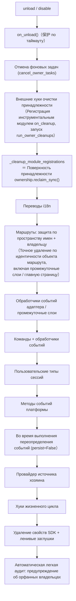

При выходе `sdk.uninit()` есть глобальная защита: все адаптеры shutdown → все модули unload → `router.stop()` (очистка маршрутов/промежуточных слоев/главной страницы) → `cancel_all_background_tasks()` → очистка обработчиков событий и хуков.

## Единая поверхность принадлежности (ownership)

Шестнадцать шагов цепочки очистки сведены в единый интерфейс принадлежности `ErisPulse.Core.ownership`, четыре глагола охватывают "удаление, подсчет, сканирование, аудит" — функции `*_by_owner` отдельных подсистем остаются неизменными, как внутренние реализации поверхности:

| Глагол | Назначение |
|------|------|
| `ownership.reclaim(owner)` | Общее удаление всех ресурсов владельца (отмена задач → хуки очистки → зарегистрированные ресурсы; асинхронная полная версия) |
| `ownership.reclaim_sync(owner)` | Удаление зарегистрированных ресурсов (синхронная версия, для синхронного пути отключения) |
| `ownership.counts(owner=None)` | Только чтение подсчета ресурсов владельца (None для всех владельцев) |
| `ownership.orphans()` | Сканирование сирот: ресурсы зарегистрированы, но владелец уже отключен (доказательство утечек) |
| `ownership.audit(owner, deep=)` | Отчет об аудите утечек (подсчет + сироты + необязательная выборка экземпляров gc) |

```python
from ErisPulse.Core import ownership

ownership.reclaim_sync("MyModule")       # {'commands': 1, 'routes_http': 2, ...}
ownership.counts("MyModule")             # Подсчет зарегистрированных ресурсов
ownership.orphans()                      # [{"owner": "ghost", "total": 2, ...}]
```

**Точка входа аудита**:

- После отключения / перезагрузки **автоматическая легкая аудит**: обнаружение орфанных ресурсов владельца вызывает предупреждение (ноль накладных расходов на подсчет сканирования)
- `sdk.module.audit(name, deep=True)` : аудит экземпляра модуля gc — при невозможности собрать экземпляр указывает тип источника ссылки (локализация "кто держит старый экземпляр"); имеет глобальные паузы, используется только при явной диагностике
- Глубокая выборка — явная операция, без настройки ключа, не делает автоматического восстановления

## Вложенные жизненные циклы (ownership.nest)

> Эта функция доступна в ErisPulse **2.12+**.

Позволяет одному модулю (родитель) управлять другой группой владельцев (дочерних), при удалении родителя дочерние ресурсы также удаляются. Типичные сценарии: запуск под插агинов внутри модуля сценария, панели расширения в Dashboard, инструментальный модуль, управляющий внешними таблицами регистрации.

```python
from ErisPulse.Core import ownership

ownership.nest("ScriptEngine", "ScriptEngine.plugin_a")
ownership.nest("ScriptEngine", "ScriptEngine.plugin_b")

ownership.nested_children("ScriptEngine")
# frozenset({"ScriptEngine.plugin_a", "ScriptEngine.plugin_b"})

ownership.unnest("ScriptEngine", "ScriptEngine.plugin_a")
```

| Элемент | Соглашение |
|----|------|
| Порядок удаления | Дочерние удаляются раньше родителя; при одинаковом уровне по порядку регистрации (последние удаляются первыми) |
| Область удаления | Ресурсный уровень (задачи / соединения / маршруты / команды / tracked ресурсы / хуки очистки), **не вызывает `on_unload` дочернего модуля** |
| Проверка цикла | `nest` отвергает самосвязь и уже существующие обратные связи, возвращает `False` и предупреждает |
| Дочерний умирает первым | При самостоятельном удалении (reclaim / reclaim_sync) дочерний автоматически unnest, родительская сторона не сохраняет висячие отношения |
| Таймаут | Один подчиненный удаляется в пределах `CLEANUP_CALLBACK_TIMEOUT_SECS`; при превышении таймаута предупреждение, удаление родитель-дочерняя связь и продолжение |
| Наблюдаемость | `ownership.counts(parent)` увеличивает счетчик `nested`; `ownership.orphans()` делает транзитивную оболочку для вложенных отношений, остаточные отношения, где родитель исчез, все еще будут обнаружены |

**Почему не вызывается `on_unload` подчиненного**: полная отмена модуля требует процесса управления (ленивые заглушки, свойства sdk, рассылка событий), а поверхность `ownership` отвечает только за очистку ресурсов, перекрестный вызов может привести к риску повторного блокирования отмены. При необходимости `on_unload` подчиненного, родитель должен явно вызвать его в своем `on_unload`:

```python
await self.sdk.module.unload(child, reason="cascade")
```

Синхронный вход (например, `sdk.module.disable`) сначала помечает асинхронную цепочку, фоновые задачи удаляют ресурсы подчиненного; `reclaim_sync` только при отсутствии асинхронной цепочки сама удаляет зарегистрированные ресурсы подчиненного.

## Откат при горячей перезагрузке

Горячая перезагрузка — это "**снимок перед отключением → автоматический откат при сбое → повторное воспроизведение on_load**": при синтаксической ошибке, отсутствии зависимостей, сбое загрузки нового варианта, старый экземпляр и состояние регистрации (записи регистраций, свойства sdk, записи sys.modules) автоматически восстанавливаются, затем в контексте принадлежности **повторно воспроизводится старый экземпляр `on_load`** (`reason` будет `"rollback"`), чтобы восстановить внешние ресурсы, разорванные на этапе отключения; после завершения генерируется событие `module.rollback` (payload `{module_name, success}`).

При неудачной перезагрузке адаптера также восстанавливается старое состояние регистрации; если старый экземпляр находился в рабочем состоянии и старые запущенные задачи завершены, после отката повторно воспроизводится `start()`, и генерируется событие `adapter.rollback` (payload `{adapter_name, replayed, success}`). Потеря соединения / оффлайн бота и другие побочные эффекты отключения не могут быть отменены. Повтор и событие `adapter.rollback` доступны в ErisPulse **2.12+**.

Ограничения:

- При неудаче или таймауте повтора **только предупреждение**, не откат отката отката — старый экземпляр остается в состоянии "завершенного" (как в 2.11.2 и более ранних версиях), в логах будет четко указано
- Сторонние ссылки, созданные в процессе выполнения, не входят в восстановление
- Если целевой пакет был удален (исчезли entry-point), считается успешным отключением, откат не выполняется
-载荷 для `on_unload` содержит `reason` (`unload` / `reload` / `disable` / `cascade` / `dormant` / `load-failed`), модуль может отложить закрытие ресурсов, которые должны пережить перезагрузку, в `reload`

Полные возможности горячей перезагрузки, семантика перекрестных циклов и правила для модулей см. в следующем разделе.

## Ограничения горячей перезагрузки

Горячая перезагрузка может заменить код, пересоздать регистрацию, откатить неудачную перезагрузку — но это **не перезапуск процесса**. Очищаются только **регистрированные в системе принадлежности ресурсы в режиме выполнения**; ресурсы, не принадлежащие ни одному владельцу, пользовательские данные конфигурации, внутренние кэши сторонних библиотек, не исчезнут вместе с перезагрузкой.

### Ограничения возможностей

| Объект | Поведение после перезагрузки | Объяснение |
|------|-----------|------|
| Код модуля / определение класса | Поддерживается, повторно импортируется | Старая запись `sys.modules` удаляется |
| `on_unload` / `on_load` | Поддерживается, вызывается по порядку | При неудаче перезагрузки повторно вызывается `on_load` (см. предыдущий раздел) |
| Команды / обработчики / маршруты / хуки жизненного цикла | Поддерживается, автоматически удаляются и регистрируются | Очищаются через цепочку принадлежности |
| `spawn_background` / `spawn_later` / `spawn_thread` | Поддерживается, отменяются по владельцу | Потоки регистрируются для наблюдения, не могут быть жестко убиты |
| Главный цикл на любом `asyncio.create_task` | Поддерживается, автоматически отменяются | Фабрика задач перехватывает (включая внутренние создания сторонних библиотек) |
| Задачи, созданные в цикле хранилища | Поддерживается, автоматически отменяются | Цикл хранилища также установлен на фабрику задач |
| Ресурсы, зарегистрированные с помощью `ownership.track()` | Поддерживается, вызывается `release()` | Ресурсы, привязанные к циклу, недоступны для фабрики задач |
| Хуки `on_cleanup` | Поддерживается, вызываются | Инструментальный модуль использует их для отбрасывания управляемых дескрипторов |
| Постоянное переопределение (`persist=True`) / файлы конфигурации | Не обрабатывается, сохраняется | Пользовательские активы |
| Объектные ссылки, кэшированные сторонними библиотеками | Не обрабатывается | Фреймворк не видит, модуль должен сам устранить ссылки |
| Созданные модулем `new` события цикла / голые потоки | Не удаляются | См. правила ниже |

### Трехуровневое управление ресурсами

1. **Уровень безвоздейственного перехвата** — фабрика задач на уровне цикла событий. Любое создание задач в контексте владельца автоматически присваивается, охватывая главный цикл и цикл хранилища-моста.
2. **Уровень принадлежности планирования** — `spawn_background` / `spawn_later` / `spawn_thread`.
3. **Уровень сотрудничества регистрации** — `ownership.track()` / `on_cleanup()`, для структурных ресурсов, недоступных для фабрики задач (пулы соединений, клиенты сторонних библиотек).

### Ограничения циклов событий

| Цикл | Создан | Установлена фабрика задач | Назначение |
|------|--------|-----------|------|
| Главный цикл | `sdk.run()` / `sdk.init()` | Установлена | Весь бизнес-код |
| Цикл хранилища-моста | `AsyncBridge` (первый синхронный вызов хранилища) | Установлена | Фоновое выполнение синхронных API хранилища |
| Временный цикл | `spawn_background` по умолчанию | Не установлена, уничтожается после использования | Последнее средство, когда главный цикл не готов |

**Временный цикл — последнее средство**: он синхронно блокирует вызывающий поток, и задачи, созданные внутри цикла, будут потеряны (в логах есть предупреждение `temp_loop_fallback`). Если вы видите это предупреждение, значит модуль запустил фоновую задачу в неправильное время.

**Отмена между циклами — это лучшие усилия**: `cancel_owner_tasks` обнаруживает задачи на других все еще работающих циклах, использует `call_soon_threadsafe` для отправки отмены и выдает предупреждение `cross_loop_task_residual`, но **не ждет** их завершения (ожидание между циклами небезопасно). Если вы видите это предупреждение, проверьте, не создали ли вы собственный цикл событий.

### Правила для модулей

```python
# Рекомендуется
spawn_background(self._poll())            # Принадлежность фоновой задачи
spawn_later(30, lambda: self._cleanup())  # Принадлежность отложенной задачи
spawn_thread("poller", self._loop_body)   # Принадлежность потока (входная точка автоматически имеет контекст владельца)
ownership.track(pool)                     # Явная регистрация ресурса, привязанного к циклу
await sdk.storage.aget(key)               # Асинхронный контекст напрямую использует асинхронный API

# Избегайте
asyncio.create_task(self._poll())         # Голый вызов: отсутствие ссылки легко может быть собрано GC
asyncio.new_event_loop()                  # Создание собственного цикла: система принадлежности полностью не может достичь
threading.Thread(target=self._loop_body)  # Голый поток: входная точка без контекста владельца
self._storage.get(key)                    # В асинхронном контексте синхронный вызов хранилища: блокирует главный цикл
```

### Список проверки

1. В логах есть `cross_loop_task_residual`? → Ресурс находится в самодельном цикле
2. В логах есть `temp_loop_fallback`? → Фоновая задача запущена до готовности главного цикла
3. Ошибка `attached to a different loop`? → Проверьте, не создали ли вы цикл событий или не используете ли объект соединения между циклами
4. `ownership.orphans()` выводит данные? → Ресурс владельца все еще жив после отключения

## Пределы дизайна: какие ресурсы не очищаются при отключении

Система принадлежности очищает только **регистрированные модульным кодом ресурсы в режиме выполнения**. Следующие ресурсы относятся к **конфигурационной семантике пользователя** (управление в руках пользователя, возможно, намеренно настроено), и после отключения модуля сохраняются вместе с конфигурацией:

| Ресурс | Семантика | Объяснение |
|------|------|------|
| `overrides.*.set(persist=True)` | Постоянное переопределение | Записывается в файл конфигурации, действует при перезапуске; модуль не удаляет при отключении (пользователь явно настроил) |
| `scope.set_action()` и т.д. правила области | Управление правами | Управляется пользователем/Dashboard, модуль не удаляет правила при отключении |
| `overrides.acl.set(persist=True)` | ACL команд | То же самое |
| `Conversation.save()` сохранение | Многоразовая архивация диалога | Данные активов не очищаются |

Временные данные, записанные во время выполнения (persist=False), удаляются вместе с владельцем — **постоянно или нет — это граница между "активами пользователя" и "состоянием выполнения модуля"**.

## Внутренняя реализация: как работает принадлежность

**Одно предложение**: цепочка присвоения (contextvar передача) определяет "на кого записано", цепочка отмены (таблица задач) определяет "можно ли отменить при отключении" — эти две цепи работают независимо, для правильной очистки ресурсов необходимы обе.

Система принадлежности состоит из **двух независимых цепей**, понимание их разделения является предпосылкой для диагностики проблем с принадлежностью:

### Цепочка присвоения (contextvar передача)

`runtime/context.py` `current_owner` и другие ContextVar отвечают за **присвоение** — "на кого записан ресурс/вызов, зарегистрированный в этом коде". Правила передачи следуют семантике Python contextvars:

| Выполнение | context передается | Результат присвоения |
|---------|----------------|---------|
| Синхронная цепочка вызовов / `await` цепочка | ✅ Передается | Правильное присвоение |
| `owner_scope` внутри `asyncio.create_task` | ✅ Передается (task копирует контекст в момент создания) | Внутри задачи правильное присвоение |
| `run_in_executor` / голый поток | ❌ Не передается | Присвоение теряется |
| Самостоятельно созданный цикл событий | ❌ Не передается | Присвоение теряется |

> Присвоение ≠ регистрация: передача контекста влияет только на "на кого записано", можно ли очистить ресурс зависит от того, попал ли он в следующую цепочку отмены.

### Цепочка отмены (таблица задач)

`runtime/tasks.py` `_owner_tasks` таблица отвечает за **жизненный цикл** — "какие незавершенные задачи принадлежат владельцу, которые нужно отменить при отключении". Способы попадания задач в таблицу регистрации:

1. **Явное планирование**: `spawn_background()` / `self.spawn()` → при создании захватывает `current_owner` (или явный параметр `owner=`) → регистрируется в таблице;
2. **Фабрика задач автоматически регистрирует** (2.8.3): `install_owner_task_factory()` устанавливается в главный цикл событий при запуске фреймворка — **любая** задача, созданная (включая внутренние `create_task` сторонних библиотек), проходя через фабрику, читает `current_owner`, если не None, регистрируется.

Таблица саморегистрируется: каждая задача имеет `done_callback`, при завершении удаляется из таблицы, утечек нет.

### Последовательность отмены (отключение модуля)

```
module.unload()
  → on_unload(event)                    # Модуль самостоятельно очищает (защита по таймауту)
  → Фреймворк удаляет команды/обработчики/хуки/маршруты этого владельца
  → cancel_owner_tasks(owner)           # Таблица задач отменяет по умолчанию
      → поочередно task.cancel()        # Исключая задачу, которая сама выполняет логику отмены
      → await gather(pending, timeout)  # Ждет завершения (таймаут не блокирует)
```

### Стратегия диагностики

- **Ресурс не очищается** → Проверьте таблицу регистрации: `get_owner_tasks("MyModule")` содержит ли эта задача; если нет, значит путь регистрации не прошел через цепочку принадлежности (import период / поток / независимый цикл), сверьтесь с предыдущей таблицей для локализации.
- **Неправильное присвоение** → Проверьте `get_current_owner()` в момент ошибки; для асинхронных отложенных выполнений (обратные вызовы/задачи) присвоение берется из контекста в момент создания, а не в момент выполнения.

## Руководство для авторов модулей

### Рекомендуемая запись

```python
from ErisPulse import sdk
from ErisPulse.Core.Event import command
from ErisPulse.runtime import owner_scope, spawn_background

class MyModule(BaseModule):
    async def on_load(self, event):
        # Рамочные ресурсы: автоматически присваиваются, нет необходимости в ручной очистке
        self.task = self.spawn(self.polling())      # Фоновая задача
        sdk.router.register_home_entry("Мой модуль", "/my")  # Главная страница

        # Ресурсы, принадлежащие модулю: включаются в систему принадлежности с помощью owner_scope
        with owner_scope("MyModule"):
            self.client.on_event(self._handle)      # Пример пользовательской регистрации

    async def on_unload(self, event):
        # Рамочные ресурсы уже автоматически очищены, нужно только очистить ресурсы, не охваченные owner_scope
        await self.client.close()
```

### Примечания

- **Регистрация в импорте**: Регистрация хуков/обработчиков на уровне модуля (в момент импорта) происходит до `owner_scope`, и они рассматриваются как ресурсы рамки (owner=None) и **не очищаются**. Все должно быть зарегистрировано в `on_load()`.
- **Регистрация пользовательской области i18n**: `i18n.register(domain=...)` с domain, не равным имени модуля, не будет автоматически очищена, сохраните domain=имя модуля.
- **Рекомендуется использовать `self.spawn()` для фоновых задач**: начиная с 2.8.3, голые `asyncio.create_task` также **автоматически присваиваются** (Task Factory автоматически регистрирует, отменяется при отключении); но `self.spawn()` по-прежнему рекомендуется — поддерживает запуск из неглавного цикла потоков, явное указание `owner=` и предотвращение GC для fire-and-forget. **В версиях до 2.8.3** голые задачи не присваиваются, необходимо использовать `self.spawn()`.
- Цепочка очистки "ошибка только предупреждение": исключение в одном шаге не блокирует очистку остальных ресурсов, логи уровня DEBUG/WARNING видны, при диагностике можно включить TRACE.

### Таблица соответствия времени регистрации и результата принадлежности

| Сценарий регистрации | Результат принадлежности | Объяснение |
|---------|---------|------|
| Регистрация через API рамки (команды/обработчики/lifecycle/маршруты) внутри `on_load()` | Принадлежит модулю | Автоматически удаляется при отключении |
| Регистрация на уровне модуля (в момент импорта) | **Без принадлежности** (owner=None) | Не очищается, не используйте |
| Фоновая задача, созданная с помощью `self.spawn()` | Принадлежит модулю | Автоматически отменяется при отключении |
| Регистрация через сторонний API в `owner_scope("Name")` | Принадлежит модулю | Зависит от того, что обратный вызов сторонней библиотеки синхронно выполняется в scope |
| Голые `asyncio.create_task` (включая `loop.create_task` / `ensure_future`) | **Автоматически присваивается** (Task Factory, 2.8.3+) | В момент создания читается `current_owner`, автоматически регистрируется, отменяется при отключении; см. ниже [Внутреннюю реализацию](#внутренняя-реализация-принадлежность-как-работает) |
| Задачи, созданные в обратных вызовах сторонних библиотек (aiohttp / APScheduler и т.д.) | **Автоматически присваиваются** (Task Factory, 2.8.3+) | Если `current_owner` уже вставлен (например, во время выполнения обработчика рамки), задача автоматически регистрируется |
| `run_in_executor` (пул потоков) | **Без принадлежности** (не asyncio.Task) | Потоки не подчиняются фабрике задач, необходимо самостоятельно управлять жизненным циклом |
| Регистрация в независимом цикле событий (самостоятельно созданный цикл) | **Без принадлежности** | Фабрика задач установлена только в главном цикле; contextvars также не передаются между циклами событий |

> Принцип: **принадлежность следует контексту `current_owner` в момент регистрации**; любая асинхронная задержка, пулы потоков, независимые циклы событий выходят из этого контекста — при необходимости принадлежности явно войдите в `owner_scope`.

## Руководство по инструментальным модулям: управление дескрипторами других модулей

**Сценарий**:定时任务、注册表、连接池这类"工具模块"会替其它模块保管东西——对方在 `on_load` 里调用 `sdk.Cron.on_trigger(handler)`，你的容器里就存下了 一个指向对方实例的回调。框架会自动清理对方注册的一切框架资源，但清理不了 你**私有容器里的引用**：对方卸载后你的容器还拉着它的实例，它就无法被 GC 回收（内存泄漏，`purge` 泄漏诊断报"不可回收"）。

**解法**：在登记对方东西的同一个函数里调用 `on_cleanup()`， 框架会在对方卸载 / 禁用时自动回调你的清理函数：

```python
from ErisPulse.Core.Bases import BaseModule
from ErisPulse.runtime import off_cleanup, on_cleanup

class CronModule(BaseModule):
    def __init__(self):
        self._entries = {}  # {模块名: 该模块托管的回调列表}

    def on_trigger(self, handler):
        # 自动识别调用方模块名（on_load 直接调用 / module.call 均正确），
        # 返回值是解析出的 owner，可直接用作记名键
        owner = on_cleanup(self._drop)
        self._entries.setdefault(owner, []).append(handler)

    def _drop(self, owner: str):
        """对方模块被卸载/禁用时由框架自动调用：抛弃它的句柄即可"""
        self._entries.pop(owner, None)

    async def on_unload(self, event):
        off_cleanup(self._drop)  # ③ 自己卸载前注销钩子，避免钩子表持有 self
```

框架保证的行为：

| 关注点 | 行为 |
|--------|------|
| 触发时机 | 对方模块 unload / disable，或适配器关闭——均在框架清理链内触发，早于 purge 泄漏诊断 |
| 调用方识别 | 直接调用取 `current_owner`；经 `module.call()` 被调用取调用方（`current_caller`）；也可 `on_cleanup(cb, owner="模块名")` 显式指定。**强制校验**：owner 无法解析（三种来源均缺失）时抛 `ValueError`——私有工具模块应在自身加载上下文内登记钩子 |
| 回调签名 | `cb(owner: str)`，同步 / 异步均可；异步带超时保护（`CLEANUP_CALLBACK_TIMEOUT_SECS`，默认 10 秒） |
| 容错 | 单个回调异常 / 超时只记日志，不影响其余钩子与清理链 |
|重复登记 | 同一 `(owner, callback)` 幂等去重 |

**什么时候不需要**：如果对方注册的是框架资源（命令、事件处理器、路由、 后台任务……），框架已全自动清理（见上文[归属资源全景](#归属资源-全-景)）。只有你私有容器里持有的对方句柄才需要 `on_cleanup`。
模块开发视角的速查版见 [最佳实践 · 工具模块](../developer-guide/modules/best-practices.md#工具模块-托管-别人-东西-时-要-接住-卸载-通知)。


### 影子模块与灰度转正

# Теневые модули и постепенный переход

> [!TIP]
> **Когда читать эту статью**: при необходимости постепенного развертывания — одновременная пробная работа новой версии, сравнение поведения и принятие решения о переходе или откате. Если вам это не нужно, можете пропустить эту статью — это не повлияет на использование других функций.

> **Что вы узнаете**: пять уровней изоляции теневых модулей, способ сопоставления поведения (`diff`), процесс одобренного перехода (`promote`) и автоматического отката при сбое, а также границы, которые не могут быть пересечены фреймворком.
>
> **В этой статье не рассматриваются**: общие механизмы горячей перезагрузки и управления принадлежностью модулей (см. [систему владельцев (owner)](ownership.md)).

Теневой модуль = **новая версия** того же модуля, которая параллельно работает с текущей версией под отдельным владельцем (например, `roll_shadow`), получая **копии** реальных событий и **перехватывая** исходящие действия для учета, а не отправляя их наружу. Сравнение поведения двух версий происходит в `shadow_diff`. После подтверждения, что новая версия безопасна, можно выполнить `promote`, чтобы сразу принять её как основную, или `dismiss`, чтобы отказаться от неё в любой момент. **Код модуля не изменяется**, вся работа осуществляется с помощью API во время выполнения: такие же операции, как `load / unload / reload`, можно вызывать через Dashboard или пользовательские модули управления, без необходимости писать какие-либо конфигурационные параметры.

{!--< tips >!--}
1. Запуск: ``await sdk.module.shadow_start("roll", source="путь/к/v2")``
   — новая версия кода работает параллельно со старой под отдельным владельцем (по умолчанию имя владельца берется из пути)
2. Теневой модуль не участвует в реальной маршрутизации и графе зависимостей: команды с одинаковыми именами выполняются в директории теневого модуля, маршрутизация регистрируется, но не привязывается, тихая трансляция жизненного цикла, `module.call` и разрешение зависимостей по-прежнему указывают на v1
3. Принятие решения о переходе всегда осуществляется человеком: ``await sdk.module.promote_shadow("roll")``, при сбое происходит автоматический откат к старой версии; ``dismiss_shadow`` позволяет в любой момент отказаться от теневого модуля
{!--< /tips >!--}

## Быстрый старт

```python
# Код v2: обычный модуль, без теневого режима (любой каталог, например downloads/roll_v2/)
```

```python
# В онлайн-боте (через Dashboard / модуль управления), запуск грейд-теста одной строкой:
await sdk.module.shadow_start("roll", source="downloads/roll_v2")
# → Теневой модуль с отдельным owner "roll_v2" параллельно работает с v1, исходящие сообщения перехватываются и записываются

# Сравнение поведения во время тестирования:
report = sdk.module.shadow_diff("roll")
# {"shadow_owner": "roll_v2", "count": 3, "aligned": [...]}
```

- **v1 фактическая отправка**: из бот-таймлайна в инбоксе (transcript)
- **v2 предполагаемая отправка**: теневой отчёт (запись в исходящем трафике о "что хотели отправить")
- Оба сопоставляются по `trace_id` — для одного и того же сообщения, почему один и другой вариант сработали/не сработали, что хотели отправить/что отправили — всё видно

После проверки без ошибок:

```python
await sdk.module.promote_shadow("roll")   # Промоутить, при ошибке автоматически откатить к v1
await sdk.module.dismiss_shadow("roll")   # Или отменить теневой режим
```

## Пять изолирующих барьеров

| Барьер | Механизм |
|----|------|
| Копия события | Теневой обработчик получает **независимую копию** события (с меткой `shadow`) — изменения / признание / остановка распространения теневого события влияют только на копию, не затрагивая оригинальную цепочку событий |
| Выходная дверь | Все вызовы DSL `Send` и `Api` теневого события перехватываются и регистрируются (возвращается фиктивный ответ), событие не отправляется наружу — теневой обработчик не будет повторно отвечать |
| Слой перекрытия хранилища | Запись KV теневого события происходит в слое перекрытия в памяти и не сохраняется в базу данных; чтение сначала проверяет слой перекрытия, при неудаче — обращается к реальной базе данных (灰度 процесс работает с реальными данными); удаление помечается как "могильный камень" |
| Блокировка маршрутизации | HTTP/WS/SSE маршруты теневого события регистрируются, но не подключаются; команды с тем же именем записываются в каталог теневых команд, методы платформенных событий запрещены к вставке |
| Тихий жизненный цикл | Теневой обработчик не транслирует собственные события жизненного цикла и не участвует в экосистемной зависимости (вызовы `module.call` и разрешение зависимостей по-прежнему указывают на v1, чтобы избежать зависимости от незавершённого продукта) |

Наследование конфигурации: теневой обработчик по умолчанию **наследует конфигурационные разделы оригинального модуля** (иначе серая версия будет отличаться от оригинала), после перевода в основной режим конфигурация применяется на месте.

## Честные границы (не остановить)

- Отправка / API / хранилище KV / единый HTTP-клиент через фреймворк **всё можно остановить**;
  модули, обходящие фреймворк, запускают `aiohttp` напрямую, создают потоки и пишут во внешние системы — фреймворк не может остановить
- **Чтение и запись ORM не входят в область покрытия** (по строкам overlay невозможно реализовать чисто на уровне SQL) —
  в период теневого режима рекомендуется избегать зависимости от ORM для обеспечения изоляции
- **Источник теневого режима — локальный путь**: новая версия кода импортируется по пути, загружается отдельным владельцем; один и тот же пакет PyPI
  в одном и том же интерпретаторе ограничен ключом `sys.modules`, не позволяя одновременно использовать две версии
- Аудитор утечек (`sdk.module.audit`) видит принадлежность теневых ресурсов; побочные эффекты от обхода фреймворка
  по крайней мере не будут бесшумными

## Промоут и откат

Процесс `promote`: создание снимка текущей версии (включая каскадные зависимости) → полное удаление → регистрация теневого экземпляра с настоящим именем  
При сбое на любом этапе происходит автоматический откат, старый экземпляр продолжает обслуживать запросы (гарантируется семантика "по возможности": необратимые побочные эффекты, выполненные в `on_unload`, не могут быть отменены, после отката старый экземпляр находится в состоянии завершения). Промоутированные ресурсы теневого экземпляра утилизируются, связь разрывается; конфигурационный раздел оригинального модуля применяется на месте.

**Напоминание о сохранении**: `promote` — это переключение в режиме выполнения — после перезапуска будет использоваться v2, необходимо **сохранить новую версию** (установка новой версии с помощью `pip install -U` / замена файла плагина). Переключение в режиме выполнения не заменяет управление пакетами. Панель управления "Промоутить и сохранить" автоматически установит загруженный whl-файл после успешного промоута, автоматизируя этот процесс; обычный `promote` не сохраняет файлы.

## Три жёстких границы

| Граница | Описание |
|--------|----------|
| pip-исключительность | В теневом режиме **распаковка без установки**: whl-файл сохраняется в `shadows/<module>/`, используется только для последующей фиксации; во время теневого запуска pip-установка не происходит, предотвращая перезапись уже установленных пакетов и тем самым избегая изменения поведения в проде |
| promote-без-записи | `promote_shadow` производит только переключение в режиме выполнения, не изменяя пакетный менеджер; после перезапуска возвращается к v1 (в конфигурации по-прежнему указывается на старую версию). Для сохранения v2 после перезапуска используйте «фиксацию и сохранение» или вручную выполните `pip install` |
| Зависимости сторонних библиотек = версия в процессе | Теневый импорт сторонних библиотек использует **уже установленную версию в текущем процессе**; новые зависимости, объявленные в whl, не устанавливаются автоматически, при отсутствии зависимостей теневая загрузка завершится ошибкой (ошибка будет брошена без изменений) |

> Для whl-поглощения, `list_shadows` и «фиксации и сохранения» (`shadow_ingest_whl` / `shadow_promote_persist` / `shadow_persist_status`) требуется ErisPulse **2.12+**; старые версии SDK автоматически понижаются до базового теневого режима (только распаковка и запуск, без сохранения), обнаружение возможностей Dashboard происходит автоматически.

Интерфейс для администрирования: `sdk.module.list_shadows()` возвращает текущие привязки в виде `{имя_модуля: имя_владельца_теневого_режима}`, для использования в Dashboard или скриптах.

Реализация whl-поглощения и «фиксации и сохранения» принадлежит SDK: распаковка, сохранение и управление pip-установкой соответствуют эволюции версии SDK, Dashboard является лишь точкой вызова.


### 启动流程与手动控制

# Процесс запуска и ручное управление

> [!TIP]
> **Когда нужно читать эту статью:** если вам нужно вручную управлять цепочкой запуска, настраивать последовательность запуска или устранять неполадки при запуске. Если не нужно, можете пропустить, это не повлияет на использование других функций.

В ErisPulse `await sdk.run()` / `await sdk.init()` обернули всю цепочку запуска в "одну строку кода". Но когда вам нужно полностью настроить процесс запуска (например, частичная загрузка, динамическая регистрация, горячая замена, внедрение пользовательской стратегии загрузки), вам нужно понимать, что происходит внутри этой цепочки и как вручную управлять каждым шагом.

В этой статье мы разбиваем цепочку запуска на отдельные этапы, объясняем их обязанности, порядок вызова и приводим пример ручного полного запуска.

> Предполагается, что вы уже запустили [первого робота](../getting-started/first-bot.md) и знакомы с `sdk.run(keep_running=True/False)` двумя режимами. В этой статье акцент делается на разбор внутренней цепочки `init()` и более низкоуровневых входных точек `init()` / `init_task()` / `init_sync()`.

## Обзор верхних точек входа SDK

Помимо двух режимов `keep_running` в `run()`, SDK предоставляет несколько более низкоуровневых точек входа, различающихся по **асинхронности, возвращаемому значению и обработке исключений**:

| Точка входа | Асинхронность | Возвращаемое значение | Обработка исключений | Сценарии использования |
|-------------|---------------|------------------------|----------------------|--------------------------|
| `await sdk.run(True)` | async, блокирует и поддерживает | `None` (автоматически `uninit` при остановке) | Ошибки модулей/адаптеров перехватываются, не сбивают процесс | Простое приложение-бот |
| `await sdk.run(False)` | async, не блокирует | `None` (не автоматически удаляется) | То же, что и `run(True)` | Инициализация, затем выполнение пользовательской логики |
| `await sdk.init()` | async, нужно `await` | `bool` | Внутренний перехват исключений компонентов, возвращает `False` при неудаче | Ручное управление жизненным циклом (в паре с `uninit()`) |
| `sdk.init_task()` | async, возвращает `Task` и не блокирует | `asyncio.Task` | То же, что и `init()` | Параллельное выполнение другой инициализации или когда цикл событий ещё не запущен |
| `sdk.init_sync()` | **Синхронный**, блокирует текущий поток | `bool` | То же, что и `init()` | Командные скрипты, синхронный вход без цикла событий |

> **Частое заблуждение**: `await sdk.init()` **не эквивалентно** `await sdk.run(keep_running=False)`. Два отличия: ① `init()` возвращает `bool` (в случае неудачи возвращает `False`), `run()` возвращает `None`; ② `init()` делает только инициализацию, **не автоматически удаляет**, `run()` при завершении цикла событий автоматически вызывает `uninit()`. Поэтому, если нужно вручную управлять жизненным циклом, используйте `init()` + `uninit()`.

## Общий обзор цепочки запуска

`sdk.init()` (точнее, его внутренний `Initializer.init()`) запускает всю систему в следующем порядке:

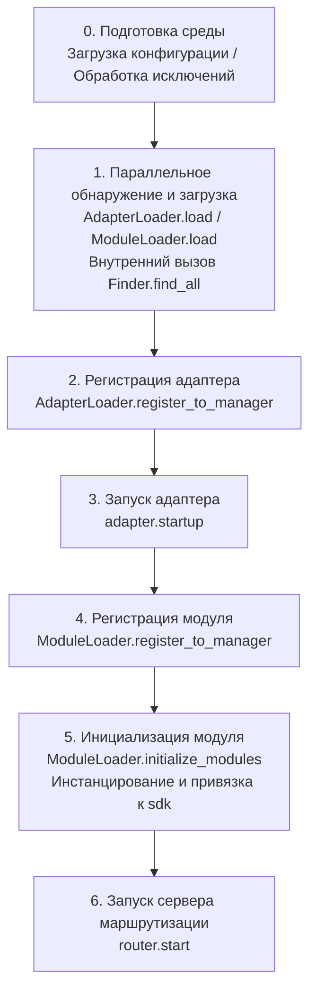

Соответствующие основные компоненты:

| Уровень | Компонент | Ответственность |
|---------|-----------|-----------------|
| Обнаружение | `AdapterFinder` / `ModuleFinder` | Обнаружение адаптеров/модулей из entry-points установленных пакетов |
| Загрузка | `AdapterLoader` / `ModuleLoader` | Обнаружение + импорт + чтение метаданных + определение включения/отключения, возвращает список объектов |
| Регистрация | `*Loader.register_to_manager` | Регистрация объектов в соответствующих менеджерах |
| Управление | `sdk.adapter` / `sdk.module` | Хранение экземпляров адаптеров/модулей, предоставление интерфейсов запуска/остановки |
| Инициализация | `ModuleLoader.initialize_modules` | Создание экземпляров модулей и привязка к `sdk` (обработка топологической сортировки зависимостей) |
| Маршрутизация | `sdk.router` | HTTP / WebSocket сервер |

> **Важно**: `Finder` и `Loader` — это два уровня. `Loader` внутри **уже содержит** `Finder` (`AdapterLoader` содержит `AdapterFinder`, `ModuleLoader` содержит `ModuleFinder`). В большинстве случаев вам достаточно использовать `Loader`, только в случае, если нужно "только перечислить, но не импортировать", вы используете `Finder` напрямую.

## Подробное описание этапов

### 1. Уровень обнаружения: Finder

Finder только отвечает за "поиск, какие пакеты предоставляют адаптеры/модули", не импортирует и не инстанцирует.

```python
from ErisPulse.finders import AdapterFinder, ModuleFinder

adapter_finder = AdapterFinder()
module_finder = ModuleFinder()

# Найти все установленные entry-points адаптеров/модулей
adapter_entries = adapter_finder.find_all()    # list[EntryPoint]
module_entries = module_finder.find_all()      # list[EntryPoint]

# Найти по имени
entry = module_finder.find_by_name("MyModule")  # EntryPoint | None
```

Каждый `EntryPoint` можно `.load()` для получения соответствующего класса, но обычно вам не нужно это делать вручную — `Loader` сделает это.

### 2. Уровень загрузки: Loader

Loader на уровне Finder делает "импорт + чтение метаданных + определение включения/отключения".

```python
from ErisPulse.loaders import AdapterLoader, ModuleLoader
from ErisPulse import sdk

adapter_loader = AdapterLoader()
module_loader = ModuleLoader()

# load() внутренне: вызывает finder.find_all() → поочередно обрабатывает entry-point → возвращает триплет
adapter_objs, enabled_adapters, disabled_adapters = await adapter_loader.load(sdk.adapter)
module_objs, enabled_modules, disabled_modules = await module_loader.load(sdk.module)
```

`load()` возвращает триплет:

| Возвращаемое значение | Описание |
|-----------------------|----------|
| `objs` (`dict`) | Имя → объект (класс адаптера / обёртка модуля) |
| `enabled` (`list[str]`) | Имена, которые включены (не отключены в конфигурации) |
| `disabled` (`list[str]`) | Имена, которые отключены |

#### Информация для диагностики при сбое загрузки

Когда модуль/адаптер выбрасывает исключение на этапе загрузки или инициализации, фреймворк пропускает этот компонент и продолжает загрузку других компонентов, при этом выводит **суммарную информацию о кадре пользовательского кода**, чтобы вы могли определить местоположение ошибки даже на уровне INFO, без необходимости включать DEBUG:

```
[ERROR] [ModuleLoader] Загрузка модуля MyModule из entry-point не удалась, пропущен: 'NoneType' object has no attribute 'platform'
  → MyModule/Core.py:42 in on_load
      adapter = sdk.platform
  → AttributeError: 'NoneType' object has no attribute 'platform'
  → Подсказка: Увеличьте уровень логирования до DEBUG, чтобы увидеть полный стек; проверьте реализацию модуля MyModule
```

Диагностическая информация генерируется модулем `ErisPulse.runtime.diagnostics` и автоматически фильтрует внутренние кадры фреймворка, оставляя только кадры вашего кода. Если вам нужно использовать это в пользовательской логике загрузки:

```python
from ErisPulse.runtime import log_diagnostic

try:
    risky_init()
except Exception as e:
    log_diagnostic(e)  # Автоматически извлекает кадры пользовательского кода и записывает в лог ERROR
```

Этот модуль также предоставляет два низкоуровневых функции: `extract_user_frame()` (возвращает структурированную информацию о кадре) и `format_diagnostic_block()` (возвращает многострочный текст).

### 3. Уровень регистрации: register_to_manager

Регистрация объектов, полученных Loader, в менеджерах, чтобы `sdk.adapter` / `sdk.module` могли их распознавать.

```python
# Регистрация адаптера (возвращает bool, означает, все ли успешно)
await adapter_loader.register_to_manager(enabled_adapters, adapter_objs, sdk.adapter)

# Регистрация модуля
await module_loader.register_to_manager(enabled_modules, module_objs, sdk.module)
```

После регистрации адаптеры зарегистрированы в менеджере адаптеров, модули — в менеджере модулей, но **ни один из них не запущен/инстанцирован**.

### 4. Запуск адаптера

```python
# Запуск всех зарегистрированных адаптеров
await sdk.adapter.startup()
# Или указать платформу
await sdk.adapter.startup("yunhu")
await sdk.adapter.startup(["yunhu", "telegram"])
```

> Регистрация ≠ Запуск. `register_to_manager` — это просто регистрация; `startup` вызывает `start()` адаптера, устанавливая соединение с платформой.

### 5. Инициализация модуля

Модуль имеет дополнительный шаг — **инстанцирование** и привязка к `sdk` (чтобы вы могли вызывать `sdk.MyModule.xxx`), а также обработка зависимостей и топологической сортировки.

```python
success = await module_loader.initialize_modules(
    enabled_modules, module_objs, sdk.module, sdk
)
```

После успешного инстанцирования модуль появляется в `sdk.<ModuleName>`.

### 6. Запуск сервера маршрутизации

```python
await sdk.router.start(
    host="0.0.0.0",
    port=8000,
    ssl_certfile=None,
    ssl_keyfile=None,
)
```

Сервер маршрутизации отвечает за получение обратных вызовов (webhook / websocket) от адаптеров. Без запуска его server-режим адаптеров не сможет получать сообщения.

## Полный пример ручного запуска

Следующий код **эквивалентен** ядро `await sdk.init()`, но каждый шаг раскрыт, и вы можете вставить пользовательскую логику в любой момент:

```python
import asyncio
from ErisPulse import sdk
from ErisPulse.loaders import AdapterLoader, ModuleLoader

async def manual_startup():
    # 0. Подготовка среды (загрузка конфигурации, регистрация глобального обработчика исключений)
    #    _prepare_environment — это предварительный шаг внутри init(); ручной процесс также должен его вызывать,
    #    иначе Loader не сможет прочитать конфигурацию и ошибочно отключит все адаптеры/модули.
    if not await sdk._prepare_environment():
        print("Подготовка среды не удалась")
        return False

    # 1. Создание загрузчиков (внутри каждый содержит Finder)
    adapter_loader = AdapterLoader()
    module_loader = ModuleLoader()

    # 2. Параллельное обнаружение и загрузка (используем gather, как в init())
    (adapter_objs, enabled_adapters, disabled_adapters), \
    (module_objs, enabled_modules, disabled_modules) = await asyncio.gather(
        adapter_loader.load(sdk.adapter),
        module_loader.load(sdk.module),
    )

    # 3. Регистрация адаптеров
    await adapter_loader.register_to_manager(
        enabled_adapters, adapter_objs, sdk.adapter
    )

    # 4. Запуск адаптеров
    if enabled_adapters:
        await sdk.adapter.startup()

    # 5. Регистрация модулей
    await module_loader.register_to_manager(
        enabled_modules, module_objs, sdk.module
    )

    # 6. Инициализация модулей (инстанцирование + привязка к sdk)
    if enabled_modules:
        await module_loader.initialize_modules(
            enabled_modules, module_objs, sdk.module, sdk
        )

    # 7. Запуск сервера маршрутизации
    await sdk.router.start(host="0.0.0.0", port=8000)

    print("Ручной запуск завершен")
    return True

async def main():
    ok = await manual_startup()
    if ok:
        # Блокирующее поддержание работы (ручной процесс не будет автоматически блокировать)
        await asyncio.Event().wait()

if __name__ == "__main__":
    asyncio.run(main())
```

### Когда использовать ручной запуск?

В большинстве случаев **не нужно** ручного запуска, `await sdk.run()` уже всё сделал. Ручной запуск имеет значение только в следующих сценариях:

- **Частичная загрузка**: загрузить только определённые адаптеры/модули, пропустить остальные
- **Динамическая регистрация**: регистрировать новые адаптеры/модули в зависимости от условий во время выполнения
- **Пользовательский порядок**: нарушить стандартный порядок загрузки (например, сначала запустить модуль, затем адаптер)
- **Внедрение стратегий**: внедрить в Loader пользовательские стратегии управления строгостью и т.д.
- **Отладка/диагностика**: вручную управлять каждым этапом, чтобы локализовать проблему при сбое

## Тонкое управление во время выполнения

### Горячая перезагрузка локальных плагинов

`sdk.enable_plugin_hot_reload()` отслеживает изменения исходного кода в локальной директории плагинов (`plugins/`) и автоматически перезагружает:
`epsdk run` уже автоматически включает это, не нужно вызывать вручную; **если запускаете `sdk.run()` без `epsdk run`**, включите перезагрузку плагинов до вызова `run()` (только локальные плагины, не влияет на модули/адаптеры, установленные через pip):

```python
sdk.enable_plugin_hot_reload()
sdk.run()
```

Даже если вы использовали `sdk.run()` для запуска, вы всё равно можете управлять подсистемами во время выполнения, не перезапуская весь SDK:

### Горячая перезагрузка адаптеров

```python
# Горячая перезапуск адаптера (восстановление соединения, без влияния на другие платформы)
await sdk.adapter.shutdown("yunhu")
await sdk.adapter.startup("yunhu")

# Запуск новой платформы во время выполнения
await sdk.adapter.startup("telegram")

# Временное отключение платформы
await sdk.adapter.shutdown("telegram")
```

> `adapter.startup()` требует, чтобы адаптер **был зарегистрирован** в менеджере. Регистрация происходит внутри `init()`/`run()`, поэтому это управление **после** запуска.

### Сервер маршрутизации

```python
# Временное отключение webhook-сервера
await sdk.router.stop()

# Перезапуск (например, после смены порта)
await sdk.router.start(host="0.0.0.0", port=9000)
```

### Модули по требованию

```python
# Ручная загрузка модуля (возможно ленивая загрузка)
await sdk.load_module("MyModule")
```

## Элегантное завершение

Начиная с версии 2.7.0, `sdk.shutdown()` предоставляет **программное элегантное завершение**: установка события завершения, которое заставляет висящий в `await sdk.run(keep_running=True)` главный цикл вернуться, что ведёт к автоматическому вызову `uninit()` и очистке ресурсов.

```python
# Вызывается в любом корутине, вызывает элегантное завершение (run() висит, возвращается и автоматически uninit)
sdk.shutdown()
```

Типичное применение:

```python
async def shutdown_after_idle():
    await asyncio.sleep(3600)
    sdk.shutdown()  # Элегантное завершение после 1 часа бездействия
```

**Обработка сигналов**: `run()` внутри регистрирует обработчики `SIGTERM` / `SIGHUP`, преобразуя системные сигналы в элегантное завершение — при остановке контейнера (Docker `docker stop`) или `systemd` сервиса процесс пройдёт через `uninit()` очистку, а не будет убит жёстко. Также регистрируется обработчик `SIGUSR1`, преобразующий сигнал во внутренний сброс (внутренний `sdk.restart()`). `epsdk restart` для контейнеров с PID 1 (остановка означает остановку контейнера, внешний перезапуск невозможен) отправляет этот сигнал для горячей перезагрузки компонентов. Канал горячей перезагрузки `SIGUSR1` требует ErisPulse **2.12+**.

- На Windows `loop.add_signal_handler` не поддерживается, обработчики сигналов автоматически пропускаются (можно использовать `sdk.shutdown()` или Ctrl+C для завершения)
- Повторный вызов `sdk.shutdown()` безопасен (если событие уже установлено, повторный вызов — бездействие)

## Процесс выгрузки

Обратная операция запуска — `await sdk.uninit()`, который очищает в обратном порядке:

1. Закрытие всех адаптеров (`adapter.shutdown()`)
2. Выгрузка всех модулей
3. Очистка всех обработчиков событий
4. Очистка менеджеров и атрибутов модулей на SDK

В сценариях ручного запуска не забудьте вызвать `uninit()` перед выходом, чтобы обеспечить элегантное завершение:

```python
try:
    await asyncio.Event().wait()   # Поддержка работы
finally:
    await sdk.uninit()
```

## Перезапуск

SDK предоставляет два способа перезапуска, без необходимости вручную выгружать — фреймворк сам обрабатывает:

| Способ | Вызов | Поведение | Сценарии использования |
|-------|-------|-----------|--------------------------|
| Горячий перезапуск | `await sdk.restart()` | Горячая перезагрузка компонентов на уровне кода: все модули проходят единый путь перезагрузки (предварительная проверка синтаксиса / откат снимка / проверка идентичности), адаптеры сначала **переобнаруживают entry-point** (новоустановленные/удалённые адаптеры в процессе работы сразу активируются), затем поочерёдно перезагружаются на уровне кода | После обновления или установки компонентов через pip, горячая перезагрузка модулей |
| Жёсткий перезапуск | `await sdk.hard_restart()` | `uninit()` с последующим выходом с кодом 42, внешний супервайзер запускает новый процесс | Обновление самого фреймворка (новый код фреймворка вступает в силу только в новом процессе), побочные эффекты бинарных библиотек (C-расширения), подозрение на утечку ресурсов |

```python
# Горячий перезапуск: перезагрузка компонентов на уровне кода (самый частый случай; новые адаптеры, установленные в процессе, также будут активированы)
await sdk.restart()

# Жёсткий перезапуск: выход из процесса, передача внешнему супервайзеру (см. руководство по супервайзеру ниже)
await sdk.hard_restart("sdk self-update")  # Необязательное описание для отображения супервайзером
```

> **Два важных замечания**:
> 1. Эти методы выполняются в фоновой задаче, **немедленно возвращают `True`**, означая, что "задача перезапуска запланирована", а не "перезапуск завершён". Фактический перезапуск происходит в фоне, чтобы не прерывать текущую цепочку событий.
> 2. `hard_restart()` работает так: выгрузка и сохранение конфигурации, затем **выход с кодом 42** (`HARD_RESTART_EXIT_CODE`) — **он сам не запускает новый процесс**. Должен быть внешний супервайзер, который обнаружит код выхода 42 и перезапустит. Если запустить напрямую `python main.py` без какого-либо супервайзера, процесс завершится с кодом 42 и **не перезапустится автоматически** (фреймворк выдаст предупреждение).

> **Взаимоисключающие и объединённые горячие перезагрузки** (начиная с 2.11.1): все операции горячей перезагрузки (перезагрузка отдельного модуля / полная перезагрузка / перезагрузка адаптера / сон / горячая загрузка нового плагина) полностью взаимоисключают друг друга — при сохранении многочисленных запросов они не будут выполняться параллельно, а если во время выполнения `restart` поступит новый запрос, он автоматически объединится (запросы, приходящие во время обычной перезагрузки, также объединяются и ставятся в очередь), и после завершения будет выполнена максимум одна дополнительная перезагрузка. При сохранении файла с синтаксической ошибкой вся перезагрузка будет отклонена **предварительной синтаксической проверкой** (одновременно перечисляются все ошибочные файлы и номера строк), адаптеры пропустят эту перезагрузку, `restart` вернёт неудачу, все старые экземпляры продолжат обслуживание; после исправления снова вызовите `restart`.

### Когда использовать жёсткий перезапуск?

Горячий перезапуск охватывает большинство сценариев (обновление/установка компонентов через pip, горячая перезагрузка кода модулей, **включая адаптеры, установленные в процессе работы**). Жёсткий перезапуск нужен только в следующих случаях:

- **Обновление самого фреймворка**: после обновления ErisPulse самого фреймворка, новый код фреймворка вступает в силу только в новом процессе (Python не перезагружает уже загруженный код фреймворка).
- **Побочные эффекты двоичных библиотек (C-расширения)**: горячий перезапуск происходит в одном процессе, не может освободить C-расширения, открытые дескрипторы файлов, потоки и другие ресурсы уровня процесса; жёсткий перезапуск меняет процесс, и эти побочные эффекты полностью очищаются.
- **Диагностика утечек ресурсов**: если подозреваете утечку памяти или дескрипторов, жёсткий перезапуск даст чистую среду.

> Функция "Перезапуск фреймворка" в панели управления Dashboard вызывает `hard_restart()`.

### Соглашение об коде выхода 42

Жёсткий перезапуск — это межпроцессное взаимодействие: **SDK отвечает за выход (код 42), супервайзер отвечает за запуск**.

| Роль | Поведение |
|------|----------|
| SDK (при жёстком перезапуске) | `uninit()` → сохранение конфигурации → запись метки жёсткого перезапуска (причина / PID, для отображения супервайзером) → `os._exit(42)` |
| Супервайзер | Обнаруживает код выхода подпроцесса 42 → отображает причину жёсткого перезапуска → перезапускает ту же команду |

> `sdk.is_supervised()` позволяет проверить, запущен ли текущий процесс супервайзером (проверка переменной окружения `ERISPULSE_SUPERVISED`). Команда CLI `run` автоматически вставляет этот флаг при запуске подпроцесса; внешние супервайзеры, такие как systemd / Docker, не вставляют, `is_supervised()` возвращает `False`, в этом случае после жёсткого перезапуска фреймворк выдаст предупреждение "Не обнаружен супервайзер".

### Руководство по супервайзеру

Выберите подходящий супервайзер, чтобы жёсткий перезапуск действительно сработал:

#### 1. Команда CLI run (разработка/простое развертывание, рекомендуется)

`epsdk run main.py` включает в себя цикл супервайзера: обнаруживает код выхода подпроцесса, при 42 немедленно перезапускает (и отображает причину жёсткого перезапуска); при других кодах выхода с ошибкой выполняет экспоненциальную задержку и автоматический повторный запуск; `Ctrl+C` сначала элегантно завершает подпроцесс (код 0 считается нормальным выходом, не перезапускается).

```bash
epsdk run main.py
```

`epsdk run --reload` (режим горячей перезагрузки для разработки, начиная с 2.11.1) также использует структуру "супервайзер + перезагрузка рабочего подпроцесса": сохранение `.py` файлов внутри рабочего приводит к **перезагрузке компонентов** (без перезапуска фреймворка); жёсткий перезапуск происходит, когда супервайзер перезапускает новый рабочий процесс, обновление фреймворка приводит к немедленному вступлению в силу нового кода.

#### Детальная перезагрузка при изменении (начиная с 2.12+)

При изменении `.py` файлов по текущему времени принадлежности источника выбирается минимальная единица перезагрузки, а не по строке пути:

| Изменённый файл | Обработка |
|-----------------|----------|
| В директории плагинов (`ErisPulse.framework.plugins_dir`) | Обрабатывается плагином hot-reload watcher, dev watcher не запускается повторно |
| Исходного кода загруженного модуля (включая `pip install -e` и site-packages) | `sdk.reload_module(имя модуля)` |
| Исходного кода зарегистрированного адаптера | `sdk.reload_adapter(платформа)` |
| Входной скрипт | Перезапуск процесса (код выхода 42, перезапускается супервайзером) |
| Исходного кода самого фреймворка (`ErisPulse` пакет) | Перезапуск процесса |
| Одновременно соответствует нескольким owner / не может быть отнесён | Консервативно перезапуск процесса |

`epsdk upgrade` и другие сценарии пакетного обновления можно использовать `sdk.reload_all_modules()` для однократной перезагрузки всех зарегистрированных модулей (в порядке зависимостей, модуль с ошибкой пропускается без отката), без перезапуска процесса.

В режиме скрипта (`epsdk run main.py --reload`) скрипт не превращается в рабочий процесс: в подпроцессе скрипта включается dev watcher, и `component_reload_pid` записывается в `.erispulse/runtime.json`; родительский процесс видит этот маркер и обрабатывает изменения модулей/адаптеров/плагинов в подпроцессе, только изменения входного скрипта или исходного кода фреймворка перезапускают процесс скрипта.

#### 2. systemd (сервер Linux)

`RestartForceExitStatus=42` заставляет код выхода 42 также вызывать перезапуск (по умолчанию `on-failure` срабатывает только для ненулевых кодов):

```ini
[Service]
ExecStart=/usr/bin/python3 /opt/mybot/main.py
Restart=on-failure
RestartForceExitStatus=42
RestartSec=2
User=mybot
```

#### 3. Docker / docker-compose

В контейнере PID 1 — это приложение, после выхода с кодом 42 контейнер завершается — используйте стратегию `restart`, чтобы он автоматически перезапускался:

```yaml
services:
  bot:
    build: .
    restart: unless-stopped   # Перезапуск при любом выходе (включая 42)
```

> В контейнере `epsdk restart` для экземпляра PID 1 выполняет горячий перезапуск внутри процесса через SIGUSR1, не приводит к выходу из контейнера; перезапуск всего процесса осуществляется через стратегию `restart`. См. [Развертывание → Перезапуск в контейнере (экземпляр PID 1)](../user-guide/deployment.md#перезапуск-в-контейнере-экземпляр-pid-1).

#### 4. PM2 (экосистема Node)

```bash
pm2 start main.py --name mybot --interpreter python3
# 42 считается кодом выхода, PM2 по умолчанию перезапускает; настройте restart_delay для предотвращения дребезга
pm2 set mybot.restart_delay 2000
```

#### 5. supervisord

```ini
[program:mybot]
command=python3 /opt/mybot/main.py
autorestart=true
exitcodes=0,2,42    # 42 также считается "нормальным выходом, требующим перезапуска"
```

#### 6. Чистый Python пользовательский супервайзер

```python
import subprocess, sys, time

while True:
    p = subprocess.Popen([sys.executable, "main.py"])
    code = p.wait()
    if code == 42:          # Запрос на жёсткий перезапуск
        time.sleep(0.5)
        continue
    if code == 0:           # Нормальный выход
        break
    time.sleep(3)           # Аномальный выход, экспоненциальная задержка и повторный запуск
```

> **Поведение без супервайзера**: при запуске напрямую `python main.py`, вызов `hard_restart()` приведёт к выходу процесса с кодом 42 и завершению, без перезапуска. В этом случае следует подключиться к любому из перечисленных супервайзеров.


### 性能基准与调优

# Производительность, тестирование и оптимизация

> [!TIP]
> **Когда нужно читать эту статью**: если вас интересуют цифры пропускной способности и задержки событий, оценка производительности перед развертыванием, или если вы хотите сравнить производительность до и после обновления версии. Если вам это не нужно, можете пропустить эту статью, это не повлияет на использование других функций.

## Тестирование производительности (2026-10-05, Python 3.13.14)

Один и тот же компьютер, два последовательных теста (предварительная прогревка + несколько циклов выборки с определением процентиля), NoneBot2 2.5.0 — контрольная среда в отдельном окружении.  
Все числовые значения можно воспроизвести с помощью встроенного в репозиторий бенчмарка: `python tests/performance/benchmark.py`.

### Распространение событий (ops/s, чем выше, тем лучше)

| Базовое тестирование | ErisPulse | NoneBot2 2.5.0 | Отношение |
|---|---|---|---|
| Задержка на одном процессоре с последовательной шиной | **9,189** | 3,021 | 3.0× |
| Пропускная способность шины с фантомным распространением (1000 событий/цикл) | **9,877** | 2,055 | 4.8× |
| Пропускная способность с 10 процессорами / событиями | **4,309** | 435 | 9.9× |
| Команда найдена (/команда) | **2,165** | 677 | 3.2× |
| Команда не найдена (некомандное сообщение) | **10,818** | 921 | 11.7× |
| Однопроцессорная шина сообщений (по умолчанию, полный путь) | **2,804** | 2,144 | 1.3× |

### Другие подсистемы (после оптимизации)

| Базовое тестирование | ops/s | Базовое тестирование | Значение |
|---|---|---|---|
| Горячее чтение getConfig | 1,086,957 | ORM: создание одной записи | 407/s |
| KV aset (sqlite) | 1,659 | GET /health (ASGI) | 1,188/s |
| KV aget (sqlite) | 3,333 | module.call RPC | 148,905/s |
| Время往返 сообщений end-to-end | 298 | Смешанная нагрузка | 142/s |

### Время запуска

| Фаза | ErisPulse | NoneBot2 |
|---|---|---|
| Пустая загрузка интерпретатора (контроль) | 59.5ms | — |
| Холодная импортная загрузка | 241.7ms | 249.6ms |
| sdk.init / инициализация NoneBot | 30.8ms | 162.3ms |

## Самостоятельная проверка и сравнение с базовым тестом

```bash
# Быстрый режим (примерно 1/4 выборки, для быстрой проверки)
python tests/performance/benchmark.py --quick

# Полный базовый тест с сохранением результатов (8 компонентов: config/event/storage/send/router/module/overall/startup)
python tests/performance/benchmark.py --json baseline.json

# Сравнение с предыдущим базовым тестом (разница в пределах ±5% считается шумом)
python tests/performance/benchmark.py --compare baseline.json

# HTML-отчёт / указание бэкенда для хранения компонентов
python tests/performance/benchmark.py --html report.html
python tests/performance/benchmark.py --backend mysql
```

> Примечание для CI: цифры в базовом тесте могут меняться в зависимости от машины. Порог ±5% в `--compare` подходит только для **сравнения на одной и той же машине** (для проверки обновлений), но не подходит для сравнения между разными машинами.

## Оптимизация

1. **Узкое место по всей цепочке сообщений — это запись сессий**: по умолчанию включена запись transcript (с 2.9 версии — буферизация в памяти + фоновая пакетная запись на диск); при отсутствии потребностей в аудите можно отключить, пропускная способность по всей цепочке возрастёт примерно с 2,804 → 3,774 операций/с.
2. **Управление сборкой мусора (GC)**: группа настроек `proactive_gc` в `ErisPulse.framework` (`interval` / `full_every` / `memory_growth_mb` / `idle_only`) — при пике событий автоматически пропускает GC; на этапе инициализации уже встроена `gc.freeze()`.
3. **Хранилище**: для локального одиночного экземпляра sqlite (WAL) достаточно; при необходимости совместного использования данных между несколькими экземплярами используйте mysql / postgres (см. [Хранилище](storage-backends.md)).
4. **Встроенные оптимизации критических участков кода** (начиная с 2.9, не требует настройки): пакетная запись transcript, кэширование i18n, защита уровней логирования, предварительная компиляция матчера, объединённая синхронизация задержанных записей конфигурации.
5. **Максимальное количество состояний команд**: таблица состояний охлаждения/ограничения/квоты ограничена 4096 записями (при превышении удаляются самые старые); при развертывании в больших группах настройка не требуется.

## Диагностика памяти

При поиске проблемы «чем дольше работает, тем больше ест памяти» поставьте по одному снимку с меткой label до и после подозрительного участка кода — для одинаковых label дельта рассчитывается автоматически (по двум метрикам: RSS + tracemalloc):

```python
from ErisPulse.runtime import log_snapshot, snapshot

class MyModule(BaseModule):
    async def on_load(self, event):
        snapshot("MyModule.load")            # Собирает и возвращает dict (включая дельту RSS по label)

    async def on_unload(self, event):
        log_snapshot("MyModule.unload")      # Сбор тем же методом и запись в лог уровня TRACE
```

- `snapshot(label)` возвращает машиночитаемый dict, подходит для ассертов и отчётов; `log_snapshot(label)`
  сразу пишет в лог (уровень TRACE), подходит для временной диагностики
- Кэш label ограничен по размеру и не «утекает» с ростом числа вызовов; в сочетании с метриками процесса
  эндпоинта `/metrics` можно вести долгосрочное наблюдение за трендами
- Остаточный рост памяти после выгрузки модуля обычно указывает на отсутствие привязки владельца (см. записи
  фоновых задач `bind_owner` в разделе [система владения](ownership.md))


### runtime 工具带

# Инструментарий runtime

> [!TIP]
> **Когда нужно читать эту статью**: если вы хотите получить обзор всех
> инструментов, доступных для прямого импорта из пакета `ErisPulse.runtime`.
> Подробное описание использования каждого инструмента находится в соответствующих
> тематических документах, в этой статье представлены краткие справочные сведения
> и описание использования инструментов, не относящихся к конкретной теме.

`ErisPulse.runtime` — это агрегирующий слой экспорта фреймворка: он собирает
разрозненные инструменты времени выполнения из разных модулей в единый входной
точку, и скрипты, модули, адаптеры могут использовать их через `from ErisPulse.runtime import X`,
не запоминая глубокие пути.

## Справочник возможностей

| Категория | Имя | Назначение | Подробнее |
|-----------|------|-----------|-----------|
| Принадлежность | `bind_owner` | Вшивает контекст владельца в обратный вызов / точку входа потока | [Система принадлежности](ownership.md) |
| Принадлежность | `owner_scope` / `get_current_owner` | Контекст принадлежности на уровне блока кода | [Система принадлежности](ownership.md) |
| Принадлежность | `get_owner_tasks` / `cancel_owner_tasks` | Получение / отмена фоновых задач владельца | [Система принадлежности](ownership.md) |
| Фоновые задачи | `spawn_background` / `spawn_later` / `spawn_thread` | Фоновые корутины / отложенные задачи / задачи потоков | [Управление жизненным циклом](lifecycle.md) |
| Фоновые задачи | `cancel_all_background_tasks` / `run_main_loop` | Очистка фоновых задач и регистрация главного цикла | [Управление жизненным циклом](lifecycle.md) |
| Контекст события | `get_current_trace_id` | Получение текущего идентификатора трассировки | [Трассировка](interaction.md#Трассировка-trace-id) |
| Контекст события | `get_send_receipts` | Получение учетной книги подтверждений отправки сообщений | [Сообщения](interaction.md#Сообщения-message_tx) |
| Контекст события | `get_current_event_account` / `get_current_caller` / `get_handler_waits` | Получение учетной записи события / вызывающей стороны / таблицы ожидания | [Система взаимодействия](interaction.md) |
| Память | `snapshot` / `log_snapshot` | Снимок RSS + tracemalloc с меткой (автоматически вычисляется приращение) | [Диагностика памяти](performance.md#Диагностика_памяти) |
| Память | `get_rss_mb` / `get_traced_mb` | Текущее значение памяти процесса | [Диагностика памяти](performance.md#Диагностика_памяти) |
| Парсинг конфигурации | `dict_to_dataclass` | Преобразование dict → типобезопасный экземпляр dataclass | См. следующий раздел |
| Парсинг конфигурации | `dataclass_to_defaults_dict` / `dataclass_to_toml_with_comments` | Преобразование dataclass → словарь значений по умолчанию / сериализация TOML с комментариями | [Декларативная конфигурация](../developer-guide/configuration.md) |
| Отладка | `explain_module` / `explain_event` / `explain_trace` | Модуль / событие / трассировка сообщения для диагностики | [Запуск](startup.md) и [обработка событий](../getting-started/event-handling.md) |
| Отладка | `format_diagnostic_block` / `log_diagnostic` / `extract_user_frame` | Форматирование диагностического блока и извлечение пользовательской кадровой информации | [Запуск](startup.md) |
| Обработка исключений | `setup_exception_handling` / `global_exception_handler` | Установка глобального обработчика исключений | [Запуск](startup.md) |
| Безопасность | `redact_secret` | Скрытие секретных значений в логах / отчетах | [Запуск](startup.md) |
| Метрики | `metrics` / `MetricsRegistry` | Регистратор метрик (источник данных для эндпоинта `/metrics`) | [Руководство по развертыванию](../user-guide/deployment.md) |

## dict_to_dataclass: dict → типобезопасный объект

Обратное направление декларативной конфигурации dataclass — преобразование произвольного dict (ответ API, webhook payload, пользовательский ввод) в типобезопасный экземпляр по объявлению, вместо ручного написания цепочек `data.get("x", default)`:

```python
from dataclasses import dataclass, field
from ErisPulse.runtime import dict_to_dataclass

@dataclass
class WebhookPayload:
    order_id: str
    amount: float = 0.0
    tags: list = field(default_factory=list)
    remark: str = ""

payload = dict_to_dataclass(WebhookPayload, {
    "order_id": "A-1024",
    "amount": "99.5",          # Автоматическое преобразование str → float
    "unknown_key": "игнорируется",      # Необъявленные поля автоматически игнорируются
})
payload.amount                   # 99.5 (float)
```

- Преобразование типов (str → int/float и т.д.), заполнение значений по умолчанию, рекурсивное заполнение вложенных dataclass
- Перекрытие переменными окружения: при наличии метаданных `metadata={"env": "NAME"}` приоритет переменных окружения > данных > значения по умолчанию
- Внутри декларативных конфигурационных классов (`ConfigClass` / `BaseConfig`) для теплого обновления обратный вызов от dict → объекта конфигурации выполняется с помощью этой функции


====
技术标准
====


### 会话类型标准

# Стандарт типов сессий ErisPulse

> [!TIP]
> **Когда нужно читать эту статью**: когда вы адаптируете платформу, сопоставляя нативные сессии с платформы с типами (private/group/channel/guild/thread), или в модуле, если не уверены, какой тип цели нужно передавать в `Send.To()`, или хотите понять, как происходит автоматическое преобразование `event.reply()`. Если не нужно, можете пропустить.

В этом документе определены стандартные типы сессий, поддерживаемые ErisPulse, включая типы событий получения и типы целей отправки.

## 1. Основные понятия

### 1.1 Типы получения и отправки

ErisPulse различает два типа сессий:

- **Тип получения (Receive Type)**: поле `detail_type` события, используемое для получения
- **Тип отправки (Send Type)**: тип цели, используемый в методе `Send.To()` при отправке сообщений

### 1.2 Отношения между типами

```
Тип получения (detail_type)     Тип отправки (Send.To)
─────────────────        ────────────────
private                 →        user
group                   →        group
channel                 →        channel
guild                   →        guild
thread                  →        thread
user                    →        user
```

**Ключевые моменты**:
- `private` — это тип получения, при отправке стандартный тип — `user`
- `group`, `channel`, `guild`, `thread` — одинаковые типы при получении и отправке
- **Рекомендуемый путь**: использовать `event.reply()` — автоматически выполняет преобразование типов и вывод цели, без необходимости ручного управления (автоматическое преобразование `private` → `user` происходит здесь)
- **При ручной отправке**: передавайте тип отправки (например, `Send.To("user", ...)`); передача типа получения, например, `Send.To("private", ...)` тоже может быть автоматически преобразована, но не рекомендуется (см. §6.1)

## 2. Стандартные типы сессий

### 2.1 Стандартные типы OneBot12

#### private
- **Тип получения**: `private`
- **Тип отправки**: `user`
- **Описание**: сообщения в личной переписке
- **Поле ID**: `user_id`
- **Применимые платформы**: все платформы, поддерживающие личную переписку

#### group
- **Тип получения**: `group`
- **Тип отправки**: `group`
- **Описание**: сообщения в группе, включая различные формы групп (например, supergroup в Telegram)
- **Поле ID**: `group_id`
- **Применимые платформы**: все платформы, поддерживающие групповые чаты

#### user
- **Тип получения**: `user`
- **Тип отправки**: `user`
- **Описание**: тип пользователя, некоторые платформы (например, Telegram) представляют личные чаты как `user`, а не `private`
- **Поле ID**: `user_id`
- **Применимые платформы**: Telegram и другие платформы

### 2.2 Расширенные типы ErisPulse

#### channel
- **Тип получения**: `channel`
- **Тип отправки**: `channel`
- **Описание**: сообщения в канале, поддерживают широковещательные сообщения нескольким пользователям
- **Поле ID**: `channel_id`
- **Применимые платформы**: Discord, Telegram, Line и др.

#### guild
- **Тип получения**: `guild`
- **Тип отправки**: `guild`
- **Описание**: сообщения в сервере/сообществе, обычно используются для событий уровня сервера Discord
- **Поле ID**: `guild_id`
- **Применимые платформы**: Discord и др.

#### thread
- **Тип получения**: `thread`
- **Тип отправки**: `thread`
- **Описание**: сообщения в теме/подканале, используются для подобсуждений в сообществах
- **Поле ID**: `thread_id`
- **Применимые платформы**: Discord Threads, Telegram Topics и др.

## 3. Сопоставление типов платформ

### 3.1 Принцип сопоставления

Адаптер отвечает за сопоставление нативных типов платформы со стандартными типами ErisPulse:

```
Нативный тип платформы → Стандартный тип ErisPulse → Тип отправки
```

### 3.2 Примеры сопоставления популярных платформ

#### Telegram
```
Тип Telegram          Тип получения ErisPulse    Тип отправки
─────────────────      ────────────────       ───────────
private                private                 user
group                  group                   group
supergroup             group                   group  # Сопоставляется с group
channel                channel                 channel
```

#### Discord
```
Тип Discord          Тип получения ErisPulse    Тип отправки
─────────────────      ────────────────       ───────────
Direct Message         private                user
Text Channel           channel                channel
Guild                  guild                  guild
Thread                 thread                 thread
```

#### OneBot11
```
Тип OneBot11        Тип получения ErisPulse    Тип отправки
─────────────────      ────────────────       ───────────
private                private                user
group                  group                  group
discuss                group                  group  # Сопоставляется с group
```

## 4. Расширение с помощью пользовательских типов

### 4.1 Регистрация пользовательских типов

Адаптер может зарегистрировать пользовательские типы сессий:

```python
from ErisPulse.Core.Event import register_custom_type

# Регистрация пользовательского типа
register_custom_type(
    receive_type="my_custom_type",
    send_type="custom",
    id_field="custom_id",
    platform="MyPlatform"
)
```

### 4.2 Использование пользовательских типов

После регистрации система автоматически обрабатывает преобразование и вывод типа:

```python
# Автоматический вывод
receive_type = infer_receive_type(event, platform="MyPlatform")
# Возвращает: "my_custom_type"

# Преобразование в тип отправки
send_type = convert_to_send_type(receive_type, platform="MyPlatform")
# Возвращает: "custom"

# Получение соответствующего ID
target_id = get_target_id(event, platform="MyPlatform")
# Возвращает: event["custom_id"]
```

### 4.3 Удаление пользовательских типов

```python
from ErisPulse.Core.Event import unregister_custom_type

unregister_custom_type("my_custom_type", platform="MyPlatform")
```

## 5. Автоматическое определение типа

Если у события отсутствует явное поле `detail_type`, система автоматически определяет тип по доступным полям ID:

> [!NOTE]
> **Изменение поведения в 2.7.0+**: `detail_type` используется только если это **известный тип сессии** (стандартный или пользовательский). У событий `notice`/`request` (например, `group_member_increase`, `friend_increase`) `detail_type` является **семантическим подтипом**, а не типом сессии, и система будет определять правильный тип сессии по полям ID.

### 5.1 Приоритет определения

```
Приоритет (от высокого к низкому):
1. group_id     → group
2. channel_id   → channel
3. guild_id     → guild
4. thread_id    → thread
5. user_id      → private
```

### 5.2 Примеры использования

```python
# У события только group_id
event = {"group_id": "123", "user_id": "456"}
receive_type = infer_receive_type(event)
# Возвращает: "group" (используется приоритетный group_id)

# У события только user_id
event = {"user_id": "123"}
receive_type = infer_receive_type(event)
# Возвращает: "private"

# У события notice detail_type — семантический подтип, в 2.7.0+ определяется по полю ID
event = {"type": "notice", "detail_type": "group_member_increase", "group_id": "123"}
receive_type = infer_receive_type(event)
# Возвращает: "group" (а не "group_member_increase")
```

## 6. Примеры использования API

### 6.1 Отправка сообщений

```python
from ErisPulse import adapter

# Отправка пользователю
await adapter.myplatform.Send.To("user", "123").Text("Hello")

# Отправка в группу
await adapter.myplatform.Send.To("group", "456").Text("Hello")

# Автоматическое преобразование private → user: использование приемлемого, но не рекомендуемого способа (может быть несовместимость)
await adapter.myplatform.Send.To("private", "789").Text("Hello")
# Внутри автоматически преобразуется в: Send.To("user", "789")
# Рекомендуемый способ: при ручной отправке используйте тип отправки user, или используйте event.reply() для автоматического преобразования (см. 6.2)
```

### 6.2 Ответ на событие

```python
from ErisPulse.Core.Event import Event

# Event.reply() автоматически обрабатывает преобразование типов (рекомендуемый путь)
await event.reply("Сообщение ответа")
# Внутри автоматически используется правильный тип отправки (автоматическое преобразование private → user происходит здесь)
```

### 6.3 Обработка команд

```python
from ErisPulse.Core.Event import command

@command(name="test")
async def handle_test(event):
    # Система автоматически обрабатывает тип сессии
    # Не нужно вручную проверять group_id или user_id
    await event.reply("Команда выполнена успешно")
```

## 7. Справочник основных API

### 7.1 Преобразование типов

```python
from ErisPulse.Core.Event import convert_to_send_type, convert_to_receive_type

# Преобразование типа получения в тип отправки
convert_to_send_type("private")  # → "user"
convert_to_send_type("group")    # → "group"

# Преобразование типа отправки в тип получения
convert_to_receive_type("user")   # → "private"
convert_to_receive_type("group")  # → "group"
```

### 7.2 Получение полей ID

```python
from ErisPulse.Core.Event import get_id_field, get_receive_type

get_id_field("group")    # → "group_id"
get_id_field("private")  # → "user_id"

get_receive_type("group_id")  # → "group"
get_receive_type("user_id")   # → "private"
```

### 7.3 Получение информации для отправки за один вызов

```python
from ErisPulse.Core.Event import get_send_type_and_target_id

event = {"detail_type": "private", "user_id": "123"}
send_type, target_id = get_send_type_and_target_id(event)
# send_type = "user", target_id = "123"

# Непосредственно для использования в Send.To()
await adapter.Send.To(send_type, target_id).Text("Hello")
```

### 7.4 Получение целевого ID

```python
from ErisPulse.Core.Event import get_target_id

event = {"detail_type": "group", "group_id": "456"}
get_target_id(event)  # → "456"
```

## 8. Вспомогательные методы

```python
from ErisPulse.Core.Event import (
    is_standard_type,
    is_valid_send_type,
    get_standard_types,
    get_send_types,
    clear_custom_types,
)

is_standard_type("private")     # True
is_standard_type("custom_type") # False

is_valid_send_type("user")      # True
is_valid_send_type("invalid")   # False

get_standard_types()  # {"private", "group", "channel", "guild", "thread", "user"}
get_send_types()      # {"user", "group", "channel", "guild", "thread"}

clear_custom_types()                # Очистка всех пользовательских типов
clear_custom_types(platform="discord")  # Очистка пользовательских типов только для указанной платформы
```

## 9. Рекомендуемые практики

### 7.1 Разработчики адаптеров

1. **Используйте стандартные сопоставления**: по возможности сопоставляйте с типами стандарта, а не создавайте новые типы
2. **Правильно преобразуйте**: убедитесь, что сопоставление типов получения и отправки корректно
3. **Сохраняйте исходные данные**: сохраняйте оригинальный тип события в `{platform}_raw`
4. **Документируйте**: в документации адаптера укажите сопоставления типов

### 7.2 Разработчики модулей

1. **Используйте вспомогательные методы**: используйте методы, такие как `get_send_type_and_target_id()`
2. **Избегайте жесткого кодирования**: не пишите код вида `if group_id else "private"`
3. **Учитывайте все типы**: код должен поддерживать все стандартные типы, а не только private/group
4. **Гибко проектируйте**: используйте методы обертки событий, а не прямой доступ к полям

### 7.3 Определение типов

- **Предпочитайте detail_type**: если есть явное поле, не используйте определение
- **Рационально используйте определение**: только когда нет явного типа
- **Учитывайте приоритеты**: знайте приоритеты определения, чтобы избежать неожиданных результатов

## 10. Часто задаваемые вопросы

### В1: Почему при отправке private нужно преобразовывать в user?

О: Это требование стандарта OneBot12. `private` — это понятие получения, при отправке лучше использовать `user`, что соответствует семантике.

### В2: Как поддержать новые типы сессий?

О: Зарегистрируйте пользовательский тип с помощью `register_custom_type()`, или используйте стандартные типы, такие как `channel`, `guild`.

### В3: Что делать, если у события нет detail_type?

О: Система автоматически определит тип по доступным полям ID. Приоритет: group > channel > guild > thread > user.

### В4: Как адаптер должен сопоставлять Telegram supergroup?

О: В логике преобразования адаптера сопоставьте `supergroup` со стандартным типом `group`.

### В5: Как обрабатывать специальные платформы, такие как почта?

О: Для неуниверсальных или платформенных специфических типов используйте `{platform}_raw` и `{platform}_raw_type` для сохранения исходных данных, адаптер должен обрабатывать их самостоятельно.

## 11. Связанные документы

**Со стороны адаптера (сопоставление и преобразование)**:
- [Стандарт преобразования событий](event-conversion.md) - полное описание стандарта преобразования событий
- [Спецификация методов отправки](send-method-spec.md) - спецификация методов и параметров класса Send
- [Руководство по разработке адаптеров](../developer-guide/adapters/) - полное руководство по разработке адаптеров

**Со стороны модуля (если не хотите вручную управлять преобразованием типов)**:
- Используйте `event.reply()`, чтобы автоматически выполнить преобразование типов и вывод цели, подробнее см. [Документация по Event Wrapper](../developer-guide/modules/event-wrapper.md)


====
生态模块
====


### ErisPulse-App 安装与使用

# ErisPulse-App

> [!TIP]
> **Когда стоит читать эту статью**: когда вы хотите создавать, запускать и управлять экземплярами роботов с помощью графического интерфейса на телефоне или компьютере — без использования терминала и без отдельной установки среды Python. Если вам это не нужно, можете пропустить.

[ErisPulse-App](https://github.com/ErisPulse/ErisPulse-App) — это **официальный клиент для нескольких платформ**, поддерживаемый напрямую ErisDev (доступен для Android / Windows / Linux / macOS),  
предоставляющий полностью нативный графический интерфейс управления: создание, запуск и управление несколькими экземплярами роботов на телефоне или компьютере,  
без использования терминала и без отдельной установки среды Python.

> [!IMPORTANT]
> ErisPulse-App — это **независимая программа-клиент**, а не модуль, установленный с помощью `epsdk install`.  
> Он содержит встроенный интерпретатор Python и ErisPulse SDK, и его можно использовать сразу после установки — **на телефоне можно запускать напрямую**.

## Функциональные возможности

- **Управление несколькими экземплярами**: создание/запуск/остановка/удаление нескольких экземпляров, автоматическое распределение портов и токенов доступа, поддержка новых сред или клонирование существующих
- **Панель инструментов**: статистика адаптеров/модулей/онлайн-роботов/общего количества событий, изменение цвета индикаторов при превышении использования CPU/памяти
- **Магазин модулей**: поиск и фильтрация по тегам, установка/обновление/удаление одним нажатием, установка определённой версии, поддержка pip-реестров и Git-пакетов
- **Поток событий + конструктор событий**: просмотр событий в реальном времени, визуальное построение тестовых событий и отправка их адаптеру
- **Мониторинг**: объединённый вид логов/жизненного цикла/аудита
- **Управление командами**: глобальные настройки префиксов и псевдонимов, включение/отключение и чёрные/белые списки платформ
- **Обзор роботов/конфигурация/управление файлами**: прямое управление экземплярами через родной интерфейс
- **Работа в фоновом режиме**: фоновый сервис для Android для поддержания активности; Windows минимизируется в системный трей, закрытие окна не прерывает экземпляр
- **Динамическое окно модуля**: автоматическое появление страниц, зарегистрированных модулем, в боковом навигационном меню (в той же группе, что и Dashboard), переход по клику

## Поддерживаемые платформы

Все установочные пакеты можно скачать на [GitHub Releases](https://github.com/ErisPulse/ErisPulse-App/releases), выберите нужный по своему усмотрению:

| Платформа | Установочный пакет | Описание |
|-----------|--------------------|----------|
| Android | `online-*.apk` / `offline-*.apk` | **Запуск непосредственно на телефоне**, без компьютера |
| Windows | `windows-x64-setup.exe` / `windows-x64.zip` | Установочный / портативный вариант |
| Linux | `linux-x64.tar.gz` | Распаковать и использовать |
| macOS | `macos-arm64.zip` | Apple Silicon (arm64) |

Один код Flutter-приложения поддерживает все платформы.

## Способы установки (Android / запуск напрямую с телефона)

Скачайте APK-файл с [GitHub Releases](https://github.com/ErisPulse/ErisPulse-App/releases) и установите его. Существует два варианта сборки:

| Сборка | Образ среды выполнения | Сценарий использования |
|------|-----------|---------|
| `erispulse-app-online-*.apk` | Скачивается при первом запуске | Установочный пакет меньше по размеру, подходит для хорошего интернет-соединения |
| `erispulse-app-offline-*.apk` | Упакован в APK | Полностью автономный, после установки не требуется подключение к интернету |

Оба варианта имеют одинаковые шаги установки:

1. Скачайте и установите APK-файл, при запуске разрешите разрешение на уведомления (необходимо для поддержания работы фоновых сервисов)
2. После появления на главной странице баннера инициализации нажмите "Запустить" для выполнения первой инициализации (с прогресс-баром и логами)
3. Создайте экземпляр и запустите его
4. Настройте адаптеры и API-ключ модели в встроенном интерфейсе управления приложения

> Оффлайн-пакет автономный — после установки не требуется подключение к интернету. Если при первом запуске загрузка медленная или ненадежная, можно переключить источник загрузки на зеркало (ghfast / gh-proxy) в настройках.

### Способы установки (десктоп: Windows / Linux / macOS)

1. Скачайте установочный пакет для соответствующей платформы с [GitHub Releases](https://github.com/ErisPulse/ErisPulse-App/releases)
   (Windows `setup.exe` или безустановочный `zip`, Linux `tar.gz`, macOS `zip`)
2. Установите и запустите
3. На странице приветствия выберите версию ErisPulse SDK для установки (по умолчанию последняя) и установите её
4. Создайте экземпляр и запустите его

---

## Принцип работы

```
┌────────────────────────────────────────────────────┐
│  ErisPulse-App (Flutter)                            │
│                                                    │
│  Нативный интерфейс ── REST / WebSocket API панели │
│       │                                            │
│       ├── Android: фоновый сервис + proot + Ubuntu rootfs│
│       │        + Python + экземпляр ErisPulse       │
│       └── Десктоп: встроенный Python + прямое управление процессами │
└────────────────────────────────────────────────────┘
```

- **Android**: экземпляр запускается в фоновом сервисе (background isolate), обёрнутом в proot (chroot в пользовательском режиме)
  после закрытия интерфейса бот продолжает работать, при падении автоматически перезапускается
- **Десктоп**: экземпляр запускается как прямой дочерний процесс приложения; поддержка Windows в минимизированном состоянии в системной панели (закрытие окна не прерывает экземпляр), при перезапуске приложения автоматически восстанавливает управление экземплярами, которые продолжают работать, при выходе из приложения останавливает все экземпляры
- Нативный интерфейс на всех платформах взаимодействует с экземпляром через REST / WebSocket API по адресу `127.0.0.1:<port>/Dashboard/*`, используя тот же API, что и [ErisPulse-Dashboard](docs/ru/dashboard.md)

## Отношение к SDK

- Встроенный в приложение ErisPulse SDK: Android-версия упакована в образ Ubuntu, десктопная версия устанавливается из PyPI  
  (при выборе версии на начальном экране, по умолчанию — последняя)
- Экземпляры в приложении эквивалентны экземплярам, созданным с помощью командной строки `epsdk`, можно использовать одинаковые модули / адаптеры
- Разработчики модулей могут зарегистрировать собственные страницы через [окно Dashboard](dashboard.md):  
  Окно автоматически появится в боковой навигации приложения (группировка соответствует Dashboard), при нажатии происходит переход на соответствующую страницу и рендеринг

---


### Dashboard 使用与视窗注册

# ErisPulse-Dashboard

> [!TIP]
> **Когда это нужно читать:** Когда вы хотите использовать веб-интерфейс для визуального управления роботом (включение/выключение модулей, редактирование конфигурации, просмотр логов, мониторинг потоков событий), или хотите зарегистрировать страницу управления для своего модуля. Если не нужно — пропустите.

[ErisPulse-Dashboard](https://pypi.org/project/ErisPulse-Dashboard/) — это **веб-панель управления**, поддерживаемая ErisDev, которая предоставляет визуальный интерфейс для управления ErisPulse в режиме выполнения: включение/выключение модулей, редактирование конфигурации, просмотр логов, мониторинг потоков событий и т.д.

> [!IMPORTANT]
> Dashboard **не является** встроенной функцией фреймворка ErisPulse, его нужно устанавливать отдельно:
>
> ```bash
> epsdk install Dashboard
> ```

Dashboard также поддерживает регистрацию пользовательских страниц управления другими модулями ErisPulse в боковой панели. После регистрации пользователь может напрямую переключиться на специальную визуальную страницу модуля в Dashboard, без необходимости дополнительного разработки отдельного пользовательского интерфейса.

> [!NOTE]
> Регистрация визуальных окон — это **необязательная функция**.
>
> - Если модуль Dashboard **не установлен** или **не загружен**, вызов `sdk.Dashboard.register_view()` вызовет исключение
> - Обязательно используйте `try/except` для обертывания кода регистрации, чтобы убедиться, что другие функции модуля не будут затронуты
> - Рекомендуется проверять доступность Dashboard перед регистрацией: `hasattr(sdk, 'Dashboard') and sdk.Dashboard`

---

## Принцип работы

```
Модуль on_load()
  → вызов sdk.Dashboard.register_view(...)
  → Dashboard сохраняет информацию о визуальном окне
  → WebSocket уведомляет клиент
  → Клиент динамически создает элемент навигации в боковой панели + контейнер страницы
  → Пользователь может переключиться на страницу модуля
```

---

## API регистрации

```python
sdk.Dashboard.register_view(
    id="MyModule",                    # Обязательный, уникальный идентификатор
    title="Мой модуль",                  # Название на китайском
    title_en="My Module",             # Название на английском
    icon_svg='<svg>...</svg>',        # SVG-иконка для боковой панели
    html_content='<div>...</div>',     # HTML-контент страницы
    js_content='function xxx() {}',    # JavaScript-логика страницы
    css_content='.my-style {}',        # Необязательный пользовательский CSS
    iframe_url='',                     # URL для режима iframe (один из двух: html_content или iframe_url)
    loader="loadMyModuleView",         # Имя функции JavaScript, вызываемой при переключении на страницу
    group="group_extensions",          # Группа в боковой панели
    group_title="",                    # Название группы на китайском
    group_title_en="",                 # Название группы на английском
)
```

### Описание параметров

| Параметр | Тип | Обязательно | Описание |
|------|------|------|------|
| `id` | `str` | Да | Уникальный идентификатор визуального окна, рекомендуется использовать название модуля |
| `title` | `str` | Нет | Название для отображения на китайском, по умолчанию используется `id` |
| `title_en` | `str` | Нет | Название для отображения на английском, по умолчанию используется `title` |
| `icon_svg` | `str` | Нет | Полная строка SVG-иконки для боковой панели |
| `html_content` | `str` | Нет* | HTML-контент страницы в режиме встраивания |
| `js_content` | `str` | Нет | JavaScript-код страницы |
| `css_content` | `str` | Нет | Пользовательский CSS-стиль страницы |
| `iframe_url` | `str` | Нет* | URL для режима iframe, при указании игнорируется `html_content` |
| `loader` | `str` | Нет | Имя функции JavaScript, вызываемой при активации страницы |
| `group` | `str` | Нет | Идентификатор группы в боковой панели, по умолчанию `group_extensions` |
| `group_title` | `str` | Нет | Название группы на китайском |
| `group_title_en` | `str` | Нет | Название группы на английском |

> *Обязательно указывать либо `html_content`, либо `iframe_url`, иначе страница будет пустой.

---

## Два режима встраивания

### Режим 1: HTML/JS встраивание (рекомендуется)

Предоставляйте HTML, JS и CSS напрямую, Dashboard вставит содержимое на страницу. Этот режим полностью соответствует стилям Dashboard, рекомендуется использовать CSS-классы, предоставляемые Dashboard.

```python
sdk.Dashboard.register_view(
    id="HelloPage",
    title="Привет страница", title_en="Hello",
    icon_svg='<svg viewBox="0 0 24 24" fill="none" stroke="currentColor" stroke-width="2"><circle cx="12" cy="12" r="10"/></svg>',
    html_content='<h1 class="page-title">Hello World</h1><div class="card"><div class="card-body">Это пример страницы</div></div>',
    group="group_tools",
)
```

> Полный пример модуля погоды (с API-маршрутами, JS-взаимодействием и т.д.) см. ниже [Полный пример модуля](#полный-пример-модуля).

### Режим 2: Встраивание с помощью iframe

Модуль предоставляет URL своей HTML-страницы (необходимо зарегистрировать маршрут), Dashboard встраивает её в iframe. Подходит для сценариев с полностью независимым UI или сложным взаимодействием.

```python
sdk.Dashboard.register_view(
    id="MyVisualizer",
    title="Визуализация данных", title_en="Data Visualizer",
    iframe_url="/MyVisualizer/view",
    group="group_tools",
)
```

> В режиме iframe автоматически добавляется параметр `token` в URL для аутентификации.

---

## Группировка в боковой панели

Модуль может указать группу, в которой будет отображаться визуальное окно. Dashboard предоставляет следующие встроенные группы:

| Идентификатор группы | Название на китайском | Позиция |
|---------|--------|------|
| `group_overview` | Обзор | 1-я группа |
| `group_events` | События | 2-я группа |
| `group_extensions` | Расширения | 3-я группа (по умолчанию) |
| `group_system` | Система | 4-я группа |
| `group_tools` | Инструменты | 5-я группа |

Указав идентификатор встроенной группы, визуальное окно будет добавлено в конец этой группы:

```python
group="group_tools"  # Добавление в группу "Инструменты"
```

Также можно использовать пользовательские идентификаторы групп (не начинающиеся с `group_`), Dashboard автоматически создаст новую группу:

```python
group="my_group",
group_title="Моя группа",
group_title_en="My Group",
```

---

## Распространённые CSS-классы

При использовании режима встраивания HTML, можно напрямую использовать CSS-классы, предоставленные Dashboard, для обеспечения визуальной согласованности:

| Класс | Назначение |
|------|------|
| `page-title` | Заголовок страницы, например `<h1 class="page-title">Заголовок</h1>` |
| `card` | Контейнер карточки |
| `card-header` | Заголовок карточки |
| `card-body` | Тело карточки |
| `grid-2` | Двухколоночный макет сетки |
| `grid-3` | Трёхколоночный макет сетки |
| `btn` | Базовая кнопка |
| `btn-primary` | Основная кнопка (синяя) |
| `btn-secondary` | Второстепенная кнопка |
| `btn-icon` | Кнопка с иконкой |
| `btn-danger` | Кнопка опасного действия |

Dashboard использует CSS-переменные для управления темой, которые можно использовать в модуле:

| CSS-переменная | Назначение |
|----------|------|
| `var(--bg-p)` | Основной фон |
| `var(--bg-s)` | Вторичный фон |
| `var(--bg-t)` | Третичный фон (карточки и т.д.) |
| `var(--tx-p)` | Основной цвет текста |
| `var(--tx-s)` | Вторичный цвет текста |
| `var(--tx-t)` | Вспомогательный цвет текста |
| `var(--bd)` | Цвет границы |
| `var(--accent)` | Акцентный цвет |
| `var(--ok-c)` | Цвет успеха |
| `var(--er-c)` | Цвет ошибки |

Эти переменные автоматически переключаются между светлой и тёмной темами Dashboard, модулю не нужно дополнительно обрабатывать.

---

## Аутентификация и вызов API

При вызове API модуля из JavaScript визуального окна необходимо передавать токен Dashboard для аутентификации:

```javascript
var token = localStorage.getItem('__ep_tk__');
var resp = await fetch('/YourModule/api/data', {
    headers: { 'Authorization': 'Bearer ' + token }
});
var data = await resp.json();
```

API-точки модуля могут самостоятельно решать, нужно ли проверять токен. Если нужно проверить, можно извлечь его из заголовка:

```python
async def _api_data(self, request):
    token = request.headers.get("Authorization", "").replace("Bearer ", "")
    if not token:
        return {"error": "Unauthorized"}, 401
    return {"data": "hello"}
```

---

## Полный пример модуля

Ниже приведён полный пример модуля погоды, демонстрирующий регистрацию визуального окна, предоставление данных API и очистку ресурсов при выгрузке:

```python
from ErisPulse import sdk
from ErisPulse.Core.Bases import BaseModule
from ErisPulse.Core.Event import command


class Main(BaseModule):
    def __init__(self):
        self.sdk = sdk
        self.logger = sdk.logger.get_child("Weather")
        self.config = self._load_config()

    @staticmethod
    def get_load_strategy():
        from ErisPulse.loaders import ModuleLoadStrategy
        return ModuleLoadStrategy(lazy_load=False, priority=50)

    async def on_load(self, event):
        self._register_routes()
        self._register_dashboard_view()
        self.logger.info("Модуль погоды загружен")

    async def on_unload(self, event):
        self._unregister_routes()
        if hasattr(self.sdk, 'Dashboard') and self.sdk.Dashboard:
            self.sdk.Dashboard.unregister_view("Weather")
        self.logger.info("Модуль погоды выгружен")

    def _load_config(self):
        config = self.sdk.config.getConfig("Weather")
        if not config:
            default = {"city": "Пекин", "api_key": ""}
            self.sdk.config.setConfig("Weather", default)
            return default
        return config

    def _register_routes(self):
        r = self.sdk.router
        r.register_http_route("Weather", "/api/current",
                              handler=self._api_current, methods=["GET"])

    def _unregister_routes(self):
        r = self.sdk.router
        try:
            r.unregister_http_route("Weather", "/api/current")
        except Exception:
            pass

    async def _api_current(self, request):
        return {
            "city": self.config.get("city", "Пекин"),
            "temp": 25,
            "humidity": 60,
        }

    def _register_dashboard_view(self):
        try:
            dashboard = self.sdk.Dashboard
            dashboard.register_view(
                id="Weather",
                title="Погода", title_en="Weather",
                icon_svg='<svg viewBox="0 0 24 24" fill="none" stroke="currentColor" stroke-width="2"><circle cx="12" cy="12" r="5"/><line x1="12" y1="1" x2="12" y2="3"/><line x1="12" y1="21" x2="12" y2="23"/><line x1="4.22" y1="4.22" x2="5.64" y2="5.64"/><line x1="18.36" y1="18.36" x2="19.78" y2="19.78"/><line x1="1" y1="12" x2="3" y2="12"/><line x1="21" y1="12" x2="23" y2="12"/><line x1="4.22" y1="19.78" x2="5.64" y2="18.36"/><line x1="18.36" y1="5.64" x2="19.78" y2="4.22"/></svg>',
                html_content='''
                    <h1 class="page-title">Погодный запрос</h1>
                    <p style="color:var(--tx-s);margin-bottom:16px">Просмотр текущей погоды</p>
                    <div class="grid-2">
                        <div class="card">
                            <div class="card-header">Текущая погода</div>
                            <div class="card-body">
                                <div id="weather-info" style="font-size:14px;color:var(--tx-s)">Нажмите, чтобы обновить</div>
                            </div>
                        </div>
                        <div class="card">
                            <div class="card-header">Действия</div>
                            <div class="card-body">
                                <button class="btn btn-primary" onclick="refreshWeather()">Обновить</button>
                            </div>
                        </div>
                    </div>
                ''',
                js_content='''
                    async function loadWeatherView() { await refreshWeather(); }
                    async function refreshWeather() {
                        var el = document.getElementById('weather-info');
                        if (!el) return;
                        el.textContent = 'Загрузка...';
                        try {
                            var resp = await fetch('/Weather/api/current', {
                                headers: { 'Authorization': 'Bearer ' + localStorage.getItem('__ep_tk__') }
                            });
                            var data = await resp.json();
                            el.innerHTML = '<p>Город: ' + (data.city || '--') + '</p>' +
                                           '<p>Температура: ' + (data.temp || '--') + '°C</p>' +
                                           '<p>Влажность: ' + (data.humidity || '--') + '%</p>';
                        } catch (e) {
                            el.textContent = 'Загрузка не удалась: ' + e.message;
                        }
                    }
                ''',
                loader="loadWeatherView",
                group="group_tools",
            )
        except Exception as e:
            self.logger.warning(f"Регистрация визуального окна Dashboard не удалась: {e}")
```

---

## Удаление визуального окна

При выгрузке модуля следует вызвать `unregister_view()` для удаления зарегистрированного визуального окна:

```python
async def on_unload(self, event):
    if hasattr(self.sdk, 'Dashboard') and self.sdk.Dashboard:
        self.sdk.Dashboard.unregister_view("Weather")
```

После удаления Dashboard будет удалять элементы навигации и контент в реальном времени через WebSocket, без необходимости обновления страницы.

---

## Примечания

1. **Порядок загрузки** — Dashboard загружается с приоритетом `99999` (очень высокий приоритет), приоритет вашего модуля должен быть ниже, например `50`, чтобы убедиться, что Dashboard загружен первым
2. **Защитное программирование** — оберните код регистрации визуального окна в `try/except`, потому что модуль Dashboard может не быть установлен или загружен
3. **Очистка ресурсов** — в `on_unload` вызовите `unregister_view()`, чтобы удалить зарегистрированное визуальное окно
4. **Уникальность ID** — параметр `id` должен быть уникальным во всём Dashboard, рекомендуется использовать имя модуля
5. **SVG-иконки** — `icon_svg` должен быть полной строкой `<svg>`, рекомендуется использовать `viewBox="0 0 24 24"`, и использовать `stroke="currentColor"` для наследования темы Dashboard
6. **Имена функций JS** — имена функций в `js_content` должны быть уникальными (например, `loadWeatherView`), чтобы избежать конфликтов с другими модулями
7. **Динамическое обновление** — после регистрации/удаления визуального окна Dashboard будет обновлять боковую панель в реальном времени через WebSocket, без необходимости обновления страницы

---

## Дальнейшие шаги

- **Не хотите использовать компьютер, хотите управлять роботом с телефона**: [ErisPulse-App](app.md) (официальный мультиплатформенный клиент, использует ту же API, что и Dashboard, визуальные окна также доступны)
- **Нужно предоставить данные API для визуального окна**: [Менеджер маршрутов](../advanced/router.md) для регистрации HTTP-маршрутов, справочник методов см. в [API основных модулей - Router](../api-reference/core-modules.md)
- **Нужно смотреть в реальном времени логи / потоки событий**: [Подписка на логи (режим push)](../api-reference/core-modules.md) и [Управление жизненным циклом](../advanced/lifecycle.md)


### Cron 定时任务

# ErisPulse-Cron

> [!TIP]
> **Когда стоит читать этот документ**: когда вашему модулю требуется логика запуска по расписанию или с задержкой (напоминания по расписанию, периодический мониторинг, планирование по Cron-выражениям), и вы хотите, чтобы задачи не терялись после перезапуска фреймворка. Если это не ваш случай — пропустите.

[ErisPulse-Cron](https://github.com/wsu2059q/ErisPulse-Cron) — это **модуль планирования задач по расписанию** в экосистеме ErisPulse, предоставляющий другим модулям единый API для работы с отложенными задачами: поддерживает три типа задач — однократный запуск по времени, циклический запуск с интервалом и Cron-выражения, передачу параметров в колбэки, а также персистентность в SQLite (задачи не теряются после перезапуска).

> [!IMPORTANT]
> Cron **не является** встроенной функциональностью фреймворка ErisPulse и требует отдельной установки:
>
> ```bash
> epsdk install Cron
> ```

После установки весь API доступен через `sdk.Cron`.

---

## Краткий обзор возможностей

- **Три типа расписания**: однократный запуск (`once`), циклический запуск с интервалом (`interval`), Cron-выражения (`cron`)
- **Передача параметров в колбэки**: при создании передаётся `callback_data`, которая при срабатывании возвращается без изменений — это удобно для определения источника задачи
- **Персистентность**: задачи хранятся в SQLite (через `sdk.storage`) и автоматически восстанавливаются после перезапуска фреймворка
- **Политика пропущенных запусков**: немедленный запуск / пропуск / перепланирование — выбирается отдельно для каждой задачи
- **Управление задачами**: пауза, возобновление, отмена, ручной запуск, очистка устаревших задач
- **Интеграция с Dashboard**: при установленном [ErisPulse-Dashboard](dashboard.md) панель управления регистрируется автоматически

---

## Быстрый старт

```python
from ErisPulse import sdk

# 1. Регистрация обработчика колбэка
@sdk.Cron.on_trigger
async def handle_trigger(info):
    data = info["callback_data"]
    print(f"Задача сработала: {info['task_id']}, данные: {data}")

# 2. Создание задачи по расписанию
task_id = sdk.Cron.once(
    delay=60,
    callback_data={"type": "reminder", "msg": "Пора попить воды"},
)
```

---

## Обзор API

### Создание задач

```python
# Однократная задача: срабатывает с задержкой 600 секунд
sdk.Cron.once(delay=600, callback_data={"order_id": "123"}, label="Напоминание о таймауте заказа")

# Циклическая задача: срабатывает каждые 300 секунд, максимум 100 раз
sdk.Cron.interval(interval_seconds=300, callback_data={"monitor": "server-1"}, max_runs=100)

# Cron-выражение: по будням каждый день в 9:30
sdk.Cron.cron(expression="30 9 * * 1-5", callback_data={"type": "daily_report"})

# Общие необязательные параметры: trigger_at (абсолютная временная метка), delay (задержка первого запуска), timezone,
# max_runs (0=бесконечно), label, source (имя модуля-создателя), missed_policy (политика пропущенных запусков)
```

Распространённые Cron-выражения: `*/5 * * * *` (каждые 5 минут), `0 8 * * *` (каждый день в 8 утра), `30 9 * * 1-5` (по будням в 9:30), `0 0 1 * *` (1-го числа каждого месяца).

### Колбэки

```python
@sdk.Cron.on_trigger
async def my_handler(info):
    # info содержит task_id / task_type / callback_data / label / source /
    # run_count / max_runs / created_at / last_run / trigger_time
    ...
```

Поддерживается регистрация нескольких обработчиков (handler); все они вызываются по очереди, и исключение в одном из них не влияет на работу остальных.

### Управление задачами

```python
sdk.Cron.cancel(task_id)                  # Отмена
sdk.Cron.pause(task_id)                   # Пауза
sdk.Cron.resume(task_id)                  # Возобновление (reschedule=True пересчитывает время следующего запуска)
await sdk.Cron.trigger_now(task_id)       # Ручной немедленный запуск (не влияет на исходное расписание)
sdk.Cron.get_task(task_id)                # Просмотр отдельной задачи
sdk.Cron.list_tasks(source="MyModule")    # Список задач (поддерживается фильтрация по source/status/task_type)
sdk.Cron.delete_task(task_id)             # Удаление записи задачи
sdk.Cron.cleanup()                        # Очистка выполненных/отменённых задач старше 7 дней
```

### Политика пропущенных запусков (missed_policy)

После перезапуска фреймворка для задач, у которых было пропущено время срабатывания:

| Политика | Поведение |
|------|------|
| `fire_immediately` | Немедленный запуск (по умолчанию) |
| `skip` | Пропустить текущий запуск и ждать следующего |
| `reschedule` | Пересчитать время следующего запуска от текущего момента |

---

## Поведение при выгрузке модуля

Данные задач Cron являются **персистентным активом**: выгрузка или отключение модуля-создателя задачи не приводит к удалению уже созданных задач. Однако зарегистрированные этим модулем обработчики колбэков будут очищены — благодаря [хукам внешней очистки](../advanced/ownership.md#руководство-по-инструментальным-модулям-хранение-обработчиков-других-модулей) на основе системы владения, Cron при хранении колбэков от имени других модулей автоматически фиксирует их владельца, и при выгрузке/отключении модуля-владельца его обработчики колбэков автоматически отбрасываются, что гарантирует корректную утилизацию экземпляров этого модуля.

- После **перезагрузки** модуля-создателя достаточно заново зарегистрировать `on_trigger`, чтобы восстановить приём срабатываний
- Ненужные задачи можно очистить с помощью `sdk.Cron.cancel(task_id)` / `delete_task(task_id)`

---

## Полезные ссылки

- [Репозиторий GitHub](https://github.com/wsu2059q/ErisPulse-Cron)
- [Страница PyPI](https://pypi.org/project/ErisPulse-Cron/)

---

## Следующие шаги

- **Отправка сообщений пользователю после срабатывания задачи**: в колбэке используйте [Send DSL](../developer-guide/adapters/send-dsl.md) или `event.reply()` (см. [API системы событий](../api-reference/event-system.md)) для доставки напоминания
- **Визуальное управление задачами по расписанию**: после установки [ErisPulse-Dashboard](dashboard.md) Cron автоматически регистрирует панель управления
- **Детали очистки колбэков при выгрузке модуля**: [система владения (owner)](../advanced/ownership.md)


### Takumi 图片渲染

# ErisPulse-Takumi

> [!TIP]
> **Когда читать этот документ**: когда вам нужно отрендерить HTML / дерево узлов / Jinja-шаблон в изображение для отправки в чат-платформу (карточки статистики, таблицы лидеров, длинные статьи с текстом и графикой). Если это не требуется — пропустите.

[ErisPulse-Takumi](https://pypi.org/project/ErisPulse-Takumi/) — это **сторонний модуль рендеринга изображений**, поддерживаемый ccd2s и основанный на [takumi-py](https://github.com/BalconyJH/takumi-py), который позволяет боту рендерить HTML, деревья узлов, Jinja-шаблоны, SVG и анимации в изображения. Модуль **включает встроенные шрифты для китайского и английского языков** (Noto Sans SC / Roboto / Source Code Pro), дополнительная настройка не требуется.

> [!IMPORTANT]
> Takumi **не является** встроенной функцией фреймворка ErisPulse, требуется отдельная установка:
>
> ```bash
> epsdk install Takumi
> ```

Сценарии применения:

- Рендеринг данных/статистики в изображения-карточки
- Рендеринг Markdown / длинного текста в изображения со стабильной вёрсткой, чтобы обойти различия стилей платформ
- Генерация SVG / анимаций для динамических визуальных эффектов
- Смешанный китайско-английский текст и графика (встроенные шрифты работают из коробки)

---

## Установка и включение

```bash
epsdk install Takumi
```

После установки модуль загружается автоматически; убедитесь, что он включён в конфигурации:

```toml
[Takumi]
enabled = true
```

---

## Быстрый старт

После автоматической загрузки модуля получите его через менеджер модулей или используйте сокращение `sdk`:

```python
from ErisPulse import sdk

takumi = sdk.module.get("Takumi")
# Эквивалентная запись: takumi = sdk.Takumi
```

### Рендеринг HTML

```python
png = takumi.render_html(
    """
    <div class="card">
      <h1>Привет, ErisPulse</h1>
      <p>Отрендерено с помощью Takumi</p>
    </div>
    """,
    stylesheets=["""
    .card {
      width: 800px;
      padding: 48px;
      color: white;
      background: #111827;
      font-family: "Noto Sans SC";
    }
    """],
    width=800,
    height=None,   # Автоматическая высота по содержимому
    lang="zh-CN",
)
```

### Рендеринг дерева узлов

```python
png = takumi.render_node(
    {
        "type": "text",
        "text": "Китайский и English можно рендерить напрямую",
        "style": {"fontSize": 48, "color": "#111827"},
    },
    width=800,
    height=None,
    lang="zh-CN",
)
```

`png` — это `bytes`, его можно отправить через `event.reply(png, method="Image")` (подробнее см. [Отправка результата рендеринга](#отправка-результата-рендеринга)).

---

## API рендеринга

`sdk.Takumi` проксирует все возможности низкоуровневого `takumi_py.Renderer`: все методы рендеринга, измерения, SVG, анимации и шаблонов можно вызывать непосредственно на `sdk.Takumi`. Для этих методов модуль при вызове **автоматически внедряет встроенный стек шрифтовых фолбэков** (`takumi.families`), так что вручную передавать `font_families` не требуется; при явной передаче настройки вызывающей стороны имеют приоритет.

### Обзор методов

| Категория | Метод | Возврат | Описание |
|------|------|------|------|
| Статический рендеринг | `render_html(html, ...)` | `bytes` | Рендеринг HTML-строки |
| | `render_node(node, ...)` | `bytes` | Рендеринг дерева узлов (dict) |
| | `render_template(name, ctx, ...)` | `bytes` | Рендеринг Jinja-шаблона |
| | `render_compiled(node, ...)` | `bytes` | Рендеринг предкомпилированного узла |
| Вывод SVG | `render_svg_html(html, ...)` | `str` | Вывод SVG (вход HTML) |
| | `render_svg_node(node, ...)` | `str` | Вывод SVG (вход — дерево узлов) |
| | `render_svg_template(name, ctx, ...)` | `str` | Вывод SVG (вход — шаблон) |
| | `render_svg_compiled(node, ...)` | `str` | Вывод SVG (вход — предкомпилированный) |
| Анимация | `render_animation(scenes, ...)` | `bytes` | Кодирование многокадровой анимации |
| | `render_sequence_at_time(scenes, time_ms, ...)` | `bytes` | Получение кадра последовательности в заданный момент времени |
| Измерение | `measure_node(node, ...)` | `dict` | Измерение раскладки дерева узлов |
| | `measure_html(html, ...)` | `dict` | Измерение раскладки HTML |
| | `measure_compiled(node, ...)` | `dict` | Измерение предкомпилированного узла |
| Компиляция | `compile_node(node)` | `CompiledNode` | Компиляция дерева узлов |
| | `compile_html(html, ...)` | `CompiledNode` | Компиляция HTML |
| Шрифты | `register_font(font)` | `list[str]` | Регистрация пользовательского шрифта, возвращает список family |
| | `register_fonts(fonts)` | `list[str]` | Пакетная регистрация |

> `CompiledNode` предоставляет метод `resource_urls()`, который позволяет заранее обнаружить HTTP(S)-ссылки на изображения, подлежащие загрузке, чтобы заблаговременно подготовить ресурсы.

### Общие параметры

Следующие параметры применимы к методам статического рендеринга и SVG (у методов анимации есть дополнительные параметры вроде `fps`, см. соответствующие примеры):

| Параметр | Тип | По умолчанию | Описание |
|------|------|--------|------|
| `stylesheets` | `list[str]` | `None` | Список CSS-строк уровня документа; инлайновые `style` по-прежнему разбираются вместе с HTML |
| `width` | `int \| None` | `1200` | Ширина области просмотра (в пикселях); при `None` определяется по раскладке |
| `height` | `int \| None` | `630` | Высота холста (в пикселях); при `None` автоматически увеличивается по содержимому (см. [Область просмотра и форматы вывода](#область-просмотра-и-форматы-вывода)) |
| `lang` | `str \| None` | `None` | Языковой тег BCP-47 (например `zh-CN`), влияет на шейпинг текста и перенос строк |
| `font_families` | `list[str]` | автоматически | Стек шрифтовых фолбэков; в удобные методы по умолчанию внедряются встроенные шрифты |
| `format` | `str` | `"png"` | Формат вывода (см. [Область просмотра и форматы вывода](#область-просмотра-и-форматы-вывода)) |
| `device_pixel_ratio` | `float` | `1.0` | Коэффициент пикселей устройства, управляет разрешением вывода |
| `time_ms` | `int` | `0` | Момент выборки анимации (в миллисекундах) |
| `dithering` | `str` | `"none"` | Алгоритм дизеринга: `none` / `ordered-bayer` / `floyd-steinberg` |
| `quality` | `int \| None` | `None` | Качество кодирования с потерями |
| `lossless` | `bool \| None` | `None` | Выполнять ли кодирование без потерь |
| `images` | `list` | `None` | Ресурсы изображений для текущего рендеринга (`ImageResource` или кортеж `(src, bytes)`) |
| `keyframes` | `Mapping` | `None` | Структурированные ключевые кадры, без необходимости писать `@keyframes` |
| `options` | `RenderOptions` | — | Передача параметров агрегированно через `RenderOptions(...)`, поля совпадают с таблицей выше |

Полные определения полей см. в `takumi_py.RenderOptions`.

### Пример дерева узлов

```python
png = takumi.render_node(
    {
        "type": "container",
        "style": {"padding": "32px", "backgroundColor": "#111827"},
        "children": [
            {"type": "text", "text": "Заголовок", "style": {"fontSize": 32, "color": "white"}},
            {"type": "text", "text": "Основной текст", "style": {"fontSize": 18, "color": "#9ca3af"}},
        ],
    },
    width=800,
    height=None,
    lang="zh-CN",
)
```

### Пример Jinja-шаблона

```python
png = takumi.render_template(
    "card.html.jinja",
    {"title": "Takumi", "subtitle": "Jinja to image"},
    stylesheets=["""
    .card {
      width: 800px;
      padding: 48px;
      color: white;
      background: #111827;
    }
    """],
    width=800,
    height=None,
    lang="zh-CN",
)
```

> Через `filters={...}` можно внедрить пользовательские Jinja-фильтры, а через `environment=...` передать полноценный `jinja2.Environment`. Подробнее о каталоге шаблонов и настройке окружения см. в [документации takumi-py по шаблонам](https://github.com/BalconyJH/takumi-py/blob/main/docs/guides/templates.md).

### Пример вывода SVG

```python
svg = takumi.render_svg_html(
    '<div class="card">Hello</div>',
    stylesheets=[".card { width: 800px; color: black; }"],
    width=800,
    height=None,
)
```

### Пример анимации

```python
from takumi_py import AnimationScene

webp = takumi.render_animation(
    [
        AnimationScene(
            {"type": "container", "style": {"width": "100%", "height": "100%", "backgroundColor": "black"}},
            duration_ms=100,
        ),
        AnimationScene(
            {"type": "container", "style": {"width": "100%", "height": "100%", "backgroundColor": "white"}},
            duration_ms=100,
        ),
    ],
    width=64,
    height=64,
    fps=20,
    format="webp",
)
```

> Каждый кадр задаётся как `AnimationScene(node, duration_ms=...)`; `duration_ms` должно быть положительным числом.

---

## Область просмотра и форматы вывода

### Форматы вывода

| Сценарий | Значения `format` |
|------|---------------|
| Статическое изображение | `png` (по умолчанию) / `jpeg` / `jpg` / `webp` / `ico` / `raw` |
| Анимация | `webp` (по умолчанию) / `apng` / `gif` |

`format="raw"` возвращает поток байтов RGBA в построчном порядке (row-major), предназначенный для пользовательской обработки на уровне пикселей.

### О width и height

Роли `width` и `height` несимметричны:

- `width` — это **ширина области просмотра**, по ней выполняются перенос строк и рефлоу текста и раскладки. Её **следует зафиксировать** конкретным значением (например `800`), иначе холст растянется по естественной ширине содержимого, текст не будет переноситься, и размер станет неуправляемым.
- `height` — это **высота холста**, растущая вместе с содержимым. Значение `height` по умолчанию — `630`; при передаче `height=None` Takumi **автоматически подберёт высоту холста по содержимому** (auto viewport).

> [!TIP]
> **Рекомендуемая комбинация: фиксированный `width` + `height=None`.** Конкретное значение `height` передавайте только тогда, когда нужен холст фиксированного размера или эффект обрезки.

> [!NOTE]
> Технически и `width`, и `height` можно передать как `None`, чтобы значение выводилось из раскладки (например, когда узел сам объявляет размеры); если заданы оба, размер вывода будет однозначно определён.

---

## Шрифты

### Встроенные шрифты

| Шрифт | family | Категория |
|------|--------|------|
| Noto Sans SC | `Noto Sans SC` | sans-serif |
| Roboto | `Roboto` | sans-serif |
| Roboto Italic | `Roboto` | sans-serif (italic) |
| Source Code Pro | `Source Code Pro` | monospace |
| Source Code Pro Italic | `Source Code Pro` | monospace (italic) |

Свойства модуля:

| Свойство | Описание |
|------|------|
| `takumi.fonts` | Список имён файлов встроенных шрифтов |
| `takumi.families` | Список зарегистрированных семейств шрифтов (family) |

### Автоматическое внедрение

Все методы рендеринга, измерения, SVG, анимации и шаблонов на `sdk.Takumi` автоматически внедряют `takumi.families` в качестве стека шрифтовых фолбэков. При прямом вызове `takumi.renderer` (нативный экземпляр) или независимого экземпляра, созданного через `create_renderer()`, потребуется вручную передавать `font_families=takumi.families`.

### Пользовательские шрифты

```python
from takumi_py import FontResource

families = takumi.renderer.register_font(
    FontResource(
        font_bytes,
        name="MyFont",
        weight=400,
        style="normal",
        generic_family="sans-serif",
    )
)
```

`register_font` возвращает список зарегистрированных имён family, которые можно передавать как `font_families` при последующем рендеринге.

---

## Экземпляры рендерера

### Нативный Renderer

`takumi.renderer` — это исходный экземпляр `takumi_py.Renderer`. При прямом вызове нужно вручную передавать `font_families`:

```python
png = takumi.renderer.render_html(
    "<div>Привет</div>",
    font_families=takumi.families,
    lang="zh-CN",
)
```

### Независимый Renderer

Если требуется изолировать кэш шрифтов / изображений / ресурсов (долгоживущие процессы, мультитенантные сценарии), можно создать независимый `Renderer`; встроенные шрифты будут зарегистрированы автоматически:

```python
renderer = takumi.create_renderer(cache_max_bytes=64 * 1024 * 1024)

png = renderer.render_html(
    "<div>Независимый Renderer</div>",
    font_families=takumi.families,
    width=800,
    height=None,
    lang="zh-CN",
)
```

`create_renderer()` принимает параметры конструктора `takumi_py.Renderer`:

| Параметр | Тип | По умолчанию | Описание |
|------|------|--------|------|
| `load_default_fonts` | `bool` | `False` | Загружать ли шрифты, поставляемые с takumi-py (встроенные шрифты загружаются всегда) |
| `fonts` | `list[FontResource]` | `None` | Дополнительные пользовательские шрифты для регистрации |
| `cache_max_bytes` | `int \| None` | `None` | Верхний предел кэша ресурсов (в байтах); `0` — отключить |
| `persistent_images` | `list` | `None` | Персистентные ресурсы изображений |

> Независимый экземпляр не проходит через прокси модуля, поэтому для сохранения единого стека фолбэков встроенных шрифтов необходимо явно передавать `font_families=takumi.families`. Если `font_families` передан явно, модуль соблюдает настройки вызывающей стороны и не внедряет стек фолбэков по умолчанию; `RenderOptions(font_families=...)` тоже действует.

---

## Отправка результата рендеринга

Изображение, полученное в результате рендеринга, представляет собой `bytes` и может быть отправлено напрямую в ответе на событие:

```python
from ErisPulse import sdk

takumi = sdk.Takumi
png = takumi.render_html("<div>hello</div>", lang="zh-CN")

# Способ 1: ответ методом Image
await event.reply(png, method="Image")

# Способ 2: ответ через сегмент сообщения OneBot12
from ErisPulse.Core.Event import MessageBuilder
await event.reply_ob12(
    MessageBuilder().image(png).build()
)
```

> Оборачивание изображений для разных платформ единообразно обрабатывается адаптерами. Подробнее см. [Подробное руководство по MessageBuilder](../advanced/message-builder.md) и [Спецификацию методов отправки](../standards/send-method-spec.md).

---

## Конфигурация

```toml
[Takumi]
enabled = true
```

---

## Полезные ссылки

- PyPI: <https://pypi.org/project/ErisPulse-Takumi/>
- Репозиторий: <https://github.com/ccd2s/ErisPulse-Takumi> (автор [@ccd2s](https://github.com/ccd2s))
- Базовый движок: <https://github.com/BalconyJH/takumi-py>
- Документация takumi-py: <https://github.com/BalconyJH/takumi-py/blob/main/docs/index.md>

---

## Следующие шаги

- **Отправить результат рендеринга**: способы ответа вроде `event.reply(png, method="Image")` см. в разделе [API системы событий — Методы ответа](../api-reference/event-system.md)
- **Составлять более сложные исходящие сообщения** (изображение + текст + @): [Конструктор сообщений](../advanced/message-builder.md)
- **Рендеринг + отправка по расписанию**: вместе с [ErisPulse-Cron](cron.md) для периодических карточек с данными


====
平台概览
====


### 平台特性与 SendDSL 通用语法

# Документация ErisPulse PlatformFeatures

> Базовый протокол: [OneBot12](https://12.onebot.dev/)
>
> Данный документ представляет собой **руководство по функциям конкретных платформ** и содержит:
> - Примеры цепочных вызовов метода Send, поддерживаемых каждым адаптером
> - Описание форматов событий/сообщений, специфичных для платформы
>
> Общие сведения об использовании см. в:
> - [Основные концепции](../getting-started/basic-concepts.md)
> - [Стандарты преобразования событий](../standards/event-conversion.md)
> - [Спецификация ответов API](../standards/api-response.md)

---

## Функции конкретных платформ

Этот раздел поддерживается разработчиками каждого адаптера и описывает отличия данного адаптера от стандарта OneBot12 и его расширенные функции. Подробную документацию по каждой платформе см. ниже:

- [Примечания по сопровождению](maintain-notes.md)

- [Особенности платформы Yunhu](yunhu.md)
- [Особенности платформы Yunhu User](yunhu_user.md)
- [Особенности платформы Oopz](oopz.md)
- [Особенности платформы Telegram](telegram.md)
- [Особенности платформы OneBot11](onebot11.md)
- [Особенности платформы OneBot12](onebot12.md)
- [Особенности платформы SnowLuma](snowluma.md)
- [Особенности платформы электронной почты](email.md)
- [Особенности платформы Kook](kook.md)
- [Особенности платформы Matrix](matrix.md)
- [Особенности платформы WeCom (корпоративный WeChat)](wecom.md)
- [Особенности платформы Bilibili](bilibili.md)
- [Особенности платформы Minecraft](minecraft.md)
- [Особенности платформы официальных ботов QQ](qqbot.md)
- [Кофейня Хуафэн (IdeAura)](ideaura.md)
- [Discord](discord.md)
- [Протокольный мост Webhook](webhook.md)
- [Официальный аккаунт WeChat](wechatmp.md)

> Кроме того, существует адаптер `sandbox`, но для него не требуется поддерживать документацию по функциям платформы

---

## Общий интерфейс

### Цепочные вызовы Send
Все адаптеры поддерживают следующие стандартные способы вызова:

> **Внимание:** `{AdapterName}` в документе следует заменить на фактическое имя адаптера (например, `yunhu`, `telegram`, `onebot11`, `email` и т. д.).

1. С указанием типа и ID: `To(type,id).Func()`
   ```python
   # Получение экземпляра адаптера
   my_adapter = adapter.get("{AdapterName}")
   
   # Отправка сообщения
   await my_adapter.Send.To("user", "U1001").Text("Hello")
   
   # Например:
   yunhu = adapter.get("yunhu")
   await yunhu.Send.To("user", "U1001").Text("Hello")
   ```
2. С указанием только ID: `To(id).Func()`
   ```python
   my_adapter = adapter.get("{AdapterName}")
   await my_adapter.Send.To("U1001").Text("Hello")
   
   # Например:
   telegram = adapter.get("telegram")
   await telegram.Send.To("U1001").Text("Hello")
   ```
3. С указанием аккаунта отправки: `Using(account_id)`
   ```python
   my_adapter = adapter.get("{AdapterName}")
   await my_adapter.Send.Using("bot1").To("U1001").Text("Hello")
   
   # Например:
   onebot11 = adapter.get("onebot11")
   await onebot11.Send.Using("bot1").To("U1001").Text("Hello")
   ```
4. Прямой вызов: `Func()`
   ```python
   my_adapter = adapter.get("{AdapterName}")
   await my_adapter.Send.Text("Broadcast message")
   
   # Например:
   email = adapter.get("email")
   await email.Send.Text("Broadcast message")
   ```

#### Асинхронная отправка и обработка результата

Методы Send DSL возвращают объект `asyncio.Task`, что означает, что вы можете сами решить, ждать ли результат немедленно:

```python
# Получение экземпляра адаптера
my_adapter = adapter.get("{AdapterName}")

# Не ждать результат — сообщение отправляется в фоне
task = my_adapter.Send.To("user", "123").Text("Hello")

# Если требуется получить результат отправки, можно дождаться его позже
result = await task
```

#### Декораторы правил отправки

В реальной разработке часто требуется: выполнять последующую логику только после успешной отправки, автоматически повторять при сбое, отменять по таймауту, отслеживать прогресс отправки и т. д. Send DSL имеет встроенный набор декораторов правил отправки, которые добавляются через цепочные методы:

| Метод | Описание |
|--------|------|
| `.Hook(callback)` | Обратный вызов, выполняемый после успешной отправки (можно вызывать несколько раз) |
| `.Retry(times=1)` | Автоматический повтор N раз при сбое (всего N+1 попыток с учётом первой) |
| `.Timeout(seconds)` | Таймаут одной отправки, отмена при превышении (можно комбинировать с Retry) |
| `.Defer(seconds)` | Отложенная отправка (таймер в рамках процесса, без сохранения состояния) |
| `.OnProgress(callback)` | Обратный вызов прогресса на каждом этапе, передаётся SendContext |
| `.OnError(callback)` | Обратный вызов при окончательном сбое (срабатывает только один раз) |

```python
yunhu = adapter.get("yunhu")

# Списание очков только после успешной отправки
await (yunhu.Send.To("user", "123")
       .Hook(lambda r: deduct_points("123"))
       .Text("Списание прошло успешно"))

# Повтор при сбое + отмена по таймауту + мониторинг прогресса
def on_progress(ctx):
    print(f"Этап: {ctx.stage}, Попытка: {ctx.attempt + 1}/{ctx.max_attempts}")

task = (yunhu.Send.To("user", "123")
        .Retry(3)              # не более 3 повторов
        .Timeout(10)           # таймаут 10 секунд на каждую попытку
        .OnProgress(on_progress)
        .OnError(lambda ctx: notify_admin(ctx.error))
        .Text("Важное уведомление"))
```

Методы правил возвращают `self` и должны вызываться до метода отправки (Text/Image и т. д.). `SendContext` содержит такие поля, как `stage` (pending/sending/retrying/success/failed/timeout), `attempt`, `elapsed`, `error`, `result`, что удобно для мониторинга.

#### Режим пакетной сборки (Build)

В одной цепочке собирается несколько методов отправки, которые затем выполняются все вместе. Подходит для сценария «отправить несколько сообщений за один раз»:

```python
yunhu = adapter.get("yunhu")

# Сборка нескольких сообщений и их единая отправка
results = await (yunhu.Send.To("user", "123")
                .Build()                     # вход в режим сборки
                .Text("Уведомление 1")
                .Image("pic.jpg")
                .Text("Уведомление 2")
                .send_all())                 # единое выполнение
# results = [результат Text, результат Image, результат Text]
```

`.send_all()` по умолчанию выполняется **параллельно** (параллельная отправка, высокая эффективность). Если необходимо гарантировать порядок доставки сообщений, вызовите `.Sequential()` для последовательного выполнения:

```python
# Последовательное выполнение (с гарантией порядка) + повтор при сбое
await (yunhu.Send.To("group", "456")
       .Build()
       .Sequential()                # отправка строго по порядку
       .Retry(2)                     # каждый неудавшийся элемент повторяется отдельно
       .Text("Первое сообщение").Text("Второе сообщение")
       .send_all())
```

Пакетное выполнение использует стратегию **продолжения при сбое**: сбой одного элемента не прерывает остальные, неудавшие элементы повторяются автоматически. Пакетная отправка также поддерживает `Hook` для всей партии (срабатывает после полного успеха), `OnError` (срабатывает при наличии сбоев), `OnProgress` (обратный вызов прогресса).

> Более подробное описание правил и пакетной сборки см. в [Подробном руководстве по SendDSL](../developer-guide/adapters/send-dsl.md).

### Прослушивание событий
Существует три способа прослушивания событий:

1. Прослушивание нативных событий платформы:
   ```python
   from ErisPulse.Core import adapter, logger
   
   @adapter.on("event_type", raw=True, platform="{AdapterName}")
   async def handler(data):
       logger.info(f"Получено нативное событие {AdapterName}: {data}")
   ```

2. Прослушивание стандартных событий OneBot12:
   ```python
   from ErisPulse.Core import adapter, logger

   # Прослушивание стандартных событий OneBot12
   @adapter.on("event_type")
   async def handler(data):
       logger.info(f"Получено стандартное событие: {data}")

   # Прослушивание стандартных событий конкретной платформы
   @adapter.on("event_type", platform="{AdapterName}")
   async def handler(data):
       logger.info(f"Получено стандартное событие {AdapterName}: {data}")
   ```

3. Прослушивание через модуль Event:
    События `Event` основаны на функции `adapter.on()`, поэтому формат событий, предоставляемых `Event`, представляет собой стандартное событие OneBot12

    ```python
    from ErisPulse.Core.Event import message, notice, request, command

    message.on_message()(message_handler)
    notice.on_notice()(notice_handler)
    request.on_request()(request_handler)
    command("hello", help="Отправка приветственного сообщения", usage="hello")(command_handler)

    async def message_handler(event):
        logger.info(f"Получено сообщение: {event}")
    async def notice_handler(event):
        logger.info(f"Получено уведомление: {event}")
    async def request_handler(event):
        logger.info(f"Получен запрос: {event}")
    async def command_handler(event):
        logger.info(f"Получена команда: {event}")
    ```

Из перечисленных способов наиболее рекомендуемым является использование модуля `Event` для обработки событий, поскольку модуль `Event` предоставляет богатый набор типов событий и методов их обработки.

---

## Стандартный формат
Для удобства здесь приведён упрощённый формат событий; для получения подробной информации обратитесь к ссылкам выше.

> **Внимание:** приведённые ниже форматы являются базовыми стандартными форматами OneBot12; адаптеры могут добавлять на их основе расширенные поля. Подробности см. в описаниях функций конкретных адаптеров.

### Стандартный формат событий
Формат преобразования событий, который обязаны реализовать все адаптеры:
```json
{
  "id": "event_123",
  "time": 1752241220,
  "type": "message",
  "detail_type": "group",
  "platform": "example_platform",
  "self": {"platform": "example_platform", "user_id": "bot_123"},
  "message_id": "msg_abc",
  "message": [
    {"type": "text", "data": {"text": "Привет"}}
  ],
  "alt_message": "Привет",
  "user_id": "user_456",
  "user_nickname": "ExampleUser",
  "group_id": "group_789"
}
```

### Стандартный формат ответа
#### Успешная отправка сообщения
```json
{
  "status": "ok",
  "retcode": 0,
  "data": {
    "message_id": "1234",
    "time": 1632847927.599013
  },
  "message_id": "1234",
  "message": "",
  "echo": "1234",
  "{platform}_raw": {...}
}
```

#### Неудачная отправка сообщения
```json
{
  "status": "failed",
  "retcode": 10003,
  "data": null,
  "message_id": "",
  "message": "Отсутствуют обязательные параметры",
  "echo": "1234",
  "{platform}_raw": {...}
}
```

---

## Ссылки
Проект ErisPulse:
- [Основной репозиторий](https://github.com/ErisPulse/ErisPulse/)
- [Репозиторий адаптера Yunhu](https://github.com/ErisPulse/ErisPulse-YunhuAdapter)
- [Репозиторий адаптера Telegram](https://github.com/ErisPulse/ErisPulse-TelegramAdapter)
- [Репозиторий адаптера OneBot](https://github.com/ErisPulse/ErisPulse-OneBotAdapter)

Соответствующая официальная документация:
- [Документация протокола OneBot V11](https://github.com/botuniverse/onebot-11)
- [Официальная документация Telegram Bot API](https://core.telegram.org/bots/api)
- [Официальная документация Yunhu](https://www.yhchat.com/document/1-3)

## Внесение вклада

Мы приглашаем больше разработчиков участвовать в написании и поддержке документации адаптеров! Пожалуйста, следуйте этим шагам для отправки вклада:
1. Сделайте форк репозитория [ErisPuls](https://github.com/ErisPulse/ErisPulse).
2. Создайте Markdown-файл в каталоге `docs/platform-features/` и назовите его в формате `<название платформы>.md`.
3. Добавьте в этот файл `README.md` ссылку на ваш адаптер, а также соответствующую официальную документацию.
4. Отправьте Pull Request.

Спасибо за вашу поддержку!

