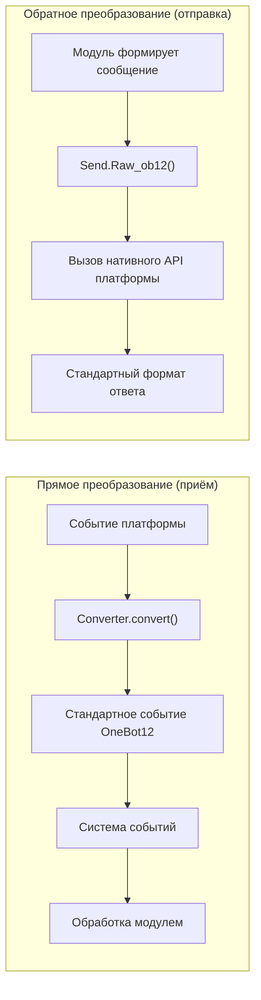
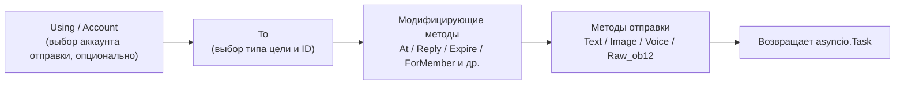
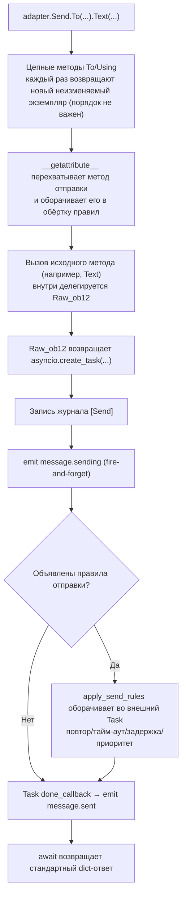

# ErisPulse 适配器开发

This skill is auto-built from the ErisPulse documentation.
Repository: https://github.com/ErisPulse/ErisPulse
Source paths are annotated per section; see docs/ in the repository for the latest content.

## 内容大纲

AI 按需读取：只读需要的章节即可，不必全文加载。

- 适配器开发入门: 88-97 行
- Введение в адаптеры: 99-122 行
- Структура каталогов: 124-137 行
- Быстрый старт: 139-470 行
- Локальная разработка (без упаковки): 472-504 行
- Объявление зависимостей (опционально, 2.8.0+): 506-540 行
- Замечания по `__init__`: 542-739 行
- Что дальше: 741-752 行
- 适配器核心概念: 754-763 行
- Архитектура адаптера: 765-804 行
- AdapterManager адаптер-менеджер: 806-1039 行
- BaseAdapter (базовый класс): 1041-1424 行
- DSL для отправки сообщений Send: 1426-1497 行
- Конвертер событий: 1499-1570 行
- Управление соединениями: 1572-1742 行
- Стандартные ответы API: 1744-1776 行
- Поддержка нескольких аккаунтов: 1778-1849 行
- Обработка ошибок: 1851-1903 行
- Управление состоянием ботов: 1905-1956 行
- Связанная документация: 1958-1967 行
- 发送 DSL: 1969-1979 行
- Базовые способы вызова: 1981-2005 行
- Цепочка методов: 2007-2015 行
- Методы отправки: 2017-2065 行
- Модифицирующие методы: 2067-2131 行
- Использование модифицирующих методов в классе-обёртке Event: 2133-2195 行
- Управление аккаунтами: 2197-2222 行
- Асинхронная обработка: 2224-2247 行
- Система правил отправки: 2249-2372 行
- Режим пакетного построения: 2374-2497 行
- Правила именования: 2499-2544 行
- Внутреннее устройство цепочки отправки: 2546-2604 行
- Возвращаемые значения: 2606-2661 行
- Полные примеры: 2663-2699 行
- Связанная документация: 2701-2711 行
- 转换器: 2713-2722 行
- Ответственность Converter: 2724-2736 行
- Базовый класс BaseConverter (рекомендуется): 2738-2784 行
- Метод convert(): 2786-2826 行
- Обязательные поля: 2828-2854 行
- Преобразование сообщений: 2856-2886 行
- Правила рендеринга alt_message: 2888-2908 行
- Платформенные расширения: 2910-2931 行
- Полный пример: 2933-3013 行
- Пример преобразования сообщений с мультимедиа: 3015-3062 行
- Распространённые ошибки: 3064-3106 行
- Лучшие практики: 3108-3114 行
- Связанные документы: 3116-3126 行
- 适配器最佳实践: 3128-3138 行
- Управление состоянием ботов и Meta-события: 3140-3237 行
- Управление подключением: 3239-3354 行
- Преобразование событий: 3356-3408 行
- Реализация SendDSL: 3410-3471 行
- Ответы API: 3473-3522 行
- Поддержка нескольких аккаунтов: 3524-3584 行
- Обработка ошибок: 3586-3638 行
- Тестирование: 3640-3684 行
- Обратное преобразование и построение сообщений: 3686-3694 行
- Расширение методами событий платформы: 3696-3748 行
- Поддержка документации: 3750-3757 行
- Основная информация: 3759-3761 行
- Поддерживаемые типы отправляемых сообщений: 3763-3764 行
- Специфичные типы событий: 3766-3767 行
- Параметры конфигурации: 3769-3780 行
- Связанная документация: 3782-3792 行
- 平台接入指南索引: 3794-3811 行
- Платформенные функции: 3813-3839 行
- Общие интерфейсы: 3841-4021 行
- Стандартные форматы: 4023-4079 行
- Ссылки: 4081-4092 行
- Участие в разработке: 4094-4103 行

## 适配器开发入门

> 来源: `docs/ru/developer-guide/adapters/getting-started.md`（https://github.com/ErisPulse/ErisPulse/blob/main/docs/ru/developer-guide/adapters/getting-started.md）

# Введение в разработку адаптеров

> [!TIP]
> **Когда читать этот документ**: стартовая (обязательная к прочтению) статья цикла разработки адаптеров. Здесь описано, как написать адаптер с нуля, каковы границы ответственности адаптера и структура проекта; после прочтения переходите по необходимости к разделам [Конвертер событий](converter.md) и [Подробное описание SendDSL](send-dsl.md).

Пройдя это руководство, вы получите минимально работоспособный адаптер, способный принимать события и отправлять сообщения (главный класс + конвертер + Send), и будете чётко понимать границы ответственности каждого компонента — вся работа по подключению новой платформы начинается именно отсюда.

## Введение в адаптеры

### Что такое адаптер

Адаптер — это мост между ErisPulse и различными платформами обмена сообщениями, отвечающий за:

1. **Прямое преобразование**: приём событий платформы и преобразование их в стандартный формат OneBot12 (Converter)
2. **Обратное преобразование**: преобразование сегментов сообщений OneBot12 в вызовы API платформы (`Raw_ob12`)
3. Управление соединением с платформой (WebSocket/WebHook)
4. Предоставление унифицированного интерфейса отправки сообщений SendDSL

### Архитектура адаптера



## Структура каталогов

Стандартная структура пакета адаптера:

```
MyAdapter/
├── pyproject.toml          # Конфигурация проекта
├── README.md               # Описание проекта
├── LICENSE                 # Лицензия
└── MyAdapter/
    ├── __init__.py          # Точка входа пакета
    ├── Core.py               # Главный класс адаптера
    └── Converter.py          # Конвертер событий
```

## Быстрый старт

### 1. Создание проекта

Рекомендуется сразу сгенерировать полный каркас с помощью скаффолда (включая pyproject, главный класс и конвертер):

```bash
# Стандартный проект (для упаковки и публикации)
epsdk create adapter -n MyAdapter

# Локальный плагин-адаптер (без упаковки; достаточно поместить в каталог plugins/ для автозагрузки, см. раздел «Локальная разработка» ниже)
epsdk create adapter -n MyAdapter --local
```

Скаффолд по умолчанию генерирует каркас WebSocket-сервера; если платформа использует другой способ подключения, можно выбрать шаблон режима связи через `--template`
(используются соответствующие базовые классы-заготовки, `start`/`shutdown` писать самому не нужно):

```bash
epsdk create adapter -n MyAdapter --template polling   # HTTP-опрос (pull через getUpdates)
epsdk create adapter -n MyAdapter --template webhook   # HTTP-колбэк (push со стороны платформы)
```

> Различия трёх режимов подключения и минимальный набор реализаций для базовых классов-заготовок описаны в разделе
> [Основные концепции адаптеров — Базовые классы-заготовки режимов подключения](core-concepts.md#连接模式半成品基类).
> Полные рабочие примеры смотрите в репозитории: `examples/example-adapter-polling/` и `examples/example-adapter-webhook/`.

Можно также создать всё вручную:

```bash
mkdir MyAdapter && cd MyAdapter
```

### 2. Создание pyproject.toml

```toml
[project]
name = "ErisPulse-MyAdapter"
version = "1.0.0"
description = "Адаптер для платформы MyAdapter"
readme = "README.md"
requires-python = ">=3.10"
license = { file = "LICENSE" }
authors = [ { name = "yourname", email = "your@mail.com" } ]

dependencies = [
    "ErisPulse>=2.4.0"  # ErisPulse уже включает aiohttp, отдельная зависимость обычно не нужна
]

[project.urls]
"homepage" = "https://github.com/yourname/MyAdapter"

[project.entry-points."erispulse.adapter"]
"MyAdapter" = "MyAdapter:MyAdapter"
```

### 3. Создание главного класса адаптера

Фреймворк предоставляет декларативное управление конфигурацией через `ConfigClass` / `AccountConfigClass`; адаптеру достаточно объявить класс конфигурации, и загрузка, валидация и генерация шаблона конфигурации выполнятся автоматически.

```python
# MyAdapter/Core.py
from dataclasses import dataclass, field
# Рекомендуется импорт из корня (2.10+): часто используемые символы импортируются напрямую из корневого пакета, глубокие пути остаются совместимыми
from ErisPulse import BaseAdapter, BaseConfig

@dataclass
class MyAdapterConfig(BaseConfig):
    """Конфигурация MyAdapter"""
    api_endpoint: str = field(
        default="https://api.example.com",
        metadata={
            "description": {"i18n": "my_adapter.api_endpoint", "default": "Адрес API"},
            "required": False,
            "ui": {"widget": "text", "group": "connection", "order": 1},
        },
    )
    token: str = field(
        default="",
        metadata={
            "description": {"i18n": "my_adapter.token", "default": "Token платформы"},
            "required": True,
            "secret": True,
            "ui": {"widget": "password", "group": "basic", "order": 2},
        },
    )

class MyAdapter(BaseAdapter):
    ConfigClass = MyAdapterConfig  # Объявляем класс конфигурации, фреймворк управляет им автоматически
    
    # Не нужно переопределять __init__! Фреймворк автоматически:
    # - устанавливает self.sdk / self.logger
    # - self.cfg читает конфигурацию в реальном времени
    # - автоматически инициализирует self.Send / self.Request
    
    def _setup_converter(self):
        from .Converter import MyPlatformConverter
        return MyPlatformConverter()
```

> ⚠️ **О `__init__`**: в новых версиях `BaseAdapter.__init__(self, sdk=None)` автоматически обрабатывает ссылку на SDK, инициализацию логирования и загрузку конфигурации. Большинству адаптеров **больше не нужно переопределять `__init__`**. Подробнее см. [Замечания по `__init__`](#init-注意事项).

> ⚠️ **О `super().__init__()`**: `BaseAdapter.__init__()` отвечает за создание фабрик `Send` и `Request`. Если забыть его вызвать, все операции отправки сообщений и запросов будут завершаться `AttributeError`. Подробнее см. [Замечания по `__init__`](#init-注意事项).

### 4. Реализация обязательных методов

```python
class MyAdapter(BaseAdapter):
    # ... код __init__ ...
    
    async def start(self):
        """Запуск адаптера (обязателен к реализации)"""
        # Регистрируем маршруты WebSocket или WebHook
        router.register_websocket(
            module_name="myplatform",
            path="/ws",
            handler=self._ws_handler
        )
        self.logger.info("Адаптер запущен")
    
    async def shutdown(self):
        """Остановка адаптера (обязательна к реализации)"""
        router.unregister_websocket(
            module_name="myplatform",
            path="/ws"
        )
        # Очищаем соединения и ресурсы
        self.logger.info("Адаптер остановлен")
    
    async def call_api(self, endpoint: str, **params):
        """Вызов API платформы (обязателен к реализации)"""
        raise NotImplementedError("Необходимо реализовать call_api")
```

#### Проактивная отправка Meta-событий

Адаптер должен проактивно отправлять meta-события, чтобы фреймворк мог отслеживать состояние бота (в сети/не в сети). С помощью `emit_meta()` это делается одной строкой:

```python
class MyAdapter(BaseAdapter):
    async def _ws_handler(self, websocket):
        bot_id = self._get_bot_id()

        # Бот в сети
        await self.emit_meta("connect", bot_id, user_name="MyBot")

        try:
            while True:
                data = await websocket.receive_text()
                event = self.convert(data)
                if event:
                    await self.adapter.emit(event)
        except WebSocketDisconnect:
            pass
        finally:
            # Бот отключился
            await self.emit_meta("disconnect", bot_id)
```

> Подробное описание управления состоянием бота и Meta-событий см. в разделе [Лучшие практики адаптеров — Управление состоянием бота](best-practices.md#bot-状态管理与-meta-事件).

### 5. Реализация класса Send

Модификаторы `At`/`AtAll`/`Reply` уже встроены в базовый класс SendDSL фреймворка; адаптеру достаточно реализовать `Raw_ob12` и конкретные методы отправки.

Фреймворк предоставляет два ключевых вспомогательных метода:
- `self._apply_modifiers(message)` — автоматически объединяет модификаторы At/AtAll/Reply в сегменты сообщения
- `self.send_context` — получение словаря контекста отправки (`target_type`, `target_id`, `account_id`)

```python
import asyncio

class MyAdapter(BaseAdapter):
    # ... остальной код ...

    class Send(BaseAdapter.Send):

        def Raw_ob12(self, message, **kwargs):
            """
            Отправка сообщения в формате OneBot12 (обязательна к реализации)

            Использует _apply_modifiers для автоматического объединения
            состояния модификаторов, а send_context — для получения
            контекста отправки.
            """
            async def _do_send():
                segments = self._apply_modifiers(message)
                return await self._adapter.call_api(
                    endpoint="/send_message",
                    message=segments,
                    **self.send_context,
                    **kwargs
                )
            return asyncio.create_task(_do_send())

        # Text/Image/Voice/Video/File наследуются от базового класса SendDSL,
        # по умолчанию они делегируют Raw_ob12, повторная реализация не требуется.
        # При необходимости платформо-специфичной логики можно переопределить отдельный метод:
        # def Text(self, text: str):
        #     return self.Raw_ob12([{"type": "text", "data": {"text": text}}])
```

**Ключевые моменты реализации методов отправки медиафайлов (Image/Video/File):**

- Реализация по умолчанию в базовом классе оборачивает параметр `file` в сегмент сообщения OneBot12 и передаёт его в `Raw_ob12`; адаптер должен обрабатывать скачивание/загрузку внутри `Raw_ob12`
- Параметр `file` должен поддерживать как бинарные данные `bytes`, так и URL-строки `str`
- При передаче URL нужно сначала скачать файл, а затем загрузить его на платформу
- Платформам обычно требуется сначала вызвать API загрузки для получения идентификатора файла, а затем вызвать API отправки

**Магический метод `__getattr__`:**

- Обеспечивает регистронезависимость имён методов (можно вызывать `Text`, `text`, `TEXT`)
- Неопределённые методы должны возвращать информационное сообщение, а не вызывать ошибку

**Метод `Raw_ob12`:**

- Преобразует стандартный формат сообщений OneBot12 в формат платформы и отправляет
- Использует `self._apply_modifiers(message)` для автоматической обработки модификаторов At/AtAll/Reply
- Использует `**self.send_context` для передачи информации о цели отправки и аккаунте

### 6. Реализация конвертера

```python
# MyAdapter/Converter.py
import time
import uuid

class MyPlatformConverter:
    def convert(self, raw_event):
        """Преобразует нативное событие платформы в стандартный формат OneBot12"""
        if not isinstance(raw_event, dict):
            return None
        
        onebot_event = {
            "id": str(raw_event.get("event_id", uuid.uuid4())),
            "time": int(time.time()),
            "type": self._convert_event_type(raw_event.get("type")),
            "detail_type": self._convert_detail_type(raw_event),
            "platform": "myplatform",
            "self": {
                "platform": "myplatform",
                "user_id": str(raw_event.get("bot_id", ""))
            },
            "myplatform_raw": raw_event,
            "myplatform_raw_type": raw_event.get("type", "")
        }
        
        return onebot_event
    
    def _convert_event_type(self, event_type):
        """Преобразует тип события"""
        type_map = {
            "message": "message",
            "notice": "notice"
        }
        return type_map.get(event_type, "unknown")
    
    def _convert_detail_type(self, raw_event):
        """Преобразует детальный тип"""
        return "private"  # упрощённый пример
```

### 7. Реализация класса Request (операции с запросами)

Если ваша платформа поддерживает запросы, требующие решения бота (заявки в друзья, приглашения в группы и т. п.), можно реализовать внутренний класс `Request`:

```python
from ErisPulse import BaseAdapter, RequestDSL

class MyAdapter(BaseAdapter):
    # ... Send и остальной код ...

    class Request(RequestDSL):
        """Реализация операций с запросами (заявки в друзья, приглашения в группы и т. д.)"""

        def accept(self, **kwargs):
            """Принять запрос"""
            async def _do():
                result = await self._adapter.call_api(
                    endpoint="/set_request",
                    request_id=self._request_id,
                    approve=True,
                    **kwargs,
                )
                return {
                    "status": "ok" if result.get("code") == 0 else "failed",
                    "retcode": result.get("code", 0),
                    "data": None,
                    "message_id": "",
                    "message": result.get("message", ""),
                }
            return self._create_task(_do())

        def reject(self, **kwargs):
            """Отклонить запрос"""
            async def _do():
                result = await self._adapter.call_api(
                    endpoint="/set_request",
                    request_id=self._request_id,
                    approve=False,
                    **kwargs,
                )
                return {
                    "status": "ok" if result.get("code") == 0 else "failed",
                    "retcode": result.get("code", 0),
                    "data": None,
                    "message_id": "",
                    "message": result.get("message", ""),
                }
            return self._create_task(_do())
```

Как этим пользуются разработчики модулей:

```python
from ErisPulse import request

@request.on_friend_request()
async def handle_friend_request(event):
    # Через удобные методы Event
    await event.approve()
    # Или напрямую через адаптер
    await adapter.myplatform.Request("req_id").accept()
```

> Если платформа не поддерживает операции с запросами, внутренний класс `Request` можно не реализовывать. Базовый класс по умолчанию возвращает `retcode=10002` (неподдерживаемая операция). Подробнее см. [Спецификация операций с запросами](../../standards/request-action-spec.md).

### 8. Создание точки входа пакета

```python
# MyAdapter/__init__.py
from .Core import MyAdapter
```

## Локальная разработка (без упаковки)

Как и модули, адаптеры можно разрабатывать напрямую в локальном каталоге плагинов проекта (по умолчанию `plugins/`, настраивается через `ErisPulse.framework.plugins_dir`), **без `pip install -e .`**:

```bash
# Сгенерировать локальный плагин-адаптер
epsdk create adapter -n MyAdapter --local
# Сгенерированная структура:
# plugins/
# └── MyAdapter/
#     ├── __init__.py
#     ├── Core.py
#     └── Converter.py
```

При запуске фреймворк автоматически сканирует каталог плагинов и загружает находящиеся в нём модули и адаптеры (с теми же правами, что и пакеты, установленные через entry-point: состояние включения, объявление конфигурации, горячее обновление и очистка при удалении полностью идентичны):

- **Правила распознавания**: подходит как каталог пакета (с `__init__.py`), так и одиночный файл `.py`; в первую очередь распознаётся класс с именем `Main`, иначе берётся первый подкласс `BaseAdapter` / `BaseModule` в плагине
- **Переопределение при совпадении имён**: если локальный плагин и адаптер, установленный с PyPI, имеют одинаковое имя, приоритет у локального плагина (удобно для отладки с переопределением)
- **Горячая перезагрузка**: мониторинг каталога плагинов, включаемый через `sdk.enable_plugin_hot_reload()`, также распространяется на адаптеры; горячая перезагрузка кода адаптера на уровне кода доступна с версии 2.11 — `await sdk.adapter.reload("имя платформы")` или `await sdk.reload_adapter("имя платформы")` (предварительная проверка синтаксиса → очистка при выгрузке → очистка кэша и повторный импорт → повторная регистрация и запуск; при сбое выполняется автоматический откат; подробнее см. [Обзор архитектуры](../../architecture.md))

### От локального плагина к публикации

После локальной проверки с помощью подкоманды `pack` можно в один клик преобразовать плагин в готовый к публикации стандартный проект (интерактивный выбор плагина, заполнение метаданных, генерация pyproject с entry-point):

```bash
epsdk create pack
# Выберите плагин из каталога плагинов → введите название/описание/автора проекта → будет сгенерирован каталог проекта MyAdapter/
cd MyAdapter
pip install -e .   # Преобразование в стандартную установку; затем следуйте процессу публикации для загрузки на PyPI
```

> **Подсказка**: после преобразования рекомендуется удалить исходную копию из `plugins/`, чтобы избежать двойной загрузки локального плагина и установленного пакета (при совпадении имён приоритет у локального, из-за чего можно ошибочно решить, что работает установленный пакет).

## Объявление зависимостей (опционально, 2.8.0+)


Адаптер может объявлять зависимости от других адаптеров или модулей, обеспечивая взаимодействие между адаптерами и опциональные функции:

```python
from typing import ClassVar

class MyAdapter(BaseAdapter):
    # Жёсткие зависимости: при их отсутствии запуск пропускается (предупреждение + событие status=skipped-dependency)
    depends: ClassVar[dict] = {
        "adapters": ["onebot11"],   # Зависимости-адаптеры (по имени платформы)
        "modules": ["TranslateEngine"],  # Зависимости-модули (по имени регистрации)
    }
    # Мягкие зависимости: их отсутствие не влияет на запуск; при загрузке/выгрузке модуля приходит колбэк (режим опциональных функций)
    optional_modules: ClassVar[list] = ["TranslateEngine"]
```

- **Порядок запуска**: адаптеры, объявившие жёсткие зависимости от модулей, **откладывают запуск до завершения инициализации модулей**
- **Уведомления о мягких зависимостях**: при загрузке модуля из `optional_modules` (или из жёстких зависимостей модулей) вызывается `on_dependency_ready(module_name)`; при выгрузке — `on_dependency_lost(module_name)` (по умолчанию пустые реализации, можно переопределить) — охватывает сценарии поздней загрузки и горячей перезагрузки:

```python
async def on_dependency_ready(self, module_name):
    """Мягкая зависимость готова: включаем соответствующую опциональную функцию"""
    if module_name == "TranslateEngine":
        self._translate = self.sdk.TranslateEngine

async def on_dependency_lost(self, module_name):
    """Мягкая зависимость потеряна: деградация функций"""
    if module_name == "TranslateEngine":
        self._translate = None
```

> [!NOTE]
> Для этой возможности требуется ErisPulse **2.8.0+**.

## Замечания по `__init__`

В разработке адаптеров есть три уровня, где может потребоваться переопределение `__init__`. Ниже — правильный подход для каждого уровня.

### 1. Уровень BaseAdapter (в большинстве случаев переопределение не требуется)

`BaseAdapter.__init__(self, sdk=None)` отвечает за создание фабрик `Send` / `Request` и автоматически выполняет следующее:

- принимает параметр `sdk` и устанавливает `self.sdk`, `self.logger`
- если объявлен `ConfigClass`, через `self.cfg` можно читать глобальную конфигурацию в реальном времени
- если объявлен `AccountConfigClass`, через `self.accounts` можно читать конфигурацию нескольких аккаунтов в реальном времени

**В большинстве случаев переопределять `__init__` не нужно**, достаточно объявить `ConfigClass`:

```python
class MyAdapter(BaseAdapter):
    ConfigClass = MyAdapterConfig  # После объявления фреймворк управляет конфигурацией автоматически
    
    async def start(self):
        cfg = self.cfg  # Типобезопасно, чтение в реальном времени
        ...
```

Если действительно нужна собственная логика инициализации, достаточно вызвать `super().__init__(sdk)`:

```python
class MyAdapter(BaseAdapter):
    ConfigClass = MyAdapterConfig
    
    def __init__(self, sdk=None):
        super().__init__(sdk)  # Передаём sdk
        self.converter = self._setup_converter()
        self.convert = self.converter.convert
```

### 2. Внутренний класс Send (в большинстве случаев переопределение не требуется)

`SendDSL.__init__` отвечает за передачу состояния при цепочечных вызовах (тип цели, ID цели, аккаунт и т. д.). **В большинстве случаев нужно переопределять только методы** (`Raw_ob12`, `Text` и т. д.), а не `__init__`.

Если это действительно необходимо (например, для инициализации специфичного для платформы состояния), **обязательно передавайте все параметры дальше**:

```python
class MyAdapter(BaseAdapter):
    class Send(BaseAdapter.Send):
        # Параметры: adapter, target_type, target_id, account_id
        def __init__(self, adapter, target_type=None, target_id=None, account_id=None):
            super().__init__(adapter, target_type, target_id, account_id)  # ← обязательно передать дальше
            self._my_state = None  # Инициализация, специфичная для платформы
```

**Почему обязательно передавать дальше?** Каждый шаг цепочечного вызова создаёт новый экземпляр через `self.__class__(...)`:

```python
adapter.Send.To("user", "123")               # → Send(adapter, "user", "123", None)
adapter.Send.To("user", "123").Using("bot1")  # → Send(adapter, "user", "123", "bot1")
```

Если сигнатура `__init__` не совпадает или не вызван `super()`, цепочка вызовов прервётся.

### 3. Внутренний класс Request (в большинстве случаев переопределение не требуется)

Аналогично Send. Параметры: `adapter`, `request_id`, `account_id`:

```python
class MyAdapter(BaseAdapter):
    class Request(RequestDSL):
        # Параметры: adapter, request_id, account_id
        def __init__(self, adapter, request_id=None, account_id=None):
            super().__init__(adapter, request_id, account_id)  # ← обязательно передать дальше
            self._my_state = None  # Инициализация, специфичная для платформы
```

### Итог

| Уровень | Когда переопределять | Что обязательно сделать |
|------|------------|-----------|
| **BaseAdapter** | Если нужна собственная логика инициализации | `super().__init__(sdk)` (передать параметр sdk) |
| **Внутренний класс Send** | Если нужно инициализировать состояние, связанное с отправкой | `super().__init__(adapter, target_type, target_id, account_id)` |
| **Внутренний класс Request** | Если нужно инициализировать состояние, связанное с запросами | `super().__init__(adapter, request_id, account_id)` |
| Все три уровня | В большинстве случаев | **Просто объявить ConfigClass, не трогая `__init__`** |

### 9. Сведения о подключении и обнаружение маршрутов

После регистрации маршрутов адаптером фреймворк сохраняет всю информацию о маршрутах. Пользователи могут посмотреть адреса подключения адаптера через следующие API:

```python
from ErisPulse import sdk

# Получить полную информацию о подключении адаптера
info = sdk.adapter.get_connection_info("myplatform")
# {
#   "platform": "myplatform",
#   "status": "started",
#   "connection": {
#     "base_url": "http://localhost:8080",
#     "http_routes": [
#       {"path": "/myplatform/webhook", "method": "POST",
#        "url": "http://localhost:8080/myplatform/webhook"}
#     ],
#     "websocket_routes": [
#       {"path": "/myplatform/ws",
#        "url": "ws://localhost:8080/myplatform/ws"}
#     ]
#   }
# }

# Перечислить маршруты всех пространств имён (адаптеры/модули)
namespaces = sdk.router.list_namespaces()
# {"myplatform": {"http": ["/myplatform/webhook"], "websocket": ["/myplatform/ws"]}}

# Получить полные URL подключения пространства имён
urls = sdk.router.get_module_urls("myplatform")
# {"base_url": "http://localhost:8080", "http": [...], "websocket": [...]}

# Получить подробную информацию о маршрутах пространства имён
routes = sdk.router.get_module_routes("myplatform")
# {"http": [{"path": "/myplatform/webhook", "methods": ["POST"]}],
#  "websocket": [{"path": "/myplatform/ws", "auth": false}]}
```

> **Подсказка**: информация, возвращаемая `get_connection_info()`, подходит для отображения пользователю (например, в WebUI) и помогает настроить адрес колбэка или адрес WebSocket-подключения на стороне платформы. `module_name`, указанный при регистрации маршрута, должен полностью совпадать с именем `platform`, под которым адаптер зарегистрирован в ErisPulse, иначе обнаружение маршрутов не сможет корректно их связать.

### 10. Поддержка SSE (Server-Sent Events)

ErisPulse имеет встроенную поддержку SSE, не зависящую от сервера; модули и адаптеры могут регистрировать SSE-эндпоинты через `@sdk.router.sse()`.

#### Базовое использование

```python
import asyncio
from ErisPulse import sdk

@sdk.router.sse("MyModule", "/events")
async def event_stream(sse):
    """Отправка SSE-событий"""
    count = 0
    while not sse.closed:
        await sse.send({"count": count}, event="update")
        count += 1
        await asyncio.sleep(1)
```

#### Использование параметров запроса

Обработчик может объявить параметр `request` для доступа к информации о клиентском запросе:

```python
@sdk.router.sse("MyModule", "/events")
async def event_stream(request, sse):
    token = request.query_params.get("token")
    if not validate_token(token):
        await sse.close()
        return

    while not sse.closed:
        data = await fetch_data(token)
        await sse.send(data)
        await asyncio.sleep(5)
```

#### SseEmitter API

| Метод | Описание |
|------|------|
| `sse.send(data, event=None, id=None, retry=None)` | Отправка SSE-события. data, не являющийся str, автоматически сериализуется в JSON |
| `sse.close()` | Корректное закрытие SSE-соединения (безопасно вызывать многократно) |
| `sse.closed` | Закрыто ли соединение |
| `sse.request` | Объект низкоуровневого запроса (можно использовать для чтения query params, headers) |

#### Использование в RouteGroup

```python
api = sdk.router.group("MyModule", "/api", version="1")

@api.sse("/events")
async def events(sse):
    await sse.send({"msg": "hello"})
```

#### Обнаружение маршрутов

SSE-маршруты автоматически появляются в API обнаружения маршрутов:

```python
# list_namespaces включает ключ "sse"
sdk.router.list_namespaces()
# {"MyModule": {"http": [...], "websocket": [...], "sse": ["/MyModule/events"]}}

# get_module_routes помечает streaming: true
sdk.router.get_module_routes("MyModule")
# {"http": [...], "websocket": [...], "sse": [{"path": "/MyModule/events", "streaming": true}]}

# get_module_urls генерирует полные URL
sdk.router.get_module_urls("MyModule")
# {"sse": [{"path": "/MyModule/events", "url": "http://localhost:8080/MyModule/events"}]}
```

> **Независимость от сервера**: `SseEmitter` отделён от низкоуровневого HTTP-фреймворка через колбэки. Фреймворк предоставляет `register_sse()` и декоратор `@sse` в качестве единой точки регистрации, поэтому адаптер может реализовать SSE-эндпоинты без прямой зависимости от какого-либо низкоуровневого HTTP-фреймворка.

## Что дальше

### Дополните три ключевых компонента адаптера

- [Конвертер событий](converter.md) — детали реализации преобразования событий платформы → OneBot12 и типичные ловушки
- [Подробное описание SendDSL](send-dsl.md) — цепочка отправки сообщений, методы-модификаторы и правила отправки
- [Основные концепции адаптеров](core-concepts.md) — описание механизмов BaseAdapter / жизненного цикла / мультиаккаунта

### После того как каркас заработал

- [Лучшие практики адаптеров](best-practices.md) — инженерная доводка: повторные попытки подключения, heartbeat, обработка ошибок
- [Руководство по публикации и магазину модулей](../publishing.md) — публикация на PyPI и в магазине модулей

## 适配器核心概念

> 来源: `docs/ru/developer-guide/adapters/core-concepts.md`（https://github.com/ErisPulse/ErisPulse/blob/main/docs/ru/developer-guide/adapters/core-concepts.md）

# Основные концепции адаптеров

> [!TIP]
> **Когда стоит читать этот документ**: обязательный материал на пути разработки адаптеров (полное описание ключевых механизмов: BaseAdapter / SendDSL / жизненный цикл и др.). Если вам нужно лишь начать работу, сначала прочитайте [Введение в разработку адаптеров](getting-started.md), а к этому документу возвращайтесь при возникновении вопросов уровня «почему».

Этот документ объясняет, как работают адаптеры: как AdapterManager регистрирует и распределяет события, что `BaseAdapter` делает за вас при инициализации, как объявлять конфигурацию и поддержку нескольких аккаунтов — если при написании адаптера возникает вопрос «почему нужно писать именно так», ищите ответ здесь.

## Архитектура адаптера

### Отношения между компонентами

```
Прямое преобразование (направление приёма)                      Обратное преобразование (направление отправки)
─────────────────                                           ─────────────────
                                                             
┌──────────────────┐                                        ┌──────────────────┐
│ Платформа-специфич. события │                                        │ Модуль формирует сообщение │
└────────┬─────────┘                                        └────────┬─────────┘
         │                                                           │
         ↓                                                           ↓
┌──────────────────┐   ┌──────────────────┐   ┌──────────────────┐
│                  │   │ Адаптер (MyAdapter) │   │ Send.Raw_ob12()  │
│  Converter       │   │ ┌──────────────┐ │   │ (точка входа обратного преобразования)   │
│  (конвертер событий)    │──→│ │              │ │   │                  │
│                  │   │ │              │ │   │                  │
└──────────────────┘   │ └──────────────┘ │   └────────┬─────────┘
                       └──────────────────┘            │
                                │                      ↓
                                ↓              ┌──────────────────┐
                       ┌──────────────────┐    │ Вызов API платформы    │
                       │ Стандартные события OneBot12 │    └────────┬─────────┘
                       └────────┬─────────┘             │
                                │                      ↓
                                ↓              ┌──────────────────┐
                       ┌──────────────────┐    │ Стандартный формат ответа     │
                       │ Система событий         │    └──────────────────┘
                       └────────┬─────────┘
                                │
                                ↓
                       ┌──────────────────┐
                       │ Модуль (обработка событий)  │
                       └──────────────────┘
```

**Основная симметрия**:
- **Прямое преобразование** (Converter): платформа-специфич. события → события OneBot12, оригинальные данные сохраняются в `{platform}_raw`
- **Обратное преобразование** (Raw_ob12): сообщения OneBot12 → вызов API платформы, возвращается стандартный формат ответа

## AdapterManager адаптер-менеджер

`AdapterManager` — это основной компонент адаптерной системы ErisPulse, отвечающий за управление регистрацией, запуском, остановкой и распределением событий всех адаптеров платформ.

### Основные функции

- **Регистрация адаптеров**: Регистрация и управление несколькими адаптерами платформ.
- **Управление жизненным циклом**: Контроль запуска и остановки адаптеров.
- **Распределение событий**: Распределение событий по стандарту OneBot12 и событий оригинальных платформ.
- **Управление конфигурацией**: Управление включением/отключением адаптеров.
- **Поддержка промежуточных обработчиков**: Поддержка промежуточных обработчиков событий OneBot12.

### Основное использование

```python
from ErisPulse import sdk

# Регистрация адаптера (обычно выполняется автоматически загрузчиком)
sdk.adapter.register("myplatform", MyPlatformAdapter)

# Запуск всех адаптеров
await sdk.adapter.startup()

# Запуск указанных адаптеров
await sdk.adapter.startup(["myplatform"])
# Запуск всех адаптеров
await sdk.adapter.startup()

# Получение экземпляра адаптера
my_adapter = sdk.adapter.get("myplatform")
# Или доступ через свойство
my_adapter = sdk.adapter.myplatform

# Остановка всех адаптеров
await sdk.adapter.shutdown()
```

### Запуск и остановка

#### Запуск адаптера

```python
# Запуск всех зарегистрированных адаптеров
await sdk.adapter.startup()

# Запуск указанной платформы
await sdk.adapter.startup(["platform1", "platform2"])
```

**Процесс запуска:**

1. Отправка события жизненного цикла `adapter.start`.
2. Отправка события `adapter.status.change` (starting).
3. Параллельный запуск каждого адаптера.
4. Автоматическая повторная попытка при сбое (стратегия экспоненциальной задержки).
5. Отправка события `adapter.status.change` (started) после успешного запуска.

**Механизм повторных попыток:**

- Первые 4 попытки: 60 секунд, 10 минут, 30 минут, 60 минут.
- С пятой попытки и далее: фиксированный интервал в 3 часа.

#### Остановка адаптера

```python
# Остановка всех адаптеров
await sdk.adapter.shutdown()
```

**Процесс остановки:**

1. Отправка события жизненного цикла `adapter.stop`.
2. Вызов метода `shutdown()` всех адаптеров.
3. Остановка маршрутизирующего сервера.
4. Очистка обработчиков событий.
5. Отправка события жизненного цикла `adapter.stopped`.

### Управление конфигурацией

#### Проверка статуса платформы

```python
# Проверка, зарегистрирована ли платформа
exists = sdk.adapter.exists("myplatform")

# Проверка, включена ли платформа
enabled = sdk.adapter.is_enabled("myplatform")

# Использование оператора in
if "myplatform" in sdk.adapter:
    print("Платформа существует и включена")
```

#### Список платформ

```python
# Получение списка всех зарегистрированных платформ
platforms = sdk.adapter.list_registered()

# Получение списка всех платформ и их статусов
status_dict = sdk.adapter.list_items()
# Возвращает: {"platform1": true, "platform2": false, ...}

# Получение списка включённых платформ
enabled_platforms = [p for p, enabled in status_dict.items() if enabled]
```

### Слушатели событий

#### Стандартные события OneBot12

```python
from ErisPulse import sdk

# Слушатель всех стандартных событий сообщений по OneBot12
@sdk.adapter.on("message")
async def handle_message(data):
    print(f"Получено сообщение OneBot12: {data}")

# Слушатель стандартных событий сообщений для определённой платформы
@sdk.adapter.on("message", platform="myplatform")
async def handle_platform_message(data):
    print(f"Получено сообщение myplatform: {data}")

# Слушатель всех событий
@sdk.adapter.on("*")
async def handle_any_event(data):
    print(f"Получено событие: {data.get('type')}")
```

#### Оригинальные события платформы

```python
# Слушатель оригинальных событий для определённой платформы
@sdk.adapter.on("raw_event_type", raw=True, platform="myplatform")
async def handle_raw_event(data):
    print(f"Получено оригинальное событие: {data}")

# Слушатель оригинальных событий для всех платформ (с использованием подстановочного знака)
@sdk.adapter.on("*", raw=True)
async def handle_all_raw_events(data):
    print(f"Получено оригинальное событие: {data}")
```

#### Механизм распределения событий

При вызове `adapter.emit(event_data)`:

1. **Обработка промежуточными обработчиками**: Сначала выполняются все промежуточные обработчики OneBot12.
2. **Распределение стандартных событий**: Распределяются на соответствующие обработчики стандартных событий OneBot12.
3. **Распределение оригинальных событий**: Если есть оригинальные данные, они распределяются на обработчики оригинальных событий.

**Правила сопоставления:**

- Точное совпадение: `@sdk.adapter.on("message")` сопоставляется только с событием `message`.
- Подстановочный знак: `@sdk.adapter.on("*")` сопоставляется со всеми событиями.
- Фильтрация по платформе: `platform="myplatform"` сопоставляется только с событиями указанной платформы.

### Промежуточные обработчики

#### Добавление промежуточного обработчика

```python
@sdk.adapter.middleware
async def logging_middleware(data):
    """Промежуточный обработчик для логирования"""
    print(f"Обработка события: {data.get('type')}")
    return data  # Обязательно вернуть данные

@sdk.adapter.middleware
async def filter_middleware(data):
    """Промежуточный обработчик для фильтрации событий"""
    # Фильтрация ненужных событий
    if data.get("type") == "notice":
        return None  # При возврате None промежуточная цепочка игнорирует результат, оставляя исходные данные для передачи
    return data  # Обязательно вернуть данные для продолжения передачи
```

#### Соглашение о возвращаемых значениях промежуточного обработчика

| Возвращаемое значение | Поведение |
|-----------------------|-----------|
| `dict`                | Изменение полезной нагрузки события (последующие обработчики получают изменённое событие) |
| `None`                | Пропуск, полезная нагрузка не изменяется (вывод предупреждения — рекомендуется явно `return data`) |
| `False`               | **Отклонение**: событие отбрасывается, не поступает в обработчики и не вызывает побочных эффектов |

Отклонение подходит для сценариев "отбрасывания события на уровне", таких как брандмауэр, ограничение скорости, чёрный список (ранее это можно было реализовать только с помощью обработчиков высокого приоритета). При отклонении фреймворк записывает трассировку и запускает хук жизненного цикла `adapter.event.blocked` (содержит имя промежуточного обработчика `middleware`, полное событие `event`, `platform` / `event_type` / `detail_type`), что помогает выяснить, почему событие не было обработано:

```python
@sdk.adapter.middleware
async def rate_limit_middleware(data):
    """Промежуточный обработчик для ограничения скорости"""
    if _is_rate_limited(data):
        return False  # Отклонение: событие отбрасывается
    data["rate_marked"] = True
    return data

@sdk.lifecycle.on("adapter.event.blocked")
async def on_event_blocked(data):
    print(f"Событие отброшено {data['middleware']}: {data['event_type']}")
```

#### Порядок выполнения промежуточных обработчиков

Промежуточные обработчики выполняются в порядке их регистрации, последние зарегистрированные обработчики выполняются первыми.

> **Внимание**: если промежуточный обработчик возвращает `None` (например, забыли `return data`), фреймворк игнорирует этот результат и сохраняет исходные данные для передачи, при этом выводится предупреждение. Это гарантирует, что ошибка одного промежуточного обработчика не приведёт к прерыванию всей цепочки событий.

```python
# Порядок регистрации
sdk.adapter.middleware(middleware1)  # Выполняется последним
sdk.adapter.middleware(middleware2)  # Выполняется посередине
sdk.adapter.middleware(middleware3)  # Выполняется первым

# Порядок выполнения: middleware3 -> middleware2 -> middleware1
```

### Получение экземпляра адаптера

#### Метод `get()`

```python
adapter = sdk.adapter.get("myplatform")
if adapter:
    await adapter.Send.To("user", "123").Text("Hello")
```

#### Доступ через свойства

```python
# Доступ по имени свойства (регистр не имеет значения)
adapter = sdk.adapter.myplatform
await adapter.Send.To("user", "123").Text("Hello")
```

## BaseAdapter (базовый класс)

### Основная структура

```python
from dataclasses import dataclass, field
from ErisPulse.Core import BaseAdapter
from ErisPulse.Core.Bases import BaseConfig, BotAccountConfig

@dataclass
class MyConfig(BaseConfig):
    """Конфигурация адаптера (объявляется, фреймворк управляет автоматически)"""
    token: str = field(
        default="",
        metadata={
            "description": {"i18n": "my_adapter.token", "default": "Bot Token"},
            "required": True,
            "secret": True,
            "ui": {"widget": "password", "group": "basic", "order": 1},
        },
    )

class MyAdapter(BaseAdapter):
    ConfigClass = MyConfig  # Объявить класс конфигурации
    
    # Не нужно переопределять __init__, фреймворк обрабатывает автоматически:
    # - self.sdk, self.logger
    # - self.cfg (типобезопасная конфигурация, считывается в реальном времени)
    # - self.Send, self.Request
    
    async def start(self):
        """Запуск адаптера (обязательно реализовать)"""
        cfg = self.cfg  # Автоматически загруженная типобезопасная конфигурация
        pass
    
    async def shutdown(self):
        """Остановка адаптера (обязательно реализовать)"""
        pass
    
    async def call_api(self, endpoint: str, **params):
        """Вызов API платформы (обязательно реализовать)"""
        pass
```

### Управление конфигурацией

Фреймворк предоставляет декларативное управление конфигурацией, определяя структуру конфигурации через dataclass, фреймворк автоматически обрабатывает загрузку, проверку и генерацию шаблонов.

#### Конфигурация с одним аккаунтом

```python
from dataclasses import dataclass, field
from ErisPulse.Core.Bases import BaseConfig

@dataclass
class TelegramConfig(BaseConfig):
    token: str = field(default="", metadata={
        "description": {"i18n": "telegram.token", "default": "Bot Token"},
        "required": True,
        "secret": True,
        "ui": {"widget": "password", "group": "basic", "order": 1},
    })
    proxy: str = field(default="", metadata={
        "description": {"i18n": "telegram.proxy", "default": "Адрес прокси"},
        "ui": {"widget": "text", "group": "advanced", "order": 10},
    })

class TelegramAdapter(BaseAdapter):
    ConfigClass = TelegramConfig
    
    async def start(self):
        cfg = self.cfg  # Типобезопасно, считывается в реальном времени
        if not cfg.token:
            raise ValueError("Не настроен токен")
        await self._connect(cfg.token, proxy=cfg.proxy)
```

#### Конфигурация с несколькими аккаунтами

Базовый класс `BotAccountConfig` предоставляет поля `enabled` и `name`. Большинство адаптеров могут автоматически получать `bot_id` из протокола платформы или ответа при входе, в процессе преобразования событий он вставляется в конфигурацию аккаунта.:

```python
from dataclasses import dataclass, field
from ErisPulse.Core.Bases import BotAccountConfig

# Большинство адаптеров: bot_id получается автоматически во время выполнения, не нужно конфигурировать
@dataclass
class MyBotConfig(BotAccountConfig):
    token: str = field(default="", metadata={
        "description": {"i18n": "my_adapter.bot_token", "default": "Токен"},
        "required": True,
    })

# Если при входе невозможно получить bot_id, можно позволить пользователю ввести его в конфигурации
@dataclass
class YunhuBotConfig(BotAccountConfig):
    bot_id: str = field(default="", metadata={
        "description": {"i18n": "yunhu.bot_id", "default": "ID бота"},
        "required": True,
    })
    token: str = field(default="", metadata={
        "description": {"i18n": "yunhu.token", "default": "Токен"},
        "required": True,
    })

class MyAdapter(BaseAdapter):
    AccountConfigClass = MyBotConfig
    
    async def start(self):
        for name, account in self.enabled_accounts.items():
            user_id = await self._login(name, account)
            await self.emit_meta("connect", user_id)
```

#### Соглашение о metadata

Поле metadata служит одновременно для генерации комментариев в TOML и рендеринга форм в WebUI:

```python
metadata = {
    "description": str | dict,  # Описание поля (поддержка i18n)
    "required": bool,         # Обязательно ли заполнять (проверка + метка обязательности в WebUI)
    "secret": bool,           # Является ли чувствительным (в WebUI отображается как ***, в логах маскируется)
    "example": bool,          # Флаг не сохранения: не записывается в config.toml (исключается из значения по умолчанию и шаблона),
                              # только рендерится в config.full.example; schema с "example": true меткой,
                              # конфигурационный гид CLI по умолчанию пропускает; после ручной установки пользователем сохраняется нормально
    "min": number, "max": number,  # Проверка диапазона значений
    "ui": {                   # Настройки элемента управления (старое имя "webui" по-прежнему совместимо)
        "widget": str,        # Тип элемента: "text" | "switch" | "select" | "number" | "password"
        "group": str,         # Группа: "basic" | "advanced" | "connection" и т.д.
        "order": int,         # Вес сортировки (чем меньше, тем ближе)
        "options": list,      # Доступные опции для элемента select [{label, value}], label поддерживает i18n
        "placeholder": str | dict,  # Подсказка в поле ввода (поддержка i18n)
    },
    "extra": dict,            # Дополнительные расширенные поля (прозрачно передаются в schema)
}
```

Все пользовательские видимые текстовые поля поддерживают i18n, единый формат: `{"i18n": "ключ", "default": "текст"}`,
чистая строка прозрачно передается (обратная совместимость). Поддерживаемые поля i18n:

| Поле | Позиция | Описание |
|------|------|------|
| `description` | metadata поля | Описание поля |
| `options[].label` | `ui.options` | Метка опции элемента select |
| `placeholder` | `ui.placeholder` | Подсказка в поле ввода |
| `group_labels` | `_schema_meta` | Название раздела (заголовок секции Dashboard) |

При использовании i18n необходимо заранее зарегистрировать ключ перевода в систему i18n (см. [документацию по i18n](../../advanced/i18n.md#конфигурация-многоязычных-полей) для подробностей).

**Примеры `description` / `placeholder` / `options label`**:

```python
token: str = field(
    default="",
    metadata={
        "description": {"i18n": "my_adapter.token", "default": "Bot Token"},
        "ui": {
            "widget": "text",
            "placeholder": {"i18n": "my_adapter.token.ph", "default": "Введите токен"},
        },
    },
)
mode: str = field(
    default="a",
    metadata={
        "description": {"i18n": "my_adapter.mode", "default": "Режим"},
        "ui": {
            "widget": "select",
            "options": [
                {"label": {"i18n": "my_adapter.mode.a", "default": "Вариант A"}, "value": "a"},
                {"label": "Чистая строка метки", "value": "b"},  # Чистая строка передается как есть
            ],
        },
    },
)
```

**Пример `group_labels`** (объявляется после определения класса конфигурации):

```python
MyConfig._schema_meta = {
    "group_labels": {
        "basic": {"i18n": "my_adapter.group.basic", "default": "Основные настройки"},
        "advanced": {"i18n": "my_adapter.group.advanced", "default": "Дополнительные настройки"},
    }
}
```

Метод `resolve_config_schema()` фреймворка автоматически разрешает все перечисленные выше поля i18n в зависимости от текущего языка;
`get_config_schema()` прозрачно передает словарь i18n, и интерфейс будет разрешать его самостоятельно.

#### Автоматическое создание описания полей из docstring (v2.8.0+)

Поле, не объявленное в metadata `description`, фреймворк автоматически извлекает описание из docstring класса конфигурации в качестве запасного варианта, поддерживает два распространенных стиля (можно использовать вместе):

```python
@dataclass
class MyConfig(BaseConfig):
    """
    Конфигурация MyAdapter

    :ivar endpoint: Адрес API платформы        # Стиль reST
    :ivar timeout: Время ожидания в секундах
    """

    endpoint: str = "https://api.example.com"   # Без metadata description → описание из docstring
    timeout: int = 30

    # Также поддерживается стиль Google (раздел Attributes):
    # Attributes:
    #     endpoint: Адрес API платформы
```

Приоритет: **metadata description > описание поля из docstring > пусто**.
Описание в формате i18n-словаря не затрагивается (всегда приоритет).

#### Вложенные конфигурации (v2.8.0+)

При типе поля вложенный dataclass фреймворк рекурсивно обрабатывает: schema с `"type": "table"` +
`"fields"` поддерево (WebUI рендерит как складываемую вложенную группу), TOML шаблон рендерится как `[подтаблица]` секция,
по умолчанию / заполнение / проверка / разрешение i18n рекурсивно применяются.

```python
@dataclass
class RetryConfig(BaseConfig):
    """Стратегия повтора

    :ivar max_retries: Максимальное количество повторных попыток
    """
    max_retries: int = 3
    backoff: float = 0.5

@dataclass
class MyConfig(BaseConfig):
    """Конфигурация MyAdapter"""
    endpoint: str = "https://api.example.com"
    retry: RetryConfig = field(default_factory=RetryConfig)   # Вложенный конфигурационный раздел
```

Сгенерированный TOML шаблон:

```toml
endpoint = "https://api.example.com"

[retry]
# Максимальное количество повторных попыток
max_retries = 3
backoff = 0.5
```

> Рекомендуется использовать прямой тип аннотации для вложенных типов; строковые аннотации (например, для отложенного вычисления) должны гарантировать, что тип можно разрешить из модуля конфигурационного класса, глобально, по `__qualname__` или по имени класса.

#### Не сохраняемые поля `example` (v2.8.0+)

```python
gc_interval: int = field(default=300, metadata={"example": True})
```

Поле с `example: True`:

- Не записывается в config.toml (шаблон конфигурации адаптера/модуля и значения по умолчанию исключаются, используются значения по умолчанию из кода)
- Отображается только в `config.full.example` проекта (для справки, копируются по желанию в config.toml)
- В schema помечается как `"example": true` (интерфейс может самостоятельно решить стратегию отображения), CLI конфигурационный гид по умолчанию пропускает
- После ручной установки пользователем сохраняется нормально, нормально обновляется (приоритет явного намерения пользователя)

Подходит для "многочисленных и редко используемых" настроек, чтобы сохранить config.toml пользователя минимальным.

> ⚠️ `_schema_meta` — это метаданные на уровне класса (не поле конфигурации). Если объявить внутри тела dataclass класса,
> необходимо добавить аннотацию `ClassVar` (`_schema_meta: ClassVar[dict] = {...}`), иначе dataclass будет воспринимать это как обычное поле. Фреймворк защитно исключает поля с подчеркиванием в начале (не включает в любой schema / шаблон / значения по умолчанию / проверки), но рекомендуется соблюдать стандартное объявление.

### Декларативные ключи перевода (v2.7.0+)

Адаптер может декларировать ключи перевода, подобно `ConfigClass`, с помощью вложенного класса `I18nClass`, фреймворк автоматически зарегистрирует все объявленные ключи перевода в `__init__` этапе (до генерации шаблона конфигурации), обеспечивая доступность ключей перевода в описаниях конфигурации при генерации шаблона.

```python
from ErisPulse.Core.Bases import BaseAdapter, BaseI18n, I18nKey

class MyAdapter(BaseAdapter):
    class I18nClass(BaseI18n):
        endpoint: I18nKey = I18nKey(
            default="API Endpoint",
            zh_CN="API 地址",
            zh_TW="API 位址",
            en="API Endpoint",
            ja="APIアドレス",
            ru="API адрес",
        )
        token: I18nKey = I18nKey(
            default="Platform Token",
            zh_CN="平台 Token",
            zh_TW="平台權杖",
            en="Platform Token",
            ja="プラットフォームトークン",
            ru="Токен платформы",
        )
```

> ``I18nKey.default`` — это **языкозависимый запасной текст**, не регистрируется ни в каком языке.
> Чтобы перевод был активен, необходимо явно передать хотя бы один параметр языка.

Подробное использование (правила путей ключей, явный параметр key и т.д.) см. в [документации по i18n](../../advanced/i18n.md#рекомендуемый-способ-объявление-ключей-перевода-через-i18nclass-v270).

### Декларативные расширения событий (v2.7.0+)

Адаптер может декларировать платформенно-специфич. методы расширения событий через `EventMixin`, фреймворк автоматически регистрирует их для текущей платформы.

```python
from ErisPulse.Core import BaseAdapter

class MyAdapter(BaseAdapter):
    class EventMixin:
        def get_chat_name(self):
            """Получить название чата"""
            return self.get("myplatform_raw", {}).get("chat", {}).get("name", "")

        def is_official_message(self):
            """Проверить, является ли сообщение официальным"""
            raw = self.get("myplatform_raw", {})
            return raw.get("sender", {}).get("is_official", False)
```

После регистрации, методы расширения событий доступны напрямую в объекте события:

```python
@message.on_group_message()
async def handler(event):
    if event.is_official_message():
        chat_name = event.get_chat_name()
        await event.reply(f"[{chat_name}] Официальное сообщение получено")
```

> Методы расширения событий адаптера регистрируются в собственной платформе (``self._platform``).
> Модули, которые нуждаются в расширении событий на разных платформах, должны использовать старый API ``register_event_mixin()``.

#### Разрешение аккаунта

Многоаккаунтный адаптер может использовать `_resolve_account()` для автоматического разрешения целевого аккаунта:

```python
async def call_api(self, endpoint: str, **params):
    account_id = params.pop("account_id", None)
    name, account = self._resolve_account(account_id)
    # name: имя аккаунта, account: экземпляр конфигурации
```

Стратегия разрешения: сопоставление по имени аккаунта → сопоставление по полю `bot_id` → сопоставление по другим строковым полям → первый включенный аккаунт.

#### Горячая перезагрузка конфигурации

Подкласс может переопределить `on_config_update()` для реакции на изменения конфигурации:

```python
class MyAdapter(BaseAdapter):
    ConfigClass = MyConfig
    
    def on_config_update(self, old_config, new_config):
        if old_config.token != new_config.token:
            self.logger.info("Токен обновлен, переподключение")
```

### Процесс инициализации

Фреймворк автоматически выполняет следующие действия в `BaseAdapter.__init__(self, sdk=None)`:

1. **Ссылка на SDK**: установка `self.sdk`, `self.logger`
2. **Фабрика Send/Request**: создание `self.Send` и `self.Request`
3. **Шаблон конфигурации**: если объявлен `ConfigClass`, автоматически генерируется шаблон конфигурации (впервые)
4. **Шаблон аккаунта**: если объявлен `AccountConfigClass`, автоматически генерируется шаблон аккаунта (впервые)
5. **Регистрация EventMixin**: если объявлен `EventMixin`, автоматически регистрируется в `AdapterManager` после вставки имени платформы

Конфигурация считывается в реальном времени через `self.cfg` / `self.accounts` (каждый доступ читает последнее значение из хранилища конфигурации). `self.config` как совместимый псевдоним `self.cfg` по-прежнему доступен.

Большинству адаптеров не нужно переопределять `__init__`. Если требуется кастомная инициализация:

```python
class MyAdapter(BaseAdapter):
    ConfigClass = MyConfig
    
    def __init__(self, sdk=None):
        super().__init__(sdk)  # передать sdk
        self.converter = self._setup_converter()
        self.convert = self.converter.convert
```

## DSL для отправки сообщений Send

### Наследование

```python
class MyAdapter(BaseAdapter):
    class Send(BaseAdapter.Send):
        """Вложенный класс Send, наследующий BaseAdapter.Send"""
        pass
```

### Доступные свойства

При вызове `Send` автоматически устанавливаются следующие свойства:

| Свойство | Описание | Способ установки |
|-----|------|---------|
| `_target_id` | Идентификатор цели | `To(id)` или `To(type, id)` |
| `_target_type` | Тип цели | `To(type, id)` |
| `_target_to` | Упрощенный идентификатор цели | `To(id)` |
| `_account_id` | Идентификатор отправляемого аккаунта | `Using(account_id)` |
| `_adapter` | Экземпляр адаптера | Автоматически установлен |
| `_at_user_ids` | Список пользователей для упоминания | `At(user_id)` |
| `_reply_message_id` | Идентификатор сообщения для ответа | `Reply(message_id)` |
| `_at_all` | Упоминание всех пользователей | `AtAll()` |

> **Рекомендуется**: использовать свойство `self.send_context` для получения `target_type`, `target_id`, `account_id` за один раз, что делает код более понятным, чем прямой доступ к экземплярным переменным.

### Вспомогательные методы фреймворка

| Метод/свойство | Описание |
|-----------|------|
| `self._apply_modifiers(message)` | Объединение состояний модификаторов At/AtAll/Reply в список сообщений |
| `self.send_context` | Возвращает словарь `{target_type, target_id, account_id}` |

### Основные методы

Адаптер должен реализовать только `Raw_ob12`, стандартные методы (Text/Image/Voice/Video/File) уже унаследованы от базового класса `SendDSL` и по умолчанию делегированы ему:

```python
class Send(BaseAdapter.Send):
    def Raw_ob12(self, message, **kwargs):
        """Обязательно реализовать: OneBot12 сообщения → платформенный API"""
        async def _do_send():
            segments = self._apply_modifiers(message)
            return await self._adapter.call_api(
                endpoint="/send_message",
                message=segments,
                **self.send_context,
                **kwargs
            )
        return asyncio.create_task(_do_send())

    # Text/Image/Voice/Video/File уже унаследованы от базового класса, автоматически делегируют Raw_ob12, не нужно повторно реализовывать
    # Если нужна платформенно-специфич. логика, можно переопределить отдельный метод:
    # def Text(self, text: str):
    #     return self.Raw_ob12([{"type": "text", "data": {"text": text}}])
```

### Цепочечные модифицирующие методы

```python
class Send(BaseAdapter.Send):

    def __init__(self, adapter, target_type=None, target_id=None, account_id=None):
        super().__init__(adapter, target_type, target_id, account_id)
        self.buttons = []

    def Button(self, content: list) -> 'Send':
        self.buttons.append(content)
        return self
```

## Конвертер событий

### Процесс преобразования

```
Платформенно-специфич. событие
    ↓
Converter.convert()
    ↓
Стандартное событие OneBot12
```

### Обязательные поля

Все преобразованные события должны содержать:

```python
{
    "id": "Уникальный идентификатор события",
    "time": 1234567890,           # 10-значный Unix timestamp
    "type": "message/notice/request/meta",
    "detail_type": "Детальный тип события",
    "platform": "Название платформы",
    "self": {
        "platform": "Название платформы",
        "user_id": "ID бота"     # Должен совпадать с bot_id
    },
    "{platform}_raw": {...},       # Оригинальные данные (обязательно)
    "{platform}_raw_type": "..."    # Тип оригинального события (обязательно)
}
```

### Пример конвертера

```python
class MyPlatformConverter:
    def convert(self, raw_event):
        """Преобразование платформенно-специфич. события в стандартный формат OneBot12"""
        if not isinstance(raw_event, dict):
            return None
        
        # Генерация идентификатора события
        event_id = raw_event.get("event_id") or str(uuid.uuid4())
        
        # Преобразование временной метки
        timestamp = raw_event.get("timestamp")
        if timestamp and timestamp > 10**12:
            timestamp = int(timestamp / 1000)
        else:
            timestamp = int(timestamp) if timestamp else int(time.time())
        
        # Преобразование типа события
        event_type = self._convert_type(raw_event.get("type"))
        detail_type = self._convert_detail_type(raw_event)
        
        # Построение стандартного события
        onebot_event = {
            "id": str(event_id),
            "time": timestamp,
            "type": event_type,
            "detail_type": detail_type,
            "platform": "myplatform",
            "self": {
                "platform": "myplatform",
                "user_id": str(raw_event.get("bot_id", ""))
            },
            "myplatform_raw": raw_event,
            "myplatform_raw_type": raw_event.get("type", "")
        }
        
        return onebot_event
```

## Управление соединениями

### Два корректных способа реализации start()

Адаптерам клиентского режима (WebSocket-клиент, HTTP-опрос и т.д.) необходимо запускать в `start()` резидентный цикл соединения. Фреймворк поддерживает два способа написания — **оба корректны, но выбрать можно только один из них**:

**Способ 1: spawn с немедленным возвратом (рекомендуется)** — через `spawn_client_loop()` цикл планируется как фоновая задача, принадлежащая данной платформе, при этом `start()` сразу возвращает управление:

```python
class MyAdapter(BaseAdapter):
    async def start(self):
        # Задача цикла принадлежит self._platform: при shutdown фреймворк отменяет её автоматически
        self.spawn_client_loop(self._connect_loop())
        # Здесь start() завершается — «запуск = успех», сбои соединения обрабатываются повторами внутри цикла

    async def _connect_loop(self):
        while True:
            try:
                await self._connect_and_receive()   # при разрыве выбрасывается исключение → отсрочка ниже
            except asyncio.CancelledError:
                raise
            except Exception:
                await asyncio.sleep(5)              # самостоятельная отсрочка и переподключение внутри цикла
```

**Способ 2: резидентный** — `start()` напрямую выполняет `await` цикла соединения и никогда не возвращает управление:

```python
class MyAdapter(BaseAdapter):
    async def start(self):
        await self._connect_loop()   # резидентный, не возвращает управление; исключение в цикле = сбой start()
```

Различия и общие черты двух способов:

| | Способ 1: spawn с возвратом | Способ 2: резидентный |
|---|---|---|
| Момент возврата `start()` | сразу после запуска цикла | при выходе/сбое цикла соединения (фреймворк повторяет попытку согласно стратегии отсрочки) |
| Обработка сбоя соединения | самостоятельный перехват и отсрочка внутри цикла | исключение передаётся выше, в цепочку повторных попыток фреймворка |
| Применимые сценарии | требуется быстрый возврат подтверждения запуска (несколько соединений, после регистрации маршрутов нужно запустить другие задачи) | простая реализация с семантикой «соединение = запуск» |

`spawn_client_loop(coro, *, name="client_loop")` — точка входа планирования для способа 1: задача регистрируется по принадлежности к `self._platform`, при `shutdown()` адаптера фреймворк автоматически отменяет её в соответствии с этой принадлежностью, поэтому управлять дескрипторами задач вручную не нужно; неперехваченные исключения внутри цикла автоматически фиксируются в логах (ожидаемые разрывы с последующим переподключением перехватывайте внутри цикла самостоятельно).

> **Единственно ошибочный способ — их смешивание**: после spawn выполнить `await` того же цикла — это лишит `start()` семантики немедленного возврата, а путь отмены задачи станет непредсказуемым.

### Полуготовые базовые классы режимов соединения

Помимо двух способов из предыдущего раздела, для двух самых распространённых режимов соединения фреймворк предоставляет «полуготовые» базовые классы (`ErisPulse.Core.Bases.adapter_patterns`, импортируются напрямую из корневого пакета): вся оркестрация жизненного цикла `start` / `shutdown` выполняется базовым классом, а подкласс реализует только бизнес-хуки.

#### PollingAdapter (HTTP-опрос)

Подходит для платформ с «регулярной выборкой событий клиентом» (типа Telegram getUpdates). Базовый класс в стиле spawn с возвратом запускает резидентный цикл опроса; при сбое выборки сбой автоматически фиксируется в логах и применяется экспоненциальная отсрочка (база — 1 секунда, максимум — 60 секунд, после успеха сбрасывается в ноль; константы `POLLING_ADAPTER_BACKOFF_BASE_SECS` / `POLLING_ADAPTER_BACKOFF_MAX_SECS` можно настроить в `Core/constants.py`):

```python
from ErisPulse import PollingAdapter

class MyAdapter(PollingAdapter):
    # Интервал опроса по умолчанию 5 секунд; после объявления поля poll_interval в ConfigClass приоритет имеет значение из конфигурации (применяется при горячем обновлении)
    poll_interval = 5.0

    async def fetch_events(self):
        """Выбирает пакет нативных событий платформы (исключения обрабатываются базовым классом через отсрочку, try/except не нужен)"""
        resp = await self.sdk.client.get(f"{self.cfg.endpoint}/getUpdates")
        data = await resp.json()
        return data.get("result", [])

    def convert_one(self, raw):
        """Преобразует одно нативное событие в OneBot12; возвращает None для пропуска"""
        return self.converter.convert(raw)

    async def call_api(self, endpoint: str, **params):
        ...  # как у обычного адаптера
```

Минимальный набор для реализации: `fetch_events` / `convert_one` / `call_api`. `start()` сразу возвращает управление после запуска цикла; `shutdown()` не требует реализации в подклассе (цикл опроса автоматически отменяется по принадлежности к owner).

#### WebhookAdapter (HTTP-колбэк)

Подходит для платформ с «активной отправкой колбэков со стороны платформы». `start()` базового класса регистрирует маршрут приёма на роутере фреймворка (итоговый путь `/{имя платформы}/webhook`, метод POST), а регистрация обёрнута в `owner_scope` — при выгрузке адаптера всё автоматически очищается по owner, отменять регистрацию вручную не нужно:

```python
from ErisPulse import WebhookAdapter

class MyAdapter(WebhookAdapter):
    def verify_request(self, request) -> bool:
        """Необязательный хук: проверка колбэка (по умолчанию пропускает; при возврате False базовый класс отвечает 403)"""
        cfg = self.cfg
        if not cfg.token:
            return True
        auth = request.headers.get("authorization", "")
        return auth == f"Bearer {cfg.token}"

    def convert(self, payload):
        """Преобразует полезную нагрузку колбэка в OneBot12; возвращает None для пропуска"""
        return self.converter.convert(payload)

    async def call_api(self, endpoint: str, **params):
        ...  # как у обычного адаптера
```

Минимальный набор для реализации: `convert` / `call_api` (`verify_request` необязателен). Адрес колбэка получают через `sdk.adapter.get_connection_info(platform)` и указывают в панели управления платформы; при неудачной проверке запрос возвращает 403, при ошибке разбора полезной нагрузки — 400, при успехе возвращается `{"status": "ok"}`.

#### Как выбрать между тремя режимами

| Протокол платформы | Наследование | Скаффолд |
|---|---|---|
| Платформа подключается сама (WebSocket-сервер) | `BaseAdapter` | `epsdk create adapter` (по умолчанию ws-server) |
| Мы сами опрашиваем (HTTP-опрос) | `PollingAdapter` | `epsdk create adapter --template polling` |
| Платформа сама присылает данные (HTTP-колбэк) | `WebhookAdapter` | `epsdk create adapter --template webhook` |

Полностью работоспособные примеры см. в репозитории: `examples/example-adapter/` (ws-server), `examples/example-adapter-polling/`, `examples/example-adapter-webhook/`.

### WebSocket-соединение

```python
class MyAdapter(BaseAdapter):
    async def start(self):
        """Регистрация WebSocket-маршрута"""
        router.register_websocket(
            module_name="myplatform",
            path="/ws",
            handler=self._ws_handler,
            auth_handler=self._auth_handler
        )
    
    async def _ws_handler(self, websocket):
        """Обработчик WebSocket-соединения"""
        self.connection = websocket
        
        try:
            while True:
                data = await websocket.receive_text()
                onebot_event = self.convert(data)
                if onebot_event:
                    await self.adapter.emit(onebot_event)
        except WebSocketDisconnect:
            self.logger.info("Соединение разорвано")
        finally:
            self.connection = None
    
    async def _auth_handler(self, websocket) -> bool:
        """Аутентификация WebSocket"""
        token = websocket.query_params.get("token")
        return token == "valid_token"
```

### WebHook-соединение

```python
class MyAdapter(BaseAdapter):
    async def start(self):
        """Регистрация WebHook-маршрута"""
        router.register_http_route(
            module_name="myplatform",
            path="/webhook",
            handler=self._webhook_handler,
            methods=["POST"]
        )
    
    async def _webhook_handler(self, request):
        """Обработчик WebHook-запросов"""
        data = await request.json()
        onebot_event = self.convert(data)
        if onebot_event:
            await self.adapter.emit(onebot_event)
        return {"status": "ok"}
```

> Платформам чисто колбэк-типа не нужно вручную описывать показанную выше оркестрацию регистрации/проверки/очистки — достаточно напрямую унаследоваться от [«полуготового» базового класса `WebhookAdapter`](#полуготовые-базовые-классы-режимов-соединения) и реализовать только `convert` (при желании переопределив `verify_request`).

> **Запрос информации о маршрутах**: маршруты, зарегистрированные адаптером (HTTP, WebSocket, SSE), позволяют получить полный адрес соединения (включающий `base_url` + путь) через `sdk.adapter.get_connection_info(platform)` и `sdk.router.get_module_urls(module_name)`. Подробнее см. [Введение в разработку адаптеров - Информация о соединении и обнаружение маршрутов](getting-started.md#9-информация-о-соединении-и-обнаружение-маршрутов) и [Поддержка SSE](getting-started.md#10-поддержка-sse-server-sent-events).

## Стандартные ответы API

Фреймворк предоставляет методы `make_response()` и `make_error()` для построения стандартизированных ответов, не нужно вручную создавать словарь ответа.

### Успешный ответ

```python
async def call_api(self, endpoint: str, **params):
    try:
        raw_response = await self._platform_api_call(endpoint, **params)
        
        return self.make_response(
            data=raw_response.get("data"),
            message_id=raw_response.get("data", {}).get("message_id", ""),
            raw=raw_response,
        )
    except Exception as e:
        return self.make_error(message=str(e), raw=None)
```

### Ручное построение ответа (старый способ по-прежнему совместим)

```python
async def call_api(self, endpoint: str, **params):
    return {
        "status": "ok",
        "retcode": 0,
        "data": {...},
        "message_id": "msg_id",
        "message": "",
        "myplatform_raw": raw_response
    }
```

## Поддержка нескольких аккаунтов

### Декларативная конфигурация (рекомендуется)

После объявления `AccountConfigClass` фреймворк автоматически управляет загрузкой, проверкой и генерацией шаблонов конфигурации нескольких аккаунтов:

```python
from dataclasses import dataclass, field
from ErisPulse.Core.Bases import BotAccountConfig

@dataclass
class MyBotConfig(BotAccountConfig):
    bot_id: str = field(default="", metadata={"description": "ID бота", "required": True})
    token: str = field(default="", metadata={"description": "Токен", "required": True, "secret": True})

class MyAdapter(BaseAdapter):
    AccountConfigClass = MyBotConfig
    
    async def start(self):
        for name, account in self.enabled_accounts.items():
            self.logger.info(f"Запуск аккаунта {name}: {account.bot_id}")
            await self._connect(name, account)
    
    async def call_api(self, endpoint: str, **params):
        account_id = params.pop("account_id", None)
        name, account = self._resolve_account(account_id)
        # Использовать account.token, account.bot_id и т.д.
```

### Файл конфигурации аккаунта

```toml
[MyAdapter.accounts.account1]
bot_id = "bot_001"
token = "token1"
enabled = true

[MyAdapter.accounts.account2]
bot_id = "bot_002"
token = "token2"
enabled = true
```

### Отправка сообщения с указанием аккаунта

```python
# Использовать метод Using для указания аккаунта
my_adapter = adapter.get("myplatform")

# Рекомендуется использовать self.user_id из события
await my_adapter.Send.Using(event["self"]["user_id"]).To("user", "123").Text("Hello")

# По имени аккаунта
await my_adapter.Send.Using("account1").To("user", "123").Text("Hello")
```

### Соотношение self.user_id и Using

Механизм ответа фреймворка автоматически извлекает `account_id` (приоритет) или `user_id` из поля `self` события, передавая его как параметр `Using`. Разработчику адаптера необходимо обеспечить, чтобы Converter правильно устанавливал `self.user_id`, чтобы `Using` мог сопоставиться.

**Внутренняя логика фреймворка**:

```python
# Логика извлечения bot_id фреймворком
bot_id = self.get("self", {}).get("account_id", "") or self.get("self", {}).get("user_id", "")

# Вызов Using только при непустом bot_id
if bot_id:
    send_chain = send_chain.Using(bot_id)
```

> **Ключевой момент**: даже если адаптер использует только одну конфигурацию бота, если Converter правильно устанавливает `self.user_id`, фреймворк будет использовать его как параметр `Using`. Адаптер должен убедиться, что `self.user_id` совпадает с идентификатором поля в `AccountConfigClass` (например, `bot_id`), чтобы `_resolve_account()` мог сопоставиться с правильным аккаунтом. Если `self.user_id` пуст, фреймворк не вызовет `Using`, и `call_api` получит `account_id` как `None`, `_resolve_account(None)` вернёт первый включённый аккаунт.

## Обработка ошибок

### Повторное подключение

```python
import asyncio

class MyAdapter(BaseAdapter):
    async def start(self):
        retry_count = 0
        max_retries = 5
        
        while retry_count < max_retries:
            try:
                await self._connect_to_platform()
                break
            except Exception as e:
                retry_count += 1
                if retry_count < max_retries:
                    wait_time = min(60 * (2 ** retry_count), 600)
                    self.logger.warning(f"Подключение не удалось, повтор через {wait_time} секунд")
                    await asyncio.sleep(wait_time)
                else:
                    raise
```

### Обработка ошибок API

```python
async def call_api(self, endpoint: str, **params):
    try:
        # Рекомендуется использовать клиент SDK
        from ErisPulse.Core import client
        from ErisPulse.Core.Bases.errors import ClientError, ClientTimeoutError
        resp = await client.post(
            f"https://api.platform.com/{endpoint}",
            json=params,
            max_retries=2,
        )
        response = await resp.json()
        return self._standardize_response(response)
    except ClientTimeoutError:
        self.logger.error(f"Запрос таймаут: {endpoint}")
        return self._error_response("Запрос таймаут", 32000)
    except ClientError as e:
        self.logger.error(f"Ошибка сети: {e}")
        return self._error_response("Ошибка сети", 33000)
    except Exception as e:
        self.logger.error(f"Неизвестная ошибка: {e}")
        return self._error_response(str(e), 34000)
```

> **Обратная совместимость**: код старых адаптеров, использующих `aiohttp.ClientSession`, не затрагивается, по-прежнему можно перехватывать `aiohttp.ClientError`. Два способа могут сосуществовать. Рекомендуется использовать `sdk.client` + систему исключений ErisPulse для нового кода.

## Управление состоянием ботов

AdapterManager включает встроенную систему отслеживания состояния ботов, которая автоматически поддерживает статус онлайн, время активности и метаданные всех зарегистрированных ботов.

### Механизм автоматического обнаружения

Когда адаптер отправляет событие через `adapter.emit()`, фреймворк автоматически проверяет поле `self` в событии:

- **События meta**: выполняют соответствующие действия в зависимости от `detail_type` (connect — регистрация / disconnect — пометка офлайн / heartbeat — обновление времени активности)
- **Обычные события** (message/notice/request): автоматическое обнаружение бота и обновление времени активности

```python
# Любое событие, содержащее поле self, запускает автоматическое обнаружение
await self.adapter.emit({
    "type": "message",
    "platform": "myplatform",
    "self": {"platform": "myplatform", "user_id": "bot123"},
    # ...
})
# Бот "bot123" автоматически зарегистрирован (при первом появлении) и время активности обновлено
```

### Типы Meta-событий

| `detail_type` | Описание | Поведение фреймворка |
|---|---|---|
| `connect` | Подключение бота | Регистрирует бота и запускает событие жизненного цикла `adapter.bot.online` |
| `disconnect` | Отключение бота | Помечает бота офлайн и запускает событие жизненного цикла `adapter.bot.offline` |
| `heartbeat` | Heartbeat бота | Обновляет время активности и метаданные бота |

### Отправка Meta-событий адаптером

Способы отправки (отправка одной строкой через `emit_meta()`, события heartbeat и ручное формирование формата) описаны в разделе [Лучшие практики адаптеров - Управление состоянием ботов и Meta-события](best-practices.md#bot-状态管理与-meta-事件).

### Расширенная информация в поле `self`

Помимо обязательных полей `platform` и `user_id`, поле `self` поддерживает следующие необязательные поля:

| Поле | Описание |
|---|---|
| `user_name` | Имя пользователя бота |
| `nickname` | Никнейм бота |
| `avatar` | URL аватара бота |
| `account_id` | Идентификатор мультиаккаунта |

### Запрос состояния ботов

API для запросов (`get_bot_info()` / `list_bots()` / `is_bot_online()` / `get_status_summary()`) описаны в разделе [API системы адаптеров - Управление состоянием ботов](../../api-reference/adapter-system.md#bot-状态管理).

### Прослушивание жизненного цикла ботов

Таблицу событий жизненного цикла `adapter.bot.online` / `adapter.bot.offline` и примеры прослушивания см. в разделе [API системы адаптеров - Управление состоянием ботов](../../api-reference/adapter-system.md#bot-状态管理).

## Связанная документация

### Подробное изучение реализации

- [Подробное руководство по SendDSL](send-dsl.md) — изучение отправки сообщений
- [Лучшие практики разработки адаптеров](best-practices.md) — создание высококачественных адаптеров

### Возврат к начальным шагам

- [Введение в разработку адаптеров](getting-started.md) — создание первого адаптера

## 发送 DSL

> 来源: `docs/ru/developer-guide/adapters/send-dsl.md`（https://github.com/ErisPulse/ErisPulse/blob/main/docs/ru/developer-guide/adapters/send-dsl.md）

# Подробное руководство по SendDSL

> [!TIP]
> **Когда это нужно прочитать**: обязательно к прочтению в рамках пути разработки адаптеров (DSL отправки). Если это не требуется — пропустите, на использование остальных функций это не влияет.


SendDSL позволяет выполнить отправку сообщения единой цепочкой: указание цели, @ / ответ, повтор / тайм-аут / задержка, пакетная отправка — всё делается одной строкой цепного вызова. В этой статье рассматриваются методы отправки, модифицирующие методы, правила отправки и внутренние механизмы цепочки отправки.

## Базовые способы вызова

### 1. Указание типа и ID

```python
await adapter.Send.To("group", "123").Text("Hello")
```

### 2. Указание только ID

```python
await adapter.Send.To("123").Text("Hello")
```

### 3. Указание аккаунта отправки

```python
await adapter.Send.Using("bot1").Text("Hello")
```

### 4. Комбинированное использование

```python
await adapter.Send.Using("bot1").To("group", "123").Text("Hello")
```

## Цепочка методов



## Методы отправки

Все методы отправки возвращают объект `asyncio.Task`.

### Базовые методы (встроены в базовый класс)

Следующие стандартные методы уже встроены в базовый класс `SendDSL` и **по умолчанию делегируются `Raw_ob12`**; подклассы адаптеров могут использовать их напрямую без повторной реализации, а IDE обеспечивает автодополнение:

| Название метода | Описание | Возвращаемое значение |
|--------|------|---------|
| `Text(text: str)` | Отправка текстового сообщения | `asyncio.Task` |
| `Image(file: bytes \| str)` | Отправка изображения | `asyncio.Task` |
| `Voice(file: bytes \| str)` | Отправка голосового сообщения (сегмент `audio` OneBot12) | `asyncio.Task` |
| `Video(file: bytes \| str)` | Отправка видео | `asyncio.Task` |
| `File(file: bytes \| str, filename: str = None)` | Отправка файла | `asyncio.Task` |

Адаптер может переопределить отдельный стандартный метод, чтобы реализовать специфичную для платформы логику:

```python
class Send(SendDSL):
    def Raw_ob12(self, message, **kwargs):
        # Обязателен к реализации
        ...

    # Опционально: переопределение Text для платформенно-специфичной логики
    # def Text(self, text: str):
    #     return self.Raw_ob12([{"type": "text", "data": {"text": text}}])
```

### Протокольные методы

| Название метода | Описание | Возвращаемое значение | Обязателен ли |
|--------|------|---------|---------|
| `Raw_ob12(message)` | Отправка сообщения в формате OneBot12 | `asyncio.Task` | **Обязателен к реализации** |

> **Важно**: `Raw_ob12` — ключевой метод адаптера, **обязательный к реализации**. Это единая точка входа для обратного преобразования (OneBot12 → платформа). Если метод не реализован, базовый класс запишет журнал уровня error и вернёт стандартный ответ с ошибкой (`status: "failed"`, `retcode: 10002`). Стандартные методы (`Text`, `Image` и др.) по умолчанию делегируются `Raw_ob12`.

### Платформенно-специфичные методы

Адаптер может добавлять в подкласс `Send` платформенно-специфичные методы отправки (они распознаются через `event.supports()` / `event.available_methods()`):

```python
class Send(SendDSL):
    def Raw_ob12(self, message, **kwargs): ...

    # Платформенно-специфичный метод
    def Sticker(self, sticker_id: str):
        return self.Raw_ob12([{"type": "sticker", "data": {"id": sticker_id}}])
```

## Модифицирующие методы

Модифицирующие методы возвращают `self`, что позволяет использовать цепные вызовы.

### Метод At

```python
# Упоминание одного пользователя
await adapter.Send.To("group", "123").At("456").Text("Привет")

# Упоминание нескольких пользователей
await adapter.Send.To("group", "123").At("456").At("789").Text("Всем привет")
```

### Метод AtAll

```python
# Упоминание всех участников
await adapter.Send.To("group", "123").AtAll().Text("Привет всем")
```

### Метод Reply

```python
# Ответ на сообщение
await adapter.Send.To("group", "123").Reply("msg_id").Text("Текст ответа")
```

### Комбинирование модификаторов

```python
await adapter.Send.To("group", "123").At("456").Reply("msg_id").Text("Ответ на упомянутое сообщение")
```

### Платформенно-специфичные модифицирующие методы

Помимо встроенных `At`/`AtAll`/`Reply`, адаптер может определять **платформенно-специфичные модифицирующие методы**. Таким методам **достаточно возвращать `self`** — какие-либо декораторы не нужны, фреймворк распознаёт их автоматически:

- Возвращает `self` (экземпляр SendDSL) → модифицирующий метод: не запускает обёртку отправки / события жизненного цикла, цепочка продолжается
- Возвращает `Task`/`Awaitable` → метод отправки

```python
class Send(SendDSL):
    def Raw_ob12(self, message, **kwargs): ...

    # Модифицирующий метод: возвращает self, ничего не отправляет
    def Expire(self, seconds: int):
        self._expire = seconds
        return self

    def ForMember(self, user_id: str):
        self._member = user_id
        return self

    # Метод отправки: возвращает Task и зависит от состояния, заданного модифицирующими методами
    def Board(self, content: str, **kwargs):
        return self.Raw_ob12([{"type": "board", "data": {"text": content}}])
```

Использование:

```python
# Модифицирующие методы можно накладывать цепочкой друг за другом
await adapter.Send.To("group", "big").Expire(3600).ForMember("114").Board("Содержимое доски")
```

## Использование модифицирующих методов в классе-обёртке Event

> [!NOTE]
> Для функций `reply(via=)` и `event.send_chain()` требуется ErisPulse **2.7.0+**.

`event.reply()` по умолчанию предоставляет только встроенные параметры модификации, такие как `at_sender`/`at_users`/`at_all`/`quote`. Чтобы использовать платформенно-специфичные модифицирующие методы, есть два способа:

### Способ 1: параметр via метода reply()

Подходит для небольшого набора заранее известных модифицирующих методов:

```python
await event.reply("Содержимое доски", method="Board",
                  via=[("Expire", 3600), ("ForMember", "114514")])
```

`via` — это список, каждый элемент которого может иметь вид:

| Форма записи | Эквивалентный цепной вызов |
|------|-------------|
| `"Name"` | `.Name()` |
| `("Name", arg1, arg2)` | `.Name(arg1, arg2)` |
| `("Name", (arg1,), {kw: val})` | `.Name(arg1, kw=val)` |

### Способ 2: event.send_chain()

Подходит для **нескольких модифицирующих методов подряд** или **методов-действий без параметров содержимого** (например, отзыв, удаление). `send_chain()` возвращает цепочку отправки с уже настроенными `To`/`Using`, к которой можно свободно добавлять любые модифицирующие методы и методы отправки:

```python
# Платформенно-специфичный модифицирующий метод + отправка доски
await event.send_chain().Expire(3600).Board("Истечёт через час")

# Несколько модифицирующих методов подряд
await (event.send_chain()
       .Expire(3600)
       .ForMember("114514")
       .Board("Содержимое доски", content_type="markdown"))

# Встроенные модифицирующие методы также доступны
await event.send_chain().At("123").Reply("msg_id").Text("hi")

# Методы-действия без параметров содержимого
await event.send_chain().DismissBoard()
```

> `send_chain()` возвращает полноценный экземпляр SendDSL, поэтому **доступны все возможности цепочек** — не только модифицирующие методы, но и правила отправки и пакетное построение:

```python
# Правила отправки: повтор + тайм-аут + колбэк успешной отправки
await (event.send_chain()
       .Retry(3).Timeout(10)
       .Hook(lambda r: print("Отправка успешна"))
       .Text("Надёжная отправка"))

# Отложенная отправка + платформенный модификатор + доска
await event.send_chain().Defer(5).Expire(3600).Board("Отложенная доска")

# Режим пакетного построения
results = await (event.send_chain()
                 .Build()
                 .Text("Первая фраза").Image("pic.jpg").Text("Вторая фраза")
                 .send_all())
```

## Управление аккаунтами

### Метод Using

`Using()` используется для указания аккаунта, от имени которого отправляется сообщение. Переданный идентификатор сопоставляется через `_resolve_account()` со следующим приоритетом:

1. **Имя аккаунта** — ключ в конфигурации (например, `"default"`, `"bot1"`)
2. **bot_id, внедрённый во время выполнения** — идентификатор, автоматически внедряемый при конвертации события
3. **Любое строковое (str) поле** — прочие строковые поля в конфигурации
4. **Запасной вариант** — первый включённый аккаунт

```python
# Использование имени аккаунта
await adapter.Send.Using("account1").To("user", "123").Text("Hello")

# Использование bot_id (то есть self.user_id из события)
await adapter.Send.Using("bot_123").To("user", "123").Text("Hello")
```

### Метод Account

Метод `Account` эквивалентен `Using`:

```python
await adapter.Send.Account("account1").To("user", "123").Text("Hello")
```

## Асинхронная обработка

### Без ожидания результата

```python
# Сообщение отправляется в фоновом режиме
task = adapter.Send.To("user", "123").Text("Hello")

# Продолжаем выполнять другие операции
# ...
```

### С ожиданием результата

```python
# Получение результата напрямую через await
result = await adapter.Send.To("user", "123").Text("Hello")
print(f"Результат отправки: {result}")

# Сначала сохраняем Task, затем ожидаем
task = adapter.Send.To("user", "123").Text("Hello")
# ... другие операции ...
result = await task
```

## Система правил отправки

SendDSL включает набор декораторов правил отправки: правила добавляются через цепные методы и применяются единообразно при финальной отправке. Правила покрывают типовые производственные сценарии: контроль тайм-аутов, повтор при сбоях, колбэки успешной отправки, отложенная отправка, отбрасывание по приоритету, мониторинг прогресса.

Методы правил **возвращают self** (как At/AtAll/Reply) и должны вызываться перед методом отправки (Text/Image и т.д.). Правила распространяются на новые экземпляры, создаваемые `To`/`Using`/`Account`.

### Обзор методов правил

| Метод | Описание |
|--------|------|
| `.Hook(callback)` | Колбэк, выполняемый после успешной отправки (можно вызывать многократно, выполняются по порядку) |
| `.Retry(times=1)` | Автоматический повтор N раз при сбое (всего N+1 попыток с учётом первой) |
| `.Timeout(seconds)` | Тайм-аут одной отправки; при превышении текущая попытка отменяется (можно комбинировать с Retry) |
| `.Defer(seconds=1.0)` | Отложенная отправка (таймер внутри процесса, без персистентности) |
| `.Priority(level, drop_if_busy=False)` | Установка приоритета; возможно отбрасывание при перегрузке очереди |
| `.OnProgress(callback)` | Колбэк прогресса по этапам (передаётся `SendContext`) |
| `.OnError(callback)` | Колбэк ошибки при финальном сбое (срабатывает только один раз) |

### Логика после успешной отправки (Hook)

```python
# Синхронный колбэк
await (adapter.Send.To("user", "123")
       .Hook(lambda r: print(f"Отправка успешна, ID сообщения: {r['message_id']}"))
       .Text("Привет"))

# Асинхронный колбэк
async def deduct_points(result):
    await db.update(user_id="123", points=-1)

await adapter.Send.To("user", "123").Hook(deduct_points).Text("Списание баллов")
```

Hook выполняется только при финальном успехе отправки (включая успех после повторов); при сбое, тайм-ауте или отмене он не срабатывает.

### Автоматический повтор при сбое (Retry)

```python
# 2 повтора после первого сбоя, всего 3 попытки
result = await adapter.Send.To("user", "123").Retry(2).Text("С повтором")
```

Условия срабатывания повтора: исключение при отправке, тайм-аут отправки, ответ со `status == "failed"`.

### Автоматическая отмена по тайм-ауту (Timeout)

```python
# Отмена, если одна отправка превышает 10 секунд
await adapter.Send.To("user", "123").Timeout(10).Text("С тайм-аутом")

# Тайм-аут + повтор: 10 секунд на попытку, максимум 3 попытки
await adapter.Send.To("user", "123").Timeout(10).Retry(2).Text("Тайм-аут с повтором")
```

### Мониторинг прогресса (OnProgress / OnError)

```python
def on_progress(ctx):
    print(f"Этап: {ctx.stage}, попытка: {ctx.attempt + 1}/{ctx.max_attempts}, затрачено: {ctx.elapsed:.2f}s")
    if ctx.stage == "failed":
        print(f"  Ошибка: {ctx.error!r}")

async def on_error(ctx):
    await notify_admin(f"Не удалось отправить {ctx.target_id}: {ctx.error!r}")

await (adapter.Send.To("user", "123")
       .Retry(3).Timeout(10)
       .OnProgress(on_progress)
       .OnError(on_error)
       .Text("Мониторинг"))
```

Поля, которые содержит `SendContext`: `task_id`, `platform`, `method`, `target_type`, `target_id`, `bot_id`, `stage`, `attempt`, `max_attempts`, `started_at`, `finished_at`, `elapsed`, `error`, `result`, `extra`.

Возможные значения `stage`: `pending`, `sending`, `retrying`, `success`, `failed`, `timeout`, `cancelled`, `dropped`.

### Отложенная отправка (Defer)

```python
# Отправка через 5 секунд
await adapter.Send.To("user", "123").Defer(5).Text("Запоздалое сообщение")
```

> Примечание: задержка реализуется таймером внутри процесса; при перезапуске процесса она теряется, персистентность не предусмотрена.

### Приоритет и отбрасывание при перегрузке (Priority)

```python
# Низкоприоритетное сообщение, автоматически отбрасывается при накоплении очереди
result = await (adapter.Send.To("user", "123")
               .Priority(-1, drop_if_busy=True)
               .Text("Отбрасываемое уведомление"))
# Если отброшено, result["status"] == "failed"
```

Если включён `drop_if_busy`, при превышении порога числа находящихся в работе задач отправки (по умолчанию 64) отправка сразу отменяется. Глобальный порог можно настроить через `.PriorityThreshold(n)`.

### Комбинация правил и фоновое выполнение

```python
# Не блокирует основной поток — правила по-прежнему действуют
task = (adapter.Send.To("user", "123")
        .Hook(lambda r: print("Отправка успешна!"))
        .Retry(3)
        .Timeout(10)
        .OnProgress(on_progress)
        .Text("Привет"))

# Продолжаем выполнять другие операции
await handle_next_action()
```

### Распространение правил

Правила распространяются на новые экземпляры, создаваемые `To`/`Using`/`Account`, что предотвращает потерю правил в цепных вызовах:

```python
# Правила, заданные до To, также распространяются на экземпляр, созданный To
builder = adapter.Send.Retry(3).Timeout(10)
send = builder.To("user", "123")  # send по-прежнему несёт Retry(3) и Timeout(10)
await send.Text("hi")
```

Правила у разных экземпляров независимы друг от друга (список hooks глубоко копируется).

## Режим пакетного построения

Помимо режима одиночной отправки, SendDSL поддерживает режим пакетного построения: несколько методов отправки записываются в одну цепочку и единовременно выполняются в конце. Подходит для сценариев «отправить несколько сообщений одним махом».

### Вход в режим построения

Вызовите `.Build()` перед методом отправки; он возвращает `SendBuilder`. После этого методы отправки (Text/Image и т.д.) не выполняются сразу, а накапливаются как намерения отправки:

```python
results = await (adapter.Send.To("user", "123")
                 .Build()                    # Вход в режим построения
                 .Text("Первая фраза")
                 .Image("pic.jpg")
                 .Text("Вторая фраза")
                 .send_all())                # Единое выполнение
# results = [результат Text, результат Image, результат Text]
```

`.send_all()` возвращает `asyncio.Task`; после await получается список результатов (в порядке намерений).

### Параллельное и последовательное выполнение

По умолчанию выполнение **параллельное** (отправка с одновременным запуском; общее время примерно равно времени самой медленной). Чтобы гарантировать порядок доставки сообщений, вызовите `.Sequential()`:

```python
# Последовательно: отправка по порядку друг за другом
await (adapter.Send.To("group", "456")
       .Build()
       .Sequential()
       .Text("Сначала это").Text("Затем это")
       .send_all())

# Параллельно (по умолчанию, можно вызвать явно)
await (adapter.Send.To("group", "456")
       .Build()
       .Parallel()
       .Text("Параллельно 1").Text("Параллельно 2")
       .send_all())
```

### Продолжение при сбое и повтор

Пакетное выполнение использует стратегию **продолжения при сбое**: сбой одного элемента не прерывает отправку остальных. В сочетании с `.Retry()` неудавшиеся элементы автоматически повторяются (повтор применяется к отдельному элементу, а не ко всей партии):

```python
await (adapter.Send.To("user", "123")
       .Build()
       .Retry(2)                       # Каждая позиция повторяется отдельно 2 раза
       .Text("Возможен сбой").Image("Тоже возможен сбой")
       .send_all())
```

### Правила для всей партии и колбэки

Правила применяются единообразно ко всей партии:

| Метод | Описание |
|--------|------|
| `.Timeout(seconds)` | Тайм-аут одной попытки для каждой отправки |
| `.Retry(times)` | Повтор для каждой отправки отдельно (продолжение при сбое) |
| `.Defer(seconds)` | Отложенная отправка всей партии |
| `.Hook(callback)` | Срабатывает после успеха всей партии, получает список `results` |
| `.OnError(callback)` | Срабатывает при наличии сбоев в партии, получает `BatchContext` |
| `.OnProgress(callback)` | Срабатывает по завершении каждой позиции, получает `BatchContext` |

```python
def on_progress(ctx):
    print(f"Прогресс: {ctx.completed}/{ctx.total}, успешно: {ctx.succeeded}, сбоев: {ctx.failed}")

async def on_error(ctx):
    print(f"В партии {ctx.failed} сбоев")

results = await (adapter.Send.To("user", "123")
               .Build()
               .Retry(2).Timeout(10)
               .OnProgress(on_progress)
               .OnError(on_error)
               .Hook(lambda rs: print("Вся партия завершена"))
               .Text("a").Text("b").Text("c")
               .send_all())
```

`BatchContext` содержит: `task_id`, `total`, `completed`, `succeeded`, `failed`, `stage`, `results`, `errors`, `elapsed`, `extra`.

Возможные значения `stage`: `pending`, `sending`, `success` (всё успешно), `partial` (частично успешно), `failed` (всё с ошибкой).

### Наследование модификаторов и правил

Модификаторы At/AtAll/Reply и правила, заданные до `.Build()`, наследуются всей партией и применяются к каждому сообщению:

```python
await (adapter.Send.To("group", "456")
       .At("789")                        # Наследование: каждое сообщение с @789
       .Build()
       .Retry(2)                         # Наследование + добавление: повтор для каждой позиции отдельно
       .Text("@Уведомление для вас")
       .Image("объявление.jpg")
       .send_all())
```

После входа в Build всё ещё можно добавлять модификаторы (они действуют на всю партию):

```python
await (adapter.Send.To("group", "456")
       .Build()
       .At("111").At("222")             # Добавление @, применяется ко всей партии
       .Text("@нескольким")
       .send_all())
```

### Фоновое выполнение

Как и при одиночной отправке, `.send_all()` возвращает Task; можно не делать await и позволить ей выполняться в фоне:

```python
task = (adapter.Send.To("user", "123")
        .Build()
        .Hook(lambda rs: print("Пакетная отправка завершена"))
        .Text("a").Text("b")
        .send_all())

# Не блокирует основной поток
await do_something_else()
```

## Правила именования

### Именование в PascalCase

Все методы отправки используют нотацию PascalCase (UpperCamelCase):

```python
# ✅ Правильно
def Text(self, text: str):
    pass

def Image(self, file: bytes):
    pass

# ❌ Неправильно
def text(self, text: str):
    pass

def send_image(self, file: bytes):
    pass
```

### Платформенно-специфичные методы

Не рекомендуется добавлять методы с префиксом платформы:

```python
# ✅ Рекомендуется
def Sticker(self, sticker_id: str):
    pass

# ❌ Не рекомендуется
def TelegramSticker(self, sticker_id: str):
    pass
```

Вместо этого используйте метод `Raw`:

```python
# ✅ Рекомендуется
await adapter.Send.Raw_ob12([{"type": "sticker", ...}])

# ❌ Не рекомендуется
def TelegramSticker(self, ...):
    pass
```

## Внутреннее устройство цепочки отправки

За одним вызовом `await adapter.Send.To("group", "123").Text("x")` фреймворк выполняет за вас следующую цепочку действий:



**Что фреймворк делает на каждом шаге:**

| Этап | Что делает фреймворк |
|------|-------------|
| Слияние цепочки | `To`/`Using`/`Account` при каждом вызове **создают новый неизменяемый экземпляр**, наследующий уже установленные поля, поэтому `To(...).Using(...)` и `Using(...).To(...)` **эквивалентны**, порядок не важен |
| Обёртка методов | Методы отправки (`Text` и др.) перехватываются `__getattribute__` и оборачиваются; модифицирующие методы (`To`/`Using`/`At`/`Retry` и др.) **не оборачиваются**. Вложенные вызовы `Raw_ob12` защищены от повторной обёртки флагом `_in_rule_wrap` |
| Создание Task | Настоящая точка создания Task — это `asyncio.create_task()` внутри `Raw_ob12`; `Text()` лишь синхронно возвращает этот Task, **не блокируя** |
| Журнал отправки | Записывается событийный журнал `[Send] platform/method -> target` (можно отключить через `exclude_levels=["EVENT"]`) |
| `message.sending` | Срабатывает **немедленно** в режиме fire-and-forget при вызове метода отправки (только при наличии подписчиков — сначала короткая проверка `has_handlers`) |
| `message.sent` | Привязывается к `done_callback` Task — **при наличии правил покрывает итоговый результат всего процесса повторов**, без правил — само завершение исходного Task |

### Цепочка отката при разрешении аккаунта

Когда адаптер внутри вызывает `_resolve_account(account_id)`, конкретный аккаунт определяется в следующем порядке:

1. Адаптер с единственным аккаунтом (нет `AccountConfigClass`) → возврат напрямую
2. Точное совпадение имени аккаунта с `account_id`
3. Совпадение по полю `bot_id` каждого аккаунта
4. Совпадение по любому строковому (`str`) значению полей аккаунтов (кроме `enabled`/`name`)
5. Запасной вариант — первый включённый аккаунт
6. Если всё не удалось → выбрасывается `ValueError`

> Передаваемый `account_id` берётся из: явного указания в `Using()` > полей `self` события (`account_id` имеет приоритет над `user_id`, автоматически внедряется через `event.reply()`) > не указан (адаптер в качестве запасного варианта берёт первый включённый аккаунт).

### Движок правил отправки (повтор/тайм-аут/задержка)

Правила оборачиваются в новый внешний Task **после** того, как `Raw_ob12` вернёт Task, и не затрагивают основной поток. Ключевые факты:

| Правило | Описание |
|------|------|
| `Retry(n)` | Всего `n+1` попыток; **после сбоя немедленная повторная отправка, без экспоненциальной задержки** |
| `Timeout(s)` | Отмена одной отправки по тайм-ауту (`asyncio.wait_for`); если попытки не исчерпаны — повтор |
| `Defer(s)` | Задержка (sleep) перед отправкой |
| `Priority(level, drop_if_busy)` | При превышении порога накопления очереди сразу возвращает `{status:"failed", retcode:10002, message:"dropped_low_priority"}` |
| `Hook(fn)` | Выполняется по порядку только при финальном успехе |
| `on_progress` / `on_error` | Колбэки по этапам / финального сбоя |

> **Внимание**: повтор — это «немедленная повторная отправка», без интервала между попытками; если платформа ограничивает частоту запросов и требует выдержки, выполните sleep в колбэке `on_error` и повторите отправку вручную. Правила считают отправку успешной по `status == "ok"` возвращаемого dict (`retcode == 0`).

> Полная семантика формата стандартного ответа и `retcode` описана в [Спецификации ответов API](../../standards/api-response.md).

## Возвращаемые значения

### Объект Task

Все методы отправки возвращают `asyncio.Task`. Адаптеру достаточно реализовать `Raw_ob12`; стандартные методы (Text/Image и т.д.) по умолчанию делегируются ему:

```python
import asyncio

def Raw_ob12(self, message, **kwargs):
    async def _do_send():
        segments = self._apply_modifiers(message)
        return await self._adapter.call_api(
            endpoint="/send_message",
            message=segments,
            **self.send_context,
            **kwargs,
        )
    return asyncio.create_task(_do_send())

# Text/Image/Voice/Video/File унаследованы от базового класса и автоматически делегируются Raw_ob12
# При необходимости переопределить стандартный метод достаточно вернуть asyncio.Task:
# def Text(self, text: str):
#     return self.Raw_ob12([{"type": "text", "data": {"text": text}}])
```

### Стандартизированный ответ

`call_api` должна возвращать стандартизированный ответ. Рекомендуется использовать методы `make_response()` / `make_error()`:

```python
async def call_api(self, endpoint: str, **params):
    try:
        result = await self._do_api_call(endpoint, **params)
        return self.make_response(
            data=result.get("data"),
            message_id=result.get("message_id", ""),
            raw=result,
        )
    except Exception as e:
        return self.make_error(message=str(e))
```

Также поддерживается ручное построение (старый способ по-прежнему совместим):

```python
async def call_api(self, endpoint: str, **params):
    return {
        "status": "ok" or "failed",
        "retcode": 0 or error_code,
        "data": {...},
        "message_id": "msg_id" or "",
        "message": "",
        "{platform}_raw": raw_response
    }
```

## Полные примеры

### Базовое использование

```python
from ErisPulse.Core import adapter

my_adapter = adapter.get("myplatform")

# Отправка текста
await my_adapter.Send.To("user", "123").Text("Hello World!")

# Отправка изображения
await my_adapter.Send.To("group", "456").Image("https://example.com/image.jpg")

# Отправка файла
with open("document.pdf", "rb") as f:
    await my_adapter.Send.To("user", "123").File(f.read())
```

### Цепные вызовы

```python
# Упоминание пользователя + ответ
await my_adapter.Send.To("group", "456").At("789").Reply("msg123").Text("Ответ на упомянутое сообщение")

# Упоминание всех + несколько модификаторов
await my_adapter.Send.Using("bot1").To("group", "456").AtAll().Text("Объявление")
```

### Сырые сообщения и построение сообщений

`Raw_ob12` — ключевая точка входа обратного преобразования (приём сегментов сообщений OB12 → вызов API платформы), а `MessageBuilder` — инструмент цепного построения сегментов сообщений, используемый вместе с ним.

> Полную спецификацию реализации `Raw_ob12`, использование `MessageBuilder` и примеры кода смотрите в:
> - [Спецификация методов отправки §6 Спецификация обратного преобразования](../../standards/send-method-spec.md#6-反向转换规范onebot12--平台)
> - [Спецификация методов отправки §11 Построитель сообщений](../../standards/send-method-spec.md#11-消息构建器-messagebuilder)

## Связанная документация

### Продолжение пути разработки адаптеров

- [Введение в разработку адаптеров](getting-started.md) - создание адаптера
- [Ключевые концепции адаптеров](core-concepts.md) - знакомство с архитектурой адаптеров
- [Лучшие практики разработки адаптеров](best-practices.md) - разработка качественных адаптеров

### Следование официальным спецификациям

- [Спецификация методов отправки](../../standards/send-method-spec.md) - полная спецификация методов отправки (реализация `Raw_ob12` и `MessageBuilder`)

## 转换器

> 来源: `docs/ru/developer-guide/adapters/converter.md`（https://github.com/ErisPulse/ErisPulse/blob/main/docs/ru/developer-guide/adapters/converter.md）

# Руководство по реализации конвертера событий

> [!TIP]
> **Когда читать эту статью**: обязательно при разработке адаптера (конвертер событий). Не нужно — пропустите, это не повлияет на использование других функций.

После получения платформой собственных событий конвертер (Converter) преобразует их в единый стандарт OneBot12 от ErisPulse — именно этот класс определяет, как события платформы попадают в фреймворк.

## Ответственность Converter

```
Событие платформы ──→ Converter.convert() ──→ Событие стандарта OneBot12
```

Converter отвечает только за **прямое преобразование** (направление получения), то есть за преобразование данных собственных событий платформы в формат стандарта OneBot12. Обратное преобразование (направление отправки) обрабатывается методом `Send.Raw_ob12()`.

### Основные принципы

1. **Без потерь**: исходные данные должны быть полностью сохранены в поле `{platform}_raw`
2. **Совместимость со стандартом**: преобразованные события должны соответствовать формату стандарта OneBot12
3. **Платформенные расширения**: платформенные специфичные данные хранятся в полях с префиксом `{platform}_`

## Базовый класс BaseConverter (рекомендуется)

Начиная с версии 2.7.0, фреймворк предоставляет базовый класс `BaseConverter` (`ErisPulse.Core.Bases`), который封装ует общие поля событий OneBot12 и вспомогательные методы для сообщений, позволяя конвертеру сосредоточиться на отображении типов:

```python
from ErisPulse.Core.Bases import BaseConverter


class MyConverter(BaseConverter):
    def __init__(self):
        super().__init__(platform="myplatform")

    def convert(self, raw_event: dict) -> dict | None:
        if not isinstance(raw_event, dict):
            return None
        event_type = raw_event.get("type", "")
        base = self.build_base_event(raw_event, event_type)  # id/time/platform/self/raw
        if event_type == "message":
            base["type"] = "message"
            base["detail_type"] = "group" if raw_event.get("group_id") else "private"
            base["user_id"] = str(raw_event.get("sender_id", ""))
            base["message"] = [self.text(raw_event.get("content", ""))]
            base["alt_message"] = raw_event.get("content", "")
            return base
        return None
```

`build_base_event()` заполняет следующие общие поля:

| Поле | Источник |
|------|------|
| `id` | `raw_event["event_id"]`, генерируется UUID по умолчанию |
| `time` | `raw_event["timestamp"]`, по умолчанию текущее время |
| `platform` | переданное при создании `platform` |
| `self` | `{"platform": ..., "user_id": raw_event["bot_id"]}` |
| `{platform}_raw` | исходное событие (соответствует принципу "без потерь") |
| `{platform}_raw_type` | тип исходного события |

Общие вспомогательные методы для сообщений (все статические методы, можно использовать напрямую):

```python
converter.text("hi")          # {"type": "text", "data": {"text": "hi"}}
converter.at("123456")        # {"type": "at", "data": {"user_id": "123456"}}
converter.image("file.png")   # {"type": "image", "data": {"file": "file.png"}}
```

> При ручной реализации конструктор общих полей в `build_base_event` является обязательным шаблоном, использование `BaseConverter` позволяет избежать этой части и автоматически обеспечивает "без потерь" (исходное событие всегда попадает в `{platform}_raw`).

## Метод convert()

### Подпись метода

```python
def convert(self, raw_event: dict) -> dict:
    """
    Преобразует собственное событие платформы в формат стандарта OneBot12

    :param raw_event: данные собственного события платформы
    :return: словарь события в формате стандарта OneBot12
    """
    pass
```

### Структура возвращаемого значения

Словарь преобразованного события должен содержать следующие стандартные поля:

```python
{
    "id": "уникальный идентификатор события",
    "time": 1234567890,           # Unix timestamp (секунды)
    "type": "message",             # Тип события
    "detail_type": "private",      # Подтип
    "platform": "myplatform",      # Название платформы
    "self": {
        "platform": "myplatform",
        "user_id": "bot_user_id"
    },

    # Поля сообщения
    "user_id": "sender_id",
    "message": [...],              # Список сообщений стандарта OneBot12
    "alt_message": "чистый текст",

    # Должны быть сохранены исходные данные
    "myplatform_raw": { ... },     # Полные данные исходного события
    "myplatform_raw_type": "имя типа исходного события",
}
```

## Обязательные поля

### Общие поля (для всех типов событий)

| Поле OB12 | Тип | Описание |
|-----------|------|------|
| `id` | str | Уникальный идентификатор события |
| `time` | int | Unix timestamp (секунды) |
| `type` | str | Тип события: `message` / `notice` / `request` / `meta` |
| `detail_type` | str | Подтип: `private` / `group` / `friend` и т.д. |
| `platform` | str | Название платформы, совпадает с именем зарегистрированного адаптера |
| `self` | dict | Информация о боте: `{"platform": "...", "user_id": "..."}` |

### Дополнительные поля для события сообщения

| Поле OB12 | Тип | Описание |
|-----------|------|------|
| `user_id` | str | ID отправителя |
| `message` | list[dict] | Список сообщений стандарта OneBot12 |
| `alt_message` | str | Резервный текст |

### Дополнительные поля для события уведомления

| Поле OB12 | Тип | Описание |
|-----------|------|------|
| `user_id` | str | ID связанного пользователя |
| `operator_id` | str | ID оператора (например, при изменении участников группы) |

## Преобразование сообщений

Стандарт OneBot12 определяет следующие типы сообщений:

```python
# Текст
{"type": "text", "data": {"text": "Hello"}}

# Изображение
{"type": "image", "data": {"file": "https://example.com/img.jpg"}}

# Аудио
{"type": "audio", "data": {"file": "https://example.com/audio.mp3"}}

# Видео
{"type": "video", "data": {"file": "https://example.com/video.mp4"}}

# Файл
{"type": "file", "data": {"file": "https://example.com/doc.pdf"}}

# Упоминание
{"type": "mention", "data": {"user_id": "123"}}

# Упоминание всех
{"type": "mention_all", "data": {}}

# Ответ
{"type": "reply", "data": {"message_id": "msg_123"}}
```

Если платформа не поддерживает определённый тип сообщения, его можно опустить или преобразовать в наиболее близкий стандартный тип.

## Правила рендеринга alt_message

`alt_message` — это резервный текст сообщения, используемый для архивации логов, `extract_text` и командного распределения. При генерации `alt_message` адаптеры должны следовать следующим правилам (особенно важно для упоминаний):

- **Упоминание** сначала рендерится как `@имя`; если платформа не предоставляет имя, используется `@{user_id}`; если `user_id` — `all` (упоминание всех), рендерится как `@всех участников`
- Если отсутствуют и имя, и `user_id`, этот элемент опускается, не выводится пустой `"@"` — например, `"@ помощь"` загрязнит текстовое сопоставление и командный анализ
- Обратите внимание на ловушку `data.get("user_name", fallback)`: если при создании сообщения `user_name` по умолчанию содержит пустую строку, ключ будет существовать, и `fallback` никогда не сработает; следует использовать `data.get("user_name") or data.get("user_id")`
- Стиль рендеринга остальных сообщений (например, `[изображение]`, `[аудио]`) и способ соединения между элементами (`""` или `" "`) следует соблюдать согласно существующему стилю адаптера, без принудительного унифицирования

```python
# Пример рендеринга упоминания
data = seg.get("data") or {}
user_id = str(data.get("user_id") or "").strip()
user_name = str(data.get("user_name") or "").strip()
if user_id == "all":
    parts.append("@всех участников")
elif user_name:
    parts.append(f"@{user_name}")
elif user_id:
    parts.append(f"@{user_id}")
```

## Платформенные расширения

Платформенные специфичные данные следует хранить с префиксом `{platform}_`, чтобы избежать конфликта с стандартными полями:

```python
{
    # Стандартные поля
    "type": "message",
    "detail_type": "group",
    # ...

    # Платформенные расширения
    "myplatform_raw": { ... },          # Исходные данные события (обязательно)
    "myplatform_raw_type": "chat",      # Тип исходного события (обязательно)

    # Другие платформенные поля
    "myplatform_group_name": "Название группы",
    "myplatform_sender_role": "администратор",
}
```

> **Важно**: поле `{platform}_raw` обязательно, система событий ErisPulse и модули могут зависеть от него для доступа к платформенным исходным данным.

## Полный пример

Ниже приведена полная реализация конвертера:

```python
class MyConverter:
    def __init__(self, platform: str):
        self.platform = platform

    def convert(self, raw_event: dict) -> dict:
        event_type = raw_event.get("type", "")

        base_event = {
            "id": raw_event.get("id", ""),
            "time": raw_event.get("timestamp", 0),
            "platform": self.platform,
            "self": {
                "platform": self.platform,
                "user_id": raw_event.get("self_id", ""),
            },
            "myplatform_raw": raw_event,
            "myplatform_raw_type": event_type,
        }

        if event_type == "chat":
            return self._convert_message(raw_event, base_event)
        elif event_type == "notification":
            return self._convert_notice(raw_event, base_event)
        elif event_type == "request":
            return self._convert_request(raw_event, base_event)

        return base_event

    def _convert_message(self, raw: dict, base: dict) -> dict:
        base["type"] = "message"
        base["detail_type"] = "group" if raw.get("group_id") else "private"
        base["user_id"] = raw.get("sender_id", "")
        base["message"] = self._convert_message_segments(raw.get("content", ""))
        base["alt_message"] = raw.get("content", "")

        if raw.get("group_id"):
            base["group_id"] = raw["group_id"]

        return base

    def _convert_message_segments(self, content: str) -> list:
        segments = []
        if content:
            segments.append({"type": "text", "data": {"text": content}})
        return segments

    def _convert_notice(self, raw: dict, base: dict) -> dict:
        base["type"] = "notice"
        notification_type = raw.get("notification_type", "")

        if notification_type == "member_join":
            base["detail_type"] = "group_member_increase"
            base["user_id"] = raw.get("user_id", "")
            base["group_id"] = raw.get("group_id", "")
            base["operator_id"] = raw.get("operator_id", "")
        elif notification_type == "friend_add":
            base["detail_type"] = "friend_increase"
            base["user_id"] = raw.get("user_id", "")

        return base

    def _convert_request(self, raw: dict, base: dict) -> dict:
        base["type"] = "request"
        request_type = raw.get("request_type", "")

        if request_type == "friend":
            base["detail_type"] = "friend"
            base["user_id"] = raw.get("user_id", "")
            base["comment"] = raw.get("message", "")
        elif request_type == "group_invite":
            base["detail_type"] = "group"
            base["group_id"] = raw.get("group_id", "")
            base["user_id"] = raw.get("inviter_id", "")

        return base
```

## Пример преобразования сообщений с мультимедиа

На практике сообщения платформы обычно содержат изображения, упоминания, ответы и другие мультимедийные элементы. Ниже приведён пример обработки `_convert_message_segments` для различных типов сообщений:

```python
def _convert_message_segments(self, raw_content: list) -> list:
    """Преобразует список сообщений платформы в стандартный список OneBot12"""
    segments = []

    for item in raw_content:
        item_type = item.get("type", "")

        if item_type == "text":
            segments.append({
                "type": "text",
                "data": {"text": item.get("content", "")}
            })

        elif item_type == "image":
            file_url = item.get("url") or item.get("file_id", "")
            segments.append({
                "type": "image",
                "data": {"file": file_url}
            })

        elif item_type == "at":
            segments.append({
                "type": "mention",
                "data": {"user_id": item.get("target_id", "")}
            })

        elif item_type == "reply":
            segments.append({
                "type": "reply",
                "data": {"message_id": item.get("reply_to_id", "")}
            })

        elif item_type == "at_all":
            segments.append({"type": "mention_all", "data": {}})

        else:
            segments.append({
                "type": "text",
                "data": {"text": f"[не поддерживаемый тип сообщения: {item_type}]"}
            })

    return segments
```

## Распространённые ошибки

### 1. Отсутствие поля `{platform}_raw`

Это самая распространённая ошибка. Отсутствие поля с исходными данными приведёт к тому, что модули не смогут получить платформенные специфичные данные.

```python
base_event["myplatform_raw"] = raw_event        # Обязательно!
base_event["myplatform_raw_type"] = event_type   # Обязательно!
```

### 2. Неправильный формат временной метки

Стандарт OneBot12 требует, чтобы поле `time` было Unix timestamp в секундах (целое число). Если платформа возвращает миллисекунды или ISO-строку, необходимо преобразовать:

```python
import time

# Миллисекунды → секунды
"time": raw_event.get("timestamp", 0) // 1000

# ISO-строка → секунды
"time": int(time.mktime(time.strptime(raw_event["created_at"], "%Y-%m-%dT%H:%M:%S")))
```

### 3. Отсутствие поля `self`

Поле `self` содержит информацию о боте, `user_id` — это ID бота. В сценариях с несколькими ботами это поле крайне важно:

```python
"self": {
    "platform": self.platform,
    "user_id": raw_event.get("bot_id", ""),   # ID самого бота
}
```

### 4. Использование недопустимых значений detail_type

`detail_type` должен содержать значения, определённые в стандарте OneBot12, такие как `private`, `group`, `friend_increase`, `group_member_increase` и т.д. Не используйте платформенные названия.

### 5. Согласованность направлений

Убедитесь, что сообщения, созданные конвертером, соответствуют типам, поддерживаемым методами отправки. Например, если конвертер преобразует изображения платформы в `{"type": "image", ...}`, то метод `Image()` в Send должен поддерживать отправку изображений.

## Лучшие практики

1. **Всегда сохраняйте исходные данные**: поле `{platform}_raw` не должно опускаться
2. **Используйте стандартные сообщения**: по возможности преобразуйте сообщения платформы в стандартные сообщения OneBot12
3. **Разумно устанавливайте detail_type**: используйте стандартные типы (`private`/`group`/`channel` и т.д.), не придумывайте свои
4. **Обрабатывайте граничные случаи**: исходное событие может содержать недостающие поля, используйте `.get()` и разумные значения по умолчанию
5. **Учитывайте производительность**: метод `convert()` вызывается для каждого события, избегайте длительных операций

## Связанные документы

### Продолжение разработки адаптера

- [Основные концепции адаптера](core-concepts.md) - общая архитектура адаптера
- [Подробности SendDSL](send-dsl.md) - обратное преобразование (направление отправки)

### Следование официальным стандартам

- [Стандарт преобразования событий](../../standards/event-conversion.md) - официальный стандарт преобразования событий
- [Система типов сессий](../../standards/session-types.md) - правила отображения типов сессий

## 适配器最佳实践

> 来源: `docs/ru/developer-guide/adapters/best-practices.md`（https://github.com/ErisPulse/ErisPulse/blob/main/docs/ru/developer-guide/adapters/best-practices.md）

# Лучшие практики разработки адаптеров

> [!TIP]
> **Когда стоит читать этот документ**: рекомендуется к прочтению после того, как скелет адаптера заработал (инженерные лучшие практики). Если это не нужно — пропустите, это не повлияет на использование остальных функций.


Здесь собраны инженерные соглашения при разработке адаптеров: отчёты о состоянии ботов, повторные попытки подключения и heartbeat, разрешение мультиаккаунтов, стандартизированные ответы об ошибках — следование им помогает избежать типичных проблем при интеграции с платформами: незаметных отключений, отправки сообщений не тому адресату при нескольких аккаунтах, трудностей с локализацией ошибок.

## Управление состоянием ботов и Meta-события

Адаптер должен активно отправлять meta-события через `adapter.emit()`, чтобы фреймворк автоматически отслеживал состояние подключения бота, его вход/выход из сети и информацию heartbeat.

### 1. Когда отправлять Meta-события

| Событие | `detail_type` | Когда срабатывает | Поведение фреймворка |
|------|--------------|---------|---------|
| Подключение | `"connect"` | При установлении соединения бота с платформой | Регистрирует бота, вызывает событие жизненного цикла `adapter.bot.online` |
| Отключение | `"disconnect"` | При разрыве соединения бота с платформой | Помечает бота как офлайн, вызывает событие жизненного цикла `adapter.bot.offline` |
| Heartbeat | `"heartbeat"` | Периодически (рекомендуется 30-60 секунд) | Обновляет время активности бота и метаданные |

### 2. Отправка Meta-событий

Фреймворк предоставляет метод `emit_meta()`, позволяющий отправить meta-событие одной строкой:

```python
class MyAdapter(BaseAdapter):
    async def _ws_handler(self, websocket):
        bot_id = self._get_bot_id()

        # Бот в сети: отправка события connect одной строкой
        await self.emit_meta("connect", bot_id, user_name="MyBot", nickname="Мой бот")

        try:
            while True:
                data = await websocket.receive_text()
                event = self.convert(data)
                if event:
                    await self.adapter.emit(event)
        except WebSocketDisconnect:
            pass
        finally:
            # Бот не в сети
            await self.emit_meta("disconnect", bot_id)
```

Также можно вручную сконструировать стандартное meta-событие (старый способ остаётся совместимым):

```python
await self.adapter.emit({
    "id": str(uuid4()),
    "time": int(time.time()),
    "type": "meta",
    "detail_type": "connect",
    "platform": "myplatform",
    "self": {
        "platform": "myplatform",
        "user_id": bot_id,
        "user_name": "MyBot",
        "avatar": "https://example.com/avatar.jpg",
    },
    "myplatform_raw": raw_data,
    "myplatform_raw_type": "connected",
})
```

### 3. События heartbeat

Адаптер должен периодически отправлять события heartbeat, пока соединение активно, обновляя время активности бота:

```python
class MyAdapter(BaseAdapter):
    async def _heartbeat_loop(self, bot_id: str):
        while self._connected:
            # Отправка meta heartbeat фреймворку (одной строкой)
            await self.emit_meta("heartbeat", bot_id)
            await asyncio.sleep(30)
```

### 4. Автоматическое обнаружение поля `self`

`adapter.emit()` фреймворка автоматически обрабатывает поле `self` во всех событиях (не только в meta-событиях):

- **В обычных событиях** (message/notice/request) поле `self` автоматически обнаруживается и регистрирует бота
- **Расширенная информация в поле `self`**: поддерживаются необязательные поля `user_name`, `nickname`, `avatar`, `account_id`

```python
# Наличие поля self в конвертере достаточно для автоматической регистрации бота
onebot_event = {
    "type": "message",
    "detail_type": "private",
    "platform": "myplatform",
    "self": {
        "platform": "myplatform",
        "user_id": "bot123",
        "user_name": "MyBot",
        "nickname": "Мой бот",
    },
    # ... другие поля
}
await self.adapter.emit(onebot_event)
# Бот "bot123" автоматически зарегистрирован, время активности обновлено
```

### 5. Запрос состояния бота

API запросов (`get_bot_info()` / `list_bots()` / `is_bot_online()` / `get_status_summary()`) и таблицу событий жизненного цикла бота см. в [API системы адаптеров - Управление состоянием ботов](../../api-reference/adapter-system.md#управление-состоянием-ботов).

## Управление подключением

### 1. Реализация повторных попыток подключения

```python
import asyncio

class MyAdapter(BaseAdapter):
    async def start(self):
        retry_count = 0
        max_retries = 5
        
        while retry_count < max_retries:
            try:
                await self._connect_to_platform()
                self.logger.info("Подключение успешно")
                break
            except Exception as e:
                retry_count += 1
                if retry_count < max_retries:
                    # Стратегия экспоненциальной задержки
                    wait_time = min(60 * (2 ** retry_count), 600)
                    self.logger.warning(
                        f"Не удалось подключиться, повторная попытка через {wait_time} с ({retry_count}/{max_retries}): {e}"
                    )
                    await asyncio.sleep(wait_time)
                else:
                    self.logger.error("Не удалось подключиться: достигнуто максимальное число попыток")
                    raise
```

### 2. Управление состоянием подключения

```python
class MyAdapter(BaseAdapter):
    async def start(self):
        self.connection = None
        self._connected = False
    
    async def _ws_handler(self, websocket: WebSocket):
        self.connection = websocket
        self._connected = True
        self.logger.info("Соединение установлено")
        
        try:
            while True:
                data = await websocket.receive_text()
                await self._process_event(data)
        except WebSocketDisconnect:
            self.logger.info("Соединение разорвано")
        finally:
            self.connection = None
            self._connected = False
```

### 3. Поддержание соединения heartbeat и Meta-heartbeat

Heartbeat адаптера должен решать две задачи одновременно: отправлять платформе heartbeat для поддержания соединения и отправлять фреймворку meta-событие heartbeat.

```python
class MyAdapter(BaseAdapter):
    async def start(self):
        self.connection = await self._connect_to_platform()
        self._heartbeat_task = asyncio.create_task(self._heartbeat_loop())

    async def _heartbeat_loop(self):
        while self.connection:
            try:
                # 1. Отправка heartbeat платформе для поддержания соединения
                await self.connection.send_json({"type": "ping"})

                # 2. Отправка meta heartbeat фреймворку (одной строкой через emit_meta)
                await self.emit_meta("heartbeat", self._bot_id)

                await asyncio.sleep(30)
            except Exception as e:
                self.logger.error(f"Ошибка heartbeat: {e}")
                break
```

### 4. Предоставление информации о подключении

Маршруты, зарегистрированные адаптером, должны быть видимы пользователю — это упрощает настройку адреса обратного вызова на стороне платформы. Рекомендуется активно выводить информацию о подключении в `start()`:

```python
class MyAdapter(BaseAdapter):
    async def start(self):
        router.register_websocket(
            module_name=self.platform,
            path="/ws",
            handler=self._ws_handler
        )

        if self.sdk:
            info = self.sdk.adapter.get_connection_info(self.platform)
            if info:
                self.logger.info(f"WebSocket-адрес: "
                    f"{info.get('connection', {}).get('base_url', '')}"
                    f"{info.get('connection', {}).get('websocket_routes', [])}")
```

Пользователи могут использовать следующие API для просмотра всех маршрутов и адресов подключения адаптера:

```python
from ErisPulse import sdk

# Информация о подключении на уровне адаптера (рекомендуется)
info = sdk.adapter.get_connection_info("myplatform")

# Запросы на уровне менеджера маршрутов
sdk.router.list_namespaces()              # Список всех пространств имён
sdk.router.get_module_routes("myplatform")  # Подробная информация о маршрутах
sdk.router.get_module_urls("myplatform")    # Полные URL подключения
```

> **Примечание**: `module_name`, указанный при регистрации маршрута, должен полностью совпадать с именем `platform`, под которым адаптер зарегистрирован в ErisPulse, иначе `get_connection_info()` не сможет связать маршруты. Мультиаккаунтные адаптеры должны регистрировать подпути для каждого аккаунта (например, `/account1/webhook`, `/account2/webhook`), а не использовать разные `module_name`.

## Преобразование событий

### 1. Строгое следование стандарту OneBot12

```python
class MyPlatformConverter:
    def convert(self, raw_event):
        """Преобразование события"""
        onebot_event = {
            "id": str(raw_event.get("event_id", uuid.uuid4())),
            "time": int(time.time()),
            "type": self._convert_type(raw_event.get("type")),
            "detail_type": self._convert_detail_type(raw_event),
            "platform": "myplatform",
            "self": {
                "platform": "myplatform",
                "user_id": str(raw_event.get("bot_id", ""))
            },
            "myplatform_raw": raw_event,  # Сохранение исходных данных (обязательно)
            "myplatform_raw_type": raw_event.get("type", "")  # Исходный тип (обязательно)
        }
        return onebot_event
```

### 2. Стандартизация временных меток

```python
def _convert_timestamp(self, timestamp):
    """Преобразование в 10-значную временную метку в секундах"""
    if not timestamp:
        return int(time.time())
    
    # Если временная метка в миллисекундах
    if timestamp > 10**12:
        return int(timestamp / 1000)
    
    # Если временная метка в секундах
    return int(timestamp)
```

### 3. Генерация ID событий

```python
import uuid

def _generate_event_id(self, raw_event):
    """Генерация ID события"""
    event_id = raw_event.get("event_id")
    if event_id:
        return str(event_id)
    # Если платформа не предоставила ID, генерируется UUID
    return str(uuid.uuid4())
```

## Реализация SendDSL

Модификаторы `At`/`AtAll`/`Reply` уже встроены в базовый класс SendDSL фреймворка — адаптеру достаточно реализовать `Raw_ob12` и конкретные методы отправки. Используйте `self._apply_modifiers(message)` и `self.send_context` для упрощения разработки.

### 1. Обязательный возврат объекта Task

```python
class Send(BaseAdapter.Send):
    def Raw_ob12(self, message, **kwargs):
        """Рекомендуемая реализация: использование вспомогательных методов фреймворка"""
        async def _do_send():
            segments = self._apply_modifiers(message)
            return await self._adapter.call_api(
                endpoint="/send_message",
                message=segments,
                **self.send_context,
                **kwargs
            )
        return asyncio.create_task(_do_send())

    def Text(self, text: str):
        return self.Raw_ob12([{"type": "text", "data": {"text": text}}])
```

### 2. Цепочные методы-модификаторы возвращают self

```python
class Send(BaseAdapter.Send):

    def __init__(self, adapter, target_type=None, target_id=None, account_id=None):
        super().__init__(adapter, target_type, target_id, account_id)
        self.buttons = []

    def Button(self, content: list) -> 'Send':
        self.buttons.append(content)
        return self # возвращает self
```

### 3. Поддержка специфичных для платформы методов

```python
class Send(BaseAdapter.Send):
    def Sticker(self, sticker_id: str):
        """Отправка стикера"""
        return asyncio.create_task(
            self._adapter.call_api(
                endpoint="/send_sticker",
                message=[{"type": "sticker", "data": {"id": sticker_id}}],
                **self.send_context
            )
        )
    
    def Card(self, card_data: dict):
        """Отправка карточного сообщения"""
        return asyncio.create_task(
            self._adapter.call_api(
                endpoint="/send_card",
                message=[{"type": "card", "data": card_data}],
                **self.send_context
            )
        )
```

## Ответы API

### 1. Стандартизированный формат ответов

Фреймворк предоставляет методы `make_response()` и `make_error()` для построения стандартизированных ответов:

```python
async def call_api(self, endpoint: str, **params):
    try:
        raw_response = await self._platform_api_call(endpoint, **params)
        
        if raw_response.get("success"):
            return self.make_response(
                data=raw_response.get("data"),
                message_id=raw_response.get("data", {}).get("message_id", ""),
                raw=raw_response,
            )
        else:
            return self.make_error(
                retcode=raw_response.get("code", 10001),
                message=raw_response.get("message", ""),
                raw=raw_response,
            )
    except Exception as e:
        return self.make_error(message=str(e))
```

`make_response()` автоматически генерирует словарь ответа с ключом `{platform}_raw`. `make_error()` по умолчанию использует `retcode=34000` (Platform Error).

### 2. Спецификация кодов ошибок

Следуйте стандартным кодам ошибок OneBot12:

```python
# 1xxxx - Ошибки запроса действия
10001: Bad Request
10002: Unsupported Action
10003: Bad Param

# 2xxxx - Ошибки обработчика действия
20001: Bad Handler
20002: Internal Handler Error

# 3xxxx - Ошибки выполнения действия
31000: Database Error
32000: Filesystem Error
33000: Network Error
34000: Platform Error
35000: Logic Error
```

## Поддержка нескольких аккаунтов

### 1. Декларативная конфигурация (рекомендуется)

После объявления класса конфигурации через `AccountConfigClass` фреймворк автоматически управляет загрузкой нескольких аккаунтов, их валидацией и генерацией шаблонов. Базовый класс `BotAccountConfig` предоставляет поля `enabled` и `name`, поэтому адаптеру не нужно объявлять их самостоятельно:

```python
from dataclasses import dataclass, field
from ErisPulse.Core.Bases import BotAccountConfig

@dataclass
class MyBotConfig(BotAccountConfig):
    token: str = field(default="", metadata={
        "description": {"i18n": "my_adapter.bot_token", "default": "Bot Token"},
        "required": True,
        "secret": True,
    })

class MyAdapter(BaseAdapter):
    AccountConfigClass = MyBotConfig
    
    async def start(self):
        for name, account in self.enabled_accounts.items():
            self.logger.info(f"Запуск аккаунта {name}")
            await self._connect(name, account.token)
            # bot_id автоматически получается фреймворком из протокола платформы/ответа на авторизацию и заполняется обратно
    
    async def call_api(self, endpoint: str, **params):
        account_id = params.pop("account_id", None)
        name, account = self._resolve_account(account_id)
        # name: имя аккаунта, account: экземпляр MyBotConfig
```

Файл конфигурации генерируется автоматически:

```toml
[MyAdapter.accounts.default]
token = ""
enabled = true
name = ""
```

### 2. Механизм выбора аккаунта

Во фреймворк встроен метод `_resolve_account()` со следующими приоритетами сопоставления:

1. **Имя аккаунта** — точное совпадение с ключом конфигурации
2. **Поле `bot_id`** — автоматически полученный bot_id (т.е. `event["self"]["user_id"]`)
3. **Любое str-поле** — другие строковые поля в конфигурации
4. **Запасной вариант** — первый включённый аккаунт

```python
# Сопоставление по имени аккаунта
name, account = self._resolve_account("account1")

# Сопоставление по bot_id (самый распространённый способ, берётся из события)
name, account = self._resolve_account("bot_123")

# Получение первого включённого аккаунта (передаётся None)
name, account = self._resolve_account(None)
```

## Обработка ошибок

### 1. Классифицированная обработка исключений

Используйте `make_error()` для построения стандартизированных ответов об ошибках. При выполнении запросов через `sdk.client` перехватывайте исключения ErisPulse:

```python
from ErisPulse.Core.Bases.errors import ClientError, ClientTimeoutError

async def call_api(self, endpoint: str, **params):
    try:
        from ErisPulse.Core import client
        resp = await client.post(
            f"https://api.platform.com/{endpoint}",
            json=params,
            max_retries=2,
        )
        response = await resp.json()
        return self.make_response(data=response, raw=response)
    except ClientTimeoutError:
        self.logger.error(f"Таймаут запроса: {endpoint}")
        return self.make_error(retcode=32000, message="Таймаут запроса")
    except ClientError as e:
        self.logger.error(f"Сетевая ошибка: {e}")
        return self.make_error(retcode=33000, message="Сбой сетевого запроса")
    except json.JSONDecodeError:
        self.logger.error("Ошибка разбора JSON")
        return self.make_error(retcode=10006, message="Неверный формат ответа")
    except Exception as e:
        self.logger.error(f"Неизвестная ошибка: {e}", exc_info=True)
        return self.make_error(message=str(e))
```

> **Обратная совместимость**: старый код адаптеров, напрямую использующий `aiohttp`, не затрагивается — по-прежнему можно перехватывать `aiohttp.ClientError`. Преобразование исключений действует только при запросах через `sdk.client`.

### 2. Логирование

Фреймворк автоматически создаёт дочерний logger для адаптера (`sdk.logger.get_child("MyAdapter")`), ручная инициализация не требуется:

```python
class MyAdapter(BaseAdapter):
    # ConfigClass = ...  # после объявления класса конфигурации self.logger доступен автоматически
    
    async def start(self):
        self.logger.info("Запуск адаптера...")
        # ...
        self.logger.info("Адаптер запущен")
    
    async def shutdown(self):
        self.logger.info("Остановка адаптера...")
        # ...
        self.logger.info("Адаптер остановлен")
```

## Тестирование

### 1. Модульные тесты

```python
import pytest
from ErisPulse.Core.Bases import BaseAdapter

class TestMyAdapter:
    def test_converter(self):
        """Тестирование конвертера"""
        converter = MyPlatformConverter()
        raw_event = {"type": "message", "content": "Hello"}
        result = converter.convert(raw_event)
        assert result is not None
        assert result["platform"] == "myplatform"
        assert "myplatform_raw" in result
    
    def test_api_response(self):
        """Тестирование формата ответа API"""
        adapter = MyAdapter()
        response = adapter.call_api("/test", param="value")
        assert "status" in response
        assert "retcode" in response
```

### 2. Интеграционные тесты

```python
@pytest.mark.asyncio
async def test_adapter_start():
    """Тестирование запуска адаптера"""
    adapter = MyAdapter()
    await adapter.start()
    assert adapter._connected is True

@pytest.mark.asyncio
async def test_send_message():
    """Тестирование отправки сообщений"""
    adapter = MyAdapter()
    await adapter.start()
    
    result = await adapter.Send.To("user", "123").Text("Hello")
    assert result is not None
```

## Обратное преобразование и построение сообщений

`Raw_ob12` — метод, который адаптер **обязан реализовать**: это единая точка входа обратного преобразования (OneBot12 → платформа). Стандартные методы (`Text`, `Image` и т.д.) должны делегировать в `Raw_ob12`, а состояние модификаторов (`At`/`Reply`/`AtAll`) должно объединяться в сегменты сообщения внутри `Raw_ob12`.

`MessageBuilder` — инструмент построения сегментов сообщений, используемый вместе с `Raw_ob12`; поддерживает цепочные вызовы и быстрое построение.

> Полную спецификацию реализации, примеры кода и инструкции по использованию см. в:
> - [Спецификация методов отправки §6 Спецификация обратного преобразования](../../standards/send-method-spec.md#6-спецификация-обратного-преобразованияonebot12--платформа)
> - [Спецификация методов отправки §11 Конструктор сообщений](../../standards/send-method-spec.md#11-конструктор-сообщений-messagebuilder)

## Расширение методами событий платформы

Адаптер может регистрировать специфичные для платформы методы у классов-обёрток Event, чтобы разработчики модулей могли удобнее обращаться к специфичным данным платформы.

### 1. Массовая регистрация с помощью Mixin-класса (рекомендуется)

Если у платформы несколько специфичных методов, рекомендуется использовать Mixin-класс:

```python
# Регистрация в start() адаптера или на уровне модуля
from ErisPulse.Core.Event import register_event_mixin

class MyPlatformEventMixin:
    def get_chat_name(self):
        """Получение названия чата"""
        return self.get("myplatform_raw", {}).get("chat", {}).get("name", "")

    def is_official_message(self):
        """Проверка, является ли сообщение официальным"""
        raw = self.get("myplatform_raw", {})
        return raw.get("sender", {}).get("is_official", False)

    def get_message_type(self):
        """Получение типа сообщения платформы"""
        return self.get("myplatform_raw", {}).get("msg_type", "text")

# Массовая регистрация
register_event_mixin("myplatform", MyPlatformEventMixin)
```

### 2. Регистрация отдельного метода с помощью декоратора

```python
from ErisPulse.Core.Event import register_event_method

@register_event_method("myplatform")
def get_chat_name(self):
    return self.get("myplatform_raw", {}).get("chat", {}).get("name", "")
```

### 3. Очистка при остановке адаптера

```python
from ErisPulse.Core.Event import unregister_platform_event_methods

class MyAdapter(BaseAdapter):
    async def shutdown(self):
        # Очистка регистрации методов событий платформы
        unregister_platform_event_methods("myplatform")
        # ... остальная очистка
```

> Более подробные сведения о регистрации и отмене регистрации см. в [API системы событий - Регистрация методов расширения платформы](../../api-reference/event-system.md#регистрация-методов-расширения-платформы-адаптером).

## Поддержка документации

### 1. Поддержка документации по особенностям платформы

Создайте документ `{platform}.md` в каталоге `docs/ru/platform-guide/` (версии на других языках будут сгенерированы автоматически):

```markdown
# Документация адаптера платформы

## Основная информация
- Версия соответствующего модуля: 1.0.0
- Сопровождающий: Ваше имя

## Поддерживаемые типы отправляемых сообщений
...

## Специфичные типы событий
...

## Параметры конфигурации
...
```

### 2. Обновление информации о версии

При выпуске новой версии обновите информацию о версии в документации:

```toml
[project]
version = "2.0.0"  # обновить номер версии
```

## Связанная документация

### Предварительные знания

- [Введение в разработку адаптеров](getting-started.md) — создание первого адаптера
- [Основные концепции адаптеров](core-concepts.md) — знакомство с архитектурой адаптеров
- [Подробно о SendDSL](send-dsl.md) — изучение отправки сообщений

### После доработки адаптера

- [Руководство по публикации и магазину модулей](../publishing.md) — публикация на PyPI и в магазине модулей

## 平台接入指南索引

> 来源: `docs/ru/platform-guide/README.md`（https://github.com/ErisPulse/ErisPulse/blob/main/docs/ru/platform-guide/README.md）

# Документация по функциям платформы ErisPulse

> Базовый протокол: [OneBot12](https://12.onebot.dev/)  
>  
> Данная документация является **руководством по платформенным функциям** и содержит:  
> - Примеры цепочки вызовов метода Send для различных адаптеров  
> - Описание специфических событий и форматов сообщений платформы  
>  
> Общие методы использования см. в следующих документах:  
> - [Основные понятия](../getting-started/basic-concepts.md)  
> - [Стандарт преобразования событий](../standards/event-conversion.md)  
> - [Стандарт API-ответов](../standards/api-response.md)  

---

## Платформенные функции

Эта часть документации поддерживается разработчиками адаптеров и предназначена для описания отличий и расширений данной платформы от стандарта OneBot12. Пожалуйста, ознакомьтесь с подробной документацией по каждой платформе:

- [Заметки по поддержке](maintain-notes.md)

- [Особенности платформы Yunhu](yunhu.md)
- [Особенности платформы Yunhu User](yunhu_user.md)
- [Особенности платформы Telegram](telegram.md)
- [Особенности платформы OneBot11](onebot11.md)
- [Особенности платформы OneBot12](onebot12.md)
- [Особенности платформы SnowLuma](snowluma.md)
- [Особенности платформы Email](email.md)
- [Особенности платформы Kook (开黑啦)](kook.md)
- [Особенности платформы Matrix](matrix.md)
- [Особенности платформы WeCom (企业微信)](wecom.md)
- [Особенности платформы Bilibili](bilibili.md)
- [Особенности платформы Minecraft](minecraft.md)
- [Особенности платформы QQ Bot](qqbot.md)
- [Особенности платформы Ideaura (花枫咖啡馆)](ideaura.md)
- [Особенности платформы Discord](discord.md)
- [Особенности протокола Webhook](webhook.md)
- [Особенности платформы WeChat MP (微信公众号)](wechatmp.md)

> Также существует адаптер `sandbox`, но для него не требуется отдельная документация по платформенным функциям

---

## Общие интерфейсы

### Цепочка вызовов Send
Все адаптеры поддерживают следующие стандартные вызовы:

> **Важно:** `{AdapterName}` в документации необходимо заменить на фактическое имя адаптера (например, `yunhu`, `telegram`, `onebot11`, `email` и т.д.).

1. Указание типа и ID: `To(type,id).Func()`
   ```python
   # Получение экземпляра адаптера
   my_adapter = adapter.get("{AdapterName}")
   
   # Отправка сообщения
   await my_adapter.Send.To("user", "U1001").Text("Hello")
   
   # Например:
   yunhu = adapter.get("yunhu")
   await yunhu.Send.To("user", "U1001").Text("Hello")
   ```
2. Указание только ID: `To(id).Func()`
   ```python
   my_adapter = adapter.get("{AdapterName}")
   await my_adapter.Send.To("U1001").Text("Hello")
   
   # Например:
   telegram = adapter.get("telegram")
   await telegram.Send.To("U1001").Text("Hello")
   ```
3. Указание учетной записи отправки: `Using(account_id)`
   ```python
   my_adapter = adapter.get("{AdapterName}")
   await my_adapter.Send.Using("bot1").To("U1001").Text("Hello")
   
   # Например:
   onebot11 = adapter.get("onebot11")
   await onebot11.Send.Using("bot1").To("U1001").Text("Hello")
   ```
4. Прямой вызов: `Func()`
   ```python
   my_adapter = adapter.get("{AdapterName}")
   await my_adapter.Send.Text("Broadcast message")
   
   # Например:
   email = adapter.get("email")
   await email.Send.Text("Broadcast message")
   ```

#### Асинхронная отправка и обработка результатов

Методы Send DSL возвращают объект `asyncio.Task`, что позволяет выбирать, нужно ли немедленно ожидать результат:

```python
# Получение экземпляра адаптера
my_adapter = adapter.get("{AdapterName}")

# Отправка сообщения без ожидания результата, сообщение отправляется в фоне
task = my_adapter.Send.To("user", "123").Text("Hello")

# Если нужно получить результат отправки, можно позже ожидать завершения задачи
result = await task
```

#### Декораторы правил отправки

В реальном разработке часто требуется: выполнять последующие действия только после успешной отправки, автоматически повторять отправку при ошибке, отменять отправку по таймауту, отслеживать прогресс отправки и т.д. DSL Send содержит встроенный набор декораторов правил отправки, которые можно добавлять цепочкой:

| Метод | Описание |
|--------|------|
| `.Hook(callback)` | Выполняется после успешной отправки (можно вызывать несколько раз) |
| `.Retry(times=1)` | Автоматически повторяет отправку N раз (включая первую попытку, всего N+1) |
| `.Timeout(seconds)` | Устанавливает таймаут для одной отправки, при превышении отменяет отправку (можно комбинировать с Retry) |
| `.Defer(seconds)` | Откладывает отправку (внутрипроцессное таймерное ожидание, не сохраняется) |
| `.OnProgress(callback)` | Вызывает обратный вызов при каждом этапе отправки, передавая SendContext |
| `.OnError(callback)` | Вызывается при окончательной ошибке отправки (вызывается только один раз) |

```python
yunhu = adapter.get("yunhu")

# Выполняется только после успешной отправки (например, списание баллов)
await (yunhu.Send.To("user", "123")
       .Hook(lambda r: deduct_points("123"))
       .Text("消费成功"))

# Повтор отправки + таймаут + отслеживание прогресса
def on_progress(ctx):
    print(f"Этап: {ctx.stage}, Попытка: {ctx.attempt + 1}/{ctx.max_attempts}")

task = (yunhu.Send.To("user", "123")
        .Retry(3)              # Повторит отправку до 3 раз
        .Timeout(10)           # Таймаут на одну отправку 10 секунд
        .OnProgress(on_progress)
        .OnError(lambda ctx: notify_admin(ctx.error))
        .Text("重要通知"))
```

Методы правил возвращают `self`, поэтому они должны вызываться до отправки сообщения (Text/Image и т.д.). `SendContext` содержит поля `stage` (pending/sending/retrying/success/failed/timeout), `attempt`, `elapsed`, `error`, `result`, что удобно для отслеживания.

#### Режим построения пакетов (Build)

Позволяет построить несколько отправок в одной цепочке и выполнить их одновременно. Подходит для сценариев "отправить сразу несколько сообщений":

```python
yunhu = adapter.get("yunhu")

# Строим несколько сообщений и отправляем их одновременно
results = await (yunhu.Send.To("user", "123")
                .Build()                     # Переходим в режим построения
                .Text("通知一")
                .Image("pic.jpg")
                .Text("通知二")
                .send_all())                 # Выполняем отправку
# results = [результат текста, результат изображения, результат текста]
```

`.send_all()` по умолчанию выполняет отправку **параллельно** (высокая эффективность). Если нужно сохранить порядок доставки, используйте `.Sequential()` для последовательной отправки:

```python
# Последовательная отправка (сохраняет порядок) + повтор при ошибке
await (yunhu.Send.To("group", "456")
       .Build()
       .Sequential()                # Отправка по порядку
       .Retry(2)                     # Каждая неудачная отправка повторяется
       .Text("第一条").Text("第二条")
       .send_all())
```

Пакетная отправка использует стратегию "продолжать при ошибке": одна неудачная отправка не прерывает другие, неудачные отправки автоматически повторяются. Пакетная отправка также поддерживает общие `Hook` (вызывается после всех успешных отправок), `OnError` (вызывается при наличии ошибок), `OnProgress` (обратный вызов по прогрессу).

> Более подробную информацию о правилах и построении пакетов см. в [SendDSL подробно](../developer-guide/adapters/send-dsl.md).

### Слушатели событий
Существует три способа прослушивания событий:

1. Слушатель событий платформы:
   ```python
   from ErisPulse.Core import adapter, logger
   
   @adapter.on("event_type", raw=True, platform="{AdapterName}")
   async def handler(data):
       logger.info(f"Получено событие {AdapterName}: {data}")
   ```

2. Слушатель стандартных событий OneBot12:
   ```python
   from ErisPulse.Core import adapter, logger

   # Слушатель стандартных событий OneBot12
   @adapter.on("event_type")
   async def handler(data):
       logger.info(f"Получено стандартное событие: {data}")

   # Слушатель стандартных событий для конкретной платформы
   @adapter.on("event_type", platform="{AdapterName}")
   async def handler(data):
       logger.info(f"Получено событие {AdapterName}: {data}")
   ```

3. Слушатель событий модуля Event:
    События модуля `Event` основаны на функции `adapter.on()`, поэтому формат событий в `Event` соответствует стандартному событию OneBot12

    ```python
    from ErisPulse.Core.Event import message, notice, request, command

    message.on_message()(message_handler)
    notice.on_notice()(notice_handler)
    request.on_request()(request_handler)
    command("hello", help="Отправить приветственное сообщение", usage="hello")(command_handler)

    async def message_handler(event):
        logger.info(f"Получено сообщение: {event}")
    async def notice_handler(event):
        logger.info(f"Получено уведомление: {event}")
    async def request_handler(event):
        logger.info(f"Получен запрос: {event}")
    async def command_handler(event):
        logger.info(f"Получена команда: {event}")
    ```

Наиболее рекомендуемый способ обработки событий — использование модуля `Event`, поскольку он предоставляет богатые типы событий и методы обработки событий.

---

## Стандартные форматы
Для удобства приведены простые форматы событий. Подробную информацию см. по ссылкам выше.

> **Важно:** Ниже представлены базовые форматы стандарта OneBot12, каждый адаптер может добавлять расширения. Подробнее см. в описании платформенных функций каждого адаптера.

### Стандартный формат событий
Все адаптеры должны реализовать формат преобразования событий:
```json
{
  "id": "event_123",
  "time": 1752241220,
  "type": "message",
  "detail_type": "group",
  "platform": "example_platform",
  "self": {"platform": "example_platform", "user_id": "bot_123"},
  "message_id": "msg_abc",
  "message": [
    {"type": "text", "data": {"text": "Привет"}}
  ],
  "alt_message": "Привет",
  "user_id": "user_456",
  "user_nickname": "ExampleUser",
  "group_id": "group_789"
}
```

### Стандартный формат ответа
#### Успешная отправка сообщения
```json
{
  "status": "ok",
  "retcode": 0,
  "data": {
    "message_id": "1234",
    "time": 1632847927.599013
  },
  "message_id": "1234",
  "message": "",
  "echo": "1234",
  "{platform}_raw": {...}
}
```

#### Неудачная отправка сообщения
```json
{
  "status": "failed",
  "retcode": 10003,
  "data": null,
  "message_id": "",
  "message": "Отсутствуют необходимые параметры",
  "echo": "1234",
  "{platform}_raw": {...}
}
```

---

## Ссылки

Проект ErisPulse:
- [Основной репозиторий](https://github.com/ErisPulse/ErisPulse/)
- [Репозиторий адаптера Yunhu](https://github.com/ErisPulse/ErisPulse-YunhuAdapter)
- [Репозиторий адаптера Telegram](https://github.com/ErisPulse/ErisPulse-TelegramAdapter)
- [Репозиторий адаптера OneBot](https://github.com/ErisPulse/ErisPulse-OneBotAdapter)

Связанные официальные документации:
- [Официальная документация OneBot V11](https://github.com/botuniverse/onebot-11)
- [Официальная документация Telegram Bot API](https://core.telegram.org/bots/api)
- [Официальная документация Yunhu](https://www.yhchat.com/document/1-3)

## Участие в разработке

Мы приветствуем больше разработчиков для написания и поддержки документации адаптеров! Пожалуйста, следуйте следующим шагам для внесения вклада:
1. Сделайте fork репозитория [ErisPulse](https://github.com/ErisPulse/ErisPulse).
2. Создайте Markdown-файл в каталоге `docs/platform-features/` с именем `<название платформы>.md`.
3. Добавьте ссылку на ваш адаптер и соответствующую официальную документацию в этот файл `README.md`.
4. Отправьте Pull Request.

Спасибо за вашу поддержку!
