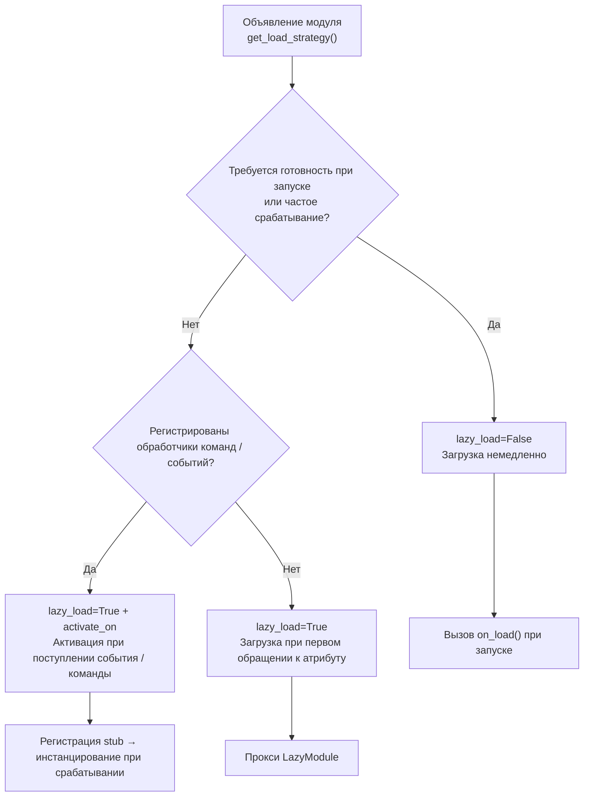

# ErisPulse 热重载与懒加载休眠

This skill is auto-built from the ErisPulse documentation.
Repository: https://github.com/ErisPulse/ErisPulse
Source paths are annotated per section; see docs/ in the repository for the latest content.

## 内容大纲

AI 按需读取：只读需要的章节即可，不必全文加载。

- 懒加载与休眠: 35-44 行
- Обзор: 46-53 行
- Принцип работы: 55-69 行
- Событийная ленивая активация (activate_on): 71-141 行
- Задержка активации (dormant_after): 143-189 行
- Конфигурация ленивой загрузки: 191-218 行
- Использование модулей с ленивой загрузкой: 220-274 行
- Рекомендуемые практики: 276-304 行
- Примечания: 306-311 行
- Связанные документы: 313-319 行
- 模块开发入门（加载策略）: 321-330 行
- Структура проекта: 332-344 行
- Конфигурация pyproject.toml: 346-364 行
- __init__.py: 366-370 行
- Core.py - Базовый модуль: 372-411 行
- Тестирование модуля: 413-431 行
- Основные концепции: 433-525 行
- Далее: 527-537 行

## 懒加载与休眠

> 来源: `docs/ru/advanced/lazy-loading.md`（https://github.com/ErisPulse/ErisPulse/blob/main/docs/ru/advanced/lazy-loading.md）

# Система ленивой загрузки модулей

> [!TIP]
> **Когда нужно читать эту статью**: при использовании ленивой загрузки модулей или активации по событию activate_on. Если не нужно, можно пропустить, это не повлияет на использование других функций.

Система ленивой загрузки модулей ErisPulse SDK позволяет отложить инициализацию модулей до **момента их фактического обращения** — на этапе запуска регистрируются только заглушки, а неиспользуемые модули не занимают время запуска и память.

## Обзор

Система ленивого загрузки модулей является одной из ключевых особенностей ErisPulse. Она работает следующим образом:

- **Отложенная инициализация**: модуль загружается и инициализируется только при первом обращении
- **Прозрачное использование**: для разработчиков ленивые модули практически не отличаются от обычных модулей
- **Автоматическое управление зависимостями**: зависимости модуля автоматически инициализируются при использовании
- **Поддержка жизненного цикла**: для модулей, унаследованных от `BaseModule`, автоматически вызываются методы жизненного цикла

## Принцип работы

### Класс LazyModule

Основой системы ленивой загрузки является класс `LazyModule`, который является обёрткой, фактически инициализирующей модуль только при первом обращении.

### Процесс инициализации

При первом обращении к модулю `LazyModule` выполняет следующие действия:

1. Получает информацию о параметрах `__init__` класса модуля
2. Определяет, следует ли передавать ссылку на `sdk`
3. Устанавливает атрибут `moduleInfo` модуля
4. Для модулей, унаследованных от `BaseModule`, вызывает метод `on_load`
5. Запускает событие жизненного цикла `module.init`

## Событийная ленивая активация (activate_on)

> [!NOTE]  
> Эта функция требует ErisPulse **2.8.0+**.

Модули с `lazy_load=True` по умолчанию загружаются только при **первом обращении к атрибуту**. Если модуль зарегистрировал обработчики команд/событий, традиционный подход требует `lazy_load=False` для немедленной загрузки. `activate_on` предоставляет третий вариант: **объявить триггер, и при первом совпадающем событии/команде модуль будет автоматически активирован** — он не будет постоянно в памяти, но при этом не потеряет вход для триггера.

```python
from ErisPulse.loaders import ModuleLoadStrategy

class MyModule(BaseModule):
    @staticmethod
    def get_load_strategy():
        return ModuleLoadStrategy(
            lazy_load=True,
            activate_on=[
                # ---- Событийные триггеры (пассивные, без участия пользователя) ----
                "message",                                    # Тип события: любое сообщение
                {"notice": "group_member_increase"},          # Тип + один detail_type
                {"message": ["private", "group"]},            # Тип + несколько detail_type

                # ---- Командные триггеры (активные, ввод пользователя, видны в Help) ----
                {"command": "roll"},                          # Сокращённая форма: имя команды
                {"command": ["roll", "dice"]},                # Список имён команд
                {"command": {                                 # Форма dict (обязателен name)
                    "name": "dice",
                    "help": "Бросить кубик",
                    "usage": "/dice",
                    "group": "Развлечения",
                    "aliases": ["d"],
                    "hidden": False,
                }},
            ],
        )
```

### Параметры команды в формате dict

Форма dict отражает пользовательские параметры декоратора `@command()`, позволяя зарегистрировать заглушку команды ещё до загрузки модуля:

| Параметр | Тип | Значение по умолчанию | Описание |
|----------|------|----------------------|----------|
| `name` | `str` | **Обязательно** | Имя команды; должно совпадать с `name` в `@command()` внутри `on_load`, иначе заглушка будет удалена, и команда не будет найдена |
| `help` | `str` | Цепочка возврата | Описание в Help; если не указано, используется цепочка возврата (см. ниже) |
| `usage` | `str` | Автоматически | Пример использования, по умолчанию `{prefix}{name}` |
| `group` | `str` | `None` | Группа команды |
| `aliases` | `list[str]` | `[]` | Алиасы, которые также регистрируются — **ввод алиаса также активирует модуль** |
| `hidden` | `bool` | `False` | Если `True`, заглушка будет скрыта (согласуется с поведением скрытых команд после активации); пользователи, знающие имя команды, могут активировать её вводом |

**Не поддерживаются** `priority` / `permission` / `master`: заглушка команды предназначена только для активации, проверка прав осуществляется после активации настоящей командой (в противном случае проверка прав на этапе заглушки приведёт к потере функциональности "активация по команде").

### Цепочка возврата для Help заглушки команды

Описание команды в Help, отображаемое до загрузки модуля, берётся по следующему порядку (первое найденное значение используется):

1. `help` из объявления команды в формате dict (наиболее точное)
2. `description` из `get_meta()`
3. Атрибут `__description__`
4. `Summary` из метаданных пакета (краткое описание на PyPI)
5. Общее сообщение: «Эта команда из лениво загружаемого модуля X, первый вызов активирует модуль»

### Семантика триггеров

- **Заглушка события**: регистрируется с низким приоритетом (`ACTIVATION_STUB_PRIORITY`) в соответствующий менеджер событий, срабатывает в качестве резервного обработчика после всех обычных; после активации событие пересылается настоящему обработчику модуля
- **Заглушка команды**: регистрируется как заглушка команды; после активации заглушка удаляется, настоящая команда обрабатывает текущий вызов
- **Защита от повторного запуска**: `asyncio.Lock` гарантирует, что модуль активируется только один раз при одновременных триггерах
- **Фильтрация по области действия**: заглушка имеет идентификатор владельца модуля, триггер не срабатывает, если модуль не включён для данного бота/сессии/платформы
- **Семантика ошибок**: при неудачной активации модуль переходит в период охлаждения (`ACTIVATE_RETRY_COOLDOWN_SECS`, 30 секунд), события в течение этого времени игнорируются, чтобы избежать повторных попыток; по истечении времени модуль автоматически перезапускается, заглушка остаётся активной
- **Удаление дубликатов**: при смешанном объявлении команд (сокращённая форма + dict) дубликаты удаляются (dict имеет приоритет); если в dict отсутствует `name` или `detail_type` события указан неверно, выводится предупреждение и объявление игнорируется

> Архитектурная диаграмма и полная семантика доступны в [Обзоре архитектуры](../architecture.md#архитектура-событийной-ленивой-активации-activate_on-триггеры).

## Задержка активации (dormant_after)

> [!NOTE]
> Эта функция доступна в ErisPulse **2.11.0+**.

После длительного бездействия модули, активированные с задержкой, могут быть **уснувшими**: фреймворк освобождает ресурсы (задачи, соединения, регистрация событий),
но сохраняет ленивый загрузочный прокси и структуру регистрации — модуль возвращается в состояние "зарегистрирован, но не загружен", и при следующем обращении к свойству /
`module.call` / событию `activate_on` **прозрачно активируется** (переинициализируется и выполняется `on_load`),
без необходимости вызывать какие-либо API активации. После усыпления состояние системы идентично состоянию "никогда не активированный".

### Способ объявления

```python
@staticmethod
def get_load_strategy():
    return ModuleLoadStrategy(
        lazy_load=True,
        dormant_after="30m",   # Автоматическое усыпление после 30 минут бездействия; отсутствие объявления = никогда не усыплять (по умолчанию)
    )
```

Синтаксис длительности идентичен синтаксису `cooldown` в командном управлении (например, `90s` / `1h30m` / `1d`). Сканер проверяет состояние с фиксированным интервалом (60 секунд),
фактическое время усыпления = порог + максимум один интервал сканирования; также можно усыпить вручную в любой момент:
`await sdk.module.sleep("имя модуля")`. Явный вызов `unload` по-прежнему означает полную разгрузку (удаляются все ленивые прокси).

### Продолжение состояния

Перед усыпанием фреймворк вызывает `on_before_unload(reason="dormant")` (первый шаг в цепочке разгрузки, ресурсы все еще целы),
модуль сохраняет состояние в `sdk.storage`; при активации в `on_load` восстанавливает:

```python
async def on_before_unload(self, event):
    if event["reason"] in ("dormant", "reload", "disable"):
        await self.sdk.storage.aset(f"{self._module_name}:counter", self._count)

async def on_load(self, event):
    self._count = await self.sdk.storage.aget(f"{self._module_name}:counter") or 0
```

### Семантика и границы

- **Безопасность для зависимых модулей**: Зависимые модули получают доступ к ленивым модулям через постоянный прокси (`sdk.<Name>`) или `module.call`,
  поведение одинаково до и после усыпания; непосредственное хранение ссылки на реальный экземпляр является противоположным подходом (видно в аудите утечек)
- **Отсутствие событий**: Усыпленные модули больше не получают события — модули, которым нужно событие для активации, должны также объявить `activate_on`
  (событие сначала активирует, затем пересылает); при диагностике "команды не отвечают" проверяйте, находится ли модуль в состоянии усыпления
- **Самовосстановление при неудачной активации**: При неудачной активации (повторной инициализации) модуль переходит в 30-секундный период охлаждения, после чего при повторном обращении автоматически повторяет попытку,
  модуль не может быть навсегда неактивным

## Конфигурация ленивой загрузки

### Глобальная конфигурация

В файле конфигурации включите/отключите глобальную ленивую загрузку:

```toml
[ErisPulse.framework]
enable_lazy_loading = true  # true=включить ленивую загрузку (по умолчанию), false=отключить ленивую загрузку
```

### Управление на уровне модуля

Модуль может контролировать стратегию загрузки, реализовав статический метод `get_load_strategy()`:

```python
from ErisPulse.Core.Bases import BaseModule
from ErisPulse.loaders import ModuleLoadStrategy

class MyModule(BaseModule):
    @staticmethod
    def get_load_strategy():
        """Возвращает стратегию загрузки модуля"""
        return ModuleLoadStrategy(
            lazy_load=False,  # Возвращает False для немедленной загрузки
            priority=100      # Приоритет загрузки, чем больше значение, тем выше приоритет
        )
```

## Использование модулей с ленивой загрузкой

### Основное использование

Для разработчиков использование модулей с ленивой загрузкой практически не отличается от обычных модулей:

```python
# Доступ к модулю с ленивой загрузкой через SDK
from ErisPulse import sdk

# Следующий вызов инициирует ленивую загрузку модуля
result = await sdk.my_module.my_method()
```

### Единый вход для получения модуля

Независимо от того, получаете ли вы модуль через свойство SDK, свойство менеджера модулей или с помощью `module.get()`, для "зарегистрированных, но еще не загруженных" модулей с ленивой загрузкой будет возвращаться один и тот же прокси-объект ленивой загрузки. Инициализация происходит только при обращении к его свойствам:

```python
# Все три способа возвращают один и тот же прокси-объект ленивой загрузки (когда модуль еще не загружен), поведение одинаково и для пользователя прозрачно
sdk.my_module          # Точка входа для инициации загрузки
sdk.module.my_module   # Также возвращает прокси-объект ленивой загрузки
sdk.module.get("my_module")  # Также возвращает прокси-объект ленивой загрузки, сам вызов не инициирует загрузку

# Инициализация модуля происходит только при обращении к свойству прокси-объекта
result = await sdk.my_module.my_method()
```

`module.get()` — это **интерфейс для запроса**, сам вызов не инициирует загрузку:
- Если модуль уже загружен → возвращается реальный экземпляр
- Если модуль зарегистрирован, но не загружен → возвращается прокси-объект ленивой загрузки (инициализация происходит при обращении к свойству)
- Если модуль не зарегистрирован → возвращается `None`

Если необходимо явно инициировать загрузку, используйте `await sdk.load_module("my_module")`.

### Асинхронная инициализация

Для модулей, требующих асинхронной инициализации, рекомендуется сначала явно загрузить модуль:

```python
# Сначала явно загрузите модуль
await sdk.load_module("my_module")

# Затем используйте модуль
result = await sdk.my_module.my_method()
```

### Синхронная инициализация

Для модулей, не требующих асинхронной инициализации, можно обращаться напрямую:

```python
# Прямое обращение автоматически инициирует синхронную инициализацию
result = sdk.my_module.some_sync_method()
```

## Рекомендуемые практики

При выборе стратегии загрузки можно использовать следующий процесс принятия решений:



### Рекомендованные сценарии использования ленивой загрузки (lazy_load=True)

- Инструментальные классы, вызываемые пассивно (например, модуль запросов данных, преобразователи форматов и т.д., которые нужны только при вызове из других модулей)
- Модули, зарегистрировавшие обработчики команд / событий, но используемые нечасто — в сочетании с `activate_on` можно объявить триггер, автоматически активирующий модуль при поступлении первого соответствующего события / команды, без отказа от ленивой загрузки

### Рекомендованные сценарии отключения ленивой загрузки (lazy_load=False)

- Модули, требующие готовности при запуске (например, основные модули, предоставляющие базовые сервисы другим модулям)
- Часто вызываемые слушатели (каждое сообщение должно обрабатываться) — `activate_on` имеет небольшую стоимость активации, поэтому для сценариев с высокой частотой вызовов прямая загрузка предпочтительнее
- Модули с планировщиком задач
- Модули, требующие инициализации при запуске приложения

> Параметр `priority` управляет порядком инициализации модулей, загруженных немедленно: чем больше значение, тем раньше модуль будет инициализирован. Модули с одинаковым приоритетом загружаются в порядке их регистрации.

## Примечания

1. Если ваш модуль использует ленивую загрузку, и если другие модули никогда не вызывались внутри ErisPulse, ваш модуль никогда не будет инициализирован.
2. Если ваш модуль содержит такие компоненты, как модули, слушающие события, или другие активно слушающие модули, у вас есть два варианта: объявить триггер `activate_on` (сохранить ленивую загрузку, автоматически активировать при поступлении события) или объявить, что он должен быть загружен немедленно (`lazy_load=False`), иначе это повлияет на нормальное функционирование вашего модуля.
3. Мы не рекомендуем отключать ленивую загрузку, если только у вас нет особых потребностей, иначе это может привести к проблемам с зависимостями и событиями жизненного цикла.
4. В командном словаре `activate_on` объявления, `name` должен совпадать с реальным именем команды, зарегистрированной в модуле `on_load` с помощью `@command()` — в противном случае, после активации модуля, команда-заполнитель будет отменена, и команда, объявленная не соответствующая реализации, не будет существовать.

## Связанные документы

Выберите в соответствии со следующими намерениями:

- **Не знаете, какой стратегии загрузки выбрать (немедленная загрузка / ленивая загрузка / activate_on)** → [Лучшие практики модулей](../developer-guide/modules/best-practices.md)
- **Цепочка освобождения ресурсов (фоновые задачи, соединения и т. д.) при сне и выгрузке** → [Система принадлежности (owner)](ownership.md)
- **Разработка модуля с нуля** → [Руководство по разработке модулей](../developer-guide/modules/getting-started.md)

## 模块开发入门（加载策略）

> 来源: `docs/ru/developer-guide/modules/getting-started.md`（https://github.com/ErisPulse/ErisPulse/blob/main/docs/ru/developer-guide/modules/getting-started.md）

# Введение в разработку модулей

> [!NOTE]
> **Обязательно к прочтению на уровне L1** — одна из пяти ключевых статей в разделе "Путь чтения" на главной странице. Необходима для разработки модулей.

Следуя этой статье, вы получите запускаемый модуль, который будет отвечать на команду `/hello`, и узнаете структуру проекта модуля, способ регистрации и обработчики загрузки/выгрузки — все последующие документы по модулям строятся на этой основе.

## Структура проекта

Стандартная структура модуля:

```
MyModule/
├── pyproject.toml
├── README.md
├── LICENSE
└── MyModule/
    ├── __init__.py
    └── Core.py
```

## Конфигурация pyproject.toml

```toml
[project]
name = "ErisPulse-MyModule"
version = "1.0.0"
description = "Описание функционала модуля"
readme = "README.md"
requires-python = ">=3.10"
license = { file = "LICENSE" }
authors = [ { name = "yourname", email = "your@mail.com" } ]
dependencies = []

[project.urls]
"homepage" = "https://github.com/yourname/MyModule"

[project.entry-points."erispulse.module"]
"MyModule" = "MyModule:Main"
```

## __init__.py

```python
from .Core import Main
```

## Core.py - Базовый модуль

```python
from ErisPulse import sdk
# Рекомендуется корневой импорт (Python 3.10+): часто используемые символы импортируются напрямую из корневого пакета, но и глубокие пути по-прежнему поддерживаются
from ErisPulse import BaseModule, command

class Main(BaseModule):
    def __init__(self, sdk):
        self.sdk = sdk
        self.logger = sdk.logger.get_child("MyModule")
        self.storage = sdk.storage
    
    @staticmethod
    def get_load_strategy():
        """Возвращает стратегию загрузки модуля"""
        from ErisPulse.loaders import ModuleLoadStrategy
        return ModuleLoadStrategy(
            lazy_load=True,
            priority=0,
            depends=[],  # Необязательно: список модулей, от которых зависит данный модуль
            # Необязательно: ленивая активация по событиям — объявите триггеры, модуль автоматически загрузится при первом совпадении события/команды
            # activate_on=[{"command": {"name": "hello", "help": "Отправить приветствие"}}],
        )
    
    async def on_load(self, event):
        """Вызывается при загрузке модуля"""
        @command("hello", help="Отправить приветствие")
        async def hello_command(event):
            name = event.get_user_nickname() or "друг"
            await event.reply(f"Привет, {name}!")
        
        self.logger.info("Модуль загружен")
    
    async def on_unload(self, event):
        """Вызывается при выгрузке модуля"""
        self.logger.info("Модуль выгружен")
```

> **Чтение конфигурации**: в приведённом базовом примере конфигурация не используется. При необходимости чтения конфигурации рекомендуется объявить вложенный класс `ConfigClass` и читать данные в реальном времени через `self.cfg` (см. [Основные концепции модуля](docs/ru/core-concepts.md#рекомендуемая-декларативная-конфигурация)). Старый способ — ручной вызов `_load_config()` — устарел.

## Тестирование модуля

### Локальное тестирование

```bash
# Установите модуль в директории проекта
epsdk install ./MyModule

# Запустите проект
epsdk run main.py --reload
```

### Тестовая команда

Отправьте команду для тестирования:

```
/hello
```

## Основные концепции

### Базовый класс BaseModule

Все модули должны наследоваться от `BaseModule`, предоставляя следующие методы:

| Метод | Описание | Обязательно |
|------|------|------|
| `__init__(self, sdk)` | Конструктор (фреймворк передаёт экземпляр `sdk`) | Нет |
| `get_load_strategy()` | Возвращает стратегию загрузки | Нет |
| `get_meta()` | Возвращает метаинформацию о модуле (необязательно) | Нет |
| `on_load(self, event)` | Вызывается при загрузке модуля | Да |
| `on_unload(self, event)` | Вызывается при выгрузке модуля | Да |

### Метаинформация модуля

> [!NOTE]
> Эта функция доступна начиная с ErisPulse **2.8.0+**.

Метаинформация модуля — это описание того, для чего он предназначен, к какой категории относится и т.д. Метаинформация — это **общие сведения о модуле**, которые используются различными интерфейсами и экосистемными модулями, такими как модуль help, список модулей в Dashboard, магазин модулей и т.д.

Как и в случае с `get_load_strategy()`, возвращайте экземпляр класса `ModuleMeta` (с поддержкой типизации и автодополнения в IDE), но также допускается возвращать словарь:

```python
class MyModule(BaseModule):
    @staticmethod
    def get_meta() -> ModuleMeta:
        return ModuleMeta(
            name="Погода",               # Отображаемое имя (по умолчанию имя регистрации)
            description="Получение погоды в городе",  # Описание модуля
            version="1.0.0",
            author="ErisDev",
            group="Инструменты",               # Категория функционала
            tags=["Погода", "Поиск"],
        )
```

Совместимый способ (через словарь):

```python
class MyModule(BaseModule):
    @staticmethod
    def get_meta() -> dict:
        return {
            "name": "Погода",
            "description": "Получение погоды в городе",
            "version": "1.0.0",
            "author": "ErisDev",
            "group": "Инструменты",
            "tags": ["Погода", "Поиск"],
        }
```

- `module.get_meta("MyModule")` читает уже разобранные метаданные (приоритет класса > регистрационной информации, автоматически дополняет имена команд модуля).
- `module.get_commands_overview()` объединяет "метаинформацию модуля + зарегистрированные команды (псевдонимы/группы/описания)" и организует обзор всех команд по модулям.
- Владелец команды можно получить через `cmd_info["owner"]` (автоматически вставляется контекстной системой при регистрации).

#### Поддержка i18n для полей метаинформации

Значения полей метаинформации могут быть простыми строками или словарями i18n `{"i18n": "key.path", "default": "текст по умолчанию"}` (согласно соглашению для `description` в конфигурации).
Ключи перевода объявляются через `I18nClass`, а при чтении `module.get_meta()` автоматически разрешаются в текст текущего языка:

```python
class MyModule(BaseModule):
    class I18nClass(BaseI18n):
        meta_description: I18nKey = I18nKey(
            default="Weather lookup",
            zh_CN="查询城市天气",
            en="Weather lookup",
        )

    @staticmethod
    def get_meta() -> ModuleMeta:
        return ModuleMeta(
            name="Погода",
            description={"i18n": "MyModule.meta_description", "default": "Weather lookup"},
        )
```

### Объект SDK

Доступ к основным функциям осуществляется через объект `sdk`:

```python
from ErisPulse import sdk

sdk.storage    # Система хранения
sdk.config     # Система конфигурации
sdk.logger     # Система логирования
sdk.adapter    # Система адаптеров
sdk.router     # Система маршрутизации
sdk.lifecycle  # Система жизненного цикла
```

## Далее

### Продолжение пути обучения

- [Основные концепции модуля](docs/ru/core-concepts.md) - Глубокое понимание архитектуры модуля
- [Подробное объяснение Event-обёртки](docs/ru/event-wrapper.md) - Изучение объекта Event

### После написания

- [Лучшие практики модуля](docs/ru/best-practices.md) - Разработка высококачественных модулей
