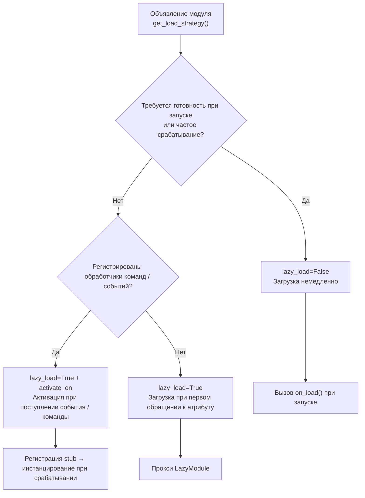
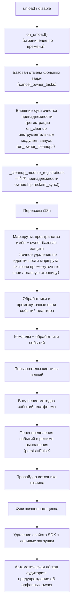

# ErisPulse 热重载与懒加载休眠

This skill is auto-built from the ErisPulse documentation.
Repository: https://github.com/ErisPulse/ErisPulse
Source paths are annotated per section; see docs/ in the repository for the latest content.

## 内容大纲

AI 按需读取：只读需要的章节即可，不必全文加载。

- 懒加载与休眠: 47-56 行
- Обзор: 58-65 行
- Принцип работы: 67-81 行
- Событийная ленивая активация (activate_on): 83-153 行
- Задержка активации (dormant_after): 155-201 行
- Конфигурация ленивой загрузки: 203-230 行
- Использование модулей с ленивой загрузкой: 232-286 行
- Рекомендуемые практики: 288-316 行
- Примечания: 318-323 行
- Связанные документы: 325-331 行
- 归属权与热重载边界: 333-355 行
- Механизм контекста owner: 357-378 行
- Полная картина принадлежащих ресурсов: 380-413 行
- Последовательность очистки при отключении/деактивации: 415-438 行
- Единая воронка принадлежности (ownership): 440-464 行
- Откат при горячей перезагрузке: 466-477 行
- Ограничения горячей перезагрузки: 479-540 行
- Пределы дизайна: какие ресурсы не очищаются при отключении: 542-553 行
- Внутренняя реализация: как работает принадлежность: 555-597 行
- Руководство для авторов модулей: 599-643 行
- Руководство по инструментальным модулям: управление дескрипторами других модулей: 645-683 行
- Связанные документы: 685-692 行
- 模块开发入门（加载策略）: 694-703 行
- Структура проекта: 705-717 行
- Конфигурация pyproject.toml: 719-737 行
- __init__.py: 739-743 行
- Core.py - Базовый модуль: 745-784 行
- Тестирование модуля: 786-804 行
- Основные концепции: 806-898 行
- Далее: 900-910 行

## 懒加载与休眠

> 来源: `docs/ru/advanced/lazy-loading.md`（https://github.com/ErisPulse/ErisPulse/blob/main/docs/ru/advanced/lazy-loading.md）

# Система ленивой загрузки модулей

> [!TIP]
> **Когда нужно читать эту статью**: при использовании ленивой загрузки модулей или активации по событию activate_on. Если не нужно, можно пропустить, это не повлияет на использование других функций.

Система ленивой загрузки модулей ErisPulse SDK позволяет отложить инициализацию модулей до **момента их фактического обращения** — на этапе запуска регистрируются только заглушки, а неиспользуемые модули не занимают время запуска и память.

## Обзор

Система ленивого загрузки модулей является одной из ключевых особенностей ErisPulse. Она работает следующим образом:

- **Отложенная инициализация**: модуль загружается и инициализируется только при первом обращении
- **Прозрачное использование**: для разработчиков ленивые модули практически не отличаются от обычных модулей
- **Автоматическое управление зависимостями**: зависимости модуля автоматически инициализируются при использовании
- **Поддержка жизненного цикла**: для модулей, унаследованных от `BaseModule`, автоматически вызываются методы жизненного цикла

## Принцип работы

### Класс LazyModule

Основой системы ленивой загрузки является класс `LazyModule`, который является обёрткой, фактически инициализирующей модуль только при первом обращении.

### Процесс инициализации

При первом обращении к модулю `LazyModule` выполняет следующие действия:

1. Получает информацию о параметрах `__init__` класса модуля
2. Определяет, следует ли передавать ссылку на `sdk`
3. Устанавливает атрибут `moduleInfo` модуля
4. Для модулей, унаследованных от `BaseModule`, вызывает метод `on_load`
5. Запускает событие жизненного цикла `module.init`

## Событийная ленивая активация (activate_on)

> [!NOTE]  
> Эта функция требует ErisPulse **2.8.0+**.

Модули с `lazy_load=True` по умолчанию загружаются только при **первом обращении к атрибуту**. Если модуль зарегистрировал обработчики команд/событий, традиционный подход требует `lazy_load=False` для немедленной загрузки. `activate_on` предоставляет третий вариант: **объявить триггер, и при первом совпадающем событии/команде модуль будет автоматически активирован** — он не будет постоянно в памяти, но при этом не потеряет вход для триггера.

```python
from ErisPulse.loaders import ModuleLoadStrategy

class MyModule(BaseModule):
    @staticmethod
    def get_load_strategy():
        return ModuleLoadStrategy(
            lazy_load=True,
            activate_on=[
                # ---- Событийные триггеры (пассивные, без участия пользователя) ----
                "message",                                    # Тип события: любое сообщение
                {"notice": "group_member_increase"},          # Тип + один detail_type
                {"message": ["private", "group"]},            # Тип + несколько detail_type

                # ---- Командные триггеры (активные, ввод пользователя, видны в Help) ----
                {"command": "roll"},                          # Сокращённая форма: имя команды
                {"command": ["roll", "dice"]},                # Список имён команд
                {"command": {                                 # Форма dict (обязателен name)
                    "name": "dice",
                    "help": "Бросить кубик",
                    "usage": "/dice",
                    "group": "Развлечения",
                    "aliases": ["d"],
                    "hidden": False,
                }},
            ],
        )
```

### Параметры команды в формате dict

Форма dict отражает пользовательские параметры декоратора `@command()`, позволяя зарегистрировать заглушку команды ещё до загрузки модуля:

| Параметр | Тип | Значение по умолчанию | Описание |
|----------|------|----------------------|----------|
| `name` | `str` | **Обязательно** | Имя команды; должно совпадать с `name` в `@command()` внутри `on_load`, иначе заглушка будет удалена, и команда не будет найдена |
| `help` | `str` | Цепочка возврата | Описание в Help; если не указано, используется цепочка возврата (см. ниже) |
| `usage` | `str` | Автоматически | Пример использования, по умолчанию `{prefix}{name}` |
| `group` | `str` | `None` | Группа команды |
| `aliases` | `list[str]` | `[]` | Алиасы, которые также регистрируются — **ввод алиаса также активирует модуль** |
| `hidden` | `bool` | `False` | Если `True`, заглушка будет скрыта (согласуется с поведением скрытых команд после активации); пользователи, знающие имя команды, могут активировать её вводом |

**Не поддерживаются** `priority` / `permission` / `master`: заглушка команды предназначена только для активации, проверка прав осуществляется после активации настоящей командой (в противном случае проверка прав на этапе заглушки приведёт к потере функциональности "активация по команде").

### Цепочка возврата для Help заглушки команды

Описание команды в Help, отображаемое до загрузки модуля, берётся по следующему порядку (первое найденное значение используется):

1. `help` из объявления команды в формате dict (наиболее точное)
2. `description` из `get_meta()`
3. Атрибут `__description__`
4. `Summary` из метаданных пакета (краткое описание на PyPI)
5. Общее сообщение: «Эта команда из лениво загружаемого модуля X, первый вызов активирует модуль»

### Семантика триггеров

- **Заглушка события**: регистрируется с низким приоритетом (`ACTIVATION_STUB_PRIORITY`) в соответствующий менеджер событий, срабатывает в качестве резервного обработчика после всех обычных; после активации событие пересылается настоящему обработчику модуля
- **Заглушка команды**: регистрируется как заглушка команды; после активации заглушка удаляется, настоящая команда обрабатывает текущий вызов
- **Защита от повторного запуска**: `asyncio.Lock` гарантирует, что модуль активируется только один раз при одновременных триггерах
- **Фильтрация по области действия**: заглушка имеет идентификатор владельца модуля, триггер не срабатывает, если модуль не включён для данного бота/сессии/платформы
- **Семантика ошибок**: при неудачной активации модуль переходит в период охлаждения (`ACTIVATE_RETRY_COOLDOWN_SECS`, 30 секунд), события в течение этого времени игнорируются, чтобы избежать повторных попыток; по истечении времени модуль автоматически перезапускается, заглушка остаётся активной
- **Удаление дубликатов**: при смешанном объявлении команд (сокращённая форма + dict) дубликаты удаляются (dict имеет приоритет); если в dict отсутствует `name` или `detail_type` события указан неверно, выводится предупреждение и объявление игнорируется

> Архитектурная диаграмма и полная семантика доступны в [Обзоре архитектуры](../architecture.md#архитектура-событийной-ленивой-активации-activate_on-триггеры).

## Задержка активации (dormant_after)

> [!NOTE]
> Эта функция доступна в ErisPulse **2.11.0+**.

После длительного бездействия модули, активированные с задержкой, могут быть **уснувшими**: фреймворк освобождает ресурсы (задачи, соединения, регистрация событий),
но сохраняет ленивый загрузочный прокси и структуру регистрации — модуль возвращается в состояние "зарегистрирован, но не загружен", и при следующем обращении к свойству /
`module.call` / событию `activate_on` **прозрачно активируется** (переинициализируется и выполняется `on_load`),
без необходимости вызывать какие-либо API активации. После усыпления состояние системы идентично состоянию "никогда не активированный".

### Способ объявления

```python
@staticmethod
def get_load_strategy():
    return ModuleLoadStrategy(
        lazy_load=True,
        dormant_after="30m",   # Автоматическое усыпление после 30 минут бездействия; отсутствие объявления = никогда не усыплять (по умолчанию)
    )
```

Синтаксис длительности идентичен синтаксису `cooldown` в командном управлении (например, `90s` / `1h30m` / `1d`). Сканер проверяет состояние с фиксированным интервалом (60 секунд),
фактическое время усыпления = порог + максимум один интервал сканирования; также можно усыпить вручную в любой момент:
`await sdk.module.sleep("имя модуля")`. Явный вызов `unload` по-прежнему означает полную разгрузку (удаляются все ленивые прокси).

### Продолжение состояния

Перед усыпанием фреймворк вызывает `on_before_unload(reason="dormant")` (первый шаг в цепочке разгрузки, ресурсы все еще целы),
модуль сохраняет состояние в `sdk.storage`; при активации в `on_load` восстанавливает:

```python
async def on_before_unload(self, event):
    if event["reason"] in ("dormant", "reload", "disable"):
        await self.sdk.storage.aset(f"{self._module_name}:counter", self._count)

async def on_load(self, event):
    self._count = await self.sdk.storage.aget(f"{self._module_name}:counter") or 0
```

### Семантика и границы

- **Безопасность для зависимых модулей**: Зависимые модули получают доступ к ленивым модулям через постоянный прокси (`sdk.<Name>`) или `module.call`,
  поведение одинаково до и после усыпания; непосредственное хранение ссылки на реальный экземпляр является противоположным подходом (видно в аудите утечек)
- **Отсутствие событий**: Усыпленные модули больше не получают события — модули, которым нужно событие для активации, должны также объявить `activate_on`
  (событие сначала активирует, затем пересылает); при диагностике "команды не отвечают" проверяйте, находится ли модуль в состоянии усыпления
- **Самовосстановление при неудачной активации**: При неудачной активации (повторной инициализации) модуль переходит в 30-секундный период охлаждения, после чего при повторном обращении автоматически повторяет попытку,
  модуль не может быть навсегда неактивным

## Конфигурация ленивой загрузки

### Глобальная конфигурация

В файле конфигурации включите/отключите глобальную ленивую загрузку:

```toml
[ErisPulse.framework]
enable_lazy_loading = true  # true=включить ленивую загрузку (по умолчанию), false=отключить ленивую загрузку
```

### Управление на уровне модуля

Модуль может контролировать стратегию загрузки, реализовав статический метод `get_load_strategy()`:

```python
from ErisPulse.Core.Bases import BaseModule
from ErisPulse.loaders import ModuleLoadStrategy

class MyModule(BaseModule):
    @staticmethod
    def get_load_strategy():
        """Возвращает стратегию загрузки модуля"""
        return ModuleLoadStrategy(
            lazy_load=False,  # Возвращает False для немедленной загрузки
            priority=100      # Приоритет загрузки, чем больше значение, тем выше приоритет
        )
```

## Использование модулей с ленивой загрузкой

### Основное использование

Для разработчиков использование модулей с ленивой загрузкой практически не отличается от обычных модулей:

```python
# Доступ к модулю с ленивой загрузкой через SDK
from ErisPulse import sdk

# Следующий вызов инициирует ленивую загрузку модуля
result = await sdk.my_module.my_method()
```

### Единый вход для получения модуля

Независимо от того, получаете ли вы модуль через свойство SDK, свойство менеджера модулей или с помощью `module.get()`, для "зарегистрированных, но еще не загруженных" модулей с ленивой загрузкой будет возвращаться один и тот же прокси-объект ленивой загрузки. Инициализация происходит только при обращении к его свойствам:

```python
# Все три способа возвращают один и тот же прокси-объект ленивой загрузки (когда модуль еще не загружен), поведение одинаково и для пользователя прозрачно
sdk.my_module          # Точка входа для инициации загрузки
sdk.module.my_module   # Также возвращает прокси-объект ленивой загрузки
sdk.module.get("my_module")  # Также возвращает прокси-объект ленивой загрузки, сам вызов не инициирует загрузку

# Инициализация модуля происходит только при обращении к свойству прокси-объекта
result = await sdk.my_module.my_method()
```

`module.get()` — это **интерфейс для запроса**, сам вызов не инициирует загрузку:
- Если модуль уже загружен → возвращается реальный экземпляр
- Если модуль зарегистрирован, но не загружен → возвращается прокси-объект ленивой загрузки (инициализация происходит при обращении к свойству)
- Если модуль не зарегистрирован → возвращается `None`

Если необходимо явно инициировать загрузку, используйте `await sdk.load_module("my_module")`.

### Асинхронная инициализация

Для модулей, требующих асинхронной инициализации, рекомендуется сначала явно загрузить модуль:

```python
# Сначала явно загрузите модуль
await sdk.load_module("my_module")

# Затем используйте модуль
result = await sdk.my_module.my_method()
```

### Синхронная инициализация

Для модулей, не требующих асинхронной инициализации, можно обращаться напрямую:

```python
# Прямое обращение автоматически инициирует синхронную инициализацию
result = sdk.my_module.some_sync_method()
```

## Рекомендуемые практики

При выборе стратегии загрузки можно использовать следующий процесс принятия решений:



### Рекомендованные сценарии использования ленивой загрузки (lazy_load=True)

- Инструментальные классы, вызываемые пассивно (например, модуль запросов данных, преобразователи форматов и т.д., которые нужны только при вызове из других модулей)
- Модули, зарегистрировавшие обработчики команд / событий, но используемые нечасто — в сочетании с `activate_on` можно объявить триггер, автоматически активирующий модуль при поступлении первого соответствующего события / команды, без отказа от ленивой загрузки

### Рекомендованные сценарии отключения ленивой загрузки (lazy_load=False)

- Модули, требующие готовности при запуске (например, основные модули, предоставляющие базовые сервисы другим модулям)
- Часто вызываемые слушатели (каждое сообщение должно обрабатываться) — `activate_on` имеет небольшую стоимость активации, поэтому для сценариев с высокой частотой вызовов прямая загрузка предпочтительнее
- Модули с планировщиком задач
- Модули, требующие инициализации при запуске приложения

> Параметр `priority` управляет порядком инициализации модулей, загруженных немедленно: чем больше значение, тем раньше модуль будет инициализирован. Модули с одинаковым приоритетом загружаются в порядке их регистрации.

## Примечания

1. Если ваш модуль использует ленивую загрузку, и если другие модули никогда не вызывались внутри ErisPulse, ваш модуль никогда не будет инициализирован.
2. Если ваш модуль содержит такие компоненты, как модули, слушающие события, или другие активно слушающие модули, у вас есть два варианта: объявить триггер `activate_on` (сохранить ленивую загрузку, автоматически активировать при поступлении события) или объявить, что он должен быть загружен немедленно (`lazy_load=False`), иначе это повлияет на нормальное функционирование вашего модуля.
3. Мы не рекомендуем отключать ленивую загрузку, если только у вас нет особых потребностей, иначе это может привести к проблемам с зависимостями и событиями жизненного цикла.
4. В командном словаре `activate_on` объявления, `name` должен совпадать с реальным именем команды, зарегистрированной в модуле `on_load` с помощью `@command()` — в противном случае, после активации модуля, команда-заполнитель будет отменена, и команда, объявленная не соответствующая реализации, не будет существовать.

## Связанные документы

Выберите в соответствии со следующими намерениями:

- **Не знаете, какой стратегии загрузки выбрать (немедленная загрузка / ленивая загрузка / activate_on)** → [Лучшие практики модулей](../developer-guide/modules/best-practices.md)
- **Цепочка освобождения ресурсов (фоновые задачи, соединения и т. д.) при сне и выгрузке** → [Система принадлежности (owner)](ownership.md)
- **Разработка модуля с нуля** → [Руководство по разработке модулей](../developer-guide/modules/getting-started.md)

## 归属权与热重载边界

> 来源: `docs/ru/advanced/ownership.md`（https://github.com/ErisPulse/ErisPulse/blob/main/docs/ru/advanced/ownership.md）

# Система принадлежности (owner)

> [!TIP]
> **Когда читать**: при отладке утечек ресурсов, изучении цепочки очистки при отключении/деактивации или при объявлении принадлежащих ресурсов. Если не нужно — пропустите, это не повлияет на использование других функций.

> **Что узнаете**: как контекст owner автоматически присваивает ресурсы, полная картина принадлежащих ресурсов, полный порядок очистки при отключении/деактивации, а также какие ресурсы не очищаются при отключении (пределы дизайна).
>
> **В этой статье не рассматривается**: когда ресурсы "вступают в силу" (см. [Область действия (scope)](scope.md)); рекомендуемая запись фоновых задач и границы принудительного отмены (см. [Управление жизненным циклом · Принадлежность и автоматическая отмена фоновых задач](lifecycle.md#фоновые-задачи-принадлежность-и-автоматическая-отмена)).

Принадлежность является основой "подключения и использования" модуля: все зарегистрированные в процессе загрузки фреймворковые ресурсы автоматически присваиваются, и при отключении/деактивации они автоматически возвращаются — автору модуля нужно лишь объявить ресурсы, а не писать логику очистки вручную.

> **Связанные системы**: область действия (scope) определяет "действует ли ресурс при отправке событий", принадлежность определяет "кому принадлежит ресурс, кто при отключении его возвращает". Область действия см. [Единая управляющая плоскость (scope)](scope.md), фоновые задачи см. [Управление жизненным циклом](lifecycle.md#фоновые-задачи-принадлежность-и-автоматическая-отмена).

{!--< tips >!--}
1. Принадлежность автоматически записывается в момент регистрации по `current_owner`, без изменений кода модуля
2. Отключение/деактивация используют одну и ту же цепочку очистки (`_cleanup_module_registrations`), ошибка на каждом шаге только предупреждение, не прерывание
3. Ресурсы пользовательской конфигурации (постоянное перезаписывание / правила scope / ACL команд) **не** очищаются при отключении модуля
4. Внешние дескрипторы, управляемые инструментальным модулем, можно добавить в цепочку очистки с помощью `on_cleanup(cb)`, автоматически вызывая обратный вызов при отключении другого модуля (см. [Руководство по инструментальным модулям](#инструментальный-модуль-управление-дескрипторами-других-модулей))
{!--< /tips >!--}

## Механизм контекста owner

Owner передается через переменную контекста `current_owner` (`ErisPulse.runtime.context`):

```python
from ErisPulse.runtime import owner_scope, get_current_owner

with owner_scope("MyModule"):
    # Все зарегистрированные ресурсы в этом интервале автоматически присваиваются MyModule
    assert get_current_owner() == "MyModule"
```

Фреймворк автоматически вставляет owner в следующие моменты (код модуля/адаптера не требует ручного обёртывания):

| Момент | Значение owner | Позиция |
|------|----------|------|
| Модуль `load()` | Имя модуля | При создании + `on_load` на протяжении всего процесса |
| Адаптер `start()` / `restart()` | Имя платформы | На протяжении всего запуска адаптера |
| Регистрация stub для ленивой активации `activate_on` | Имя модуля | При регистрации заполнителя команды/обработчика |
| Исполнение обработчика события | Имя модуля, к которому принадлежит обработчик | Повторное внесение в контекст в точке входа handler / команды |

Повторное внесение в контекст означает, что обработчик команды, объявленный в `on_load`, при вызове API регистрации (например, `sdk.adapter.on()` / `overrides.*.set(persist=False)`) во время выполнения, также будет автоматически присваиваться этому модулю.

## Полная картина принадлежащих ресурсов

Все ресурсы, зарегистрированные в контексте загрузки, записываются с присвоением, и при отключении/деактивации автоматически возвращаются:

| Ресурс | Способ регистрации | Вызов очистки |
|------|----------|----------|
| Команды | `@command()` / объявление словаря команд | `command.unregister_by_owner()` |
| Обработчики событий | `@message` / `@notice` / `@request` / `@meta` | `handler.unregister_by_owner()` |
| Слушатели событий адаптера | `sdk.adapter.on()` / `raw=True` | `adapter.unregister_handlers_by_owner()` |
| Промежуточные слои адаптера | `@sdk.adapter.middleware` | То же самое |
| Маршруты (HTTP/WS/SSE) | `router.http()` / `websocket()` / `sse()` | Двойная защита по пространству имён и по owner |
| Промежуточные слои маршрута | `@router.middleware()` / `add_middleware()` | `router.unregister_all_by_owner()` |
| Главная страница Dashboard | `router.register_home_entry()` | `unregister_home_entries_by_owner()` |
| Пользовательские типы сессий | `register_custom_type()` | `unregister_custom_types_by_owner()` |
| Внедрение методов событий платформы | `register_event_method()` / `register_event_mixin()` | `unregister_event_methods_by_owner()` (автоматически возвращаются при отключении модуля, старые замыкания больше не утекают) |
| Фоновые задачи | `self.spawn()` | `cancel_owner_tasks()` |
| Внешние очисточные хуки принадлежности (инструментальный модуль управляет) | `runtime.on_cleanup(cb)` | `run_owner_cleanups()` (вызывается в цепочке отключения/деактивации/закрытия адаптера) |
| Жизненный цикл хуки | `lifecycle.register()` | `lifecycle.unregister_by_owner()` |
| Провайдер источника хозяина | `master.provider` | `master.unregister_by_owner()` |
| Переводы i18n | Объявление `I18nClass` (domain=имя модуля) | `i18n.unregister_domain()` |
| Переопределения событий (в режиме выполнения) | `overrides.*.set(persist=False)` | `overrides.unregister_by_owner()` |
| Взаимодействующие сессии (ожидание wait_reply и т.д. / аренды) | `event.wait_reply()` / `sdk.interaction.acquire()` | `interaction.cancel_by_owner()` (сторона ожидания немедленно получает отмену) |
| Контекстные данные | `runtime/context` с записью по owner | Точная очистка по модулю |

Соответствующие ресурсы на стороне адаптера (с платформенным именем в качестве owner) при `shutdown()` / `restart()` адаптера возвращаются `_cleanup_adapter_resources`, а также включают:

| Ресурс | Вызов очистки |
|------|----------|
| Собственные `on()` обработчики и промежуточные слои адаптера | `adapter.unregister_handlers_by_owner(platform)` |
| Расширения методов событий платформы (`EventMixin`) | `unregister_platform_event_methods(platform)` |
| Пользовательские типы сессий | `unregister_custom_types_by_owner(platform)` |
| Взаимодействующие сессии (ожидание wait_reply / аренды на этой платформе) | `interaction.cancel_by_platform(platform)` |
| Переводы i18n (domain=ключ конфигурации) | `i18n.unregister_domain(ключ конфигурации)` |
| Маршруты с тонкой настройкой пространства имён | `router.unregister_all_by_owner(platform)` |

## Последовательность очистки при отключении/деактивации

`unload()` и `disable()` используют одну и ту же цепочку очистки (каждый шаг независимо try/except, ошибка только в логах, **не прерывает последующую очистку**):



При выходе `sdk.uninit()` есть дополнительный глобальный базовый защитный механизм: все адаптеры завершают работу → все модули отключаются → `router.stop()` (очистка маршрутов/промежуточных слоев/главной страницы) → `cancel_all_background_tasks()` → очистка обработчиков событий и хуков.

## Единая воронка принадлежности (ownership)

Шестнадцать шагов цепочки очистки сведены в единый интерфейс принадлежности `ErisPulse.Core.ownership`, четыре глагола охватывают "отмену, подсчёт, сканирование, аудит" — функции `*_by_owner` отдельных подсистем остаются без изменений, как внутренняя реализация воронки:

| Глагол | Назначение |
|------|------|
| `ownership.reclaim(owner)` | Общая отмена всех ресурсов по owner (отмена задач → хуки очистки → зарегистрированные ресурсы; асинхронная полная версия) |
| `ownership.reclaim_sync(owner)` | Отмена зарегистрированных ресурсов (синхронная версия, для синхронного пути отключения) |
| `ownership.counts(owner=None)` | Только чтение подсчёта ресурсов по owner (None для всех owner) |
| `ownership.orphans()` | Сканирование орфанных: ресурсы зарегистрированы, но owner уже отключён (доказательство утечки) |
| `ownership.audit(owner, deep=)` | Отчёт об утечке (подсчёт + орфанные + необязательная генерация экземпляров gc) |

```python
from ErisPulse.Core import ownership

ownership.reclaim_sync("MyModule")       # {'commands': 1, 'routes_http': 2, ...}
ownership.counts("MyModule")             # Подсчёт зарегистрированных ресурсов
ownership.orphans()                      # [{"owner": "ghost", "total": 2, ...}]
```

**Точка входа аудита**:

- После отключения / перезагрузки **автоматическая лёгкая аудитория**: обнаружение орфанных ресурсов owner вызывает предупреждение (ноль накладных расходов на подсчёт сканирования)
- `sdk.module.audit(name, deep=True)`: генерация экземпляров gc для экземпляра модуля — если экземпляр не может быть собран, указывается тип ссылки (локация "кто держит старый экземпляр"); есть глобальное время остановки, используется только для явного устранения неполадок
- Глубокая генерация является явной операцией, не устанавливается в конфигурационном ключе, не делается автоматическая корректировка

## Откат при горячей перезагрузке

Горячая перезагрузка — это "**снимок до отключения → автоматический откат при сбое → повторное воспроизведение on_load**": при синтаксической ошибке, отсутствии зависимостей, сбое загрузки нового варианта, старый экземпляр и зарегистрированные состояния (записи в регистре, свойства sdk, записи в sys.modules) автоматически восстанавливаются, после чего в контексте принадлежности **повторно воспроизводится on_load старого экземпляра** (`reason` будет `"rollback"`), чтобы восстановить внешние ресурсы, разорванные на этапе отключения; после завершения генерируется событие `module.rollback` (payload `{module_name, success}`).

Ограничения:

- При сбое или таймауте повторного воспроизведения **только предупреждение**, не откат отката — старый экземпляр остаётся в состоянии "закончен" (как в 2.11.2 и более ранних версиях), в журнале будет явно указано
- Временные кэши, созданные сторонними в ходе выполнения, не входят в восстановление
- Если целевой пакет уже отключён (entry-point исчез), считается, что отключение прошло успешно, откат не делается
-载荷 `on_unload` содержит `reason` (`unload` / `reload` / `disable` / `cascade` / `dormant` / `load-failed`), модуль может отложить закрытие, если ресурсы, необходимые для перезагрузки, должны сохраняться

Полные возможности горячей перезагрузки, семантика перезагрузки цикла и правила для модулей см. в следующем разделе.

## Ограничения горячей перезагрузки

Горячая перезагрузка может заменить код, перестроить регистрацию, откатить неудачную перезагрузку — но это **не перезапуск процесса**. Возвращаются только **регистрируемые в системе принадлежности ресурсы в режиме выполнения**; ресурсы, не принадлежащие ни одному owner, пользовательские конфигурационные данные, внутренние кэши сторонних библиотек, не исчезают вместе с перезагрузкой.

### Ограничения по возможностям

| Объект | Поведение после перезагрузки | Примечание |
|------|-----------|------|
| Код модуля / определения класса | Поддерживается, повторно импортируется | Старая запись в sys.modules будет удалена |
| `on_unload` / `on_load` | Поддерживается, вызывается по порядку | При неудачном откате повторно вызывается `on_load` (см. предыдущий раздел) |
| Команды / обработчики / маршруты / хуки жизненного цикла | Поддерживается, автоматически отменяются и регистрируются заново | Очищаются через цепочку возврата принадлежности |
| `spawn_background` / `spawn_later` / `spawn_thread` | Поддерживается, отменяются по owner | Потоки регистрируются для наблюдения, не могут быть принудительно убиты |
| Любые `asyncio.create_task` в главном цикле | Поддерживается, автоматически отменяются | Фабрика задач перехватывает (включая внутренние создания библиотеки) |
| Задачи, порождённые в цикле хранилища | Поддерживается, автоматически отменяются | Цикл хранилища также имеет фабрику задач |
| Ресурсы, зарегистрированные с помощью `ownership.track()` | Поддерживается, вызывается `release()` | Задачи фабрики не могут достичь ресурсов, связанных с циклом |
| Хуки `on_cleanup` | Поддерживается, вызываются | Инструментальные модули используют их для отбрасывания управляемых дескрипторов |
| Постоянные переопределения (`persist=True`) / файлы конфигурации | Не обрабатываются, сохраняются | Пользовательское имущество |
| Внутренние кэшируемые объекты сторонних библиотек | Не обрабатываются | Фреймворк не видит, модуль должен сам отменить ссылки |
| Созданные модулем `new` события цикла / голые потоки | Не восстанавливаются | См. ниже правила |
| Ресурсы, возвращённые адаптером после отката | Не синхронизированы | На стороне адаптера временно не воспроизводится `start()` |

### Трёхуровневое управление ресурсами

1. **Уровень прозрачного перехвата** — фабрика задач уровня цикла. В контексте owner любое создание задачи автоматически присваивается, охватывает главный цикл и цикл хранилища.
2. **Уровень присвоенного планирования** — `spawn_background` / `spawn_later` / `spawn_thread`.
3. **Уровень совместного регистрации** — `ownership.track()` / `on_cleanup()`, для структурных ресурсов, недоступных для фабрики задач (пулы соединений, клиенты сторонних библиотек).

### Ограничения цикла событий

| Цикл | Кто создал | Установлена ли фабрика задач | Назначение |
|------|--------|-----------|------|
| Главный цикл | `sdk.run()` / `sdk.init()` | Установлена | Весь бизнес-код |
| Цикл хранилища | `AsyncBridge` (первый синхронный вызов хранилища) | Установлена | Фоновое выполнение синхронных API хранилища |
| Временный цикл | `spawn_background` по умолчанию | Не установлена, используется и сразу закрывается | Последний шанс при отсутствии главного цикла |

**Временный цикл — последний шанс**: он будет синхронно блокировать вызывающий поток, и задачи, порождённые внутри корутины после закрытия цикла, будут потеряны (в журнале есть предупреждение `temp_loop_fallback`). Увидев это предупреждение, значит, модуль запланировал фоновую задачу в неправильное время.

**Отмена между циклами — стараться изо всех сил**: `cancel_owner_tasks` обнаруживает задачу в другом ещё работающем цикле, использует `call_soon_threadsafe` для отправки отмены и выдаёт предупреждение `cross_loop_task_residual`, но **не ждёт** её завершения (ожидание между циклами небезопасно). Увидев это предупреждение, следует проверить, не создавал ли модуль собственный цикл событий.

### Правила для модулей

```python
# Рекомендуется
spawn_background(self._poll())            # Присвоенная фоновая задача
spawn_later(30, lambda: self._cleanup())  # Присвоенная отложенная задача
spawn_thread("poller", self._loop_body)   # Присвоенный поток (вход автоматически с owner)
ownership.track(pool)                     # Явная регистрация ресурса, связанного с циклом
await sdk.storage.aget(key)               # В асинхронном контексте напрямую используйте асинхронный API

# Избегайте
asyncio.create_task(self._poll())         # Голое вызов: без ссылки легко GC
asyncio.new_event_loop()                  # Создание собственного цикла: система присвоения не может достичь
threading.Thread(target=self._loop_body)  # Голый поток: вход без контекста owner
self._storage.get(key)                    # В асинхронном контексте синхронно вызывайте хранилище: блокирует главный цикл
```

### Список проверки

1. В журнале есть `cross_loop_task_residual`? → Ресурсы находятся в собственном цикле
2. В журнале есть `temp_loop_fallback`? → Фоновая задача запланирована до готовности главного цикла
3. Ошибка `attached to a different loop`? → Проверьте, не создавал ли модуль собственный цикл или не используете ли объект соединения между циклами
4. `ownership.orphans()` выводит результат? → Ресурсы в собственном owner остаются после отключения

## Пределы дизайна: какие ресурсы не очищаются при отключении

Принадлежность возвращает только **регистрируемые в режиме выполнения ресурсы модуля**. Следующие ресурсы относятся к **семантике пользовательской конфигурации** (управление в руках пользователя, возможно, намеренно настроено), и после отключения модуля сохраняются вместе с конфигурацией:

| Ресурс | Семантика | Примечание |
|------|------|------|
| `overrides.*.set(persist=True)` | Постоянное переопределение | Записывается в файл конфигурации, действует при перезапуске; при отключении модуля не удаляется (явно настроено пользователем) |
| `scope.set_action()` и т.д. правила области действия | Плоскость управления разрешениями | Управляется пользователем/Dashboard, при отключении модуля правила не возвращаются |
| `overrides.acl.set(persist=True)` | ACL команд | То же самое |
| `Conversation.save()` сохранение | Многоразовая архивация диалога | Данные активы не очищаются |

Временные данные, записанные в режиме выполнения (`persist=False`), возвращаются вместе с owner — **постоянность или нет — это граница между "имуществом пользователя" и "состоянием модуля в режиме выполнения"**.

## Внутренняя реализация: как работает принадлежность

**Одно предложение**: цепочка присвоения (contextvar передача) определяет "на кого записано", цепочка отмены (таблица регистрации задач) определяет "можно ли отменить при отключении" — эти две цепочки работают независимо, для правильной очистки ресурсов необходимы обе.

Система принадлежности состоит из **двух независимых цепочек**, понимание их разделения необходимо для отладки проблем с принадлежностью:

### Цепочка присвоения (contextvar передача)

`runtime/context.py` переменные `current_owner` и другие ContextVar отвечают за **присвоение** — "кому записан ресурс/вызов, зарегистрированный в данный момент кодом". Правила передачи следуют семантике Python contextvars:

| Выполнение | Передача контекста | Результат присвоения |
|---------|----------------|---------|
| Синхронная цепочка вызовов / `await` цепочка | ✅ Передача | Правильное присвоение |
| `owner_scope` внутри `asyncio.create_task` | ✅ Передача (task копирует контекст в момент создания) | Внутри задачи фреймворк-вызовы правильно присваиваются |
| `run_in_executor` / голые потоки | ❌ Не передача | Присвоение теряется |
| Самостоятельно созданный цикл событий | ❌ Не передача | Присвоение теряется |

> Присвоение ≠ регистрация: передача контекста влияет только на "на кого записано", может ли ресурс быть очищен, зависит от того, был ли он зарегистрирован в следующей цепочке отмены.

### Цепочка отмены (таблица регистрации задач)

`runtime/tasks.py` таблица `_owner_tasks` отвечает за **жизненный цикл** — "какие незавершённые задачи принадлежат owner, которые нужно отменить при отключении". Способы попадания задач в таблицу регистрации:

1. **Явное планирование**: `spawn_background()` / `self.spawn()` → при создании захватывается `current_owner` (или явный параметр `owner=`) → запись в таблицу;
2. **Автоматическая регистрация фабрики задач** (2.8.3): `install_owner_task_factory()` устанавливается в главный цикл событий при запуске фреймворка — **любая** задача (включая внутренние `create_task` сторонних библиотек) проходит через фабрику и при чтении `current_owner`, если не None, регистрируется.

Таблица регистрации сама очищается: каждая задача имеет `done_callback`, при завершении удаляется из таблицы, без утечек.

### Последовательность отмены (отключение модуля)

```
module.unload()
  → on_unload(event)                    # Модуль сам очищает (защита по таймауту)
  → Фреймворк удаляет команды/обработчики/钩子/маршруты этого owner
  → cancel_owner_tasks(owner)           # Таблица регистрации задач отменяет
      → пошагово task.cancel()          # Исключая саму задачу, отменяющую логику
      → await gather(pending, timeout)  # Ожидание завершения (таймаут не блокирует)
```

### План отладки

- **Ресурс не очищен** → проверить таблицу регистрации: `get_owner_tasks("MyModule")` содержит ли эта задача; если нет, значит путь регистрации не прошёл через цепочку принадлежности (import-период / поток / независимый цикл), сопоставьте с предыдущей таблицей для определения.
- **Неправильное присвоение** → проверить `get_current_owner()` в момент ошибки; для асинхронных отложенных выполнений (колбэков/задач) присвоение берётся из контекста в момент создания, а не в момент выполнения.

## Руководство для авторов модулей

### Рекомендуемая запись

```python
from ErisPulse import sdk
from ErisPulse.Core.Event import command
from ErisPulse.runtime import owner_scope, spawn_background

class MyModule(BaseModule):
    async def on_load(self, event):
        # Фреймворк-ресурсы: автоматически присваиваются, ручная очистка не нужна
        self.task = self.spawn(self.polling())      # Фоновая задача
        sdk.router.register_home_entry("我的模块", "/my")  # Главная страница

        # Собственные ресурсы модуля: включите в owner_scope, чтобы попасть в систему принадлежности
        with owner_scope("MyModule"):
            self.client.on_event(self._handle)      # Предполагаемая пользовательская регистрация

    async def on_unload(self, event):
        # Фреймворк-ресурсы уже автоматически возвращены, нужно очистить только те, что не покрыты owner_scope
        await self.client.close()
```

### Примечания

- **Регистрация в импорте без принадлежности**: Регистрация хуков/обработчиков на уровне модуля (в момент импорта) происходит до `owner_scope`, и они будут рассматриваться как фреймворк-ресурсы (owner=None) и **не будут очищены**. Всегда помещайте регистрацию в `on_load()`.
- **Регистрация пользовательского домена в i18n**: `i18n.register(domain=...)` с доменом, не равным имени модуля, не будет автоматически возвращена, пожалуйста, сохраняйте domain=имя модуля.
- **Рекомендуется использовать `self.spawn()` для фоновых задач**: начиная с 2.8.3, голое `asyncio.create_task` также **автоматически неявно присваивается** (фабрика задач автоматически регистрирует, отключение по умолчанию отменяет); но `self.spawn()` по-прежнему рекомендуется — поддерживает планирование не главного цикла в главный цикл, явное указание `owner=` и предотвращение GC для fire-and-forget. **В версиях до 2.8.3** голые задачи не присваиваются, необходимо использовать `self.spawn()`.
- Цепочка очистки "ошибка только предупреждение": ошибка в одном шаге не блокирует очистку остальных ресурсов, в журнале уровня DEBUG/WARNING видно, при отладке можно включить TRACE.

### Сопоставление сценария регистрации → результат присвоения

| Сценарий регистрации | Результат присвоения | Примечание |
|---------|---------|------|
| Регистрация через API фреймворка (декораторы команд/событий/lifecycle/маршрута) в `on_load()` | Присвоение модулю | При отключении автоматически отменяется |
| Регистрация на уровне модуля (импорт-период) | **Без принадлежности** (owner=None) | Не будет очищен, не используйте |
| Создание фоновой задачи с помощью `self.spawn()` | Присвоение модулю | При отключении автоматически отменяется |
| Регистрация в `owner_scope("Name")` через API сторонней библиотеки | Присвоение модулю | Зависит от того, что колбэк сторонней библиотеки выполняется синхронно в scope |
| Голое `asyncio.create_task` (включая `loop.create_task` / `ensure_future`) | **Автоматически присваивается** (Task Factory, 2.8.3+) | В момент создания читает `current_owner`, owner контекст автоматически регистрируется, отключение по умолчанию отменяет; см. ниже [внутреннюю реализацию](#внутренняя-реализация-как-работает-принадлежность) |
| Внутренние задачи, созданные в асинхронных обратных вызовах сторонних библиотек (aiohttp / APScheduler и т.д.) | **Автоматически присваиваются** (Task Factory, 2.8.3+) | При выполнении обратного вызова, если `current_owner` уже внесён (например, при выполнении обработчика фреймворка), задача автоматически регистрируется |
| `run_in_executor` (пул потоков) | **Без принадлежности** (не asyncio.Task) | Потоки не управляются фабрикой задач, необходимо самостоятельно управлять жизненным циклом |
| Регистрация в самостоятельном цикле событий (самостоятельно созданный loop) | **Без принадлежности** | Фабрика задач установлена только в главном цикле; contextvars также не передаются между циклами событий |

> Принцип: **принадлежность следует за `current_owner` контекстом в момент регистрации**; любая асинхронная задержка, пул потоков, независимый цикл событий отходят от этого контекста — при необходимости принадлежности явно войдите в `owner_scope`.

## Руководство по инструментальным модулям: управление дескрипторами других модулей

**Сценарий**: таймеры, регистры, пулы соединений и т.д. "инструментальные модули" будут хранить вещи для других модулей — когда другой модуль вызывает `sdk.Cron.on_trigger(handler)` в `on_load`, ваш контейнер сохраняет обратный вызов, указывающий на экземпляр другого модуля. Фреймворк автоматически очистит все фреймворк-ресурсы, зарегистрированные другой стороной, но не очистит **вашу частную коллекцию ссылок**: после отключения другой стороны ваш контейнер всё ещё держит её экземпляр, и он не может быть собран GC (утечка памяти, `purge` диагностика сообщает "непересобранный").

**Решение**: в той же функции, где вы регистрируете вещи другой стороны, вызовите `on_cleanup()`, фреймворк автоматически вызовет вашу функцию очистки, когда другая сторона отключится / будет отключена:

```python
from ErisPulse.Core.Bases import BaseModule
from ErisPulse.runtime import off_cleanup, on_cleanup

class CronModule(BaseModule):
    def __init__(self):
        self._entries = {}  # {имя модуля: список обратных вызовов этого модуля}

    def on_trigger(self, handler):
        # Автоматически определяет имя модуля-вызывающей стороны (напрямую вызывается / через module.call), возвращает owner, который можно использовать как ключ присвоения
        owner = on_cleanup(self._drop)
        self._entries.setdefault(owner, []).append(handler)

    def _drop(self, owner: str):
        """Вызывается фреймворком автоматически, когда модуль-сторона отключается/отключается: просто отбросьте её дескрипторы"""
        self._entries.pop(owner, None)

    async def on_unload(self, event):
        off_cleanup(self._drop)  # ③ Удалите хук перед отключением, чтобы избежать удержания self в таблице хуков
```

Обеспечиваемые фреймворком поведения:

| Аспект | Поведение |
|--------|------|
| Время срабатывания | При отключении/отключении модуля-стороны или при закрытии адаптера — все происходят в рамках цепочки очистки фреймворка, раньше диагностики утечек purge |
| Определение вызывающей стороны | Прямой вызов берёт `current_owner`; через `module.call()` вызывается вызывающая сторона (`current_caller`); также можно `on_cleanup(cb, owner="имя модуля")` явно указать. **Обязательная проверка**: при невозможности определить owner (три источника отсутствуют) выбрасывается `ValueError` — частный инструментальный модуль должен регистрировать хуки в контексте загрузки собственного модуля |
| Подпись обратного вызова | `cb(owner: str)`, синхронный / асинхронный; асинхронный с защитой по таймауту (`CLEANUP_CALLBACK_TIMEOUT_SECS`, по умолчанию 10 секунд) |
| Обработка ошибок | Ошибка / таймаут одного обратного вызова только в журнале, не влияет на остальные хуки и цепочку очистки |
| Повторная регистрация | Одна и та же `(owner, callback)`幂等去重 |

**Когда не нужно**: если другая сторона регистрирует фреймворк-ресурсы (команды, обработчики событий, маршруты, фоновые задачи и т.д.), фреймворк уже автоматически очищает (см. выше [Полная картина принадлежащих ресурсов](#принадлежность-ресурсов-полная-картина)). Только в вашей частной коллекции дескрипторов другой стороны нужно использовать `on_cleanup`.
Справочник для модульного разработчика см. в [Практика разработки модулей · Инструментальный модуль](../developer-guide/modules/best-practices.md#инструментальный-модуль-управление-дескрипторами-других-модулей).

## Связанные документы

Выберите следующий шаг:

- **Хочу контролировать "действует ли ресурс" (управление разрешениями)** → [Область действия (scope)](scope.md) — принадлежность управляет "кому принадлежит ресурс, кто при отключении его возвращает", область действия управляет "когда ресурс вступает в силу"
- **Фоновые задачи / таймеры с базовой отменой** → [Управление жизненным циклом · Принадлежность и автоматическая отмена фоновых задач](lifecycle.md#фоновые-задачи-принадлежность-и-автоматическая-отмена)
- **Изолировать для грейд-запуска с отдельным owner** → [Теневой модуль и превращение грейда в основной](shadow.md)
- **Справочник для разработчика модуля: краткий обзор и рекомендуемая запись** → [Практика разработки модулей](../developer-guide/modules/best-practices.md)

## 模块开发入门（加载策略）

> 来源: `docs/ru/developer-guide/modules/getting-started.md`（https://github.com/ErisPulse/ErisPulse/blob/main/docs/ru/developer-guide/modules/getting-started.md）

# Введение в разработку модулей

> [!NOTE]
> **Обязательно к прочтению на уровне L1** — одна из пяти ключевых статей в разделе "Путь чтения" на главной странице. Необходима для разработки модулей.

Следуя этой статье, вы получите запускаемый модуль, который будет отвечать на команду `/hello`, и узнаете структуру проекта модуля, способ регистрации и обработчики загрузки/выгрузки — все последующие документы по модулям строятся на этой основе.

## Структура проекта

Стандартная структура модуля:

```
MyModule/
├── pyproject.toml
├── README.md
├── LICENSE
└── MyModule/
    ├── __init__.py
    └── Core.py
```

## Конфигурация pyproject.toml

```toml
[project]
name = "ErisPulse-MyModule"
version = "1.0.0"
description = "Описание функционала модуля"
readme = "README.md"
requires-python = ">=3.10"
license = { file = "LICENSE" }
authors = [ { name = "yourname", email = "your@mail.com" } ]
dependencies = []

[project.urls]
"homepage" = "https://github.com/yourname/MyModule"

[project.entry-points."erispulse.module"]
"MyModule" = "MyModule:Main"
```

## __init__.py

```python
from .Core import Main
```

## Core.py - Базовый модуль

```python
from ErisPulse import sdk
# Рекомендуется корневой импорт (Python 3.10+): часто используемые символы импортируются напрямую из корневого пакета, но и глубокие пути по-прежнему поддерживаются
from ErisPulse import BaseModule, command

class Main(BaseModule):
    def __init__(self, sdk):
        self.sdk = sdk
        self.logger = sdk.logger.get_child("MyModule")
        self.storage = sdk.storage
    
    @staticmethod
    def get_load_strategy():
        """Возвращает стратегию загрузки модуля"""
        from ErisPulse.loaders import ModuleLoadStrategy
        return ModuleLoadStrategy(
            lazy_load=True,
            priority=0,
            depends=[],  # Необязательно: список модулей, от которых зависит данный модуль
            # Необязательно: ленивая активация по событиям — объявите триггеры, модуль автоматически загрузится при первом совпадении события/команды
            # activate_on=[{"command": {"name": "hello", "help": "Отправить приветствие"}}],
        )
    
    async def on_load(self, event):
        """Вызывается при загрузке модуля"""
        @command("hello", help="Отправить приветствие")
        async def hello_command(event):
            name = event.get_user_nickname() or "друг"
            await event.reply(f"Привет, {name}!")
        
        self.logger.info("Модуль загружен")
    
    async def on_unload(self, event):
        """Вызывается при выгрузке модуля"""
        self.logger.info("Модуль выгружен")
```

> **Чтение конфигурации**: в приведённом базовом примере конфигурация не используется. При необходимости чтения конфигурации рекомендуется объявить вложенный класс `ConfigClass` и читать данные в реальном времени через `self.cfg` (см. [Основные концепции модуля](docs/ru/core-concepts.md#рекомендуемая-декларативная-конфигурация)). Старый способ — ручной вызов `_load_config()` — устарел.

## Тестирование модуля

### Локальное тестирование

```bash
# Установите модуль в директории проекта
epsdk install ./MyModule

# Запустите проект
epsdk run main.py --reload
```

### Тестовая команда

Отправьте команду для тестирования:

```
/hello
```

## Основные концепции

### Базовый класс BaseModule

Все модули должны наследоваться от `BaseModule`, предоставляя следующие методы:

| Метод | Описание | Обязательно |
|------|------|------|
| `__init__(self, sdk)` | Конструктор (фреймворк передаёт экземпляр `sdk`) | Нет |
| `get_load_strategy()` | Возвращает стратегию загрузки | Нет |
| `get_meta()` | Возвращает метаинформацию о модуле (необязательно) | Нет |
| `on_load(self, event)` | Вызывается при загрузке модуля | Да |
| `on_unload(self, event)` | Вызывается при выгрузке модуля | Да |

### Метаинформация модуля

> [!NOTE]
> Эта функция доступна начиная с ErisPulse **2.8.0+**.

Метаинформация модуля — это описание того, для чего он предназначен, к какой категории относится и т.д. Метаинформация — это **общие сведения о модуле**, которые используются различными интерфейсами и экосистемными модулями, такими как модуль help, список модулей в Dashboard, магазин модулей и т.д.

Как и в случае с `get_load_strategy()`, возвращайте экземпляр класса `ModuleMeta` (с поддержкой типизации и автодополнения в IDE), но также допускается возвращать словарь:

```python
class MyModule(BaseModule):
    @staticmethod
    def get_meta() -> ModuleMeta:
        return ModuleMeta(
            name="Погода",               # Отображаемое имя (по умолчанию имя регистрации)
            description="Получение погоды в городе",  # Описание модуля
            version="1.0.0",
            author="ErisDev",
            group="Инструменты",               # Категория функционала
            tags=["Погода", "Поиск"],
        )
```

Совместимый способ (через словарь):

```python
class MyModule(BaseModule):
    @staticmethod
    def get_meta() -> dict:
        return {
            "name": "Погода",
            "description": "Получение погоды в городе",
            "version": "1.0.0",
            "author": "ErisDev",
            "group": "Инструменты",
            "tags": ["Погода", "Поиск"],
        }
```

- `module.get_meta("MyModule")` читает уже разобранные метаданные (приоритет класса > регистрационной информации, автоматически дополняет имена команд модуля).
- `module.get_commands_overview()` объединяет "метаинформацию модуля + зарегистрированные команды (псевдонимы/группы/описания)" и организует обзор всех команд по модулям.
- Владелец команды можно получить через `cmd_info["owner"]` (автоматически вставляется контекстной системой при регистрации).

#### Поддержка i18n для полей метаинформации

Значения полей метаинформации могут быть простыми строками или словарями i18n `{"i18n": "key.path", "default": "текст по умолчанию"}` (согласно соглашению для `description` в конфигурации).
Ключи перевода объявляются через `I18nClass`, а при чтении `module.get_meta()` автоматически разрешаются в текст текущего языка:

```python
class MyModule(BaseModule):
    class I18nClass(BaseI18n):
        meta_description: I18nKey = I18nKey(
            default="Weather lookup",
            zh_CN="查询城市天气",
            en="Weather lookup",
        )

    @staticmethod
    def get_meta() -> ModuleMeta:
        return ModuleMeta(
            name="Погода",
            description={"i18n": "MyModule.meta_description", "default": "Weather lookup"},
        )
```

### Объект SDK

Доступ к основным функциям осуществляется через объект `sdk`:

```python
from ErisPulse import sdk

sdk.storage    # Система хранения
sdk.config     # Система конфигурации
sdk.logger     # Система логирования
sdk.adapter    # Система адаптеров
sdk.router     # Система маршрутизации
sdk.lifecycle  # Система жизненного цикла
```

## Далее

### Продолжение пути обучения

- [Основные концепции модуля](docs/ru/core-concepts.md) - Глубокое понимание архитектуры модуля
- [Подробное объяснение Event-обёртки](docs/ru/event-wrapper.md) - Изучение объекта Event

### После написания

- [Лучшие практики модуля](docs/ru/best-practices.md) - Разработка высококачественных модулей
