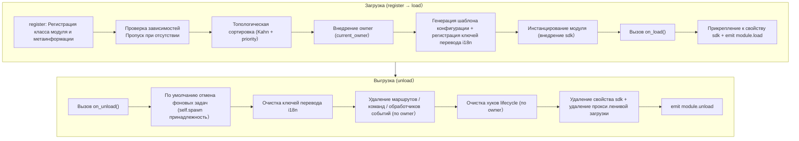
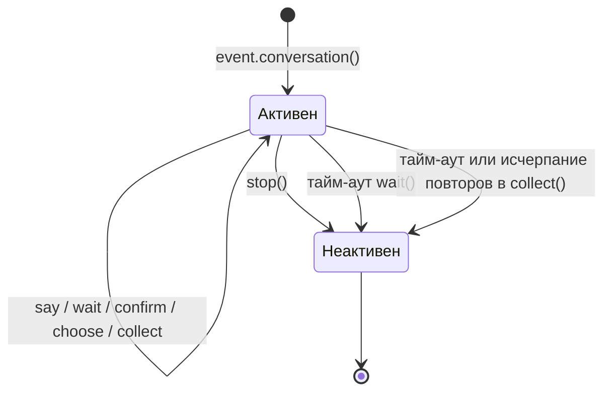

# ErisPulse 模块开发

This skill is auto-built from the ErisPulse documentation.
Repository: https://github.com/ErisPulse/ErisPulse
Source paths are annotated per section; see docs/ in the repository for the latest content.

## 模块开发入门

> 来源: `docs/ru/developer-guide/modules/getting-started.md`（https://github.com/ErisPulse/ErisPulse/blob/main/docs/ru/developer-guide/modules/getting-started.md）

# Введение в разработку модулей

> [!NOTE]
> **Обязательная документация уровня L1 (ядро)** — один из пяти ключевых документов в «маршруте чтения» на главной странице, необходим для разработки модулей.


Пройдя этот материал до конца, вы получите работающий модуль, реагирующий на команду `/hello`, а также узнаете о структуре проекта модуля, способе его регистрации и хуках загрузки/выгрузки — вся последующая документация по модулям строится на этом каркасе.

## Структура проекта

Стандартная структура модуля:

```
MyModule/
├── pyproject.toml
├── README.md
├── LICENSE
└── MyModule/
    ├── __init__.py
    └── Core.py
```

## Конфигурация pyproject.toml

```toml
[project]
name = "ErisPulse-MyModule"
version = "1.0.0"
description = "Описание функциональности модуля"
readme = "README.md"
requires-python = ">=3.10"
license = { file = "LICENSE" }
authors = [ { name = "yourname", email = "your@mail.com" } ]
dependencies = []

[project.urls]
"homepage" = "https://github.com/yourname/MyModule"

[project.entry-points."erispulse.module"]
"MyModule" = "MyModule:Main"
```

## __init__.py

```python
from .Core import Main
```

## Core.py — базовый модуль

```python
from ErisPulse import sdk
# Рекомендуется корневой импорт (2.10+): часто используемые символы импортируются напрямую из корневого пакета, глубокие пути по-прежнему поддерживаются
from ErisPulse import BaseModule, command

class Main(BaseModule):
    def __init__(self, sdk):
        self.sdk = sdk
        self.logger = sdk.logger.get_child("MyModule")
        self.storage = sdk.storage
    
    @staticmethod
    def get_load_strategy():
        """Возвращает стратегию загрузки модуля"""
        from ErisPulse.loaders import ModuleLoadStrategy
        return ModuleLoadStrategy(
            lazy_load=True,
            priority=0,
            depends=[],  # Необязательно: список других модулей, от которых зависит данный модуль
            # Необязательно: ленивая активация по событиям — объявите триггеры, и модуль автоматически загрузится при поступлении первого совпадающего события/команды
            # activate_on=[{"command": {"name": "hello", "help": "Отправляет приветствие"}}],
        )
    
    async def on_load(self, event):
        """Вызывается при загрузке модуля"""
        @command("hello", help="Отправляет приветствие")
        async def hello_command(event):
            name = event.get_user_nickname() or "друг"
            await event.reply(f"Привет, {name}!")
        
        self.logger.info("Модуль загружен")
    
    async def on_unload(self, event):
        """Вызывается при выгрузке модуля"""
        self.logger.info("Модуль выгружен")
```

> **Чтение конфигурации**: приведённый выше базовый пример не использует конфигурацию. Если требуется чтение конфигурации, рекомендуется объявить вложенный класс `ConfigClass` и читать её в реальном времени через `self.cfg` (см. [Основные концепции модулей](core-concepts.md#声明式配置推荐)). Устаревший подход с ручным вызовом `_load_config()` признан нерекомендуемым.

## Тестирование модуля

### Локальное тестирование

```bash
# Установите модуль из каталога проекта
epsdk install ./MyModule

# Запустите проект
epsdk run main.py --reload
```

### Тестирование команды

Отправьте команду для проверки:

```
/hello
```

## Основные концепции

### Базовый класс BaseModule

Все модули должны наследоваться от `BaseModule` и предоставлять следующие методы:

| Метод | Описание | Обязательный |
|------|------|------|
| `__init__(self, sdk)` | Конструктор (фреймворк передаёт экземпляр `sdk`) | Нет |
| `get_load_strategy()` | Возвращает стратегию загрузки | Нет |
| `get_meta()` | Возвращает метаинформацию о модуле (необязательно) | Нет |
| `on_load(self, event)` | Вызывается при загрузке модуля | Да |
| `on_unload(self, event)` | Вызывается при выгрузке модуля | Да |

### Метаинформация модуля (meta)

> [!NOTE]
> Для этой функции требуется ErisPulse **2.8.0+**.

Через `get_meta()` объявляется вводная метаинформация о модуле (что делает этот модуль, к какой категории относится и т. д.).
Метаинформация — это **универсальные презентационные данные модуля**, используемые help-модулем, списком модулей Dashboard, магазином модулей и другими интерфейсными/экосистемными модулями.

Аналогично `get_load_strategy()`, возвращающему `ModuleLoadStrategy`, **рекомендуется возвращать экземпляр конфигурационного класса `ModuleMeta`** (типизация атрибутов, автодополнение в IDE); также поддерживается возврат dict напрямую:

```python
class MyModule(BaseModule):
    @staticmethod
    def get_meta() -> ModuleMeta:
        return ModuleMeta(
            name="Погода",               # Отображаемое имя (имя по умолчанию при регистрации)
            description="Запрос погоды в городе",  # Краткое описание модуля
            version="1.0.0",
            author="ErisDev",
            group="Инструменты",               # Функциональная группа
            tags=["погода", "запрос"],
        )
```

Совместимый вариант записи (dict):

```python
class MyModule(BaseModule):
    @staticmethod
    def get_meta() -> dict:
        return {
            "name": "Погода",
            "description": "Запрос погоды в городе",
            "version": "1.0.0",
            "author": "ErisDev",
            "group": "Инструменты",
            "tags": ["погода", "запрос"],
        }
```

- `module.get_meta("MyModule")` читает уже разрешённую метаинформацию (объявление в классе > зарегистрированная info, имена команд модуля дополняются автоматически).
- `module.get_commands_overview()` агрегирует «метаинформацию модуля + зарегистрированные им команды (алиасы/группы/справка)» — общий обзор команд, организованный по модулям.
- Принадлежность команды модулю можно получить через `cmd_info["owner"]` (автоматически внедряется системой контекста при регистрации).

#### Поддержка i18n для полей meta

Значениями полей метаинформации могут быть обычные строки или i18n-словарь `{"i18n": "key.path", "default": "резервный текст"}` (по тому же соглашению, что и `description` в конфигурации).
Ключи перевода объявляются и регистрируются через `I18nClass`, а при чтении `module.get_meta()` автоматически разрешаются в текст на текущем языке:

```python
class MyModule(BaseModule):
    class I18nClass(BaseI18n):
        meta_description: I18nKey = I18nKey(
            default="Weather lookup",
            zh_CN="Запрос погоды в городе",
            en="Weather lookup",
        )

    @staticmethod
    def get_meta() -> ModuleMeta:
        return ModuleMeta(
            name="Погода",
            description={"i18n": "MyModule.meta_description", "default": "Weather lookup"},
        )
```

### Объект SDK

Доступ к основной функциональности через объект `sdk`:

```python
from ErisPulse import sdk

sdk.storage    # Система хранения
sdk.config     # Система конфигурации
sdk.logger     # Система логирования
sdk.adapter    # Система адаптеров
sdk.router     # Система маршрутизации
sdk.lifecycle  # Система жизненного цикла
```

## Далее

### Дальнейшее обучение

- [Основные концепции модуля](core-concepts.md) - Глубокое понимание архитектуры модуля
- [Подробнее о классе-обертке Event](event-wrapper.md) - Изучение объекта Event

### После завершения

- [Лучшие практики модуля](best-practices.md) - Разработка высококачественных модулей

## 模块核心概念

> 来源: `docs/ru/developer-guide/modules/core-concepts.md`（https://github.com/ErisPulse/ErisPulse/blob/main/docs/ru/developer-guide/modules/core-concepts.md）

# Основные концепты модуля

> [!NOTE]
> **Обязательно к прочтению для L1** — одна из пяти ключевых статей в разделе "Путь чтения" на главной странице, необходима для разработки модулей.

В этой статье подробно объясняется полный жизненный цикл модуля — от загрузки до выгрузки, объявленная конфигурация и использование хранилища — то, что фреймворк делает за вас автоматически, и что вам нужно написать самостоятельно. Прочитав статью, вы получите полное представление.

## Жизненный цикл модуля

### Стратегия загрузки

```python
from ErisPulse.Core.Bases import BaseModule
from ErisPulse.loaders import ModuleLoadStrategy

class MyModule(BaseModule):
    @staticmethod
    def get_load_strategy():
        """Возвращает стратегию загрузки модуля"""
        return ModuleLoadStrategy(
            lazy_load=True,   # Ленивая загрузка или немедленная
            priority=0,       # Приоритет загрузки (чем больше, тем раньше)
            depends=["OtherModule"]  # Опционально: объявленные зависимости от других модулей
        )
```

> Модули, объявленные в `depends`, которые не зарегистрированы, будут пропущены и в логе будет выдано предупреждение. Порядок загрузки определяется топологической сортировкой, модули с одинаковым приоритетом сортируются по убыванию `priority`.

> [!NOTE]
> **Каскадное выгрузка / каскадное перезагрузка** (ErisPulse **2.8.0+**): При выгрузке модуля, на который ссылаются другие модули, модули, зависящие от него, будут **сначала каскадно выгружены** (в логе указывается цепочка каскада); при горячей перезагрузке любого модуля (локальный плагин / модуль, зарегистрированный во время выполнения / пакет из PyPI), модули, от которых он зависит, также будут **каскадно перезагружены**, чтобы избежать использования устаревших ссылок на экземпляры. Циклические зависимости будут отклонены с `RuntimeError` при загрузке.
>
> **Перезагрузка — полная перезагрузка** (ErisPulse **2.11.0+**): `reload()` по умолчанию очищает кэш импорта по имени верхнего уровня и перезагружает код зависимых модулей, автоматически проверяет синтаксис перед выгрузкой (отказ при ошибке, старые экземпляры продолжают обслуживать), после успешной проверки идентичности кода (предупреждение о ложной перезагрузке / `stale` метка); при неудачной загрузке можно получить ошибку через `sdk.module.last_error(имя)` (с traceback).

### Метод on_load

Вызывается при загрузке модуля, используется для инициализации ресурсов и регистрации обработчиков событий:

```python
async def on_load(self, event):
    # Регистрация обработчика события
    @command("hello", help="Команда приветствия")
    async def hello_handler(event):
        await event.reply("Привет!")

    # Использование встроенного HTTP-клиента SDK (автоматически управляет пулом соединений, не нужно создавать session вручную)
    # Отправлять запросы можно через sdk.client
```

### Метод on_unload

Вызывается при выгрузке модуля, используется для очистки ресурсов:

```python
async def on_unload(self, event):
    # Очистка пользовательских ресурсов
    # sdk.client управляется фреймворком, не нужно закрывать вручную

    # Отмена обработчиков событий (фреймворк автоматически обрабатывает)
    self.logger.info("Модуль выгружен")
```

> Создание и очистка фоновых задач (через `self.spawn()` / фреймворк отменяет по умолчанию) см. в [управлении жизненным циклом](../../advanced/lifecycle.md#фоновые-задачи-принадлежность-и-автоматическая-отмена).

### Метод on_before_unload

> [!NOTE]
> Этот хук требуется ErisPulse **2.11.0+**.

Опциональный хук, запускаемый **до** `on_unload` и освобождения ресурсов — в этот момент все ресурсы модуля еще доступны, подходят для сохранения состояния в `sdk.storage` перед выгрузкой / засыпанием / перезагрузкой, восстановление при следующем `on_load` (продолжение состояния при ленивой загрузке именно на этом основывается):

```python
async def on_before_unload(self, event):
    # event["reason"] указывает причину: unload / reload / disable / cascade / dormant
    if event["reason"] in ("reload", "dormant"):
        await self.sdk.storage.aset(f"{self._module_name}:state", self.collect_state())
```

Если хук завершается с ошибкой, это лишь предупреждение, не блокирует процесс выгрузки; модули, не объявляющие этот хук, ведут себя как обычно. Семантика засыпания / пробуждения см. в [Ленивой загрузке](../../advanced/lazy-loading.md#засыпание-dormant_after).

### Выгрузка и полная выгрузка (purge)

> [!NOTE]
> Эта функция требует ErisPulse **2.8.0+**.

`unload()` по умолчанию **только отменяет загрузку** (выгружает экземпляр и ресурсы), но сохраняет метаданные регистрации (класс модуля и метаинформация) — модуль по-прежнему может быть обнаружен и перезагружен через `load()`, без необходимости повторной `register()`.

Если требуется **полная выгрузка** (освобождение ссылок на класс модуля, очистка `sys.modules`, чтобы плагин и его уникальные зависимости могли быть собраны сборщиком мусора), передайте `purge=True`:

```python
# Только отмена загрузки: сохраняются метаданные регистрации, можно перезагрузить в любой момент
await sdk.module.unload("MyModule")

# Полная выгрузка: удаляются метаданные регистрации + очистка sys.modules (только для модулей из папки плагинов)
await sdk.module.unload("MyModule", purge=True)
```

| Семантика | `unload()` по умолчанию | `unload(purge=True)` |
|----------|-------------------------|----------------------|
| Выгрузка экземпляра и ресурсов (события/задачи/маршруты/lifecycle/i18n) | ✅ | ✅ |
| Сохранение метаданных регистрации (класс модуля и метаинформация) | ✅ | ❌ Удалено |
| Очистка `sys.modules` (только для модулей из папки плагинов) | ❌ | ✅ |
| Класс модуля может быть собран сборщиком мусора | ❌ | ✅ |
| Перезагрузка | `load()` напрямую | Необходимо сначала `register()` + `load()` |

> При `purge=True` зависимые модули, которые каскадно выгружаются, также будут удалены; после выгрузки фреймворк выполнит `gc.collect()` и проверит, могут ли класс модуля/экземпляр быть собраны, остаточные ссылки будут предупреждены в логе (с указанием источника, уровень DEBUG).

### Жизненный цикл в целом

Собрав все методы вместе, фреймворк делает **все**, что нужно, при загрузке и выгрузке модуля:



**Что делает фреймворк при загрузке (вам нужно только написать `on_load()`, всё остальное автоматически)**:

| Этап | Что делает фреймворк автоматически |
|------|----------------------------------|
| Внедрение owner | При инстанцировании модуль обёртывается в `owner_scope`, все зарегистрированные команды/события/хуки/фоновые задачи **автоматически привязываются к этому модулю**, при выгрузке они очищаются по owner |
| Шаблон конфигурации | Модули, объявившие `ConfigClass`, получают автоматически сгенерированный/заполненный раздел конфигурации `ErisPulse.<ModuleName>` |
| Ключи перевода i18n | Модули, объявившие `I18nClass`, регистрируют ключи перевода (автоматически удаляются при выгрузке) |
| Зависимости | Сортируются по `depends`, гарантируется, что зависимые модули загружаются первыми; циклические зависимости отклоняются с `RuntimeError` |
| SDK привязка | После инстанцирования модуль привязывается к `sdk.<ModuleName>`, чтобы вы могли обращаться к `sdk.MyModule.xxx` |

**Что очищает фреймворк при выгрузке (соответствует U1→U7 выше)**: после выполнения `on_unload()` фреймворк по умолчанию отменяет фоновые задачи (`self.spawn`), i18n ключи, маршруты, команды/обработчики событий, хуки lifecycle, затем удаляет свойство sdk. При `purge=True` дополнительно удаляются метаданные регистрации + очищаются `sys.modules`.

> Именно эта автоматическая очистка — основа уверенности в том, что «вам нужно только писать `on_load`/`on_unload`, не нужно вручную unregister» — фреймворк использует принадлежность owner, чтобы сделать «тот, кто зарегистрировал, тот и очищает» одним нажатием.

## Объект SDK

### Доступ к основным модулям

```python
from ErisPulse import sdk

# Доступ к основным модулям через объект sdk
sdk.logger.info("Логирование")
sdk.storage.set("key", "value")
config = sdk.config.getConfig("MyModule")
```

### Взаимодействие между модулями

```python
# Доступ к другим модулям
other_module = sdk.OtherModule
result = await other_module.some_method()
```

## Методы отправки адаптера

Из-за нового стандарта, требующего использования перегрузки метода `__getattr__` для реализации механизма отправки по умолчанию, невозможно использовать `hasattr` для проверки существования метода. Начиная с версии `2.3.5`, добавлена функция для запроса методов отправки.

### Список поддерживаемых методов отправки

```python
# Список всех методов отправки, поддерживаемых платформой
methods = sdk.adapter.list_sends("onebot11")
# Возвращает: ["Text", "Image", "Voice", "Markdown", ...]
```

### Получение подробной информации о методе

```python
# Получение подробной информации о методе
info = sdk.adapter.send_info("onebot11", "Text")
# Возвращает:
# {
#     "name": "Text",
#     "parameters": [
#         {"name": "text", "type": "str", "default": null, "annotation": "str"}
#     ],
#     "return_type": "Awaitable[Any]",
#     "docstring": "Отправка текстового сообщения..."
# }
```

## Управление конфигурацией

### Объявленная конфигурация (рекомендуется)

Начиная с версии `v2.5.2`, модули могут объявлять класс конфигурации через `ConfigClass`, используя ту же систему схемы конфигурации, что и адаптеры. Конфигурация доступна через `self.cfg` в реальном времени, изменения применяются немедленно:

```python
from dataclasses import dataclass, field
from ErisPulse.Core.Bases import BaseModule
from ErisPulse.Core.Bases import BaseConfig

@dataclass
class MyModuleConfig(BaseConfig):
    api_key: str = field(
        default="",
        metadata={
            "description": {"i18n": "my_module.api_key", "default": "Ключ API"},
            "required": True,
            "secret": True,
            "ui": {"widget": "password", "group": "basic", "order": 1},
        },
    )
    timeout: int = field(
        default=30,
        metadata={
            "description": {"i18n": "my_module.timeout", "default": "Время ожидания (секунды)"},
            "ui": {"widget": "number", "group": "advanced", "order": 2},
        },
    )

class MyModule(BaseModule):
    ConfigClass = MyModuleConfig

    def __init__(self, sdk):
        self.sdk = sdk
        self.logger = sdk.logger.get_child("MyModule")

    async def on_load(self, event):
        self.logger.info("Модуль загружен")

    async def on_unload(self, event):
        pass

    async def do_something(self):
        cfg = self.cfg  # Чтение в реальном времени, типобезопасно
        api_key = cfg.api_key
        timeout = cfg.timeout
```

`BaseConfig` — базовый класс конфигурации, используется в адаптерах, модулях, внешних проектах и любых других сценариях. Поля конфигурации поддерживают многоязычные описания (см. [документацию i18n](../../advanced/i18n.md#многоязычные-описания-поля-конфигурации)).

> [!NOTE]
> Жизненный цикл модуля (включая загрузку, выгрузку, запуск и остановку) управляется фреймворком (модульный менеджер / scope предоставляет API для запроса и управления). `ConfigClass` должен содержать только бизнес-параметры, модулю не нужно вводить дополнительные условия "запускать себя" внутри.

Система схем конфигурации также поддерживает (с v2.8.0, см. [основные концепты адаптера](../adapters/core-concepts.md#metadata-约定)):

- **Автоматическое создание описания полей из docstring**: при отсутствии metadata `description`, описание автоматически извлекается из docstring по шаблону `:ivar 字段: 说明` или из раздела `Attributes:`
- **Вложенные dataclass-конфигурации**: при типе поля вложенный dataclass, схема/шаблон/валидация обрабатываются рекурсивно, WebUI отображает как вложенные группы
- **Поле `example` не сохраняется в файл**: `metadata={"example": True}` означает, что поле не записывается в config.toml, сохраняется только в `config.full.example` (подходит для сложных и редко используемых настроек), после ручного установки пользователем сохраняется как обычное поле

### Объявленные ключи перевода (v2.7.0+)

Начиная с v2.7.0, модули могут объявлять ключи перевода, как и `ConfigClass`, через вложенный класс `I18nClass`. Фреймворк автоматически **регистрирует** все объявленные ключи перевода при загрузке, без необходимости вызова `i18n.register()`, и регистрация происходит раньше, чем генерация шаблона конфигурации, гарантируя, что ключи перевода, используемые в описаниях конфигурации, уже доступны.

```python
from ErisPulse.Core.Bases import BaseConfig, BaseI18n, I18nKey

class MyModule(BaseModule):
    # Конфигурационный класс (опционально)
    @dataclass
    class ConfigClass(BaseConfig):
        welcome_msg: str = field(
            default="Добро пожаловать",
            metadata={
                "description": {"i18n": "mymodule.welcome_msg", "default": "Сообщение приветствия"},
            },
        )

    # Класс коллекции ключей перевода (опционально)
    class I18nClass(BaseI18n):
        # Имя свойства автоматически объединяется в полный путь ключа: <имя модуля>.<имя свойства>
        welcome_msg: I18nKey = I18nKey(
            default="Welcome Message",   # Языко-независимый резервный текст
            zh_CN="欢迎消息",
            zh_TW="歡迎訊息",
            en="Welcome Message",
            ja="ウェルカムメッセージ",
            ru="Приветственное сообщение",
        )
        hello: I18nKey = I18nKey(
            default="Hello, {name}!",
            zh_CN="你好，{name}！",
            zh_TW="你好，{name}！",
            en="Hello, {name}!",
            ja="こんにちは、{name}！",
            ru="Привет, {name}!",
        )
```

Подробнее см. в [рекомендуемом способе написания i18n](../../advanced/i18n.md#рекомендуемый-способ-через-i18nclass-объявление-ключей-перевода-v270).

### Ручное чтение конфигурации (устарело)

> **Устарело**: используйте [объявленную конфигурацию](#объявленная-конфигурация-рекомендуется) + `self.cfg` для чтения в реальном времени.

```python
class MyModule(BaseModule):
    def __init__(self, sdk):
        self.sdk = sdk

    def _load_config(self):
        config = self.sdk.config.getConfig("MyModule")
        if not config:
            self.sdk.config.setConfig("MyModule", {"api_key": "", "timeout": 30})
            return {"api_key": "", "timeout": 30}
        return config
```

## Система хранилища

### Основное использование

```python
# Сохранение данных
sdk.storage.set("user:123", {"name": "Чжан Сань"})

# Получение данных
user = sdk.storage.get("user:123", {})

# Удаление данных
sdk.storage.delete("user:123")
```

### Использование транзакций

```python
# Использование транзакции для обеспечения согласованности данных
with sdk.storage.transaction():
    sdk.storage.set("key1", "value1")
    sdk.storage.set("key2", "value2")
    # Если какое-либо действие завершится с ошибкой, все изменения будут отменены
```

## Обработка событий

### Регистрация обработчиков событий

```python
from ErisPulse.Core.Event import command, message

# Регистрация команды
@command("info", help="Получить информацию")
async def info_handler(event):
    await event.reply("Это информация")

# Регистрация обработчика сообщений
@message.on_group_message()
async def group_handler(event):
    sdk.logger.info(f"Получено групповое сообщение: {event.get_text()}")
```

### Жизненный цикл обработчиков событий

Фреймворк автоматически управляет регистрацией и удалением обработчиков событий, вам нужно только зарегистрировать их в `on_load()`.

## Механизм ленивой загрузки

### Принцип работы

```python
# Модуль будет инициализирован при первом обращении
result = await sdk.my_module.some_method()
# ↑ При этом будет вызвана инициализация модуля
```

### Немедленная загрузка

Для модулей, которые должны быть инициализированы немедленно (например, слушатели, таймеры):

```python
@staticmethod
def get_load_strategy():
    return ModuleLoadStrategy(
        lazy_load=False,  # Немедленная загрузка
        priority=100
    )
```

## Обработка ошибок

### Перехват исключений

```python
async def handle_event(self, event):
    try:
        # Бизнес-логика
        await self.process_event(event)
    except ValueError as e:
        self.logger.warning(f"Ошибка параметра: {e}")
        await event.reply(f"Ошибка параметра: {e}")
    except Exception as e:
        self.logger.error(f"Обработка не удалась: {e}")
        raise
```

### Запись в лог

```python
# Использование разных уровней логирования
self.logger.debug("Отладочная информация")    # Подробная отладочная информация
self.logger.info("Состояние выполнения")      # Информация о нормальном состоянии выполнения
self.logger.warning("Предупреждение")  # Предупреждение
self.logger.error("Ошибка")    # Ошибка
self.logger.critical("Критическая ошибка") # Критическая ошибка
```

## Связанные документы

### Продолжение изучения

- [Объект события](event-wrapper.md) - Подробное объяснение обработки событий

### Глубокое изучение и отладка

- [Лучшие практики модуля](best-practices.md) - Разработка качественных модулей
- [Начало разработки модуля](getting-started.md) - Возвращение к первому шагу создания модуля

## Event 包装类

> 来源: `docs/ru/developer-guide/modules/event-wrapper.md`（https://github.com/ErisPulse/ErisPulse/blob/main/docs/ru/developer-guide/modules/event-wrapper.md）

# Подробное объяснение обёртки события

> [!NOTE]
> **Обязательное для понимания уровня L1** — одна из пяти основных статей в "пути чтения" на главной странице, необходима для разработки модулей.

Параметр `event` в обработчике событий может напрямую использовать `.get_text()` / `.reply()` / `.wait_reply()`, благодаря обёртке события. В этой статье представлен полный список методов — обращайтесь к ней при написании обработчиков событий, все сигнатуры методов и поведение должны соответствовать этой статье.

## Добавление аннотаций типа для параметра event

Параметр `event` в обработчике событий является **обёрткой события** (подклассом dict). Рекомендуется добавлять аннотации типа:

```python
from ErisPulse.Core.Event import Event

@message.on_private_message()
async def handler(event: Event):
    text = event.get_text()   # IDE автоматически подсказывает все удобные методы
    await event.reply(text)   # Ошибки в написании методов обнаруживаются при статической проверке
```

Без аннотаций IDE не распознаёт методы в Event (`get_text()` / `reply()` / `wait_reply()` / расширения платформы не подсказываются), и приходится полагаться на память.

> **Обратите внимание**: в обработчике событий `event` является **обёрткой события** (аннотация `Event`); в методах жизненного цикла модуля `on_load` / `on_unload` `event` является обычным **dict** (аннотация `dict`), не путайте их.

## Основные особенности

- **Полная совместимость с dict**: Event наследуется от dict
- **Удобные методы**: предоставляет множество удобных методов
- **Доступ через точку**: поддерживает доступ к полям события через точку
- **Обратная совместимость**: все методы являются необязательными

## Основные методы полей события

```python
from ErisPulse.Core.Event import command

@command("info")
async def info_command(event: Event):
    event_id = event.get_id()
    platform = event.get_platform()
    time = event.get_time()
    print(f"ID: {event_id}, платформа: {platform}, время: {time}")
```

## Методы событий сообщений

```python
from ErisPulse.Core.Event import message

@message.on_private_message()
async def private_handler(event: Event):
    text = event.get_text()
    user_id = event.get_user_id()
    nickname = event.get_user_nickname()
    await event.reply(f"Привет, {nickname}!")
```

## Определение типа сообщения

```python
from ErisPulse.Core.Event import message

@message.on_group_message()
async def group_handler(event: Event):
    is_private = event.is_private_message()
    is_group = event.is_group_message()
    is_at = event.is_at_message()
    await event.reply(f"Тип: {'личное сообщение' if is_private else 'группа'}")
```

## Функция ответа

```python
from ErisPulse.Core.Event import command

@command("ask")
async def ask_command(event: Event):
    await event.reply("Введите ваше имя:")
    reply = await event.wait_reply(timeout=30)
    if reply:
        name = reply.get_text()
        await event.reply(f"Привет, {name}!")

@command("price")
async def price_command(event: Event):
    await event.reply("Введите сумму (например: 5 юаней):")
    # Ответ должен соответствовать регулярному выражению, иначе ожидание продолжается до истечения таймаута
    reply = await event.wait_reply(timeout=30, regex=r"\d+\s*元")
    if reply:
        await event.reply(f"Получена сумма: {reply.get_text()}")
```

## Расширенные возможности интерактивных сессий

> [!NOTE]
> Эта функция доступна в ErisPulse **2.8.0+**.

```python
# Напоминание сессии: если в течение 5 минут нет ответа, отправить напоминание, после ответа пользователя автоматически отменить
reminder = event.remind(300, "Ещё здесь? Если не хочешь продолжать, напиши «выход»")
reminder.cancel()  # Также можно отменить вручную

# Повышение при таймауте: по истечении времени обязательно сработает (не отменяется ответом), например, если обработка длительная, уведомить владельца
event.escalate(1800, lambda e: notify_master("Заявка просрочена"))

# Ожидание нескольких путей: одновременно ждать "согласия" и "отказа", сработает первый пришедший
which, reply = await event.select(
    event.expect(pattern="согласен*", user="10001"),
    event.expect(pattern="отказ*", user="10002"),
    timeout=60,
)
if which is None:
    await event.reply("Таймаут, ответ не получен")

# Ожидание в сессии: ответ любого пользователя в группе может быть принят (сотрудничество в группе)
reply = await event.wait_reply(session=True, prompt="Кто-нибудь может помочь ответить?")

# Почтовый ящик сессии: последние 20 сообщений текущей сессии (включая бота, контекст для ИИ / база для предотвращения повторов)
messages = await event.history(20)

# Транзакции сообщений: при возникновении ошибки автоматически отменяются отправленные сообщения в рамках транзакции
async with event.message_tx():
    await event.reply("Обработка, подождите...")
    result = await do_something()
    await event.reply(f"Завершено: {result}")
```

## Получение информации о команде

```python
from ErisPulse.Core.Event import command

@command("cmdinfo")
async def cmdinfo_command(event: Event):
    cmd_name = event.get_command_name()
    cmd_args = event.get_command_args()
    await event.reply(f"Команда: {cmd_name}, параметры: {cmd_args}")
```

## Методы событий уведомлений

```python
from ErisPulse.Core.Event import notice

@notice.on_friend_add()
async def friend_add_handler(event: Event):
    await event.reply("Добро пожаловать в друзья!")
```

## Справочник методов

### Основные методы

#### Основная информация о событии
- `get_id()` - получить идентификатор события
- `get_time()` - получить временную метку события (Unix, секунды)
- `get_type()` - получить тип события (message/notice/request/meta)
- `get_detail_type()` - получить подробный тип события (private/group/friend и т.д.)
- `get_platform()` - получить название платформы

#### Информация о боте
- `get_self_platform()` - получить название платформы бота
- `get_self_user_id()` - получить идентификатор пользователя бота
- `get_self_account_id()` - получить идентификатор аккаунта бота (режим множественных ботов)
- `get_self_info()` - получить полную информацию о боте в виде словаря

#### Идентификаторы сессии
- `get_target_id()` - получить единый идентификатор цели (для групповых чатов возвращает `group_id`, для каналов `channel_id`, для личных сообщений `user_id`, в порядке group → channel → guild → thread → user возвращает первый непустой)
- `get_session_id()` - получить уникальный идентификатор сессии, формат `{platform}:{detail_type}:{target_id}`

### Методы событий сообщений

#### Содержимое сообщения
- `get_message()` - получить массив сегментов сообщения (формат OneBot12)
- `get_alt_message()` - получить альтернативный текст сообщения
- `get_text()` - получить текстовое содержимое (псевдоним `get_alt_message()`)
- `get_message_text()` - получить текстовое содержимое (псевдоним `get_alt_message()`)

#### Информация об отправителе
- `get_user_id()` - получить идентификатор пользователя-отправителя
- `get_user_nickname()` - получить никнейм отправителя
- `get_sender()` - получить полную информацию об отправителе в виде словаря

#### Информация о группе/канале
- `get_group_id()` - получить идентификатор группы (для сообщений в группе)
- `get_channel_id()` - получить идентификатор канала (для сообщений в канале)
- `get_guild_id()` - получить идентификатор сервера (для сообщений на сервере)
- `get_thread_id()` - получить идентификатор темы/подканала (для сообщений в теме)

#### Связанные с @ сообщениями
- `has_mention()` - содержит ли сообщение упоминание бота
- `get_mentions()` - получить список всех упомянутых идентификаторов пользователей

### Определение типа сообщения

#### Основные проверки
- `is_message()` - является ли событие сообщением
- `is_private_message()` - является ли сообщение личным
- `is_group_message()` - является ли сообщение групповым
- `is_at_message()` - является ли сообщение с упоминанием бота (`has_mention()` alias)

### Методы событий уведомлений

#### Информация об операторе
- `get_operator_id()` - получить идентификатор оператора
- `get_operator_nickname()` - получить никнейм оператора

#### Определение типа уведомления
- `is_notice()` - является ли событие уведомлением
- `is_group_member_increase()` - событие увеличения участников группы
- `is_group_member_decrease()` - событие уменьшения участников группы
- `is_friend_add()` - событие добавления друга (соответствует `detail_type == "friend_increase"`)
- `is_friend_delete()` - событие удаления друга (соответствует `detail_type == "friend_decrease"`)

### Методы событий запросов

#### Информация о запросе
- `get_comment()` - получить комментарий к запросу

#### Определение типа запроса
- `is_request()` - является ли событие запросом
- `is_friend_request()` - является ли запросом добавления друга
- `is_group_request()` - является ли запросом добавления в группу

### Функция ответа

#### Основной ответ
- `reply(content, method="Text", at_sender=False, quote=False, at_users=None, reply_to=None, at_all=False, via=None, **kwargs)` - универсальный метод ответа
  - `content`: содержимое отправки (текст, URL и т.д.)
  - `method`: метод отправки, по умолчанию "Text", можно выбрать "Image"/"Voice"/"Video"/"File" и т.д.
  - `at_sender`: упоминать ли отправителя (автоматически извлекает user_id)
  - `quote`: цитировать ли текущее сообщение (автоматически извлекает message_id)
  - `at_users`: список упоминаний пользователей, например `["user1", "user2"]`
  - `reply_to`: вручную указать идентификатор сообщения для ответа
  - `at_all`: упоминать ли всех участников
  - `**kwargs`: дополнительные параметры (например, для метода Mention user_id)

- `reply_ob12(message)` - ответ с использованием OneBot12 сегментов сообщения
  - `message`: список или словарь сегментов OneBot12, можно использовать MessageBuilder для построения

#### Проверка поддержки платформой
- `supports(method)` - проверить, поддерживает ли текущая платформа метод отправки (например, `"Image"`, `"Voice"`), возвращает `bool`
- `available_methods()` - перечислить все доступные методы отправки на текущей платформе, возвращает список названий методов

#### Функция пересылки

> **Внимание**: функция пересылки должна реализовываться через DSL отправки адаптера, Event wrapper сам не предоставляет прямого метода пересылки.

```python
# Переслать сообщение в группу
adapter = sdk.adapter.get(event.get_platform())
target_id = event.get_group_id()  # или указать другой идентификатор группы
await adapter.Send.To("group", target_id).Text(event.get_text())
```

### Функция ожидания ответа

- `wait_reply(prompt=None, timeout=60.0, callback=None, validator=None, method="Text", pattern=None, regex=None)` - ожидать ответ пользователя
  - `prompt`: сообщение-подсказка, если указано, отправляется пользователю
  - `timeout`: время ожидания (секунды), по умолчанию 60 секунд
  - `callback`: функция-обратный вызов, выполняется при получении ответа
  - `validator`: функция проверки, используется для проверки корректности ответа
  - `method`: метод отправки подсказки, по умолчанию "Text"
  - `pattern`: шаблон glob (`*` / `?` / `[seq]`), текст ответа должен соответствовать, иначе ожидание продолжается
  - `regex`: регулярное выражение, текст ответа должен соответствовать (один из `pattern` или `regex`), иначе ожидание продолжается
  - Возвращает объект Event с ответом пользователя, в случае таймаута возвращает None

#### Интерактивные методы

- `confirm(prompt=None, timeout=60.0, yes_words=None, no_words=None, method="Text", hint=False)` - метод подтверждения
  - Возвращает `True` (подтверждение) / `False` (отрицание) / `None` (таймаут)
  - Встроенные слова подтверждения на английском и китайском автоматически распознаются, можно настроить собственный набор слов
  - `method`: метод отправки, по умолчанию "Text"; поддерживает "Image"/"Markdown" и другие не-текстовые методы
  - `hint`: добавлять ли автоматически подсказку в конце (например, "（да/нет）" в конце), по умолчанию False

- `choose(prompt, options, timeout=60.0, method="Text", options_format="auto", merge_prompt=False, placeholder="{options}")` - метод выбора меню
  - `options`: список текстов опций
  - Возвращает индекс выбранной опции (начиная с 0), в случае таймаута возвращает `None`
  - `method`: метод отправки, по умолчанию "Text"; текстовые методы (Text/Markdown/md/Html/h5) по умолчанию объединяют опции в конец
  - `options_format`: формат опций (по умолчанию: "auto", автоматически выбирается встроенный стиль в зависимости от метода)
    - `"auto"`: Markdown→нумерованный список (`- 1. опция`), Html→упорядоченный список (`<ol>`), остальные→простой список
    - `"list"`: по одному на строку, например ``1. опцияA\n2. опцияB``
    - `"inline"`: отображение в одной строке, например ``1.A | 2.B``
    - `"md"`: Markdown нумерованный список
    - `"html"`: Html упорядоченный список
    - `callable`: пользовательская функция, принимает ``list[str]`` и возвращает ``str``
  - `merge_prompt`: принудительно объединять ли в одно сообщение, по умолчанию False
    - `False` (по умолчанию): текстовые методы объединяют автоматически; не-текстовые методы сначала отправляют prompt, затем Text с опциями
    - `True`: независимо от метода объединяются в одно сообщение, отправляется с указанным методом
  - `placeholder`: маркер для вставки опций, по умолчанию `{options}`; текст с этим маркером заменяется на список опций, если пустая строка, то всегда добавляется в конец

- `collect(fields, timeout_per_field=60.0)` - сбор формы
  - `fields`: список полей, каждое содержит `key`, `prompt`, необязательный `validator`, необязательный `method`
  - Возвращает словарь `{key: value}`, если любое поле вышло за таймаут, возвращает `None`
  - Каждое поле может иметь ключ `method` для указания метода отправки, например, при сборе изображения: `{"key": "avatar", "prompt": "Пожалуйста, отправьте аватар", "method": "Image"}`
  - Каждое поле может иметь ключ `options` (список), при наличии становится выбором (автоматически вызывается логика choose)
  - Каждое поле может иметь ключи `options_format`, `merge_prompt`, `placeholder`, управляющие форматом опций, поведением объединения сообщений и маркером

- `wait_for(event_type="message", condition=None, timeout=60.0)` - ожидать произвольного события
  - `condition`: фильтрующая функция, возвращает `True` при совпадении
  - Возвращает соответствующий Event объект, в случае таймаута возвращает None

- `conversation(timeout=60.0)` - создать контекст многошагового диалога
  - Возвращает объект `Conversation`, поддерживающий `say()`/`wait()`/`confirm()`/`choose()`/`collect()`/`stop()`
  - Атрибут `is_active` указывает, активен ли диалог

#### Примеры интерактивных методов

**confirm() - подтверждение диалога:**

```python
@command("delete", help="Удалить данные")
async def delete_handler(event: Event):
    if await event.confirm("Вы уверены, что хотите удалить все данные?"):
        sdk.storage.delete("all_data")
        await event.reply("Данные удалены")
    else:
        await event.reply("Отменено")
```

**confirm() - с подсказкой:**

```python
# hint=True добавит "（да/нет）" в конец подсказки
if await event.confirm("Продолжить?", hint=True):
    await event.reply("Продолжено")
# Пользователь увидит: Продолжить?（да/нет）
```

**choose() - выбор меню:**

```python
@command("color", help="Выбрать цвет")
async def color_handler(event: Event):
    choice = await event.choose("Выберите цвет:", ["красный", "зелёный", "синий"])
    if choice is not None:
        colors = ["красный", "зелёный", "синий"]
        await event.reply(f"Вы выбрали: {colors[choice]}")
```

**choose() - форматирование и объединение опций:**

```python
# inline формат: опции отображаются в одной строке
choice = await event.choose("Выберите:", ["A", "B", "C"], options_format="inline")
# Вывод: 1.A | 2.B | 3.C

# Пользовательская функция форматирования
choice = await event.choose("Выберите:", ["кот", "собака"],
    options_format=lambda opts: " / ".join(opts))
# Вывод: кот / собака

# options_format="auto" (по умолчанию): в зависимости от method автоматически выбирается встроенный стиль
# Markdown → нумерованный список
choice = await event.choose(
    "## Выберите", ["кот", "собака"],
    method="Markdown",  # auto автоматически распознаёт как md-список
)
# Вывод:
# ## Выберите
# - 1. кот
# - 2. собака

# Html → упорядоченный список
choice = await event.choose(
    "<h2>Выберите</h2>", ["кот", "собака"],
    method="Html", merge_prompt=True,  # auto автоматически распознаёт как html-список
)
# Вывод:
# <h2>Выберите</h2>
# <ol><li>1. кот</li><li>2. собака</li></ol>

# Режим объединения + маркер
choice = await event.choose(
    "## Выберите\n{options}\nОтветьте номером",
    ["кот", "собака"],
    method="Markdown", merge_prompt=True,
)

# Пользовательский маркер
choice = await event.choose(
    "Выберите: [choices]",
    ["кот", "собака"],
    placeholder="[choices]",
)
```

**collect() - сбор формы:**

```python
@command("register", help="Регистрация")
async def register_handler(event: Event):
    data = await event.collect([
        {"key": "name", "prompt": "Введите имя:"},
        {"key": "age", "prompt": "Введите возраст:",
         "validator": lambda e: e.get_text().isdigit()},
    ])
    if data:
        await event.reply(f"Регистрация прошла успешно! {data['name']}, {data['age']} лет")
```

**reply с методами, отличными от Text:**

```python
await event.reply("http://example.com/img.jpg", method="Image")
await event.reply("http://example.com/audio.mp3", method="Voice")

from ErisPulse.Core.Event import MessageBuilder
segments = MessageBuilder.text("Посмотрите на эту картинку:").image("http://example.com/img.jpg").build()
await event.reply_ob12(segments)
```

> Полное использование многошагового диалога через Conversation см. в [Многошаговый диалог Conversation](../../advanced/conversation.md).

### Информация о команде

#### Основные команды
- `get_command_name()` - получить название команды
- `get_command_args()` - получить список аргументов команды
- `get_command_raw()` - получить исходный текст команды
- `get_command_info()` - получить полную информацию о команде в виде словаря
- `is_command()` - является ли событие командой

### Исходные данные

- `get_raw()` - получить исходные данные события платформы
- `get_raw_type()` - получить тип исходного события платформы

### Методы расширения платформы

Адаптеры могут регистрировать специфичные для платформы методы для обёртки события. Методы доступны только на экземплярах Event соответствующей платформы, попытка доступа с других платформ вызывает `AttributeError`.

Методы платформы имеют приоритет над встроенными методами через `Event.__getattribute__`, поэтому можно переопределить встроенные методы `confirm`、`choose`、`collect`、`wait_reply` и др., предоставив реализацию с функционалом платформы (например, кнопки, карточки). Встроенная реализация экспортируется как `_builtin_*` функции для переопределения.

```python
# Почтовое событие - только методы email
event = Event({"platform": "email", "email_raw": {"subject": "Hello"}})
event.get_subject()      # ✅ Возвращает "Hello"
event.get_chat_type()    # ❌ AttributeError

# Telegram событие - только методы Telegram
event = Event({"platform": "telegram", "telegram_raw": {"chat": {"type": "private"}}})
event.get_chat_type()    # ✅ Возвращает "private"
event.get_subject()      # ❌ AttributeError

# Встроенные методы всегда доступны
event.get_text()         # ✅ В любой платформе
event.reply("hi")        # ✅ В любой платформе
```

### Проверка зарегистрированных методов

```python
from ErisPulse.Core.Event import get_platform_event_methods

methods = get_platform_event_methods("email")
# ["get_subject", "get_from", ...]
```

### Поддержка hasattr и dir

```python
hasattr(event, "get_subject")   # Возвращает True только если platform="email"
"get_subject" in dir(event)     # То же самое
```

### Расширение для всех платформ (шаблон)

`register_event_method` и `register_event_mixin` поддерживают передачу `"*"` в качестве названия платформы, методы будут доступны на **всех** платформах. Подходит для функций, требующих переносимости, таких как ИИ-диалоги, управление контекстом и т.д.

```python
from ErisPulse.Core.Event.wrapper import register_event_method

@register_event_method("*")
async def ai_chat(self, prompt: str):
    # self — экземпляр Event, можно получить доступ к данным события и встроенным методам
    await self.reply(f"ИИ: {prompt}")
```

После регистрации, метод `event.ai_chat(...)` будет доступен в обработчиках событий любой платформы.

Приоритет разрешения методов (от высшего к низшему): методы платформы → методы шаблона → встроенные методы → доступ по ключу словаря.

> Способ регистрации расширений адаптерами см. в [API системы событий - Расширение для всех платформ (шаблон)](../../api-reference/event-system.md#расширение-для-всех-платформ-шаблон).

## Связанные документы

### Продолжение пути разработки модуля

- [Начало разработки модуля](getting-started.md) - Создание первого модуля
- [Лучшие практики разработки модуля](best-practices.md) - Разработка модуля высокого качества

### Глубокое изучение интерактивных возможностей

- [Многошаговый диалог Conversation](../../advanced/conversation.md) - Полная система сессий на основе `wait_reply` (сбор, проверка, ветвление)
- [Руководство по отладке модуля](../module-troubleshooting.md) - Поиск и устранение проблем, когда событие не отвечает

## 模块最佳实践

> 来源: `docs/ru/developer-guide/modules/best-practices.md`（https://github.com/ErisPulse/ErisPulse/blob/main/docs/ru/developer-guide/modules/best-practices.md）

# Лучшие практики разработки модулей

> [!TIP]
> **Когда читать эту статью:** рекомендуется прочитать после написания первого модуля (инженерные лучшие практики). Если не нужно, пропустите — это не повлияет на использование других функций.

Здесь собраны инженерные соглашения по разработке модулей: асинхронные операции не блокируют цикл событий, конфигурация задается декларативно, управляемые ресурсы других модулей освобождаются при отключении — следуя этим правилам, можно избежать утечек памяти, остаточных фоновых задач, сбоев горячей перезагрузки — типичных проблем при разработке модулей.

## Проектирование модуля

### 1. Принцип единственной ответственности

Каждый модуль должен отвечать только за одну основную функцию:

```python
# Хорошее проектирование: каждый модуль отвечает за одну функцию
class WeatherModule(BaseModule):
    """Модуль для запроса погоды"""
    pass

class NewsModule(BaseModule):
    """Модуль для запроса новостей"""
    pass

# Плохое проектирование: один модуль отвечает за несколько несвязанных функций
class UtilityModule(BaseModule):
    """Содержит погоду, новости, шутки и другие функции"""
    pass
```

### 2. Нормы именования модулей

```toml
[project]
name = "ErisPulse-ModuleName"  # Использование префикса ErisPulse-
```

### 3. Четкое управление конфигурацией

Рекомендуется использовать декларативную конфигурацию (`ConfigClass` + `BaseConfig`), чтобы получить типовую безопасность, автоматическое создание шаблонов, поддержку веб-интерфейса и т.д.:

```python
from dataclasses import dataclass, field
from ErisPulse.Core.Bases import BaseConfig

@dataclass
class MyModuleConfig(BaseConfig):
    api_url: str = field(default="https://api.example.com", metadata={
        "description": {"i18n": "my_module.api_url", "default": "Адрес API"},
    })
    timeout: int = field(default=30, metadata={
        "description": {"i18n": "my_module.timeout", "default": "Время ожидания (секунды)"},
    })
    cache_ttl: int = field(default=3600, metadata={
        "description": {"i18n": "my_module.cache_ttl", "default": "Время жизни кэша (секунды)"},
    })

class MyModule(BaseModule):
    ConfigClass = MyModuleConfig

    async def do_something(self):
        cfg = self.cfg  # Типовая безопасность, получение в реальном времени
        await self._fetch(cfg.api_url, timeout=cfg.timeout)
```

Также можно продолжать использовать ручной способ чтения и записи конфигурации (см. [Основные концепции модуля](core-concepts.md#управление-конфигурацией)).

### Декларативные ключи перевода (v2.7.0+)

Модуль может объявить ключи перевода с помощью `I18nClass`, и фреймворк автоматически зарегистрирует их в системе перевода, без необходимости вызывать `i18n.register()` вручную.

```python
from ErisPulse.Core.Bases import BaseI18n, I18nKey

class MyModule(BaseModule):
    class I18nClass(BaseI18n):
        # Ключ перевода с плейсхолдером
        welcome: I18nKey = I18nKey(
            default="Welcome, {name}!",
            zh_CN="Добро пожаловать, {name}!",
            zh_TW="歡迎你，{name}！",
            en="Welcome, {name}!",
            ja="ようこそ、{name}！",
            ru="Добро пожаловать, {name}!",
        )
        # Описание поля конфигурации
        api_url: I18nKey = I18nKey(
            default="API URL",
            zh_CN="Адрес API",
            zh_TW="API 位址",
            en="API URL",
            ja="API URL",
            ru="API URL",
        )
```

Подробное использование смотрите в [документации по i18n](../../advanced/i18n.md#рекомендуемый-подход-объявление-ключей-перевода-через-i18nclass-v270).

## Асинхронное программирование

### 1. Использование асинхронных библиотек

```python
# Рекомендуется использовать встроенный HTTP-клиент SDK (асинхронный, с автоматической логированием и статистикой)
from ErisPulse.Core import client

class MyModule(BaseModule):
    async def fetch_data(self, url):
        resp = await client.get(url)
        return await resp.json()

# Также можно использовать sdk.client (результат тот же)
from ErisPulse import sdk

class MyModule(BaseModule):
    async def fetch_data(self, url):
        resp = await sdk.client.get(url)
        return await resp.json()

# Не используйте прямой импорт aiohttp (трудно управлять в рамках фреймворка)
import aiohttp

class MyModule(BaseModule):
    async def fetch_data(self, url):
        async with aiohttp.ClientSession() as session:
            async with session.get(url) as response:
                return await response.json()

# Не используйте requests (синхронный, блокирует цикл событий)
import requests

class MyModule(BaseModule):
    def fetch_data(self, url):
        return requests.get(url).json()  # Блокирует цикл событий
```

### 2. Правильное выполнение асинхронных операций

```python
from ErisPulse.Core.Event import Event  # 注解 event: Event получает поддержку IDE

async def handle_command(self, event: Event):
    # Операции, требующие ожидания результата: просто await (жизненный цикл ясен)
    result = await self._long_operation()

async def on_load(self, event: dict):
    # Фоновые задачи (опрос/таймер/fire-and-forget): используйте self.spawn(),
    # при отключении модуля фреймворк в on_unload гарантирует отмену, чтобы избежать утечек
    self.spawn(self._poll())
```

> [!NOTE]
> Рекомендуется использовать `self.spawn()` (ErisPulse **2.8.0+**). **С версии 2.8.3** даже `asyncio.create_task`
> будет автоматически привязан к модулю (Task Factory автоматически регистрирует, отменяет при отключении, не утечка `self`);
> `self.spawn()` по-прежнему рекомендуется — поддерживает переключение потоков, явное указание `owner=`.
> **До версии 2.8.3** фоновые задачи не привязаны, удерживают ссылку на `self`, что приводит к утечке при горячей перезагрузке;
> необходимо использовать `self.spawn()`. Подробнее смотрите в [управление жизненным циклом](../../advanced/lifecycle.md#принадлежность-фоновых-задач-и-автоматическая-отмена).

### 3. Управление ресурсами

```python
async def on_load(self, event):
    # Клиент SDK уже управляет пулы соединений, не нужно создавать сессию вручную
    pass
    
async def on_unload(self, event):
    # Если нужно использовать кастомный клиент, не забудьте освободить ресурсы
    pass
```

## Обработка событий

### 1. Использование обёртки Event

```python
# Использование удобных методов обёртки Event
@command("info")
async def info_command(event: Event):
    user_id = event.get_user_id()
    nickname = event.get_user_nickname()
    await event.reply(f"Привет, {nickname}!")

# А не прямой доступ к словарю
@command("info")
async def info_command(event: Event):
    user_id = event["user_id"]  # Менее понятно, легко ошибиться
```

### 2. Разумное использование ленивой загрузки

```python
# Модуль с редко используемыми командами: объявите триггер activate_on, модуль автоматически активируется при первом совпадении команды (поддерживает ленивую загрузку)
class CommandModule(BaseModule):
    @staticmethod
    def get_load_strategy():
        return ModuleLoadStrategy(lazy_load=True, activate_on=[
            {"command": {"name": "dice", "help": "Бросить кубик", "aliases": ["d"]}},
        ])

# Модуль с редкими триггерами: объявите триггер события, модуль активируется при наступлении события
class ListenerModule(BaseModule):
    @staticmethod
    def get_load_strategy():
        return ModuleLoadStrategy(lazy_load=True, activate_on=[
            {"notice": "group_member_increase"},
        ])

# Модуль, который должен обрабатывать каждое событие или быть готовым при запуске: загружается немедленно
class HotListenerModule(BaseModule):
    @staticmethod
    def get_load_strategy():
        return ModuleLoadStrategy(lazy_load=False)

# Утилитарные модули подходят для ленивой загрузки
class UtilityModule(BaseModule):
    @staticmethod
    def get_load_strategy():
        return ModuleLoadStrategy(lazy_load=True)
```

> Полный синтаксис `activate_on` (три формы события / сокращённая и dict-декларация команды / цепочка fallback help) смотрите в
> [системе ленивой загрузки модулей](../../advanced/lazy-loading.md#активация-по-событию-activate_on).

### 3. Регистрация обработчиков событий

```python
async def on_load(self, event):
    # Регистрируйте обработчики событий в on_load
    @command("hello")
    async def hello_handler(event: Event):
        await event.reply("Привет!")
    
    @message.on_group_message()
    async def group_handler(event: Event):
        self.logger.info("Получено сообщение в группе")
    
    # Не нужно отменять регистрацию вручную, фреймворк сделает это автоматически
```

## Утилитарные модули: при управлении чужими объектами нужно обрабатывать "уведомления об отключении"

**Когда это нужно:** ваш модуль управляет объектами других модулей (периодические обратные вызовы, подписчики, соединения, кэш и т.д.). Если эти ссылки не будут удалены после отключения модуля, экземпляр модуля не может быть освобождён — это наиболее распространённая причина утечек памяти в утилитарных модулях.

```python
from ErisPulse.Core.Bases import BaseModule
from ErisPulse.runtime import off_cleanup, on_cleanup

class MyToolModule(BaseModule):
    def __init__(self):
        self._entries = {}  # {имя модуля: управляемый объект}

    def register(self, entry):
        owner = on_cleanup(self._drop)   # ① При регистрации добавить в цепочку очистки, автоматически определить вызывающий модуль
        self._entries.setdefault(owner, []).append(entry)

    def _drop(self, owner: str):
        self._entries.pop(owner, None)   # ② При отключении модуля фреймворк автоматически вызывает: удалить его объекты

    async def on_unload(self, event):
        off_cleanup(self._drop)          # ③ Перед отключением модуля отменить хук
```

Вот и всё, фреймворк гарантирует:

- При **отключении / отключении** модуля (или при закрытии адаптера) `_drop("имя модуля")` обязательно будет вызван
- **Определение вызывающей стороны полностью автоматическое**: если вызывающий модуль в `on_load` вызывает `sdk.MyToolModule.register(...)`, или через `sdk.module.call("MyToolModule", "register", ...)`, будет правильно определён
- Не нужно беспокоиться о времени — хук вызывается в цепочке очистки фреймворка, раньше диагностики утечек, не будет ложных срабатываний

Последствия отсутствия подключения: при полном отключении модуля экземпляр не может быть освобождён (диагностика утечек сообщает "неосвобождаемый"); если вызывающий модуль сам не отменяет уведомление в `on_unload`, утечка будет постоянной.

**Обычным модулям (не управляющим чужими объектами) не нужно об этом беспокоиться** — очистка ресурсов (команды / обработчики / маршрутизация / фоновые задачи и т.д.) автоматически управляется фреймворком.

> Подробности о времени срабатывания, правилах определения вызывающей стороны, таймаутах и обработке ошибок смотрите в
> [системе принадлежности · руководство для утилитарных модулей](../../advanced/ownership.md#руководство-для-утилитарных-модулей-управление-дескрипторами-других-модулей).

## Обработка ошибок

### 1. Классификация обработки исключений

```python
from ErisPulse.Core.Bases.errors import ClientError

async def handle_event(self, event: Event):
    try:
        result = await self._process(event)
    except ValueError as e:
        # Ожидаемые бизнес-ошибки
        self.logger.warning(f"Предупреждение: {e}")
        await event.reply(f"Ошибка параметра: {e}")
    except ClientError as e:
        # Ошибки сети (нижележащие aiohttp-исключения sdk.client уже преобразованы)
        self.logger.error(f"Ошибка сети {e.method} {e.url}: {e}")
        await event.reply("Сетевой запрос не удался, попробуйте позже")
    except Exception as e:
        # Неожиданные ошибки
        self.logger.error(f"Неизвестная ошибка: {e}", exc_info=True)
        await event.reply("Обработка не удалась, свяжитесь с администратором")
        raise
```

### 2. Обработка таймаутов

```python
# Рекомендуется использовать встроенный клиент SDK (с таймаутом и повторами)
from ErisPulse.Core import client
from ErisPulse.Core.Bases.errors import ClientTimeoutError

async def fetch_with_timeout(self, url, timeout=30):
    try:
        resp = await client.get(url, timeout=timeout)
        return await resp.json()
    except ClientTimeoutError:
        self.logger.warning(f"Таймаут запроса: {url}")
        raise
```

## Система хранения данных

### 1. Использование транзакций

```python
# Используйте транзакции для обеспечения согласованности данных
async def update_user(self, user_id, data):
    with self.sdk.storage.transaction():
        self.sdk.storage.set(f"user:{user_id}:profile", data["profile"])
        self.sdk.storage.set(f"user:{user_id}:settings", data["settings"])

# ❌ Без транзакций возможна несогласованность данных
async def update_user(self, user_id, data):
    self.sdk.storage.set(f"user:{user_id}:profile", data["profile"])
    # Если здесь произойдёт ошибка, предыдущая запись не откатится
    self.sdk.storage.set(f"user:{user_id}:settings", data["settings"])
```

### 2. Массовые операции

```python
# Используйте массовые операции для повышения производительности
def cache_multiple_items(self, items):
    self.sdk.storage.set_multi({
        f"item:{k}": v for k, v in items.items()
    })

# ❌ Многократные вызовы менее эффективны
def cache_multiple_items(self, items):
    for k, v in items.items():
        self.sdk.storage.set(f"item:{k}", v)
```

## Логирование

### 1. Разумное использование уровней логирования

```python
# DEBUG: Подробная отладочная информация (только для разработки)
self.logger.debug(f"Входные параметры: {params}")

# INFO: Информация о нормальной работе
self.logger.info("Модуль загружен")
self.logger.info(f"Обработка запроса: {request_id}")

# WARNING: Предупреждения, не влияющие на основную функциональность
self.logger.warning(f"Параметр {key} не установлен, используется значение по умолчанию")
self.logger.warning("API отвечает медленно, возможно, требуется оптимизация")

# ERROR: Ошибки
self.logger.error(f"Запрос API не удался: {e}")
self.logger.error(f"Ошибка обработки события: {e}", exc_info=True)

# CRITICAL: Критические ошибки, требующие немедленного вмешательства
self.logger.critical("Не удалось подключиться к базе данных, бот не может нормально работать")
```

### 2. Структурированное логирование

```python
# Используйте структурированное логирование для удобства анализа
self.logger.info(f"Обработка запроса: request_id={request_id}, user_id={user_id}, duration={duration}ms")

# ❌ Использование неструктурированного логирования
self.logger.info(f"Обработка запроса, от пользователя {user_id}, затрачено {duration} миллисекунд")
```

## Оптимизация производительности

### 1. Использование кэша

```python
class MyModule(BaseModule):
    def __init__(self):
        self._cache = {}
        self._cache_lock = asyncio.Lock()
    
    async def get_data(self, key):
        async with self._cache_lock:
            if key in self._cache:
                return self._cache[key]
            
            # Получение данных из базы
            data = await self._fetch_from_db(key)
            
            # Кэширование данных
            self._cache[key] = data
            return data
```

### 2. Избегание блокирующих операций

```python
# Используйте асинхронные операции
async def process_message(self, event: Event):
    # Асинхронная обработка
    await self._async_process(event)

# ❌ Блокирующая операция
async def process_message(self, event: Event):
    # Синхронная операция, блокирует цикл событий
    result = self._sync_process(event)
```

## Безопасность

### 1. Защита конфиденциальных данных

```python
# Конфиденциальные данные хранятся в конфигурации (декларативный ConfigClass, secret-поля не попадают в логи/экспорт)
from dataclasses import dataclass, field
from ErisPulse.Core.Bases import BaseModule, BaseConfig

@dataclass
class MyModuleConfig(BaseConfig):
    api_key: str = field(
        default="",
        metadata={"description": "API-ключ", "secret": True},
    )

class MyModule(BaseModule):
    ConfigClass = MyModuleConfig

    def check_api_key(self):
        if not self.cfg.api_key or self.cfg.api_key == "YOUR_API_KEY_HERE":
            raise ValueError("Пожалуйста, настройте действительный API-ключ в config.toml")

# ❌ Конфиденциальные данные в коде
class MyModule(BaseModule):
    API_KEY = "sk-1234567890"  # Не делайте так!
```

### 2. Проверка входных данных

```python
# Проверка пользовательского ввода
async def process_command(self, event: Event):
    user_input = event.get_text()
    
    # Проверка длины ввода
    if len(user_input) > 1000:
        await event.reply("Слишком длинный ввод, пожалуйста, повторите")
        return
    
    # Проверка формата ввода
    if not re.match(r'^[a-zA-Z0-9]+$', user_input):
        await event.reply("Неверный формат ввода")
        return
```

## Тестирование

### 1. Юнит-тесты

```python
import pytest
from ErisPulse.Core.Bases import BaseModule

class TestMyModule:
    def test_config_defaults(self):
        """Тестирование значений по умолчанию конфигурации"""
        config = MyModule.ConfigClass()
        assert config.timeout == 30
```

### 2. Интеграционные тесты

```python
@pytest.mark.asyncio
async def test_command_handling():
    """Тестирование обработки команд"""
    module = MyModule()
    await module.on_load({})
    
    # Симуляция командного события
    event = create_test_command_event("hello")
    await module.handle_command(event)
```

## Развертывание

### 1. Управление версиями

```toml
[project]
name = "ErisPulse-MyModule"
version = "1.0.0"
```

Следуйте семантическому версионированию:
- MAJOR.MINOR.PATCH
- Главная версия: несовместимые изменения API
- Младшая версия: совместимые добавления функций
- Патч: совместимые исправления ошибок

### 2. Заголовок README

README, созданный с помощью `epsdk create`, уже содержит логотип и шапку ErisPulse. Два рекомендуемых подхода:

**Способ A — Только логотип ErisPulse (по умолчанию):**

```markdown
<div align="center">


# MyModule

**Одно предложение описания**

<p>
  <a href="https://pypi.org/project/ErisPulse-MyModule/"></a>
  <a href="https://pypi.org/project/ErisPulse-MyModule/"></a>
  <a href="./LICENSE"></a>
  <a href="https://github.com/ErisPulse/ErisPulse"></a>
</p>

</div>
```

**Способ B — Иконка модуля × Логотип ErisPulse (если есть пользовательская иконка):**

```markdown
<div align="center">


<span style="font-size:44px;color:#c8c8c8;margin:0 18px;vertical-align:middle;">×</span>


# MyModule
(Строка с шаблонами та же)
</div>
```

Можно дополнительно добавить шаблоны GitHub Stars, Downloads и т.д. Логотип также можно загрузить в проект (`.github/assets/ErisPulseLogo.png`) и использовать относительный путь.

## Связанные документы

### Возвращение к учебному пути

- [Введение в разработку модулей](getting-started.md) - Создание первого модуля
- [Основные концепции модуля](core-concepts.md) - Понимание архитектуры модуля

### Глубокое изучение по сценариям

- [Обёртка Event](event-wrapper.md) - Подробности обработки событий
- [Руководство по публикации и магазину модулей](../publishing.md) - Публикация модуля в PyPI и магазине модулей

## ORM 数据模型

> 来源: `docs/ru/developer-guide/orm.md`（https://github.com/ErisPulse/ErisPulse/blob/main/docs/ru/developer-guide/orm.md）

# Слой моделей данных (ORM)

> [!TIP]
> **Когда стоит читать этот документ**: если нужны модели данных, автоматическое создание таблиц или маппинг связей. Если нет — пропустите, это не повлияет на использование остальных функций.


Начиная с версии 2.9.0 во фреймворк встроен декларативный слой моделей данных: унаследуйте `Model` и объявите поля через `Field`, чтобы получить автоматическое создание таблиц и возможности CRUD. Модели построены непосредственно поверх встроенного слоя хранения — SQLite / MySQL / PostgreSQL определяется конфигурацией `ErisPulse.storage.backend`, **при смене бэкенда не нужно изменять код моделей**.

## Объявление моделей

```python
from ErisPulse.Core.Bases import Model, Field

class User(Model):
    id: int = Field(primary_key=True, autoincrement=True)
    name: str = Field(max_length=64)
    age: int = Field(default=0, ge=0, le=150)
    role: str = Field(default="user", choices=["user", "admin"])
    tags: list = Field(default_factory=list)          # JSON-столбец, автоматическая сериализация при чтении и записи
    bio: str = Field(default="", description={"i18n": "user.bio", "default": "Описание"})
```

- Имя таблицы по умолчанию — имя класса в snake_case (`UserProfile → user_profile`); можно переопределить через `__tablename__ = "xxx"`
- Набор ограничений `Field` совпадает с декларативным конфигурационным классом (`choices` / `ge` / `le` / `max_length`; `description` также поддерживает i18n-словарь); движок валидации имеет общую основу с валидацией конфигурации

## Параметры полей

| Параметр | Описание |
|------|------|
| `default` | Значение по умолчанию (не задано и не автоинкремент → обязательное NOT NULL) |
| `default_factory` | Фабрика изменяемого значения по умолчанию (например, `list`) |
| `primary_key` | Первичный ключ |
| `autoincrement` | Автоинкрементный первичный ключ (подразумевает первичный ключ, автоматически заполняется после `create`) |
| `max_length` | Максимальная длина строки (генерирует `VARCHAR(n)`, проверка при записи) |
| `nullable` | Допускается ли NULL (по умолчанию False) |
| `index` | Создаёт обычный индекс |
| `unique` | Ограничение уникальности |
| `choices` / `ge` / `le` | Перечисление / числовой диапазон (проверка при записи) |
| `description` | Описание (i18n-словарь, тот же формат, что у конфигурационных классов) |
| `column_type` | Переопределяет определение типа SQL-столбца |

## Создание таблиц и CRUD

```python
await User.create_table()                      # Идемпотентно (IF NOT EXISTS)

user = await User.create(name="Alice", age=20) # Вставка (автоинкрементный первичный ключ заполняется автоматически)
got = await User.get(id=user.id)               # Первая запись по условию равенства

users = await User.where(User.age > 18).order_by("-age").limit(10).all()
first = await User.where(User.name == "Alice").first()
total = await User.count(User.age > 18)

user.age = 21
await user.save()                              # Обновление по первичному ключу (сначала проверка ограничений); при отсутствии первичного ключа выполняется вставка (автоинкрементный первичный ключ также заполняется в экземпляре)
await user.delete()                            # Удаление по первичному ключу

await User.update_all(User.age > 18, role="adult")  # Массовое обновление
await User.delete_all(User.age > 100)               # Массовое удаление
```

Выражения запросов поддерживают `> >= < <= == !=`, `in_([...])`, а также комбинации `&` (И) / `|` (ИЛИ):

```python
await User.where((User.age > 18) & User.name.in_(["Alice", "Bob"])).all()
```

## Транзакции

Чтение и запись ORM используют тот же маршрутизатор транзакций, что и слой хранения фреймворка: когда вы находитесь внутри контекстной транзакции `storage.atransaction()`, операции `create` / `save` / `delete` и запросы автоматически переиспользуют соединение транзакции; фиксация или откат выполняются единым образом вместе с транзакцией, отдельной фиксации не происходит.

```python
async with storage.atransaction():
    await User.create(name="Alice")
    ...  # при исключении внутри блока INSERT выше также откатывается
```

## Связь с декларативными конфигурационными классами

Объявления моделей **разделяют одну и ту же основу** с `ConfigClass` (`@dataclass + field(metadata=...)`) — набор ограничений, движок валидации (`validate_field_constraints`), реестр категорий типов (`python_type_category`); но базовые классы намеренно разделены: поля конфигурации — обычные значения (TOML round-trip, горячее обновление после однократной загрузки), поля моделей — дескрипторы столбцов (обращение к классу = выражение запроса, экземпляр на каждую строку). Один синтаксис объявления, две основы, каждая выполняющая свою роль.

### Когда какой способ объявления использовать

| Аспект | Конфигурационный класс `field(metadata=...)` | Поле модели `Field()` |
|------|------------------------------|---------------------|
| Сценарий применения | Параметры поведения модуля (немного, читаемо человеком, требуется горячее обновление) | Записи бизнес-данных (много строк, программная запись/чтение, требуются запросы) |
| Форма хранения | `config.toml` (с сохранением комментариев, TOML round-trip) | Таблица базы данных (автоматическое создание таблиц, SQL-диалект) |
| Форма значения | Обычное значение (прямой доступ к атрибуту `dataclass`) | Дескриптор (обращение к классу = выражение столбца, обращение к экземпляру = значение строки) |
| Объявление ограничений | `metadata={"choices": ..., "min": ..., "max": ...}` | `Field(choices=..., ge=..., le=..., max_length=...)` |
| Общая основа | Движок валидации + набор ограничений + реестр категорий типов (одни и те же) | То же самое |

Эмпирическое правило: **«как работает модуль» — конфигурационный класс, «какие данные создал пользователь» — модель**.

## Ограничения и важные замечания

- Бэкенд определяется глобальной конфигурацией хранения; модель может переопределить его через атрибут класса `__storage__` с пользовательским экземпляром `BaseStorage` (для внедрения в тестах)
- Поля `list` / `dict` (включая параметризованные дженерики, такие как `list[int]`, `dict[str, int]`) хранятся как JSON-текстовые столбцы по категории контейнера, сериализация при чтении и записи выполняется автоматически
- Перед записью (`create` / `save`) автоматически выполняется проверка ограничений; при неудаче выбрасывается `ValueError` (локализованное сообщение)
- Автоматическая миграция реализована для сценария **добавления столбцов** (см. ниже); изменение типа столбца и удаление столбцов требуют ручной обработки
- Поведение при сбое соединения с хранилищем совпадает с поведением слоя хранения: фреймворк не падает, после периода охлаждения выполняется автоматическое переподключение

## Автоматическая миграция (этап 2)

`create_table()` при уже существующей таблице автоматически сравнивает существующие столбцы с полями модели: для **новых полей** автоматически выполняется
`ALTER TABLE ADD COLUMN` (мигрируемые столбцы освобождаются от ограничения `NOT NULL`, существующие строки заполняются NULL),
для новых полей с `index=True` синхронно создаётся индекс. Писать миграционные скрипты вручную не нужно.

```python
# Эволюция модели после релиза v1: добавление полей email / bio
class User(Model):
    __tablename__ = "orm_users"

    id: int = Field(primary_key=True, autoincrement=True)
    name: str = Field(max_length=64)
    age: int = Field(default=0)
    email: str = Field(default="")     # Новое: при следующем create_table() автоматически выполнится ADD COLUMN
    bio: str = Field(default="")

await User.create_table()              # Идемпотентно: мигрируются только новые столбцы
```

**Ограничения**: поддерживается только добавление столбцов; изменение первичного ключа, изменение типа столбца и удаление столбцов требуют ручной обработки (во избежание случайных разрушительных
ALTER-операций).

## Внешние ключи (основа маппинга связей)

`foreign_key="таблица.столбец"` объявляет ограничение внешнего ключа на уровне столбца; в DDL генерируется клауза `REFERENCES`:

```python
class Post(Model):
    __tablename__ = "posts"

    id: int = Field(primary_key=True, autoincrement=True)
    author: int = Field(foreign_key="orm_users.id")

    content: str = Field(max_length=255)
```

## Маппинг связей (relationship)

Объявите `relationship()` как атрибут класса в теле класса модели; **направление определяется автоматически в зависимости от того, в какой таблице объявлен столбец внешнего ключа**:

```python
from ErisPulse.Core.Bases import Model, Field, relationship

class User(Model):
    __tablename__ = "orm_users"

    id: int = Field(primary_key=True, autoincrement=True)
    name: str = Field(max_length=64)

    posts = relationship("Post", foreign_key="author")   # внешний ключ в таблице другой модели → has-many

class Post(Model):
    __tablename__ = "posts"

    id: int = Field(primary_key=True, autoincrement=True)
    author: int = Field(foreign_key="orm_users.id")
    content: str = Field(max_length=255)

    writer = relationship("User", foreign_key="author")  # внешний ключ в этой таблице → belongs-to
```

**has-many**: атрибут экземпляра возвращает набор запросов, доступны все цепочечные возможности `QuerySet`,
`create` автоматически подставляет первичный ключ текущей таблицы в столбец внешнего ключа связанной модели:

```python
alice = await User.get(name="Alice")

posts = await alice.posts.all()                          # все статьи этого пользователя
latest = await alice.posts.order_by("-id").first()
total = await alice.posts.count()
hot = await alice.posts.where(Post.content != "").all()  # добавление условия по полю связанной таблицы
await alice.posts.delete()                               # удаляются только записи этого пользователя

new_post = await alice.posts.create(content="hi")        # author автоматически = alice.id
```

**belongs-to**: прямое `await` возвращает экземпляр связанной модели (возвращает `None`, если совпадений нет или внешний ключ равен NULL):

```python
post = await Post.get(id=1)
writer = await post.writer          # экземпляр User или None
await writer.posts.count()          # работает в обе стороны
```

**Ключевые моменты**:

- В `related` передаётся строка с именем класса (разрешается лениво по реестру имён классов моделей, порядок определения сторон не важен) или непосредственно сам класс модели
- Запросы по связям и модель другой стороны используют каждый свой бэкенд хранения (JOIN между разными бэкендами не поддерживается — запрос по связи выполняется как два независимых SQL-запроса)
- Запросы по связям не кэшируются, каждый доступ — это немедленный запрос; при необходимости произвольных пользовательских запросов можно использовать `User.where(...)`

## Что дальше

### Нужно сменить базу данных или развернуться на облачной БД

- [Бэкенды хранения](../advanced/storage-backends.md) — настройка и переключение SQLite / MySQL / PostgreSQL, код моделей менять не нужно

### Не нужна структура таблиц, нужно лишь хранить несколько пар ключ–значение

- [Основные концепции модулей — Система хранения](modules/core-concepts.md#система-хранения) — лёгкий способ работы с хранилищем ключ-значение, объявлять модели не нужно

## 多轮对话

> 来源: `docs/ru/advanced/conversation.md`（https://github.com/ErisPulse/ErisPulse/blob/main/docs/ru/advanced/conversation.md）

# Conversation: многоходовой диалог

> [!TIP]
> **Когда читать этот документ**: когда нужны конечный автомат многоходового диалога и восстановление из контрольных точек. Если это не нужно — пропустите, на использование остальных функций это не влияет.

Когда команда должна последовательно запрашивать у пользователя информацию в несколько шагов (сбор данных при регистрации, анкеты, мастер настройки), используйте `Conversation`, чтобы выстроить в одной сессии цепочку «вопрос → ожидание ответа → проверка → следующий шаг». После тайм-аута или перезапуска диалог можно восстановить из контрольной точки.

## Создание диалога

Диалог создаётся методом `conversation()` объекта `Event`:

```python
from ErisPulse.Core.Event import command

@command("quiz")
async def quiz_handler(event):
    conv = event.conversation(timeout=30)

    await conv.say("🎮 Добро пожаловать в викторину!")

    answer = await conv.choose("Вопрос 1: кто создатель Python?", [
        "Guido van Rossum",
        "James Gosling",
        "Dennis Ritchie",
    ])

    if answer is None:
        await conv.say("Время вышло, приходите в следующий раз!")
        return

    if answer == 0:
        await conv.say("Правильно!")
    else:
        await conv.say("Неправильно, правильный ответ — Guido van Rossum")

    conv.stop()
```

## Основной API

### say(content, **kwargs)

Отправляет сообщение, возвращает `self`, поддерживая цепочки вызовов:

```python
await conv.say("Первая строка").say("Вторая строка").say("Третья строка")
```

Можно также указать метод отправки:

```python
await conv.say("https://example.com/image.jpg", method="Image")
```

### wait(prompt=None, timeout=None)

Ожидает ответ пользователя, возвращает объект `Event` или `None` (тайм-аут):

```python
# Простое ожидание
resp = await conv.wait()
if resp:
    text = resp.get_text()

# Отправка подсказки и ожидание
resp = await conv.wait(prompt="Пожалуйста, введите ваше имя:")

# Своё время ожидания (переопределяет тайм-аут диалога по умолчанию)
resp = await conv.wait(prompt="Ответьте в течение 10 секунд:", timeout=10)
```

### confirm(prompt=None, **kwargs)

Ожидает подтверждения пользователя (да/нет), возвращает `True` / `False` / `None` (тайм-аут):

```python
result = await conv.confirm("Вы уверены, что хотите удалить все данные?")
if result is True:
    await conv.say("Удалено")
elif result is False:
    await conv.say("Отменено")
else:
    await conv.say("Время ожидания истекло, ответа нет")
```

Встроенные распознаваемые слова подтверждения: `да/yes/y/подтверждаю/точно/хорошо/ok/true/верно/ага/ладно/согласен/без проблем/можно/конечно...`

Встроенные распознаваемые слова отрицания: `нет/no/n/отмена/не/не надо/нельзя/cancel/false/неверно/неправильно/не/отказ...`

### choose(prompt, options, **kwargs)

Ожидает, пока пользователь выберет один из вариантов, возвращает индекс варианта (начиная с 0) или `None`:

```python
choice = await conv.choose("Выберите цвет:", ["Красный", "Зелёный", "Синий"])
if choice is not None:
    colors = ["Красный", "Зелёный", "Синий"]
    await conv.say(f"Вы выбрали {colors[choice]}")
```

Пользователь может выбрать, введя номер (`1`/`2`/`3`) или текст варианта (`Красный`).

`options_format="auto"` (по умолчанию) автоматически выбирает встроенный стиль в зависимости от method: Markdown→маркированный список, Html→нумерованный список, остальные→простой текстовый список.
Также поддерживаются `"list"`, `"inline"`, `"md"`, `"html"` или пользовательская функция.

Поддерживается `merge_prompt=True` для объединения подсказки и вариантов в одно сообщение, а также плейсхолдер, управляющий позицией вставки вариантов (по умолчанию `{options}`, настраивается через `placeholder`):

```python
choice = await conv.choose(
    "## Выберите\n{options}",
    ["Вариант А", "Вариант Б"],
    method="Markdown",
    merge_prompt=True,
)

# Собственное имя плейсхолдера
choice = await conv.choose(
    "Выберите: [choices]",
    ["Вариант А", "Вариант Б"],
    placeholder="[choices]",
)
```

### collect(fields, **kwargs)

Пошаговый сбор информации, возвращает словарь данных или `None`:

```python
data = await conv.collect([
    {"key": "name", "prompt": "Введите имя"},
    {"key": "age", "prompt": "Введите возраст",
     "validator": lambda e: e.get("alt_message", "").strip().isdigit(),
     "retry_prompt": "Возраст должен быть числом, введите ещё раз"},
    {"key": "city", "prompt": "Введите город"},
])

if data:
    await conv.say(f"Регистрация успешна!\nИмя: {data['name']}\nВозраст: {data['age']}\nГород: {data['city']}")
else:
    await conv.say("Процесс регистрации прерван")
```

Конфигурация полей:

| Параметр | Описание | По умолчанию |
|------|------|--------|
| `key` | Ключ поля (обязателен) | - |
| `prompt` | Подсказка | `"Введите {key}"` |
| `validator` | Функция проверки, принимает Event, возвращает bool | нет |
| `retry_prompt` | Подсказка при повторе после неудачной проверки | `"Некорректный ввод, попробуйте ещё раз"` |
| `max_retries` | Максимальное число повторных попыток | 3 |
| `condition` | Функция условия, принимает dict уже собранных данных, возвращает bool | нет |

**Условные поля**: с помощью `condition` можно реализовать динамические формы — поле собирается только при выполнении условия:

```python
data = await conv.collect([
    {"key": "has_car", "prompt": "У вас есть машина? (да/нет)"},
    {"key": "car_brand", "prompt": "Введите марку машины",
     "condition": lambda d: d.get("has_car", "").lower() in ("да", "yes", "y")},
])
```

### stop()

Вручную завершает диалог, устанавливая `is_active` в `False`:

```python
conv.stop()
```

### is_active

Находится ли диалог в активном состоянии:

```python
if conv.is_active:
    await conv.say("Диалог ещё продолжается")
```

## Управление активным состоянием



Диалог автоматически переходит в неактивное состояние в следующих случаях:

1. Вызван метод `stop()`
2. `wait()` по тайм-ауту вернул `None`
3. `collect()` вернул `None` из-за тайм-аута на каком-либо шаге или исчерпания повторных попыток

После перехода в неактивное состояние все интерактивные методы (`wait`/`confirm`/`choose`/`collect`) немедленно возвращают `None` и больше не ожидают ввод пользователя.

## Ветвления и переходы

### Декоратор @conv.branch(name)

Метод `branch()` регистрирует ветвь диалога, а `goto()` выполняет переходы между ветвями:

```python
@command("menu")
async def menu_handler(event):
    conv = event.conversation(timeout=60)

    @conv.branch("main")
    async def main_menu():
        await conv.say("=== Главное меню ===\n1. Личные данные\n2. Настройки\n3. Выход")
        resp = await conv.wait()
        if resp is None:
            return
        text = resp.get_text().strip()
        if text == "1":
            await conv.goto("profile")
        elif text == "2":
            await conv.goto("settings")
        elif text == "3":
            await conv.say("До свидания!")
            conv.stop()

    @conv.branch("profile")
    async def profile():
        await conv.say("=== Личные данные ===\nИмя: Alice\n0. Назад")
        resp = await conv.wait()
        if resp and resp.get_text().strip() == "0":
            await conv.goto("main")

    @conv.branch("settings")
    async def settings():
        await conv.say("=== Настройки ===\n1. Переключатель уведомлений\n0. Назад")
        resp = await conv.wait()
        if resp and resp.get_text().strip() == "0":
            await conv.goto("main")

    await conv.start()  # Начало с первой зарегистрированной ветви
```

### conv.start(name=None)

Запускает диалог, по умолчанию — с первой зарегистрированной ветви:

```python
await conv.start()           # С первой ветви
await conv.start("settings") # С указанной ветви
```

## Контекст и персистентность

### conv.context

У каждого экземпляра диалога есть встроенный словарь `context` для обмена состоянием между ветвями:

```python
@conv.branch("step1")
async def step1():
    conv.context["username"] = resp.get_text().strip()
    await conv.goto("step2")

@conv.branch("step2")
async def step2():
    name = conv.context.get("username", "Неизвестно")
    await conv.say(f"Привет, {name}!")
```

### save() / resume() / clear_saved()

Диалог поддерживает персистентность и может быть восстановлен после тайм-аута или прерывания:

```python
# Сохранение состояния диалога (обычно вызывать вручную не нужно, см. «Автоматическое сохранение» ниже)
await conv.save()

# ... позже восстановление в той же сессии ...
conv2 = event.conversation()
if await conv2.resume():
    await conv2.say("С возвращением! Продолжим прерванный диалог")
else:
    await conv2.say("Предыдущий диалог не найден")

# Очистка сохранённого диалога
await conv.clear_saved()
```

Ключ хранения включает измерение target (`conversation:{platform}:{user_id}:{target_id}`), поэтому диалоги одного пользователя в разных сессиях не перезаписывают друг друга; архивы старого формата (без target) автоматически мигрируют при `resume()`.

## Автоматические контрольные точки и восстановление после перезапуска

### Автоматическое сохранение

Фреймворк автоматически поддерживает контрольные точки в следующих случаях; обычно вручную вызывать `save()` не нужно:

| Момент | Поведение |
|------|------|
| Переход между ветвями `goto()` / `start()` | Автосохранение (текущая ветвь + context) |
| `stop()` / тайм-аут `wait()` / сбой `collect()` | Автоочистка (конечное состояние диалога) |

### TTL контрольных точек

Архивы содержат метку времени; архивы старше `ErisPulse.interaction.checkpoint_ttl` (по умолчанию 24 часа) удаляются:

- **Ленивое отбрасывание**: если при восстановлении обнаруживается, что архив просрочен, он автоматически отбрасывается
- **Активная фоновая очистка**: во фреймворке есть периодическая задача GC (лениво запускается после первого использования контрольных точек), которая активно перечисляет и удаляет просроченные архивы, чтобы при долгой работе просроченные контрольные точки не накапливались в storage бесконечно. Если после активной очистки архива в сессию придёт сообщение, оно обрабатывается как «контрольная точка отсутствует»

```toml
[ErisPulse.interaction]
checkpoint_ttl = 86400  # секунды
```

### Автоматическое восстановление после перезапуска

После перезапуска фреймворка идущие диалоги (ожидающие корутины в памяти) теряются, но контрольные точки сохраняются. Если зарегистрировать **фабрику восстановления** через `register_resume_handler`, фреймворк после перезапуска при получении первого сообщения в этой сессии автоматически продолжит диалог:

```python
from ErisPulse.Core.Event.wrapper import Conversation

@Conversation.register_resume_handler()  # можно передать platform="onebot11", чтобы ограничить платформу
def make_conversation(event) -> Conversation:
    # Задача фабрики: заново создать диалог и перерегистрировать все ветви
    conv = event.conversation(timeout=60)

    @conv.branch("menu")
    async def menu(conv, event):
        ...

    return conv
```

После регистрации, когда пользователь, находившийся до перезапуска в ветви `menu`, пришлёт первое сообщение, фреймворк автоматически: восстановит context → захватит это сообщение → продолжит диалог из сохранённой ветви. Без зарегистрированной фабрики этот механизм не создаёт накладных расходов.

### Восстановление означает захват

При успешном `resume()` фреймворк автоматически делает две вещи:

1. **Захват сессии**: автоматически выполняет acquire эксклюзивной аренды сессии — другие модули могут через `sdk.interaction.get_owner_of(event)` узнать, что «этот пользователь занят диалогом»; если сессия уже занята другим модулем, восстановление отменяется (возвращает False), чтобы два диалога не конфликтовали
2. **Возврат истории**: последние 10 сообщений из входящего ящика сессии помещаются в `conv.recent_history` (контекст LLM у AI-модуля не обрывается после восстановления); можно отключить через `resume(with_history=0)`

```python
if await conv.resume(with_history=20):
    for m in conv.recent_history:
        print(m["role"], ":", m["text"])
```

### Ручное восстановление (если не использовать автоматический механизм)

```python
@command("continue")
async def continue_handler(event):
    conv = event.conversation()
    # ... регистрация ветвей ...
    if await conv.resume():
        conv.goto(conv.get_current_branch())
```

## Типовые шаблоны потоков

### Пошаговая регистрация

```python
@command("register")
async def register_handler(event):
    conv = event.conversation(timeout=60)

    await conv.say("Добро пожаловать! Начинаем регистрацию.")

    data = await conv.collect([
        {"key": "username", "prompt": "Введите имя пользователя (3-20 символов)",
         "validator": lambda e: 3 <= len(e.get_text().strip()) <= 20},
        {"key": "email", "prompt": "Введите адрес электронной почты",
         "validator": lambda e: "@" in e.get_text() and "." in e.get_text(),
         "retry_prompt": "Неверный формат email, введите ещё раз"},
    ])

    if not data:
        await event.reply("Регистрация отменена")
        return

    confirmed = await conv.confirm(
        f"Подтвердить данные регистрации?\nИмя пользователя: {data['username']}\nEmail: {data['email']}"
    )

    if confirmed:
        await conv.say("✅ Регистрация успешно завершена!")
    else:
        await conv.say("❌ Регистрация отменена")
```

### Циклический диалог

```python
@command("chat")
async def chat_handler(event):
    conv = event.conversation(timeout=120)
    await conv.say("Включён режим диалога. Введите «выход», чтобы завершить.")

    while conv.is_active:
        resp = await conv.wait()
        if resp is None:
            await conv.say("Время вышло, диалог завершён")
            break

        text = resp.get_text().strip()

        if text == "выход":
            await conv.say("До свидания!")
            conv.stop()
        elif text == "помощь":
            await conv.say("Доступные команды: выход, помощь, статус")
        elif text == "статус":
            await conv.say("Диалог активен")
        else:
            await conv.say(f"Вы сказали: {text}")
```

## Связанные документы

- [Класс-обёртка Event](../developer-guide/modules/event-wrapper.md) - все методы объекта Event
- [Начало работы с обработкой событий](../getting-started/event-handling.md) - основы обработки событий

## 交互会话

> 来源: `docs/ru/advanced/interaction.md`（https://github.com/ErisPulse/ErisPulse/blob/main/docs/ru/advanced/interaction.md）

# Система интерактивных сессий

> [!TIP]
> **Когда стоит читать этот документ**: если нужны wait_reply, многошаговые диалоги, таймеры напоминаний, взаимоисключение сессий или сквозная трассировка. Если нет — можно пропустить, на использование остальных функций это не влияет.

> **Прочитав, вы узнаете**: все параметры `wait_reply` и причины отмены, декларативные многошаговые цепочки `.got()`,
> таймеры сессий (remind / escalate), многоканальное ожидание (expect / select) и аренды взаимоисключения сессий.
>
> **В этой статье не рассматриваются**: машина состояний с ветвлениями для многошаговых диалогов и восстановление после перезапуска (см. [Conversation: многошаговые диалоги](conversation.md));
> параметры политики хранения почтового ящика и переопределение в рантайме (см. [Почтовый ящик сессии](transcript.md)).

> [!NOTE]
> Материал этой главы требует ErisPulse **2.8.0+**.

ErisPulse превращает «непрерывное взаимодействие с пользователем» в инфраструктуру уровня фреймворка: от одиночного `wait_reply`
до таймеров напоминаний, многоканального ожидания, взаимоисключения сессий и восстановления после перезапуска — всем этим управляет единый
**менеджер интерактивных сессий** (`Core/Event/interaction.py`, `sdk.interaction`).

{!--< tips >!--}
Каждая способность, описанная в этой статье, несёт встроенного **владельца (owner)**: интерактивные ожидания, аренды и таймеры фиксируют
имя модуля на момент регистрации; при выгрузке модуля / закрытии адаптера фреймворк автоматически их очищает, а ожидающая сторона
немедленно получает уведомление вместо томительного ожидания таймаута — это распространение системы владения на измерение
взаимодействия (см. [Систему владения](ownership.md)).
{!--< /tips >!--}

## Ожидание ответа: wait_reply

**Одной фразой**: приостанавливает текущую сопрограмму в ожидании следующего сообщения целевого пользователя; при совпадении возвращает событие ответа, при таймауте или отмене — `None`; `pattern` / `regex` / `validator` позволяют отсеивать неподходящие ответы.

`wait_reply` — краеугольный камень интерактивных сессий: он приостанавливает текущую сопрограмму и ждёт, пока целевой пользователь «ответит» следующим сообщением.

```python
from ErisPulse.Core.Event import command

@command("ask")
async def ask_command(event):
    reply = await event.wait_reply(prompt="Введите ваше имя:", timeout=30)
    if reply is None:
        await event.reply("Время ожидания истекло")
        return
    await event.reply(f"Привет, {reply.get_text()}!")
```

### Все параметры

| Параметр | Описание | По умолчанию |
|------|------|------|
| `prompt` | Подсказка, отправляемая перед приостановкой | None |
| `timeout` | Таймаут ожидания (секунды) | 60 |
| `pattern` | glob-фильтр (`*` / `?` / `[seq]`), при несовпадении ожидание продолжается | None |
| `regex` | Фильтр по регулярному выражению (при одновременном указании с pattern должны совпасть оба), при несовпадении ожидание продолжается | None |
| `validator` | Функция проверки (принимает Event, возвращает bool), при неудаче ожидание продолжается | None |
| `callback` | Колбэк при получении ответа (альтернативный вариант вместо возврата значения) | None |
| `method` | Метод отправки prompt | "Text" |
| `session` | **Ожидание уровня сессии**: совпасть может ответ любого участника той же сессии (группы / канала) | False |

```python
# Принимаем только числовую сумму, иначе продолжаем ждать
reply = await event.wait_reply("Введите сумму:", regex=r"\d+\s*юаней", timeout=30)

# Ожидание уровня сессии: сценарий групповой работы, ответить может любой участник группы
reply = await event.wait_reply(session=True, prompt="Кто-нибудь может подсказать?")
```

### Граница между ожиданием и командами (сквозной проход команд)

Если во время ожидания поступает сообщение с **зарегистрированной командой** (например, `/cancel`), по умолчанию оно пропускается диспетчеру команд и не потребляется как ответ (параметр конфигурации `ErisPulse.event.wait_reply.cmdpass`; при `True` поведение инвертируется — все сообщения трактуются как ответы). Критерий разбора текста совпадает с диспетчеризацией команд: приоритет у `alt_message`, при его отсутствии — откат к конкатенации сегментов сообщения (с 2.10.1 действует и для адаптеров, использующих только message-сегменты).

### Когда ожидание может быть отменено

Ожидание больше не сводится к «ожиданию таймаута» — в следующих случаях ожидание **немедленно прекращается** (`wait_reply` возвращает `None`),
а не заставляет вызывающего ждать до таймаута:

| Триггер | Причина отмены (`InteractionCancelled.reason`) | Описание |
|------|------|------|
| Модуль-владелец выгружен / отключён | `owner_unload` | Очистка по владению: чьё ожидание зарегистрировано, у того и изымается при исчезновении |
| Адаптер закрыт / перезапущен | `platform_stop` | Все приостановленные ожидания этой платформы отменяются |
| Сессия заменена новым ожиданием / арендой | `conflict` | См. «арбитраж сессий» ниже |
| Отвечающий в чёрном списке / модуль owner отвязан | `revoked` | **Повторная проверка прав** при совпадении ответа: измерение идентичности scope + измерение модуля |
| Совпадение с ответом пользователя | —— | Обычный путь, возвращает событие ответа |

Базовое исключение — `InteractionCancelled` (входит в иерархию исключений `InteractionError`),
`wait_reply` уже преобразует его в возврат `None`; вызывающим, которым нужна причина, стоит использовать
низкоуровневый API `sdk.interaction.register()`.

### Полная цепочка определения совпадения ответа

При поступлении сообщения-ответа менеджер взаимодействия проверяет его в следующем порядке (выполняется **до** сопоставления команд,
приоритет у непрерывности диалога — даже если сообщение уже занято другим обработчиком с высоким приоритетом, приостановленный диалог
может завершиться):

```
Совпадение ключа сессии (точное измерение user → откат к уровню сессии)
  → Текстовая фильтрация pattern / regex (при несовпадении продолжаем ждать)
  → Проверка validator (при неудаче продолжаем ждать)
  → Повторная проверка прав (измерение идентичности scope + измерение модуля owner; при неудаче ожидание прекращается)
  → Пробуждение ожидающего + принятие события в обработку (mark_processed)
```

## Декларативные многошаговые цепочки: `.got()` (2.11+)

`@command` возвращает **агент потока управления для нескольких шагов**; с помощью `.got()` пошагово декларируются этапы сбора — функции шагов
по именам параметров получают уже собранные значения (включая входные параметры команды), типы автоматически определяются по `type=` / аннотациям.
Низкоуровнево всё компилируется в Conversation: каждый шаг — отдельная ветвь, переходы автоматически сохраняют контрольные точки, и **после
перезапуска ответ пользователя продолжится с сохранённого шага** (фабрика восстановления регистрируется автоматически при декорировании и
автоматически снимается при выгрузке модуля).

```python
@command("weather")
async def weather(event):
    pass  # Точка входа: prompt первого .got отправляется автоматически, вопрос задавать вручную не нужно

@weather.got("city", prompt="Ответьте названием города")
async def weather_city(event, city: str):
    await event.reply(f"{city}: ясно, 25℃")

@weather.got("days", prompt="Прогноз на сколько дней?", type=int, retry_prompt="Введите число")
async def weather_days(event, city: str, days: int):
    await event.reply(f"{city}, следующие {days} дней……")
```

### Описание параметров

| Параметр | Описание |
|------|------|
| `name` | Имя собираемого значения (имя параметра, инжектируемого в функции последующих шагов; уникально в рамках потока, повторное объявление вызывает ошибку при регистрации) |
| `prompt` | Вопрос, автоматически отправляемый при входе в шаг |
| `timeout` | Таймаут ожидания шага (число секунд или строка длительности `"90s"` / `"1h30m"`, по умолчанию 60с) |
| `type` | Тип значения (`int` / `float` / `str`…; при неудаче разбора автоматически повторно отправляется `retry_prompt`, максимум `max_retries` раз) |
| `validator` / `pattern` / `regex` | Фильтрация и проверка ответа (семантика совпадает с [`wait_reply`](#ожидание-ответа-wait_reply)) |
| `session` | Ожидание уровня сессии (совпасть может ответ любого в той же сессии) |
| `cmdpass` | Трёхпозиционный флаг прохода команд (по умолчанию команды вроде `/cancel` во время ожидания выполняются как обычно) |

### Семантика и границы

- **Таймаут / прерывание на любом шаге → завершается весь поток**, контрольные точки очищаются (семантика совпадает с `wait_reply`);
  внутри функций шагов можно в любой момент выводить промежуточные результаты через `event.reply(...)`
- **У одного пользователя одновременно может быть только одно приостановленное взаимодействие** — ожидание второго потока вытеснит предыдущее
  (`InteractionCancelled("conflict")`); для взаимоисключающих подсказок используйте
  [аренду сессии](#взаимоисключение-сессий-acquire--hold--get_owner_of)
- Собранные значения существуют только внутри потока; для оркестрации со сложным состоянием, сохраняющимся между перезапусками, используйте напрямую
  [Conversation](conversation.md) (`context` + `branch/goto` + ручные контрольные точки)
- `@command` возвращает объект-прокси: поведение вызова, `__name__`, docstring и пользовательские атрибуты
  полностью идентичны исходной функции; `command.unregister(прокси)` автоматически распаковывает объект

## Таймеры сессии: remind / escalate

Превращает «таймаут» из возвращаемого значения в оркестрируемый примитив. Таймеры привязаны к интерактивной сессии,
автоматически отменяются при выгрузке модуля / закрытии адаптера; лимит активных remind на одну сессию — 5.

### remind: напоминание, если нет ответа

```python
@command("ticket")
async def ticket_command(event):
    await event.reply("Тикет отправлен, результат обработки будет сообщён здесь")
    # Если 5 минут нет ответа — один раз мягко напомним; любой ответ пользователя автоматически его отменяет
    event.remind(300, "Вы ещё здесь? Как только будет результат — сразу сообщим")
    reply = await event.wait_reply(timeout=3600)
    ...
```

- `event.remind(delay, text=None, *, callback=None)`: по истечении срока отправляет `text` в текущую сессию
  (или вызывает `callback(event)`; поддерживаются синхронные / асинхронные функции). **Строгая проверка**: необходимо указать
  что-то одно — `text` или `callback` (если не указано ни то ни другое, бросается `ValueError`)
- Возвращает дескриптор `Reminder`: `reminder.cancel()` — ручная отмена, `reminder.expired` — проверка состояния
- **Автоматически отменяется после ответа** пользователя в этой сессии — в этом суть семантики «напоминания»:
  напоминание появляется, только пока пользователь молчит
- Доступно и внутри `Conversation`: `conv.remind(120, "Всё ещё раздумываете?")`

### escalate: гарантированная эскалация по истечении срока

```python
event.escalate(1800, lambda e: notify_master(f"Тикет не обрабатывался 30 минут: {event.get_command_args()}"))
```

Единственное отличие от `remind`: **не отменяется ответом пользователя** — эскалационное действие (уведомление владельца, передача
живому оператору) является обещанием «гарантированной доставки по истечении таймаута», отменяется только вручную через
`cancel()` / при выгрузке модуля / закрытии адаптера.

| | `remind` | `escalate` |
|---|---|---|
| Поведение по истечении срока | Отправка текста / выполнение callback | Выполнение callback |
| Ответ пользователя | **Автоотмена** | Не влияет |
| Очистка по владению (выгрузка / закрытие платформы) | Отмена | Отмена |
| Лимит на одну сессию | 5 | Без ограничений (страховка — очистка по владению) |

## Многоканальное ожидание: expect + select

**Одной фразой**: `expect` лишь описывает ожидание, не регистрируя его; `select` разом приостанавливает несколько ожиданий и возвращает `(индекс, событие ответа)` по первому совпавшему, а несовпавшие автоматически очищаются.

Приостанавливает несколько ожиданий одновременно по принципу **«кто первый — того и право»** — типичные сценарии:
одновременно ждать одобрения администратора и отзыва от пользователя, совместное голосование нескольких участников.

```python
which, reply = await event.select(
    event.expect(pattern="Согласен*", user="10001"),
    event.expect(pattern="Отказ*", user="10002"),
    event.expect(validator=lambda e: e.get_text() == "Отложить", session=True),
    timeout=60,
)
if which is None:
    await event.reply("За 60 секунд не получено ни одного результата одобрения")
elif which == 0:
    await event.reply("Одобрено")
elif which == 1:
    await event.reply("Отклонено")
```

- `event.expect(...)` создаёт **описание ожидания** (ничего не регистрируя): поддерживает
  `pattern` / `regex` / `validator` / `user` (ограничение круга отвечающих) / `session` (ответить может любой)
- `event.select(*expectations, timeout=60)`: регистрирует всё разом → при совпадении любого возвращает
  `(индекс, событие ответа)` → несовпавшие ожидания автоматически отменяются; при общем таймауте возвращает `(None, None)`.
  **Строгая проверка**: должна быть передана хотя бы одна expectation, иначе бросается `ValueError`
- Совпавшее событие уже принимается фреймворком в обработку (`mark_processed`) и не будет потреблено повторно другими обработчиками

{!--< tips >!--}
По сравнению с ручной оркестрацией нескольких задач через `asyncio.wait`: `select` автоматически очищает несовпавшие ожидания,
автоматически принимает совпавшие события в обработку, а повторная проверка прав и очистка по владению полностью работают —
не нужно самостоятельно управлять никакими Future.
{!--< /tips >!--}

> [!NOTE]
> С версии 2.10.1 `select` — это **агрегированное ожидание**: все ожидания объединяются в одну запись + пользовательское правило совпадения,
> несколько путей с одним ключом (например, два разных pattern на одного user) больше не отменяют друг друга, возвращается первый совпавший путь.
> Критерий проверки текста ответа: приоритет `alt_message` + откат к сегментам сообщения (как при диспетчеризации команд).
>
> Замечание о границах применимости: `event.wait_for(...)` подключается напрямую к шине событий адаптера и **не проходит** через
> промежуточное ПО и фильтрацию по условиям detail_type (допуск по идентичности страхуется на входе диспетчеризации);
> для ожиданий с полным конвейером используйте `wait_reply` / `select`.

## Взаимоисключение сессий: acquire / hold / get_owner_of

Владение распространяется с «ресурсов» на «сессии» — «кем в данный момент занят этот пользователь» становится запросом первого класса.

```python
# Запрос: кто сейчас взаимодействует в этой сессии? (при простое возвращает None)
owner = sdk.interaction.get_owner_of(event)
if owner and owner != "MyModule":
    return  # С другим модулем уже идёт диалог, не мешаем

# Эксклюзивная аренда: монопольный доступ к сессии (стратегия deny, при занятости возвращает None)
lease = sdk.interaction.acquire(event)          # TTL по умолчанию 1 час, можно передать ttl=
if lease is None:
    return  # Уже занята
try:
    ...  # Эксклюзивное взаимодействие
finally:
    lease.release()
```

Форма контекстного менеджера (при неудаче захвата бросается `SessionOccupiedError`):

```python
with sdk.interaction.hold(event) as lease:
    ...  # Автоматическое освобождение при выходе
```

Аренда поддерживает продление через `renew(ttl)`; TTL истекает лениво — просроченная аренда автоматически очищается при следующем обращении.

При восстановлении диалога через `Conversation.resume()` фреймворк автоматически захватывает аренду (см.
«восстановление = перехват» в [Conversation: многошаговые диалоги](conversation.md)) —
восстановленный диалог естественно владеет сессией, и другие модули не вмешаются.

## Почтовый ящик сессии: event.history

> Политику хранения (7 дней / лимит количества), API переопределения в рантайме, а также риски и аудит см. в специальной статье [Почтовый ящик сессии](transcript.md).

Единая запись недавнего потока сообщений каждой сессии (обе стороны — пользователь + бот), служащая **общим фундаментом фактов**
для модулей ИИ-контекста, защиты от повторов и анализа поведения — модулям больше не нужно хранить историю по отдельности.

```python
messages = await event.history(20)   # Последние 20 сообщений текущей сессии, по возрастанию времени
for m in messages:
    print(m["role"], ":", m["text"])  # role: "user" / "bot"
```

- Автоматическая запись: входящие сообщения (role=user) + исходящие тексты бота (role=bot)
- Хранение: отдельная таблица SQLite, политика хранения = лимит на сессию (по умолчанию 50) + глобальный TTL (по умолчанию 7 дней)
- Способ записи: буфер в памяти + фоновая пакетная запись на диск (задержка не более 1 секунды), интерфейсы запросов автоматически
  объединяют ещё не сброшенные буферные строки — «чтение своих записей» в рамках одного процесса не страдает; при штатном
  завершении (`sdk.uninit` / завершение процесса) выполняется автоматический сброс на диск. **При жёстком сбое / принудительном
  завершении могут потеряться записи примерно за последнюю секунду**: этот фундамент предназначен как кэш недавнего контекста и
  не подходит для персистентности аудиторского уровня
- Конфигурация: `ErisPulse.transcript = {enabled = true, max_per_session = 50, ttl_hours = 168}`
- API менеджера: `sdk.transcript.append() / get() / clear()`, `aflush()` / `flush()` — ручной сброс на диск

## Транзакции сообщений: message_tx

Все исходящие отправки внутри транзакции автоматически заносятся в журнал; **при аварийном выходе отправленные сообщения
автоматически отзываются в обратном порядке**
(шаг пропускается, если адаптер не реализует `delete_message`, журнал при этом ведётся в обычном режиме).

```python
async with event.message_tx():
    await event.reply("Обрабатываем, пожалуйста, подождите")
    result = await do_something()          # Здесь бросается исключение →
    await event.reply(f"Готово: {result}")   # Предыдущее «Обрабатываем» отзывается автоматически
```

Отправки вне транзакции не учитываются (нулевые накладные расходы); `get_send_receipts()` позволяет просмотреть чеки по отправкам текущей транзакции.

## Сквозная трассировка: trace-id

Каждое входящее событие автоматически получает идентификатор трассировки (переиспользуется `event["id"]`, при отсутствии генерируется), который сопровождает:

- контекст handler-а (чтение через `get_current_trace_id()`)
- исходящие отправки (к строкам журнала `[Send]` добавляется `[trace:...]`, поле `trace_id` в хуках `message.sending/sent`)
- данные хуков жизненного цикла (в dict автоматически добавляется `_trace_id`)
- направленные события (`lifecycle.emit(..., to=...)`) и чеки транзакций сообщений

Когда одно сообщение обрабатывается цепочкой из нескольких модулей, вся цепочка связывается одним и тем же ID (журналы / медленные запросы / аудит).

## Связь с другими системами

- **Владение**: ожидания / аренды / таймеры фиксируют owner, при выгрузке сразу изымаются ([Система владения](ownership.md))
- **Область действия (scope)**: при совпадении ответа выполняется повторная проверка по измерениям идентичности + модуля; аудит межмодульных вызовов идёт по исходящему измерению ([Область действия](scope.md))
- **Conversation**: многошаговый диалог — это машина состояний с ветвлениями над интерактивными сессиями ([Conversation](conversation.md)),
  его ожидания также подпадают под все семантики отмены / повторной проверки / владения, описанные на этой странице

## Связанные документы

- [Conversation: многошаговые диалоги](conversation.md) - машина состояний с ветвлениями, автоматические контрольные точки и восстановление после перезапуска
- [Система владения (owner)](ownership.md) - полная картина очистки по владению и границы проектирования
- [Область действия (scope)](scope.md) - настройка повторной проверки прав и исходящего аудита
- [Межмодульная коммуникация](module-communication.md) - межмодульные вызовы и направленные события
