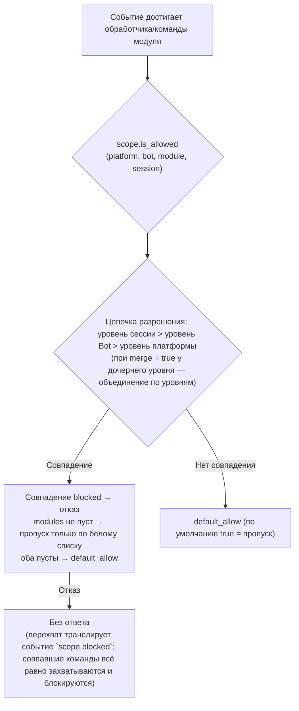
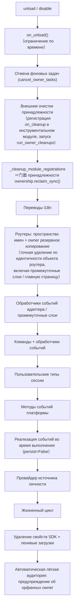
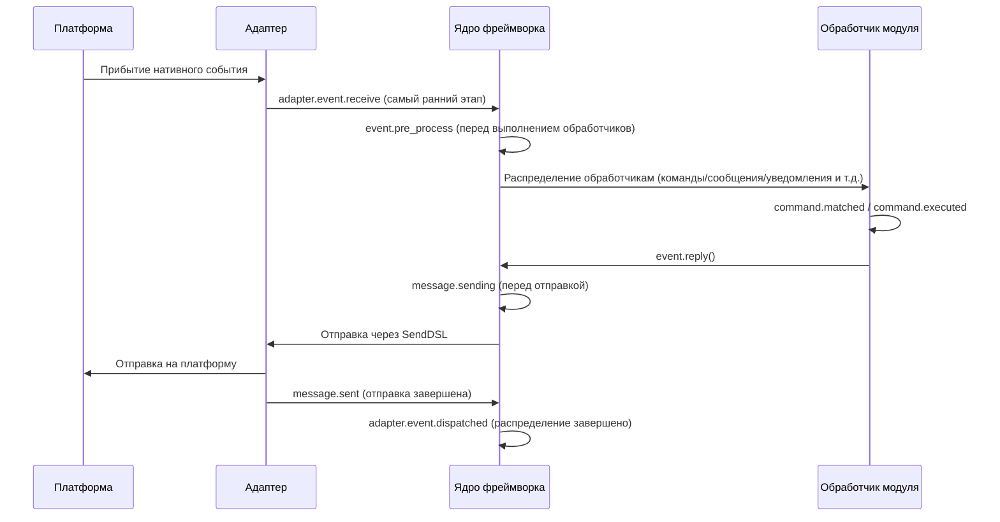

# ErisPulse 权限作用域与归属权

This skill is auto-built from the ErisPulse documentation.
Repository: https://github.com/ErisPulse/ErisPulse
Source paths are annotated per section; see docs/ in the repository for the latest content.

## 作用域

> 来源: `docs/ru/advanced/scope.md`（https://github.com/ErisPulse/ErisPulse/blob/main/docs/ru/advanced/scope.md）

# Область действия (scope)

> [!TIP]
> **Когда читать этот документ**: когда нужно управлять доступностью модулей, допуском событий или ограничениями исходящих действий. Если это не требуется — пропустите, на использование остальных функций это не повлияет.

> **Прочитав, вы узнаете**: пути конфигурации каждого из трёх измерений области действия (доступность модулей / допуск событий / исходящие действия),
> приоритеты их определения и поведение при отказе, как пользоваться API времени выполнения, а также как наблюдать за перехватом (событие `scope.blocked`).
>
> **Здесь не рассматриваются**: принадлежность ресурсов, их выгрузка и освобождение (см. [Систему владения (owner)](ownership.md));
> ACL команд и переопределение событий (см. [Введение в обработку событий](../getting-started/event-handling.md)).

> [!NOTE]
> Для этой функции требуется ErisPulse **2.8.0+**.

Область действия отвечает на четыре вопроса: **какие модули доступны, чьи события принимать, какой текст обрабатывает тот или иной модуль и что модуль может делать наружу**.
Управление полностью отдаётся пользователю: правила объявляются единым образом на **уровне выше** регистрации модулей / адаптеров / обработчиков / исходящих вызовов (в конфигурации `ErisPulse.scope` или во время выполнения через `sdk.scope`), а конвейер событий автоматически считывает и применяет их на входе, при фильтрации обработчиков и на шлюзе исходящих вызовов.

| Измерение | Что контролирует | Поведение при отказе | Путь конфигурации |
|------|---------|---------|---------|
| **① Модули** | Какие модули доступны (три уровня: платформа / Bot / сессия) | Отфильтрованные модули не срабатывают и не отвечают (перехват транслирует событие `scope.blocked`; совпавшие команды всё равно захватываются и блокируются) | `scope.platforms / bots / sessions` |
| **② Идентичность** | Принимать ли события (четыре уровня: адаптер / Bot / сессия / пользователь) | Полное отбрасывание на входе (перехват транслирует событие `scope.blocked`) | `scope.identity.*` |
| **③ Исходящие** | Какие исходящие вызовы может инициировать модуль (сообщения / API / запросы; белые и чёрные списки на уровне методов) | Ответ с ошибкой (`retcode=34601`) | `scope.actions` |

> **Связанные системы**: команды — это особые обработчики событий сообщений; их пользовательские чёрно-белые списки (ACL) и переопределение параметров реализации поддерживаются системой команд (`ErisPulse.event.command`),
> см. [Введение в обработку событий](../getting-started/event-handling.md) и [Руководство по конфигурации](../user-guide/configuration.md).

{!--< tips >!--}
1. Импортируйте синглтон через `from ErisPulse.Core import scope` (это тот же объект, что и `sdk.scope`)
2. Проверки: `scope.is_allowed(...)` / `scope.is_identity_allowed(...)` /
   `scope.is_action_allowed(...)` соответствуют трём шлюзам ①②③
3. Чтение и запись: параметризованные методы по измерениям (с автодополнением в IDE) —
   `scope.set_module(...)` / `scope.set_identity(...)` / `scope.set_action(...)`;
   кроме того есть словарный запасной вариант `scope.get(path)` / `scope.set(path, v)` / `scope.delete(path)`
4. Переопределение текстовых условий обработчиков событий — см.
   [Введение в обработку событий · Переопределение событий](../getting-started/event-handling.md#переопределение-событий-переопределение-поведения-любого-типа-события-без-изменения-кода-модуля);
   ACL команд / переопределение параметров — см. [Введение в обработку событий](../getting-started/event-handling.md)
{!--< /tips >!--}

## Синтаксис записей сопоставления (единый для всей системы)

Все «списки имён» в области действия (имена модулей, ключи идентичности, записи исходящих действий) используют один и тот же синтаксис сопоставления
(`ErisPulse.Core.text_match`):

| Синтаксис | Пример | Описание |
|------|------|------|
| Точное имя | `"Chat"` | Сравнение полного значения, **без учёта регистра** |
| glob | `"Tool*"`, `"spam_*"` | `*` любая строка / `?` один символ / `[seq]` набор символов, без учёта регистра |
| Регулярное выражение | `"re:^Danger.*"` | Объявляется префиксом `re:`, сопоставление через регулярное `search`, по умолчанию без учёта регистра |

- Некорректные регулярные выражения **молча деградируют** до «не совпадает» (без исключений и сбоев)
- Параметры декораторов (`pattern=` / `regex=`) имеют фиксированную семантику: `pattern` — это glob, `regex` — исходный текст регулярного выражения
  (без префикса `re:`); записи-регулярные выражения в конфигурации области действия **обязаны** иметь префикс `re:`

## Глобальное резервное значение: `default_allow`

`default_allow` — **единственный на всю систему** резервный переключатель (по умолчанию `true`),
единообразно действующий на двух измерениях проверки:

- **Измерение модулей**: ни одна привязка не совпала → решение о пропуске/отказе принимает `default_allow`
- **Измерение идентичности**: ни одна политика не совпала → решение о пропуске/отказе принимает `default_allow`

Установка в `false` включает строгий режим «неявного отказа»: управление в духе белого списка,
**всё, что явно не разрешено, отвергается**.

> **Исключение**: измерение ③ исходящих вызовов **не подчиняется** `default_allow` — это независимый переключатель ужесточения:
> по умолчанию всё разрешено, ограничивают только явные правила (вызовы уровня фреймворка с пустым owner пропускаются всегда).
> Благодаря этому строгий глобальный режим случайно не обрежет ответы всех модулей.
> ACL команд имеет собственный резервный переключатель `ErisPulse.event.command.default_allow`; друг на друга они не влияют.

## Файл конфигурации

```toml
[ErisPulse.scope]
default_allow = true        # Глобальное резервное значение (false = строгий режим неявного отказа)
cache_size = 1024           # Размер LRU-кэша

# ── ① Измерение модулей (приоритет: сессия > Bot > платформа) ──
[ErisPulse.scope.platforms.onebot11]
modules = ["Chat", "Tool*"]   # Белый список: точное имя / glob / re: регулярное выражение
blocked = ["re:^Danger"]
[ErisPulse.scope.bots.onebot11."123456"]
modules = ["Chat"]
merge = true                  # Добавление к привязке уровня платформы (по умолчанию — полная перезапись)
[ErisPulse.scope.sessions.onebot11."789012345"]
modules = ["Chat"]

# ── ② Измерение идентичности (приоритет: пользователь > сессия > Bot > адаптер) ──
[ErisPulse.scope.identity.adapters.onebot11]
deny = true                   # Все события адаптера полностью отбрасываются
[ErisPulse.scope.identity.bots.onebot11."123456"]
deny = true
[ErisPulse.scope.identity.sessions.onebot11."g_blocked"]
deny = true
[ErisPulse.scope.identity.users.onebot11]
allow = ["u_admin"]           # Ключи пользователей поддерживают glob / re: регулярные выражения
deny = ["u_bad", "spam_*"]

# ── ③ Измерение исходящих (по умолчанию всё разрешено, запрещается только явным ужесточением) ──
[ErisPulse.scope.actions.MyModule]
send = { deny = true }                                    # Полный запрет отправки
api = { allow = ["get_*"] }                               # Разрешены только стандартные API-запросы
request = { deny = true }                                 # Запрет обработки запросов
```

## ① Измерение модулей

**Коротко**: с помощью трёхуровневых привязок (платформа / Bot / сессия) контролируется, «какие модули доступны в этом контексте»; отфильтрованные модули не срабатывают и не отвечают (совпавшие команды всё равно захватываются и блокируются).

Отвечает на вопрос «какие модули доступны в данном контексте». По умолчанию всё открыто; фильтрация начинается только после настройки привязок,
**модули и адаптеры не требуют никаких изменений**.



- **Приоритет разрешения: уровень сессии > уровень Bot > уровень платформы**; привязка с более высоким приоритетом **полностью перезаписывает** привязку с более низким;
  если у дочерней привязки указано `merge = true`, вместо этого выполняется **объединение по записям** с более низким приоритетом (modules / blocked объединяются по отдельности;
  сам `merge` — управляющий ключ и записью не считается)
- **Семантика по умолчанию**: команды и обработчики отфильтрованного модуля не срабатывают и не отвечают; это видно в логах уровня TRACE
  (`core.scope.denied`); перехват одновременно транслирует событие жизненного цикла `scope.blocked` (подписавшись, можно наблюдать, кого и почему перехватили); совпавшая **команда** всё равно захватывается и блокируется — текст команды больше не «протекает» к обработчикам сообщений с более низким приоритетом, что устраняет двусмысленность двойного ответа, когда после отказа команды обработчик сообщений реагирует ещё раз
- **Обработчики уровня фреймворка** (`scope_exempt=True` или пустой owner) не затрагиваются; ресурсы с пустым именем модуля (уровень фреймворка) пропускаются всегда
- **Справка и запрос команд с учётом сессии**: API запроса команд (`command.help` /
  `get_command` / `get_commands` / `get_group_commands` / `get_visible_commands`,
  а также `module.get_commands_overview`) поддерживают необязательный `event=` или явные
  ключевые аргументы `platform=` / `bot_id=` / `session_id=` — команды модулей, недоступных
  в текущей сессии, больше не попадают в результаты (`get_command` возвращает None, справка по отдельной команде обрабатывается как «не зарегистрирована»,
  что соответствует семантике по умолчанию); без передачи контекста поведение остаётся полным

### Наследование привязок (merge)

Семантика полной перезаписи по умолчанию ясна и предсказуема; когда нужно **добавить** записи к привязке родительского уровня, укажите `merge = true` на дочернем уровне:

```toml
[ErisPulse.scope.platforms.onebot11]
modules = ["Chat", "Tool"]      # Уровень платформы: разрешены Chat, Tool

[ErisPulse.scope.bots.onebot11."123456"]
modules = ["Music"]
merge = true                    # Фактически действующий список у этого Bot = ["Chat", "Tool", "Music"]
```

- Правила объединения: для `modules` и `blocked` по отдельности берётся **объединение**; внутри привязки `blocked` по-прежнему имеет приоритет над `modules`
- Цепное объединение: платформа → Bot → сессия, уровни накладываются последовательно; каждый уровень независимо решает — объединить (`merge`) или перезаписать

## ② Измерение идентичности (допуск событий)

**Коротко**: согласно четырёхуровневым политикам (пользователь / сессия / Bot / адаптер) на входе диспетчеризации полностью отбрасываются «события, которые не должны приниматься»; deny имеет приоритет над allow.

Отвечает на вопрос «чьи события принимать». Отклонённые события **полностью отбрасываются на входе диспетчеризации** —
они не попадают в middleware и ни к одному обработчику (включая уровень фреймворка), видно только в логах уровня TRACE (`core.scope.identity_denied`).

- **Приоритет разрешения: пользователь > сессия > Bot > адаптер**, берётся самая конкретная настроенная политика; deny имеет приоритет над allow
- Привязка каждого уровня — бинарная политика: `{ allow = true }` или `{ deny = true }`
- Ключи пользователей поддерживают glob / регулярные выражения (например, `"spam_*"` блокирует сразу группу спам-пользователей)
- Типичное применение — deny на верхнем уровне и allow для отдельного пользователя как «исключение»:

```toml
[ErisPulse.scope.identity.adapters.onebot11]
deny = true
[ErisPulse.scope.identity.users.onebot11]
allow = ["u_admin"]   # Даже при отказе на уровне адаптера события от u_admin пропускаются
```

## ③ Измерение исходящих (ограничение исходящих вызовов, инициируемых модулями)

**Коротко**: белые и чёрные списки на уровне методов ограничивают вызовы модуля — сообщения / API / запросы; отклонённые вызовы не порождают никаких сетевых запросов и сразу возвращают `retcode=34601`.

Ограничивает **исходящие действия**, инициируемые модулем: отправку сообщений / стандартные действия API / операции запросов.
Три типа действий соответствуют низкоуровневому DSL: `Event.reply` и `Send` (send), `Api` / `call_api` (api),
accept/reject у `Request` (request). Исходящие вызовы, инициированные модулем во время выполнения обработчика события,
несут owner модуля и единообразно проверяются этим измерением.

### Форма правил (инлайн-таблицы)

Правило для каждого действия — это инлайн-таблица: `{ allow = [...], deny = true|[...] }`.
У одного действия может быть только один вид правила (ключи TOML не могут повторяться: либо полный запрет, либо детализация — выберите одно):

```toml
[ErisPulse.scope.actions.MyModule]
send = { deny = true }                                  # Полный запрет отправки (Event.reply / Send DSL)
# Или детализация по методам: send = { allow = ["Text", "Image*"], deny = ["File"] }
api = { allow = ["get_*"] }                             # Пропускаются только стандартные API-запросы (чтение)
# Или чёрный список по действиям: api = { deny = ["set_*", "leave_*"] }
request = { deny = true }                               # Запрет обработки accept/reject запросов
```

- Записи `send` сопоставляются с **именами методов отправки** (`Text` / `Image` / `File` ...),
  записи `api` — с **именами стандартных действий** (`get_group_info` / `set_group_name` ...)
- Записи поддерживают точные имена / glob / `re:` регулярные выражения (единый синтаксис всей системы, без учёта регистра)
- Одиночная строка в `allow` эквивалентна списку из одной записи: `send = { allow = "Text" }`

### Семантика определения

**По умолчанию всё разрешено** — если правил нет или owner пуст (внутренние вызовы уровня фреймворка), вызовы пропускаются.
После настройки правил проверка идёт в следующем порядке:

1. `deny = true` → отказ
2. Имя вызова совпало со списком `deny` → отказ
3. Список `allow` не пуст, а имя вызова не совпало (или у вызова нет имени) → отказ
4. В остальных случаях — пропуск

Отклонённый вызов не порождает никаких сетевых запросов и сразу возвращает стандартный ответ с ошибкой
(`retcode = 34601`, см. [api-response §5.3](../standards/api-response.md#53-расширенные-коды-возврата-фреймворка-34xxx-младшие-три-цифры-сегмента-ошибок-платформы)).
Три типа действий независимы друг от друга — можно ограничить только один из них.

```python
# API времени выполнения
sdk.scope.set_action("MyModule", "send", deny=True)              # Полный запрет отправки сообщений
sdk.scope.set_action("MyModule", "send", allow=["Text"])         # Разрешена только отправка текста
sdk.scope.is_action_allowed("MyModule", "send", name="Image")    # False
sdk.scope.is_action_allowed("MyModule", "api", name="get_user_info")  # Проверка по правилам
sdk.scope.delete_action("MyModule", "send")                      # Вернуть разрешение
sdk.scope.get_action("MyModule", "send")                         # Текущее правило этого действия
```

## API времени выполнения

API времени выполнения области действия состоит из трёх слоёв: **проверки** (три вопроса), **параметризованное чтение/запись по измерениям** (для каждого измерения — методы `set` / `get` / `delete`, сигнатуры полностью типизированы, с автодополнением в IDE), **словарный запасной вариант** (пути через точку ведут к любому разделу напрямую).

```python
from ErisPulse import sdk

scope = sdk.scope
```

### Проверки (три вопроса)

```python
scope.is_allowed("onebot11", "123456", "Chat")                 # ① Измерение модулей
scope.is_allowed("onebot11", "123456", "Chat", "789012345")    # С учётом уровня сессии
scope.is_allowed("onebot11", "123456", None)                   # Ресурс уровня фреймворка -> True

scope.is_identity_allowed("onebot11", "123456", "group_9", "u1")   # ② Измерение идентичности

scope.is_action_allowed("MyModule", "send")                    # ④ Измерение исходящих
scope.is_action_allowed("MyModule", "send", name="Image")      # Детализация по методам
```

### ① Измерение модулей

```python
# Привязка (уровень определяется аргументами: session_id > bot_id > уровень платформы)
scope.set_module("onebot11", bot_id="123456", modules=["Chat", "Tool*"])
scope.set_module("onebot11", blocked=["re:^Danger"])                       # Уровень платформы
scope.set_module("onebot11", bot_id="123456", session_id="g9", modules=["Chat"])  # Уровень сессии
scope.set_module("onebot11", bot_id="123456", modules=["Music"], merge=True)      # Объединение с текущими записями
scope.set_module("onebot11", bot_id="123456", modules=["Chat"], persist=False)    # Только на время выполнения

# Чтение / удаление
scope.get_module("onebot11", bot_id="123456")   # {"modules": ["Chat"], "blocked": []}
scope.delete_module("onebot11", bot_id="123456")
```

> `merge=True` — это **объединение при записи** (слияние записей с существующей привязкой данного уровня); о ключе конфигурации `merge = true`, работающем при разрешении между уровнями, см. выше раздел [Наследование привязок](#наследование-привязок-merge) — это два независимых механизма.

> **Семантика привязок времени выполнения (`persist=False`)**: привязки времени выполнения хранятся в отдельном слое переопределений,
> **любые последующие записи в конфигурацию / горячее обновление файла конфигурации их не сотрут** (после перестроения дерева конфигурации
> они автоматически воспроизводятся в порядке записи, включая удаления во время выполнения). На диск они не записываются и теряются при перезапуске процесса; при выгрузке модуля записанные им
> привязки времени выполнения подлежат гарантированной очистке. Последующая запись `persist=True` по тому же пути (семантика пользовательского сохранения)
> заменит правило времени выполнения.

### ② Измерение идентичности

```python
# Привязка политики (уровень определяется аргументами: user > session > bot > adapter; allow / deny — только одно из двух)
scope.set_identity("onebot11", user_id="u_bad", deny=True)
scope.set_identity("onebot11", user_id="spam_*", deny=True)    # Ключи поддерживают glob / re: регулярные выражения
scope.set_identity("onebot11", bot_id="123456", session_id="g9", allow=True)

# Чтение / удаление
scope.get_identity("onebot11", user_id="u_bad")   # {"deny": True}
scope.delete_identity("onebot11", user_id="u_bad")
```

### ③ Измерение исходящих

```python
# Задать правило ограничения (allow: str|list; deny: bool|str|list; семантика полной замены правила)
scope.set_action("MyModule", "send", deny=True)                    # Полный запрет отправки
scope.set_action("MyModule", "send", allow=["Text"])               # Разрешена только отправка текста
scope.set_action("MyModule", "api", deny=["set_*", "leave_*"])     # Запрет административных API

# Чтение / удаление
scope.get_action("MyModule", "send")       # {"allow": ["Text"]} исходное правило
scope.delete_action("MyModule", "send")    # Удалить одно действие
scope.delete_action("MyModule")            # Удалить все ограничения действий этого модуля
```

### Общие методы

```python
scope.get("platforms")   # Словарный запасной вариант: чтение любого раздела по пути через точку
scope.topology()         # Полное дерево конфигурации (для Dashboard)
scope.stats()
# {"module_calls": .., "module_filtered": .., "identity_checks": .., "identity_denied": ..,
#  "action_checks": .., "action_denied": .., "cache_hits": .., "cache_misses": ..}
scope.reset_stats()
scope.clear()           # Очистить всю конфигурацию (действует только в памяти)
```

### Продвинутое: словарный запасной вариант с путями через точку

Параметризованные методы покрывают повседневные сценарии; когда нужен прямой доступ к любому узлу (или к измерениям, которые появятся в будущем),
используйте словарный API — `get` / `set` / `delete` принимают пути через точку (глубокое слияние dict, чтение сразу после записи),
а также предоставляются протоколы `scope[path]` / `scope[path] = v` / `del scope[path]` / `path in scope`:

```python
scope.set("bots.onebot11.123456", {"modules": ["Chat"], "blocked": []})
scope.set("identity.users.onebot11.u_bad", {"deny": True})
scope.get("actions.MyModule.send")

scope["platforms.onebot11"]        # Чтение (при отсутствии — KeyError)
scope["platforms.onebot11"] = {...}  # Запись
del scope["platforms.onebot11"]      # Удаление
"actions.MyModule" in scope          # Проверка существования
```

## Наблюдаемость перехвата: событие `scope.blocked`

При срабатывании перехвата области действия (фильтрация модулей / отказ по идентичности) транслируется событие жизненного цикла **`scope.blocked`**,
благодаря которому «кого перехватили и на каком уровне» можно отслеживать по подписке, собирать статистику и показывать в Dashboard — перехват по умолчанию
не отвечает, но больше не является непрозрачным чёрным ящиком.

| Поле | Описание |
|------|------|
| `dimension` | `"module"` (фильтрация по измерению модулей) / `"identity"` (отказ при допуске по идентичности) |
| `module` | Имя отфильтрованного модуля (только измерение модулей) |
| `platform` / `bot_id` / `session_id` / `user_id` | Контекст источника, где произошёл перехват |

```python
from ErisPulse.Core.lifecycle import lifecycle

@lifecycle.on("scope.blocked")
def on_blocked(data):
    print(f"Перехвачено: {data['dimension']} {data.get('module') or data.get('user_id')}")
```

- Событие транслируется в фоне через `fire` (при отсутствии слушателей — нулевые накладные расходы, «горячий путь» не замедляется)
- Повторные перехваты, попавшие в кэш, **не** транслируются повторно — одна и та же комбинация транслируется один раз, лишь при сбросе кэша
- Не путать с `adapter.event.blocked` (вето middleware): то — отбрасывание на уровне события, а это событие — фильтрация модулей / идентичности на входе допуска области действия

## Кэш и горячее обновление

- Результаты `is_allowed` / `is_identity_allowed` / `is_action_allowed` кэшируются в **LRU**
  (размер настраивается через `scope.cache_size`); `set` / `delete` /
  горячее обновление конфигурации (`config.updated` / `config.set`) автоматически инвалидируют кэш
- Изменения конфигурации во всех измерениях **вступают в силу немедленно**, перезагрузка не требуется
- Область действия проверяет «по каждому событию» и не помнит ничего между событиями: изменилась конфигурация — следующее событие уже обрабатывается по новым правилам

## Валидация формата конфигурации

При загрузке / горячем обновлении формат конфигурации проверяется по каждому разделу: разделы с неверным типом (например, `platforms` записана как строка),
недопустимые правила исходящих (например, `allow` записан как число), неизвестные имена действий, неизвестные ключи верхнего уровня (например, опечатка `alow`)
вызовут вывод **WARNING** и игнорирование соответствующего раздела / записи; остальная корректная конфигурация работает как обычно — ошибки больше не «тихо» игнорируются.

## Частые вопросы и важные замечания

### 1. Уровни конфигурации и переопределение

- Измерение модулей: уровень сессии > уровень Bot > уровень платформы, **полная перезапись** (при `merge = true` на дочернем уровне — объединение по записям).
  Если нужно «на уровне платформы разрешить Chat, а на уровне Bot добавить Music», укажите на уровне Bot `merge = true` или перечислите оба в одном списке
- Измерение идентичности: пользователь > сессия > Bot > адаптер, берётся **самая конкретная** настроенная политика (можно делать исключения)
- Пользовательские чёрно-белые списки команд: точные имена команд имеют приоритет над ключами glob (см. `event.command.acl`)

### 2. Модуль/команда не реагирует

Сначала заподозрите область действия, а не сам модуль:

```python
from ErisPulse import sdk

print(sdk.scope.is_allowed(event.get_platform(), bot_id, "MyModule", session_id))
print(sdk.scope.is_identity_allowed(event.get_platform(), bot_id, session_id, user_id))
print(sdk.scope.stats())   # module_filtered / identity_denied > 0 означает наличие записей о перехватах
```

Отфильтрованное по умолчанию не отвечает (измерения модулей и идентичности — чтобы не раскрывать правила), но при этом транслируется событие жизненного цикла `scope.blocked`, а статистика продолжает накапливаться;
при отклонении команды по ACL будет явный ответ «недостаточно прав».

### 3. Диагностика при отклонении исходящих действий

```python
from ErisPulse import sdk

print(sdk.scope.get("actions.MyModule"))
print(sdk.scope.stats())   # action_denied > 0 означает, что были перехваченные вызовы
```

Перехват **явный**: отклонённый вызов возвращает стандартный ответ с ошибкой `retcode = 34601` (сетевой запрос не выполняется).

### 4. Изоляция идентификаторов сессий между платформами

Уникальный идентификатор — это комбинация `(platform, session_id)`. `scope.sessions.onebot11."789"`
действует только для onebot11 и не затрагивает сессию с тем же `789` на telegram. То же верно для ключей пользователей в измерении идентичности.

## API дерева топологии

`ModuleManager.get_topology()` и `AdapterManager.get_topology()` предоставляют данные о принадлежности модулей/адаптеров,
`sdk.get_topology()` агрегирует их одним вызовом (включая область действия `scope`):

```python
from ErisPulse import sdk

topology = sdk.get_topology()
# {
#   "modules": {                                   # модуль → принадлежащие ему ресурсы
#     "Chat": {
#       "loaded": True, "enabled": True,
#       "commands": ["chat", "translate"],
#       "handlers": {"message": 2, "notice": 1},
#       "routes": {"http": ["/Chat/api"], "ws": [], "sse": []},
#       "lifecycle_hooks": 3,
#     }
#   },
#   "adapters": {                                  # адаптер → Bot → область действия
#     "onebot11": {
#       "status": "started", "enabled": True,
#       "bots": {"123456": {"status": "online", "scope": {...}}},
#       "scope": {"modules": [...], "blocked": [...]},
#     }
#   },
#   "scope": {                                     # область действия (модули / идентичность / исходящие действия)
#     "platforms": {...}, "bots": {...}, "sessions": {...},
#     "identity": {"adapters": {...}, "bots": {...}, "sessions": {...}, "users": {...}},
#     "actions": {...},
#   },
# }
```

- Топология модуля агрегирует зарегистрированные этим модулем команды, обработчики событий, маршруты HTTP/WS/SSE и хуки жизненного цикла — удобно для построения дерева ресурсов модуля.
- Топология адаптера агрегирует состояние каждого адаптера, состояние подчинённых Bot и привязки области действия уровня платформы/уровня Bot (измерение модулей).
- **JSON-безопасный вывод**: `get_topology(json_safe=...)` по умолчанию `True`; возвращаемая структура пригодна для прямого `json.dumps` — в `info` модуля остаётся только под-таблица чистых данных `meta` (объекты времени выполнения вроде `module_class` / `strategy` отбрасываются), а остальные узлы (включая любые объекты, вложенные авторами адаптеров в `info` Bot) проходят запасную очистку (у классов берётся `__name__`, несериализуемые объекты деградируют до `str()`). Dashboard / WebUI могут сериализовать результат напрямую; если нужны исходные объекты, передайте `json_safe=False`.

## Связанные документы

Выбирайте в зависимости от следующего шага:

- **Хотите управлять принадлежностью ресурсов, их выгрузкой и освобождением** → [Система владения (owner)](ownership.md) — область действия решает, «действует ли ресурс», а владение — «кому принадлежит ресурс и при чьей выгрузке он освобождается»
- **Хотите аудитировать межмодульные вызовы** → [Взаимодействие между модулями](module-communication.md) — как `module.call` проходит шлюз исходящих вызовов с личностью вызывающего
- **Хотите выпускать новые версии модуля в теневом (канареечном) режиме** → [Теневые модули и перевод в основную версию](shadow.md) — параллельный пробный запуск с независимым owner
- **Хотите посмотреть, как записывать разделы конфигурации и как ведёт себя горячее обновление** → [Руководство по конфигурации](../user-guide/configuration.md)

## 归属权

> 来源: `docs/ru/advanced/ownership.md`（https://github.com/ErisPulse/ErisPulse/blob/main/docs/ru/advanced/ownership.md）

# Система принадлежности (owner)

> [!TIP]
> **Когда читать**: при отладке утечек ресурсов, при изучении цепочки очистки при отключении или при объявлении принадлежащих ресурсов. Если не нужно, пропустите, это не повлияет на использование других функций.

> **Что узнаете**: как контекст owner автоматически присваивает ресурсы, полная картина принадлежащих ресурсов, полный порядок очистки при отключении/отключении, а также какие ресурсы не удаляются при отключении (пределы проектирования).
>
> **В этой статье не рассматривается**: когда ресурсы становятся активными (см. [Область видимости (scope)](scope.md)); рекомендуемый способ написания фоновых задач и границы принудительного отменения (см. [Управление жизненным циклом · Принадлежность и автоматическая отмена фоновых задач](lifecycle.md#фоновые-задачи-принадлежность-и-автоматическая-отмена)).

Принадлежность является основой для "подключения и использования" модуля: все зарегистрированные кадровые ресурсы автоматически присваиваются при загрузке модуля, и при отключении/отключении они автоматически удаляются — автор модуля просто объявляет ресурсы, не пишет логику очистки вручную.

> **Связанные системы**: область видимости (scope) определяет, "активны ли ресурсы" при отправке событий, принадлежность определяет "кому принадлежат ресурсы и кто удаляет их при отключении". Область видимости см. [Единая система управления (scope)](scope.md), фоновые задачи см. [Управление жизненным циклом](lifecycle.md#фоновые-задачи-принадлежность-и-автоматическая-отмена).

{!--< tips >!--}
1. Принадлежность автоматически записывается при регистрации (в момент `current_owner`), код модуля не изменяется
2. Отключение/отключение используют одну и ту же цепочку очистки (`_cleanup_module_registrations`), сбой на каждом шаге только предупреждает, не прерывает
3. Ресурсы пользовательского конфигурационного смысла (постоянное перезаписывание / правила scope / ACL команд) **не** удаляются при отключении модуля
4. Внешние дескрипторы, управляемые инструментальным модулем, можно добавить в цепочку очистки с помощью `on_cleanup(cb)`, и при отключении другого модуля будет автоматически вызван обратный вызов (см. [Руководство по инструментальным модулям](#инструментальные-модули-управление-дескрипторами-других-модулей))
{!--< /tips >!--}

## Механизм контекста owner

Owner передается через переменную контекста `current_owner` (`ErisPulse.runtime.context`):

```python
from ErisPulse.runtime import owner_scope, get_current_owner

with owner_scope("MyModule"):
    # Все зарегистрированные ресурсы в этом диапазоне автоматически принадлежат MyModule
    assert get_current_owner() == "MyModule"
```

Кадры автоматически вставляют owner в следующие моменты (код модуля/адаптера не требует ручного обертывания):

| Момент | Значение owner | Место |
|------|----------|------|
| Модуль `load()` | Имя модуля | Весь процесс инстанцирования + `on_load` |
| Адаптер `start()` / `restart()` | Имя платформы | Весь процесс запуска адаптера |
| Регистрация stub для ленивой активации `activate_on` | Имя модуля | Регистрация запускаемых команд/обработчиков |
| Выполнение обработчика событий | Имя модуля, которому принадлежит обработчик | Переинъекция в точке входа handler / команды |

Переинъекция во время выполнения означает: обработчики команд, объявленные модулем в `on_load`, при вызове API-функций регистрации (например, `sdk.adapter.on()` или `overrides.*.set(persist=False)`), также будут автоматически присвоены этому модулю.

## Полная картина принадлежащих ресурсов

Все ресурсы, зарегистрированные в контексте загрузки модуля, записываются и автоматически удаляются при отключении/отключении:

| Ресурс | Способ регистрации | Вызов очистки |
|------|----------|----------|
| Команды | `@command()` / объявление словаря команд | `command.unregister_by_owner()` |
| Обработчики событий | `@message` / `@notice` / `@request` / `@meta` | `handler.unregister_by_owner()` |
| Слушатели событий адаптера | `sdk.adapter.on()` / `raw=True` | `adapter.unregister_handlers_by_owner()` |
| Промежуточные слои адаптера | `@sdk.adapter.middleware` | То же самое |
| Роутинг (HTTP/WS/SSE) | `router.http()` / `websocket()` / `sse()` | Двойной резерв по пространству имен и по owner |
| Промежуточные слои роутера | `@router.middleware()` / `add_middleware()` | `router.unregister_all_by_owner()` |
| Главная страница Dashboard | `router.register_home_entry()` | `unregister_home_entries_by_owner()` |
| Пользовательские типы сессии | `register_custom_type()` | `unregister_custom_types_by_owner()` |
| Методы событий платформы | `register_event_method()` / `register_event_mixin()` | `unregister_event_methods_by_owner()` (автоматически удаляется при отключении модуля, старые замыкания не утекают) |
| Фоновые задачи | `self.spawn()` | `cancel_owner_tasks()` |
| Внешние очистки принадлежности (инструментальный модуль управляет) | `runtime.on_cleanup(cb)` | `run_owner_cleanups()` (вызывается в цепочке отключения/отключения/закрытия адаптера) |
| Жизненный цикл | `lifecycle.register()` | `lifecycle.unregister_by_owner()` |
| Провайдер источника личности | `master.provider` | `master.unregister_by_owner()` |
| Переводы i18n | Объявление `I18nClass` (domain=имя модуля) | `i18n.unregister_domain()` |
| Переопределения событий (во время выполнения) | `overrides.*.set(persist=False)` | `overrides.unregister_by_owner()` |
| Взаимодействие сессий (ожидание wait_reply и т.д.) | `event.wait_reply()` / `sdk.interaction.acquire()` | `interaction.cancel_by_owner()` (сторона ожидания немедленно получает отмену) |
| Контекстные данные | `runtime/context` записывает по owner | Точный очистка по модулю |

Соответствующие ресурсы на стороне адаптера (с owner именем платформы) удаляются в `shutdown()` / `restart()` адаптера с помощью `_cleanup_adapter_resources`, а также включают:

| Ресурс | Вызов очистки |
|------|----------|
| Собственные `on()` обработчики и промежуточные слои адаптера | `adapter.unregister_handlers_by_owner(platform)` |
| Расширения методов событий платформы (`EventMixin`) | `unregister_platform_event_methods(platform)` |
| Пользовательские типы сессии | `unregister_custom_types_by_owner(platform)` |
| Взаимодействие сессий (ожидание wait_reply / аренды на этой платформе) | `interaction.cancel_by_platform(platform)` |
| Переводы i18n (domain=ключ конфигурации) | `i18n.unregister_domain(ключ конфигурации)` |
| Тонкие пространства имен роутера | `router.unregister_all_by_owner(platform)` |

## Последовательность очистки при отключении/отключении

`unload()` и `disable()` используют одну и ту же цепочку очистки (каждый шаг независим, try/except, сбой только логирует, **не прерывает последующую очистку**):



При выходе `sdk.uninit()` есть глобальный резервный вариант: все адаптеры shutdown → все модули unload → `router.stop()` (очистка роутера/промежуточных слоев/главной страницы) → `cancel_all_background_tasks()` → очистка обработчиков событий и хуков.

## Единый интерфейс принадлежности (ownership)

Шестнадцать шагов цепочки очистки сведены под единый интерфейс принадлежности `ErisPulse.Core.ownership`, четыре глагола охватывают "удаление, подсчет, сканирование, аудит" — функции `*_by_owner` отдельных подсистем остаются неизменными, как внутренняя реализация интерфейса:

| Глагол | Назначение |
|------|------|
| `ownership.reclaim(owner)` | Общая очистка всех ресурсов принадлежащих owner (отмена задач → очистка хуков → зарегистрированные ресурсы; асинхронная полная версия) |
| `ownership.reclaim_sync(owner)` | Очистка зарегистрированных ресурсов (синхронная версия, для синхронного пути отключения) |
| `ownership.counts(owner=None)` | Только чтение: подсчет ресурсов принадлежащих owner (None — все owner) |
| `ownership.orphans()` | Сканирование сирот: ресурсы в списке, но owner уже отключен (список улик утечки) |
| `ownership.audit(owner, deep=)` | Отчет об аудите утечек (подсчет + сироты + необязательное gc-исследование экземпляров) |

```python
from ErisPulse.Core import ownership

ownership.reclaim_sync("MyModule")       # {'commands': 1, 'routes_http': 2, ...}
ownership.counts("MyModule")             # Подсчет ресурсов принадлежащих MyModule
ownership.orphans()                      # [{"owner": "ghost", "total": 2, ...}]
```

**Точка входа аудита**:

- После отключения / перезагрузки **автоматическая лёгкая аудитория**: обнаружение орфанных ресурсов owner приводит к предупреждению (ноль накладных расходов на подсчет сканирования)
- `sdk.module.audit(name, deep=True)`: исследование gc-экземпляра модуля — при невозможности сборки мусора экземпляра указывает тип ссылки (локализация "кто держит старый экземпляр"); есть глобальные паузы, используется только для явной диагностики
- Глубокое исследование является явной операцией, не настраивается, не делает автоматическое восстановление

## Откат при неудачной горячей перезагрузке

Горячая перезагрузка изменена на "снимок до отключения → автоматический откат при сбое": при синтаксических ошибках, отсутствии зависимостей, сбое загрузки, старый экземпляр и состояние регистрации (записи регистрационной таблицы, свойства sdk, записи sys.modules) автоматически восстанавливаются, сервис не прерывается, в логах появляется сообщение "Восстановлено к старому экземпляру для продолжения обслуживания".

Предельное поведение (документированные границы):

- Побочные эффекты, выполненные в `on_unload` (разорванные соединения, отмененные задачи) не отменяются — после восстановления старый экземпляр находится в состоянии "завершения", необходимо снова запустить загрузку, чтобы полностью использовать его
- Ссылки на старый экземпляр, созданные сторонними в ходе выполнения, не входят в область восстановления
- Если целевой пакет уже был отключен (исчез entry-point), считается успешным отключением, откат не выполняется

## Пределы проектирования: какие ресурсы не удаляются при отключении

Принадлежность удаляет **только ресурсы, зарегистрированные кодом модуля во время выполнения**. Следующие ресурсы относятся к **смыслу пользовательской конфигурации** (управление находится у пользователя, возможно, намеренно настроено), и после отключения модуля сохраняются вместе с конфигурацией:

| Ресурс | Смысл | Примечание |
|------|------|------|
| `overrides.*.set(persist=True)` | Постоянное переопределение | Запись в файл конфигурации, действует при перезапуске; при отключении модуля не удаляется (явно настроен пользователем) |
| `scope.set_action()` и т.п. правила области видимости | Поверхность управления разрешениями | Управляется пользователем/Dashboard, при отключении модуля правила не удаляются |
| `overrides.acl.set(persist=True)` | ACL команд | То же самое |
| `Conversation.save()` сохранение | Многоразговорная архивация | Данные активы не очищаются |

Ресурсы, записанные временно во время выполнения (с `persist=False`), удаляются вместе с owner — **постоянность или нет — это граница между "активами пользователя" и "состоянием выполнения модуля"**.

## Внутренняя реализация: как работает принадлежность

**Одним предложением**: цепочка присвоения (contextvar) определяет "на кого записано", цепочка отмены (таблица задач) определяет "можно ли отменить при отключении" — эти две цепочки работают независимо, для правильной очистки ресурсов необходимы обе.

Система принадлежности состоит из **двух независимых цепочек**, понимание их разделения является предпосылкой для отладки проблем с принадлежностью:

### Цепочка присвоения (contextvar)

`runtime/context.py` переменные `current_owner` и т.д. типа `ContextVar` отвечают за **присвоение** — "кому записаны ресурсы/вызовы, зарегистрированные в этом коде". Правила распространения соответствуют семантике `contextvars` Python:

| Выполнение | context распространяется | Результат присвоения |
|---------|----------------|---------|
| Синхронные вызовы / `await` цепочка | ✅ Распространяется | Правильное присвоение |
| `owner_scope` внутри `asyncio.create_task` | ✅ Распространяется (task копирует context в момент создания) | Правильное присвоение внутри задачи |
| `run_in_executor` / голые потоки | ❌ Не распространяется | Присвоение теряется |
| Собственный цикл событий | ❌ Не распространяется | Присвоение теряется |

> Присвоение ≠ регистрация: распространение context влияет только на "на кого записано", можно ли очистить ресурс, зависит от того, попал ли он в цепочку отмены.

### Цепочка отмены (таблица задач)

`runtime/tasks.py` таблица `_owner_tasks` отвечает за **жизненный цикл** — "какие незавершенные задачи принадлежат owner, которые будут отменены при отключении". Способы попадания задач в таблицу регистрации:

1. **Явная отправка**: `spawn_background()` / `self.spawn()` → при создании захватывается `current_owner` (или явный параметр `owner=`) → добавляется в таблицу;
2. **Автоматическая регистрация Task Factory** (2.8.3): `install_owner_task_factory()` устанавливается в главный цикл событий при запуске кадров — **любая** задача (включая внутренние `create_task` сторонних библиотек) проходя через фабрику читает `current_owner`, если не None, то добавляется.

Таблица саморегулируется: каждая задача имеет `done_callback`, при завершении удаляется из таблицы, утечек нет.

### Последовательность отмены (отключение модуля)

```
module.unload()
  → on_unload(event)                    # Модуль самостоятельно очищает (резервное ограничение по времени)
  → Кадры удаляют команды/обработчики/хуки/роутеры этого owner
  → cancel_owner_tasks(owner)           # Резервная отмена из таблицы задач
      → пошагово task.cancel()          # Исключая задачу, которая сама выполняет логику отмены
      → await gather(pending, timeout)  # Ждать завершения (с таймаутом, не блокировать)
```

### Стратегия отладки

- **Ресурс не был очищен** → проверьте таблицу регистрации: `get_owner_tasks("MyModule")` содержит ли задачу; если нет, значит путь регистрации не прошел через цепочку принадлежности (import-период / поток / независимый цикл), сверьтесь с таблицей выше.
- **Неправильное присвоение** → проверьте значение `get_current_owner()` в момент ошибки; для асинхронных отложенных вызовов (колбэков/задач) присвоение берется из context в момент создания, а не в момент выполнения.

## Руководство для авторов модулей

### Рекомендуемый стиль

```python
from ErisPulse import sdk
from ErisPulse.Core.Event import command
from ErisPulse.runtime import owner_scope, spawn_background

class MyModule(BaseModule):
    async def on_load(self, event):
        # Кадровые ресурсы: автоматически присваиваются, не нужно вручную очищать
        self.task = self.spawn(self.polling())      # Фоновая задача
        sdk.router.register_home_entry("Мой модуль", "/my")  # Главная страница

        # Модульные собственные ресурсы: включите в owner_scope, чтобы попасть в систему принадлежности
        with owner_scope("MyModule"):
            self.client.on_event(self._handle)      # Предположим, это пользовательская регистрация

    async def on_unload(self, event):
        # Кадровые ресурсы были автоматически удалены, нужно очистить только ресурсы, не охваченные owner_scope
        await self.client.close()
```

### Примечания

- **Регистрация в момент импорта без принадлежности**: хуки/обработчики, зарегистрированные в верхнем уровне модуля (в момент импорта), регистрируются до `owner_scope` и считаются кадровыми ресурсами (owner=None) и **не удаляются**. Всегда помещайте в `on_load()`.
- **Регистрация пользовательского domain в i18n**: `i18n.register(domain=...)` с domain, не равным имени модуля, не будет автоматически удалена, сохраняйте domain=имя модуля.
- **Рекомендуемый стиль для фоновых задач `self.spawn()`**: начиная с 2.8.3, голые `asyncio.create_task` также **автоматически принадлежат** (Task Factory автоматически регистрирует, отключение автоматически отменяет); но `self.spawn()` по-прежнему рекомендуется — поддерживает перенос задачи с неглавного потока на главный цикл, явное указание `owner=` и предотвращение GC для задач fire-and-forget. **В версиях до 2.8.3** голые задачи не принадлежат, нужно использовать `self.spawn()`.
- Цепочка очистки "сбой только предупреждает": ошибка на одном шаге не блокирует очистку остальных ресурсов, в логах на уровне DEBUG/WARNING видно, при отладке можно включить TRACE.

### Связь времени регистрации → результата принадлежности

| Сцена регистрации | Результат принадлежности | Примечание |
|---------|---------|------|
| Регистрация через API кадров (команды/обработчики/lifecycle/роутеры декораторы) в `on_load()` | Принадлежит модулю | Автоматически удаляется при отключении |
| Регистрация в верхнем уровне модуля (в момент импорта) | **Без принадлежности** (owner=None) | Не удаляется, не используйте |
| Создание фоновой задачи с помощью `self.spawn()` | Принадлежит модулю | Автоматически отменяется при отключении |
| Регистрация через сторонний API в `owner_scope("Name")` | Принадлежит модулю | Зависит от того, что обратный вызов сторонней библиотеки синхронно выполняется в scope |
| Голые `asyncio.create_task` (включая `loop.create_task` / `ensure_future`) | **Автоматически принадлежит** (Task Factory, 2.8.3+) | Считывает `current_owner` в момент создания, автоматически регистрируется в context owner, отключение автоматически отменяет; см. ниже [внутреннюю реализацию](#внутренняя-реализация-как-работает-принадлежность) |
| Задачи, созданные в обратных вызовах сторонних библиотек (aiohttp / APScheduler и т.д.) | **Автоматически принадлежит** (Task Factory, 2.8.3+) | При выполнении обратного вызова, если `current_owner` уже вставлен (например, во время выполнения обработчика кадров), задача автоматически регистрируется |
| `run_in_executor` (пул потоков) | **Без принадлежности** (не asyncio.Task) | Потоки не управляются Task Factory, необходимо самостоятельно управлять жизненным циклом |
| Регистрация в независимом цикле событий (собственный loop) | **Без принадлежности** | Task Factory установлен только в главный цикл; contextvars также не распространяются между циклами событий |

> Принцип: **принадлежность следует за контекстом `current_owner` в момент регистрации**; любое асинхронное отложенное выполнение, пул потоков, независимый цикл событий выходят из этого контекста — при необходимости принадлежности явно войдите в `owner_scope`.

## Руководство по инструментальным модулям: управление дескрипторами других модулей

**Сценарий**: модули-инструменты, такие как таймеры, регистры, пулы соединений, будут хранить вещи для других модулей — когда другой модуль вызывает `sdk.Cron.on_trigger(handler)` в `on_load`, ваш контейнер сохраняет обратный вызов, ссылающийся на экземпляр другого модуля. Кадры автоматически очистят все кадровые ресурсы, зарегистрированные другой стороной, но не очистят **ваш собственный контейнер с ссылками**: после отключения другой стороны ваш контейнер по-прежнему держит его экземпляр, и он не может быть собран сборщиком мусора (утечка памяти, `purge` диагностика сообщает "непересобранный").

**Решение**: в той же функции, где вы регистрируете вещи другой стороны, вызовите `on_cleanup()`, и кадры автоматически вызовут вашу функцию очистки при отключении/отключении другой стороны:

```python
from ErisPulse.Core.Bases import BaseModule
from ErisPulse.runtime import off_cleanup, on_cleanup

class CronModule(BaseModule):
    def __init__(self):
        self._entries = {}  # {имя модуля: список обратных вызовов этого модуля}

    def on_trigger(self, handler):
        # Автоматически определяет имя модуля-вызывающей стороны (прямой вызов / module.call правильно),
        # возвращаемое значение — это разобранный owner, который можно использовать как ключ присвоения
        owner = on_cleanup(self._drop)
        self._entries.setdefault(owner, []).append(handler)

    def _drop(self, owner: str):
        """Вызывается кадрами автоматически при отключении/отключении модуля-вызывающей стороны: просто отбросьте его дескрипторы"""
        self._entries.pop(owner, None)

    async def on_unload(self, event):
        off_cleanup(self._drop)  # ③ Удалите хук перед собственным отключением, чтобы избежать удержания self таблицей хуков
```

Обеспечиваемое поведение кадров:

| Аспект | Поведение |
|--------|------|
| Время срабатывания | Отключение/отключение модуля-вызывающей стороны или закрытие адаптера — все происходит в цепочке очистки кадров, раньше, чем диагностика утечек `purge` |
| Определение вызывающей стороны | Прямой вызов использует `current_owner`; вызов через `module.call()` использует вызывающую сторону (`current_caller`); также можно явно указать `on_cleanup(cb, owner="имя модуля")`. **Обязательная проверка**: при невозможности разобрать owner (все три источника отсутствуют) выбрасывается `ValueError` — инструментальные модули должны регистрировать хуки в контексте загрузки самого модуля |
| Подпись обратного вызова | `cb(owner: str)`, синхронный или асинхронный; асинхронный с защитой по таймауту (`CLEANUP_CALLBACK_TIMEOUT_SECS`, по умолчанию 10 секунд) |
| Обработка ошибок | Ошибка или таймаут одного обратного вызова записываются в лог, не влияют на другие хуки и цепочку очистки |
| Повторная регистрация | Одна и та же `(owner, callback)` идемпотентна и удаляется |

**Когда не нужно**: если другая сторона регистрирует кадровые ресурсы (команды, обработчики событий, роутеры, фоновые задачи и т.д.), кадры уже автоматически удаляют их (см. [Полная картина принадлежащих ресурсов](#полная-картина-принадлежащих-ресурсов)). Только если вы храните дескрипторы другой стороны в собственном контейнере, вам нужно `on_cleanup`. Сводка для авторов модулей см. в [Рекомендации · Инструментальные модули](../developer-guide/modules/best-practices.md#инструментальные-модули-управление-вещами-других-модулей-при-отключении)

## Связанные документы

Выберите следующий шаг:

- **Хотите контролировать "активны ли ресурсы" (уровень разрешений)** → [Область видимости (scope)](scope.md) — принадлежность управляет "кому принадлежат ресурсы, кто удаляет при отключении", область видимости управляет "когда ресурсы становятся активными"
- **Доводка отмены фоновых задач / таймеров** → [Управление жизненным циклом · Принадлежность и автоматическая отмена фоновых задач](lifecycle.md#фоновые-задачи-принадлежность-и-автоматическая-отмена)
- **Изолировать грейд-деплой с отдельным owner** → [Теневой модуль и грейд-деплой](shadow.md)
- **Сводка для авторов модулей: рекомендуемый стиль и проверка** → [Рекомендации по модулям](../developer-guide/modules/best-practices.md)

## 生命周期

> 来源: `docs/ru/advanced/lifecycle.md`（https://github.com/ErisPulse/ErisPulse/blob/main/docs/ru/advanced/lifecycle.md）

# Управление жизненным циклом

> [!TIP]
> **Когда стоит читать этот документ**: когда нужно подписываться на события жизненного цикла фреймворка (запуск / загрузка / изменение состояния). Если это не требуется — пропустите, на использование остальных функций это не повлияет.

> **Прочитав, вы узнаете**: механизм регистрации / срабатывания / адресной доставки событий
> жизненного цикла, различия четырёх API запуска событий и критерии их выбора,
> а также форматы данных всех предусмотренных во фреймворке точек перехвата (core / module / adapter / server / message
> и т.д.).
>
> **В этой статье не рассматриваются**: методы жизненного цикла, которые должен реализовывать сам модуль (`on_load` / `on_unload`, см.
> [руководство по разработке модулей](../developer-guide/modules/getting-started.md)); подробности этапов цепочки запуска
> (см. [процесс запуска и ручное управление](startup.md)).


Если вы хотите получать уведомления в таких точках, как сбой загрузки модуля, изменение конфигурации, отправка сообщения, выполнение команды, и выполнять там собственную логику (аудит, статистика, оповещения, связанное поведение) — просто подпишитесь на события жизненного цикла фреймворка: фреймворк заранее встроил точки перехвата в каждую ключевую точку, подключение занимает одну строку `@sdk.lifecycle.on("имя_события")`, а полный перечень всех точек приведён в конце статьи.

Система поддерживает три способа запуска событий:
- `await lifecycle.emit("event", data)` — упрощённая версия, передаёт произвольные данные (при `to="Owner"` выполняется адресная доставка)
- `lifecycle.emit_sync("event", data)` — синхронная версия (для неасинхронного контекста)
- `await lifecycle.submit_event("event", ...)` — для обратной совместимости, автоматически формирует стандартный формат события

## Механизм обработки событий

### Регистрация обработчиков

```python
from ErisPulse import sdk

# Режим декоратора
@sdk.lifecycle.on("module.load")
async def on_module_load(data):
    print(f"Загрузка модуля: {data}")

# Программная регистрация
sdk.lifecycle.register("module.load", on_module_load, priority=10)

# Отмена регистрации
sdk.lifecycle.unregister("module.load", on_module_load)

# Массовая отмена регистрации по владельцу (фреймворк вызывает автоматически при выгрузке модуля/адаптера)
removed = sdk.lifecycle.unregister_by_owner("MyModule")
print(f"Очищено хуков жизненного цикла: {removed}")
```

### Приоритет

Обработчики поддерживают параметр `priority`; чем больше значение, тем раньше выполняется обработчик (как и в загрузчике модулей):

```python
@sdk.lifecycle.on("adapter.event.receive", priority=10)  # выполняется первым
async def first_handler(data):
    pass

@sdk.lifecycle.on("adapter.event.receive", priority=0)  # выполняется позже
async def second_handler(data):
    pass
```

### События с точечной структурой

При срабатывании конкретного события также срабатывают его родительские события:
- при срабатывании `module.load` также срабатывает `module`
- при срабатывании `adapter.event.receive` также срабатывают `adapter.event` и `adapter`

### Подстановочный знак

Зарегистрируйте `*`, чтобы перехватывать все события:

```python
@sdk.lifecycle.on("*")
async def on_anything(data):
    print(f"Получено событие: {data}")
```

### Адресная доставка (emit to=)

> [!NOTE]
> Эта функция требует ErisPulse **2.8.0+**.

После указания параметра `to` в `emit()` включается адресная доставка: событие распределяется только обработчикам, зарегистрированным от имени данного владельца (owner) (хуки, зарегистрированные модулем внутри `on_load`, автоматически принадлежат этому модулю); другие модули и обработчики с подстановочным знаком `*` о событии не узнают.

```python
# Отправитель: событие доставляется только хукам, зарегистрированным модулем Chat
await sdk.lifecycle.emit("message_received", {"text": "hi"}, to="Chat")

# Подписчик (внутри модуля Chat): регистрация одноимённого хука, owner автоматически фиксируется при регистрации
@sdk.lifecycle.on("message_received")
async def on_message_received(data): ...

@sdk.lifecycle.on("message")   # точечный родительский префикс тоже работает (фильтрация по owner)
async def on_any(data): ...
```

- Если у целевого владельца нет зарегистрированных хуков → событие **не потребляется** (заранее проверить можно с помощью `has_handlers()`)
- Если `data` — dict, автоматически добавляется `_trace_id` (существующее значение не перезаписывается)
- `emit_sync` / `submit_event` также поддерживают параметр `to=`
- Трёхуровневая модель взаимодействия между модулями (RPC / адресная / широковещательная) описана в разделе
  [взаимодействие между модулями](module-communication.md)

### Одноразовая регистрация (once)

Начиная с 2.7.0, обработчики, зарегистрированные через `lifecycle.once()`, **автоматически отменяются после одного срабатывания** — это подходит для одноразовых хуков типа «первая готовность»:

```python
@sdk.lifecycle.once("core.init.complete")
async def on_first_ready(data):
    print("Первая готовность, повторно больше не сработает")
```

- Та же семантика параметра приоритета, что у `on()` (чем больше `priority`, тем раньше выполняется)
- Автоматическая отмена регистрации, ручной вызов `unregister` не нужен
- Поддерживаются как синхронные, так и асинхронные обработчики

### Проверка слушателей (has_handlers)

В сценариях короткого замыкания на «горячих» путях можно сначала с помощью `has_handlers()` проверить наличие слушателей, чтобы избежать лишнего обхода событий и планирования задач:

```python
if sdk.lifecycle.has_handlers("message.sending"):
    await sdk.lifecycle.emit("message.sending", send_ctx)
```

- Охватывает три вида соответствия: **точное имя события, подстановочный знак `*`, родительские события**
- При отсутствии каких-либо слушателей возвращает `False` — можно безопасно пропустить `emit`

## Обзор точек перехвата

Типичная последовательность событий жизненного цикла сообщения от поступления с платформы во фреймворк до завершения обработки:



Фреймворк имеет встроенные точки перехвата, перечисленные ниже; пользователь может прослушивать любую из них через `@sdk.lifecycle.on()` для реализации собственной логики.

### Инициализация ядра

| Название хука | Момент срабатывания | Данные |
|---------|---------|------|
| `core.init.start` | Начало инициализации SDK | `{}` |
| `core.init.stage` | Начало каждого этапа инициализации (генерация в фоне) | `{"stage": str}`, значения `discovery` / `adapter_register` / `adapter_start` / `module_register` / `module_init` / `adapter_start_deferred` / `router_start` |
| `core.init.complete` | Завершение инициализации SDK | `{"duration": float, "success": bool, "stages": {stage: float}, "adapters": {"enabled": [str], "disabled": [str]}, "modules": {"enabled": [str], "disabled": [str]}, "error": str(только при сбое)}` |
| `core.uninit.complete` | Завершение деинициализации SDK | `{"duration": float, "success": bool, "adapters_closed": int, "modules_unloaded": int, "module_properties_cleared": int, "module_properties_to_clear": [str], "error": str(только при сбое)}` |

**Пример: отображение прогресса запуска**

```python
@sdk.lifecycle.on("core.init.stage")
def show_stage(data):
    print(f"[Запуск] Вход в этап: {data['stage']}")
```

### Изменение конфигурации

| Название хука | Момент срабатывания | Данные |
|---------|---------|------|
| `config.set` | Изменён параметр конфигурации | `{"key": str, "old_value": Any, "new_value": Any}` |
| `config.updated` | Обнаружено изменение всего дерева после внешнего редактирования config.toml | `{"old_config": dict, "new_config": dict, "config_file": str}` |

**Пример: аудит конфигурации**

```python
@sdk.lifecycle.on("config.set")
def audit_config(data):
    print(f"[Аудит] {data['key']}: {data['old_value']} -> {data['new_value']}")
```

### Жизненный цикл модулей

| Название хука | Момент срабатывания | Данные |
|---------|---------|------|
| `module.register` | Класс модуля зарегистрирован в менеджере | `{"module_name": str, "success": bool}` |
| `module.load` | Загрузка модуля завершена (успешная инстанциация); при сбое payload дополнительно содержит `"error": str, "traceback": str` (место сбоя можно также запросить через `module.last_error(имя)`) | `{"module_name": str, "success": bool}` |
| `module.init` | Инициализация модуля завершена (включая ленивую загрузку) | `{"module_name": str, "success": bool}` |
| `module.before_unload` | Первый шаг конвейера выгрузки (раньше `on_unload` и освобождения ресурсов; хук экземпляра модуля `on_before_unload` срабатывает синхронно) | `{"module_name": str, "reason": str}`; значения `reason`: `unload` / `reload` / `disable` / `cascade` / `dormant` |
| `module.sleep` | Перевод модуля в спящий режим завершён (спящий режим ленивой загрузки: ресурсы освобождены, при обращении модуль автоматически пробуждается) | `{"module_name": str, "success": bool}` |
| `module.unload` | Выгрузка или отключение модуля (`disable` и `unload` равнозначно уведомляют зависимые модули, контракт `on_dependency_lost` включает «отключение») | `{"module_name": str, "success": bool}` |
| `module.reload` | Горячая перезагрузка модуля завершена (включая каскадную перезагрузку зависимых) | `{"module_name": str, "success": bool, "full": bool, "duration_ms": int}`; при одиночной перезагрузке дополнительно содержит `"identity_changed": bool` (False = в процессе всё ещё может работать старый код, например кэш C-расширений) и `"version_old": str, "version_new": str`; при полной перезагрузке (`reload_all`) `module_name` равно `"All"`, payload дополнительно содержит `"results": dict[str, bool]` |

> **Хук экземпляра модуля `on_before_unload`**: необязательный метод жизненного цикла, соответствующий событию `module.before_unload` — `event["reason"]` указывает причину вызова; подходит для сохранения состояния в `sdk.storage` перед освобождением ресурсов с последующим восстановлением в `on_load` после пробуждения / перезагрузки (на этом основано сохранение состояния при спящем режиме ленивой загрузки). Сбой хука приводит лишь к предупреждению и не блокирует процесс выгрузки.

### Жизненный цикл адаптеров

| Название хука | Момент срабатывания | Данные |
|---------|---------|------|
| `adapter.load` | Регистрация адаптера завершена | `{"platform": str, "success": bool}` |
| `adapter.reload` | Горячая перезагрузка кода адаптера завершена | `{"adapter_name": str, "success": bool, "full": bool, "duration_ms": int, "identity_changed": bool, "version_old": str, "version_new": str, "was_started": bool, "source": str}`; `identity_changed=False` = в процессе всё ещё может работать старый код |
| `adapter.start` | Запуск адаптера | `{"platforms": [str]}` |
| `adapter.status.change` | Изменение состояния адаптера | `{"platform": str, "status": str, "retry_count": int, "error": str(только при сбое)}`; полные значения status: `starting` / `started` / `start_failed` / `stopping` / `stopped` / `stop_failed` / `skipped-dependency` / `disabled` |
| `adapter.stop` | Остановка адаптера | `{"platforms": [str]}` |
| `adapter.stopped` | Остановка адаптера завершена | `{"platforms": [str]}` |
| `adapter.bot.online` | Бот в сети | `{"platform": str, "bot_id": str, "info": dict, "status": str}` |
| `adapter.bot.offline` | Бот не в сети | `{"platform": str, "bot_id": str, "status": str}` |

### Приём и обработка событий

| Название хука | Момент срабатывания | Данные |
|---------|---------|------|
| `adapter.event.receive` | Получено событие от внешней платформы (самый ранний этап) | `{"platform": str, "event_type": str, "raw_event_type": str}` |
| `adapter.event.blocked` | Middleware отклонил событие (возврат `False`, событие отбрасывается и не попадает ни в один обработчик) | `{"middleware": str, "platform": str, "event_type": str, "detail_type": str, "event": dict, "_trace_id": str}` |
| `adapter.event.dispatched` | Распределение события завершено | `{"platform": str, "event_type": str, "raw_event_type": str, "onebot_handlers_count": int}` |
| `event.pre_process` | Перед началом выполнения обработчиков событий | `{"event_type": str, "platform": str, "detail_type": str}` |

**Пример: статистика событий**

```python
event_counter = {}

@sdk.lifecycle.on("adapter.event.receive")
def count_events(data):
    platform = data["platform"]
    event_counter[platform] = event_counter.get(platform, 0) + 1

@sdk.lifecycle.on("adapter.event.dispatched")
def log_unhandled(data):
    if data["onebot_handlers_count"] == 0:
        print(f"[Не обработано] {data['platform']}/{data['event_type']}")
```

### Отправка сообщений

| Название хука | Момент срабатывания | Данные |
|---------|---------|------|
| `message.sending` | Сообщение вот-вот будет отправлено | `{"platform": str, "method": str, "detail_type": str, "target_id": str, "bot_id": str}` |
| `message.sent` | Отправка сообщения завершена | `{"platform": str, "method": str, "detail_type": str, "target_id": str, "bot_id": str}` |

**Пример: аудит отправки сообщений**

```python
@sdk.lifecycle.on("message.sending")
def log_sending(data):
    print(f"[Отправка] -> {data['platform']}/{data['detail_type']}/{data['target_id']} via {data['method']}")
```

### Система команд

| Название хука | Момент срабатывания | Данные |
|---------|---------|------|
| `command.matched` | Команда сопоставлена и вот-вот будет выполнена | `{"command": str, "args": list[str], "platform": str, "user_id": str}` |
| `command.executed` | Выполнение команды завершено | `{"command": str, "args": list[str], "platform": str, "user_id": str, "success": bool, "error": str(только при сбое)}` |

**Пример: статистика команд**

```python
@sdk.lifecycle.on("command.matched")
def count_commands(data):
    print(f"[Команда] /{data['command']} from {data['user_id']}@{data['platform']}")
```

### HTTP-маршрутизация

| Название хука | Момент срабатывания | Данные |
|---------|---------|------|
| `server.request` | Приём HTTP-запроса | `{"method": str, "path": str, "client_ip": str, "request_id": str}` |
| `server.response` | Отправка HTTP-ответа | `{"method": str, "path": str, "status_code": int, "client_ip": str, "request_id": str}` |

> `request_id` — это [ID корреляции запросов X-Request-ID](router.md#id-корреляции-запросов-x-request-id): сначала используется заголовок запроса клиента, иначе автоматически генерируется UUID; с его помощью можно связать события запроса и ответа.

**Пример: журнал запросов**

```python
@sdk.lifecycle.on("server.response")
def log_http(data):
    print(f"[HTTP] {data['method']} {data['path']} -> {data['status_code']}")
```

### WebSocket

| Название хука | Момент срабатывания | Данные |
|---------|---------|------|
| `server.start` | Запуск сервера маршрутизации | `{"base_url": str, "host": str, "port": int, "success": bool, "error": str(только при сбое)}` |
| `server.stop` | Остановка сервера маршрутизации | `{}` |
| `server.websocket.connect` | Установка WebSocket-соединения | `{"path": str, "module_name": str, "client_ip": str}` |
| `server.websocket.disconnect` | Разрыв WebSocket-соединения | `{"path": str, "module_name": str, "reason": str, "error": str(только при исключении)}` |

**Пример: мониторинг WebSocket-соединений**

```python
@sdk.lifecycle.on("server.websocket.connect")
def on_ws_connect(data):
    print(f"[WS] Подключение: {data['path']} from {data['client_ip']}")

@sdk.lifecycle.on("server.websocket.disconnect")
def on_ws_disconnect(data):
    print(f"[WS] Отключение: {data['path']} ({data['reason']})")
```

### Состояние подключения хранилища

Создание, сбои и восстановление пула подключений бэкенда хранилища (всё генерируется в фоне и не блокирует операции хранилища):

| Название хука | Момент срабатывания | Данные |
|---------|---------|------|
| `storage.ready` | Пул подключений бэкенда хранилища готов (первое успешное создание пула в каждом цикле событий) | `{"backend": str}` |
| `storage.unreachable` | Повторные попытки подключения исчерпаны, начинается период охлаждения (в это время операции быстро завершаются сбоем) | `{"backend": str, "error": str, "cooldown": float}` |
| `storage.recovered` | По окончании охлаждения повторное подключение успешно, хранилище снова доступно | `{"backend": str}` |

**Пример: оповещение о сбое хранилища**

```python
@sdk.lifecycle.on("storage.unreachable")
def alert_storage_down(data):
    print(f"[Тревога] Бэкенд хранилища {data['backend']} недоступен: {data['error']}, автоматическое переподключение через {data['cooldown']} с")

@sdk.lifecycle.on("storage.recovered")
def notify_storage_back(data):
    print(f"[Восстановление] Бэкенд хранилища {data['backend']} снова доступен")
```

### HTTP-клиент

События запросов и подключений `sdk.client` (все генерируются в фоне):

| Название хука | Момент срабатывания | Данные |
|---------|---------|------|
| `client.request.success` | HTTP-запрос выполнен успешно | `{"method": str, "url": str, "status": int, "elapsed": float}` |
| `client.request.failed` | Повторные попытки HTTP-запроса исчерпаны, окончательный сбой | `{"method": str, "url": str, "error": str, "attempts": int, "elapsed": float}` |
| `client.ws.connect` | Установлено WebSocket-соединение | `{"url": str}` |

### Интернационализация

| Название хука | Момент срабатывания | Данные |
|---------|---------|------|
| `i18n.language.changed` | Переключение языка фреймворка (`i18n.set_language`) | `{"language": str, "previous": str}` |

## Определение стандартных событий

```python
STANDARD_EVENTS = {
    "core": ["init.start", "init.stage", "init.complete", "uninit.complete"],
    "module": ["load", "before_unload", "init", "sleep", "unload", "register", "reload"],
    "adapter": [
        "load", "start", "status.change", "reload", "stop", "stopped",
        "event.receive", "event.blocked", "event.dispatched",
        "bot.online", "bot.offline",
    ],
    "server": [
        "start", "stop",
        "request", "response",
        "websocket.connect", "websocket.disconnect",
    ],
    "event": ["pre_process"],
    "message": ["sending", "sent"],
    "command": ["matched", "executed"],
    "config": ["set", "updated"],
    "storage": ["ready", "unreachable", "recovered"],
    "client": ["request.success", "request.failed", "ws.connect"],
    "i18n": ["language.changed"],
}
```

## Полный справочник API

### Регистрация и отмена регистрации

| Метод | Описание |
|------|------|
| `@lifecycle.on(event, *, priority=0)` | Регистрация обработчика через декоратор |
| `lifecycle.register(event, handler, *, priority=0)` | Программная регистрация |
| `lifecycle.unregister(event, handler=None)` | Отмена регистрации (при handler=None отменяются все обработчики данного события) |

### Запуск событий

| Метод | Описание |
|------|------|
| `await lifecycle.emit(event, data=None, *, to=None)` | Асинхронный запуск, обработчики выполняются **параллельно** (не блокируют друг друга, к моменту возврата все завершены); возвращённые не-None значения по порядку приоритета последовательно заменяют data; при указании `to` выполняется адресная доставка владельцу (owner) |
| `lifecycle.fire(event, data=None, *, to=None)` | **Фоновая генерация («бросил и пошёл»)**: обработчики выполняются параллельно в фоновых задачах, без ожидания и без возвращаемых значений; при отсутствии слушателей — нулевые накладные расходы. Подходит для частых «горячих» путей и чисто наблюдательных событий; для последовательности завершения работы и чувствительного к порядку потребления (например `config.set`) используйте `emit` |
| `lifecycle.emit_sync(event, data=None, *, to=None)` | Синхронный запуск, асинхронные обработчики планируются через create_task |
| `await lifecycle.submit_event(event_type, *, source, msg, data, to=None, background=False)` | Для обратной совместимости, автоматически формирует стандартный формат события; при `background=True` выполняется фоновая генерация через `fire` |

**Сравнение четырёх API запуска событий**:

| Метод | Форма вызова | Ожидает ли завершения обработчиков | Типичный сценарий |
|------|---------|------------------|---------|
| `emit` | `await` (асинхронно) | **Ожидает** — обработчики выполняются параллельно, к моменту возврата все завершены, возвращаемые значения воспроизводятся цепочкой | Обычный запуск; для чувствительного к порядку потребления (`config.set`) и последовательности завершения работы обязателен именно он |
| `fire` | Прямой вызов (синхронный возврат) | **Не ожидает** — фоновые задачи выполняются параллельно, без возвращаемых значений; при отсутствии слушателей нулевые накладные расходы | Частые «горячие» пути и чисто наблюдательные события (`server.request` / `storage.ready`) |
| `emit_sync` | Прямой вызов (синхронно) | Синхронные обработчики завершаются сразу; асинхронные планируются через `create_task` (возвращаемые значения вернуть невозможно) | Запуск событий в неасинхронном контексте (синхронный код) |
| `submit_event` | `await` (асинхронно) | Ожидает (при `background=True`, как `fire`, не ожидает) | Для обратной совместимости: автоматически формирует стандартный формат события (`source` / `msg` / `timestamp`) |

### Утилиты

| Метод | Описание |
|------|------|
| `lifecycle.start_timer(timer_id)` | Запуск отсчёта времени |
| `lifecycle.get_duration(timer_id)` | Получить прошедшее время (в секундах) |
| `lifecycle.stop_timer(timer_id)` | Остановить отсчёт и вернуть прошедшее время |
| `lifecycle.list_hooks()` | Перечислить все зарегистрированные хуки и количество обработчиков |
| `lifecycle.clear()` | Очистить все обработчики и таймеры |

## Пример использования в модуле

```python
from ErisPulse.Core.Bases import BaseModule
from ErisPulse import sdk

class Main(BaseModule):
    async def on_load(self, event):
        # Реализуем простую статистику сообщений
        self.msg_count = 0
        
        @sdk.lifecycle.on("adapter.event.receive")
        async def count(data):
            if data["event_type"] == "message":
                self.msg_count += 1
        
        # Мониторинг всех команд
        @sdk.lifecycle.on("command.matched")
        async def log_cmd(data):
            sdk.logger.info(f"Выполнение команды: /{data['command']} by {data['user_id']}")
        
        # Аудит изменений конфигурации
        @sdk.lifecycle.on("config.set")
        def audit(data):
            sdk.logger.info(f"Изменение конфигурации: {data['key']} = {data['new_value']}")
```

## Принадлежность фоновых задач и автоматическая отмена

> [!NOTE]
> Эта функция требует ErisPulse **2.8.0+**.

Если asyncio-фоновые задачи, созданные модулем, не отменены в `on_unload`, они удерживают ссылку на `self`, из-за чего экземпляр модуля не может быть собран сборщиком мусора (после горячей перезагрузки остаётся старый экземпляр). Фреймворк предоставляет следующие механизмы подстраховки:

- **`self.spawn(coro)`** (рекомендуется внутри модулей): задачи автоматически привязываются к имени модуля; при выгрузке модуля фреймворк **после** `on_unload` в качестве подстраховки отменяет незавершённые задачи и записывает предупреждение
- **`spawn_background(coro)`** (`ErisPulse.runtime`): автоматически захватывает текущий контекст `owner_scope`; `cancel_owner_tasks(owner)` отменяет задачи по принадлежности, `cancel_all_background_tasks()` служит подстраховкой для `sdk.uninit()`
- **Адаптеры**: при закрытии также выполняется подстраховочная отмена фоновых задач, принадлежащих платформе

```python
async def on_load(self, event):
    # Рекомендуется: фоновые задачи создавайте через self.spawn(), при выгрузке фреймворк автоматически их отменит
    self.spawn(self._poll())

async def on_unload(self, event):
    # Для сценариев с тонким управлением по-прежнему рекомендуется отменять самостоятельно и дожидаться завершения
    if self._poll_task:
        self._poll_task.cancel()
        await asyncio.gather(self._poll_task, return_exceptions=True)

async def _poll(self):
    while True:
        await asyncio.sleep(60)
        ...
```

> [!IMPORTANT]
> Подстраховка фреймворка — это **принудительная отмена (cancel)** (`cancel_owner_tasks`), она происходит после возврата из `on_unload`. Поэтому задачи, требующие корректного завершения (сброс буферов, сохранение состояния, закрытие соединений), **обязаны** самостоятельно выполнить `cancel()` + `await` внутри `on_unload` — не рассчитывайте, что подстраховка сохранит логику завершения. Фреймворк гарантирует лишь «отсутствие оставшихся задач, удерживающих `self`», но не гарантирует «корректность». Для задач, результат которых нужен через `await`, используйте `await` напрямую, не отправляйте их в фоновые задачи.

## Важные замечания

1. **Обработчики могут быть синхронными или асинхронными**: система автоматически распознаёт и корректно вызывает их
2. **Передача данных**: в режиме `emit()` возвращённые обработчиками не-None значения изменяют data, передаваемые последующим обработчикам
3. **Соглашение об именовании событий**: рекомендуется использовать точечную структуру имён событий для удобства прослушивания родительских событий
4. **Изоляция ошибок**: исключение в одном обработчике не влияет на выполнение остальных
5. **Ограничение синхронного запуска**: в `emit_sync()` асинхронные обработчики планируются по принципу fire-and-forget, возвращаемые значения вернуть невозможно
6. **Очистка жизненного цикла**: при вызове `sdk.uninit()` все зарегистрированные обработчики и таймеры очищаются
7. **Приоритет загрузки**: если нужно прослушивать события уже на этапе инициализации фреймворка, рекомендуется установить высокий приоритет и отключить ленивую загрузку

## Связанная документация

Выберите в зависимости от намерения следующего шага:

- **Хотите увидеть, как события проходят весь путь от адаптера до обработчиков** → [обзор архитектуры](../architecture.md)
- **Какие методы жизненного цикла (on_load / on_unload) следует реализовывать при написании модулей** → [руководство по разработке модулей](../developer-guide/modules/getting-started.md)
- **Подстраховка фоновых задач и освобождение ресурсов** → [система принадлежности (owner)](ownership.md)
- **Этапы цепочки запуска (источник событий `core.init.*`)** → [процесс запуска и ручное управление](startup.md)
- **Рекомендации по использованию событий жизненного цикла** → [лучшие практики модулей](../developer-guide/modules/best-practices.md)
