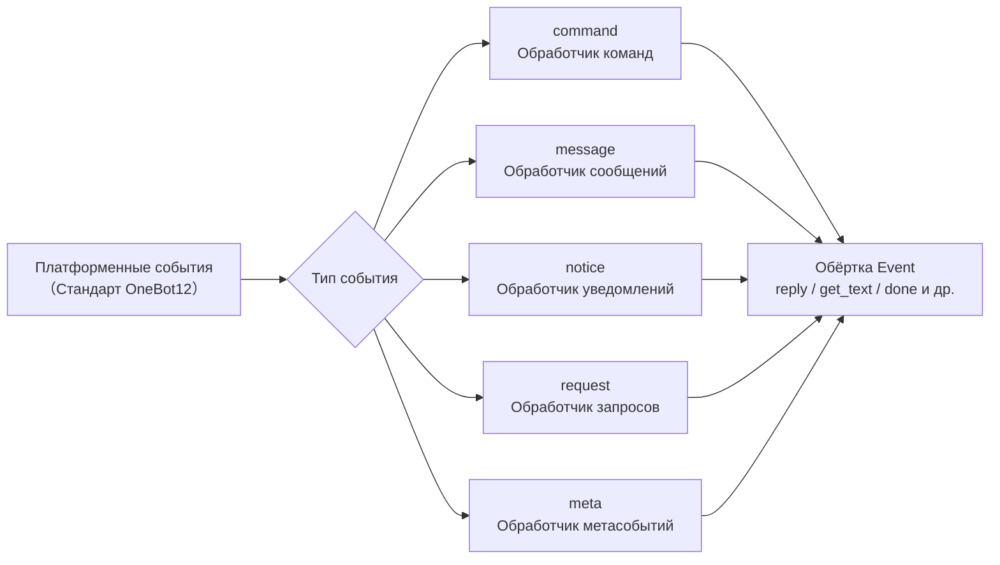

# API системы событий

> [!TIP]
> **Когда нужно читать эту статью**: когда вам нужно зарегистрировать команду, слушать события сообщений/уведомлений/запросов или использовать методы взаимодействия с событиями, такие как `event.reply()` / `wait_reply()` / `confirm()` и т.д. Если это не нужно, пропустите.

В этой документации подробно описывается API системы событий ErisPulse.

Система событий распределяет платформенные события по типам в пять категорий обработчиков:



## Модуль Command (Команды)

### Регистрация команд

```python
from ErisPulse.Core.Event import command

# Базовая команда
@command("hello", help="Отправить приветствие")
async def hello_handler(event):
    await event.reply("Привет!")

# Команда с алиасами
@command(["help", "h"], aliases=["помощь"], help="Отобразить помощь")
async def help_handler(event):
    pass

# Команда с правами доступа
def is_admin(event):
    return event.get("user_id") in admin_ids

@command("admin", permission=is_admin, help="Команда администратора")
async def admin_handler(event):
    pass

# Скрытая команда
@command("secret", hidden=True, help="Секретная команда")
async def secret_handler(event):
    pass

# Группа команд
@command("admin.reload", group="admin", help="Перезагрузить модуль")
async def reload_handler(event):
    pass

# Подкоманда (многословные команды с пробелами)
# Сопоставление происходит по самому длинному префиксу: /admin add x сначала совпадает с admin add (args = ["x"]);
# Подкоманда без объявленного permission наследует право доступа от ближайшего предка с объявленным правом
@command("admin add", help="Добавить администратора")
async def admin_add_handler(event):
    pass
```

**Правила конфликтов имён**: Имя команды имеет приоритет над алиасом. При регистрации алиаса с уже существующим именем команда не будет зарегистрирована, и будет выдано предупреждение; при регистрации команды с именем, совпадающим с уже существующим алиасом, имя команды будет иметь приоритет, и мёртвый алиас будет автоматически удалён — оба типа конфликтов имеют WARNING-логи, и не будут молча перехватывать.

### Информация о командах

Все API для запроса информации о командах поддерживают необязательный **контекст сессии**: передача `event=` (Event или dict) или явные `platform=` / `bot_id=` / `session_id=` (при совмещении с event, явные параметры имеют приоритет), т.е. фильтрация по области действия модуля, исключая команды, недоступные в текущей сессии (см. advanced/scope.md); все параметры необязательны, если не переданы, поведение остаётся прежним.

```python
# Получить справку по команде
help_text = command.help()

# Сессионная справка: отобразить только доступные в текущей сессии команды
help_text = command.help(event=event)

# Получить конкретную команду (возвращает объединённые параметры; возвращает None, если недоступна в сессии)
cmd_info = command.get_command("admin")
cmd_info = command.get_command("admin", event=event)

# Получить все команды (при сессионной фильтрации исключаются недоступные модули)
all_commands = command.get_commands()
all_commands = command.get_commands(event=event)

# Получить все команды в группе (поддержка сессионной фильтрации)
admin_commands = command.get_group_commands("admin")
admin_commands = command.get_group_commands("admin", event=event)

# Получить все видимые команды
visible_commands = command.get_visible_commands()

# Видимые команды с учётом сессии (достаточно event или явных параметров)
visible_commands = command.get_visible_commands(event=event)
visible_commands = command.get_visible_commands(
    platform=event.get("platform"),
    bot_id=event.get_self_account_id(),
    session_id=event.get_session_id(),
)
```

### Ожидание ответа

```python
# Ожидание ответа пользователя
@command("ask", help="Запросить информацию у пользователя")
async def ask_command(event):
    reply = await command.wait_reply(
        event,
        prompt="Пожалуйста, введите ваше имя:",  # Уже отправлено выше
        timeout=30.0
    )
    
    if reply:
        name = reply.get_text()
        await event.reply(f"Привет, {name}!")

# Ожидание ответа с проверкой
def validate_age(event_data):
    try:
        age = int(event_data.get_text())
        return 0 <= age <= 150
    except ValueError:
        return False

@command("age", help="Запросить возраст пользователя")
async def age_command(event):
    await event.reply("Пожалуйста, введите ваш возраст:")
    
    reply = await command.wait_reply(
        event,
        timeout=60,
        validator=validate_age
    )
    
    if reply:
        age = int(reply.get_text())
        await event.reply(f"Ваш возраст: {age} лет")

# Ожидание ответа с колбэком
async def handle_confirmation(reply_event):
    text = reply_event.get_text().lower()
    if text in ["да", "yes", "y"]:
        await event.reply("Операция подтверждена!")
    else:
        await event.reply("Операция отменена.")

@command("confirm", help="Подтвердить операцию")
async def confirm_command(event):
    await command.wait_reply(
        event,
        prompt="Введите 'да' или 'нет':",
        callback=handle_confirmation
    )
```

## Модуль Message (Сообщения)

### События сообщений

```python
from ErisPulse.Core.Event import message

# Отслеживание всех сообщений
@message.on_message()
async def message_handler(event):
    sdk.logger.info(f"Получено сообщение: {event.get_text()}")

# Отслеживание личных сообщений
@message.on_private_message()
async def private_handler(event):
    user_id = event.get_user_id()
    sdk.logger.info(f"Личное сообщение от: {user_id}")

# Отслеживание групповых сообщений
@message.on_group_message()
async def group_handler(event):
    group_id = event.get_group_id()
    sdk.logger.info(f"Групповое сообщение от: {group_id}")

# Отслеживание сообщений с упоминанием
@message.on_at_message()
async def at_handler(event):
    mentions = event.get_mentions()
    sdk.logger.info(f"Упомянутые пользователи: {mentions}")
```

### Условное отслеживание

```python
# Использование приоритета для управления порядком выполнения
@message.on_message(priority=10)  # Чем больше значение, тем выше приоритет
async def high_priority_handler(event):
    pass

# Условная фильтрация внутри обработчика
@message.on_message()
async def filtered_handler(event):
    if "ключевое слово" not in event.get_text():
        return
    # Обработка сообщений, содержащих ключевое слово
    pass
```

## Модуль Notice (Уведомления)

### События уведомлений

```python
from ErisPulse.Core.Event import notice

# Добавление друга
@notice.on_friend_add()
async def friend_add_handler(event):
    user_id = event.get_user_id()
    await event.reply("Спасибо за добавление меня в друзья!")

# Удаление друга
@notice.on_friend_remove()
async def friend_remove_handler(event):
    user_id = event.get_user_id()
    sdk.logger.info(f"Друг удалён: {user_id}")

# Увеличение числа участников группы
@notice.on_group_increase()
async def member_increase_handler(event):
    user_id = event.get_user_id()
    await event.reply(f"Добро пожаловать, новый участник!")

# Уменьшение числа участников группы
@notice.on_group_decrease()
async def member_decrease_handler(event):
    user_id = event.get_user_id()
    sdk.logger.info(f"Участник покинул группу: {user_id}")
```

## Модуль Request (Запросы)

### События запросов

```python
from ErisPulse.Core.Event import request

# Запрос на добавление друга
@request.on_friend_request()
async def friend_request_handler(event):
    user_id = event.get_user_id()
    comment = event.get_comment()
    sdk.logger.info(f"Запрос на добавление друга: {user_id}, комментарий: {comment}")

# Запрос на групповое приглашение
@request.on_group_request()
async def group_request_handler(event):
    group_id = event.get_group_id()
    user_id = event.get_user_id()
    sdk.logger.info(f"Групповое приглашение: {group_id}, от: {user_id}")
```

## Модуль Meta (Метасобытия)

### Метасобытия

```python
from ErisPulse.Core.Event import meta

# Событие подключения
@meta.on_connect()
async def connect_handler(event):
    platform = event.get_platform()
    sdk.logger.info(f"Платформа {platform} успешно подключена")

# Событие отключения
@meta.on_disconnect()
async def disconnect_handler(event):
    platform = event.get_platform()
    sdk.logger.info(f"Платформа {platform} отключена")

# Событие心跳
@meta.on_heartbeat()
async def heartbeat_handler(event):
    sdk.logger.debug("Получено heartbeat")
```

### Запрос состояния бота

После того как адаптер отправляет метасобытия, фреймворк автоматически отслеживает состояние бота. API для запроса и слушатели событий жизненного цикла см. в [API системы адаптеров - Управление состоянием бота](adapter-system.md#bot-状态管理).

## Обёртка Event

Обработчики событий модуля Event получают экземпляр обёртки Event, которая наследуется от dict и предоставляет удобные методы. Полный список методов, сигнатуры параметров и поведение см. в [Подробном описании обёртки Event](../developer-guide/modules/event-wrapper.md); в этом разделе приведён краткий обзор.

### Краткий обзор возможностей

- **Основная информация о событии**: `get_id()` / `get_time()` / `get_type()` / `get_detail_type()` / `get_platform()`
- **Информация о боте**: `get_self_platform()` / `get_self_user_id()` / `get_self_account_id()` / `get_self_info()`
- **Идентификатор сессии**: `get_target_id()` (единый идентификатор цели, берётся первый ненулевой из `group_id` → `channel_id` → `guild_id` → `thread_id` → `user_id`); `get_session_id()` (формат `{platform}:{detail_type}:{target_id}`, например `"telegram:private:12345"`)
- **Содержание сообщения и отправитель**: `get_message()` / `get_alt_message()` / `get_text()` / `get_user_id()` / `get_sender()` / `get_group_id()` и т.д.
- **Проверка типа сообщения**: `is_message()` / `is_private_message()` / `is_group_message()` / `is_at_message()` / `has_mention()` / `get_mentions()`
- **Ответ**: `reply(content, method=..., at_sender=..., quote=..., at_users=..., reply_to=..., at_all=..., via=...)` / `reply_ob12()`; проверка поддержки платформой `supports()` / `available_methods()`; свободная отправка цепочки `send_chain()` см. в [Подробном описании SendDSL](../developer-guide/adapters/send-dsl.md#方式二eventsend_chain)
- **Информация о команде**: `get_command_name()` / `get_command_args()` / `is_command()` и т.д.
- **Интерактивные сессии**: `wait_reply()` / `confirm()` / `choose()` / `collect()` / `wait_for()` / `conversation()`
- **Утилиты**: `to_dict()` (фильтрация внутренних ключей) / `get_raw()` / `get_raw_type()`

> Полное описание параметров и примеров каждого метода см. в [Подробном описании обёртки Event](../developer-guide/modules/event-wrapper.md);
> Дополнительные сведения о многошаговых диалогах см. в [Conversation многошаговые диалоги](../advanced/conversation.md).

### Управление цепочкой

`event.done(claim=, stop=)` единый способ управления двумя ортогональными семантиками «признания» и «блокировки»:

- **Признание (claim)**: пометить событие как обработанное (`_processed`), обработчик команды использует это для пропуска дублирования
- **Блокировка (stop)**: предотвратить распространение события на обработчики с более низким приоритетом (`_propagation_stopped`)

```python
# Признание + блокировка (по умолчанию)
event.done()

# Только признание, не блокировка (низкоприоритетные наблюдатели всё ещё видят)
event.done(stop=False)

# Только блокировка, не признание (например, фаервол / ограничение скорости)
event.done(claim=False)

# mark_processed — основной метод, done — его алиас
event.mark_processed()             # эквивалент event.done()
event.mark_processed(stop=False)   # эквивалент event.done(stop=False)

# Проверка состояния
event.is_processed()  # был ли признан
event.is_stopped()    # был ли заблокирован
```

### Платформенные расширения

Адаптеры могут регистрировать платформенно-специфические методы для Event, доступные только на экземплярах соответствующей платформы.

#### Использование платформенно-специфических методов

После регистрации адаптером платформенно-специфических методов, вы можете вызывать их в обработчике событий. Методы для каждой платформы различаются, см. соответствующую [документацию платформы](../platform-guide/).

```python
from ErisPulse.Core.Event import message

@message.on_message()
async def handle_message(event):
    platform = event.get_platform()

    # Вызов платформенно-специфических методов
    if platform == "email":
        subject = event.get_subject()           # специфичный для email
        attachments = event.get_attachments()   # специфичный для email
```

#### Запрос зарегистрированных методов платформы

```python
from ErisPulse.Core.Event import get_platform_event_methods

# Получить список зарегистрированных методов для платформы
methods = get_platform_event_methods("email")
# ["get_subject", "get_from", "get_attachments", ...]

# Динамический вызов метода
for method_name in get_platform_event_methods(event.get_platform()):
    method = getattr(event, method_name)
    print(f"{method_name}: {method()}")
```

#### Изоляция методов платформ

Регистрируемые методы разных платформ не влияют друг на друга:

```python
# Email событие - только email методы
event = Event({"platform": "email", "email_raw": {"subject": "Hello"}})
event.get_subject()      # ✅ "Hello"
event.get_chat_type()    # ❌ AttributeError

# Telegram событие - только Telegram методы
event = Event({"platform": "telegram", "telegram_raw": {"chat": {"type": "private"}}})
event.get_chat_type()    # ✅ "private"
event.get_subject()      # ❌ AttributeError
```

#### Поддержка hasattr / dir

```python
hasattr(event, "get_subject")   # True только если platform="email"
"get_subject" in dir(event)     # То же самое
```

#### Регистрация платформенно-специфических методов адаптером

Адаптеры могут зарегистрировать платформенно-специфические методы для Event с помощью декоратора, первый параметр метода — self (экземпляр Event), можно свободно обращаться к данным события.

##### Регистрация одного метода

```python
from ErisPulse.Core.Event import register_event_method

@register_event_method("email")
def get_subject(self):
    """Получить тему письма"""
    return self.get("email_raw", {}).get("subject", "")

@register_event_method("email")
def get_from(self):
    """Получить отправителя"""
    return self.get("email_raw", {}).get("from", {})
```

##### Массовая регистрация (через Mixin)

При большом количестве методов рекомендуется использовать Mixin для массовой регистрации:

```python
from ErisPulse.Core.Event import register_event_mixin

class EmailEventMixin:
    def get_subject(self):
        return self.get("email_raw", {}).get("subject", "")

    def get_from(self):
        return self.get("email_raw", {}).get("from", {})

    def get_attachments(self):
        return self.get("email_raw", {}).get("attachments", [])

# Регистрация всех методов сразу
register_event_mixin("email", EmailEventMixin)
```

##### Правила возвращаемых значений

| Сценарий | Возвращаемое значение | Способ использования пользователем |
|------|--------|------------|
| Возврат данных (текст, словарь и т.д.) | Просто возвращаемое значение | `subject = event.get_subject()` |
| Выполнение операции (отправка сообщения и т.д.) | Возвращается `asyncio.Task` | `task = event.do_something()` (необязательно `await`) |

> **Рекомендация**: методы, возвращающие не данные, возвращают `asyncio.Task`, чтобы пользователь мог сам решить, нужно ли `await`, даже если не `await`, операция будет выполнена.

```python
@register_event_method("email")
def forward_email(self, to_address: str):
    """Переслать письмо — возвращает Task, пользователь может сам решить, нужно ли await"""
    import asyncio
    return asyncio.create_task(
        self._do_forward(to_address)
    )

# Пользователь может await и дождаться результата
await event.forward_email("user@example.com")

# Также можно не await, операция выполнится в фоне
event.forward_email("user@example.com")
```

##### Удаление методов

```python
from ErisPulse.Core.Event import unregister_event_method, unregister_platform_event_methods

# Удаление одного метода
unregister_event_method("email", "get_subject")

# Удаление всех методов платформы (вызывается при остановке адаптера)
unregister_platform_event_methods("email")
```

##### Переопределение встроенных методов

`register_event_mixin` / `register_event_method` поддерживают переопределение встроенных методов Event (например, `confirm`, `choose`, `collect`, `wait_reply`, `reply` и т.д.). Зарегистрированные платформенно-специфичные методы через `Event.__getattribute__` имеют приоритет над встроенными, поэтому адаптер может предоставлять платформенно-специфичную реализацию интерактивных функций.

Встроенные реализации экспортируются как `_builtin_*` функции, переопределяющая реализация может вызывать их как резервную:

```python
from ErisPulse.Core.Event import register_event_mixin, _builtin_choose

class YunhuEventMixin:
    async def choose(self, prompt, options, timeout=60, method="Text"):
        # Платформа Yunhu использует кнопки
        buttons = [[{"text": opt} for opt in options]]
        await self.reply(prompt)
        # ...ожидание нажатия кнопки или текстового ответа...
        # Резервная логика
        return await _builtin_choose(self, None, options, timeout, "Text")

register_event_mixin("yunhu", YunhuEventMixin)
```

## Расширение для кросс-платформ (шаблоны)

`register_event_method` и `register_event_mixin` поддерживают передачу `"*"` в качестве названия платформы, регистрируемые методы доступны на всех платформах. Подходит для функций, требующих кросс-платформенного переиспользования, таких как AI-диалоги, управление контекстом и т.д.

### Регистрация кросс-платформенных методов

```python
from ErisPulse.Core.Event.wrapper import register_event_method

@register_event_method("*")
async def ai_chat(self, prompt: str):
    """self — экземпляр Event, можно свободно обращаться к данным и встроенным методам"""
    await self.reply(f"AI: {prompt}")
```

После регистрации все платформы могут использовать метод:

```python
from ErisPulse.Core.Event import message

@message.on_message()
async def handler(event):
    await event.ai_chat(event.get_text())
```

### Приоритет разрешения методов

При доступе к методам Event через атрибуты разрешение происходит в следующем порядке:

1. **Платформенно-специфические методы** (переопределение текущей платформы)
2. **Методы шаблона** (`"*"` — кросс-платформенные методы)
3. **Встроенные методы** (`reply`, `confirm` и т.д.)
4. **Доступ по ключу словаря**

> Таким образом, методы шаблона могут переопределять встроенные методы (например, `reply`), но будут переопределены методами платформенно-специфическими с тем же именем.

## Система приоритетов

Обработчики событий поддерживают приоритет, чем больше значение, тем выше приоритет:

```python
# Обработчик с высоким приоритетом выполняется первым
@message.on_message(priority=10)
async def high_priority_handler(event):
    pass

# Обработчик с низким приоритетом выполняется последним
@message.on_message(priority=0)
async def low_priority_handler(event):
    pass
```

## Связанные документы

**Продолжить изучение API**:
- [API основных модулей](core-modules.md) - API основных модулей
- [API системы адаптеров](adapter-system.md) - API управления адаптерами

**Изучить обработку событий на примерах**:
- [Руководство по разработке модулей](../developer-guide/modules/) - Разработка пользовательских модулей
- [Обработка событий](../getting-started/event-handling.md) - Введение в обработку событий