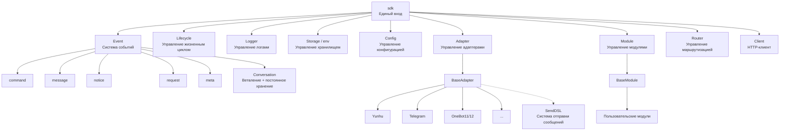
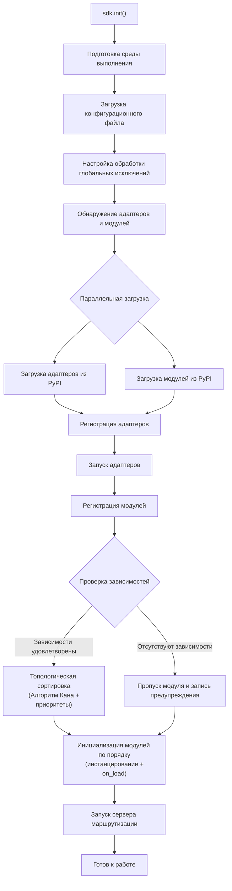
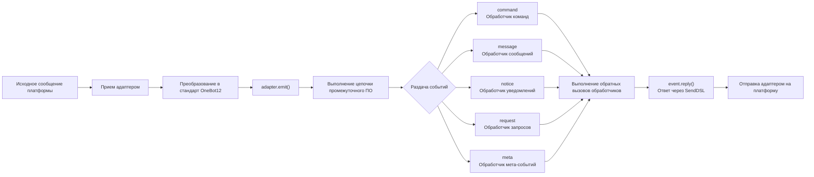
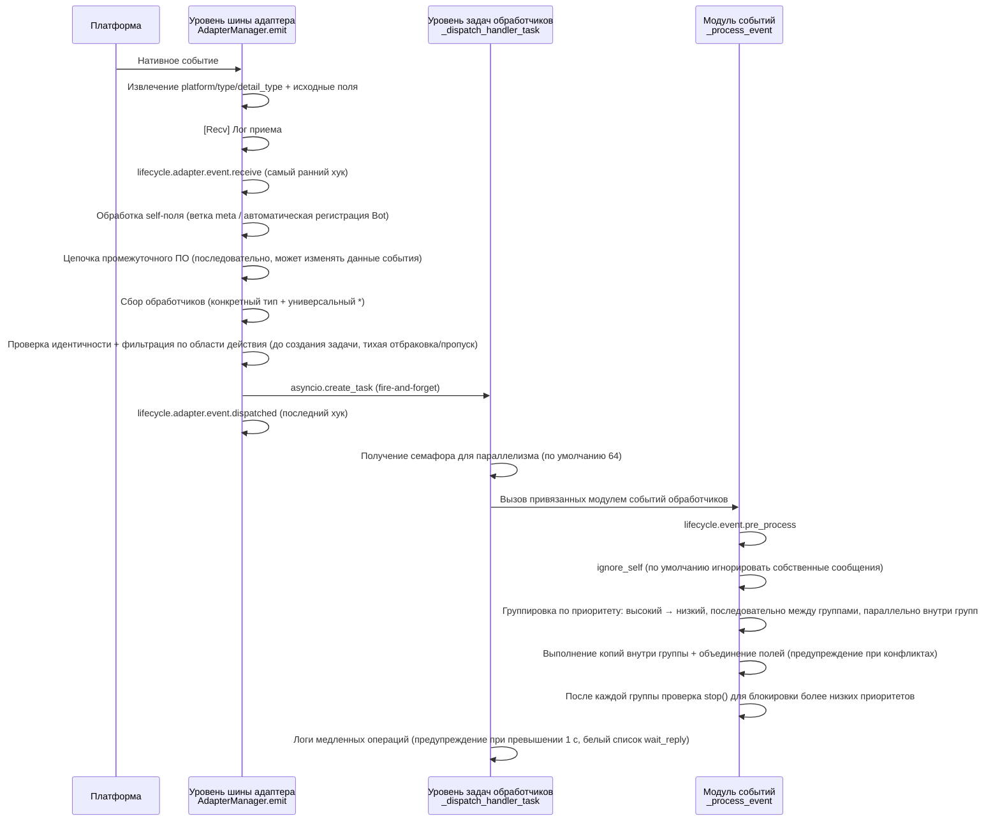
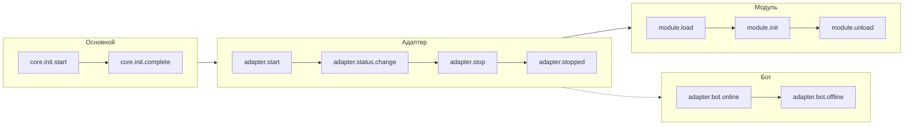
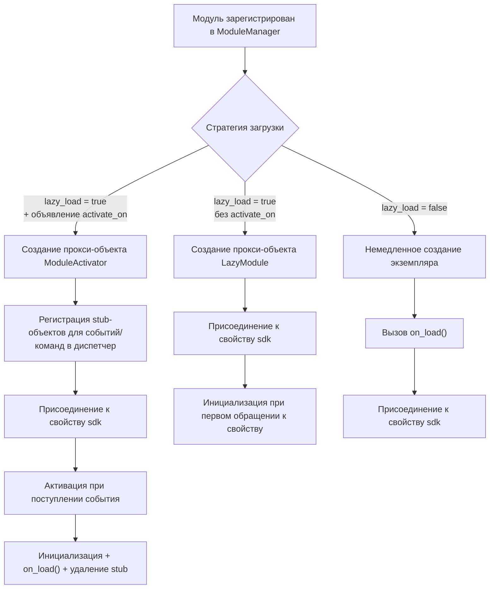
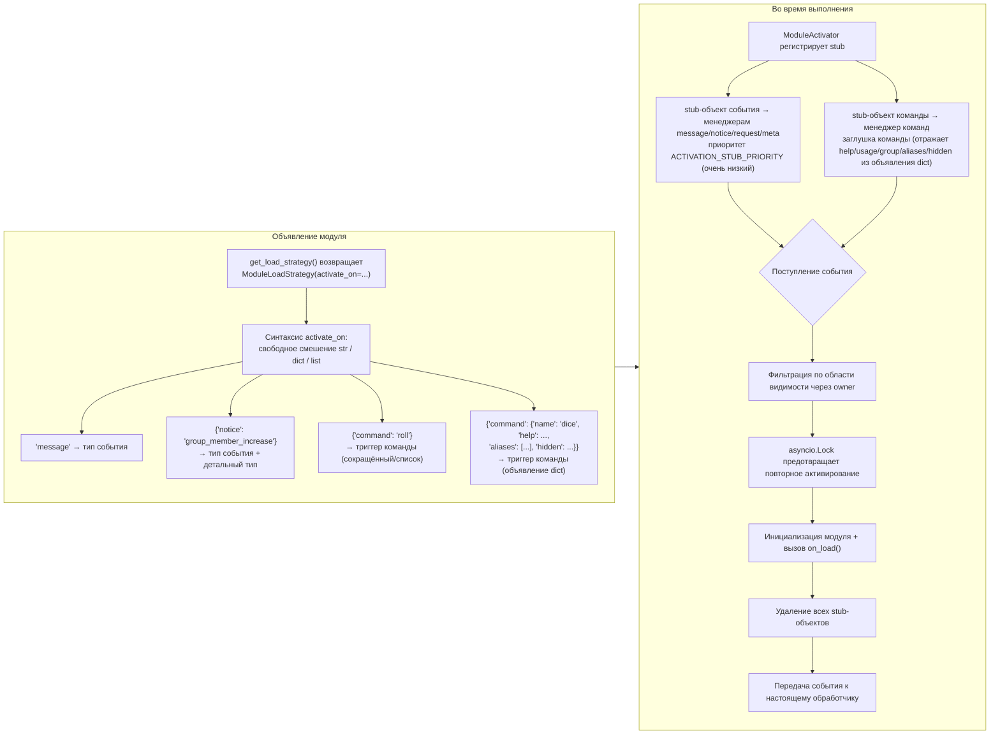
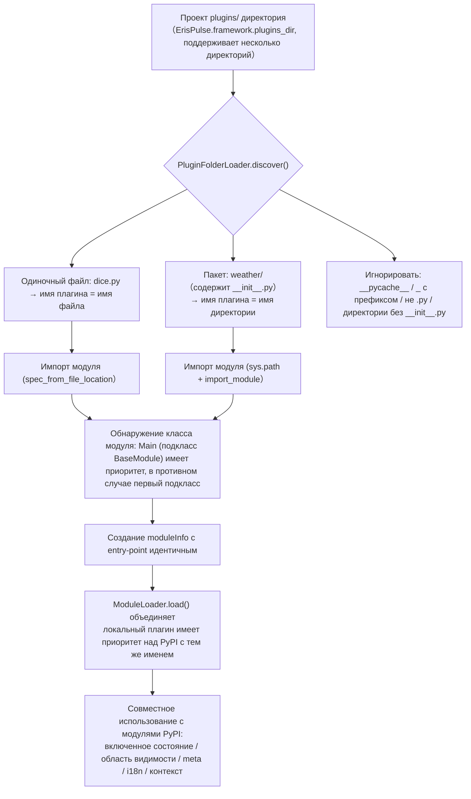
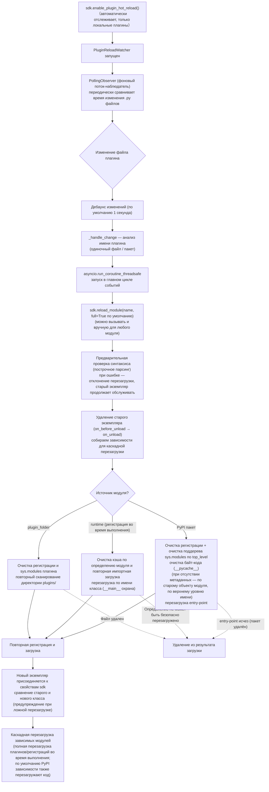
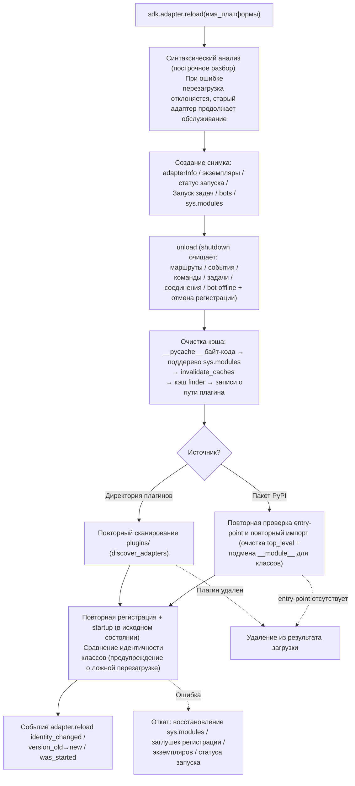

# Обзор архитектуры

Данный документ представляет визуальные диаграммы, описывающие техническую архитектуру ErisPulse SDK, чтобы помочь вам быстро понять идеи проектирования и модульные зависимости.

## Основная архитектура SDK

На следующей схеме показаны основные модули SDK и их взаимосвязи:

### Описание основных модулей

| Модуль | Описание |
|------|------|
| **Event** | Система событий, обеспечивающая обработку пяти типов событий: command / message / notice / request / meta, а также поддерживает многократные диалоги через Conversation |
| **Adapter** | Менеджер адаптеров, отвечающий за регистрацию, запуск и остановку адаптеров для различных платформ |
| **Module** | Менеджер модулей, отвечающий за регистрацию, загрузку и выгрузку плагинов, поддерживает объявление зависимостей и топологическую сортировку |
| **Lifecycle** | Менеджер жизненного цикла, предоставляющий систему событий для жизненных циклов |
| **Storage** | Система хранилища на основе SQLite, поддерживающая общие SQL-запросы в цепочке |
| **Config** | Управление конфигурационными файлами в формате TOML |
| **Logger** | Модульная система логирования, поддерживающая под-логгеры |
| **Router** | Управление маршрутизацией HTTP/WebSocket, через абстрактный слой обертывает базовые бэкенды (в настоящее время FastAPI + Uvicorn), поддерживает маршрутизацию с помощью декораторов, промежуточные обработчики, группировку, ограничение скорости, CORS |
| **Client** | Единый HTTP/WS-клиент (до версии 2.8.0 назывался `HttpClient`, сохраняется совместимость с псевдонимом), через абстрактный слой обертывает базовые библиотеки запросов (в настоящее время aiohttp), предоставляет функции статистики запросов, повторных попыток, логирования, WebSocket-клиент, систему исключений ErisPulse. Клиент и сервер WebSocket разделяют базовый класс `WebSocketConnectionBase` |

## Процесс инициализации

На следующей схеме показан полный процесс инициализации `sdk.init()`:

### Подробное описание этапов инициализации

> Полная цепочка инициализации с разбивкой на Finder / Loader / Manager / Router, а также базовые точки входа (`init()` / `init_task()` / `init_sync()`) и ручной полный запуск описаны в [Процесс запуска и ручное управление](docs/ru/advanced/startup.md).

## Процесс обработки событий

На следующей схеме показан полный путь сообщения от платформы до обработчика:

### Подробное описание цепочки обработки событий

Схема выше показывает "результат"; ниже разобрано, что делает фреймворк "за кулисами" после вызова `adapter.emit()` — это трехуровневая цепочка раздачи событий:

**Что делает фреймворк на каждом этапе и что вы можете изменить:**

| Этап | Что делает фреймворк | Что вы можете изменить |
|------|---------------------|------------------------|
| Прием | Извлекает стандартные поля, сохраняет `{platform}_raw` исходные данные; пишет `[Recv]` лог | Наблюдение за `adapter.event.receive` для раннего доступа к событию |
| self-поле | Мета-события обрабатываются ветвями connect/disconnect/heartbeat; обычные события автоматически регистрируют Bot и вызывают `adapter.bot.online` | Наблюдение за `adapter.bot.online` / `bot.offline` |
| Промежуточное ПО | **Последовательно** выполняется, если возвращается не None, то заменяет данные события | Регистрация промежуточного ПО для изменения/блокировки события |
| Сбор обработчиков | Сначала собираются обработчики конкретного типа, затем универсальные `*` | — |
| Идентификация | Определяет, принимать ли событие по пользователю>сессии>Bot>адаптеру (`scope.is_identity_allowed`), **если отклонено — событие удаляется** | Привязка `ErisPulse.scope.identity` |
| Фильтрация по области | Определяет `scope.is_allowed` по владельцу модуля (сессия>Bot>платформа), **если не проходит — тихо пропускается** | Настройка белого/черного списка областей |
| Планирование | Каждый подходящий обработчик запускается в отдельной `asyncio.Task`, `emit()` **не ждет завершения обработчиков** | — |
| Приоритет | Высокоприоритетные группы обрабатываются первыми; **между группами последовательно, внутри групп параллельно** (каждая группа имеет свою копию события, изменения объединяются в оригинальное событие, конфликты предупреждаются) | `@command(..., priority=N)` / указание при регистрации |
| Прерывание | После обработки каждой группы проверяется `event.is_stopped()`, если True — **не выполняются более низкие приоритеты** | `event.mark_processed(stop=True)` / `event.done()` |

> **Распространенные заблуждения**:
> 1. **Фильтрация по области тихая** — отфильтрованные обработчики не генерируют ошибок и не отвечают, видны только в логах TRACE (`core.scope.denied`). Если "мой модуль не получил сообщение" — сначала проверьте привязку областей.
> 2. **Обработчики обрабатываются параллельно по умолчанию** — фреймворк уже создает отдельные задачи для каждого обработчика, вам **не нужно** дополнительно оборачивать в `asyncio.create_task`.
> 3. **Внутри одной группы приоритетов нет прерывания** — `mark_processed(stop=True)` блокирует только более низкие группы, уже запущенные обработчики в той же группе не прерываются.
> 4. **Порог медленных логов фиксирован в 1 секунду** — если обработчик выполняется дольше 1 с, в логах появляется предупреждение (`wait_reply` время исключается из времени выполнения), но выполнение не прерывается.

> Подробности о привязке областей (scope) по модулям, проверке идентичности и ограничениях отправки см. в [Область (scope)](advanced/scope.md); текстовую фильтрацию событий и ACL пользователя команд см. в [Введение в обработку событий](getting-started/event-handling.md); настройку лимита параллелизма см. в [Руководство по конфигурации](user-guide/configuration.md#framework-config).

## Жизненный цикл

На следующей схеме показан порядок срабатывания событий жизненного цикла компонентов фреймворка:

### Подписка на события жизненного цикла

> Полный список методов для прослушивания событий (lifecycle.on() / once() / has_handlers()), полный список событий жизненного цикла и формат данных см. в разделе [Управление жизненным циклом](advanced/lifecycle.md).

## Стратегии загрузки модулей

ErisPulse поддерживает три стратегии загрузки модулей, которые определяются `ModuleLoadStrategy`, возвращаемым функцией `get_load_strategy()`:

> Подробнее см. [Система ленивой загрузки](advanced/lazy-loading.md), [Управление жизненным циклом](advanced/lifecycle.md) и документацию модуля.

### Архитектура триггерного ленивого активирования (trigger architecture с `activate_on`)

> [!NOTE]
> Эта функция доступна в ErisPulse **2.8.0+**.

`activate_on` позволяет загружать модуль только при поступлении **первого подходящего события/команды**, предотвращая постоянное присутствие в памяти, при этом события не теряются:

**Ключевые моменты семантики триггеров:**

> Полный синтаксис `activate_on` (str / dict / list), объявление команды через dict, цепочка возврата help для заглушек, фильтрация по области видимости и семантика ошибок см. в [Системе ленивой загрузки](advanced/lazy-loading.md#триггерное-ЛенивоеАктивированиеActivateOn).

## Архитектура локальной папки плагинов

> [!NOTE]
> Эта функция требует ErisPulse **2.8.0+**.

Локальные плагины (в директории `plugins/`) не требуют пакетирования для публикации, и фреймворк автоматически обнаруживает и загружает их при запуске:

**Соглашения и особенности:**

- Имя плагина берется из имени файла для одиночного файла, и из имени директории для пакета
- Локальный плагин имеет `moduleInfo.meta.source == "plugin_folder"`, и может совместно использоваться с модулями, установленными из PyPI
- При совпадении имен приоритет отдается локальному плагину (удобно для отладки), при отключении удаляется также соответствующий entry-point

## Архитектура горячей перезагрузки модулей

Горячая перезагрузка применяется ко **всем источникам модулей**: локальные плагины (в директории `plugins/`), модули, зарегистрированные во время выполнения (`sdk.module.register()`), и модули из PyPI, все они могут быть перезагружены с помощью `sdk.reload_module()` / `sdk.module.reload()` — **по умолчанию это полная перезагрузка** (удаление кэша импорта по имени пакета и повторная загрузка зависимых модулей, `full=False` — лёгкий "выходной клапан"); `sdk.reload_all_modules()` / `sdk.module.reload_all()` позволяет одновременно перезагрузить все зарегистрированные модули (после обновления пакетов через pip можно вызвать эту функцию, чтобы всё заработало):

**Различия между тремя источниками проявляются только на этапе обнаружения**, предварительная проверка, удаление и каскадная перезагрузка идентичны:

- **Локальные плагины** (`moduleInfo.meta.source == "plugin_folder"`): после очистки соответствующего `sys.modules` происходит повторный сканирование директории `plugins/`; если файл удален — он удаляется из результата загрузки
- **Регистрация во время выполнения** (`source == "runtime"`): повторная импортная загрузка по определению модуля, повторная загрузка по имени класса и перерегистрация; классы, определённые в `__main__` / без исходного файла, запрещены к перезагрузке (предупреждение охраны, избегаем повторного выполнения скрипта)
- **PyPI пакеты**: по `meta.top_level` очищается поддерево `sys.modules`, обновляется кэш импорта (пробиваем 60-секундный кэш entry-point), затем повторно загружаются и перезагружаются entry-point; если entry-point исчез (пакет удалён) — он удаляется из результата загрузки

**По умолчанию и гарантии надёжности (2.11):**

- **Перезагрузка — полная перезагрузка**: по умолчанию по имени верхнего пакета очищается `sys.modules` и повторно загружаются коды зависимых модулей; `full=False` — только по метаданным, PyPI зависимости перезагружаются через пересоздание экземпляра (выходной клапан для больших зависимостей)
- **Проверка синтаксиса**: перед началом удаления происходит построчное парсинг синтаксиса файлов, при ошибке — отклонение перезагрузки: старый экземпляр не удаляется, продолжает обслуживать; синтаксические ошибки никогда не приводят к "полусмертному" состоянию модуля (при превышении лимита файлов в пакете проверка пропускается)
- **Кэш-поддержка**: при отсутствии метаданных `top_level` очищается по двум уровням: по префиксу имени старого объекта модуля → по префиксу `__module__` класса; при перезагрузке также очищаются байт-коды исходных файлов (`__pycache__`), изменения, даже если файлы одинаковы по размеру и времени изменения, будут применены
- **Сравнение идентичности**: после успешной перезагрузки проверяется изменение идентичности нового и старого класса, если не изменилось (например, из-за кэша расширений на C), выводится предупреждение и событие `module.reload` содержит `identity_changed: false`; `module.get_info()` показывает "регистрационная версия ≠ текущая версия" через поля `running_identity` / `stale`
- **Диагностика ошибок**: при неудачной загрузке (исключение + traceback) можно получить информацию через `module.last_error(имя)` / `get_info()["last_error"]`, при неудаче также очищается кэш импорта модуля — "измените код и перезагрузите ещё раз", чтобы убедиться, что читается новый код
- Перезагрузка принудительно активирует модули, которые изначально загружались лениво (явный лог); `reload_all_modules()` сохраняет стратегию ленивой загрузки, перезагружая только модули, которые были уже загружены до перезагрузки, модули, находящиеся в состоянии "спячки", остаются в спячке
- `reload_all_modules()` перезагружает в порядке зависимостей, при неудаче с одним модулем — записывается диагностическая информация и модуль пропускается (без общего отката — побочные эффекты `on_unload` необратимы, что соответствует поведению перезагрузки одного модуля); в сценариях, где перезагрузка была отменена, также лог будет явно указывать, что старый экземпляр находится в состоянии завершения

## Архитектура горячей перезагрузки адаптера

Горячая перезагрузка адаптера на уровне кода (2.11) аналогична модульной конвейерной архитектуре: `sdk.adapter.reload(имя_платформы)` / `sdk.reload_adapter(имя_платформы)` выполняется для **локальных плагинов** и **пакетов, установленных через PyPI** — 

**Различия с модульной конвейерной архитектурой:**

- Адаптеры не поддерживают ленивую загрузку и каскадные зависимости: перезагрузка **не распространяется** на другие адаптеры, от которых зависит (только предупреждение — потребители косвенно используют через реестр, без семантики каскадного экземпляра)
- Запуск — асинхронная цепочка (`startup` передается через `_run_adapter`, включая пропуск зависимостей и экспоненциальную задержку при повторных попытках): временный сбой запуска **не считается сбоем перезагрузки** (код уже обновлен), результат передается через `adapter.status.change`
- Ловушка повторного использования экземпляра в `register()` (одинаковые объекты — старый экземпляр используется повторно) решается «триадой»: очистка pyc + удаление из sys.modules + проверка идентичности
- События жизненного цикла: `adapter.reload` (payload содержит `adapter_name` / `success` / `full` / `duration_ms` / `identity_changed` / `version_old→new` / `was_started` / `source`)