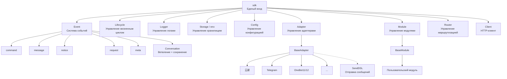
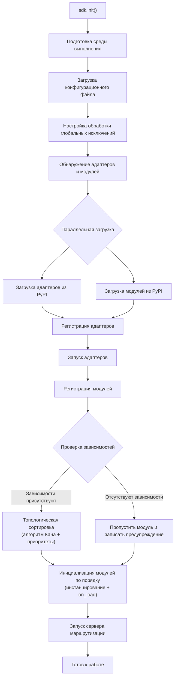
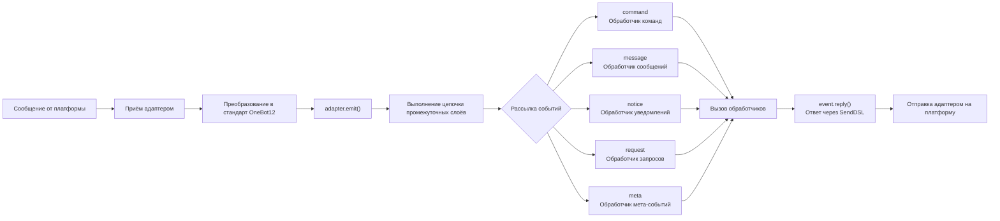
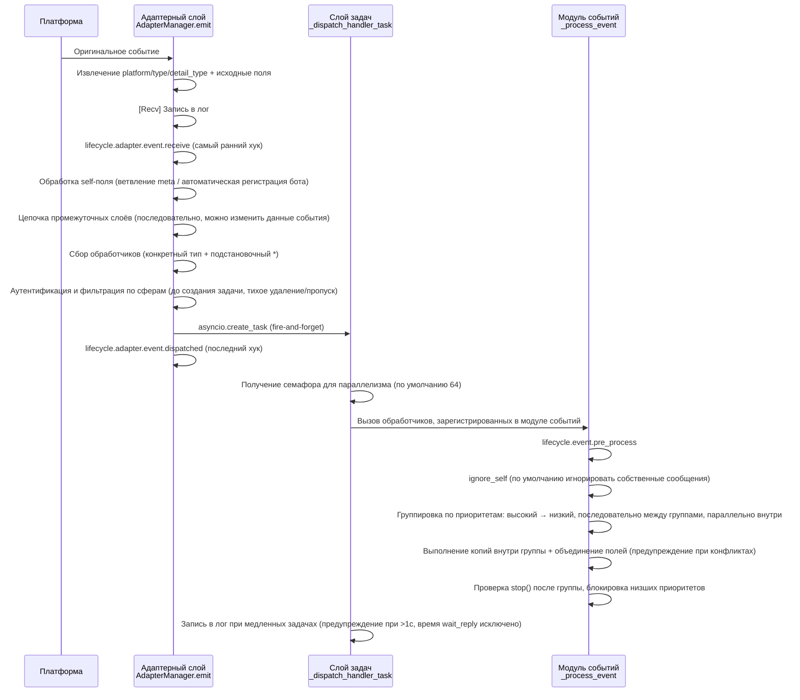
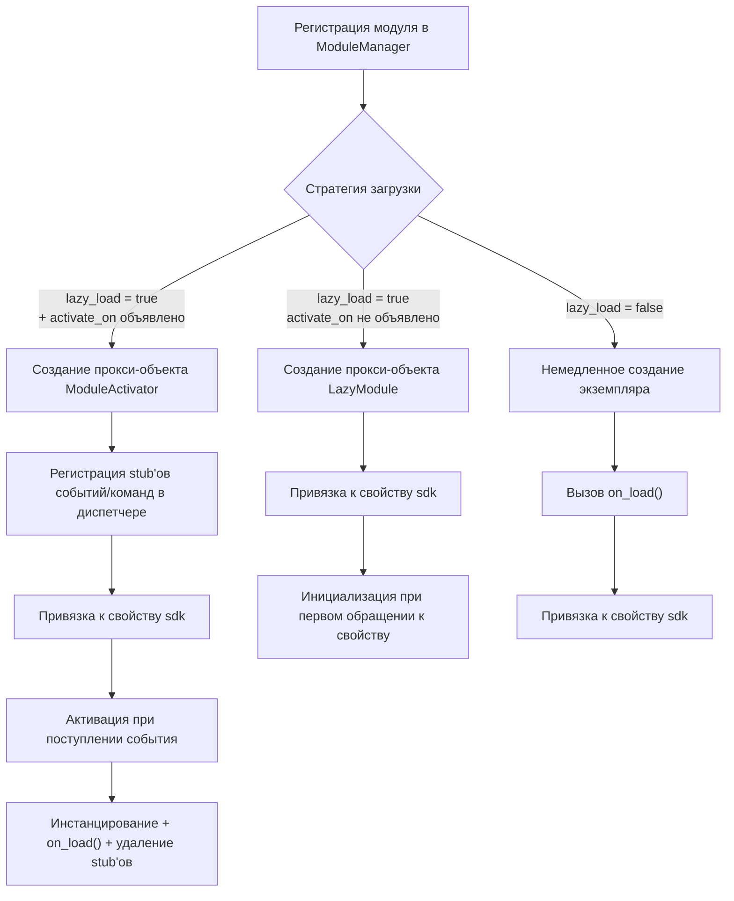
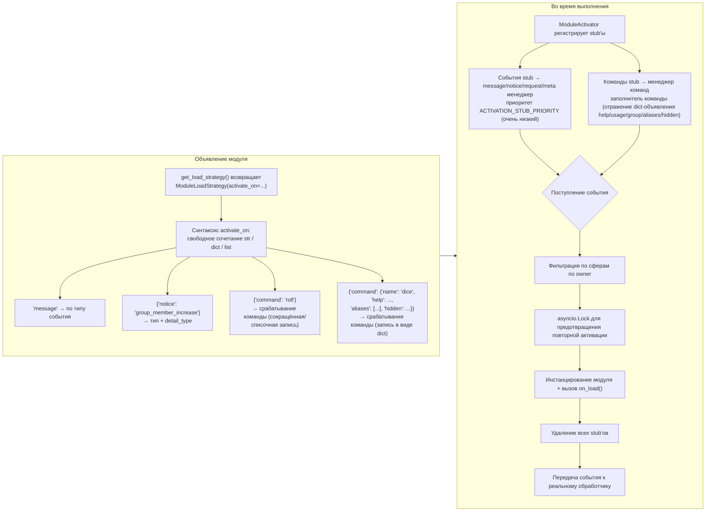
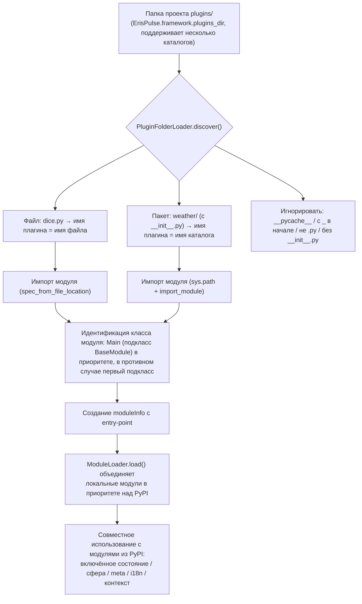
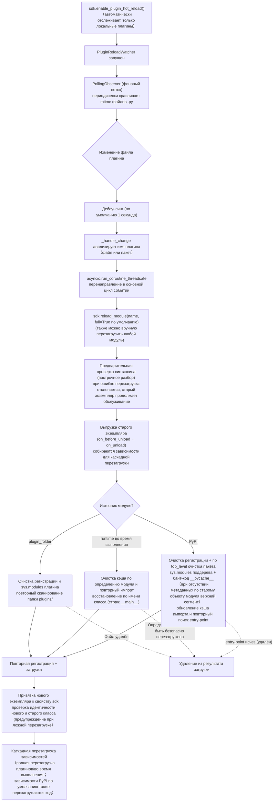
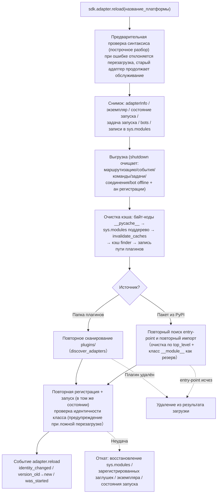

# Обзор архитектуры

> [!TIP]
> **Когда читать эту статью**: если вы хотите понять, что происходит за кулисами фреймворка — как проходит сообщение, в каком порядке инициализируются модули, что происходит при горячем перезагрузке, или если вы хотите разобраться, почему фреймворк ведёт себя так, как он ведёт. Если вы хотите просто писать обработчики, достаточно прочитать [Введение в обработку событий](getting-started/event-handling.md); если нет необходимости, можете пропустить эту статью.

Сообщение от пользователя до ответа бота проходит через адаптеры, промежуточные слои, фильтрацию по сферам, распределение по приоритетам и другие этапы; модули также не загружаются сразу при запуске. В этой статье мы используем диаграммы, чтобы показать эту цепочку и объяснить, что вы можете изменить на каждом этапе.

## Основная архитектура SDK

Ниже представлена диаграмма основных модулей SDK и их взаимосвязей:

### Описание основных модулей

| Модуль | Описание |
|------|------|
| **Event** | Система событий, предоставляющая обработку событий command / message / notice / request / meta, а также Conversation для многократных диалогов |
| **Adapter** | Менеджер адаптеров, отвечает за регистрацию, запуск и остановку адаптеров для различных платформ |
| **Module** | Менеджер модулей, отвечает за регистрацию, загрузку и выгрузку плагинов, поддерживает объявление зависимостей и топологическую сортировку |
| **Lifecycle** | Менеджер жизненного цикла, предоставляет обработчики жизненного цикла на основе событий |
| **Storage** | Хранилище на основе SQLite, поддерживающее общие SQL-запросы с цепочечной синтаксической структурой |
| **Config** | Управление конфигурационными файлами в формате TOML |
| **Logger** | Модульная система логирования, поддерживающая под-логгеры |
| **Router** | Управление маршрутизацией HTTP/WebSocket, через абстракцию обертывает底层后端 (в настоящее время FastAPI + Uvicorn), поддерживает маршрутизацию с помощью декораторов, промежуточные слои, группировку, ограничение скорости, CORS |
| **Client** | Единый HTTP/WS-клиент (до версии 2.8.0 был `HttpClient`, оставлен как совместимый псевдоним), через абстракцию обертывает底层请求库 (в настоящее время aiohttp), предоставляет статистику запросов, повторные попытки, логирование, WebSocket-клиент, систему исключений ErisPulse. WebSocket-клиент и серверная часть WebSocket используют общий базовый класс `WebSocketConnectionBase` |

## Процесс инициализации

Ниже представлена диаграмма полного процесса инициализации `sdk.init()`:

### Подробное описание этапов инициализации

> Полная цепочка инициализации (Finder / Loader / Manager / Router), базовые входные точки (`init()` / `init_task()` / `init_sync()`) и ручной полный запуск см. в [Процесс запуска и ручное управление](advanced/startup.md).

## Процесс обработки событий

Ниже представлена диаграмма полного пути сообщения от платформы до обработчика:

### Подробное описание цепочки обработки событий

На этой диаграмме показан результат; ниже разобрано, что происходит "за кадром" после вызова `adapter.emit()` — это трёхуровневая цепочка рассылки:

**Что делает фреймворк и что вы можете изменить:**

| Этап | Что делает фреймворк | Что вы можете изменить |
|------|-------------|-----------|
| Приём | Извлекает стандартные поля, сохраняет `{platform}_raw` исходные данные; записывает `[Recv]` лог | Наблюдение за `adapter.event.receive` для получения самого раннего события |
| self-поле | Для мета-событий ветвление connect/disconnect/heartbeat; для обычных событий автоматическая регистрация бота и запуск `adapter.bot.online` | Наблюдение за `adapter.bot.online` / `bot.offline` |
| Промежуточные слои | **Последовательно** выполняются, если возвращаемое значение не None, то заменяется событие | Регистрация промежуточных слоёв для изменения/перехвата события |
| Сбор обработчиков | Сначала берётся конкретный тип обработчика, затем `*` подстановочный обработчик | — |
| Аутентификация | Определяется, принимать ли событие по пользователю>сессии>боту>адаптеру (`scope.is_identity_allowed`), **отклонённые события удаляются** | `ErisPulse.scope.identity` привязка |
| Фильтрация по сферам | Определяется по владельцу модуля (`scope.is_allowed`), сессионный>бот>платформенный уровень, **не прошедшие фильтр тихо пропускаются** | Настройка белого/чёрного списка сфер |
| Планирование | Каждый обработчик запускается в отдельной `asyncio.Task`, `emit()` **не ждёт завершения обработчика** | — |
| Приоритеты | Высокий приоритет выполняется первым; **между группами последовательно, внутри групп параллельно** (каждая группа получает копию события, изменения объединяются, конфликты предупреждаются) | `@command(..., priority=N)` / указание при регистрации |
| Блокировка | После обработки группы проверяется `event.is_stopped()`, если true, то **выполняются только более высокие приоритеты** | `event.mark_processed(stop=True)` / `event.done()` |

> **Распространённые заблуждения**:
> 1. **Фильтрация по сферам тихая** — отфильтрованные обработчики не вызывают ошибок и не отвечают, только в логах TRACE видно (`core.scope.denied`). При "мой модуль не получает сообщения" сначала проверьте привязку сфер.
> 2. **Обработчики обрабатываются параллельно** — фреймворк уже создал для каждого обработчика отдельную задачу, вам **не нужно** дополнительно оборачивать в `asyncio.create_task`.
> 3. **Блокировка не действует внутри группы** — `mark_processed(stop=True)` блокирует только более низкие приоритеты, обработчики в одной группе не прерываются.
> 4. **Порог медленного лога фиксирован 1 секунда** — если обработчик затрачивает более 1 секунды, в логе появляется предупреждение (время `wait_reply` исключено), но выполнение не прерывается.

> Подробнее о привязке сфер, аутентификации и ограничениях действий см. в [Сфера (scope)](advanced/scope.md); о текстовом фильтре сфер и ACL пользователя команд см. в [Введение в обработку событий](getting-started/event-handling.md); о настройке верхнего лимита параллелизма см. в [Руководство по конфигурации](user-guide/configuration.md#Конфигурация_фреймворка).

## События жизненного цикла

Ниже представлена диаграмма последовательности событий жизненного цикла компонентов фреймворка:

### Наблюдение за событиями жизненного цикла

> Полный список методов наблюдения за событиями (`lifecycle.on()` / `once()` / `has_handlers()`), все события жизненного цикла и формат данных см. в [Управление жизненным циклом](advanced/lifecycle.md).

## Стратегии загрузки модулей

ErisPulse поддерживает три стратегии загрузки модулей, возвращаемые `get_load_strategy()` в виде `ModuleLoadStrategy`:

> Подробнее смотрите [Систему ленивой загрузки](advanced/lazy-loading.md), [Управление жизненным циклом](advanced/lifecycle.md) и документацию модуля.

### Архитектура ленивой активации по событиям (`activate_on`)

> [!NOTE]
> Эта функция доступна в ErisPulse **с версии 2.8.0**.

`activate_on` позволяет модулю загружаться **только при первом поступлении соответствующего события/команды**, что позволяет избежать постоянного использования памяти и гарантирует, что события не будут потеряны:

**Ключевые моменты семантики триггера:**

> Полный синтаксис `activate_on` (str / dict / list), объявление команды в виде dict, цепочка отката help для заполнителя команды, фильтрация по сферам и семантика неудачи см. в [Системе ленивой загрузки](advanced/lazy-loading.md#Ленивая_активация_по_событиям_activate_on).

## Архитектура локальной папки плагинов

> [!NOTE]
> Эта функция доступна в ErisPulse **с версии 2.8.0**.

Локальные плагины (папка `plugins/`) не требуют публикации и автоматически обнаруживаются и загружаются при запуске фреймворка:

**Соглашения и особенности:**

- Имя плагина: для файла — имя файла, для пакета — имя каталога
- Для локального плагина `moduleInfo.meta.source == "plugin_folder"`, он совместим с модулями из PyPI
- При совпадении имен локальный модуль имеет приоритет (удобно для отладки), при отключении удаляется и entry-point

## Архитектура горячей перезагрузки модулей

Горячая перезагрузка применяется ко **всем источникам модулей** одинаково: локальные плагины (`plugins/`), модули, зарегистрированные во время выполнения (`sdk.module.register()`), и модули из PyPI, которые можно перезагрузить через `sdk.reload_module()` / `sdk.module.reload()` — **по умолчанию полная перезагрузка** (очистка кэша импорта по имени пакета и повторный импорт зависимостей, `full=False` — лёгкий выход); `sdk.reload_all_modules()` / `sdk.module.reload_all()` может перезагрузить все зарегистрированные модули за один раз (например, после обновления пакетов через pip):

**Различия между тремя источниками только на этапе обнаружения**, предварительная проверка, выгрузка и каскадная перезагрузка идентичны:

- **Локальные плагины** (`moduleInfo.meta.source == "plugin_folder"`): после очистки sys.modules соответствующего имени плагина повторно сканируется папка `plugins/`; если файл удалён, он удаляется из результата загрузки
- **Модули, зарегистрированные во время выполнения** (`source == "runtime"`): повторный импорт по определению модуля, восстановление по имени класса и повторная регистрация; классы, определённые в `__main__` / без исходного файла отклоняются от перезагрузки (страж предупреждения, чтобы избежать повторного выполнения скрипта входной точки)
- **Пакеты из PyPI**: по `meta.top_level` очищается поддерево sys.modules пакета, обновляется кэш импорта (преодоление кэша entry-point на 60 секунд) и повторно импортируется; если entry-point исчез (pip-удалён), он удаляется из результата загрузки

**Стандартная семантика и гарантии надёжности (2.11):**

- **reload = полная перезагрузка**: по умолчанию очищается sys.modules по имени пакета и повторно импортируются зависимости; `full=False` — только очистка метаданных, зависимости PyPI повторно инстанцируются (выход для производительности при больших зависимостях)
- **Предварительный барьер синтаксической проверки**: перед началом выгрузки происходит построчная синтаксическая проверка, при ошибке перезагрузка отклоняется — старый экземпляр не выгружается и продолжает обслуживание, синтаксические ошибки никогда не приведут модуль в "полумёртвое состояние" (при большом количестве файлов превышает лимит)
- **Кэш-поддержка**: при отсутствии метаданных `top_level` используется двойная генерация очистки по старому объекту модуля `__name__` префикс → модульному классу `__module__` префикс; при перезагрузке также очищаются байт-коды исходных файлов (в __pycache__), даже небольшие изменения в тот же секунду и с одинаковой длиной вступают в силу
- **Проверка идентичности**: после успешной перезагрузки утверждается изменение идентичности нового и старого класса, если не изменилось (например, C-расширения, кэш не очищается) — явное предупреждение и событие `module.reload` с `identity_changed: false`; `module.get_info()` с полями `running_identity` / `stale` показывает "зарегистрированная версия ≠ текущая версия"
- **Проверка ошибок**: при неудачной загрузке (исключение + traceback) можно напрямую получить через `module.last_error(имя)` / `get_info()["last_error"]`, при этом очищается кэш импорта модуля — "измените код и перезагрузите ещё раз" обязательно прочитает новый код
- Перезагрузка заставляет модуль, который был лениво загружен, активироваться (явное логирование); `reload_all_modules()` сохраняет стратегию ленивой загрузки, только модули, которые были загружены до перезагрузки, повторно активируются, модули, находящиеся в спящем состоянии, остаются в спящем состоянии
- `reload_all_modules()` перезагружает в порядке зависимостей, при неудаче одного модуля записывается диагностика и пропускается (без общей отката —副作用 on_unload не отменить, семантика как у горячей перезагрузки одного модуля); при неудаче перезагрузки, когда старый экземпляр уже откатился, лог будет явно указывать, что старый экземпляр находится в состоянии завершения

## Архитектура горячей перезагрузки адаптеров

Горячая перезагрузка адаптеров на уровне кода (2.11) идентична цепочке модулей: `sdk.adapter.reload(название_платформы)` / `sdk.reload_adapter(название_платформы)` применяется ко **локальным плагинам** и **пакетам из PyPI**:

**Различия с цепочкой модулей:**

- У адаптеров нет ленивой загрузки и каскадной перезагрузки зависимостей: перезагрузка **не распространяется** на другие адаптеры, которые от него зависят (только предупреждение — зависимые через реестр косвенно используют, без семантики каскада экземпляров)
- Запуск асинхронный (через `startup` через `_run_adapter`, включая пропуск зависимостей и экспоненциальную отмену с повторными попытками): временный сбой запуска **не считается неудачей перезагрузки** (код уже обновлён), результат передаётся через `adapter.status.change`
- Ловушка повторного использования экземпляра register (если классы совпадают, старый экземпляр повторно используется) решается "очисткой pyc + sys.modules + проверкой идентичности"
- События жизненного цикла: `adapter.reload` (payload содержит `adapter_name` / `success` / `full` / `duration_ms` / `identity_changed` / `version_old→new` / `was_started` / `source`)

## Далее

- **Если хотите ручное управление запуском / остановкой**: смотрите [Процесс запуска и ручное управление](advanced/startup.md), где разобрана цепочка инициализации, отдельные запуск и остановка адаптеров и маршрутизации
- **Если хотите разобраться с ленивой загрузкой и спящим состоянием**: смотрите [Систему ленивой загрузки](advanced/lazy-loading.md), включая полный синтаксис `activate_on` для ленивой активации по событиям
- **Если хотите использовать жизненный цикл при написании модуля**: смотрите [Управление жизненным циклом](advanced/lifecycle.md), где представлены все события жизненного цикла и методы наблюдения