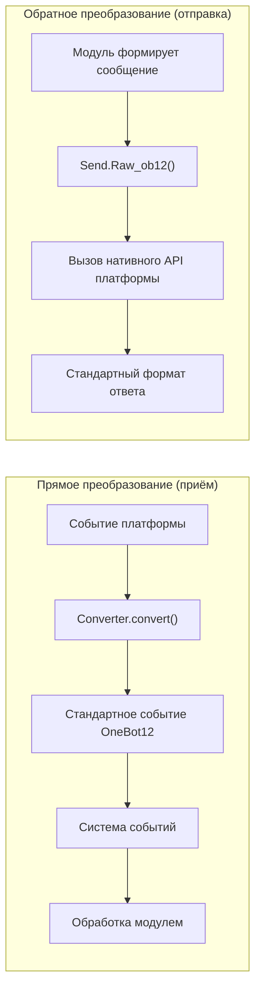

# Введение в разработку адаптеров

> [!TIP]
> **Когда читать этот документ**: стартовая (обязательная к прочтению) статья цикла разработки адаптеров. Здесь описано, как написать адаптер с нуля, каковы границы ответственности адаптера и структура проекта; после прочтения переходите по необходимости к разделам [Конвертер событий](converter.md) и [Подробное описание SendDSL](send-dsl.md).

Пройдя это руководство, вы получите минимально работоспособный адаптер, способный принимать события и отправлять сообщения (главный класс + конвертер + Send), и будете чётко понимать границы ответственности каждого компонента — вся работа по подключению новой платформы начинается именно отсюда.

## Введение в адаптеры

### Что такое адаптер

Адаптер — это мост между ErisPulse и различными платформами обмена сообщениями, отвечающий за:

1. **Прямое преобразование**: приём событий платформы и преобразование их в стандартный формат OneBot12 (Converter)
2. **Обратное преобразование**: преобразование сегментов сообщений OneBot12 в вызовы API платформы (`Raw_ob12`)
3. Управление соединением с платформой (WebSocket/WebHook)
4. Предоставление унифицированного интерфейса отправки сообщений SendDSL

### Архитектура адаптера



## Структура каталогов

Стандартная структура пакета адаптера:

```
MyAdapter/
├── pyproject.toml          # Конфигурация проекта
├── README.md               # Описание проекта
├── LICENSE                 # Лицензия
└── MyAdapter/
    ├── __init__.py          # Точка входа пакета
    ├── Core.py               # Главный класс адаптера
    └── Converter.py          # Конвертер событий
```

## Быстрый старт

### 1. Создание проекта

Рекомендуется сразу сгенерировать полный каркас с помощью скаффолда (включая pyproject, главный класс и конвертер):

```bash
# Стандартный проект (для упаковки и публикации)
epsdk create adapter -n MyAdapter

# Локальный плагин-адаптер (без упаковки; достаточно поместить в каталог plugins/ для автозагрузки, см. раздел «Локальная разработка» ниже)
epsdk create adapter -n MyAdapter --local
```

Скаффолд по умолчанию генерирует каркас WebSocket-сервера; если платформа использует другой способ подключения, можно выбрать шаблон режима связи через `--template`
(используются соответствующие базовые классы-заготовки, `start`/`shutdown` писать самому не нужно):

```bash
epsdk create adapter -n MyAdapter --template polling   # HTTP-опрос (pull через getUpdates)
epsdk create adapter -n MyAdapter --template webhook   # HTTP-колбэк (push со стороны платформы)
```

> Различия трёх режимов подключения и минимальный набор реализаций для базовых классов-заготовок описаны в разделе
> [Основные концепции адаптеров — Базовые классы-заготовки режимов подключения](core-concepts.md#连接模式半成品基类).
> Полные рабочие примеры смотрите в репозитории: `examples/example-adapter-polling/` и `examples/example-adapter-webhook/`.

Можно также создать всё вручную:

```bash
mkdir MyAdapter && cd MyAdapter
```

### 2. Создание pyproject.toml

```toml
[project]
name = "ErisPulse-MyAdapter"
version = "1.0.0"
description = "Адаптер для платформы MyAdapter"
readme = "README.md"
requires-python = ">=3.10"
license = { file = "LICENSE" }
authors = [ { name = "yourname", email = "your@mail.com" } ]

dependencies = [
    "ErisPulse>=2.4.0"  # ErisPulse уже включает aiohttp, отдельная зависимость обычно не нужна
]

[project.urls]
"homepage" = "https://github.com/yourname/MyAdapter"

[project.entry-points."erispulse.adapter"]
"MyAdapter" = "MyAdapter:MyAdapter"
```

### 3. Создание главного класса адаптера

Фреймворк предоставляет декларативное управление конфигурацией через `ConfigClass` / `AccountConfigClass`; адаптеру достаточно объявить класс конфигурации, и загрузка, валидация и генерация шаблона конфигурации выполнятся автоматически.

```python
# MyAdapter/Core.py
from dataclasses import dataclass, field
# Рекомендуется импорт из корня (2.10+): часто используемые символы импортируются напрямую из корневого пакета, глубокие пути остаются совместимыми
from ErisPulse import BaseAdapter, BaseConfig

@dataclass
class MyAdapterConfig(BaseConfig):
    """Конфигурация MyAdapter"""
    api_endpoint: str = field(
        default="https://api.example.com",
        metadata={
            "description": {"i18n": "my_adapter.api_endpoint", "default": "Адрес API"},
            "required": False,
            "ui": {"widget": "text", "group": "connection", "order": 1},
        },
    )
    token: str = field(
        default="",
        metadata={
            "description": {"i18n": "my_adapter.token", "default": "Token платформы"},
            "required": True,
            "secret": True,
            "ui": {"widget": "password", "group": "basic", "order": 2},
        },
    )

class MyAdapter(BaseAdapter):
    ConfigClass = MyAdapterConfig  # Объявляем класс конфигурации, фреймворк управляет им автоматически
    
    # Не нужно переопределять __init__! Фреймворк автоматически:
    # - устанавливает self.sdk / self.logger
    # - self.cfg читает конфигурацию в реальном времени
    # - автоматически инициализирует self.Send / self.Request
    
    def _setup_converter(self):
        from .Converter import MyPlatformConverter
        return MyPlatformConverter()
```

> ⚠️ **О `__init__`**: в новых версиях `BaseAdapter.__init__(self, sdk=None)` автоматически обрабатывает ссылку на SDK, инициализацию логирования и загрузку конфигурации. Большинству адаптеров **больше не нужно переопределять `__init__`**. Подробнее см. [Замечания по `__init__`](#init-注意事项).

> ⚠️ **О `super().__init__()`**: `BaseAdapter.__init__()` отвечает за создание фабрик `Send` и `Request`. Если забыть его вызвать, все операции отправки сообщений и запросов будут завершаться `AttributeError`. Подробнее см. [Замечания по `__init__`](#init-注意事项).

### 4. Реализация обязательных методов

```python
class MyAdapter(BaseAdapter):
    # ... код __init__ ...
    
    async def start(self):
        """Запуск адаптера (обязателен к реализации)"""
        # Регистрируем маршруты WebSocket или WebHook
        router.register_websocket(
            module_name="myplatform",
            path="/ws",
            handler=self._ws_handler
        )
        self.logger.info("Адаптер запущен")
    
    async def shutdown(self):
        """Остановка адаптера (обязательна к реализации)"""
        router.unregister_websocket(
            module_name="myplatform",
            path="/ws"
        )
        # Очищаем соединения и ресурсы
        self.logger.info("Адаптер остановлен")
    
    async def call_api(self, endpoint: str, **params):
        """Вызов API платформы (обязателен к реализации)"""
        raise NotImplementedError("Необходимо реализовать call_api")
```

#### Проактивная отправка Meta-событий

Адаптер должен проактивно отправлять meta-события, чтобы фреймворк мог отслеживать состояние бота (в сети/не в сети). С помощью `emit_meta()` это делается одной строкой:

```python
class MyAdapter(BaseAdapter):
    async def _ws_handler(self, websocket):
        bot_id = self._get_bot_id()

        # Бот в сети
        await self.emit_meta("connect", bot_id, user_name="MyBot")

        try:
            while True:
                data = await websocket.receive_text()
                event = self.convert(data)
                if event:
                    await self.adapter.emit(event)
        except WebSocketDisconnect:
            pass
        finally:
            # Бот отключился
            await self.emit_meta("disconnect", bot_id)
```

> Подробное описание управления состоянием бота и Meta-событий см. в разделе [Лучшие практики адаптеров — Управление состоянием бота](best-practices.md#bot-状态管理与-meta-事件).

### 5. Реализация класса Send

Модификаторы `At`/`AtAll`/`Reply` уже встроены в базовый класс SendDSL фреймворка; адаптеру достаточно реализовать `Raw_ob12` и конкретные методы отправки.

Фреймворк предоставляет два ключевых вспомогательных метода:
- `self._apply_modifiers(message)` — автоматически объединяет модификаторы At/AtAll/Reply в сегменты сообщения
- `self.send_context` — получение словаря контекста отправки (`target_type`, `target_id`, `account_id`)

```python
import asyncio

class MyAdapter(BaseAdapter):
    # ... остальной код ...

    class Send(BaseAdapter.Send):

        def Raw_ob12(self, message, **kwargs):
            """
            Отправка сообщения в формате OneBot12 (обязательна к реализации)

            Использует _apply_modifiers для автоматического объединения
            состояния модификаторов, а send_context — для получения
            контекста отправки.
            """
            async def _do_send():
                segments = self._apply_modifiers(message)
                return await self._adapter.call_api(
                    endpoint="/send_message",
                    message=segments,
                    **self.send_context,
                    **kwargs
                )
            return asyncio.create_task(_do_send())

        # Text/Image/Voice/Video/File наследуются от базового класса SendDSL,
        # по умолчанию они делегируют Raw_ob12, повторная реализация не требуется.
        # При необходимости платформо-специфичной логики можно переопределить отдельный метод:
        # def Text(self, text: str):
        #     return self.Raw_ob12([{"type": "text", "data": {"text": text}}])
```

**Ключевые моменты реализации методов отправки медиафайлов (Image/Video/File):**

- Реализация по умолчанию в базовом классе оборачивает параметр `file` в сегмент сообщения OneBot12 и передаёт его в `Raw_ob12`; адаптер должен обрабатывать скачивание/загрузку внутри `Raw_ob12`
- Параметр `file` должен поддерживать как бинарные данные `bytes`, так и URL-строки `str`
- При передаче URL нужно сначала скачать файл, а затем загрузить его на платформу
- Платформам обычно требуется сначала вызвать API загрузки для получения идентификатора файла, а затем вызвать API отправки

**Магический метод `__getattr__`:**

- Обеспечивает регистронезависимость имён методов (можно вызывать `Text`, `text`, `TEXT`)
- Неопределённые методы должны возвращать информационное сообщение, а не вызывать ошибку

**Метод `Raw_ob12`:**

- Преобразует стандартный формат сообщений OneBot12 в формат платформы и отправляет
- Использует `self._apply_modifiers(message)` для автоматической обработки модификаторов At/AtAll/Reply
- Использует `**self.send_context` для передачи информации о цели отправки и аккаунте

### 6. Реализация конвертера

```python
# MyAdapter/Converter.py
import time
import uuid

class MyPlatformConverter:
    def convert(self, raw_event):
        """Преобразует нативное событие платформы в стандартный формат OneBot12"""
        if not isinstance(raw_event, dict):
            return None
        
        onebot_event = {
            "id": str(raw_event.get("event_id", uuid.uuid4())),
            "time": int(time.time()),
            "type": self._convert_event_type(raw_event.get("type")),
            "detail_type": self._convert_detail_type(raw_event),
            "platform": "myplatform",
            "self": {
                "platform": "myplatform",
                "user_id": str(raw_event.get("bot_id", ""))
            },
            "myplatform_raw": raw_event,
            "myplatform_raw_type": raw_event.get("type", "")
        }
        
        return onebot_event
    
    def _convert_event_type(self, event_type):
        """Преобразует тип события"""
        type_map = {
            "message": "message",
            "notice": "notice"
        }
        return type_map.get(event_type, "unknown")
    
    def _convert_detail_type(self, raw_event):
        """Преобразует детальный тип"""
        return "private"  # упрощённый пример
```

### 7. Реализация класса Request (операции с запросами)

Если ваша платформа поддерживает запросы, требующие решения бота (заявки в друзья, приглашения в группы и т. п.), можно реализовать внутренний класс `Request`:

```python
from ErisPulse import BaseAdapter, RequestDSL

class MyAdapter(BaseAdapter):
    # ... Send и остальной код ...

    class Request(RequestDSL):
        """Реализация операций с запросами (заявки в друзья, приглашения в группы и т. д.)"""

        def accept(self, **kwargs):
            """Принять запрос"""
            async def _do():
                result = await self._adapter.call_api(
                    endpoint="/set_request",
                    request_id=self._request_id,
                    approve=True,
                    **kwargs,
                )
                return {
                    "status": "ok" if result.get("code") == 0 else "failed",
                    "retcode": result.get("code", 0),
                    "data": None,
                    "message_id": "",
                    "message": result.get("message", ""),
                }
            return self._create_task(_do())

        def reject(self, **kwargs):
            """Отклонить запрос"""
            async def _do():
                result = await self._adapter.call_api(
                    endpoint="/set_request",
                    request_id=self._request_id,
                    approve=False,
                    **kwargs,
                )
                return {
                    "status": "ok" if result.get("code") == 0 else "failed",
                    "retcode": result.get("code", 0),
                    "data": None,
                    "message_id": "",
                    "message": result.get("message", ""),
                }
            return self._create_task(_do())
```

Как этим пользуются разработчики модулей:

```python
from ErisPulse import request

@request.on_friend_request()
async def handle_friend_request(event):
    # Через удобные методы Event
    await event.approve()
    # Или напрямую через адаптер
    await adapter.myplatform.Request("req_id").accept()
```

> Если платформа не поддерживает операции с запросами, внутренний класс `Request` можно не реализовывать. Базовый класс по умолчанию возвращает `retcode=10002` (неподдерживаемая операция). Подробнее см. [Спецификация операций с запросами](../../standards/request-action-spec.md).

### 8. Создание точки входа пакета

```python
# MyAdapter/__init__.py
from .Core import MyAdapter
```

## Локальная разработка (без упаковки)

Как и модули, адаптеры можно разрабатывать напрямую в локальном каталоге плагинов проекта (по умолчанию `plugins/`, настраивается через `ErisPulse.framework.plugins_dir`), **без `pip install -e .`**:

```bash
# Сгенерировать локальный плагин-адаптер
epsdk create adapter -n MyAdapter --local
# Сгенерированная структура:
# plugins/
# └── MyAdapter/
#     ├── __init__.py
#     ├── Core.py
#     └── Converter.py
```

При запуске фреймворк автоматически сканирует каталог плагинов и загружает находящиеся в нём модули и адаптеры (с теми же правами, что и пакеты, установленные через entry-point: состояние включения, объявление конфигурации, горячее обновление и очистка при удалении полностью идентичны):

- **Правила распознавания**: подходит как каталог пакета (с `__init__.py`), так и одиночный файл `.py`; в первую очередь распознаётся класс с именем `Main`, иначе берётся первый подкласс `BaseAdapter` / `BaseModule` в плагине
- **Переопределение при совпадении имён**: если локальный плагин и адаптер, установленный с PyPI, имеют одинаковое имя, приоритет у локального плагина (удобно для отладки с переопределением)
- **Горячая перезагрузка**: мониторинг каталога плагинов, включаемый через `sdk.enable_plugin_hot_reload()`, также распространяется на адаптеры; горячая перезагрузка кода адаптера на уровне кода доступна с версии 2.11 — `await sdk.adapter.reload("имя платформы")` или `await sdk.reload_adapter("имя платформы")` (предварительная проверка синтаксиса → очистка при выгрузке → очистка кэша и повторный импорт → повторная регистрация и запуск; при сбое выполняется автоматический откат; подробнее см. [Обзор архитектуры](../../architecture.md))

### От локального плагина к публикации

После локальной проверки с помощью подкоманды `pack` можно в один клик преобразовать плагин в готовый к публикации стандартный проект (интерактивный выбор плагина, заполнение метаданных, генерация pyproject с entry-point):

```bash
epsdk create pack
# Выберите плагин из каталога плагинов → введите название/описание/автора проекта → будет сгенерирован каталог проекта MyAdapter/
cd MyAdapter
pip install -e .   # Преобразование в стандартную установку; затем следуйте процессу публикации для загрузки на PyPI
```

> **Подсказка**: после преобразования рекомендуется удалить исходную копию из `plugins/`, чтобы избежать двойной загрузки локального плагина и установленного пакета (при совпадении имён приоритет у локального, из-за чего можно ошибочно решить, что работает установленный пакет).

## Объявление зависимостей (опционально, 2.8.0+)


Адаптер может объявлять зависимости от других адаптеров или модулей, обеспечивая взаимодействие между адаптерами и опциональные функции:

```python
from typing import ClassVar

class MyAdapter(BaseAdapter):
    # Жёсткие зависимости: при их отсутствии запуск пропускается (предупреждение + событие status=skipped-dependency)
    depends: ClassVar[dict] = {
        "adapters": ["onebot11"],   # Зависимости-адаптеры (по имени платформы)
        "modules": ["TranslateEngine"],  # Зависимости-модули (по имени регистрации)
    }
    # Мягкие зависимости: их отсутствие не влияет на запуск; при загрузке/выгрузке модуля приходит колбэк (режим опциональных функций)
    optional_modules: ClassVar[list] = ["TranslateEngine"]
```

- **Порядок запуска**: адаптеры, объявившие жёсткие зависимости от модулей, **откладывают запуск до завершения инициализации модулей**
- **Уведомления о мягких зависимостях**: при загрузке модуля из `optional_modules` (или из жёстких зависимостей модулей) вызывается `on_dependency_ready(module_name)`; при выгрузке — `on_dependency_lost(module_name)` (по умолчанию пустые реализации, можно переопределить) — охватывает сценарии поздней загрузки и горячей перезагрузки:

```python
async def on_dependency_ready(self, module_name):
    """Мягкая зависимость готова: включаем соответствующую опциональную функцию"""
    if module_name == "TranslateEngine":
        self._translate = self.sdk.TranslateEngine

async def on_dependency_lost(self, module_name):
    """Мягкая зависимость потеряна: деградация функций"""
    if module_name == "TranslateEngine":
        self._translate = None
```

> [!NOTE]
> Для этой возможности требуется ErisPulse **2.8.0+**.

## Замечания по `__init__`

В разработке адаптеров есть три уровня, где может потребоваться переопределение `__init__`. Ниже — правильный подход для каждого уровня.

### 1. Уровень BaseAdapter (в большинстве случаев переопределение не требуется)

`BaseAdapter.__init__(self, sdk=None)` отвечает за создание фабрик `Send` / `Request` и автоматически выполняет следующее:

- принимает параметр `sdk` и устанавливает `self.sdk`, `self.logger`
- если объявлен `ConfigClass`, через `self.cfg` можно читать глобальную конфигурацию в реальном времени
- если объявлен `AccountConfigClass`, через `self.accounts` можно читать конфигурацию нескольких аккаунтов в реальном времени

**В большинстве случаев переопределять `__init__` не нужно**, достаточно объявить `ConfigClass`:

```python
class MyAdapter(BaseAdapter):
    ConfigClass = MyAdapterConfig  # После объявления фреймворк управляет конфигурацией автоматически
    
    async def start(self):
        cfg = self.cfg  # Типобезопасно, чтение в реальном времени
        ...
```

Если действительно нужна собственная логика инициализации, достаточно вызвать `super().__init__(sdk)`:

```python
class MyAdapter(BaseAdapter):
    ConfigClass = MyAdapterConfig
    
    def __init__(self, sdk=None):
        super().__init__(sdk)  # Передаём sdk
        self.converter = self._setup_converter()
        self.convert = self.converter.convert
```

### 2. Внутренний класс Send (в большинстве случаев переопределение не требуется)

`SendDSL.__init__` отвечает за передачу состояния при цепочечных вызовах (тип цели, ID цели, аккаунт и т. д.). **В большинстве случаев нужно переопределять только методы** (`Raw_ob12`, `Text` и т. д.), а не `__init__`.

Если это действительно необходимо (например, для инициализации специфичного для платформы состояния), **обязательно передавайте все параметры дальше**:

```python
class MyAdapter(BaseAdapter):
    class Send(BaseAdapter.Send):
        # Параметры: adapter, target_type, target_id, account_id
        def __init__(self, adapter, target_type=None, target_id=None, account_id=None):
            super().__init__(adapter, target_type, target_id, account_id)  # ← обязательно передать дальше
            self._my_state = None  # Инициализация, специфичная для платформы
```

**Почему обязательно передавать дальше?** Каждый шаг цепочечного вызова создаёт новый экземпляр через `self.__class__(...)`:

```python
adapter.Send.To("user", "123")               # → Send(adapter, "user", "123", None)
adapter.Send.To("user", "123").Using("bot1")  # → Send(adapter, "user", "123", "bot1")
```

Если сигнатура `__init__` не совпадает или не вызван `super()`, цепочка вызовов прервётся.

### 3. Внутренний класс Request (в большинстве случаев переопределение не требуется)

Аналогично Send. Параметры: `adapter`, `request_id`, `account_id`:

```python
class MyAdapter(BaseAdapter):
    class Request(RequestDSL):
        # Параметры: adapter, request_id, account_id
        def __init__(self, adapter, request_id=None, account_id=None):
            super().__init__(adapter, request_id, account_id)  # ← обязательно передать дальше
            self._my_state = None  # Инициализация, специфичная для платформы
```

### Итог

| Уровень | Когда переопределять | Что обязательно сделать |
|------|------------|-----------|
| **BaseAdapter** | Если нужна собственная логика инициализации | `super().__init__(sdk)` (передать параметр sdk) |
| **Внутренний класс Send** | Если нужно инициализировать состояние, связанное с отправкой | `super().__init__(adapter, target_type, target_id, account_id)` |
| **Внутренний класс Request** | Если нужно инициализировать состояние, связанное с запросами | `super().__init__(adapter, request_id, account_id)` |
| Все три уровня | В большинстве случаев | **Просто объявить ConfigClass, не трогая `__init__`** |

### 9. Сведения о подключении и обнаружение маршрутов

После регистрации маршрутов адаптером фреймворк сохраняет всю информацию о маршрутах. Пользователи могут посмотреть адреса подключения адаптера через следующие API:

```python
from ErisPulse import sdk

# Получить полную информацию о подключении адаптера
info = sdk.adapter.get_connection_info("myplatform")
# {
#   "platform": "myplatform",
#   "status": "started",
#   "connection": {
#     "base_url": "http://localhost:8080",
#     "http_routes": [
#       {"path": "/myplatform/webhook", "method": "POST",
#        "url": "http://localhost:8080/myplatform/webhook"}
#     ],
#     "websocket_routes": [
#       {"path": "/myplatform/ws",
#        "url": "ws://localhost:8080/myplatform/ws"}
#     ]
#   }
# }

# Перечислить маршруты всех пространств имён (адаптеры/модули)
namespaces = sdk.router.list_namespaces()
# {"myplatform": {"http": ["/myplatform/webhook"], "websocket": ["/myplatform/ws"]}}

# Получить полные URL подключения пространства имён
urls = sdk.router.get_module_urls("myplatform")
# {"base_url": "http://localhost:8080", "http": [...], "websocket": [...]}

# Получить подробную информацию о маршрутах пространства имён
routes = sdk.router.get_module_routes("myplatform")
# {"http": [{"path": "/myplatform/webhook", "methods": ["POST"]}],
#  "websocket": [{"path": "/myplatform/ws", "auth": false}]}
```

> **Подсказка**: информация, возвращаемая `get_connection_info()`, подходит для отображения пользователю (например, в WebUI) и помогает настроить адрес колбэка или адрес WebSocket-подключения на стороне платформы. `module_name`, указанный при регистрации маршрута, должен полностью совпадать с именем `platform`, под которым адаптер зарегистрирован в ErisPulse, иначе обнаружение маршрутов не сможет корректно их связать.

### 10. Поддержка SSE (Server-Sent Events)

ErisPulse имеет встроенную поддержку SSE, не зависящую от сервера; модули и адаптеры могут регистрировать SSE-эндпоинты через `@sdk.router.sse()`.

#### Базовое использование

```python
import asyncio
from ErisPulse import sdk

@sdk.router.sse("MyModule", "/events")
async def event_stream(sse):
    """Отправка SSE-событий"""
    count = 0
    while not sse.closed:
        await sse.send({"count": count}, event="update")
        count += 1
        await asyncio.sleep(1)
```

#### Использование параметров запроса

Обработчик может объявить параметр `request` для доступа к информации о клиентском запросе:

```python
@sdk.router.sse("MyModule", "/events")
async def event_stream(request, sse):
    token = request.query_params.get("token")
    if not validate_token(token):
        await sse.close()
        return

    while not sse.closed:
        data = await fetch_data(token)
        await sse.send(data)
        await asyncio.sleep(5)
```

#### SseEmitter API

| Метод | Описание |
|------|------|
| `sse.send(data, event=None, id=None, retry=None)` | Отправка SSE-события. data, не являющийся str, автоматически сериализуется в JSON |
| `sse.close()` | Корректное закрытие SSE-соединения (безопасно вызывать многократно) |
| `sse.closed` | Закрыто ли соединение |
| `sse.request` | Объект низкоуровневого запроса (можно использовать для чтения query params, headers) |

#### Использование в RouteGroup

```python
api = sdk.router.group("MyModule", "/api", version="1")

@api.sse("/events")
async def events(sse):
    await sse.send({"msg": "hello"})
```

#### Обнаружение маршрутов

SSE-маршруты автоматически появляются в API обнаружения маршрутов:

```python
# list_namespaces включает ключ "sse"
sdk.router.list_namespaces()
# {"MyModule": {"http": [...], "websocket": [...], "sse": ["/MyModule/events"]}}

# get_module_routes помечает streaming: true
sdk.router.get_module_routes("MyModule")
# {"http": [...], "websocket": [...], "sse": [{"path": "/MyModule/events", "streaming": true}]}

# get_module_urls генерирует полные URL
sdk.router.get_module_urls("MyModule")
# {"sse": [{"path": "/MyModule/events", "url": "http://localhost:8080/MyModule/events"}]}
```

> **Независимость от сервера**: `SseEmitter` отделён от низкоуровневого HTTP-фреймворка через колбэки. Фреймворк предоставляет `register_sse()` и декоратор `@sse` в качестве единой точки регистрации, поэтому адаптер может реализовать SSE-эндпоинты без прямой зависимости от какого-либо низкоуровневого HTTP-фреймворка.

## Что дальше

### Дополните три ключевых компонента адаптера

- [Конвертер событий](converter.md) — детали реализации преобразования событий платформы → OneBot12 и типичные ловушки
- [Подробное описание SendDSL](send-dsl.md) — цепочка отправки сообщений, методы-модификаторы и правила отправки
- [Основные концепции адаптеров](core-concepts.md) — описание механизмов BaseAdapter / жизненного цикла / мультиаккаунта

### После того как каркас заработал

- [Лучшие практики адаптеров](best-practices.md) — инженерная доводка: повторные попытки подключения, heartbeat, обработка ошибок
- [Руководство по публикации и магазину модулей](../publishing.md) — публикация на PyPI и в магазине модулей