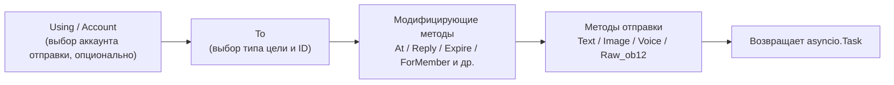
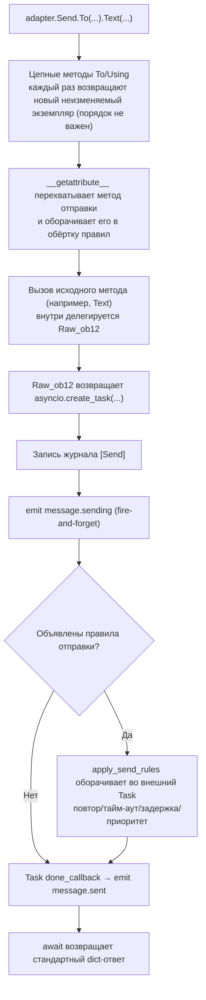

# Подробное руководство по SendDSL

> [!TIP]
> **Когда это нужно прочитать**: обязательно к прочтению в рамках пути разработки адаптеров (DSL отправки). Если это не требуется — пропустите, на использование остальных функций это не влияет.


SendDSL позволяет выполнить отправку сообщения единой цепочкой: указание цели, @ / ответ, повтор / тайм-аут / задержка, пакетная отправка — всё делается одной строкой цепного вызова. В этой статье рассматриваются методы отправки, модифицирующие методы, правила отправки и внутренние механизмы цепочки отправки.

## Базовые способы вызова

### 1. Указание типа и ID

```python
await adapter.Send.To("group", "123").Text("Hello")
```

### 2. Указание только ID

```python
await adapter.Send.To("123").Text("Hello")
```

### 3. Указание аккаунта отправки

```python
await adapter.Send.Using("bot1").Text("Hello")
```

### 4. Комбинированное использование

```python
await adapter.Send.Using("bot1").To("group", "123").Text("Hello")
```

## Цепочка методов



## Методы отправки

Все методы отправки возвращают объект `asyncio.Task`.

### Базовые методы (встроены в базовый класс)

Следующие стандартные методы уже встроены в базовый класс `SendDSL` и **по умолчанию делегируются `Raw_ob12`**; подклассы адаптеров могут использовать их напрямую без повторной реализации, а IDE обеспечивает автодополнение:

| Название метода | Описание | Возвращаемое значение |
|--------|------|---------|
| `Text(text: str)` | Отправка текстового сообщения | `asyncio.Task` |
| `Image(file: bytes \| str)` | Отправка изображения | `asyncio.Task` |
| `Voice(file: bytes \| str)` | Отправка голосового сообщения (сегмент `audio` OneBot12) | `asyncio.Task` |
| `Video(file: bytes \| str)` | Отправка видео | `asyncio.Task` |
| `File(file: bytes \| str, filename: str = None)` | Отправка файла | `asyncio.Task` |

Адаптер может переопределить отдельный стандартный метод, чтобы реализовать специфичную для платформы логику:

```python
class Send(SendDSL):
    def Raw_ob12(self, message, **kwargs):
        # Обязателен к реализации
        ...

    # Опционально: переопределение Text для платформенно-специфичной логики
    # def Text(self, text: str):
    #     return self.Raw_ob12([{"type": "text", "data": {"text": text}}])
```

### Протокольные методы

| Название метода | Описание | Возвращаемое значение | Обязателен ли |
|--------|------|---------|---------|
| `Raw_ob12(message)` | Отправка сообщения в формате OneBot12 | `asyncio.Task` | **Обязателен к реализации** |

> **Важно**: `Raw_ob12` — ключевой метод адаптера, **обязательный к реализации**. Это единая точка входа для обратного преобразования (OneBot12 → платформа). Если метод не реализован, базовый класс запишет журнал уровня error и вернёт стандартный ответ с ошибкой (`status: "failed"`, `retcode: 10002`). Стандартные методы (`Text`, `Image` и др.) по умолчанию делегируются `Raw_ob12`.

### Платформенно-специфичные методы

Адаптер может добавлять в подкласс `Send` платформенно-специфичные методы отправки (они распознаются через `event.supports()` / `event.available_methods()`):

```python
class Send(SendDSL):
    def Raw_ob12(self, message, **kwargs): ...

    # Платформенно-специфичный метод
    def Sticker(self, sticker_id: str):
        return self.Raw_ob12([{"type": "sticker", "data": {"id": sticker_id}}])
```

## Модифицирующие методы

Модифицирующие методы возвращают `self`, что позволяет использовать цепные вызовы.

### Метод At

```python
# Упоминание одного пользователя
await adapter.Send.To("group", "123").At("456").Text("Привет")

# Упоминание нескольких пользователей
await adapter.Send.To("group", "123").At("456").At("789").Text("Всем привет")
```

### Метод AtAll

```python
# Упоминание всех участников
await adapter.Send.To("group", "123").AtAll().Text("Привет всем")
```

### Метод Reply

```python
# Ответ на сообщение
await adapter.Send.To("group", "123").Reply("msg_id").Text("Текст ответа")
```

### Комбинирование модификаторов

```python
await adapter.Send.To("group", "123").At("456").Reply("msg_id").Text("Ответ на упомянутое сообщение")
```

### Платформенно-специфичные модифицирующие методы

Помимо встроенных `At`/`AtAll`/`Reply`, адаптер может определять **платформенно-специфичные модифицирующие методы**. Таким методам **достаточно возвращать `self`** — какие-либо декораторы не нужны, фреймворк распознаёт их автоматически:

- Возвращает `self` (экземпляр SendDSL) → модифицирующий метод: не запускает обёртку отправки / события жизненного цикла, цепочка продолжается
- Возвращает `Task`/`Awaitable` → метод отправки

```python
class Send(SendDSL):
    def Raw_ob12(self, message, **kwargs): ...

    # Модифицирующий метод: возвращает self, ничего не отправляет
    def Expire(self, seconds: int):
        self._expire = seconds
        return self

    def ForMember(self, user_id: str):
        self._member = user_id
        return self

    # Метод отправки: возвращает Task и зависит от состояния, заданного модифицирующими методами
    def Board(self, content: str, **kwargs):
        return self.Raw_ob12([{"type": "board", "data": {"text": content}}])
```

Использование:

```python
# Модифицирующие методы можно накладывать цепочкой друг за другом
await adapter.Send.To("group", "big").Expire(3600).ForMember("114").Board("Содержимое доски")
```

## Использование модифицирующих методов в классе-обёртке Event

> [!NOTE]
> Для функций `reply(via=)` и `event.send_chain()` требуется ErisPulse **2.7.0+**.

`event.reply()` по умолчанию предоставляет только встроенные параметры модификации, такие как `at_sender`/`at_users`/`at_all`/`quote`. Чтобы использовать платформенно-специфичные модифицирующие методы, есть два способа:

### Способ 1: параметр via метода reply()

Подходит для небольшого набора заранее известных модифицирующих методов:

```python
await event.reply("Содержимое доски", method="Board",
                  via=[("Expire", 3600), ("ForMember", "114514")])
```

`via` — это список, каждый элемент которого может иметь вид:

| Форма записи | Эквивалентный цепной вызов |
|------|-------------|
| `"Name"` | `.Name()` |
| `("Name", arg1, arg2)` | `.Name(arg1, arg2)` |
| `("Name", (arg1,), {kw: val})` | `.Name(arg1, kw=val)` |

### Способ 2: event.send_chain()

Подходит для **нескольких модифицирующих методов подряд** или **методов-действий без параметров содержимого** (например, отзыв, удаление). `send_chain()` возвращает цепочку отправки с уже настроенными `To`/`Using`, к которой можно свободно добавлять любые модифицирующие методы и методы отправки:

```python
# Платформенно-специфичный модифицирующий метод + отправка доски
await event.send_chain().Expire(3600).Board("Истечёт через час")

# Несколько модифицирующих методов подряд
await (event.send_chain()
       .Expire(3600)
       .ForMember("114514")
       .Board("Содержимое доски", content_type="markdown"))

# Встроенные модифицирующие методы также доступны
await event.send_chain().At("123").Reply("msg_id").Text("hi")

# Методы-действия без параметров содержимого
await event.send_chain().DismissBoard()
```

> `send_chain()` возвращает полноценный экземпляр SendDSL, поэтому **доступны все возможности цепочек** — не только модифицирующие методы, но и правила отправки и пакетное построение:

```python
# Правила отправки: повтор + тайм-аут + колбэк успешной отправки
await (event.send_chain()
       .Retry(3).Timeout(10)
       .Hook(lambda r: print("Отправка успешна"))
       .Text("Надёжная отправка"))

# Отложенная отправка + платформенный модификатор + доска
await event.send_chain().Defer(5).Expire(3600).Board("Отложенная доска")

# Режим пакетного построения
results = await (event.send_chain()
                 .Build()
                 .Text("Первая фраза").Image("pic.jpg").Text("Вторая фраза")
                 .send_all())
```

## Управление аккаунтами

### Метод Using

`Using()` используется для указания аккаунта, от имени которого отправляется сообщение. Переданный идентификатор сопоставляется через `_resolve_account()` со следующим приоритетом:

1. **Имя аккаунта** — ключ в конфигурации (например, `"default"`, `"bot1"`)
2. **bot_id, внедрённый во время выполнения** — идентификатор, автоматически внедряемый при конвертации события
3. **Любое строковое (str) поле** — прочие строковые поля в конфигурации
4. **Запасной вариант** — первый включённый аккаунт

```python
# Использование имени аккаунта
await adapter.Send.Using("account1").To("user", "123").Text("Hello")

# Использование bot_id (то есть self.user_id из события)
await adapter.Send.Using("bot_123").To("user", "123").Text("Hello")
```

### Метод Account

Метод `Account` эквивалентен `Using`:

```python
await adapter.Send.Account("account1").To("user", "123").Text("Hello")
```

## Асинхронная обработка

### Без ожидания результата

```python
# Сообщение отправляется в фоновом режиме
task = adapter.Send.To("user", "123").Text("Hello")

# Продолжаем выполнять другие операции
# ...
```

### С ожиданием результата

```python
# Получение результата напрямую через await
result = await adapter.Send.To("user", "123").Text("Hello")
print(f"Результат отправки: {result}")

# Сначала сохраняем Task, затем ожидаем
task = adapter.Send.To("user", "123").Text("Hello")
# ... другие операции ...
result = await task
```

## Система правил отправки

SendDSL включает набор декораторов правил отправки: правила добавляются через цепные методы и применяются единообразно при финальной отправке. Правила покрывают типовые производственные сценарии: контроль тайм-аутов, повтор при сбоях, колбэки успешной отправки, отложенная отправка, отбрасывание по приоритету, мониторинг прогресса.

Методы правил **возвращают self** (как At/AtAll/Reply) и должны вызываться перед методом отправки (Text/Image и т.д.). Правила распространяются на новые экземпляры, создаваемые `To`/`Using`/`Account`.

### Обзор методов правил

| Метод | Описание |
|--------|------|
| `.Hook(callback)` | Колбэк, выполняемый после успешной отправки (можно вызывать многократно, выполняются по порядку) |
| `.Retry(times=1)` | Автоматический повтор N раз при сбое (всего N+1 попыток с учётом первой) |
| `.Timeout(seconds)` | Тайм-аут одной отправки; при превышении текущая попытка отменяется (можно комбинировать с Retry) |
| `.Defer(seconds=1.0)` | Отложенная отправка (таймер внутри процесса, без персистентности) |
| `.Priority(level, drop_if_busy=False)` | Установка приоритета; возможно отбрасывание при перегрузке очереди |
| `.OnProgress(callback)` | Колбэк прогресса по этапам (передаётся `SendContext`) |
| `.OnError(callback)` | Колбэк ошибки при финальном сбое (срабатывает только один раз) |

### Логика после успешной отправки (Hook)

```python
# Синхронный колбэк
await (adapter.Send.To("user", "123")
       .Hook(lambda r: print(f"Отправка успешна, ID сообщения: {r['message_id']}"))
       .Text("Привет"))

# Асинхронный колбэк
async def deduct_points(result):
    await db.update(user_id="123", points=-1)

await adapter.Send.To("user", "123").Hook(deduct_points).Text("Списание баллов")
```

Hook выполняется только при финальном успехе отправки (включая успех после повторов); при сбое, тайм-ауте или отмене он не срабатывает.

### Автоматический повтор при сбое (Retry)

```python
# 2 повтора после первого сбоя, всего 3 попытки
result = await adapter.Send.To("user", "123").Retry(2).Text("С повтором")
```

Условия срабатывания повтора: исключение при отправке, тайм-аут отправки, ответ со `status == "failed"`.

### Автоматическая отмена по тайм-ауту (Timeout)

```python
# Отмена, если одна отправка превышает 10 секунд
await adapter.Send.To("user", "123").Timeout(10).Text("С тайм-аутом")

# Тайм-аут + повтор: 10 секунд на попытку, максимум 3 попытки
await adapter.Send.To("user", "123").Timeout(10).Retry(2).Text("Тайм-аут с повтором")
```

### Мониторинг прогресса (OnProgress / OnError)

```python
def on_progress(ctx):
    print(f"Этап: {ctx.stage}, попытка: {ctx.attempt + 1}/{ctx.max_attempts}, затрачено: {ctx.elapsed:.2f}s")
    if ctx.stage == "failed":
        print(f"  Ошибка: {ctx.error!r}")

async def on_error(ctx):
    await notify_admin(f"Не удалось отправить {ctx.target_id}: {ctx.error!r}")

await (adapter.Send.To("user", "123")
       .Retry(3).Timeout(10)
       .OnProgress(on_progress)
       .OnError(on_error)
       .Text("Мониторинг"))
```

Поля, которые содержит `SendContext`: `task_id`, `platform`, `method`, `target_type`, `target_id`, `bot_id`, `stage`, `attempt`, `max_attempts`, `started_at`, `finished_at`, `elapsed`, `error`, `result`, `extra`.

Возможные значения `stage`: `pending`, `sending`, `retrying`, `success`, `failed`, `timeout`, `cancelled`, `dropped`.

### Отложенная отправка (Defer)

```python
# Отправка через 5 секунд
await adapter.Send.To("user", "123").Defer(5).Text("Запоздалое сообщение")
```

> Примечание: задержка реализуется таймером внутри процесса; при перезапуске процесса она теряется, персистентность не предусмотрена.

### Приоритет и отбрасывание при перегрузке (Priority)

```python
# Низкоприоритетное сообщение, автоматически отбрасывается при накоплении очереди
result = await (adapter.Send.To("user", "123")
               .Priority(-1, drop_if_busy=True)
               .Text("Отбрасываемое уведомление"))
# Если отброшено, result["status"] == "failed"
```

Если включён `drop_if_busy`, при превышении порога числа находящихся в работе задач отправки (по умолчанию 64) отправка сразу отменяется. Глобальный порог можно настроить через `.PriorityThreshold(n)`.

### Комбинация правил и фоновое выполнение

```python
# Не блокирует основной поток — правила по-прежнему действуют
task = (adapter.Send.To("user", "123")
        .Hook(lambda r: print("Отправка успешна!"))
        .Retry(3)
        .Timeout(10)
        .OnProgress(on_progress)
        .Text("Привет"))

# Продолжаем выполнять другие операции
await handle_next_action()
```

### Распространение правил

Правила распространяются на новые экземпляры, создаваемые `To`/`Using`/`Account`, что предотвращает потерю правил в цепных вызовах:

```python
# Правила, заданные до To, также распространяются на экземпляр, созданный To
builder = adapter.Send.Retry(3).Timeout(10)
send = builder.To("user", "123")  # send по-прежнему несёт Retry(3) и Timeout(10)
await send.Text("hi")
```

Правила у разных экземпляров независимы друг от друга (список hooks глубоко копируется).

## Режим пакетного построения

Помимо режима одиночной отправки, SendDSL поддерживает режим пакетного построения: несколько методов отправки записываются в одну цепочку и единовременно выполняются в конце. Подходит для сценариев «отправить несколько сообщений одним махом».

### Вход в режим построения

Вызовите `.Build()` перед методом отправки; он возвращает `SendBuilder`. После этого методы отправки (Text/Image и т.д.) не выполняются сразу, а накапливаются как намерения отправки:

```python
results = await (adapter.Send.To("user", "123")
                 .Build()                    # Вход в режим построения
                 .Text("Первая фраза")
                 .Image("pic.jpg")
                 .Text("Вторая фраза")
                 .send_all())                # Единое выполнение
# results = [результат Text, результат Image, результат Text]
```

`.send_all()` возвращает `asyncio.Task`; после await получается список результатов (в порядке намерений).

### Параллельное и последовательное выполнение

По умолчанию выполнение **параллельное** (отправка с одновременным запуском; общее время примерно равно времени самой медленной). Чтобы гарантировать порядок доставки сообщений, вызовите `.Sequential()`:

```python
# Последовательно: отправка по порядку друг за другом
await (adapter.Send.To("group", "456")
       .Build()
       .Sequential()
       .Text("Сначала это").Text("Затем это")
       .send_all())

# Параллельно (по умолчанию, можно вызвать явно)
await (adapter.Send.To("group", "456")
       .Build()
       .Parallel()
       .Text("Параллельно 1").Text("Параллельно 2")
       .send_all())
```

### Продолжение при сбое и повтор

Пакетное выполнение использует стратегию **продолжения при сбое**: сбой одного элемента не прерывает отправку остальных. В сочетании с `.Retry()` неудавшиеся элементы автоматически повторяются (повтор применяется к отдельному элементу, а не ко всей партии):

```python
await (adapter.Send.To("user", "123")
       .Build()
       .Retry(2)                       # Каждая позиция повторяется отдельно 2 раза
       .Text("Возможен сбой").Image("Тоже возможен сбой")
       .send_all())
```

### Правила для всей партии и колбэки

Правила применяются единообразно ко всей партии:

| Метод | Описание |
|--------|------|
| `.Timeout(seconds)` | Тайм-аут одной попытки для каждой отправки |
| `.Retry(times)` | Повтор для каждой отправки отдельно (продолжение при сбое) |
| `.Defer(seconds)` | Отложенная отправка всей партии |
| `.Hook(callback)` | Срабатывает после успеха всей партии, получает список `results` |
| `.OnError(callback)` | Срабатывает при наличии сбоев в партии, получает `BatchContext` |
| `.OnProgress(callback)` | Срабатывает по завершении каждой позиции, получает `BatchContext` |

```python
def on_progress(ctx):
    print(f"Прогресс: {ctx.completed}/{ctx.total}, успешно: {ctx.succeeded}, сбоев: {ctx.failed}")

async def on_error(ctx):
    print(f"В партии {ctx.failed} сбоев")

results = await (adapter.Send.To("user", "123")
               .Build()
               .Retry(2).Timeout(10)
               .OnProgress(on_progress)
               .OnError(on_error)
               .Hook(lambda rs: print("Вся партия завершена"))
               .Text("a").Text("b").Text("c")
               .send_all())
```

`BatchContext` содержит: `task_id`, `total`, `completed`, `succeeded`, `failed`, `stage`, `results`, `errors`, `elapsed`, `extra`.

Возможные значения `stage`: `pending`, `sending`, `success` (всё успешно), `partial` (частично успешно), `failed` (всё с ошибкой).

### Наследование модификаторов и правил

Модификаторы At/AtAll/Reply и правила, заданные до `.Build()`, наследуются всей партией и применяются к каждому сообщению:

```python
await (adapter.Send.To("group", "456")
       .At("789")                        # Наследование: каждое сообщение с @789
       .Build()
       .Retry(2)                         # Наследование + добавление: повтор для каждой позиции отдельно
       .Text("@Уведомление для вас")
       .Image("объявление.jpg")
       .send_all())
```

После входа в Build всё ещё можно добавлять модификаторы (они действуют на всю партию):

```python
await (adapter.Send.To("group", "456")
       .Build()
       .At("111").At("222")             # Добавление @, применяется ко всей партии
       .Text("@нескольким")
       .send_all())
```

### Фоновое выполнение

Как и при одиночной отправке, `.send_all()` возвращает Task; можно не делать await и позволить ей выполняться в фоне:

```python
task = (adapter.Send.To("user", "123")
        .Build()
        .Hook(lambda rs: print("Пакетная отправка завершена"))
        .Text("a").Text("b")
        .send_all())

# Не блокирует основной поток
await do_something_else()
```

## Правила именования

### Именование в PascalCase

Все методы отправки используют нотацию PascalCase (UpperCamelCase):

```python
# ✅ Правильно
def Text(self, text: str):
    pass

def Image(self, file: bytes):
    pass

# ❌ Неправильно
def text(self, text: str):
    pass

def send_image(self, file: bytes):
    pass
```

### Платформенно-специфичные методы

Не рекомендуется добавлять методы с префиксом платформы:

```python
# ✅ Рекомендуется
def Sticker(self, sticker_id: str):
    pass

# ❌ Не рекомендуется
def TelegramSticker(self, sticker_id: str):
    pass
```

Вместо этого используйте метод `Raw`:

```python
# ✅ Рекомендуется
await adapter.Send.Raw_ob12([{"type": "sticker", ...}])

# ❌ Не рекомендуется
def TelegramSticker(self, ...):
    pass
```

## Внутреннее устройство цепочки отправки

За одним вызовом `await adapter.Send.To("group", "123").Text("x")` фреймворк выполняет за вас следующую цепочку действий:



**Что фреймворк делает на каждом шаге:**

| Этап | Что делает фреймворк |
|------|-------------|
| Слияние цепочки | `To`/`Using`/`Account` при каждом вызове **создают новый неизменяемый экземпляр**, наследующий уже установленные поля, поэтому `To(...).Using(...)` и `Using(...).To(...)` **эквивалентны**, порядок не важен |
| Обёртка методов | Методы отправки (`Text` и др.) перехватываются `__getattribute__` и оборачиваются; модифицирующие методы (`To`/`Using`/`At`/`Retry` и др.) **не оборачиваются**. Вложенные вызовы `Raw_ob12` защищены от повторной обёртки флагом `_in_rule_wrap` |
| Создание Task | Настоящая точка создания Task — это `asyncio.create_task()` внутри `Raw_ob12`; `Text()` лишь синхронно возвращает этот Task, **не блокируя** |
| Журнал отправки | Записывается событийный журнал `[Send] platform/method -> target` (можно отключить через `exclude_levels=["EVENT"]`) |
| `message.sending` | Срабатывает **немедленно** в режиме fire-and-forget при вызове метода отправки (только при наличии подписчиков — сначала короткая проверка `has_handlers`) |
| `message.sent` | Привязывается к `done_callback` Task — **при наличии правил покрывает итоговый результат всего процесса повторов**, без правил — само завершение исходного Task |

### Цепочка отката при разрешении аккаунта

Когда адаптер внутри вызывает `_resolve_account(account_id)`, конкретный аккаунт определяется в следующем порядке:

1. Адаптер с единственным аккаунтом (нет `AccountConfigClass`) → возврат напрямую
2. Точное совпадение имени аккаунта с `account_id`
3. Совпадение по полю `bot_id` каждого аккаунта
4. Совпадение по любому строковому (`str`) значению полей аккаунтов (кроме `enabled`/`name`)
5. Запасной вариант — первый включённый аккаунт
6. Если всё не удалось → выбрасывается `ValueError`

> Передаваемый `account_id` берётся из: явного указания в `Using()` > полей `self` события (`account_id` имеет приоритет над `user_id`, автоматически внедряется через `event.reply()`) > не указан (адаптер в качестве запасного варианта берёт первый включённый аккаунт).

### Движок правил отправки (повтор/тайм-аут/задержка)

Правила оборачиваются в новый внешний Task **после** того, как `Raw_ob12` вернёт Task, и не затрагивают основной поток. Ключевые факты:

| Правило | Описание |
|------|------|
| `Retry(n)` | Всего `n+1` попыток; **после сбоя немедленная повторная отправка, без экспоненциальной задержки** |
| `Timeout(s)` | Отмена одной отправки по тайм-ауту (`asyncio.wait_for`); если попытки не исчерпаны — повтор |
| `Defer(s)` | Задержка (sleep) перед отправкой |
| `Priority(level, drop_if_busy)` | При превышении порога накопления очереди сразу возвращает `{status:"failed", retcode:10002, message:"dropped_low_priority"}` |
| `Hook(fn)` | Выполняется по порядку только при финальном успехе |
| `on_progress` / `on_error` | Колбэки по этапам / финального сбоя |

> **Внимание**: повтор — это «немедленная повторная отправка», без интервала между попытками; если платформа ограничивает частоту запросов и требует выдержки, выполните sleep в колбэке `on_error` и повторите отправку вручную. Правила считают отправку успешной по `status == "ok"` возвращаемого dict (`retcode == 0`).

> Полная семантика формата стандартного ответа и `retcode` описана в [Спецификации ответов API](../../standards/api-response.md).

## Возвращаемые значения

### Объект Task

Все методы отправки возвращают `asyncio.Task`. Адаптеру достаточно реализовать `Raw_ob12`; стандартные методы (Text/Image и т.д.) по умолчанию делегируются ему:

```python
import asyncio

def Raw_ob12(self, message, **kwargs):
    async def _do_send():
        segments = self._apply_modifiers(message)
        return await self._adapter.call_api(
            endpoint="/send_message",
            message=segments,
            **self.send_context,
            **kwargs,
        )
    return asyncio.create_task(_do_send())

# Text/Image/Voice/Video/File унаследованы от базового класса и автоматически делегируются Raw_ob12
# При необходимости переопределить стандартный метод достаточно вернуть asyncio.Task:
# def Text(self, text: str):
#     return self.Raw_ob12([{"type": "text", "data": {"text": text}}])
```

### Стандартизированный ответ

`call_api` должна возвращать стандартизированный ответ. Рекомендуется использовать методы `make_response()` / `make_error()`:

```python
async def call_api(self, endpoint: str, **params):
    try:
        result = await self._do_api_call(endpoint, **params)
        return self.make_response(
            data=result.get("data"),
            message_id=result.get("message_id", ""),
            raw=result,
        )
    except Exception as e:
        return self.make_error(message=str(e))
```

Также поддерживается ручное построение (старый способ по-прежнему совместим):

```python
async def call_api(self, endpoint: str, **params):
    return {
        "status": "ok" or "failed",
        "retcode": 0 or error_code,
        "data": {...},
        "message_id": "msg_id" or "",
        "message": "",
        "{platform}_raw": raw_response
    }
```

## Полные примеры

### Базовое использование

```python
from ErisPulse.Core import adapter

my_adapter = adapter.get("myplatform")

# Отправка текста
await my_adapter.Send.To("user", "123").Text("Hello World!")

# Отправка изображения
await my_adapter.Send.To("group", "456").Image("https://example.com/image.jpg")

# Отправка файла
with open("document.pdf", "rb") as f:
    await my_adapter.Send.To("user", "123").File(f.read())
```

### Цепные вызовы

```python
# Упоминание пользователя + ответ
await my_adapter.Send.To("group", "456").At("789").Reply("msg123").Text("Ответ на упомянутое сообщение")

# Упоминание всех + несколько модификаторов
await my_adapter.Send.Using("bot1").To("group", "456").AtAll().Text("Объявление")
```

### Сырые сообщения и построение сообщений

`Raw_ob12` — ключевая точка входа обратного преобразования (приём сегментов сообщений OB12 → вызов API платформы), а `MessageBuilder` — инструмент цепного построения сегментов сообщений, используемый вместе с ним.

> Полную спецификацию реализации `Raw_ob12`, использование `MessageBuilder` и примеры кода смотрите в:
> - [Спецификация методов отправки §6 Спецификация обратного преобразования](../../standards/send-method-spec.md#6-反向转换规范onebot12--平台)
> - [Спецификация методов отправки §11 Построитель сообщений](../../standards/send-method-spec.md#11-消息构建器-messagebuilder)

## Связанная документация

### Продолжение пути разработки адаптеров

- [Введение в разработку адаптеров](getting-started.md) - создание адаптера
- [Ключевые концепции адаптеров](core-concepts.md) - знакомство с архитектурой адаптеров
- [Лучшие практики разработки адаптеров](best-practices.md) - разработка качественных адаптеров

### Следование официальным спецификациям

- [Спецификация методов отправки](../../standards/send-method-spec.md) - полная спецификация методов отправки (реализация `Raw_ob12` и `MessageBuilder`)