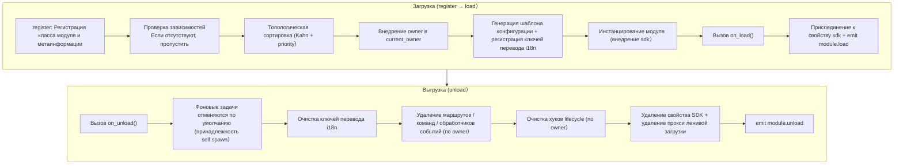

# Основные концепции модуля

> [!NOTE]
> **Обязательное чтение для уровня L1** — один из пяти основных документов в "пути чтения" на главной странице. Необходимо для разработки модуля.

В этой статье подробно описан полный жизненный цикл модуля от загрузки до выгрузки, а также способы использования декларативной конфигурации и хранилища — что делает за вас фреймворк, а что вам нужно написать самостоятельно. Прочитав статью, у вас будет полное представление.

## Жизненный цикл модуля

### Стратегия загрузки

```python
from ErisPulse.Core.Bases import BaseModule
from ErisPulse.loaders import ModuleLoadStrategy

class MyModule(BaseModule):
    @staticmethod
    def get_load_strategy():
        """Возвращает стратегию загрузки модуля"""
        return ModuleLoadStrategy(
            lazy_load=True,   # Ленивая загрузка или немедленная
            priority=0,       # Приоритет загрузки (чем больше значение, тем раньше загрузка)
            depends=["OtherModule"]  # Необязательно: объявить зависимости от других модулей
        )
```

> Если модули, перечисленные в `depends`, не зарегистрированы, текущий модуль будет пропущен и будет записано предупреждение. Порядок загрузки определяется топологической сортировкой, модули с одинаковым приоритетом сортируются по убыванию `priority`.

> [!NOTE]
> **Каскадная выгрузка / каскадная перезагрузка** (ErisPulse **2.8.0+**): при выгрузке модуля, на который ссылаются другие модули, сначала будут **каскадно выгружены** модули, которые на него ссылаются (в логах будет указан цепочка каскада); при горячей перезагрузке любого модуля (локальный плагин / модуль, зарегистрированный во время выполнения / пакет из PyPI), модули, на которые он ссылается, также **каскадно перезагружаются**, чтобы избежать использования устаревших ссылок на экземпляры. Циклические зависимости будут отклонены с `RuntimeError` при загрузке.

> **Перезагрузка = полная перезагрузка** (ErisPulse **2.11.0+**): `reload()` по умолчанию очищает кэш импорта по имени верхнего пакета и перезагружает код зависимых модулей, автоматически проверяет синтаксис перед выгрузкой (если проверка не пройдена, выгрузка отклоняется, старый экземпляр продолжает обслуживать), после успешной проверки проверяет идентичность кода (предупреждение о ложной перезагрузке / `stale` метка); при неудачной загрузке можно напрямую запросить последнюю ошибку модуля через `sdk.module.last_error(имя)` (с traceback).

### Метод on_load

Вызывается при загрузке модуля, используется для инициализации ресурсов и регистрации обработчиков событий:

```python
async def on_load(self, event):
    # Регистрация обработчика события
    @command("hello", help="Команда приветствия")
    async def hello_handler(event):
        await event.reply("Привет!")

    # Использование встроенного HTTP-клиента SDK (автоматически управляет пулом соединений, не нужно создавать сессию вручную)
    # Отправлять запросы можно через sdk.client
```

### Метод on_unload

Вызывается при выгрузке модуля, используется для очистки ресурсов:

```python
async def on_unload(self, event):
    # Очистка пользовательских ресурсов
    # sdk.client управляется фреймворком, не нужно закрывать вручную

    # Отмена обработчика события (фреймворк автоматически обрабатывает)
    self.logger.info("Модуль выгружен")
```

> Подробности о создании и очистке фоновых задач (через `self.spawn()` / фреймворк отменяет в фоне) см. в [управлении жизненным циклом](../../advanced/lifecycle.md#фоновые-задачи-принадлежность-и-автоматическая-отмена).

### Метод on_before_unload

> [!NOTE]
> Этот хук доступен только в ErisPulse **2.11.0+**.

Опциональный хук, срабатывающий на **первом этапе** выгрузки (до `on_unload` и освобождения ресурсов) — в этот момент все ресурсы модуля все еще целы, подходит для сохранения состояния в `sdk.storage` перед выгрузкой / сном / перезагрузкой, чтобы восстановить его в следующем `on_load` (продолжение состояния после ленивой загрузки основано именно на этом):

```python
async def on_before_unload(self, event):
    # event["reason"] указывает причину: unload / reload / disable / cascade / dormant
    if event["reason"] in ("reload", "dormant"):
        await self.state.aset("snapshot", self.collect_state())
```

Если хук завершается с ошибкой, это только предупреждение, не блокирует процесс выгрузки; модули, не объявляющие этот хук, ведут себя как обычно. Семантика сна / пробуждения описана в [Ленивой загрузке](../../advanced/lazy-loading.md#Ленивая-загрузка-спящее-состояние-dormant_after).

### Выгрузка и полная выгрузка (purge)

> [!NOTE]
> Эта функция доступна только в ErisPulse **2.8.0+**.

`unload()` по умолчанию **отменяет только загрузку** (выгружает экземпляр и ресурсы), но сохраняет метаданные регистрации (класс модуля и метаинформация) — модуль все еще может быть обнаружен и перезагружен с помощью `load()`, без необходимости повторной `register()`.

Если требуется **полная выгрузка** (освобождение ссылки на класс модуля, очистка `sys.modules`, чтобы плагин и его уникальные зависимости могли быть собраны сборщиком мусора), передайте `purge=True`:

```python
# Отменить только загрузку: сохранить метаданные регистрации, можно перезагрузить load()
await sdk.module.unload("MyModule")

# Полная выгрузка: удалить метаданные регистрации + очистить sys.modules (только для плагинов из папки)
await sdk.module.unload("MyModule", purge=True)
```

| Семантика | unload() по умолчанию | unload(purge=True) |
|------|-----------------|----------------------|
| Выгрузка экземпляра и ресурсов (события/задачи/маршруты/lifecycle/i18n) | ✅ | ✅ |
| Сохранение метаданных регистрации (класс модуля и метаинформация) | ✅ | ❌ Удалить |
| Очистка `sys.modules` (только для источников из папки плагинов) | ❌ | ✅ |
| Класс модуля может быть собран мусором | ❌ | ✅ |
| Перезагрузка | load() доступен напрямую | Необходимо сначала register() + load() |

> При `purge=True` зависимые модули, участвующие в каскадной выгрузке, также будут удалены. После выгрузки фреймворк выполнит `gc.collect()` и проверит, можно ли собрать класс модуля/экземпляр, наличие остаточных ссылок будет предупреждено в логах (с указанием источника, уровень DEBUG).

### Жизненный цикл в целом

Соединив все методы, фреймворк делает за вас **все, что нужно при загрузке и выгрузке модуля**:



**Что делает фреймворк за вас при загрузке** (вам нужно написать только `on_load()`, остальное делается автоматически):

| Этап | Что делает фреймворк автоматически |
|------|-------------|
| Внедрение owner | При инстанцировании модуль обернут в `owner_scope` — команды/события/хуки/фоновые задачи, зарегистрированные в `on_load`, **автоматически присоединяются к этому модулю**, при выгрузке они очищаются по owner |
| Шаблон конфигурации | Модули, объявившие `ConfigClass`, получают автоматически сгенерированный/заполненный конфигурационный раздел `ErisPulse.<ModuleName>` |
| Ключи перевода i18n | Модули, объявившие `I18nClass`, получают автоматически зарегистрированные ключи перевода (автоматически удаляются при выгрузке) |
| Зависимости | Модули сортируются по `depends`, гарантируя, что зависимые модули загружаются первыми; циклические зависимости отклоняются с `RuntimeError` |
| Присоединение SDK | После инстанцирования присоединяется к `sdk.<ModuleName>`, чтобы вы могли обращаться к `sdk.MyModule.xxx` |

**Что фреймворк очищает при выгрузке** (соответствует U1→U7 выше): после выполнения `on_unload` происходит дополнительная очистка — фоновые задачи отменяются (созданные через `self.spawn`, для корректного завершения сделайте это в `on_unload`), ключи перевода i18n, маршруты, команды/обработчики событий, хуки lifecycle, затем удаляется свойство SDK. При `purge=True` дополнительно удаляются метаданные регистрации + очищаются `sys.modules`.

> Именно эта автоматическая очистка является основой для утверждения «вам нужно написать только `on_load`/`on_unload`, не нужно вручную unregister» — фреймворк использует принадлежность owner, чтобы сделать «кто зарегистрировал, тот и очищает» однокнопочным.

## Объект SDK

### Доступ к основным модулям

```python
from ErisPulse import sdk

# Доступ к всем основным модулям через объект sdk
sdk.logger.info("Лог")
await sdk.storage.aset("key", "value")

# Состояние модуля (счетчики/флаги/время последнего запуска) предпочтительно использовать self.state —
# ключи автоматически имеют префикс module.state.<имя модуля>, состояние сохраняется при выгрузке и перезагрузке:
count = self.state.get("runs", 0) + 1
self.state.set("runs", count)            # Синхронно (в любом контексте)
await self.state.aset("runs", count)     # Асинхронный путь
await self.state.aget("runs", 0)
config = sdk.config.getConfig("MyModule")
```

### Коммуникация между модулями

```python
# Доступ к другим модулям
other_module = sdk.OtherModule
result = await other_module.some_method()
```

## Запрос методов отправки адаптера

Из-за нового стандарта, требующего использования перегрузки метода `__getattr__` для реализации механизма отправки по умолчанию, невозможно использовать метод `hasattr` для проверки существования метода. Начиная с версии `2.3.5`, добавлена возможность запроса методов отправки.

### Список поддерживаемых методов отправки

```python
# Получить список всех методов отправки, поддерживаемых платформой
methods = sdk.adapter.list_sends("onebot11")
# Возвращает: ["Text", "Image", "Voice", "Markdown", ...]
```

### Получение подробной информации о методе

```python
# Получить подробную информацию о методе
info = sdk.adapter.send_info("onebot11", "Text")
# Возвращает:
# {
#     "name": "Text",
#     "parameters": [
#         {"name": "text", "type": "str", "default": null, "annotation": "str"}
#     ],
#     "return_type": "Awaitable[Any]",
#     "docstring": "Отправка текстового сообщения..."
# }
```

## Управление конфигурацией

### Декларативная конфигурация (рекомендуется)

Начиная с версии v2.5.2, модули могут объявлять класс конфигурации через `ConfigClass`, используя ту же систему схемы конфигурации, что и адаптеры. Конфигурация читается в реальном времени через `self.cfg`, и изменения сразу применяются:

```python
from dataclasses import dataclass, field
from ErisPulse.Core.Bases import BaseModule
from ErisPulse.Core.Bases import BaseConfig

@dataclass
class MyModuleConfig(BaseConfig):
    api_key: str = field(
        default="",
        metadata={
            "description": {"i18n": "my_module.api_key", "default": "API ключ"},
            "required": True,
            "secret": True,
            "ui": {"widget": "password", "group": "basic", "order": 1},
        },
    )
    timeout: int = field(
        default=30,
        metadata={
            "description": {"i18n": "my_module.timeout", "default": "Время ожидания (секунды)"},
            "ui": {"widget": "number", "group": "advanced", "order": 2},
        },
    )

class MyModule(BaseModule):
    ConfigClass = MyModuleConfig

    def __init__(self, sdk):
        self.sdk = sdk
        self.logger = sdk.logger.get_child("MyModule")

    async def on_load(self, event):
        self.logger.info("Модуль загружен")

    async def on_unload(self, event):
        pass

    async def do_something(self):
        cfg = self.cfg  # Чтение в реальном времени, тип безопасно
        api_key = cfg.api_key
        timeout = cfg.timeout
```

`BaseConfig` — базовый класс конфигурации, подходит для адаптеров, модулей, внешних проектов и любых сценариев. Поля конфигурации поддерживают многоязычные описания i18n (см. [документацию по i18n](../../advanced/i18n.md#многоязычные-описания-конфигурационных-полей)).

> [!NOTE]
> Жизненный цикл модуля (включая адаптеры) — загрузка, выгрузка, включение, выключение и т.д. — управляется фреймворком (модульный менеджер / scope предоставляет API для запроса и управления). `ConfigClass` должен содержать только бизнес-параметры, модулю не нужно вкладывать в себя логику "должен ли он запускаться".

Система схемы конфигурации также поддерживает (начиная с v2.8.0, см. [основные концепции адаптера](../adapters/core-concepts.md#约定-metadata)):

- **Автоматическое создание описания полей из docstring**: если не объявлено `metadata description`, автоматически извлекается из docstring с помощью `:ivar поле: описание` или раздела `Attributes:`
- **Вложенные dataclass конфигурации**: при типе поля вложенный dataclass, схема/шаблон/валидация обрабатываются рекурсивно, WebUI отображает вложенные группы
- **Поле `example`, не сохраняющееся в файл**: поле с `metadata={"example": True}` не записывается в config.toml, только сохраняется в `config.full.example` (подходит для сложных и редко используемых продвинутых параметров конфигурации), пользователь вручную настраивает и сохраняет нормально

### Горячая перезагрузка конфигурации (on_config_update)

После реализации модулем и адаптером метода `on_config_update(old, new)`, фреймворк автоматически вызывает его при **фактическом изменении конфигурации, относящейся к этому модулю** (не нужно самостоятельно подписываться на события конфигурации), изменения токена / переключателя / лимитов параметров **применяются без перезапуска**:

```python
class MyModule(BaseModule):
    ConfigClass = MyModuleConfig

    def on_config_update(self, old_config, new_config):
        # При объявлении ConfigClass — тип безопасный объект конфигурации (не объявлен — dict)；
        # При вызове setConfig() в рантайме old_config будет None (только new будет иметь значение）
        if old_config is None or new_config.api_key != old_config.api_key:
            self.logger.info("API ключ обновлен, пересоздание клиента")
            self._client = build_client(new_config.api_key)
```

Источники и правила маршрутизации:

- **Запись в рантайме** (код или Dashboard вызов `setConfig()`): маршрутизация по префиксу ключа конфигурации — только запись, попадающая в ключи конфигурации этого модуля (или их подключей), вызывает обратный вызов, при этом `old_config` будет `None`
- **Редактирование файла конфигурации** (запуск по изменению файла): вызывается только при несовпадении старой и новой конфигурации, при этом `old` / `new` — объекты конфигурации до и после изменения
- Исключения, возникающие в обратном вызове, перехватываются и записываются фреймворком, не влияют на саму запись конфигурации

Использование:

- `self.cfg` — чтение в реальном времени — для простых параметров, не требующих пересоздания состояния (например, время ожидания в секундах), значение уже новое на следующей строке кода, не нужно в этом хуке вручную синхронизировать
- Для ресурсов с состоянием, требующих пересоздания (клиентское соединение, пул соединений, таймер), обработка происходит в этом хуке

### Декларативные ключи перевода (v2.7.0+)

Начиная с v2.7.0, модуль может объявлять ключи перевода, подобно `ConfigClass`, с помощью вложенного класса `I18nClass`, где все ключи перевода регистрируются автоматически при загрузке. Регистрация происходит до генерации шаблона конфигурации, гарантируя, что i18n-ключи, используемые в описании конфигурации, уже доступны.

```python
from ErisPulse.Core.Bases import BaseConfig, BaseI18n, I18nKey

class MyModule(BaseModule):
    # Класс конфигурации (опционально）
    @dataclass
    class ConfigClass(BaseConfig):
        welcome_msg: str = field(
            default="Welcome",
            metadata={
                "description": {"i18n": "mymodule.welcome_msg", "default": "Сообщение приветствия"},
            },
        )

    # Класс коллекции ключей перевода (опционально）
    class I18nClass(BaseI18n):
        # Имя атрибута автоматически объединяется в полный путь ключа: <имя модуля>.<имя атрибута>
        welcome_msg: I18nKey = I18nKey(
            default="Welcome Message",   # Языковонезависимый резервный вариант
            zh_CN="欢迎消息",
            zh_TW="歡迎訊息",
            en="Welcome Message",
            ja="ウェルカムメッセージ",
            ru="Приветственное сообщение",
        )
        hello: I18nKey = I18nKey(
            default="Hello, {name}!",
            zh_CN="你好，{name}！",
            zh_TW="你好，{name}！",
            en="Hello, {name}!",
            ja="こんにちは、{name}！",
            ru="Привет, {name}!",
        )
```

Подробнее см. [рекомендованную запись i18n](../../advanced/i18n.md#рекомендованная-запись-через-i18nclass-объявление-ключей-перевода-v270).

### Ручное чтение конфигурации (устаревшее)

> **Устаревшее**: используйте [декларативную конфигурацию](#декларативная-конфигурация-рекомендуется) + чтение `self.cfg` в реальном времени.

```python
class MyModule(BaseModule):
    def __init__(self, sdk):
        self.sdk = sdk

    def _load_config(self):
        config = self.sdk.config.getConfig("MyModule")
        if not config:
            self.sdk.config.setConfig("MyModule", {"api_key": "", "timeout": 30})
            return {"api_key": "", "timeout": 30}
        return config
```

## Система хранилища

### Основное использование

```python
# Сохранить данные
await sdk.storage.aset("user:123", {"name": "张三"})

# Получить данные
user = await sdk.storage.aget("user:123", {})

# Удалить данные
sdk.storage.delete("user:123")
```

### Использование транзакций

```python
# Использование транзакции для обеспечения согласованности данных
async with sdk.storage.atransaction():
    await sdk.storage.aset("key1", "value1")
    await sdk.storage.aset("key2", "value2")
    # Если какая-либо операция не удалась, все изменения будут откатиться
```

## Обработка событий

### Регистрация обработчиков событий

```python
from ErisPulse.Core.Event import command, message

# Регистрация команды
@command("info", help="Получить информацию")
async def info_handler(event):
    await event.reply("Это информация")

# Регистрация обработчика сообщений
@message.on_group_message()
async def group_handler(event):
    sdk.logger.info(f"Получено групповое сообщение: {event.get_text()}")
```

### Жизненный цикл обработчиков событий

Фреймворк автоматически управляет регистрацией и удалением обработчиков событий, вам нужно только зарегистрировать их в `on_load()`.

## Механизм ленивой загрузки

### Принцип работы

```python
# Модуль будет инициализирован при первом обращении
result = await sdk.my_module.some_method()
# ↑ Здесь будет вызвана инициализация модуля
```

### Немедленная загрузка

Для модулей, которые должны быть инициализированы немедленно (например, слушатели, таймеры):

```python
@staticmethod
def get_load_strategy():
    return ModuleLoadStrategy(
        lazy_load=False,  # Немедленная загрузка
        priority=100
    )
```

## Обработка ошибок

### Поймать исключение

```python
async def handle_event(self, event):
    try:
        # бизнес-логика
        await self.process_event(event)
    except ValueError as e:
        self.logger.warning(f"Ошибка параметра: {e}")
        await event.reply(f"Ошибка параметра: {e}")
    except Exception as e:
        self.logger.error(f"Обработка не удалась: {e}")
        raise
```

### Запись в лог

```python
# Использование разных уровней логирования
self.logger.debug("Отладочная информация")    # Подробная отладочная информация
self.logger.info("Статус выполнения")      # Информация о нормальном выполнении
self.logger.warning("Предупреждение")  # Предупреждение
self.logger.error("Ошибка")    # Ошибка
self.logger.critical("Критическая ошибка") # Критическая ошибка
```

## Связанные документы

### Дальнейшее обучение

- [Обертка событий](event-wrapper.md) - Подробное объяснение обработки событий

### Глубокое изучение и отладка

- [Лучшие практики модуля](best-practices.md) - Разработка качественных модулей
- [Введение в разработку модуля](getting-started.md) - Возвращение к первому шагу создания модуля