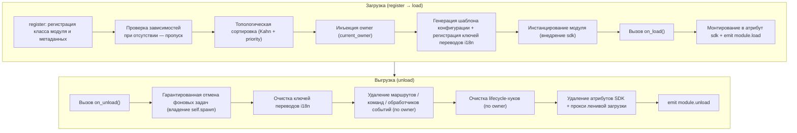

# Основные концепции модуля

> [!NOTE]
> **Обязательный к прочтению для L1** — одна из пяти основных документов в разделе "Путь чтения" на главной странице, необходима для разработки модуля.

В этой статье подробно объясняется полный жизненный цикл модуля от загрузки до выгрузки, методы объявления конфигурации и хранения данных — что делает за вас фреймворк, а что вам нужно написать самостоятельно. Прочитав статью, вы получите полное представление.

## Жизненный цикл модуля

### Стратегия загрузки

```python
from ErisPulse.Core.Bases import BaseModule
from ErisPulse.loaders import ModuleLoadStrategy

class MyModule(BaseModule):
    @staticmethod
    def get_load_strategy():
        """Возвращает стратегию загрузки модуля"""
        return ModuleLoadStrategy(
            lazy_load=True,   # ленивая или немедленная загрузка
            priority=0,       # приоритет загрузки (чем больше число, тем раньше загружается)
            depends=["OtherModule"]  # необязательно: объявление зависимостей от других модулей
        )
```

> Если модуль, указанный в `depends`, не зарегистрирован, текущий модуль будет пропущен с записью предупреждения. Порядок загрузки определяется топологической сортировкой, внутри одного уровня — по убыванию `priority`.

> [!NOTE]
> **Каскадная выгрузка / каскадная перезагрузка** (ErisPulse **2.8.0+**): при выгрузке модуля, от которого зависят другие модули, зависящие от него модули **сначала выгружаются каскадом** (в журнале описывается цепочка каскада); при горячей перезагрузке любого модуля (локальный плагин / регистрация во время выполнения / пакет, установленный через PyPI) зависящие от него модули также **перезагружаются каскадом**, чтобы зависимые модули не продолжали работу, держа недействительные ссылки на экземпляры. Циклические зависимости отклоняются при загрузке с `RuntimeError`.
>
> **reload — это полная перезагрузка** (ErisPulse **2.11.0+**): `reload()` по умолчанию очищает кэш импорта по имени верхнеуровневого пакета и повторно импортирует код зависимых модулей; перед выгрузкой автоматически выполняется предварительная проверка синтаксиса (при неудаче выгрузка отклоняется, старый экземпляр продолжает работать), после успеха сверяется идентичность кода (предупреждение о ложной перезагрузке / метка `stale`); место сбоя при загрузке можно напрямую запросить через `sdk.module.last_error(имя)` (включая traceback).

### Метод on_load

Вызывается при загрузке модуля, используется для инициализации ресурсов и регистрации обработчиков событий:

```python
async def on_load(self, event):
    # Регистрация обработчиков событий
    @command("hello", help="команда приветствия")
    async def hello_handler(event):
        await event.reply("Привет!")
    
    # Использование встроенного HTTP-клиента SDK (автоматическое управление пулом соединений, не нужно вручную создавать session)
    # Отправлять запросы можно прямо через sdk.client
```

### Метод on_unload

Вызывается при выгрузке модуля, используется для очистки ресурсов:

```python
async def on_unload(self, event):
    # Очистка пользовательских ресурсов
    # sdk.client управляется фреймворком, закрывать вручную не нужно
    
    # Отмена обработчиков событий (фреймворк обработает это автоматически)
    self.logger.info("Модуль выгружен")
```

> Создание и очистка фоновых задач (`self.spawn()` / гарантированная отмена фреймворком) подробно описаны в разделе [Управление жизненным циклом](../../advanced/lifecycle.md#принадлежность-фоновых-задач-и-автоматическая-отмена).

### Метод on_before_unload

> [!NOTE]
> Для этого хука требуется ErisPulse **2.11.0+**.

Необязательный хук, срабатывающий на **первом шаге** конвейера выгрузки (до `on_unload` и освобождения ресурсов) — в этот момент все ресурсы модуля ещё целы, поэтому удобно сохранить состояние в `sdk.storage` перед выгрузкой / уходом в спящий режим / перезагрузкой и восстановить его при следующем `on_load` (именно на этом основано возобновление состояния при спящем режиме ленивой загрузки):

```python
async def on_before_unload(self, event):
    # event["reason"] указывает причину вызова: unload / reload / disable / cascade / dormant
    if event["reason"] in ("reload", "dormant"):
        await self.state.aset("snapshot", self.collect_state())
```

Сбой хука лишь фиксируется предупреждением и не блокирует процесс выгрузки; поведение модулей, не объявивших этот хук, не меняется. Семантика перехода в спящий режим / пробуждения подробно описана в разделе [Спящий режим ленивой загрузки](../../advanced/lazy-loading.md#спящий-режим-ленивой-загрузки-dormant_after).

### Выгрузка и полное удаление (purge)

> [!NOTE]
> Для этой функции требуется ErisPulse **2.8.0+**.

По умолчанию `unload()` только **отменяет загрузку** (выгружает экземпляр и ресурсы), но сохраняет заглушку регистрации (класс модуля и метаданные) — модуль по-прежнему может быть заново обнаружен через discover и повторно инстанцирован через `load()` без повторного `register()`.

Когда требуется **полное удаление** (освобождение ссылок на класс модуля, очистка `sys.modules`, чтобы плагин и его эксклюзивные зависимости могли быть собраны GC), передайте `purge=True`:

```python
# Только отмена загрузки: заглушка регистрации сохраняется, можно в любой момент заново выполнить load()
await sdk.module.unload("MyModule")

# Полное удаление: удаление заглушки регистрации + очистка sys.modules (источник — плагин)
await sdk.module.unload("MyModule", purge=True)
```

| Семантика | `unload()` по умолчанию | `unload(purge=True)` |
|------|-----------------|----------------------|
| Выгрузка экземпляра и ресурсов (события/task/маршруты/lifecycle/i18n) | ✅ | ✅ |
| Сохранение заглушки регистрации (класс модуля и метаданные) | ✅ | ❌ удаляется |
| Очистка `sys.modules` (только для модулей из папки плагина) | ❌ | ✅ |
| Класс модуля может быть собран GC | ❌ | ✅ |
| Повторная загрузка | `load()` доступна сразу | Сначала требуется `register()` + `load()` |

> При `purge=True` зависимые модули, выгруженные каскадом, также подвергаются purge; после выгрузки фреймворк вызывает `gc.collect()` и проверяет, поддаются ли сборке класс/экземпляр модуля — оставшиеся ссылки фиксируются предупреждением в журнале (с указанием держателей ссылок, уровень DEBUG).

### Полная картина жизненного цикла

Соединяя описанные выше методы воедино — **всё, что фреймворк делает для вас за кулисами** при загрузке и выгрузке модуля:



**Что фреймворк делает за вас при загрузке** (вам достаточно написать `on_load`, всё остальное выполняется автоматически):

| Этап | Что фреймворк делает автоматически |
|------|-------------|
| Инъекция owner | Во время инстанцирования имя модуля оборачивается в `owner_scope` — команды/события/хуки/фоновые задачи, зарегистрированные в вашем `on_load`, **автоматически принадлежат данному модулю**; при выгрузке они очищаются по owner в один клик |
| Шаблон конфигурации | Для модулей с объявленным `ConfigClass` фреймворк автоматически генерирует/заполняет секцию конфигурации `ErisPulse.<ModuleName>` |
| Ключи переводов i18n | Для модулей с объявленным `I18nClass` ключи переводов регистрируются автоматически (при выгрузке автоматически отменяются) |
| Топология зависимостей | Сортировка согласно объявлениям `depends`, гарантирующая, что модули-зависимости загружаются первыми; циклические зависимости отклоняются с `RuntimeError` |
| Монтирование SDK | После инстанцирования модуль монтируется в `sdk.<ModuleName>`, благодаря чему вы можете обращаться к нему через `sdk.MyModule.xxx` |

**Что фреймворк очищает за вас при выгрузке** (соответствует U1→U7 выше): после завершения `on_unload` выполняется гарантированная очистка — принудительная отмена фоновых задач (созданных через `self.spawn`; аккуратное завершение делайте сами в `on_unload`), ключей i18n, маршрутов, обработчиков команд/событий, lifecycle-хуков, и в конце удаляются атрибуты SDK. При `purge=True` дополнительно удаляется заглушка регистрации + очищается `sys.modules`.

> Именно эта автоматическая очистка даёт уверенность, что «достаточно написать `on_load`/`on_unload`, ручной unregister не нужен» — фреймворк через принадлежность owner превратил принцип «кто зарегистрировал — тот и очищает» в действие одним шагом.

## Объект SDK

### Доступ к основным модулям

```python
from ErisPulse import sdk

# Доступ ко всем основным модулям через объект sdk
sdk.logger.info("Лог")
sdk.storage.set("key", "value")

# Для собственного малого состояния модуля (счётчики/переключатели/время последнего запуска) предпочтительно использовать self.state —
# ключи автоматически получают префикс module.state.<имя модуля>. и сохраняются после выгрузки и перезагрузки модуля:
count = self.state.get("runs", 0) + 1
self.state.set("runs", count)            # синхронно (в любом контексте)
await self.state.aset("runs", count)     # асинхронный путь
await self.state.aget("runs", 0)
config = sdk.config.getConfig("MyModule")
```

### Взаимодействие между модулями

```python
# Доступ к другим модулям
other_module = sdk.OtherModule
result = await other_module.some_method()
```

## Методы отправки адаптера

В связи с новым стандартным требованием использовать перегрузку метода `__getattr__` для реализации метода отправки по умолчанию, невозможно использовать `hasattr` для проверки наличия метода. Начиная с версии `2.3.5`, добавлена функция для проверки методов отправки.

### Список поддерживаемых методов отправки

```python
# Вывести список всех методов отправки, поддерживаемых платформой
methods = sdk.adapter.list_sends("onebot11")
# Возвращает: ["Text", "Image", "Voice", "Markdown", ...]
```

### Получение подробной информации о методе

```python
# Получить подробную информацию о методе
info = sdk.adapter.send_info("onebot11", "Text")
# Возвращает:
# {
#     "name": "Text",
#     "parameters": [
#         {"name": "text", "type": "str", "default": null, "annotation": "str"}
#     ],
#     "return_type": "Awaitable[Any]",
#     "docstring": "Отправка текстового сообщения..."
# }
```

## Управление конфигурацией

### Объявленная конфигурация (рекомендуется)

Начиная с версии v2.5.2, модуль может объявить класс конфигурации с помощью `ConfigClass`, используя ту же систему схемы конфигурации, что и адаптер. Конфигурация читается в реальном времени через `self.cfg`, изменения применяются немедленно:

```python
from dataclasses import dataclass, field
from ErisPulse.Core.Bases import BaseModule
from ErisPulse.Core.Bases import BaseConfig

@dataclass
class MyModuleConfig(BaseConfig):
    api_key: str = field(
        default="",
        metadata={
            "description": {"i18n": "my_module.api_key", "default": "Ключ API"},
            "required": True,
            "secret": True,
            "ui": {"widget": "password", "group": "basic", "order": 1},
        },
    )
    timeout: int = field(
        default=30,
        metadata={
            "description": {"i18n": "my_module.timeout", "default": "Время ожидания (секунды)"},
            "ui": {"widget": "number", "group": "advanced", "order": 2},
        },
    )

class MyModule(BaseModule):
    ConfigClass = MyModuleConfig

    def __init__(self, sdk):
        self.sdk = sdk
        self.logger = sdk.logger.get_child("MyModule")

    async def on_load(self, event):
        self.logger.info("Модуль загружен")

    async def on_unload(self, event):
        pass

    async def do_something(self):
        cfg = self.cfg  # Чтение в реальном времени, тип безопасно
        api_key = cfg.api_key
        timeout = cfg.timeout
```

`BaseConfig` — универсальный базовый класс конфигурации, применим для адаптеров, модулей, внешних проектов и любых сценариев. Поля конфигурации поддерживают многоязычные описания i18n (см. [документацию по i18n](../../advanced/i18n.md#многоязычные-описания-полей-конфигурации)).

> [!NOTE]
> Жизненный цикл модуля (включая адаптеры) — загрузка, выгрузка, запуск, остановка и т.д. — управляется фреймворком (модульный менеджер / scope предоставляет API для запроса и управления). `ConfigClass` должен содержать только бизнес-параметры, модули не должны вкладывать логику "нужно ли запускать себя" внутри.

Система схемы конфигурации также поддерживает (начиная с v2.8.0, см. [основные понятия адаптера](../adapters/core-concepts.md#约定-metadata)):

- **Автоматическое создание описания полей из docstring**: если `metadata` `description` не объявлен, автоматически извлекается из docstring `:ivar поле: описание` или раздела `Attributes:`
- **Вложенные dataclass конфигурации**: при типе поля вложенный dataclass, схема/шаблон/валидация обрабатываются рекурсивно, веб-интерфейс отображает вложенные группы
- **Поле `example`, не сохраняющееся на диск**: поле с `metadata={"example": True}` не записывается в config.toml, только сохраняется в `config.full.example` (подходит для сложных, редко используемых настроек), пользователь может вручную установить и сохранить как обычное поле

### Объявленные ключи перевода (v2.7.0+)

Начиная с v2.7.0, модуль может объявить ключи перевода, как и `ConfigClass`, с помощью вложенного класса `I18nClass`. Фреймворк автоматически регистрирует все объявленные ключи перевода при загрузке, без необходимости вызова `i18n.register()`, и регистрация происходит до генерации шаблона конфигурации, гарантируя, что ключи перевода, используемые в описании конфигурации, уже доступны.

```python
from ErisPulse.Core.Bases import BaseConfig, BaseI18n, I18nKey

class MyModule(BaseModule):
    # Класс конфигурации (необязательно)
    @dataclass
    class ConfigClass(BaseConfig):
        welcome_msg: str = field(
            default="Добро пожаловать",
            metadata={
                "description": {"i18n": "mymodule.welcome_msg", "default": "Сообщение приветствия"},
            },
        )

    # Класс набора ключей перевода (необязательно)
    class I18nClass(BaseI18n):
        # Имя атрибута автоматически объединяется в полный ключ пути: <имя модуля>.<имя атрибута>
        welcome_msg: I18nKey = I18nKey(
            default="Welcome Message",   # Безопасный запасной текст без привязки к языку
            zh_CN="欢迎消息",
            zh_TW="歡迎訊息",
            en="Welcome Message",
            ja="ウェルカムメッセージ",
            ru="Приветственное сообщение",
        )
        hello: I18nKey = I18nKey(
            default="Hello, {name}!",
            zh_CN="你好，{name}！",
            zh_TW="你好，{name}！",
            en="Hello, {name}!",
            ja="こんにちは、{name}！",
            ru="Привет, {name}!",
        )
```

Подробнее см. [Рекомендуемый способ написания i18n](../../advanced/i18n.md#рекомендуемый-способ-объявления-ключей-перевода-через-i18nclass-v270).

### Ручное чтение конфигурации (устарело)

> **Устарело**: используйте [объявленную конфигурацию](#объявленная-конфигурация-рекомендуется) + чтение `self.cfg` в реальном времени.

```python
class MyModule(BaseModule):
    def __init__(self, sdk):
        self.sdk = sdk

    def _load_config(self):
        config = self.sdk.config.getConfig("MyModule")
        if not config:
            self.sdk.config.setConfig("MyModule", {"api_key": "", "timeout": 30})
            return {"api_key": "", "timeout": 30}
        return config
```

## Система хранения

### Основное использование

```python
# Сохранить данные
sdk.storage.set("user:123", {"name": "张三"})

# Получить данные
user = sdk.storage.get("user:123", {})

# Удалить данные
sdk.storage.delete("user:123")
```

### Использование транзакций

```python
# Использовать транзакцию для обеспечения согласованности данных
with sdk.storage.transaction():
    sdk.storage.set("key1", "value1")
    sdk.storage.set("key2", "value2")
    # Если любая операция завершится с ошибкой, все изменения будут отменены
```

## Обработка событий

### Регистрация обработчиков событий

```python
from ErisPulse.Core.Event import command, message

# Регистрация команды
@command("info", help="Получить информацию")
async def info_handler(event):
    await event.reply("Это информация")

# Регистрация обработчика сообщений
@message.on_group_message()
async def group_handler(event):
    sdk.logger.info(f"Получено групповое сообщение: {event.get_text()}")
```

### Жизненный цикл обработчиков событий

Фреймворк автоматически управляет регистрацией и удалением обработчиков событий, вам нужно только зарегистрировать их в `on_load`.

## Механизм ленивой загрузки

### Принцип работы

```python
# Модуль инициализируется только при первом обращении
result = await sdk.my_module.some_method()
# ↑ Здесь будет инициирована инициализация модуля
```

### Немедленная загрузка

Для модулей, требующих немедленной инициализации (например, триггеры, таймеры):

```python
@staticmethod
def get_load_strategy():
    return ModuleLoadStrategy(
        lazy_load=False,  # Немедленная загрузка
        priority=100
    )
```

## Обработка ошибок

### Перехват исключений

```python
async def handle_event(self, event):
    try:
        # Бизнес-логика
        await self.process_event(event)
    except ValueError as e:
        self.logger.warning(f"Ошибка параметра: {e}")
        await event.reply(f"Ошибка параметра: {e}")
    except Exception as e:
        self.logger.error(f"Обработка не удалась: {e}")
        raise
```

### Запись в лог

```python
# Использование разных уровней логирования
self.logger.debug("Отладочная информация")    # Подробная отладочная информация
self.logger.info("Состояние работы")      # Информация о нормальной работе
self.logger.warning("Предупреждение")  # Предупреждение
self.logger.error("Ошибка")    # Ошибка
self.logger.critical("Критическая ошибка") # Критическая ошибка
```

## Связанные документы

### Продолжение пути обучения

- [Объект события](event-wrapper.md) - Подробности обработки событий

### Глубокое изучение и отладка

- [Лучшие практики модуля](best-practices.md) - Разработка высококачественных модулей
- [Введение в разработку модуля](getting-started.md) - Повторный просмотр шагов по созданию первого модуля