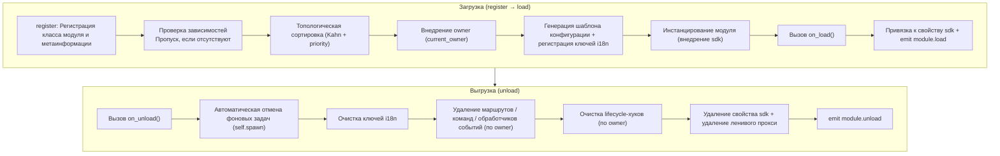

# Основные концепции модулей

> [!NOTE]
> **Обязательное чтение уровня L1** — один из пяти ключевых документов в «пути чтения» на главной странице, необходим для разработки модулей.


В этой статье подробно описывается полный жизненный цикл модуля от загрузки до выгрузки, а также использование декларативной конфигурации и хранилища — что фреймворк делает за вас автоматически и что вам нужно написать самостоятельно. После прочтения у вас сложится ясное представление.

## Жизненный цикл модуля

### Стратегия загрузки

```python
from ErisPulse.Core.Bases import BaseModule
from ErisPulse.loaders import ModuleLoadStrategy

class MyModule(BaseModule):
    @staticmethod
    def get_load_strategy():
        """Возвращает стратегию загрузки модуля"""
        return ModuleLoadStrategy(
            lazy_load=True,   # Загрузка "ленивая" или немедленная
            priority=0,       # Приоритет загрузки (чем больше значение, тем раньше загрузка)
            depends=["OtherModule"]  # Опционально: объявление зависимых модулей
        )
```

> Модули, объявленные в `depends`, будут пропущены при загрузке и в логе будет выдано предупреждение, если они не зарегистрированы. Порядок загрузки определяется топологической сортировкой, а при равных приоритетах модули сортируются по убыванию `priority`.

> [!NOTE]
> **Каскадное выгрузка / каскадное перезагрузка** (ErisPulse **2.8.0+**): При выгрузке модуля, который используется другими модулями, модули, зависящие от него, будут **сначала выгружены каскадно** (в логе будет указан цепочка выгрузки); при горячей перезагрузке любого модуля (локальный плагин / модуль, зарегистрированный во время выполнения / пакет из PyPI), модули, зависящие от него, также будут **каскадно перезагружены**, чтобы избежать использования устаревших экземпляров. Циклические зависимости будут отклонены с `RuntimeError` при загрузке.

> **Перезагрузка = полная перезагрузка** (ErisPulse **2.11.0+**): `reload()` по умолчанию очищает кэш импорта по имени пакета и перезагружает код зависимых модулей, автоматически проверяет синтаксис кода перед выгрузкой (в случае ошибки выгрузка отклоняется, старый экземпляр продолжает обслуживать), после успешной перезагрузки проверяется идентичность кода (предупреждение о ложной перезагрузке / `stale` метка); если загрузка не удалась, можно получить информацию об ошибке с помощью `sdk.module.last_error(имя)` (включая traceback).

### Метод on_load

Вызывается при загрузке модуля, используется для инициализации ресурсов и регистрации обработчиков событий:

```python
async def on_load(self, event):
    # Регистрация обработчика события
    @command("hello", help="Команда приветствия")
    async def hello_handler(event):
        await event.reply("Привет!")

    # Использование встроенного HTTP-клиента SDK (автоматически управляет пулом соединений, не нужно создавать session вручную)
    # Отправлять запросы можно через sdk.client
```

### Метод on_unload

Вызывается при выгрузке модуля, используется для очистки ресурсов:

```python
async def on_unload(self, event):
    # Очистка пользовательских ресурсов
    # sdk.client управляется фреймворком, закрывать вручную не нужно
    
    # Отмена обработчика события (фреймворк обрабатывает автоматически)
    self.logger.info("Модуль выгружен")
```

> Создание и очистка фоновых задач (через `self.spawn()` / автоматическая отмена фреймворком) см. в [управлении жизненным циклом](../../advanced/lifecycle.md#задачи-фонового-выполнения-и-автоматическая-отмена).

### Метод on_before_unload

> [!NOTE]
> Этот хук доступен в ErisPulse **2.11.0+**.

Опциональный хук, срабатывающий на **первом шаге** процесса выгрузки (до `on_unload` и освобождения ресурсов) — в этот момент все ресурсы модуля еще доступны, и можно сохранить состояние в `sdk.storage`, чтобы восстановить его при следующем `on_load` (используется для продолжения состояния при ленивой загрузке):

```python
async def on_before_unload(self, event):
    # event["reason"] указывает причину: unload / reload / disable / cascade / dormant
    if event["reason"] in ("reload", "dormant"):
        await self.sdk.storage.aset(f"{self._module_name}:state", self.collect_state())
```

Если хук завершится с ошибкой, будет выдано предупреждение, но процесс выгрузки не будет прерван; модули, не имеющие этого хука, будут работать как обычно. Семантика "засыпания" / "пробуждения" см. в [Ленивой загрузке](../../advanced/lazy-loading.md#засыпание-модуля-dormant_after).

### Выгрузка и полная выгрузка (purge)

> [!NOTE]
> Эта функция доступна в ErisPulse **2.8.0+**.

`unload()` по умолчанию **только отменяет загрузку** (выгружает экземпляр и ресурсы), но оставляет метаданные регистрации (класс модуля и метаинформацию) — модуль можно снова обнаружить и перезагрузить с помощью `load()` без повторной `register()`.

Для **полной выгрузки** (освобождение ссылок на класс модуля, очистка `sys.modules`, чтобы плагин и его уникальные зависимости могли быть собраны сборщиком мусора) нужно передать `purge=True`:

```python
# Только отмена загрузки: оставляются метаданные регистрации, можно перезагрузить load()
await sdk.module.unload("MyModule")

# Полная выгрузка: удаляются метаданные регистрации + очистка sys.modules (только для плагинов из папки)
await sdk.module.unload("MyModule", purge=True)
```

| Семантика | `unload()` по умолчанию | `unload(purge=True)` |
|----------|--------------------------|----------------------|
| Выгрузка экземпляра и ресурсов (события/task/маршруты/lifecycle/i18n) | ✅ | ✅ |
| Сохранение метаданных регистрации (класс модуля и метаинформация) | ✅ | ❌ Удалено |
| Очистка `sys.modules` (только для плагинов из папки) | ❌ | ✅ |
| Класс модуля может быть собран сборщиком мусора | ❌ | ✅ |
| Перезагрузка | `load()` можно использовать напрямую | Необходимо сначала `register()` + `load()` |

> При `purge=True` зависимые модули, которые также выгружаются каскадно, будут удалены полностью; после выгрузки фреймворк выполнит `gc.collect()` и проверит, могут ли класс и экземпляр модуля быть собраны, остаточные ссылки будут выданы в логе (с указанием источника, уровень DEBUG).

### Жизненный цикл в целом

Собрав все методы воедино, вот **все действия, которые фреймворк выполняет за вас** при загрузке и выгрузке модуля:



**Что делает фреймворк при загрузке** (вам нужно только написать `on_load()`, остальное делается автоматически):

| Этап | Что делает фреймворк автоматически |
|------|------------------------------------|
| Внедрение owner | При инстанцировании модуль оборачивается в `owner_scope`, все команды/события/хуки/фоновые задачи, зарегистрированные в `on_load`, **автоматически привязываются к модулю** и при выгрузке удаляются по owner |
| Шаблон конфигурации | Модули, объявленные с `ConfigClass`, получают автоматически сгенерированный/заполненный `ErisPulse.<ModuleName>` |
| Ключи i18n | Модули, объявленные с `I18nClass`, автоматически регистрируют ключи переводов (удаляются при выгрузке) |
| Зависимости | Модули сортируются по `depends`, чтобы модули, от которых зависят, загружались первыми; циклические зависимости отклоняются с `RuntimeError` |
| Привязка к SDK | После инстанцирования модуль привязывается к `sdk.<ModuleName>`, чтобы вы могли обращаться к `sdk.MyModule.xxx` |

**Что делает фреймворк при выгрузке** (соответствует U1→U7): После выполнения `on_unload()` происходит автоматическая очистка — фоновые задачи, созданные через `self.spawn`, отменяются (для грациозного завершения их нужно обрабатывать в `on_unload`), ключи i18n, маршруты, команды/обработчики событий, lifecycle-хуки, затем удаляется свойство SDK. При `purge=True` дополнительно удаляются метаданные регистрации и `sys.modules`.

> Именно эта автоматическая очистка обеспечивает то, что **вам нужно только писать `on_load`/`on_unload`, а не вручную unregister** — фреймворк использует привязку owner, чтобы "кто зарегистрировал, тот и очищает" стало одно-клик-операцией.

## Объект SDK

### Доступ к основным модулям

```python
from ErisPulse import sdk

# Доступ к основным модулям через объект sdk
sdk.logger.info("Лог")
sdk.storage.set("key", "value")
config = sdk.config.getConfig("MyModule")
```

### Коммуникация между модулями

```python
# Доступ к другим модулям
other_module = sdk.OtherModule
result = await other_module.some_method()
```

## Методы отправки адаптера

Из-за нового стандарта, требующего перезаписи метода `__getattr__` для реализации механизма отправки по умолчанию, невозможно использовать `hasattr` для проверки существования метода. Начиная с версии `2.3.5`, добавлена функция для запроса методов отправки.

### Список поддерживаемых методов отправки

```python
# Вывод всех поддерживаемых методов отправки платформы
methods = sdk.adapter.list_sends("onebot11")
# Возвращает: ["Text", "Image", "Voice", "Markdown", ...]
```

### Получение подробной информации о методе

```python
# Получение подробной информации о методе
info = sdk.adapter.send_info("onebot11", "Text")
# Возвращает:
# {
#     "name": "Text",
#     "parameters": [
#         {"name": "text", "type": "str", "default": null, "annotation": "str"}
#     ],
#     "return_type": "Awaitable[Any]",
#     "docstring": "Отправка текстового сообщения..."
# }
```

## Управление конфигурацией

### Декларативная конфигурация (рекомендуется)

Начиная с версии `v2.5.2`, модули могут объявлять класс конфигурации через `ConfigClass`, используя ту же систему схемы конфигурации, что и адаптеры. Конфигурация доступна через `self.cfg` в режиме реального времени, изменения применяются немедленно:

```python
from dataclasses import dataclass, field
from ErisPulse.Core.Bases import BaseModule
from ErisPulse.Core.Bases import BaseConfig

@dataclass
class MyModuleConfig(BaseConfig):
    api_key: str = field(
        default="",
        metadata={
            "description": {"i18n": "my_module.api_key", "default": "API ключ"},
            "required": True,
            "secret": True,
            "ui": {"widget": "password", "group": "basic", "order": 1},
        },
    )
    timeout: int = field(
        default=30,
        metadata={
            "description": {"i18n": "my_module.timeout", "default": "Время ожидания (секунд)"},
            "ui": {"widget": "number", "group": "advanced", "order": 2},
        },
    )

class MyModule(BaseModule):
    ConfigClass = MyModuleConfig

    def __init__(self, sdk):
        self.sdk = sdk
        self.logger = sdk.logger.get_child("MyModule")

    async def on_load(self, event):
        self.logger.info("Модуль загружен")

    async def on_unload(self, event):
        pass

    async def do_something(self):
        cfg = self.cfg  # Чтение в режиме реального времени, типобезопасно
        api_key = cfg.api_key
        timeout = cfg.timeout
```

`BaseConfig` — универсальный базовый класс конфигурации, подходит для адаптеров, модулей, внешних проектов и любых сценариев. Поля конфигурации поддерживают многоязычные описания с помощью i18n (см. [документацию по i18n](../../advanced/i18n.md#многоязычные-описания-конфигурационных-полей)).

> [!NOTE]
> Жизненный цикл модуля (включая адаптеры) — загрузка, выгрузка, запуск, остановка и т.д. — управляется фреймворком (модульный менеджер / scope предоставляет API для запроса и управления). `ConfigClass` должен содержать только бизнес-параметры, модулю не нужно вкладывать внутрь логику "нужно ли запускать себя".

Система схемы конфигурации также поддерживает (с версии `v2.8.0`, см. [основные концепты адаптера](../adapters/core-concepts.md#метаданные-оговорка)):

- **Автоматическое создание описания полей из docstring**: Если `description` не объявлен в `metadata`, автоматически извлекается из docstring через `:ivar поле: описание` или раздел `Attributes:`
- **Вложенные dataclass конфигурации**: Если тип поля — вложенный dataclass, схема/шаблон/валидация обрабатываются рекурсивно, веб-интерфейс отображает вложенные группы
- **Поле `example`, не сохраняющееся в файл**: Поле с `metadata={"example": True}` не записывается в `config.toml`, сохраняется только в `config.full.example` (подходит для сложных, редко используемых расширенных настроек), пользователь вручную настраивает и сохраняет как обычное

### Декларативные ключи перевода (v2.7.0+)

Начиная с версии `v2.7.0`, модули могут объявлять ключи перевода так же, как и `ConfigClass`, используя вложенный класс `I18nClass` для централизованного объявления. Фреймворк **автоматически регистрирует** все объявленные ключи перевода при загрузке, без необходимости вызывать `i18n.register()` вручную, и регистрация происходит раньше, чем генерируется шаблон конфигурации, гарантируя, что ключи перевода, используемые в описании конфигурации, уже доступны.

```python
from ErisPulse.Core.Bases import BaseConfig, BaseI18n, I18nKey

class MyModule(BaseModule):
    # Класс конфигурации (опционально)
    @dataclass
    class ConfigClass(BaseConfig):
        welcome_msg: str = field(
            default="Добро пожаловать",
            metadata={
                "description": {"i18n": "mymodule.welcome_msg", "default": "Сообщение приветствия"},
            },
        )

    # Класс набора ключей перевода (опционально)
    class I18nClass(BaseI18n):
        # Имя атрибута автоматически объединяется в полный путь ключа: <имя_модуля>.<имя_атрибута>
        welcome_msg: I18nKey = I18nKey(
            default="Welcome Message",   # Безязыковой резервный вариант
            zh_CN="Добро пожаловать",
            zh_TW="Добро пожаловать",
            en="Welcome Message",
            ja="Добро пожаловать",
            ru="Приветственное сообщение",
        )
        hello: I18nKey = I18nKey(
            default="Hello, {name}!",
            zh_CN="Привет, {name}!",
            zh_TW="Привет, {name}!",
            en="Hello, {name}!",
            ja="Привет, {name}!",
            ru="Привет, {name}!",
        )
```

Подробнее см. [Рекомендуемый способ i18n](../../advanced/i18n.md#рекомендуемый-способ-объявление-ключей-перевода-через-i18nclass-v270).

### Ручное чтение конфигурации (устарело)

> **Устарело**: используйте [декларативную конфигурацию](#декларативная-конфигурация-рекомендуется) + `self.cfg` для чтения в режиме реального времени.

```python
class MyModule(BaseModule):
    def __init__(self, sdk):
        self.sdk = sdk

    def _load_config(self):
        config = self.sdk.config.getConfig("MyModule")
        if not config:
            self.sdk.config.setConfig("MyModule", {"api_key": "", "timeout": 30})
            return {"api_key": "", "timeout": 30}
        return config
```

## Система хранения

### Основное использование

```python
# Сохранение данных
sdk.storage.set("user:123", {"name": "Чжан Сань"})

# Получение данных
user = sdk.storage.get("user:123", {})

# Удаление данных
sdk.storage.delete("user:123")
```

### Использование транзакций

```python
# Использование транзакции для обеспечения согласованности данных
with sdk.storage.transaction():
    sdk.storage.set("key1", "value1")
    sdk.storage.set("key2", "value2")
    # Если любая операция не удалась, все изменения будут отменены
```

## Обработка событий

### Регистрация обработчиков событий

```python
from ErisPulse.Core.Event import command, message

# Регистрация команды
@command("info", help="Получить информацию")
async def info_handler(event):
    await event.reply("Это информация")

# Регистрация обработчика сообщений
@message.on_group_message()
async def group_handler(event):
    sdk.logger.info(f"Получено групповое сообщение: {event.get_text()}")
```

### Жизненный цикл обработчиков событий

Фреймворк автоматически управляет регистрацией и удалением обработчиков событий, вам нужно только зарегистрировать их в `on_load`.

## Механизм ленивой загрузки

### Принцип работы

```python
# Модуль будет инициализирован при первом обращении
result = await sdk.my_module.some_method()
# ↑ Здесь будет вызвана инициализация модуля
```

### Немедленная загрузка

Для модулей, которые должны быть инициализированы немедленно (например, слушатели, таймеры):

```python
@staticmethod
def get_load_strategy():
    return ModuleLoadStrategy(
        lazy_load=False,  # Немедленная загрузка
        priority=100
    )
```

## Обработка ошибок

### Перехват исключений

```python
async def handle_event(self, event):
    try:
        # Бизнес-логика
        await self.process_event(event)
    except ValueError as e:
        self.logger.warning(f"Ошибка параметра: {e}")
        await event.reply(f"Ошибка параметра: {e}")
    except Exception as e:
        self.logger.error(f"Обработка не удалась: {e}")
        raise
```

### Запись в лог

```python
# Использование разных уровней логирования
self.logger.debug("Отладочная информация")    # Подробная отладочная информация
self.logger.info("Состояние выполнения")      # Информация о нормальном выполнении
self.logger.warning("Предупреждение")  # Предупреждающие сообщения
self.logger.error("Ошибка")    # Сообщения об ошибках
self.logger.critical("Критическая ошибка") # Критические ошибки
```

## Связанная документация

### Продолжение обучения

- [Класс-обёртка Event](event-wrapper.md) - Подробное руководство по обработке событий

### Углублённое изучение и устранение неполадок

- [Лучшие практики разработки модулей](best-practices.md) - Разработка высококачественных модулей
- [Начало разработки модулей](getting-started.md) - Повторный обзор шагов по созданию первого модуля
- [Руководство по устранению неполадок модулей](../module-troubleshooting.md) - Поиск и устранение проблем, когда поведение модуля не соответствует ожиданиям