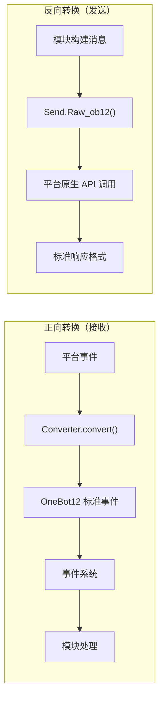
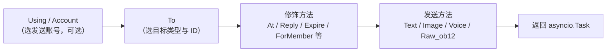
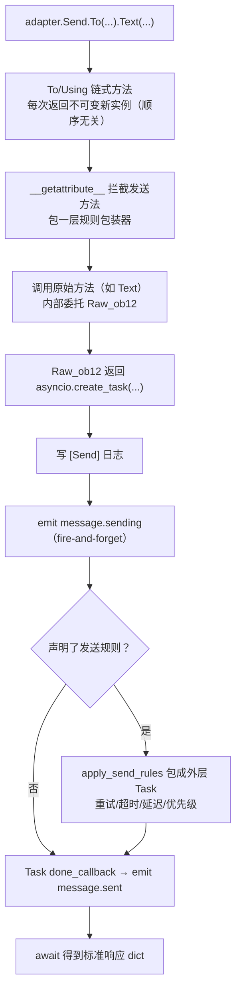

# ErisPulse 适配器开发

本技能由 ErisPulse 文档自动构建（generate-skills.py）。
仓库：https://github.com/ErisPulse/ErisPulse
各节末尾标注了来源文档路径，需要最新内容请以仓库 docs/zh-CN/ 为准。

## 内容大纲

AI 按需读取：只读需要的章节即可，不必全文加载。

- 适配器开发入门: 83-92 行
- 适配器简介: 94-117 行
- 目录结构: 119-132 行
- 快速开始: 134-464 行
- 本地开发（免打包）: 466-498 行
- 依赖声明（可选，2.8.0+）: 500-534 行
- `__init__` 注意事项: 536-744 行
- 适配器核心概念: 746-755 行
- 适配器架构: 757-796 行
- AdapterManager 适配器管理器: 798-1031 行
- BaseAdapter 基类: 1033-1422 行
- Send 消息发送 DSL: 1424-1495 行
- 事件转换器: 1497-1568 行
- 连接管理: 1570-1758 行
- API 响应标准: 1760-1792 行
- 多账户支持: 1794-1865 行
- 错误处理: 1867-1919 行
- Bot 状态管理: 1921-1981 行
- 发送 DSL: 1983-1993 行
- 基本调用方式: 1995-2019 行
- 方法链: 2021-2029 行
- 发送方法: 2031-2079 行
- 修饰方法: 2081-2145 行
- 在 Event 包装类中使用修饰方法: 2147-2209 行
- 账户管理: 2211-2236 行
- 异步处理: 2238-2261 行
- 发送规则系统: 2263-2386 行
- 批量构建模式（Build）: 2388-2511 行
- 命名规范: 2513-2558 行
- 发送链路内部拆解: 2560-2618 行
- 返回值: 2620-2675 行
- 完整示例: 2677-2723 行
- 转换器: 2725-2735 行
- Converter 职责: 2737-2749 行
- BaseConverter 基类（推荐）: 2751-2797 行
- convert() 方法: 2799-2839 行
- 必填字段映射: 2841-2867 行
- 消息段转换: 2869-2899 行
- alt_message 渲染约定: 2901-2921 行
- 平台扩展字段: 2923-2944 行
- 完整示例: 2946-3026 行
- 富媒体消息转换示例: 3028-3075 行
- 常见陷阱: 3077-3119 行
- 最佳实践: 3121-3137 行
- 适配器最佳实践: 3139-3149 行
- Bot 状态管理与 Meta 事件: 3151-3248 行
- 连接管理: 3250-3365 行
- 事件转换: 3367-3419 行
- SendDSL 实现: 3421-3482 行
- API 响应: 3484-3533 行
- 多账户支持: 3535-3595 行
- 错误处理: 3597-3649 行
- 测试: 3651-3695 行
- 反向转换与消息构建: 3697-3705 行
- 平台事件方法扩展: 3707-3759 行
- 文档维护: 3761-3768 行
- 基本信息: 3770-3772 行
- 支持的消息发送类型: 3774-3775 行
- 特有事件类型: 3777-3778 行
- 配置选项: 3780-3801 行
- 平台接入指南索引: 3803-3820 行
- 平台特定功能: 3822-3846 行
- 通用接口: 3848-4028 行
- 标准格式: 4030-4086 行
- 参考链接: 4088-4098 行
- 参与贡献: 4100-4109 行

## 适配器开发入门

> 来源: `docs/zh-CN/developer-guide/adapters/getting-started.md`（https://github.com/ErisPulse/ErisPulse/blob/main/docs/zh-CN/developer-guide/adapters/getting-started.md）

# 适配器开发入门

> [!TIP]
> **什么时候需要读这篇**：适配器开发路径的入口篇（必读）。从零写一个适配器、了解适配器的职责边界与项目结构都在这里；读完后再按需进入 [事件转换器](converter.md) 与 [SendDSL 详解](send-dsl.md)。

跟着这篇走完，你会得到一个能收事件、发消息的最小可用适配器（主类 + 转换器 + Send），并清楚每个部件的职责边界——接入一个新平台的所有工作都从这里展开。

## 适配器简介

### 什么是适配器

适配器是 ErisPulse 与各个消息平台之间的桥梁，负责：

1. **正向转换**：接收平台事件并转换为 OneBot12 标准格式（Converter）
2. **反向转换**：将 OneBot12 消息段转换为平台 API 调用（`Raw_ob12`）
3. 管理与平台的连接（WebSocket/WebHook）
4. 提供统一的 SendDSL 消息发送接口

### 适配器架构



## 目录结构

标准的适配器包结构：

```
MyAdapter/
├── pyproject.toml          # 项目配置
├── README.md               # 项目说明
├── LICENSE                 # 许可证
└── MyAdapter/
    ├── __init__.py          # 包入口
    ├── Core.py               # 适配器主类
    └── Converter.py          # 事件转换器
```

## 快速开始

### 1. 创建项目

推荐直接用脚手架生成完整骨架（含 pyproject、主类、转换器）：

```bash
# 标准项目（打包发布用）
epsdk create adapter -n MyAdapter

# 本地适配器插件（免打包，放入 plugins/ 目录即可被自动加载，见下方"本地开发"）
epsdk create adapter -n MyAdapter --local
```

脚手架默认生成 WebSocket 服务端骨架；平台连接方式不同时可经 `--template`
选择通信模式模板（生成即用对应的半成品基类，`start`/`shutdown` 都不需要自己写）：

```bash
epsdk create adapter -n MyAdapter --template polling   # HTTP 轮询型（getUpdates 拉取）
epsdk create adapter -n MyAdapter --template webhook   # HTTP 回调型（平台推送）
```

> 三种连接模式的差异与半成品基类的最小实现面见
> [适配器核心概念 - 连接模式半成品基类](core-concepts.md#连接模式半成品基类)。
> 完整可运行示例参考仓库 `examples/example-adapter-polling/` 与 `examples/example-adapter-webhook/`。

也可以手动创建：

```bash
mkdir MyAdapter && cd MyAdapter
```

### 2. 创建 pyproject.toml

```toml
[project]
name = "ErisPulse-MyAdapter"
version = "1.0.0"
description = "MyAdapter平台适配器"
readme = "README.md"
requires-python = ">=3.10"
license = { file = "LICENSE" }
authors = [ { name = "yourname", email = "your@mail.com" } ]

dependencies = [
    "ErisPulse>=2.4.0"  # ErisPulse 已内置 aiohttp，通常无需单独依赖
]

[project.urls]
"homepage" = "https://github.com/yourname/MyAdapter"

[project.entry-points."erispulse.adapter"]
"MyAdapter" = "MyAdapter:MyAdapter"
```

### 3. 创建适配器主类

框架提供了 `ConfigClass` / `AccountConfigClass` 声明式配置管理，适配器只需声明配置类即可自动加载、校验和生成配置模板。

```python
# MyAdapter/Core.py
from dataclasses import dataclass, field
# 推荐根导入（2.10+）：常用符号直接从根包导入，深路径仍兼容
from ErisPulse import BaseAdapter, BaseConfig

@dataclass
class MyAdapterConfig(BaseConfig):
    """MyAdapter 配置"""
    api_endpoint: str = field(
        default="https://api.example.com",
        metadata={
            "description": {"i18n": "my_adapter.api_endpoint", "default": "API 地址"},
            "required": False,
            "ui": {"widget": "text", "group": "connection", "order": 1},
        },
    )
    token: str = field(
        default="",
        metadata={
            "description": {"i18n": "my_adapter.token", "default": "平台 Token"},
            "required": True,
            "secret": True,
            "ui": {"widget": "password", "group": "basic", "order": 2},
        },
    )

class MyAdapter(BaseAdapter):
    ConfigClass = MyAdapterConfig  # 声明配置类，框架自动管理
    
    # 不需要覆写 __init__！框架自动处理：
    # - self.sdk / self.logger 自动设置
    # - self.cfg 实时读取配置
    # - self.Send / self.Request 自动初始化
    
    def _setup_converter(self):
        from .Converter import MyPlatformConverter
        return MyPlatformConverter()
```

> ⚠️ **关于 `__init__`**：新版本中 `BaseAdapter.__init__(self, sdk=None)` 会自动处理 SDK 引用、日志初始化和配置加载。大多数适配器**不再需要覆写 `__init__`**。详见 [__init__ 注意事项](#init-注意事项)。

> ⚠️ **关于 `super().__init__()`**：`BaseAdapter.__init__()` 负责创建 `Send` 和 `Request` 工厂实例。如果忘记调用，所有消息发送和请求操作都会报 `AttributeError`。详见 [__init__ 注意事项](#init-注意事项)。

### 4. 实现必需方法

```python
class MyAdapter(BaseAdapter):
    # ... __init__ 代码 ...
    
    async def start(self):
        """启动适配器（必须实现）"""
        # 注册 WebSocket 或 WebHook 路由
        router.register_websocket(
            module_name="myplatform",
            path="/ws",
            handler=self._ws_handler
        )
        self.logger.info("适配器已启动")
    
    async def shutdown(self):
        """关闭适配器（必须实现）"""
        router.unregister_websocket(
            module_name="myplatform",
            path="/ws"
        )
        # 清理连接和资源
        self.logger.info("适配器已关闭")
    
    async def call_api(self, endpoint: str, **params):
        """调用平台 API（必须实现）"""
        raise NotImplementedError("需要实现 call_api")
```

#### 主动发送 Meta 事件

适配器应主动发送 meta 事件，让框架追踪 Bot 的在线状态。使用 `emit_meta()` 一行即可完成：

```python
class MyAdapter(BaseAdapter):
    async def _ws_handler(self, websocket):
        bot_id = self._get_bot_id()

        # Bot 上线
        await self.emit_meta("connect", bot_id, user_name="MyBot")

        try:
            while True:
                data = await websocket.receive_text()
                event = self.convert(data)
                if event:
                    await self.adapter.emit(event)
        except WebSocketDisconnect:
            pass
        finally:
            # Bot 下线
            await self.emit_meta("disconnect", bot_id)
```

> 详细的 Bot 状态管理和 Meta 事件说明请参阅 [适配器最佳实践 - Bot 状态管理](best-practices.md#bot-状态管理与-meta-事件)。

### 5. 实现 Send 类

`At`/`AtAll`/`Reply` 修饰器已由框架 SendDSL 基类内置实现，适配器只需实现 `Raw_ob12` 和具体的发送方法即可。

框架提供两个关键辅助方法：
- `self._apply_modifiers(message)` — 自动合并 At/AtAll/Reply 修饰器到消息段
- `self.send_context` — 获取发送上下文字典（`target_type`、`target_id`、`account_id`）

```python
import asyncio

class MyAdapter(BaseAdapter):
    # ... 其他代码 ...

    class Send(BaseAdapter.Send):

        def Raw_ob12(self, message, **kwargs):
            """
            发送 OneBot12 格式消息（必须实现）

            使用 _apply_modifiers 自动合并修饰器状态，
            使用 send_context 获取发送上下文。
            """
            async def _do_send():
                segments = self._apply_modifiers(message)
                return await self._adapter.call_api(
                    endpoint="/send_message",
                    message=segments,
                    **self.send_context,
                    **kwargs
                )
            return asyncio.create_task(_do_send())

        # Text/Image/Voice/Video/File 已从 SendDSL 基类继承，
        # 默认委托给 Raw_ob12，无需重复实现。
        # 如需平台特定逻辑，可覆盖单个方法：
        # def Text(self, text: str):
        #     return self.Raw_ob12([{"type": "text", "data": {"text": text}}])
```

**媒体类发送方法（Image/Video/File）实现要点：**

- 基类的默认实现会将 `file` 参数封装为 OneBot12 消息段传给 `Raw_ob12`，适配器需在 `Raw_ob12` 中处理下载/上传
- `file` 参数应同时支持 `bytes` 二进制数据和 `str` URL 两种类型
- 当传入 URL 时，需先下载文件再上传到平台
- 平台通常需要先调用上传接口获取文件标识，再调用发送接口

**`__getattr__` 魔术方法：**

- 实现方法名大小写不敏感（`Text`、`text`、`TEXT` 都能调用）
- 未定义的方法应返回提示信息而非报错

**`Raw_ob12` 方法：**

- 将 OneBot12 标准消息格式转换为平台格式发送
- 使用 `self._apply_modifiers(message)` 自动处理 At/AtAll/Reply 修饰器
- 使用 `**self.send_context` 传递发送目标信息和账号信息

### 6. 实现转换器

```python
# MyAdapter/Converter.py
import time
import uuid

class MyPlatformConverter:
    def convert(self, raw_event):
        """将平台原生事件转换为 OneBot12 标准格式"""
        if not isinstance(raw_event, dict):
            return None
        
        onebot_event = {
            "id": str(raw_event.get("event_id", uuid.uuid4())),
            "time": int(time.time()),
            "type": self._convert_event_type(raw_event.get("type")),
            "detail_type": self._convert_detail_type(raw_event),
            "platform": "myplatform",
            "self": {
                "platform": "myplatform",
                "user_id": str(raw_event.get("bot_id", ""))
            },
            "myplatform_raw": raw_event,
            "myplatform_raw_type": raw_event.get("type", "")
        }
        
        return onebot_event
    
    def _convert_event_type(self, event_type):
        """转换事件类型"""
        type_map = {
            "message": "message",
            "notice": "notice"
        }
        return type_map.get(event_type, "unknown")
    
    def _convert_detail_type(self, raw_event):
        """转换详细类型"""
        return "private"  # 简化示例
```

### 7. 实现 Request 类（请求操作）

如果你的平台支持好友请求、群邀请等需要 Bot 做出决策的请求，可以实现 `Request` 内部类：

```python
from ErisPulse import BaseAdapter, RequestDSL

class MyAdapter(BaseAdapter):
    # ... Send 和其他代码 ...

    class Request(RequestDSL):
        """请求操作实现（好友请求、群邀请等）"""

        def accept(self, **kwargs):
            """同意请求"""
            async def _do():
                result = await self._adapter.call_api(
                    endpoint="/set_request",
                    request_id=self._request_id,
                    approve=True,
                    **kwargs,
                )
                return {
                    "status": "ok" if result.get("code") == 0 else "failed",
                    "retcode": result.get("code", 0),
                    "data": None,
                    "message_id": "",
                    "message": result.get("message", ""),
                }
            return self._create_task(_do())

        def reject(self, **kwargs):
            """拒绝请求"""
            async def _do():
                result = await self._adapter.call_api(
                    endpoint="/set_request",
                    request_id=self._request_id,
                    approve=False,
                    **kwargs,
                )
                return {
                    "status": "ok" if result.get("code") == 0 else "failed",
                    "retcode": result.get("code", 0),
                    "data": None,
                    "message_id": "",
                    "message": result.get("message", ""),
                }
            return self._create_task(_do())
```

模块开发者使用方式：

```python
from ErisPulse import request

@request.on_friend_request()
async def handle_friend_request(event):
    # 通过 Event 便捷方法
    await event.approve()
    # 或通过适配器直接操作
    await adapter.myplatform.Request("req_id").accept()
```

> 如果平台不支持请求操作，可以不实现 `Request` 内部类。基类默认返回 `retcode=10002`（不支持的操作）。详见 [请求操作规范](../../standards/request-action-spec.md)。

### 8. 创建包入口

```python
# MyAdapter/__init__.py
from .Core import MyAdapter
```

## 本地开发（免打包）

与模块一致，适配器也可以放入项目的本地插件目录（默认 `plugins/`，可通过 `ErisPulse.framework.plugins_dir` 配置）直接开发，**无需 `pip install -e .`**：

```bash
# 生成本地适配器插件
epsdk create adapter -n MyAdapter --local
# 生成结构：
# plugins/
# └── MyAdapter/
#     ├── __init__.py
#     ├── Core.py
#     └── Converter.py
```

框架启动时自动扫描插件目录并加载其中的模块与适配器（与 entry-point 安装包同等待遇：启用状态、配置声明、热更新、卸载清理全部一致）：

- **识别规则**：包目录（含 `__init__.py`）或单 `.py` 文件均可；优先识别 `Main` 命名类，否则取插件内首个 `BaseAdapter` / `BaseModule` 子类
- **同名覆盖**：本地插件与 PyPI 安装的适配器同名时，本地插件优先（便于覆盖调试）
- **热重载**：`sdk.enable_plugin_hot_reload()` 开启的插件目录监控同样覆盖适配器；适配器代码级热重载自 2.11 提供——`await sdk.adapter.reload("平台名")` 或 `await sdk.reload_adapter("平台名")`（语法预检 → 卸载清理 → 清缓存重导 → 重新注册拉起，失败自动回滚；详见[架构概览](../../architecture.md)）

### 从本地插件到发布

本地验证完成后，用 `pack` 子命令把插件一键转换为可发布的标准项目（交互式选择插件、补全元信息，生成含 entry-point 的 pyproject）：

```bash
epsdk create pack
# 选择插件目录中的插件 → 输入项目名/描述/作者 → 生成 MyAdapter/ 项目目录
cd MyAdapter
pip install -e .   # 转为标准安装；随后按发布流程上传 PyPI
```

> **提示**：转换完成后建议移除 `plugins/` 中的原件，避免本地插件与安装包重复加载（两者同名时本地优先，会让你误以为安装包生效）。

## 依赖声明（可选，2.8.0+）


适配器可以声明对其它适配器或模块的依赖，实现适配器间联动与可选功能：

```python
from typing import ClassVar

class MyAdapter(BaseAdapter):
    # 硬依赖：缺失时跳过启动（警告 + status=skipped-dependency 事件）
    depends: ClassVar[dict] = {
        "adapters": ["onebot11"],   # 依赖的适配器（按平台名）
        "modules": ["TranslateEngine"],  # 依赖的模块（按注册名）
    }
    # 软依赖：缺失不影响启动；模块加载/卸载时收到回调（可选功能模式）
    optional_modules: ClassVar[list] = ["TranslateEngine"]
```

- **启动顺序**：声明了模块硬依赖的适配器会**推迟到模块初始化完成后**再启动
- **软依赖通知**：`optional_modules`（或模块硬依赖）中的模块被加载时调用 `on_dependency_ready(module_name)`；被卸载时调用 `on_dependency_lost(module_name)`（默认空实现，可覆写）——覆盖晚加载与热重载场景：

```python
async def on_dependency_ready(self, module_name):
    """软依赖模块就绪：启用对应可选功能"""
    if module_name == "TranslateEngine":
        self._translate = self.sdk.TranslateEngine

async def on_dependency_lost(self, module_name):
    """软依赖模块丢失：降级功能"""
    if module_name == "TranslateEngine":
        self._translate = None
```

> [!NOTE]
> 本特性需要 ErisPulse **2.8.0+**。

## `__init__` 注意事项

适配器开发中有三个层面可能涉及 `__init__` 重写。以下是每个层面的正确做法。

### 1. BaseAdapter 层（大多数情况不需要重写）

`BaseAdapter.__init__(self, sdk=None)` 负责创建 `Send` / `Request` 工厂实例，并自动完成以下工作：

- 接受 `sdk` 参数并设置 `self.sdk`、`self.logger`
- 如果声明了 `ConfigClass`，可通过 `self.cfg` 实时读取全局配置
- 如果声明了 `AccountConfigClass`，可通过 `self.accounts` 实时读取多账户配置

**大多数情况下不需要覆写 `__init__`**，只需声明 `ConfigClass` 即可：

```python
class MyAdapter(BaseAdapter):
    ConfigClass = MyAdapterConfig  # 声明后框架自动管理配置
    
    async def start(self):
        cfg = self.cfg  # 类型安全，实时读取
        ...
```

如果确实需要自定义初始化，调用 `super().__init__(sdk)` 即可：

```python
class MyAdapter(BaseAdapter):
    ConfigClass = MyAdapterConfig
    
    def __init__(self, sdk=None):
        super().__init__(sdk)  # 传入 sdk
        self.converter = self._setup_converter()
        self.convert = self.converter.convert
```

### 2. Send 内部类（大多数情况不需要重写）

`SendDSL.__init__` 负责链式调用的状态传递（目标类型、目标ID、账号等）。**大多数情况下，你只需要重写方法**（`Raw_ob12`、`Text` 等），不需要重写 `__init__`。

如果确实需要（比如初始化平台特有的状态），**必须透传所有参数**：

```python
class MyAdapter(BaseAdapter):
    class Send(BaseAdapter.Send):
        # 参数：adapter, target_type, target_id, account_id
        def __init__(self, adapter, target_type=None, target_id=None, account_id=None):
            super().__init__(adapter, target_type, target_id, account_id)  # ← 必须透传
            self._my_state = None  # 平台特有初始化
```

**为什么必须透传？** 链式调用的每一步都通过 `self.__class__(...)` 创建新实例：

```python
adapter.Send.To("user", "123")               # → Send(adapter, "user", "123", None)
adapter.Send.To("user", "123").Using("bot1")  # → Send(adapter, "user", "123", "bot1")
```

如果 `__init__` 签名不匹配或没调 `super()`，链式调用就会中断。

### 3. Request 内部类（大多数情况不需要重写）

与 Send 同理。参数为 `adapter`, `request_id`, `account_id`：

```python
class MyAdapter(BaseAdapter):
    class Request(RequestDSL):
        # 参数：adapter, request_id, account_id
        def __init__(self, adapter, request_id=None, account_id=None):
            super().__init__(adapter, request_id, account_id)  # ← 必须透传
            self._my_state = None  # 平台特有初始化
```

### 总结

| 层面 | 什么时候重写 | 必须做的事 |
|------|------------|-----------|
| **BaseAdapter** | 需要自定义初始化逻辑时 | `super().__init__(sdk)` （传入 sdk 参数） |
| **Send 内部类** | 需要初始化发送相关状态时 | `super().__init__(adapter, target_type, target_id, account_id)` |
| **Request 内部类** | 需要初始化请求相关状态时 | `super().__init__(adapter, request_id, account_id)` |
| 三个层面 | 大多数情况 | **声明 ConfigClass 即可，不碰 `__init__`** |

### 9. 连接信息与路由发现

适配器注册路由后，框架会记录所有路由信息。用户可以通过以下 API 查看适配器的连接地址：

```python
from ErisPulse import sdk

# 获取适配器完整连接信息
info = sdk.adapter.get_connection_info("myplatform")
# {
#   "platform": "myplatform",
#   "status": "started",
#   "connection": {
#     "base_url": "http://localhost:8080",
#     "http_routes": [
#       {"path": "/myplatform/webhook", "method": "POST",
#        "url": "http://localhost:8080/myplatform/webhook"}
#     ],
#     "websocket_routes": [
#       {"path": "/myplatform/ws",
#        "url": "ws://localhost:8080/myplatform/ws"}
#     ]
#   }
# }

# 列出所有命名空间（适配器/模块）的路由
namespaces = sdk.router.list_namespaces()
# {"myplatform": {"http": ["/myplatform/webhook"], "websocket": ["/myplatform/ws"]}}

# 获取命名空间的完整连接 URL
urls = sdk.router.get_module_urls("myplatform")
# {"base_url": "http://localhost:8080", "http": [...], "websocket": [...]}

# 获取命名空间的详细路由信息
routes = sdk.router.get_module_routes("myplatform")
# {"http": [{"path": "/myplatform/webhook", "methods": ["POST"]}],
#  "websocket": [{"path": "/myplatform/ws", "auth": false}]}
```

> **提示**：`get_connection_info()` 返回的信息适合展示给用户（如 WebUI），帮助用户配置平台侧的回调地址或 WebSocket 连接地址。路由注册时的 `module_name` 必须与适配器在 ErisPulse 中注册的 `platform` 名称完全一致，否则路由发现将无法正确关联。

### 10. SSE (Server-Sent Events) 支持

ErisPulse 内置了服务器无关的 SSE 支持，模块和适配器可以通过 `@sdk.router.sse()` 注册 SSE 端点。

#### 基本使用

```python
import asyncio
from ErisPulse import sdk

@sdk.router.sse("MyModule", "/events")
async def event_stream(sse):
    """推送 SSE 事件"""
    count = 0
    while not sse.closed:
        await sse.send({"count": count}, event="update")
        count += 1
        await asyncio.sleep(1)
```

#### 使用请求参数

处理器可以声明 `request` 参数来访问客户端请求信息：

```python
@sdk.router.sse("MyModule", "/events")
async def event_stream(request, sse):
    token = request.query_params.get("token")
    if not validate_token(token):
        await sse.close()
        return

    while not sse.closed:
        data = await fetch_data(token)
        await sse.send(data)
        await asyncio.sleep(5)
```

#### SseEmitter API

| 方法 | 说明 |
|------|------|
| `sse.send(data, event=None, id=None, retry=None)` | 发送 SSE 事件。非 str 的 data 自动 JSON 序列化 |
| `sse.close()` | 优雅关闭 SSE 连接（安全调用，可多次） |
| `sse.closed` | 连接是否已关闭 |
| `sse.request` | 底层请求对象（可用于读取 query params、headers） |

#### 在 RouteGroup 中使用

```python
api = sdk.router.group("MyModule", "/api", version="1")

@api.sse("/events")
async def events(sse):
    await sse.send({"msg": "hello"})
```

#### 路由发现

SSE 路由会自动出现在路由发现 API 中：

```python
# list_namespaces 会包含 "sse" 键
sdk.router.list_namespaces()
# {"MyModule": {"http": [...], "websocket": [...], "sse": ["/MyModule/events"]}}

# get_module_routes 会标记 streaming: true
sdk.router.get_module_routes("MyModule")
# {"http": [...], "websocket": [...], "sse": [{"path": "/MyModule/events", "streaming": true}]}

# get_module_urls 会生成完整 URL
sdk.router.get_module_urls("MyModule")
# {"sse": [{"path": "/MyModule/events", "url": "http://localhost:8080/MyModule/events"}]}
```

> **服务器无关设计**：`SseEmitter` 通过回调与底层 HTTP 框架解耦。框架提供了 `register_sse()` 和 `@sse` 装饰器作为统一的注册入口，适配器无需直接依赖任何底层 HTTP 框架即可实现 SSE 端点。

### 补齐适配器的三大件

- [事件转换器](converter.md) - 平台事件 → OneBot12 的实现细节与常见陷阱
- [SendDSL 详解](send-dsl.md) - 消息发送链、修饰方法与发送规则
- [适配器核心概念](core-concepts.md) - BaseAdapter / 生命周期 / 多账户的机制说明

### 骨架跑通之后

- [适配器最佳实践](best-practices.md) - 连接重试、心跳、错误处理的工程化收尾
- [发布与模块商店指南](../publishing.md) - 发布到 PyPI 与模块商店

## 适配器核心概念

> 来源: `docs/zh-CN/developer-guide/adapters/core-concepts.md`（https://github.com/ErisPulse/ErisPulse/blob/main/docs/zh-CN/developer-guide/adapters/core-concepts.md）

# 适配器核心概念

> [!TIP]
> **什么时候需要读这篇**：适配器开发路径内必读（BaseAdapter / SendDSL / 生命周期等核心机制的完整说明）。只想起步可先读 [适配器开发入门](getting-started.md)，遇到"为什么"层面的疑问再回到本篇查阅。

这篇解释适配器的运行机制：AdapterManager 如何注册与分发事件、`BaseAdapter` 在初始化时替你做了什么、配置与多账户怎么声明——写适配器时遇到"为什么要这样写"的疑问，来这里查。

## 适配器架构

### 组件关系

```
正向转换（接收方向）                           反向转换（发送方向）
─────────────────                           ─────────────────
                                             
┌──────────────────┐                        ┌──────────────────┐
│ 平台原生事件     │                        │ 模块构建消息     │
└────────┬─────────┘                        └────────┬─────────┘
         │                                           │
         ↓                                           ↓
┌──────────────────┐   ┌──────────────────┐   ┌──────────────────┐
│                  │   │ 适配器 (MyAdapter) │   │                  │
│  Converter       │   │ ┌──────────────┐ │   │ Send.Raw_ob12()  │
│  (事件转换器)    │──→│ │              │ │   │ (反向转换入口)   │
│                  │   │ │              │ │   │                  │
└──────────────────┘   │ └──────────────┘ │   └────────┬─────────┘
                       └──────────────────┘            │
                                │                      ↓
                                ↓              ┌──────────────────┐
                       ┌──────────────────┐    │ 平台 API 调用    │
                       │ OneBot12 标准事件 │    └────────┬─────────┘
                       └────────┬─────────┘             │
                                │                      ↓
                                ↓              ┌──────────────────┐
                       ┌──────────────────┐    │ 标准响应格式     │
                       │ 事件系统         │    └──────────────────┘
                       └────────┬─────────┘
                                │
                                ↓
                       ┌──────────────────┐
                       │ 模块 (处理事件)  │
                       └──────────────────┘
```

**核心对称性**：
- **正向转换**（Converter）：平台原生事件 → OneBot12 标准事件，原始数据保留在 `{platform}_raw`
- **反向转换**（Raw_ob12）：OneBot12 消息段 → 平台 API 调用，返回标准响应格式

## AdapterManager 适配器管理器

`AdapterManager` 是 ErisPulse 适配器系统的核心组件，负责管理所有平台适配器的注册、启动、关闭和事件分发。

### 核心功能

- **适配器注册**：注册和管理多个平台适配器
- **生命周期管理**：控制适配器的启动和关闭
- **事件分发**：分发 OneBot12 标准事件和平台原生事件
- **配置管理**：管理适配器的启用/禁用状态
- **中间件支持**：支持 OneBot12 事件中间件

### 基本使用

```python
from ErisPulse import sdk

# 注册适配器（通常由 Loader 自动完成）
sdk.adapter.register("myplatform", MyPlatformAdapter)

# 启动所有适配器
await sdk.adapter.startup()

# 启动指定适配器
await sdk.adapter.startup(["myplatform"])
# 启动全部适配器
await sdk.adapter.startup()

# 获取适配器实例
my_adapter = sdk.adapter.get("myplatform")
# 或通过属性访问
my_adapter = sdk.adapter.myplatform

# 关闭所有适配器
await sdk.adapter.shutdown()
```

### 启动和关闭

#### 启动适配器

```python
# 启动所有已注册的适配器
await sdk.adapter.startup()

# 启动指定平台
await sdk.adapter.startup(["platform1", "platform2"])
```

**启动流程：**

1. 提交 `adapter.start` 生命周期事件
2. 提交 `adapter.status.change` 事件（starting）
3. 并行启动各个适配器
4. 如果启动失败，自动重试（指数退避策略）
5. 启动成功后提交 `adapter.status.change` 事件（started）

**重试机制：**

- 前 4 次重试：60秒、10分钟、30分钟、60分钟
- 第 5 次及以后：3 小时固定间隔

#### 关闭适配器

```python
# 关闭所有适配器
await sdk.adapter.shutdown()
```

**关闭流程：**

1. 提交 `adapter.stop` 生命周期事件
2. 调用所有适配器的 `shutdown()` 方法
3. 关闭路由服务器
4. 清空事件处理器
5. 提交 `adapter.stopped` 生命周期事件

### 配置管理

#### 检查平台状态

```python
# 检查平台是否已注册
exists = sdk.adapter.exists("myplatform")

# 检查平台是否启用
enabled = sdk.adapter.is_enabled("myplatform")

# 使用 in 操作符
if "myplatform" in sdk.adapter:
    print("平台存在且已启用")
```

#### 列出平台

```python
# 列出所有已注册的平台
platforms = sdk.adapter.list_registered()

# 列出所有平台及其状态
status_dict = sdk.adapter.list_items()
# 返回: {"platform1": true, "platform2": false, ...}

# 获取已启用的平台列表
enabled_platforms = [p for p, enabled in status_dict.items() if enabled]
```

### 事件监听

#### OneBot12 标准事件

```python
from ErisPulse import sdk

# 监听所有平台的标准消息事件
@sdk.adapter.on("message")
async def handle_message(data):
    print(f"收到OneBot12消息: {data}")

# 监听特定平台的标准消息事件
@sdk.adapter.on("message", platform="myplatform")
async def handle_platform_message(data):
    print(f"收到 myplatform 消息: {data}")

# 监听所有事件
@sdk.adapter.on("*")
async def handle_any_event(data):
    print(f"收到事件: {data.get('type')}")
```

#### 平台原生事件

```python
# 监听特定平台的原生事件
@sdk.adapter.on("raw_event_type", raw=True, platform="myplatform")
async def handle_raw_event(data):
    print(f"收到原生事件: {data}")

# 监听所有平台的原生事件（通配符）
@sdk.adapter.on("*", raw=True)
async def handle_all_raw_events(data):
    print(f"收到原生事件: {data}")
```

#### 事件分发机制

当调用 `adapter.emit(event_data)` 时：

1. **中间件处理**：先执行所有 OneBot12 中间件
2. **标准事件分发**：分发到匹配的 OneBot12 事件处理器
3. **原生事件分发**：如果存在原始数据，分发到原生事件处理器

**匹配规则：**

- 精确匹配：`@sdk.adapter.on("message")` 只匹配 `message` 事件
- 通配符：`@sdk.adapter.on("*")` 匹配所有事件
- 平台过滤：`platform="myplatform"` 只分发指定平台的事件

### 中间件

#### 添加中间件

```python
@sdk.adapter.middleware
async def logging_middleware(data):
    """日志记录中间件"""
    print(f"处理事件: {data.get('type')}")
    return data  # 必须返回数据

@sdk.adapter.middleware
async def filter_middleware(data):
    """事件过滤中间件"""
    # 过滤不需要的事件
    if data.get("type") == "notice":
        return None  # 返回 None 时中间件链会忽略该返回值，保留原数据继续传递
    return data  # 必须返回数据以继续传递
```

#### 中间件返回契约

| 返回值 | 行为 |
|--------|------|
| `dict` | 改写事件载荷（后续处理器收到改写后的事件） |
| `None` | 放行，载荷不变（输出 WARNING 提示——建议显式 `return data`） |
| `False` | **否决**：事件被丢弃，不进入任何处理器、无任何出站副作用 |

否决适用于防火墙、限流、黑名单等"在事件层面直接丢弃"的场景（此前只能用高优先级事件处理器绕行实现）。否决时框架输出 TRACE 日志并触发 `adapter.event.blocked` 生命周期钩子（携带 `middleware` 中间件名、完整 `event`、`platform` / `event_type` / `detail_type`），便于排查"事件为什么没响应"：

```python
@sdk.adapter.middleware
async def rate_limit_middleware(data):
    """限流中间件"""
    if _is_rate_limited(data):
        return False  # 否决：事件被丢弃
    data["rate_marked"] = True
    return data

@sdk.lifecycle.on("adapter.event.blocked")
async def on_event_blocked(data):
    print(f"事件被 {data['middleware']} 否决: {data['event_type']}")
```

#### 中间件执行顺序

中间件按照注册顺序执行，后注册的中间件先执行。

> **注意**：如果中间件返回 `None`（例如忘记 `return data`），框架会忽略该返回值并保留原数据继续传递，同时输出 warning 级别日志。这确保了单个中间件的失误不会导致整个事件链中断。

```python
# 注册顺序
sdk.adapter.middleware(middleware1)  # 最后执行
sdk.adapter.middleware(middleware2)  # 中间执行
sdk.adapter.middleware(middleware3)  # 最先执行

# 执行顺序：middleware3 -> middleware2 -> middleware1
```

### 获取适配器实例

#### get() 方法

```python
adapter = sdk.adapter.get("myplatform")
if adapter:
    await adapter.Send.To("user", "123").Text("Hello")
```

#### 属性访问

```python
# 通过属性名访问（不区分大小写）
adapter = sdk.adapter.myplatform
await adapter.Send.To("user", "123").Text("Hello")
```

## BaseAdapter 基类

### 基本结构

```python
from dataclasses import dataclass, field
from ErisPulse.Core import BaseAdapter
from ErisPulse.Core.Bases import BaseConfig, BotAccountConfig

@dataclass
class MyConfig(BaseConfig):
    """适配器配置（声明后框架自动管理）"""
    token: str = field(
        default="",
        metadata={
            "description": {"i18n": "my_adapter.token", "default": "Bot Token"},
            "required": True,
            "secret": True,
            "ui": {"widget": "password", "group": "basic", "order": 1},
        },
    )

class MyAdapter(BaseAdapter):
    ConfigClass = MyConfig  # 声明配置类
    
    # 无需覆写 __init__，框架自动处理：
    # - self.sdk, self.logger
    # - self.cfg（类型安全的配置实例，实时读取）
    # - self.Send, self.Request
    
    async def start(self):
        """启动适配器（必须实现）"""
        cfg = self.cfg  # 自动加载的类型安全配置
        pass
    
    async def shutdown(self):
        """关闭适配器（必须实现）"""
        pass
    
    async def call_api(self, endpoint: str, **params):
        """调用平台 API（必须实现）"""
        pass
```

### 配置管理

框架提供了声明式配置管理，通过 dataclass 定义配置结构，框架自动处理加载、校验和模板生成。

#### 单账户配置

```python
from dataclasses import dataclass, field
from ErisPulse.Core.Bases import BaseConfig

@dataclass
class TelegramConfig(BaseConfig):
    token: str = field(default="", metadata={
        "description": {"i18n": "telegram.token", "default": "Bot Token"},
        "required": True,
        "secret": True,
        "ui": {"widget": "password", "group": "basic", "order": 1},
    })
    proxy: str = field(default="", metadata={
        "description": {"i18n": "telegram.proxy", "default": "代理地址"},
        "ui": {"widget": "text", "group": "advanced", "order": 10},
    })

class TelegramAdapter(BaseAdapter):
    ConfigClass = TelegramConfig
    
    async def start(self):
        cfg = self.cfg  # 类型安全，实时读取
        if not cfg.token:
            raise ValueError("未配置 Token")
        await self._connect(cfg.token, proxy=cfg.proxy)
```

#### 多账户配置

`BotAccountConfig` 基类提供 `enabled` 和 `name` 字段。绝大多数适配器能从平台协议或登录响应中自动获取 bot_id，在事件转换时注入到账户配置中。：

```python
from dataclasses import dataclass, field
from ErisPulse.Core.Bases import BotAccountConfig

# 大多数适配器：bot_id 运行时自动获取，无需配置
@dataclass
class MyBotConfig(BotAccountConfig):
    token: str = field(default="", metadata={
        "description": {"i18n": "my_adapter.bot_token", "default": "Token"},
        "required": True,
    })

# 如果登录时无法获取 bot_id，可以让用户在配置中填写
@dataclass
class YunhuBotConfig(BotAccountConfig):
    bot_id: str = field(default="", metadata={
        "description": {"i18n": "yunhu.bot_id", "default": "机器人ID"},
        "required": True,
    })
    token: str = field(default="", metadata={
        "description": {"i18n": "yunhu.token", "default": "Token"},
        "required": True,
    })

class MyAdapter(BaseAdapter):
    AccountConfigClass = MyBotConfig
    
    async def start(self):
        for name, account in self.enabled_accounts.items():
            user_id = await self._login(name, account)
            await self.emit_meta("connect", user_id)
```

#### metadata 约定

字段 metadata 同时服务于 TOML 注释生成和 WebUI 表单渲染：

```python
metadata = {
    "description": str | dict,  # 字段描述（支持 i18n）
    "required": bool,         # 是否必填（校验 + WebUI 必填标记）
    "secret": bool,           # 是否敏感（WebUI 显示为 ***，日志中脱敏）
    "example": bool,          # 不落盘标志：不写入 config.toml（默认值/模板均排除），
                              # 仅渲染进 config.full.example；schema 带 "example": true 标记，
                              # CLI 配置向导默认跳过；用户手动设置后正常持久化
    "min": number, "max": number,  # 数值范围校验
    "ui": {                   # WebUI 控件配置（旧名 "webui" 仍兼容）
        "widget": str,        # 控件类型: "text" | "switch" | "select" | "number" | "password"
        "group": str,         # 分组: "basic" | "advanced" | "connection" 等
        "order": int,         # 排序权重（越小越靠前）
        "options": list,      # select 控件的可选项 [{label, value}]，label 支持 i18n
        "placeholder": str | dict,  # 输入框占位符（支持 i18n）
    },
    "extra": dict,            # 额外扩展字段（透传到 schema）
}
```

所有用户可见的文本字段均支持 i18n，统一采用 `{"i18n": "key", "default": "文本"}` 格式，
纯字符串则原样透传（向后兼容）。支持的 i18n 字段：

| 字段 | 位置 | 说明 |
|------|------|------|
| `description` | field metadata | 字段描述 |
| `options[].label` | `ui.options` | select 控件选项标签 |
| `placeholder` | `ui.placeholder` | 输入框占位符 |
| `group_labels` | `_schema_meta` | 分组显示名（Dashboard 分区标题） |

使用 i18n 时，需提前将翻译键注册到 i18n 系统（详见 [i18n 文档](../../advanced/i18n.md#配置字段多语言)）。

**description / placeholder / options label** 示例：

```python
token: str = field(
    default="",
    metadata={
        "description": {"i18n": "my_adapter.token", "default": "Bot Token"},
        "ui": {
            "widget": "text",
            "placeholder": {"i18n": "my_adapter.token.ph", "default": "请输入 Token"},
        },
    },
)
mode: str = field(
    default="a",
    metadata={
        "description": {"i18n": "my_adapter.mode", "default": "模式"},
        "ui": {
            "widget": "select",
            "options": [
                {"label": {"i18n": "my_adapter.mode.a", "default": "选项A"}, "value": "a"},
                {"label": "纯字符串标签", "value": "b"},  # 纯字符串原样透传
            ],
        },
    },
)
```

**group_labels** 示例（在配置类定义后声明）：

```python
MyConfig._schema_meta = {
    "group_labels": {
        "basic": {"i18n": "my_adapter.group.basic", "default": "基本设置"},
        "advanced": {"i18n": "my_adapter.group.advanced", "default": "高级设置"},
    }
}
```

框架的 `resolve_config_schema()` 会根据当前语言自动解析上述所有字段的 i18n 键；
`get_config_schema()` 则原样透传 i18n 字典，由前端自行解析。

#### docstring 自动生成字段描述（v2.8.0+）

未在 metadata 中声明 `description` 的字段，框架会自动从配置类 docstring 中
提取字段说明作为兜底，支持两种常见风格（可混用）：

```python
@dataclass
class MyConfig(BaseConfig):
    """
    MyAdapter 配置

    :ivar endpoint: 平台 API 地址        # reST 风格
    :ivar timeout: 请求超时秒数
    """

    endpoint: str = "https://api.example.com"   # 无 metadata description → 注释/描述取 docstring
    timeout: int = 30

    # Google 风格同样支持（Attributes: 段）：
    # Attributes:
    #     endpoint: 平台 API 地址
```

优先级：**metadata description > docstring 字段说明 > 空**。
i18n 字典形式的 description 不受影响（始终优先）。

#### 嵌套配置（v2.8.0+）

字段类型为嵌套 dataclass 时，框架递归处理：schema 以 `"type": "table"` +
`"fields"` 子树承载（WebUI 渲染为可折叠嵌套分组），TOML 模板渲染为 `[子表]` 节，
默认值 / 填充 / 校验 / i18n 解析均递归生效。

```python
@dataclass
class RetryConfig(BaseConfig):
    """重试策略

    :ivar max_retries: 最大重试次数
    """
    max_retries: int = 3
    backoff: float = 0.5

@dataclass
class MyConfig(BaseConfig):
    """MyAdapter 配置"""
    endpoint: str = "https://api.example.com"
    retry: RetryConfig = field(default_factory=RetryConfig)   # 嵌套配置段
```

生成的 TOML 模板：

```toml
endpoint = "https://api.example.com"

[retry]
# 最大重试次数
max_retries = 3
backoff = 0.5
```

> 嵌套类型建议使用直接类型注解；字符串注解（如延迟求值场景）需保证
> 类型可从配置类所在模块全局、`__qualname__` 外层类命名空间或类属性中按名解析。

#### 不落盘的 example 字段（v2.8.0+）

```python
gc_interval: int = field(default=300, metadata={"example": True})
```

带 `example: True` 的字段：

- 不写入 config.toml（适配器/模块配置模板与默认值均排除，运行时走代码默认值）
- 仅渲染进项目内 `config.full.example`（供用户参考，按需手动复制到 config.toml）
- schema 中带 `"example": true` 标记（面板可自行决定展示策略），CLI 配置向导默认跳过
- 用户手动设置该键后正常持久化、正常热更新（用户显式意图优先）

适合"冗杂又很少触碰"的高级配置项，保持用户的 config.toml 最小化。

> ⚠️ `_schema_meta` 是类级元数据（非配置字段）。若在 dataclass 类体内部声明，
> 必须加 `ClassVar` 注解（`_schema_meta: ClassVar[dict] = {...}`），否则会被
> dataclass 视为普通字段。框架对下划线前缀字段已做防御性排除（不进入任何
> schema / 模板 / 默认值 / 校验输出），但仍建议规范声明。

### 声明式翻译键（v2.7.0+）

适配器可以像声明 `ConfigClass` 一样，通过嵌套类 `I18nClass` 集中声明翻译键。
框架会在 `__init__` 阶段（配置模板生成之前）自动注册所有声明的翻译键，
确保配置描述中引用的 i18n 键在生成模板时已可用。

```python
from ErisPulse.Core.Bases import BaseAdapter, BaseI18n, I18nKey

class MyAdapter(BaseAdapter):
    class I18nClass(BaseI18n):
        endpoint: I18nKey = I18nKey(
            default="API Endpoint",
            zh_CN="API 地址",
            zh_TW="API 位址",
            en="API Endpoint",
            ja="APIアドレス",
            ru="API адрес",
        )
        token: I18nKey = I18nKey(
            default="Platform Token",
            zh_CN="平台 Token",
            zh_TW="平台權杖",
            en="Platform Token",
            ja="プラットフォームトークン",
            ru="Токен платформы",
        )
```

> ``I18nKey.default`` 是**语言无关的兜底文本**，不会注册到任何语言。
> 要让翻译生效，必须显式传入至少一个语言参数。

详细用法（键路径规则、显式 key 参数等）见 [i18n 文档](../../advanced/i18n.md#推荐写法通过-i18nclass-声明翻译键-v270)。

### 声明式事件扩展方法（v2.7.0+）

适配器可以通过 `EventMixin` 集中声明平台特有的事件扩展方法，框架自动注册到当前平台。

```python
from ErisPulse.Core import BaseAdapter

class MyAdapter(BaseAdapter):
    class EventMixin:
        def get_chat_name(self):
            """获取聊天名称"""
            return self.get("myplatform_raw", {}).get("chat", {}).get("name", "")

        def is_official_message(self):
            """判断是否为官方消息"""
            raw = self.get("myplatform_raw", {})
            return raw.get("sender", {}).get("is_official", False)
```

注册后，事件对象直接调用这些方法：

```python
@message.on_group_message()
async def handler(event):
    if event.is_official_message():
        chat_name = event.get_chat_name()
        await event.reply(f"[{chat_name}] 官方消息已收到")
```

> 适配器的事件扩展方法注册到自身平台（``self._platform``）。
> 模块如需跨平台事件扩展，请使用原有的 ``register_event_mixin()`` API。

#### 账户解析

多账户适配器可使用 `_resolve_account()` 自动解析目标账户：

```python
async def call_api(self, endpoint: str, **params):
    account_id = params.pop("account_id", None)
    name, account = self._resolve_account(account_id)
    # name: 账户名, account: 配置实例
```

解析策略：账户名匹配 → `bot_id` 字段匹配 → 其他 str 字段匹配 → 第一个启用账户。

#### 配置热更新

子类可覆写 `on_config_update()` 响应配置变更：

```python
class MyAdapter(BaseAdapter):
    ConfigClass = MyConfig
    
    def on_config_update(self, old_config, new_config):
        if old_config.token != new_config.token:
            self.logger.info("Token 已更新，将重新连接")
```

### 初始化过程

框架在 `BaseAdapter.__init__(self, sdk=None)` 中自动完成以下工作：

1. **SDK 引用**：设置 `self.sdk`、`self.logger`
2. **Send/Request 工厂**：创建 `self.Send` 和 `self.Request`
3. **配置模板**：如果声明了 `ConfigClass`，自动生成默认配置模板（首次）
4. **账户模板**：如果声明了 `AccountConfigClass`，自动生成默认账户模板（首次）
5. **EventMixin 注册**：如果声明了 `EventMixin`，在 `AdapterManager` 注入平台名后自动注册

配置通过 `self.cfg` / `self.accounts` 实时读取（每次访问都从配置存储读取最新值）。`self.config` 作为 `self.cfg` 的兼容别名仍可使用。

大多数适配器无需覆写 `__init__`。如需自定义初始化：

```python
class MyAdapter(BaseAdapter):
    ConfigClass = MyConfig
    
    def __init__(self, sdk=None):
        super().__init__(sdk)  # 传入 sdk
        self.converter = self._setup_converter()
        self.convert = self.converter.convert
```

## Send 消息发送 DSL

### 继承关系

```python
class MyAdapter(BaseAdapter):
    class Send(BaseAdapter.Send):
        """Send 嵌套类，继承自 BaseAdapter.Send"""
        pass
```

### 可用属性

`Send` 类在调用时会自动设置以下属性：

| 属性 | 说明 | 设置方式 |
|-----|------|---------|
| `_target_id` | 目标ID | `To(id)` 或 `To(type, id)` |
| `_target_type` | 目标类型 | `To(type, id)` |
| `_target_to` | 简化目标ID | `To(id)` |
| `_account_id` | 发送账号ID | `Using(account_id)` |
| `_adapter` | 适配器实例 | 自动设置 |
| `_at_user_ids` | @用户列表 | `At(user_id)` |
| `_reply_message_id` | 回复的消息ID | `Reply(message_id)` |
| `_at_all` | 是否@全体 | `AtAll()` |

> **推荐**：使用 `self.send_context` 属性一次性获取 `target_type`、`target_id`、`account_id`，比直接访问实例变量更清晰。

### 框架辅助方法

| 方法/属性 | 说明 |
|-----------|------|
| `self._apply_modifiers(message)` | 将 At/AtAll/Reply 修饰器状态合并到消息段列表 |
| `self.send_context` | 返回 `{target_type, target_id, account_id}` 字典 |

### 基本方法

适配器只需实现 `Raw_ob12`，标准方法（Text/Image/Voice/Video/File）已从 `SendDSL` 基类继承并默认委托给它：

```python
class Send(BaseAdapter.Send):
    def Raw_ob12(self, message, **kwargs):
        """必须实现：OneBot12 消息段 → 平台 API"""
        async def _do_send():
            segments = self._apply_modifiers(message)
            return await self._adapter.call_api(
                endpoint="/send_message",
                message=segments,
                **self.send_context,
                **kwargs
            )
        return asyncio.create_task(_do_send())

    # Text/Image/Voice/Video/File 已从基类继承，自动委托 Raw_ob12，无需重复实现
    # 如需平台特定逻辑，可覆盖单个方法：
    # def Text(self, text: str):
    #     return self.Raw_ob12([{"type": "text", "data": {"text": text}}])
```

### 链式修饰方法

```python
class Send(BaseAdapter.Send):

    def __init__(self, adapter, target_type=None, target_id=None, account_id=None):
        super().__init__(adapter, target_type, target_id, account_id)
        self.buttons = []

    def Button(self, content: list) -> 'Send':
        self.buttons.append(content)
        return self
```

## 事件转换器

### 转换流程

```
平台原始事件
    ↓
Converter.convert()
    ↓
OneBot12 标准事件
```

### 必需字段

所有转换后的事件必须包含：

```python
{
    "id": "事件唯一标识",
    "time": 1234567890,           # 10位 Unix 时间戳
    "type": "message/notice/request/meta",
    "detail_type": "事件详细类型",
    "platform": "平台名称",
    "self": {
        "platform": "平台名称",
        "user_id": "机器人ID"     # 必须与 bot_id 一致
    },
    "{platform}_raw": {...},       # 原始数据（必须）
    "{platform}_raw_type": "..."    # 原始类型（必须）
}
```

### 转换器示例

```python
class MyPlatformConverter:
    def convert(self, raw_event):
        """将平台原生事件转换为 OneBot12 标准格式"""
        if not isinstance(raw_event, dict):
            return None
        
        # 生成事件 ID
        event_id = raw_event.get("event_id") or str(uuid.uuid4())
        
        # 转换时间戳
        timestamp = raw_event.get("timestamp")
        if timestamp and timestamp > 10**12:
            timestamp = int(timestamp / 1000)
        else:
            timestamp = int(timestamp) if timestamp else int(time.time())
        
        # 转换事件类型
        event_type = self._convert_type(raw_event.get("type"))
        detail_type = self._convert_detail_type(raw_event)
        
        # 构建标准事件
        onebot_event = {
            "id": str(event_id),
            "time": timestamp,
            "type": event_type,
            "detail_type": detail_type,
            "platform": "myplatform",
            "self": {
                "platform": "myplatform",
                "user_id": str(raw_event.get("bot_id", ""))
            },
            "myplatform_raw": raw_event,
            "myplatform_raw_type": raw_event.get("type", "")
        }
        
        return onebot_event
```

## 连接管理

### start() 的两种正确写法

客户端模式的适配器（WebSocket 客户端、HTTP 轮询等）需要在 `start()` 里拉起一个
常驻连接循环。框架支持两种写法，**都正确，但只能二选一**：

**写法一：spawn-返回式（推荐）**——经 `spawn_client_loop()` 把循环调度为归属本平台
的后台任务，`start()` 立即返回：

```python
class MyAdapter(BaseAdapter):
    async def start(self):
        # 循环任务归属 self._platform：shutdown 时框架自动取消
        self.spawn_client_loop(self._connect_loop())
        # start 到这里就结束——"启动即成功"，连接失败由循环内重试

    async def _connect_loop(self):
        while True:
            try:
                await self._connect_and_receive()   # 断开抛异常 → 下方退避
            except asyncio.CancelledError:
                raise
            except Exception:
                await asyncio.sleep(5)              # 循环内自行退避重连
```

**写法二：常驻式**——`start()` 直接 `await` 连接循环，永不返回：

```python
class MyAdapter(BaseAdapter):
    async def start(self):
        await self._connect_loop()   # 常驻不返回；循环抛异常 = start 失败
```

两种写法的差异与共同点：

| | spawn-返回式 | 常驻式 |
|---|---|---|
| `start()` 返回时机 | 拉起循环后立即返回 | 连接循环退出/失败时（框架按退避策略重试） |
| 连接失败处理 | 循环内自行捕获退避 | 异常上抛，交给框架的重试链 |
| 适用场景 | 需要快速返回启动确认（多连接、注册路由后还要拉起其它任务） | "连接即启动"语义的简单实现 |

`spawn_client_loop(coro, *, name="client_loop")` 是写法一的调度入口：任务按
`self._platform` 归属登记，适配器 `shutdown()` 时框架按归属自动取消，无需自己
管理任务句柄；循环内未捕获的异常会自动留痕（预期的断连重连请在循环内自行捕获）。

> **唯一错误写法是混用**：spawn 之后又 `await` 同一个循环——这会让 `start()`
> 失去立即返回语义，任务取消路径也会变得不可预测。

### 连接模式半成品基类

上一节的两种写法之外，最常见的两类连接模式框架直接提供了「半成品」基类
（`ErisPulse.Core.Bases.adapter_patterns`，根包可直接导入）：`start` / `shutdown`
的生命周期编排全部由基类完成，子类只实现业务钩子。

#### PollingAdapter（HTTP 轮询型）

适用于「客户端定时拉取事件」的平台（Telegram getUpdates 型）。基类以
spawn-返回式拉起常驻轮询循环，拉取失败自动留痕并指数退避（基数 1 秒、上限
60 秒，成功后归零；常量 `POLLING_ADAPTER_BACKOFF_BASE_SECS` /
`POLLING_ADAPTER_BACKOFF_MAX_SECS` 可在 `Core/constants.py` 调整）：

```python
from ErisPulse import PollingAdapter

class MyAdapter(PollingAdapter):
    # 轮询间隔默认 5 秒；ConfigClass 声明 poll_interval 字段后以配置值为准（热更新生效）
    poll_interval = 5.0

    async def fetch_events(self):
        """拉一批平台原生事件（异常由基类统一退避，无需 try/except）"""
        resp = await self.sdk.client.get(f"{self.cfg.endpoint}/getUpdates")
        data = await resp.json()
        return data.get("result", [])

    def convert_one(self, raw):
        """单条原生事件转 OneBot12；返回 None 跳过"""
        return self.converter.convert(raw)

    async def call_api(self, endpoint: str, **params):
        ...  # 与普通适配器相同
```

最小实现面：`fetch_events` / `convert_one` / `call_api`。`start()` 拉起循环后立即
返回；`shutdown()` 无需子类处理（轮询循环按 owner 归属自动取消）。

#### WebhookAdapter（HTTP 回调型）

适用于「平台主动推送回调」的平台。基类的 `start()` 在框架 router 上注册接收路由
（最终路径 `/{平台名}/webhook`，POST 方法），注册包在 `owner_scope` 中——适配器
卸载时按 owner 自动清理，无需手动注销：

```python
from ErisPulse import WebhookAdapter

class MyAdapter(WebhookAdapter):
    def verify_request(self, request) -> bool:
        """可选钩子：回调校验（默认放行；返回 False 时基类以 403 回绝）"""
        cfg = self.cfg
        if not cfg.token:
            return True
        auth = request.headers.get("authorization", "")
        return auth == f"Bearer {cfg.token}"

    def convert(self, payload):
        """回调载荷转 OneBot12；返回 None 跳过"""
        return self.converter.convert(payload)

    async def call_api(self, endpoint: str, **params):
        ...  # 与普通适配器相同
```

最小实现面：`convert` / `call_api`（`verify_request` 可选）。回调地址经
`sdk.adapter.get_connection_info(platform)` 查询后填到平台后台；校验失败的请求
返回 403、载荷解析失败返回 400、正常返回 `{"status": "ok"}`。

#### 三种模式怎么选

| 平台协议 | 继承 | 脚手架 |
|---|---|---|
| 平台连过来（WebSocket 服务端） | `BaseAdapter` | `epsdk create adapter`（默认 ws-server） |
| 我们去拉（HTTP 轮询） | `PollingAdapter` | `epsdk create adapter --template polling` |
| 平台推过来（HTTP 回调） | `WebhookAdapter` | `epsdk create adapter --template webhook` |

完整可运行示例见仓库 `examples/example-adapter/`（ws-server）、
`examples/example-adapter-polling/`、`examples/example-adapter-webhook/`。

### WebSocket 连接

```python
class MyAdapter(BaseAdapter):
    async def start(self):
        """注册 WebSocket 路由"""
        router.register_websocket(
            module_name="myplatform",
            path="/ws",
            handler=self._ws_handler,
            auth_handler=self._auth_handler
        )
    
    async def _ws_handler(self, websocket):
        """WebSocket 连接处理器"""
        self.connection = websocket
        
        try:
            while True:
                data = await websocket.receive_text()
                onebot_event = self.convert(data)
                if onebot_event:
                    await self.adapter.emit(onebot_event)
        except WebSocketDisconnect:
            self.logger.info("连接已断开")
        finally:
            self.connection = None
    
    async def _auth_handler(self, websocket) -> bool:
        """WebSocket 认证"""
        token = websocket.query_params.get("token")
        return token == "valid_token"
```

### WebHook 连接

```python
class MyAdapter(BaseAdapter):
    async def start(self):
        """注册 WebHook 路由"""
        router.register_http_route(
            module_name="myplatform",
            path="/webhook",
            handler=self._webhook_handler,
            methods=["POST"]
        )
    
    async def _webhook_handler(self, request):
        """WebHook 请求处理器"""
        data = await request.json()
        onebot_event = self.convert(data)
        if onebot_event:
            await self.adapter.emit(onebot_event)
        return {"status": "ok"}
```

> 纯回调型平台不必手写上面这套注册/校验/清理编排——直接继承
> [`WebhookAdapter` 半成品基类](#连接模式半成品基类)，只实现 `convert`
> （可选覆写 `verify_request`）即可。

> **路由信息查询**：适配器注册的路由（HTTP、WebSocket、SSE）可以通过 `sdk.adapter.get_connection_info(platform)` 和 `sdk.router.get_module_urls(module_name)` 查询完整连接地址（包含 `base_url` + 路径）。详见 [适配器开发入门 - 连接信息与路由发现](getting-started.md#9-连接信息与路由发现) 和 [SSE 支持](getting-started.md#10-sse-server-sent-events-支持)。

## API 响应标准

框架提供 `make_response()` 和 `make_error()` 方法构造标准化响应，无需手动构建响应字典。

### 成功响应

```python
async def call_api(self, endpoint: str, **params):
    try:
        raw_response = await self._platform_api_call(endpoint, **params)
        
        return self.make_response(
            data=raw_response.get("data"),
            message_id=raw_response.get("data", {}).get("message_id", ""),
            raw=raw_response,
        )
    except Exception as e:
        return self.make_error(message=str(e), raw=None)
```

### 手动构造响应（旧版方式仍然兼容）

```python
async def call_api(self, endpoint: str, **params):
    return {
        "status": "ok",
        "retcode": 0,
        "data": {...},
        "message_id": "msg_id",
        "message": "",
        "myplatform_raw": raw_response
    }
```

## 多账户支持

### 声明式配置（推荐）

使用 `AccountConfigClass` 声明配置类后，框架自动管理多账户加载、校验和模板生成：

```python
from dataclasses import dataclass, field
from ErisPulse.Core.Bases import BotAccountConfig

@dataclass
class MyBotConfig(BotAccountConfig):
    bot_id: str = field(default="", metadata={"description": "Bot ID", "required": True})
    token: str = field(default="", metadata={"description": "Token", "required": True, "secret": True})

class MyAdapter(BaseAdapter):
    AccountConfigClass = MyBotConfig
    
    async def start(self):
        for name, account in self.enabled_accounts.items():
            self.logger.info(f"启动账户 {name}: {account.bot_id}")
            await self._connect(name, account)
    
    async def call_api(self, endpoint: str, **params):
        account_id = params.pop("account_id", None)
        name, account = self._resolve_account(account_id)
        # 使用 account.token, account.bot_id 等字段
```

### 账户配置文件

```toml
[MyAdapter.accounts.account1]
bot_id = "bot_001"
token = "token1"
enabled = true

[MyAdapter.accounts.account2]
bot_id = "bot_002"
token = "token2"
enabled = true
```

### 指定账户发送

```python
# 使用 Using 方法指定账户
my_adapter = adapter.get("myplatform")

# 通过事件中的 self.user_id（推荐，最通用）
await my_adapter.Send.Using(event["self"]["user_id"]).To("user", "123").Text("Hello")

# 通过账户名
await my_adapter.Send.Using("account1").To("user", "123").Text("Hello")
```

### self.user_id 与 Using 的关系

框架的事件回复机制会自动从事件的 `self` 字段中提取 `account_id`（优先）或 `user_id`，作为 `Using` 参数传入。适配器开发者需要确保 Converter 中 `self.user_id` 的值与 `_resolve_account()` 能够正确匹配。

**框架内部行为**：

```python
# 框架提取 bot_id 的逻辑
bot_id = self.get("self", {}).get("account_id", "") or self.get("self", {}).get("user_id", "")

# 仅在 bot_id 非空时调用 Using
if bot_id:
    send_chain = send_chain.Using(bot_id)
```

> **关键点**：即使适配器只使用一个 Bot 配置，只要 Converter 正确设置了 `self.user_id`，框架就会将其作为 `Using` 参数传入。适配器需确保 `self.user_id` 与 `AccountConfigClass` 中的标识字段（如 `bot_id`）一致，使 `_resolve_account()` 能匹配到正确账户。如果 `self.user_id` 为空，框架不会调用 `Using`，此时 `call_api` 收到的 `account_id` 为 `None`，`_resolve_account(None)` 返回第一个启用的账户。

## 错误处理

### 连接重试

```python
import asyncio

class MyAdapter(BaseAdapter):
    async def start(self):
        retry_count = 0
        max_retries = 5
        
        while retry_count < max_retries:
            try:
                await self._connect_to_platform()
                break
            except Exception as e:
                retry_count += 1
                if retry_count < max_retries:
                    wait_time = min(60 * (2 ** retry_count), 600)
                    self.logger.warning(f"连接失败，{wait_time}秒后重试")
                    await asyncio.sleep(wait_time)
                else:
                    raise
```

### API 错误处理

```python
async def call_api(self, endpoint: str, **params):
    try:
        # 推荐使用 SDK 内置客户端
        from ErisPulse.Core import client
        from ErisPulse.Core.Bases.errors import ClientError, ClientTimeoutError
        resp = await client.post(
            f"https://api.platform.com/{endpoint}",
            json=params,
            max_retries=2,
        )
        response = await resp.json()
        return self._standardize_response(response)
    except ClientTimeoutError:
        self.logger.error(f"请求超时: {endpoint}")
        return self._error_response("请求超时", 32000)
    except ClientError as e:
        self.logger.error(f"网络错误: {e}")
        return self._error_response("网络请求失败", 33000)
    except Exception as e:
        self.logger.error(f"未知错误: {e}")
        return self._error_response(str(e), 34000)
```

> **向后兼容**：直接使用 `aiohttp.ClientSession` 的旧适配器代码不受影响，仍然可以捕获 `aiohttp.ClientError`。两种方式可以共存。推荐新代码使用 `sdk.client` + ErisPulse 异常体系。

## Bot 状态管理

AdapterManager 内置了 Bot 状态追踪系统，自动维护所有已注册 Bot 的在线状态、活跃时间和元信息。

### 自动发现机制

当适配器通过 `adapter.emit()` 发送事件时，框架会自动检查事件中的 `self` 字段：

- **meta 事件**：根据 `detail_type` 执行对应操作（connect 注册/断开标记离线/heartbeat 更新活跃时间）
- **普通事件**（message/notice/request）：自动发现 Bot 并更新活跃时间

```python
# 所有包含 self 字段的事件都会触发自动发现
await self.adapter.emit({
    "type": "message",
    "platform": "myplatform",
    "self": {"platform": "myplatform", "user_id": "bot123"},
    # ...
})
# Bot "bot123" 已自动注册（如果首次出现）并更新活跃时间
```

### Meta 事件类型

| `detail_type` | 说明 | 框架行为 |
|---|---|---|
| `connect` | Bot 连接 | 注册 Bot 并触发 `adapter.bot.online` 生命周期事件 |
| `disconnect` | Bot 断开 | 标记 Bot 离线并触发 `adapter.bot.offline` 生命周期事件 |
| `heartbeat` | Bot 心跳 | 更新 Bot 活跃时间和元信息 |

### 适配器发送 Meta 事件

发送方式（`emit_meta()` 一行发送、心跳事件与手动构造格式）见 [适配器最佳实践 - Bot 状态管理与 Meta 事件](best-practices.md#bot-状态管理与-meta-事件)。

### `self` 字段扩展信息

`self` 字段除必需的 `platform` 和 `user_id` 外，还支持以下可选字段：

| 字段 | 说明 |
|---|---|
| `user_name` | Bot 用户名 |
| `nickname` | Bot 昵称 |
| `avatar` | Bot 头像 URL |
| `account_id` | 多账户标识 |

### Bot 状态查询

查询 API（`get_bot_info()` / `list_bots()` / `is_bot_online()` / `get_status_summary()`）见 [适配器系统 API - Bot 状态管理](../../api-reference/adapter-system.md#bot-状态管理)。

### 监听 Bot 生命周期

`adapter.bot.online` / `adapter.bot.offline` 生命周期事件表与监听示例见 [适配器系统 API - Bot 状态管理](../../api-reference/adapter-system.md#bot-状态管理)。

### 实现层面深入

- [SendDSL 详解](send-dsl.md) - 学习消息发送
- [适配器最佳实践](best-practices.md) - 开发高质量适配器

### 回看起步步骤

- [适配器开发入门](getting-started.md) - 创建第一个适配器

## 发送 DSL

> 来源: `docs/zh-CN/developer-guide/adapters/send-dsl.md`（https://github.com/ErisPulse/ErisPulse/blob/main/docs/zh-CN/developer-guide/adapters/send-dsl.md）

# SendDSL 详解

> [!TIP]
> **什么时候需要读这篇**：适配器开发路径内必读（发送 DSL）。不需要则跳过，不影响其它功能的使用。


SendDSL 让消息发送串成一条链完成：指定目标、@ / 回复、重试 / 超时 / 延迟、批量发送，一行链式调用搞定。本篇覆盖发送方法、修饰方法、发送规则与发送链路的内部机制。

## 基本调用方式

### 1. 指定类型和ID

```python
await adapter.Send.To("group", "123").Text("Hello")
```

### 2. 仅指定ID

```python
await adapter.Send.To("123").Text("Hello")
```

### 3. 指定发送账号

```python
await adapter.Send.Using("bot1").Text("Hello")
```

### 4. 组合使用

```python
await adapter.Send.Using("bot1").To("group", "123").Text("Hello")
```

## 方法链



## 发送方法

所有发送方法返回 `asyncio.Task` 对象。

### 基本方法（基类内置）

以下标准方法已由 `SendDSL` 基类内置实现，**默认委托给 `Raw_ob12`**，适配器子类无需重复实现即可直接使用，且 IDE 能补全：

| 方法名 | 说明 | 返回值 |
|--------|------|---------|
| `Text(text: str)` | 发送文本消息 | `asyncio.Task` |
| `Image(file: bytes \| str)` | 发送图片 | `asyncio.Task` |
| `Voice(file: bytes \| str)` | 发送语音（OneBot12 `audio` 段） | `asyncio.Task` |
| `Video(file: bytes \| str)` | 发送视频 | `asyncio.Task` |
| `File(file: bytes \| str, filename: str = None)` | 发送文件 | `asyncio.Task` |

适配器可覆盖单个标准方法以提供平台特定逻辑：

```python
class Send(SendDSL):
    def Raw_ob12(self, message, **kwargs):
        # 必须实现
        ...

    # 可选：覆盖 Text 以提供平台特定逻辑
    # def Text(self, text: str):
    #     return self.Raw_ob12([{"type": "text", "data": {"text": text}}])
```

### 协议方法

| 方法名 | 说明 | 返回值 | 是否必须 |
|--------|------|---------|---------|
| `Raw_ob12(message)` | 发送 OneBot12 格式消息 | `asyncio.Task` | **必须实现** |

> **重要**：`Raw_ob12` 是适配器的核心方法，**必须实现**。它是反向转换（OneBot12 → 平台）的统一入口。未实现时基类会记录 error 日志并返回标准错误响应（`status: "failed"`, `retcode: 10002`）。标准方法（`Text`、`Image` 等）默认委托给 `Raw_ob12`。

### 平台特有方法

适配器可在 `Send` 子类中添加平台特有的发送方法（会被 `event.supports()` / `event.available_methods()` 识别）：

```python
class Send(SendDSL):
    def Raw_ob12(self, message, **kwargs): ...

    # 平台特有方法
    def Sticker(self, sticker_id: str):
        return self.Raw_ob12([{"type": "sticker", "data": {"id": sticker_id}}])
```

## 修饰方法

修饰方法返回 `self` 以支持链式调用。

### At 方法

```python
# @单个用户
await adapter.Send.To("group", "123").At("456").Text("你好")

# @多个用户
await adapter.Send.To("group", "123").At("456").At("789").Text("你们好")
```

### AtAll 方法

```python
# @全体成员
await adapter.Send.To("group", "123").AtAll().Text("大家好")
```

### Reply 方法

```python
# 回复消息
await adapter.Send.To("group", "123").Reply("msg_id").Text("回复内容")
```

### 组合修饰

```python
await adapter.Send.To("group", "123").At("456").Reply("msg_id").Text("回复@的消息")
```

### 平台专有修饰方法

除了内置的 `At`/`AtAll`/`Reply`，适配器可以定义**平台专有的修饰方法**。这类方法**只需返回 `self`**，无需任何装饰器——框架会自动识别：

- 返回 `self`（SendDSL 实例）→ 修饰方法，不触发发送包装/生命周期事件，链式继续
- 返回 `Task`/`Awaitable` → 发送方法

```python
class Send(SendDSL):
    def Raw_ob12(self, message, **kwargs): ...

    # 修饰方法：返回 self，不发送
    def Expire(self, seconds: int):
        self._expire = seconds
        return self

    def ForMember(self, user_id: str):
        self._member = user_id
        return self

    # 发送方法：返回 Task，依赖修饰方法设置的状态
    def Board(self, content: str, **kwargs):
        return self.Raw_ob12([{"type": "board", "data": {"text": content}}])
```

使用：

```python
# 修饰方法可连续链式叠加
await adapter.Send.To("group", "big").Expire(3600).ForMember("114").Board("看板内容")
```

## 在 Event 包装类中使用修饰方法

> [!NOTE]
> `reply(via=)` 与 `event.send_chain()` 本特性需要 ErisPulse **2.7.0+**。

`event.reply()` 默认只暴露 `at_sender`/`at_users`/`at_all`/`quote` 等内置修饰参数。要使用平台专有修饰方法，有两种方式：

### 方式一：reply() 的 via 参数

适合少量、已知的修饰方法：

```python
await event.reply("看板内容", method="Board",
                  via=[("Expire", 3600), ("ForMember", "114514")])
```

`via` 是一个列表，每个元素可为：

| 形式 | 等价链式调用 |
|------|-------------|
| `"Name"` | `.Name()` |
| `("Name", arg1, arg2)` | `.Name(arg1, arg2)` |
| `("Name", (arg1,), {kw: val})` | `.Name(arg1, kw=val)` |

### 方式二：event.send_chain()

适合**连续多个修饰方法**或**无内容参数的动作型方法**（如撤回、删除）。`send_chain()` 返回已配置好 `To`/`Using` 的发送链，可自由追加任意修饰方法和发送方法：

```python
# 平台专有修饰方法 + 看板发送
await event.send_chain().Expire(3600).Board("一小时后过期")

# 连续多个修饰方法
await (event.send_chain()
       .Expire(3600)
       .ForMember("114514")
       .Board("看板内容", content_type="markdown"))

# 内置修饰方法同样可用
await event.send_chain().At("123").Reply("msg_id").Text("hi")

# 无内容参数的动作型方法
await event.send_chain().DismissBoard()
```

> `send_chain()` 返回的是完整的 SendDSL 实例，因此**所有链式特性都可用**——不仅是修饰方法，还包括发送规则和批量构建：

```python
# 发送规则：重试 + 超时 + 成功回调
await (event.send_chain()
       .Retry(3).Timeout(10)
       .Hook(lambda r: print("发送成功"))
       .Text("可靠发送"))

# 延迟发送 + 平台修饰 + 看板
await event.send_chain().Defer(5).Expire(3600).Board("延迟看板")

# 批量构建模式
results = await (event.send_chain()
                 .Build()
                 .Text("第一句").Image("pic.jpg").Text("第二句")
                 .send_all())
```

## 账户管理

### Using 方法

`Using()` 用于指定发送消息的账户。传入的标识符会通过 `_resolve_account()` 按以下优先级匹配：

1. **账户名** — 配置中的键名（如 `"default"`、`"bot1"`）
2. **运行时注入的 bot_id** — 从事件转换时自动注入的标识符
3. **任意 str 字段** — 配置中其他字符串字段
4. **兜底** — 第一个启用的账户

```python
# 使用账户名
await adapter.Send.Using("account1").To("user", "123").Text("Hello")

# 使用 bot_id（即事件中的 self.user_id）
await adapter.Send.Using("bot_123").To("user", "123").Text("Hello")
```

### Account 方法

`Account` 方法与 `Using` 等价：

```python
await adapter.Send.Account("account1").To("user", "123").Text("Hello")
```

## 异步处理

### 不等待结果

```python
# 消息在后台发送
task = adapter.Send.To("user", "123").Text("Hello")

# 继续执行其他操作
# ...
```

### 等待结果

```python
# 直接 await 获取结果
result = await adapter.Send.To("user", "123").Text("Hello")
print(f"发送结果: {result}")

# 先保存 Task，稍后等待
task = adapter.Send.To("user", "123").Text("Hello")
# ... 其他操作 ...
result = await task
```

## 发送规则系统

SendDSL 内置了一套发送规则装饰器，通过链式方法附加规则，在最终发送时统一应用。规则覆盖常见的生产场景：超时控制、失败重试、成功回调、延迟发送、优先级丢弃、进度监控。

规则方法**返回 self**（与 At/AtAll/Reply 一样），必须放在发送方法（Text/Image 等）之前调用。规则会随 `To`/`Using`/`Account` 创建的新实例传播。

### 规则方法一览

| 方法 | 说明 |
|--------|------|
| `.Hook(callback)` | 发送成功后执行的回调（可多次调用，按顺序执行） |
| `.Retry(times=1)` | 失败自动重试 N 次（含首次共 N+1 次） |
| `.Timeout(seconds)` | 单次发送超时，超时取消当前尝试（可与 Retry 叠加） |
| `.Defer(seconds=1.0)` | 延迟发送（进程内定时，不持久化） |
| `.Priority(level, drop_if_busy=False)` | 设置优先级；积压时可丢弃 |
| `.OnProgress(callback)` | 各阶段进度回调（传入 `SendContext`） |
| `.OnError(callback)` | 最终失败时的错误回调（仅触发一次） |

### 发送成功后执行逻辑（Hook）

```python
# 同步回调
await (adapter.Send.To("user", "123")
       .Hook(lambda r: print(f"发送成功，消息ID: {r['message_id']}"))
       .Text("你好"))

# 异步回调
async def deduct_points(result):
    await db.update(user_id="123", points=-1)

await adapter.Send.To("user", "123").Hook(deduct_points).Text("扣积分")
```

Hook 仅在发送最终成功（含重试成功）时执行；失败、超时、取消不触发。

### 失败自动重试（Retry）

```python
# 首次失败后重试 2 次，共 3 次尝试
result = await adapter.Send.To("user", "123").Retry(2).Text("带重试")
```

重试触发条件：发送抛出异常、发送超时、发送返回 `status == "failed"` 的响应。

### 超时自动取消（Timeout）

```python
# 单次发送超过 10 秒则取消
await adapter.Send.To("user", "123").Timeout(10).Text("带超时")

# 超时 + 重试：每次尝试 10 秒，最多 3 次
await adapter.Send.To("user", "123").Timeout(10).Retry(2).Text("超时重试")
```

### 进度监控（OnProgress / OnError）

```python
def on_progress(ctx):
    print(f"阶段: {ctx.stage}, 尝试: {ctx.attempt + 1}/{ctx.max_attempts}, 耗时: {ctx.elapsed:.2f}s")
    if ctx.stage == "failed":
        print(f"  错误: {ctx.error!r}")

async def on_error(ctx):
    await notify_admin(f"发送给 {ctx.target_id} 失败: {ctx.error!r}")

await (adapter.Send.To("user", "123")
       .Retry(3).Timeout(10)
       .OnProgress(on_progress)
       .OnError(on_error)
       .Text("监控"))
```

`SendContext` 包含的字段：`task_id`、`platform`、`method`、`target_type`、`target_id`、`bot_id`、`stage`、`attempt`、`max_attempts`、`started_at`、`finished_at`、`elapsed`、`error`、`result`、`extra`。

`stage` 可能的值：`pending`、`sending`、`retrying`、`success`、`failed`、`timeout`、`cancelled`、`dropped`。

### 延迟发送（Defer）

```python
# 5 秒后发送
await adapter.Send.To("user", "123").Defer(5).Text("迟到消息")
```

> 注意：延迟为进程内定时，进程重启会丢失，不提供持久化。

### 优先级与积压丢弃（Priority）

```python
# 低优先级消息，队列积压时自动丢弃
result = await (adapter.Send.To("user", "123")
               .Priority(-1, drop_if_busy=True)
               .Text("可放弃的通知"))
# 若被丢弃，result["status"] == "failed"
```

`drop_if_busy` 启用后，当在途发送任务数超过阈值（默认 64）时直接放弃本次发送。可通过 `.PriorityThreshold(n)` 调整全局阈值。

### 规则组合与后台执行

```python
# 不阻塞主流程，规则照样生效
task = (adapter.Send.To("user", "123")
        .Hook(lambda r: print("发送成功！"))
        .Retry(3)
        .Timeout(10)
        .OnProgress(on_progress)
        .Text("你好"))

# 继续执行其他操作
await handle_next_action()
```

### 规则传播

规则随 `To`/`Using`/`Account` 创建的新实例传播，避免链式调用中规则丢失：

```python
# 规则在 To 之前设置，也会传播到 To 创建的实例
builder = adapter.Send.Retry(3).Timeout(10)
send = builder.To("user", "123")  # send 仍携带 Retry(3) 和 Timeout(10)
await send.Text("hi")
```

多个实例的规则相互独立（hooks 列表深拷贝）。

## 批量构建模式（Build）

除单发模式外，SendDSL 还支持批量构建模式：一条链路中写多个发送方法，最后统一执行。适用于“一口气发多条消息”的场景。

### 进入构建模式

在发送方法之前调用 `.Build()`，返回 `SendBuilder`。此后发送方法（Text/Image 等）不再立即执行，而是累积为发送意图：

```python
results = await (adapter.Send.To("user", "123")
                 .Build()                    # 进入构建模式
                 .Text("第一句")
                 .Image("pic.jpg")
                 .Text("第二句")
                 .send_all())                 # 统一执行
# results = [Text结果, Image结果, Text结果]
```

`.send_all()` 返回 `asyncio.Task`，await 后得到结果列表（按意图顺序）。

### 并行与串行

默认**并行**执行（并发发送，总耗时约等于最慢的一条）。需要保证消息到达顺序时调用 `.Sequential()`：

```python
# 串行：按顺序依次发送
await (adapter.Send.To("group", "456")
       .Build()
       .Sequential()
       .Text("先发这个").Text("再发这个")
       .send_all())

# 并行（默认，可显式调用）
await (adapter.Send.To("group", "456")
       .Build()
       .Parallel()
       .Text("并发1").Text("并发2")
       .send_all())
```

### 失败继续与重试

批量执行采用**失败继续**策略：某条失败不会中断其他条的发送。配合 `.Retry()` 时，失败的条目会自动重试（重试作用于单条，不是重试整批）：

```python
await (adapter.Send.To("user", "123")
       .Build()
       .Retry(2)                       # 每条各自重试 2 次
       .Text("可能失败的").Image("也可能失败的")
       .send_all())
```

### 整批规则与回调

规则统一作用于整批：

| 方法 | 说明 |
|--------|------|
| `.Timeout(seconds)` | 每条发送的单次超时 |
| `.Retry(times)` | 每条发送各自重试（失败继续） |
| `.Defer(seconds)` | 延迟整批发送 |
| `.Hook(callback)` | 整批全部成功后触发，接收 `results` 列表 |
| `.OnError(callback)` | 批次存在失败时触发，接收 `BatchContext` |
| `.OnProgress(callback)` | 每条完成时触发，接收 `BatchContext` |

```python
def on_progress(ctx):
    print(f"进度: {ctx.completed}/{ctx.total}, 成功 {ctx.succeeded}, 失败 {ctx.failed}")

async def on_error(ctx):
    print(f"批次有 {ctx.failed} 条失败")

results = await (adapter.Send.To("user", "123")
               .Build()
               .Retry(2).Timeout(10)
               .OnProgress(on_progress)
               .OnError(on_error)
               .Hook(lambda rs: print("整批完成"))
               .Text("a").Text("b").Text("c")
               .send_all())
```

`BatchContext` 包含：`task_id`、`total`、`completed`、`succeeded`、`failed`、`stage`、`results`、`errors`、`elapsed`、`extra`。

`stage` 可能的值：`pending`、`sending`、`success`（全部成功）、`partial`（部分成功）、`failed`（全部失败）。

### 修饰器与规则的继承

`.Build()` 之前的 At/AtAll/Reply 修饰器和规则会继承到整批，作用于每条消息：

```python
await (adapter.Send.To("group", "456")
       .At("789")                        # 继承：每条消息都 @789
       .Build()
       .Retry(2)                         # 继承 + 追加：每条各自重试
       .Text("@你的通知")
       .Image("公告图")
       .send_all())
```

进入 Build 后仍可追加修饰器（作用于整批）：

```python
await (adapter.Send.To("group", "456")
       .Build()
       .At("111").At("222")             # 追加 @，作用于整批
       .Text("@多人")
       .send_all())
```

### 后台执行

与单发一样，`.send_all()` 返回 Task，可不 await 让其在后台执行：

```python
task = (adapter.Send.To("user", "123")
        .Build()
        .Hook(lambda rs: print("批量发送完成"))
        .Text("a").Text("b")
        .send_all())

# 不阻塞主流程
await do_something_else()
```

## 命名规范

### PascalCase 命名

所有发送方法使用大驼峰命名法：

```python
# ✅ 正确
def Text(self, text: str):
    pass

def Image(self, file: bytes):
    pass

# ❌ 错误
def text(self, text: str):
    pass

def send_image(self, file: bytes):
    pass
```

### 平台特有方法

不推荐添加平台前缀方法：

```python
# ✅ 推荐
def Sticker(self, sticker_id: str):
    pass

# ❌ 不推荐
def TelegramSticker(self, sticker_id: str):
    pass
```

使用 `Raw` 方法替代：

```python
# ✅ 推荐
await adapter.Send.Raw_ob12([{"type": "sticker", ...}])

# ❌ 不推荐
def TelegramSticker(self, ...):
    pass
```

## 发送链路内部拆解

一次 `await adapter.Send.To("group", "123").Text("x")` 的背后，框架帮你完成了下面这一串事：



**每一步框架做了什么：**

| 阶段 | 框架做了什么 |
|------|-------------|
| 链式合并 | `To`/`Using`/`Account` 每次调用都**新建不可变实例**并继承已设字段，因此 `To(...).Using(...)` 与 `Using(...).To(...)` **等价**、顺序无关 |
| 方法包装 | 发送方法（`Text` 等）被 `__getattribute__` 拦截包一层；修饰方法（`To`/`Using`/`At`/`Retry` 等）**不包装**。嵌套的 `Raw_ob12` 调用靠 `_in_rule_wrap` 标记防重复包装 |
| Task 创建 | `Raw_ob12` 内部 `asyncio.create_task()` 才是 Task 真正的创建点；`Text()` 只是同步返回这个 Task，**不阻塞** |
| 发送日志 | 写 `[Send] platform/method -> target` 事件日志（`exclude_levels=["EVENT"]` 可屏蔽） |
| `message.sending` | 发送方法被调用时**立即**以 fire-and-forget 触发（仅当存在监听者，先 `has_handlers` 短路） |
| `message.sent` | 绑定在 Task 的 `done_callback` 上——**有规则时覆盖整个重试流程的最终结果**，无规则时即原始 Task 完成 |

### 账户解析回退链

当适配器内部调用 `_resolve_account(account_id)` 时，按以下顺序解析到具体账户：

1. 单账户适配器（无 `AccountConfigClass`）→ 直接返回
2. 账户名精确匹配 `account_id`
3. 各账户 `bot_id` 字段匹配
4. 各账户任意 `str` 字段值匹配（排除 `enabled`/`name`）
5. 兜底第一个启用的账户
6. 全部失败 → 抛 `ValueError`

> 你传的 `account_id` 来自：`Using()` 显式指定 > 事件 `self` 字段（`account_id` 优先于 `user_id`，由 `event.reply()` 自动注入）> 不指定（由适配器兜底第一个启用账户）。

### 发送规则引擎（重试/超时/延迟）

规则在 `Raw_ob12` 返回 Task **之后**包装成新的外层 Task，不影响主流程。关键事实：

| 规则 | 说明 |
|------|------|
| `Retry(n)` | 总尝试 `n+1` 次；**失败后立即重发，无指数退避** |
| `Timeout(s)` | 单次发送超时取消（`asyncio.wait_for`），未耗尽则重试 |
| `Defer(s)` | 发送前延迟 sleep |
| `Priority(level, drop_if_busy)` | 积压超阈值时直接返回 `{status:"failed", retcode:10002, message:"dropped_low_priority"}` |
| `Hook(fn)` | 仅最终成功时按序执行 |
| `on_progress` / `on_error` | 各阶段 / 最终失败回调 |

> **注意**：重试是「立即重发」，没有退避间隔；若平台限流需要退避，请在 `on_error` 回调里自行 sleep 后再手动重发。规则的成功判定以返回 dict 的 `status == "ok"` 为准（`retcode == 0`）。

> 标准响应格式与 `retcode` 完整语义见 [API 响应规范](../../standards/api-response.md)。

## 返回值

### Task 对象

所有发送方法返回 `asyncio.Task`。适配器只需实现 `Raw_ob12`，标准方法（Text/Image 等）默认委托给它：

```python
import asyncio

def Raw_ob12(self, message, **kwargs):
    async def _do_send():
        segments = self._apply_modifiers(message)
        return await self._adapter.call_api(
            endpoint="/send_message",
            message=segments,
            **self.send_context,
            **kwargs,
        )
    return asyncio.create_task(_do_send())

# Text/Image/Voice/Video/File 已从基类继承，自动委托给 Raw_ob12
# 如需覆盖标准方法，返回 asyncio.Task 即可：
# def Text(self, text: str):
#     return self.Raw_ob12([{"type": "text", "data": {"text": text}}])
```

### 标准化响应

`call_api` 应返回标准化响应。推荐使用 `make_response()` / `make_error()` 方法：

```python
async def call_api(self, endpoint: str, **params):
    try:
        result = await self._do_api_call(endpoint, **params)
        return self.make_response(
            data=result.get("data"),
            message_id=result.get("message_id", ""),
            raw=result,
        )
    except Exception as e:
        return self.make_error(message=str(e))
```

也支持手动构造（旧版方式仍然兼容）：

```python
async def call_api(self, endpoint: str, **params):
    return {
        "status": "ok" or "failed",
        "retcode": 0 or error_code,
        "data": {...},
        "message_id": "msg_id" or "",
        "message": "",
        "{platform}_raw": raw_response
    }
```

## 完整示例

### 基本使用

```python
from ErisPulse.Core import adapter

my_adapter = adapter.get("myplatform")

# 发送文本
await my_adapter.Send.To("user", "123").Text("Hello World!")

# 发送图片
await my_adapter.Send.To("group", "456").Image("https://example.com/image.jpg")

# 发送文件
with open("document.pdf", "rb") as f:
    await my_adapter.Send.To("user", "123").File(f.read())
```

### 链式调用

```python
# @用户 + 回复
await my_adapter.Send.To("group", "456").At("789").Reply("msg123").Text("回复@的消息")

# @全体 + 多个修饰
await my_adapter.Send.Using("bot1").To("group", "456").AtAll().Text("公告消息")
```

### 原始消息与消息构建

`Raw_ob12` 是反向转换的核心入口（接收 OB12 消息段 → 平台 API 调用），`MessageBuilder` 是配合其使用的链式消息段构建工具。

> 完整的 `Raw_ob12` 实现规范、`MessageBuilder` 用法及代码示例请参阅：
> - [发送方法规范 §6 反向转换规范](../../standards/send-method-spec.md#6-反向转换规范onebot12--平台)
> - [发送方法规范 §11 消息构建器](../../standards/send-method-spec.md#11-消息构建器-messagebuilder)

### 继续适配器开发路径

- [适配器开发入门](getting-started.md) - 创建适配器
- [适配器核心概念](core-concepts.md) - 了解适配器架构
- [适配器最佳实践](best-practices.md) - 开发高质量适配器

### 遵循正式规范

- [发送方法规范](../../standards/send-method-spec.md) - 发送方法完整规范（`Raw_ob12` 实现与 `MessageBuilder`）

## 转换器

> 来源: `docs/zh-CN/developer-guide/adapters/converter.md`（https://github.com/ErisPulse/ErisPulse/blob/main/docs/zh-CN/developer-guide/adapters/converter.md）

# 事件转换器实现指南

> [!TIP]
> **什么时候需要读这篇**：适配器开发路径内必读（事件转换器）。不需要则跳过，不影响其它功能的使用。


适配器收到平台原生事件后，由事件转换器 (Converter) 把它转换为 ErisPulse 统一的 OneBot12 标准格式——平台事件怎么进框架，就由这一个类决定。

## Converter 职责

```
平台原生事件 ──→ Converter.convert() ──→ OneBot12 标准事件
```

Converter 只负责**正向转换**（接收方向），即将平台的原生事件数据转换为 OneBot12 标准格式。反向转换（发送方向）由 `Send.Raw_ob12()` 方法处理。

### 核心原则

1. **无损转换**：原始数据必须完整保留在 `{platform}_raw` 字段中
2. **标准兼容**：转换后的事件必须符合 OneBot12 标准格式
3. **平台扩展**：平台特有数据使用 `{platform}_` 前缀字段存储

## BaseConverter 基类（推荐）

从 2.7.0 起，框架提供 `BaseConverter` 基类（`ErisPulse.Core.Bases`），封装 OneBot12 事件的**公共字段构建**与**常用消息段辅助**，让转换器只需聚焦类型映射：

```python
from ErisPulse.Core.Bases import BaseConverter


class MyConverter(BaseConverter):
    def __init__(self):
        super().__init__(platform="myplatform")

    def convert(self, raw_event: dict) -> dict | None:
        if not isinstance(raw_event, dict):
            return None
        event_type = raw_event.get("type", "")
        base = self.build_base_event(raw_event, event_type)  # id/time/platform/self/raw
        if event_type == "message":
            base["type"] = "message"
            base["detail_type"] = "group" if raw_event.get("group_id") else "private"
            base["user_id"] = str(raw_event.get("sender_id", ""))
            base["message"] = [self.text(raw_event.get("content", ""))]
            base["alt_message"] = raw_event.get("content", "")
            return base
        return None
```

`build_base_event()` 已填充的公共字段：

| 字段 | 来源 |
|------|------|
| `id` | `raw_event["event_id"]`，缺省自动生成 UUID |
| `time` | `raw_event["timestamp"]`，缺省当前时间 |
| `platform` | 构造时传入的 `platform` |
| `self` | `{"platform": ..., "user_id": raw_event["bot_id"]}` |
| `{platform}_raw` | 原始事件（满足"无损转换"原则） |
| `{platform}_raw_type` | 原始事件类型 |

常用消息段辅助方法（均为静态方法，直接复用）：

```python
converter.text("hi")          # {"type": "text", "data": {"text": "hi"}}
converter.at("123456")        # {"type": "at", "data": {"user_id": "123456"}}
converter.image("file.png")   # {"type": "image", "data": {"file": "file.png"}}
```

> 手动实现时 `build_base_event` 的公共字段构造是必须重复写的样板代码，使用 `BaseConverter` 可省去这部分，且天然满足"无损转换"（原始事件始终进 `{platform}_raw`）。

## convert() 方法

### 方法签名

```python
def convert(self, raw_event: dict) -> dict:
    """
    将平台原生事件转换为 OneBot12 标准格式

    :param raw_event: 平台原生事件数据
    :return: OneBot12 标准格式事件字典
    """
    pass
```

### 返回值结构

转换后的事件字典应包含以下标准字段：

```python
{
    "id": "事件唯一ID",
    "time": 1234567890,           # Unix 时间戳（秒）
    "type": "message",             # 事件类型
    "detail_type": "private",      # 详细类型
    "platform": "myplatform",      # 平台名称
    "self": {
        "platform": "myplatform",
        "user_id": "bot_user_id"
    },

    # 消息事件字段
    "user_id": "sender_id",
    "message": [...],              # OneBot12 消息段列表
    "alt_message": "纯文本内容",

    # 必须保留原始数据
    "myplatform_raw": { ... },     # 平台原生事件完整数据
    "myplatform_raw_type": "原生事件类型名",
}
```

## 必填字段映射

### 通用字段（所有事件类型）

| OB12 字段 | 类型 | 说明 |
|-----------|------|------|
| `id` | str | 事件唯一标识符 |
| `time` | int | Unix 时间戳（秒） |
| `type` | str | 事件类型：`message` / `notice` / `request` / `meta` |
| `detail_type` | str | 详细类型：`private` / `group` / `friend` 等 |
| `platform` | str | 平台名称，与适配器注册名一致 |
| `self` | dict | 机器人信息：`{"platform": "...", "user_id": "..."}` |

### 消息事件额外字段

| OB12 字段 | 类型 | 说明 |
|-----------|------|------|
| `user_id` | str | 发送者 ID |
| `message` | list[dict] | OneBot12 消息段列表 |
| `alt_message` | str | 纯文本备用内容 |

### 通知事件额外字段

| OB12 字段 | 类型 | 说明 |
|-----------|------|------|
| `user_id` | str | 相关用户 ID |
| `operator_id` | str | 操作者 ID（如群成员变动） |

## 消息段转换

OneBot12 标准定义了以下消息段类型：

```python
# 文本
{"type": "text", "data": {"text": "Hello"}}

# 图片
{"type": "image", "data": {"file": "https://example.com/img.jpg"}}

# 音频
{"type": "audio", "data": {"file": "https://example.com/audio.mp3"}}

# 视频
{"type": "video", "data": {"file": "https://example.com/video.mp4"}}

# 文件
{"type": "file", "data": {"file": "https://example.com/doc.pdf"}}

# @提及
{"type": "mention", "data": {"user_id": "123"}}

# @全体
{"type": "mention_all", "data": {}}

# 回复
{"type": "reply", "data": {"message_id": "msg_123"}}
```

如果平台有不支持的消息段类型，可以省略该段或转换为最接近的标准类型。

## alt_message 渲染约定

`alt_message` 是消息事件的纯文本备用内容，供日志归档、`extract_text` 文本匹配与命令分发兜底使用。各适配器生成 `alt_message` 时应遵循以下约定（尤其注意 mention 段）：

- **mention 段**优先渲染为 `@昵称`；平台未提供昵称时回退为 `@{user_id}`；`user_id` 为 `all`（@全体成员）时渲染为 `@全体成员`
- 昵称与 `user_id` **两者皆缺时省略该段**，不得输出空的 `"@"`——如 `"@ 帮助"` 会污染文本匹配与命令解析口径
- 注意 `data.get("user_name", fallback)` 陷阱：若构造消息段时 `user_name` 默认存了空字符串，键存在会导致 fallback 永不生效；应使用 `data.get("user_name") or data.get("user_id")` 的写法
- 其余消息段的渲染风格（如 `[图片]`、`[语音]`）与各段之间的拼接方式（`""` 或 `" "`）保持适配器自身既有口径，不做强制统一

```python
# mention 段渲染示例
data = seg.get("data") or {}
user_id = str(data.get("user_id") or "").strip()
user_name = str(data.get("user_name") or "").strip()
if user_id == "all":
    parts.append("@全体成员")
elif user_name:
    parts.append(f"@{user_name}")
elif user_id:
    parts.append(f"@{user_id}")
```

## 平台扩展字段

平台特有的数据应使用 `{platform}_` 前缀存储，避免与标准字段冲突：

```python
{
    # 标准字段
    "type": "message",
    "detail_type": "group",
    # ...

    # 平台扩展字段
    "myplatform_raw": { ... },          # 原始事件数据（必须）
    "myplatform_raw_type": "chat",      # 原始事件类型（必须）

    # 其他平台特有字段
    "myplatform_group_name": "群名称",
    "myplatform_sender_role": "admin",
}
```

> **重要**：`{platform}_raw` 字段是必须的，ErisPulse 的事件系统和模块可能依赖它来访问平台原始数据。

## 完整示例

以下是一个完整的 Converter 实现：

```python
class MyConverter:
    def __init__(self, platform: str):
        self.platform = platform

    def convert(self, raw_event: dict) -> dict:
        event_type = raw_event.get("type", "")

        base_event = {
            "id": raw_event.get("id", ""),
            "time": raw_event.get("timestamp", 0),
            "platform": self.platform,
            "self": {
                "platform": self.platform,
                "user_id": raw_event.get("self_id", ""),
            },
            "myplatform_raw": raw_event,
            "myplatform_raw_type": event_type,
        }

        if event_type == "chat":
            return self._convert_message(raw_event, base_event)
        elif event_type == "notification":
            return self._convert_notice(raw_event, base_event)
        elif event_type == "request":
            return self._convert_request(raw_event, base_event)

        return base_event

    def _convert_message(self, raw: dict, base: dict) -> dict:
        base["type"] = "message"
        base["detail_type"] = "group" if raw.get("group_id") else "private"
        base["user_id"] = raw.get("sender_id", "")
        base["message"] = self._convert_message_segments(raw.get("content", ""))
        base["alt_message"] = raw.get("content", "")

        if raw.get("group_id"):
            base["group_id"] = raw["group_id"]

        return base

    def _convert_message_segments(self, content: str) -> list:
        segments = []
        if content:
            segments.append({"type": "text", "data": {"text": content}})
        return segments

    def _convert_notice(self, raw: dict, base: dict) -> dict:
        base["type"] = "notice"
        notification_type = raw.get("notification_type", "")

        if notification_type == "member_join":
            base["detail_type"] = "group_member_increase"
            base["user_id"] = raw.get("user_id", "")
            base["group_id"] = raw.get("group_id", "")
            base["operator_id"] = raw.get("operator_id", "")
        elif notification_type == "friend_add":
            base["detail_type"] = "friend_increase"
            base["user_id"] = raw.get("user_id", "")

        return base

    def _convert_request(self, raw: dict, base: dict) -> dict:
        base["type"] = "request"
        request_type = raw.get("request_type", "")

        if request_type == "friend":
            base["detail_type"] = "friend"
            base["user_id"] = raw.get("user_id", "")
            base["comment"] = raw.get("message", "")
        elif request_type == "group_invite":
            base["detail_type"] = "group"
            base["group_id"] = raw.get("group_id", "")
            base["user_id"] = raw.get("inviter_id", "")

        return base
```

## 富媒体消息转换示例

实际平台的消息通常包含图片、@提及、回复等富媒体内容。以下是 `_convert_message_segments` 处理多种消息类型的示例：

```python
def _convert_message_segments(self, raw_content: list) -> list:
    """将平台原生消息段列表转换为 OneBot12 标准消息段"""
    segments = []

    for item in raw_content:
        item_type = item.get("type", "")

        if item_type == "text":
            segments.append({
                "type": "text",
                "data": {"text": item.get("content", "")}
            })

        elif item_type == "image":
            file_url = item.get("url") or item.get("file_id", "")
            segments.append({
                "type": "image",
                "data": {"file": file_url}
            })

        elif item_type == "at":
            segments.append({
                "type": "mention",
                "data": {"user_id": item.get("target_id", "")}
            })

        elif item_type == "reply":
            segments.append({
                "type": "reply",
                "data": {"message_id": item.get("reply_to_id", "")}
            })

        elif item_type == "at_all":
            segments.append({"type": "mention_all", "data": {}})

        else:
            segments.append({
                "type": "text",
                "data": {"text": f"[不支持的消息类型: {item_type}]"}
            })

    return segments
```

## 常见陷阱

### 1. 缺少 `{platform}_raw` 字段

这是最常见的错误。缺少原始数据字段会导致模块无法访问平台特有的信息。

```python
base_event["myplatform_raw"] = raw_event        # 必须！
base_event["myplatform_raw_type"] = event_type   # 必须！
```

### 2. 时间戳格式错误

OneBot12 标准要求 `time` 字段为 Unix 秒级时间戳（整数）。如果你的平台返回毫秒时间戳或 ISO 格式字符串，需要转换：

```python
import time

# 毫秒 → 秒
"time": raw_event.get("timestamp", 0) // 1000

# ISO 字符串 → 秒
"time": int(time.mktime(time.strptime(raw_event["created_at"], "%Y-%m-%dT%H:%M:%S")))
```

### 3. 缺少 `self` 字段

`self` 字段包含机器人自身信息，`user_id` 为机器人的账号 ID。多 Bot 场景下此字段至关重要：

```python
"self": {
    "platform": self.platform,
    "user_id": raw_event.get("bot_id", ""),   # 机器人自身的 ID
}
```

### 4. detail_type 使用了非标准值

`detail_type` 必须使用 OneBot12 标准定义的值，如 `private`、`group`、`friend_increase`、`group_member_increase` 等。不要使用平台特有的命名。

### 5. 往返一致性

确保 Converter 生成的消息段类型与 Send 端支持的方法对应。例如，如果 Converter 将平台的图片消息转换为 `{"type": "image", ...}`，那么 Send 端的 `Image()` 方法必须能处理图片发送。

## 最佳实践

1. **总是保留原始数据**：`{platform}_raw` 字段不能省略
2. **使用标准消息段**：尽量将平台消息转换为 OneBot12 标准消息段
3. **合理设置 detail_type**：使用标准类型（`private`/`group`/`channel` 等），不要自定义
4. **处理边界情况**：原始事件可能缺少某些字段，使用 `.get()` 并提供合理默认值
5. **性能考虑**：`convert()` 在每个事件上调用，避免在其中执行耗时操作

### 继续适配器开发路径

- [适配器核心概念](core-concepts.md) - 适配器整体架构
- [SendDSL 详解](send-dsl.md) - 反向转换（发送方向）

### 遵循正式规范

- [事件转换标准](../../standards/event-conversion.md) - 正式的事件转换规范
- [会话类型系统](../../standards/session-types.md) - 会话类型映射规则

## 适配器最佳实践

> 来源: `docs/zh-CN/developer-guide/adapters/best-practices.md`（https://github.com/ErisPulse/ErisPulse/blob/main/docs/zh-CN/developer-guide/adapters/best-practices.md）

# 适配器开发最佳实践

> [!TIP]
> **什么时候需要读这篇**：适配器骨架跑通后建议阅读（工程化最佳实践）。不需要则跳过，不影响其它功能的使用。


这里汇总适配器开发的工程约定：Bot 状态上报、连接重试与心跳、多账户解析、标准化错误响应——照着做能避开掉线无感知、多账户发错目标、报错难定位这类接入平台时的常见问题。

## Bot 状态管理与 Meta 事件

适配器应主动通过 `adapter.emit()` 发送 meta 事件，让框架自动追踪 Bot 的连接状态、上下线和心跳信息。

### 1. 何时发送 Meta 事件

| 事件 | `detail_type` | 触发时机 | 框架行为 |
|------|--------------|---------|---------|
| 连接 | `"connect"` | Bot 与平台建立连接时 | 注册 Bot，触发 `adapter.bot.online` 生命周期事件 |
| 断开 | `"disconnect"` | Bot 与平台断开连接时 | 标记 Bot 离线，触发 `adapter.bot.offline` 生命周期事件 |
| 心跳 | `"heartbeat"` | 定期发送（建议 30-60 秒） | 更新 Bot 活跃时间和元信息 |

### 2. 发送 Meta 事件

框架提供 `emit_meta()` 方法，一行即可发送 meta 事件：

```python
class MyAdapter(BaseAdapter):
    async def _ws_handler(self, websocket):
        bot_id = self._get_bot_id()

        # Bot 上线：一行发送 connect 事件
        await self.emit_meta("connect", bot_id, user_name="MyBot", nickname="我的机器人")

        try:
            while True:
                data = await websocket.receive_text()
                event = self.convert(data)
                if event:
                    await self.adapter.emit(event)
        except WebSocketDisconnect:
            pass
        finally:
            # Bot 下线
            await self.emit_meta("disconnect", bot_id)
```

也可手动构造标准 meta 事件（旧版方式仍然兼容）：

```python
await self.adapter.emit({
    "id": str(uuid4()),
    "time": int(time.time()),
    "type": "meta",
    "detail_type": "connect",
    "platform": "myplatform",
    "self": {
        "platform": "myplatform",
        "user_id": bot_id,
        "user_name": "MyBot",
        "avatar": "https://example.com/avatar.jpg",
    },
    "myplatform_raw": raw_data,
    "myplatform_raw_type": "connected",
})
```

### 3. 心跳事件

适配器应在连接存活期间定期发送心跳事件，更新 Bot 的活跃时间：

```python
class MyAdapter(BaseAdapter):
    async def _heartbeat_loop(self, bot_id: str):
        while self._connected:
            # 向框架发送 meta heartbeat（一行完成）
            await self.emit_meta("heartbeat", bot_id)
            await asyncio.sleep(30)
```

### 4. `self` 字段自动发现

框架的 `adapter.emit()` 会自动处理所有事件（不仅是 meta 事件）中的 `self` 字段：

- **普通事件**（message/notice/request）中的 `self` 字段会自动发现并注册 Bot
- **`self` 字段扩展信息**：支持 `user_name`、`nickname`、`avatar`、`account_id` 可选字段

```python
# 转换器中包含 self 字段即可自动注册 Bot
onebot_event = {
    "type": "message",
    "detail_type": "private",
    "platform": "myplatform",
    "self": {
        "platform": "myplatform",
        "user_id": "bot123",
        "user_name": "MyBot",
        "nickname": "我的机器人",
    },
    # ... 其他字段
}
await self.adapter.emit(onebot_event)
# Bot "bot123" 已自动注册并更新活跃时间
```

### 5. Bot 状态查询

查询 API（`get_bot_info()` / `list_bots()` / `is_bot_online()` / `get_status_summary()`）与 Bot 生命周期事件表见 [适配器系统 API - Bot 状态管理](../../api-reference/adapter-system.md#bot-状态管理)。

## 连接管理

### 1. 实现连接重试

```python
import asyncio

class MyAdapter(BaseAdapter):
    async def start(self):
        retry_count = 0
        max_retries = 5
        
        while retry_count < max_retries:
            try:
                await self._connect_to_platform()
                self.logger.info("连接成功")
                break
            except Exception as e:
                retry_count += 1
                if retry_count < max_retries:
                    # 指数退避策略
                    wait_time = min(60 * (2 ** retry_count), 600)
                    self.logger.warning(
                        f"连接失败，{wait_time}秒后重试 ({retry_count}/{max_retries}): {e}"
                    )
                    await asyncio.sleep(wait_time)
                else:
                    self.logger.error("连接失败，已达到最大重试次数")
                    raise
```

### 2. 连接状态管理

```python
class MyAdapter(BaseAdapter):
    async def start(self):
        self.connection = None
        self._connected = False
    
    async def _ws_handler(self, websocket: WebSocket):
        self.connection = websocket
        self._connected = True
        self.logger.info("连接已建立")
        
        try:
            while True:
                data = await websocket.receive_text()
                await self._process_event(data)
        except WebSocketDisconnect:
            self.logger.info("连接已断开")
        finally:
            self.connection = None
            self._connected = False
```

### 3. 心跳保活与 Meta 心跳

适配器的心跳应同时完成两个任务：向平台发送心跳保活，并向框架发送 meta heartbeat 事件。

```python
class MyAdapter(BaseAdapter):
    async def start(self):
        self.connection = await self._connect_to_platform()
        self._heartbeat_task = asyncio.create_task(self._heartbeat_loop())

    async def _heartbeat_loop(self):
        while self.connection:
            try:
                # 1. 向平台发送心跳保活
                await self.connection.send_json({"type": "ping"})

                # 2. 向框架发送 meta heartbeat（使用 emit_meta 一行完成）
                await self.emit_meta("heartbeat", self._bot_id)

                await asyncio.sleep(30)
            except Exception as e:
                self.logger.error(f"心跳失败: {e}")
                break
```

### 4. 连接信息暴露

适配器注册的路由应对用户可见，便于用户配置平台侧的回调地址。推荐在 `start()` 中主动输出连接信息：

```python
class MyAdapter(BaseAdapter):
    async def start(self):
        router.register_websocket(
            module_name=self.platform,
            path="/ws",
            handler=self._ws_handler
        )

        if self.sdk:
            info = self.sdk.adapter.get_connection_info(self.platform)
            if info:
                self.logger.info(f"WebSocket 地址: "
                    f"{info.get('connection', {}).get('base_url', '')}"
                    f"{info.get('connection', {}).get('websocket_routes', [])}")
```

用户可以通过以下 API 查看适配器的所有路由和连接地址：

```python
from ErisPulse import sdk

# 适配器级别的连接信息（推荐）
info = sdk.adapter.get_connection_info("myplatform")

# 路由管理器级别的查询
sdk.router.list_namespaces()              # 列出所有命名空间
sdk.router.get_module_routes("myplatform")  # 详细路由信息
sdk.router.get_module_urls("myplatform")    # 完整连接 URL
```

> **注意**：路由注册时的 `module_name` 必须与适配器在 ErisPulse 中注册的 `platform` 名称完全一致，否则 `get_connection_info()` 将无法关联路由。多账户适配器应为每个账户注册子路径（如 `/account1/webhook`、`/account2/webhook`），而非使用不同的 `module_name`。

## 事件转换

### 1. 严格遵循 OneBot12 标准

```python
class MyPlatformConverter:
    def convert(self, raw_event):
        """转换事件"""
        onebot_event = {
            "id": str(raw_event.get("event_id", uuid.uuid4())),
            "time": int(time.time()),
            "type": self._convert_type(raw_event.get("type")),
            "detail_type": self._convert_detail_type(raw_event),
            "platform": "myplatform",
            "self": {
                "platform": "myplatform",
                "user_id": str(raw_event.get("bot_id", ""))
            },
            "myplatform_raw": raw_event,  # 保留原始数据（必须）
            "myplatform_raw_type": raw_event.get("type", "")  # 原始类型（必须）
        }
        return onebot_event
```

### 2. 时间戳标准化

```python
def _convert_timestamp(self, timestamp):
    """转换为 10 位秒级时间戳"""
    if not timestamp:
        return int(time.time())
    
    # 如果是毫秒级时间戳
    if timestamp > 10**12:
        return int(timestamp / 1000)
    
    # 如果是秒级时间戳
    return int(timestamp)
```

### 3. 事件 ID 生成

```python
import uuid

def _generate_event_id(self, raw_event):
    """生成事件 ID"""
    event_id = raw_event.get("event_id")
    if event_id:
        return str(event_id)
    # 如果平台没有提供 ID，生成 UUID
    return str(uuid.uuid4())
```

## SendDSL 实现

`At`/`AtAll`/`Reply` 修饰器已由框架 SendDSL 基类内置，适配器只需实现 `Raw_ob12` 和具体发送方法。使用 `self._apply_modifiers(message)` 和 `self.send_context` 简化开发。

### 1. 必须返回 Task 对象

```python
class Send(BaseAdapter.Send):
    def Raw_ob12(self, message, **kwargs):
        """推荐实现：使用框架辅助方法"""
        async def _do_send():
            segments = self._apply_modifiers(message)
            return await self._adapter.call_api(
                endpoint="/send_message",
                message=segments,
                **self.send_context,
                **kwargs
            )
        return asyncio.create_task(_do_send())

    def Text(self, text: str):
        return self.Raw_ob12([{"type": "text", "data": {"text": text}}])
```

### 2. 链式修饰方法返回 self

```python
class Send(BaseAdapter.Send):

    def __init__(self, adapter, target_type=None, target_id=None, account_id=None):
        super().__init__(adapter, target_type, target_id, account_id)
        self.buttons = []

    def Button(self, content: list) -> 'Send':
        self.buttons.append(content)
        return self # 返回 self
```

### 3. 支持平台特有方法

```python
class Send(BaseAdapter.Send):
    def Sticker(self, sticker_id: str):
        """发送表情包"""
        return asyncio.create_task(
            self._adapter.call_api(
                endpoint="/send_sticker",
                message=[{"type": "sticker", "data": {"id": sticker_id}}],
                **self.send_context
            )
        )
    
    def Card(self, card_data: dict):
        """发送卡片消息"""
        return asyncio.create_task(
            self._adapter.call_api(
                endpoint="/send_card",
                message=[{"type": "card", "data": card_data}],
                **self.send_context
            )
        )
```

## API 响应

### 1. 标准化响应格式

框架提供 `make_response()` 和 `make_error()` 方法构造标准化响应：

```python
async def call_api(self, endpoint: str, **params):
    try:
        raw_response = await self._platform_api_call(endpoint, **params)
        
        if raw_response.get("success"):
            return self.make_response(
                data=raw_response.get("data"),
                message_id=raw_response.get("data", {}).get("message_id", ""),
                raw=raw_response,
            )
        else:
            return self.make_error(
                retcode=raw_response.get("code", 10001),
                message=raw_response.get("message", ""),
                raw=raw_response,
            )
    except Exception as e:
        return self.make_error(message=str(e))
```

`make_response()` 会自动生成包含 `{platform}_raw` 键的响应字典。`make_error()` 默认使用 `retcode=34000`（Platform Error）。

### 2. 错误码规范

遵循 OneBot12 标准错误码：

```python
# 1xxxx - 动作请求错误
10001: Bad Request
10002: Unsupported Action
10003: Bad Param

# 2xxxx - 动作处理器错误
20001: Bad Handler
20002: Internal Handler Error

# 3xxxx - 动作执行错误
31000: Database Error
32000: Filesystem Error
33000: Network Error
34000: Platform Error
35000: Logic Error
```

## 多账户支持

### 1. 声明式配置（推荐）

使用 `AccountConfigClass` 声明配置类后，框架自动管理多账户加载、校验和模板生成。`BotAccountConfig` 基类提供 `enabled` 和 `name` 字段，适配器无需声明：

```python
from dataclasses import dataclass, field
from ErisPulse.Core.Bases import BotAccountConfig

@dataclass
class MyBotConfig(BotAccountConfig):
    token: str = field(default="", metadata={
        "description": {"i18n": "my_adapter.bot_token", "default": "Bot Token"},
        "required": True,
        "secret": True,
    })

class MyAdapter(BaseAdapter):
    AccountConfigClass = MyBotConfig
    
    async def start(self):
        for name, account in self.enabled_accounts.items():
            self.logger.info(f"启动账户 {name}")
            await self._connect(name, account.token)
            # bot_id 由框架自动从平台协议/登录响应中获取并回填
    
    async def call_api(self, endpoint: str, **params):
        account_id = params.pop("account_id", None)
        name, account = self._resolve_account(account_id)
        # name: 账户名, account: MyBotConfig 实例
```

配置文件自动生成为：

```toml
[MyAdapter.accounts.default]
token = ""
enabled = true
name = ""
```

### 2. 账户选择机制

框架内置 `_resolve_account()` 方法，匹配优先级：

1. **账户名** — 配置键名精确匹配
2. **`bot_id` 字段** — 自动获取的 bot_id（即 `event["self"]["user_id"]`）
3. **任意 str 字段** — 配置中其他字符串字段
4. **兜底** — 第一个启用的账户

```python
# 按账户名匹配
name, account = self._resolve_account("account1")

# 按 bot_id 匹配（最常用的方式，来自事件）
name, account = self._resolve_account("bot_123")

# 获取第一个启用的账户（传入 None）
name, account = self._resolve_account(None)
```

## 错误处理

### 1. 分类异常处理

使用 `make_error()` 构造标准化错误响应。通过 `sdk.client` 请求时捕获 ErisPulse 异常：

```python
from ErisPulse.Core.Bases.errors import ClientError, ClientTimeoutError

async def call_api(self, endpoint: str, **params):
    try:
        from ErisPulse.Core import client
        resp = await client.post(
            f"https://api.platform.com/{endpoint}",
            json=params,
            max_retries=2,
        )
        response = await resp.json()
        return self.make_response(data=response, raw=response)
    except ClientTimeoutError:
        self.logger.error(f"请求超时: {endpoint}")
        return self.make_error(retcode=32000, message="请求超时")
    except ClientError as e:
        self.logger.error(f"网络错误: {e}")
        return self.make_error(retcode=33000, message="网络请求失败")
    except json.JSONDecodeError:
        self.logger.error("JSON 解析失败")
        return self.make_error(retcode=10006, message="响应格式错误")
    except Exception as e:
        self.logger.error(f"未知错误: {e}", exc_info=True)
        return self.make_error(message=str(e))
```

> **向后兼容**：直接使用 `aiohttp` 的旧适配器代码不受影响，仍可捕获 `aiohttp.ClientError`。异常转换仅在通过 `sdk.client` 发起请求时生效。

### 2. 日志记录

框架自动为适配器创建子 logger（`sdk.logger.get_child("MyAdapter")`），无需手动初始化：

```python
class MyAdapter(BaseAdapter):
    # ConfigClass = ...  # 声明配置类后 self.logger 自动可用
    
    async def start(self):
        self.logger.info("适配器启动中...")
        # ...
        self.logger.info("适配器启动完成")
    
    async def shutdown(self):
        self.logger.info("适配器关闭中...")
        # ...
        self.logger.info("适配器关闭完成")
```

## 测试

### 1. 单元测试

```python
import pytest
from ErisPulse.Core.Bases import BaseAdapter

class TestMyAdapter:
    def test_converter(self):
        """测试转换器"""
        converter = MyPlatformConverter()
        raw_event = {"type": "message", "content": "Hello"}
        result = converter.convert(raw_event)
        assert result is not None
        assert result["platform"] == "myplatform"
        assert "myplatform_raw" in result
    
    def test_api_response(self):
        """测试 API 响应格式"""
        adapter = MyAdapter()
        response = adapter.call_api("/test", param="value")
        assert "status" in response
        assert "retcode" in response
```

### 2. 集成测试

```python
@pytest.mark.asyncio
async def test_adapter_start():
    """测试适配器启动"""
    adapter = MyAdapter()
    await adapter.start()
    assert adapter._connected is True

@pytest.mark.asyncio
async def test_send_message():
    """测试发送消息"""
    adapter = MyAdapter()
    await adapter.start()
    
    result = await adapter.Send.To("user", "123").Text("Hello")
    assert result is not None
```

## 反向转换与消息构建

`Raw_ob12` 是适配器**必须实现**的方法，是反向转换（OneBot12 → 平台）的统一入口。标准方法（`Text`、`Image` 等）应委托给 `Raw_ob12`，修饰器状态（`At`/`Reply`/`AtAll`）需在 `Raw_ob12` 内合并为消息段。

`MessageBuilder` 是配合 `Raw_ob12` 使用的消息段构建工具，支持链式调用和快速构建。

> 完整的实现规范、代码示例和使用方法请参阅：
> - [发送方法规范 §6 反向转换规范](../../standards/send-method-spec.md#6-反向转换规范onebot12--平台)
> - [发送方法规范 §11 消息构建器](../../standards/send-method-spec.md#11-消息构建器-messagebuilder)

## 平台事件方法扩展

适配器可以为 Event 包装类注册平台专有方法，让模块开发者能更方便地访问平台特有数据。

### 1. 使用 Mixin 类批量注册（推荐）

当平台有多个专有方法时，推荐使用 Mixin 类：

```python
# 在适配器的 start() 或模块级别注册
from ErisPulse.Core.Event import register_event_mixin

class MyPlatformEventMixin:
    def get_chat_name(self):
        """获取聊天名称"""
        return self.get("myplatform_raw", {}).get("chat", {}).get("name", "")

    def is_official_message(self):
        """判断是否为官方消息"""
        raw = self.get("myplatform_raw", {})
        return raw.get("sender", {}).get("is_official", False)

    def get_message_type(self):
        """获取平台消息类型"""
        return self.get("myplatform_raw", {}).get("msg_type", "text")

# 批量注册
register_event_mixin("myplatform", MyPlatformEventMixin)
```

### 2. 使用装饰器注册单个方法

```python
from ErisPulse.Core.Event import register_event_method

@register_event_method("myplatform")
def get_chat_name(self):
    return self.get("myplatform_raw", {}).get("chat", {}).get("name", "")
```

### 3. 适配器关闭时清理

```python
from ErisPulse.Core.Event import unregister_platform_event_methods

class MyAdapter(BaseAdapter):
    async def shutdown(self):
        # 清理平台事件方法注册
        unregister_platform_event_methods("myplatform")
        # ... 其他清理
```

> 更详细的注册和注销说明请参阅 [事件系统 API - 注册平台扩展方法](../../api-reference/event-system.md#适配器注册平台扩展方法)。

## 文档维护

### 1. 维护平台特性文档

在 `docs/zh-CN/platform-guide/` 下创建 `{platform}.md` 文档(其它语言版本会自动生成)：

```markdown
# 平台名称适配器文档

## 基本信息
- 对应模块版本: 1.0.0
- 维护者: Your Name

## 支持的消息发送类型
...

## 特有事件类型
...

## 配置选项
...
```

### 2. 更新版本信息

发布新版本时，更新文档中的版本信息：

```toml
[project]
version = "2.0.0"  # 更新版本号
```

### 回看前置知识

- [适配器开发入门](getting-started.md) - 创建第一个适配器
- [适配器核心概念](core-concepts.md) - 了解适配器架构
- [SendDSL 详解](send-dsl.md) - 学习消息发送

### 适配器完善之后

- [发布与模块商店指南](../publishing.md) - 发布到 PyPI 与模块商店

## 平台接入指南索引

> 来源: `docs/zh-CN/platform-guide/README.md`（https://github.com/ErisPulse/ErisPulse/blob/main/docs/zh-CN/platform-guide/README.md）

# ErisPulse PlatformFeatures 文档

> 基线协议：[OneBot12](https://12.onebot.dev/) 
> 
> 本文档为**平台特定功能指南**，包含：
> - 各适配器支持的Send方法链式调用示例
> - 平台特有的事件/消息格式说明
> 
> 通用使用方法请参考：
> - [基础概念](../getting-started/basic-concepts.md)
> - [事件转换标准](../standards/event-conversion.md)  
> - [API响应规范](../standards/api-response.md)

---

## 平台特定功能

此部分由各适配器开发者维护，用于说明该适配器与 OneBot12 标准的差异和扩展功能。请参考以下各平台的详细文档：

- [维护说明](maintain-notes.md)

- [云湖平台特性](yunhu.md)
- [云湖用户平台特性](yunhu_user.md)
- [Telegram平台特性](telegram.md)
- [OneBot11平台特性](onebot11.md)
- [OneBot12平台特性](onebot12.md)
- [SnowLuma平台特性](snowluma.md)
- [邮件平台特性](email.md)
- [Kook(开黑啦)平台特性](kook.md)
- [Matrix平台特性](matrix.md)
- [企业微信平台特性](wecom.md)
- [QQ官方机器人平台特性](qqbot.md)
- [花枫咖啡馆](ideaura.md)
- [Discord](discord.md)
- [Webhook协议桥](webhook.md)
- [微信公众号](wechatmp.md)

> 此外还有 `sandbox` 适配器，但此适配器无需维护平台特性文档

---

## 通用接口

### Send 链式调用
所有适配器都支持以下标准调用方式：

> **注意：** 文档中的 `{AdapterName}` 需替换为实际适配器名称（如 `yunhu`、`telegram`、`onebot11`、`email` 等）。

1. 指定类型和ID: `To(type,id).Func()`
   ```python
   # 获取适配器实例
   my_adapter = adapter.get("{AdapterName}")
   
   # 发送消息
   await my_adapter.Send.To("user", "U1001").Text("Hello")
   
   # 例如：
   yunhu = adapter.get("yunhu")
   await yunhu.Send.To("user", "U1001").Text("Hello")
   ```
2. 仅指定ID: `To(id).Func()`
   ```python
   my_adapter = adapter.get("{AdapterName}")
   await my_adapter.Send.To("U1001").Text("Hello")
   
   # 例如：
   telegram = adapter.get("telegram")
   await telegram.Send.To("U1001").Text("Hello")
   ```
3. 指定发送账号: `Using(account_id)`
   ```python
   my_adapter = adapter.get("{AdapterName}")
   await my_adapter.Send.Using("bot1").To("U1001").Text("Hello")
   
   # 例如：
   onebot11 = adapter.get("onebot11")
   await onebot11.Send.Using("bot1").To("U1001").Text("Hello")
   ```
4. 直接调用: `Func()`
   ```python
   my_adapter = adapter.get("{AdapterName}")
   await my_adapter.Send.Text("Broadcast message")
   
   # 例如：
   email = adapter.get("email")
   await email.Send.Text("Broadcast message")
   ```

#### 异步发送与结果处理

Send DSL 的方法返回 `asyncio.Task` 对象，这意味着您可以选择是否立即等待结果：

```python
# 获取适配器实例
my_adapter = adapter.get("{AdapterName}")

# 不等待结果，消息在后台发送
task = my_adapter.Send.To("user", "123").Text("Hello")

# 如果需要获取发送结果，稍后可以等待
result = await task
```

#### 发送规则装饰器

在实际开发中，经常需要：发送成功后才执行后续逻辑、失败自动重试、超时取消、发送进度监控等。Send DSL 内置了一套发送规则装饰器，通过链式方法附加规则：

| 方法 | 说明 |
|--------|------|
| `.Hook(callback)` | 发送成功后执行的回调（可多次调用） |
| `.Retry(times=1)` | 失败自动重试 N 次（含首次共 N+1 次） |
| `.Timeout(seconds)` | 单次发送超时，超时取消（可与 Retry 叠加） |
| `.Defer(seconds)` | 延迟发送（进程内定时，不持久化） |
| `.OnProgress(callback)` | 各阶段进度回调，传入 SendContext |
| `.OnError(callback)` | 最终失败时的错误回调（仅触发一次） |

```python
yunhu = adapter.get("yunhu")

# 发送成功后才扣积分
await (yunhu.Send.To("user", "123")
       .Hook(lambda r: deduct_points("123"))
       .Text("消费成功"))

# 失败重试 + 超时取消 + 进度监控
def on_progress(ctx):
    print(f"阶段: {ctx.stage}, 尝试: {ctx.attempt + 1}/{ctx.max_attempts}")

task = (yunhu.Send.To("user", "123")
        .Retry(3)              # 最多重试 3 次
        .Timeout(10)           # 每次超时 10 秒
        .OnProgress(on_progress)
        .OnError(lambda ctx: notify_admin(ctx.error))
        .Text("重要通知"))
```

规则方法返回 `self`，必须放在发送方法（Text/Image 等）之前调用。`SendContext` 包含 `stage`（pending/sending/retrying/success/failed/timeout）、`attempt`、`elapsed`、`error`、`result` 等字段，便于监控。

#### 批量构建模式（Build）

一条链路中构建多个发送方法，最后统一执行。适用于“一口气发多条消息”的场景：

```python
yunhu = adapter.get("yunhu")

# 构建多条消息，统一发送
results = await (yunhu.Send.To("user", "123")
                .Build()                     # 进入构建模式
                .Text("通知一")
                .Image("pic.jpg")
                .Text("通知二")
                .send_all())                 # 统一执行
# results = [Text结果, Image结果, Text结果]
```

`.send_all()` 默认**并行**执行（并发发送，效率高）。需要保证消息到达顺序时调用 `.Sequential()` 串行执行：

```python
# 串行执行（保证顺序）+ 失败重试
await (yunhu.Send.To("group", "456")
       .Build()
       .Sequential()                # 按顺序依次发送
       .Retry(2)                     # 失败的条目各自重试
       .Text("第一条").Text("第二条")
       .send_all())
```

批量执行采用**失败继续**策略：某条失败不会中断其他条，失败的条目自动重试。批量也支持整批的 `Hook`（全部成功后触发）、`OnError`（有失败时触发）、`OnProgress`（进度回调）。

> 更详细的规则与批量构建说明请参考 [SendDSL 详解](../developer-guide/adapters/send-dsl.md)。

### 事件监听
有三种事件监听方式：

1. 平台原生事件监听：
   ```python
   from ErisPulse.Core import adapter, logger
   
   @adapter.on("event_type", raw=True, platform="{AdapterName}")
   async def handler(data):
       logger.info(f"收到{AdapterName}原生事件: {data}")
   ```

2. OneBot12标准事件监听：
   ```python
   from ErisPulse.Core import adapter, logger

   # 监听OneBot12标准事件
   @adapter.on("event_type")
   async def handler(data):
       logger.info(f"收到标准事件: {data}")

   # 监听特定平台的标准事件
   @adapter.on("event_type", platform="{AdapterName}")
   async def handler(data):
       logger.info(f"收到{AdapterName}标准事件: {data}")
   ```

3. Event模块监听：
    `Event`的事件基于 `adapter.on()` 函数，因此`Event`提供的事件格式是一个OneBot12标准事件

    ```python
    from ErisPulse.Core.Event import message, notice, request, command

    message.on_message()(message_handler)
    notice.on_notice()(notice_handler)
    request.on_request()(request_handler)
    command("hello", help="发送问候消息", usage="hello")(command_handler)

    async def message_handler(event):
        logger.info(f"收到消息: {event}")
    async def notice_handler(event):
        logger.info(f"收到通知: {event}")
    async def request_handler(event):
        logger.info(f"收到请求: {event}")
    async def command_handler(event):
        logger.info(f"收到命令: {event}")
    ```

其中，最推荐的是使用 `Event` 模块进行事件处理，因为 `Event` 模块提供了丰富的事件类型，以及丰富的事件处理方法。

---

## 标准格式
为方便参考，这里给出了简单的事件格式，如果需要详细信息，请参考上方的链接。

> **注意：** 以下格式为基础 OneBot12 标准格式，各适配器可能在此基础上有扩展字段。具体请参考各适配器的特定功能说明。

### 标准事件格式
所有适配器必须实现的事件转换格式：
```json
{
  "id": "event_123",
  "time": 1752241220,
  "type": "message",
  "detail_type": "group",
  "platform": "example_platform",
  "self": {"platform": "example_platform", "user_id": "bot_123"},
  "message_id": "msg_abc",
  "message": [
    {"type": "text", "data": {"text": "你好"}}
  ],
  "alt_message": "你好",
  "user_id": "user_456",
  "user_nickname": "ExampleUser",
  "group_id": "group_789"
}
```

### 标准响应格式
#### 消息发送成功
```json
{
  "status": "ok",
  "retcode": 0,
  "data": {
    "message_id": "1234",
    "time": 1632847927.599013
  },
  "message_id": "1234",
  "message": "",
  "echo": "1234",
  "{platform}_raw": {...}
}
```

#### 消息发送失败
```json
{
  "status": "failed",
  "retcode": 10003,
  "data": null,
  "message_id": "",
  "message": "缺少必要参数",
  "echo": "1234",
  "{platform}_raw": {...}
}
```

---

## 参考链接
ErisPulse 项目：
- [主库](https://github.com/ErisPulse/ErisPulse/)
- [Yunhu 适配器库](https://github.com/ErisPulse/ErisPulse-YunhuAdapter)
- [Telegram 适配器库](https://github.com/ErisPulse/ErisPulse-TelegramAdapter)
- [OneBot 适配器库](https://github.com/ErisPulse/ErisPulse-OneBotAdapter)

相关官方文档：
- [OneBot V11 协议文档](https://github.com/botuniverse/onebot-11)
- [Telegram Bot API 官方文档](https://core.telegram.org/bots/api)
- [云湖官方文档](https://www.yhchat.com/document/1-3)

## 参与贡献

我们欢迎更多开发者参与编写和维护适配器文档！请按照以下步骤提交贡献：
1. Fork [ErisPuls](https://github.com/ErisPulse/ErisPulse) 仓库。
2. 在 `docs/platform-features/` 目录下创建一个 Markdown 文件，并命名格式为 `<平台名称>.md`。
3. 在本 `README.md` 文件中添加对您贡献的适配器的链接以及相关官方文档。
4. 提交 Pull Request。

感谢您的支持！
