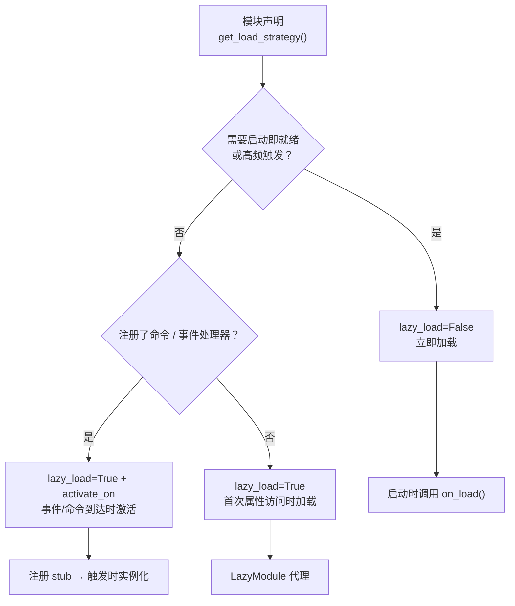

# ErisPulse 热重载与懒加载休眠

本技能由 ErisPulse 文档自动构建（generate-skills.py）。
仓库：https://github.com/ErisPulse/ErisPulse
各节末尾标注了来源文档路径，需要最新内容请以仓库 docs/zh-CN/ 为准。

## 内容大纲

AI 按需读取：只读需要的章节即可，不必全文加载。

- 懒加载与休眠: 33-43 行
- 概述: 45-52 行
- 工作原理: 54-68 行
- 事件驱动懒激活（activate_on）: 70-146 行
- 懒加载休眠（dormant_after）: 148-194 行
- 配置懒加载: 196-223 行
- 使用懒加载模块: 225-280 行
- 最佳实践: 282-310 行
- 注意事项: 312-317 行
- 模块开发入门（加载策略）: 319-329 行
- 项目结构: 331-343 行
- pyproject.toml 配置: 345-363 行
- __init__.py: 365-369 行
- Core.py - 基础模块: 371-410 行
- 测试模块: 412-430 行
- 核心概念: 432-535 行

## 懒加载与休眠

> 来源: `docs/zh-CN/advanced/lazy-loading.md`（https://github.com/ErisPulse/ErisPulse/blob/main/docs/zh-CN/advanced/lazy-loading.md）

# 懒加载模块系统

> [!TIP]
> **什么时候需要读这篇**：使用懒加载模块或 activate_on 事件驱动激活时。不需要则跳过，不影响其它功能的使用。


ErisPulse SDK 的懒加载模块系统让模块推迟到**实际被访问时**才初始化——启动阶段只登记占位代理，未被用到的模块不占用启动时间与内存。

## 概述

懒加载模块系统是 ErisPulse 的核心特性之一，它通过以下方式工作：

- **延迟初始化**：模块只有在第一次被访问时才会实际加载和初始化
- **透明使用**：对于开发者来说，懒加载模块与普通模块在使用上几乎没有区别
- **自动依赖管理**：模块依赖会在被使用时自动初始化
- **生命周期支持**：对于继承自 `BaseModule` 的模块，会自动调用生命周期方法

## 工作原理

### LazyModule 类

懒加载系统的核心是 `LazyModule` 类，它是一个包装器，在第一次访问时才实际初始化模块。

### 初始化过程

当模块首次被访问时，`LazyModule` 会执行以下操作：

1. 获取模块类的 `__init__` 参数信息
2. 根据参数决定是否传入 `sdk` 引用
3. 设置模块的 `moduleInfo` 属性
4. 对于继承自 `BaseModule` 的模块，调用 `on_load` 方法
5. 触发 `module.init` 生命周期事件

## 事件驱动懒激活（activate_on）

> [!NOTE]
> 本特性需要 ErisPulse **2.8.0+**。

`lazy_load=True` 的模块默认只在**首次属性访问**时加载。若模块注册了命令/事件处理器，
传统做法只能 `lazy_load=False` 立即加载。`activate_on` 提供了第三种选择：**声明触发器，
首个匹配事件/命令到达时自动激活模块**——既不常驻内存，又不丢失触发入口。

```python
from ErisPulse.loaders import ModuleLoadStrategy

class MyModule(BaseModule):
    @staticmethod
    def get_load_strategy():
        return ModuleLoadStrategy(
            lazy_load=True,
            activate_on=[
                # ---- 事件触发（被动到达，无需用户感知）----
                "message",                                    # 类型级：任何消息事件
                {"notice": "group_member_increase"},          # 类型 + 单个 detail_type
                {"message": ["private", "group"]},            # 类型 + 多个 detail_type

                # ---- 命令触发（主动输入，占位命令对 Help 可见）----
                {"command": "roll"},                          # 简写：命令名
                {"command": ["roll", "dice"]},                # 命令名列表
                {"command": {                                 # dict 声明（name 必填）
                    "name": "dice",
                    "help": "掷一个骰子",
                    "usage": "/dice",
                    "group": "娱乐",
                    "aliases": ["d"],
                    "hidden": False,
                }},
            ],
        )
```

### 命令 dict 声明参数

dict 形式镜像 `@command()` 装饰器的用户级参数，用于在模块加载前就注册占位命令：

| 参数 | 类型 | 默认 | 说明 |
|------|------|------|------|
| `name` | `str` | **必填** | 命令名；须与 `on_load` 中 `@command(name)` 一致，否则激活后占位注销、命令不存在 |
| `help` | `str` | 回退链 | Help 中显示的介绍；未声明时按回退链取值（见下） |
| `usage` | `str` | 自动生成 | 用法行，默认 `{prefix}{name}` |
| `group` | `str` | `None` | 命令分组 |
| `aliases` | `list[str]` | `[]` | 别名同时注册，**输入别名同样触发激活** |
| `hidden` | `bool` | `False` | `True` 时占位命令同样隐藏（与激活后真实命令的隐藏语义对齐）；知道命令名的用户输入仍可触发 |

**不支持** `priority` / `permission` / `master`：占位命令的使命只是触发激活，
权限检查由激活后的真实命令执行（占位阶段拦截权限反而会让"输入命令激活"失效）。

### 占位命令 help 回退链

模块未加载时 Help 显示的命令介绍，按以下顺序取值（取到即止）：

1. dict 声明的命令级 `help`（最精确）
2. 模块 `get_meta()` 的 `description`
3. 模块 `__description__` 属性
4. 包元数据的 `Summary`（PyPI 包简介）
5. 通用提示：「此命令来自懒加载模块 X，首次使用将自动加载该模块」

### 触发语义

- **事件 stub**：以极低优先级（`ACTIVATION_STUB_PRIORITY`）注册到对应事件管理器，
  在所有普通处理器之后兜底触发；激活后将当前事件转发给模块的真实处理器
- **命令 stub**：注册占位命令；激活后占位注销、真实命令接管当次触发
- **防重入**：`asyncio.Lock` 保证并发触发下只激活一次
- **作用域过滤**：stub 带模块 owner 身份，模块未对该 Bot / 会话 / 平台启用时不触发
- **失败语义**：激活失败进入冷却期（`ACTIVATE_RETRY_COOLDOWN_SECS`，30 秒），
  冷却内事件短路避免重复尝试；冷却结束后再次触发自动重试，stub 全程保留
- **去重**：同名命令以简写 + dict 混合声明时去重（dict 优先）；dict 缺 `name`
  或事件 `detail_type` 误写 dict 时告警并忽略

> 架构图与完整语义详见 [架构概览](../architecture.md#事件驱动懒激活activate_on触发架构)。

## 懒加载休眠（dormant_after）

> [!NOTE]
> 本特性需要 ErisPulse **2.11.0+**。

懒激活的模块长期闲置后，框架可将其**归眠**：释放运行时资源（归属任务 / 连接 / 事件注册），
但保留懒加载代理与注册存根——模块回到"已注册未加载"状态，下次属性访问 /
`module.call` / `activate_on` 事件**透明唤醒**（重新实例化并执行 `on_load`），
无需任何唤醒 API。归眠后的系统状态与"从未激活"完全一致。

### 声明方式

```python
@staticmethod
def get_load_strategy():
    return ModuleLoadStrategy(
        lazy_load=True,
        dormant_after="30m",   # 闲置 30 分钟自动归眠；不声明 = 永不休眠（默认）
    )
```

时长语法与命令治理的 `cooldown` 完全一致（`90s` / `1h30m` / `1d`）。清扫器按固定间隔
（60 秒）扫描，实际归眠时点 = 阈值 + 最多一个扫描间隔；也可随时手动归眠：
`await sdk.module.sleep("模块名")`。显式 `unload` 仍是彻底卸载（懒代理一并移除）。

### 状态接续

归眠前框架触发 `on_before_unload(reason="dormant")`（卸载流水线第一步，资源仍完好），
模块把状态保存到 `sdk.storage`；唤醒后在 `on_load` 中恢复：

```python
async def on_before_unload(self, event):
    if event["reason"] in ("dormant", "reload", "disable"):
        await self.sdk.storage.aset(f"{self._module_name}:counter", self._count)

async def on_load(self, event):
    self._count = await self.sdk.storage.aget(f"{self._module_name}:counter") or 0
```

### 语义与边界

- **依赖方安全**：懒模块的依赖方经由持久代理（`sdk.<Name>`）或 `module.call` 访问，
  归眠前后行为一致；直接持有真实实例引用属反模式（泄漏审计器可见）
- **事件不达**：归眠模块不再接收事件——需要事件唤醒的模块请同时声明 `activate_on`
  （事件先唤醒再转发）；排查"命令没反应"时注意确认模块是否处于归眠态
- **唤醒失败可自愈**：唤醒（重新初始化）失败进入 30 秒冷却，冷却后再次访问自动重试，
  不会永久失效

## 配置懒加载

### 全局配置

在配置文件中启用/禁用全局懒加载：

```toml
[ErisPulse.framework]
enable_lazy_loading = true  # true=启用懒加载(默认)，false=禁用懒加载
```

### 模块级别控制

模块可以通过实现 `get_load_strategy()` 静态方法来控制加载策略：

```python
from ErisPulse.Core.Bases import BaseModule
from ErisPulse.loaders import ModuleLoadStrategy

class MyModule(BaseModule):
    @staticmethod
    def get_load_strategy():
        """返回模块加载策略"""
        return ModuleLoadStrategy(
            lazy_load=False,  # 返回 False 表示立即加载
            priority=100      # 加载优先级，数值越大优先级越高
        )
```

## 使用懒加载模块

### 基本使用

对于开发者来说，懒加载模块与普通模块在使用上几乎没有区别：

```python
# 通过SDK访问懒加载模块
from ErisPulse import sdk

# 以下访问会触发模块懒加载
result = await sdk.my_module.my_method()
```

### 统一的模块获取入口

无论是通过 SDK 属性、模块管理器属性访问，还是通过 `module.get()` 查询，
对于“已注册但尚未加载”的懒加载模块，都会返回同一个懒加载代理，访问其属性才会真正触发初始化：

```python
# 三种方式拿到的都是懒加载代理（在模块未加载时），行为一致、对用户透明
sdk.my_module          # 触发加载的入口
sdk.module.my_module   # 同样返回懒加载代理
sdk.module.get("my_module")  # 也返回懒加载代理，本身不会触发加载

# 访问代理的任意属性才会真正初始化模块
result = await sdk.my_module.my_method()
```

`module.get()` 是**查询**接口，本身不触发加载：
- 模块已加载 → 返回真实实例
- 模块已注册但未加载 → 返回懒加载代理（访问属性才初始化）
- 模块未注册 → 返回 `None`

如需显式触发加载，请使用 `await sdk.load_module("my_module")`。

### 异步初始化

对于需要异步初始化的模块，建议先显式加载：

```python
# 先显式加载模块
await sdk.load_module("my_module")

# 然后使用模块
result = await sdk.my_module.my_method()
```

### 同步初始化

对于不需要异步初始化的模块，可以直接访问：

```python
# 直接访问会自动同步初始化
result = sdk.my_module.some_sync_method()
```

## 最佳实践

选择加载策略时，可参考以下决策流程：



### 推荐使用懒加载的场景（lazy_load=True）

- 被动调用的工具类（如数据查询模块，格式转换器等，仅只在其他模块调用时才需要）
- 注册命令/事件处理器但非高频使用的模块——配合 `activate_on` 声明触发器，首个匹配事件/命令到达时自动激活，无需放弃懒加载

### 推荐禁用懒加载的场景（lazy_load=False）

- 需要在启动时立即就绪的模块（如为其它模块提供基础服务的核心模块）
- 高频触发的监听器（每条消息都要处理）——`activate_on` 转发有一次激活开销，高频场景立即加载更直接
- 定时任务模块
- 需要在应用启动时就初始化的模块

> `priority` 参数控制立即加载模块间的初始化顺序，数值越大越先初始化。同优先级的模块按注册顺序加载。

## 注意事项

1. 如果您的模块使用了懒加载，如果其它模块从未在ErisPulse内进行过调用，则您的模块永远不会被初始化。
2. 如果您的模块中包含了诸如监听Event的模块，或其它主动监听类似模块，有两种选择：声明 `activate_on` 触发器（保持懒加载，事件到达时自动激活），或声明需要立即被加载（`lazy_load=False`），否则会影响您模块的正常业务。
3. 我们不建议您禁用懒加载，除非有特殊需求，否则它可能为您带来诸如依赖管理和生命周期事件等的问题。
4. `activate_on` 的命令 dict 声明中，`name` 必须与模块 `on_load` 中 `@command()` 注册的真实命令名一致——否则模块激活后占位命令注销，声明与实现不一致的命令将不存在。

## 模块开发入门（加载策略）

> 来源: `docs/zh-CN/developer-guide/modules/getting-started.md`（https://github.com/ErisPulse/ErisPulse/blob/main/docs/zh-CN/developer-guide/modules/getting-started.md）

# 模块开发入门

> [!NOTE]
> **L1 核心必读**——首页"阅读路径"中的五篇核心文档之一，模块开发必备。


跟着这篇走完，你会得到一个能响应 `/hello` 命令的可运行模块，并了解模块的项目结构、注册方式与加载 / 卸载钩子——后续所有模块文档都建立在这套骨架上。

## 项目结构

一个标准的模块结构：

```
MyModule/
├── pyproject.toml
├── README.md
├── LICENSE
└── MyModule/
    ├── __init__.py
    └── Core.py
```

## pyproject.toml 配置

```toml
[project]
name = "ErisPulse-MyModule"
version = "1.0.0"
description = "模块功能描述"
readme = "README.md"
requires-python = ">=3.10"
license = { file = "LICENSE" }
authors = [ { name = "yourname", email = "your@mail.com" } ]
dependencies = []

[project.urls]
"homepage" = "https://github.com/yourname/MyModule"

[project.entry-points."erispulse.module"]
"MyModule" = "MyModule:Main"
```

## __init__.py

```python
from .Core import Main
```

## Core.py - 基础模块

```python
from ErisPulse import sdk
# 推荐根导入（2.10+）：常用符号直接从根包导入，深路径仍兼容
from ErisPulse import BaseModule, command

class Main(BaseModule):
    def __init__(self, sdk):
        self.sdk = sdk
        self.logger = sdk.logger.get_child("MyModule")
        self.storage = sdk.storage
    
    @staticmethod
    def get_load_strategy():
        """返回模块加载策略"""
        from ErisPulse.loaders import ModuleLoadStrategy
        return ModuleLoadStrategy(
            lazy_load=True,
            priority=0,
            depends=[],  # 可选：依赖的其他模块列表
            # 可选：事件驱动懒激活——声明触发器，首个匹配事件/命令到达时自动加载
            # activate_on=[{"command": {"name": "hello", "help": "发送问候"}}],
        )
    
    async def on_load(self, event):
        """模块加载时调用"""
        @command("hello", help="发送问候")
        async def hello_command(event):
            name = event.get_user_nickname() or "朋友"
            await event.reply(f"你好，{name}！")
        
        self.logger.info("模块已加载")
    
    async def on_unload(self, event):
        """模块卸载时调用"""
        self.logger.info("模块已卸载")
```

> **配置读取**：上面的基础示例未使用配置。需要读取配置时，推荐声明嵌套的 `ConfigClass` 并通过 `self.cfg` 实时读取（见 [模块核心概念](core-concepts.md#声明式配置推荐)）。手动调用 `_load_config()` 的旧写法已废弃。

## 测试模块

### 本地测试

```bash
# 在项目目录安装模块
epsdk install ./MyModule

# 运行项目
epsdk run main.py --reload
```

### 测试命令

发送命令测试：

```
/hello
```

## 核心概念

### BaseModule 基类

所有模块必须继承 `BaseModule`，提供以下方法：

| 方法 | 说明 | 必须 |
|------|------|------|
| `__init__(self, sdk)` | 构造函数（框架传入 `sdk` 实例） | 否 |
| `get_load_strategy()` | 返回加载策略 | 否 |
| `get_meta()` | 返回模块介绍元信息（可选） | 否 |
| `on_load(self, event)` | 模块加载时调用 | 是 |
| `on_unload(self, event)` | 模块卸载时调用 | 是 |

### 模块介绍 meta

> [!NOTE]
> 本特性需要 ErisPulse **2.8.0+**。

通过 `get_meta()` 声明模块的介绍元信息（这个模块是干什么的、属于哪一类等）。
元信息是模块的**通用介绍数据**，供 help 模块、Dashboard 模块列表、模块商店等各类界面/生态模块消费。

与 `get_load_strategy()` 返回 `ModuleLoadStrategy` 一致，**推荐返回 `ModuleMeta` 配置类实例**（属性键入、IDE 补全），也兼容直接返回 dict：

```python
class MyModule(BaseModule):
    @staticmethod
    def get_meta() -> ModuleMeta:
        return ModuleMeta(
            name="天气",               # 显示名（默认注册名）
            description="查询城市天气",  # 模块简介
            version="1.0.0",
            author="ErisDev",
            group="工具",               # 功能分组
            tags=["天气", "查询"],
        )
```

兼容写法（dict）：

```python
class MyModule(BaseModule):
    @staticmethod
    def get_meta() -> dict:
        return {
            "name": "天气",
            "description": "查询城市天气",
            "version": "1.0.0",
            "author": "ErisDev",
            "group": "工具",
            "tags": ["天气", "查询"],
        }
```

- `module.get_meta("MyModule")` 读取已解析的元信息（类声明 > 注册 info，自动补全该模块的命令名）。
- `module.get_commands_overview()` 聚合「模块 meta + 其注册的命令（别名/分组/帮助）」，按模块组织的命令总览。
- 命令归属模块通过 `cmd_info["owner"]` 获取（注册时由上下文系统自动注入）。

#### meta 字段的 i18n 支持

元信息字段值可用纯字符串，或 i18n 字典 `{"i18n": "key.path", "default": "兜底文本"}`（与配置 `description` 约定一致）。
翻译键通过 `I18nClass` 声明注册，`module.get_meta()` 读取时自动解析为当前语言文本：

```python
class MyModule(BaseModule):
    class I18nClass(BaseI18n):
        meta_description: I18nKey = I18nKey(
            default="Weather lookup",
            zh_CN="查询城市天气",
            en="Weather lookup",
        )

    @staticmethod
    def get_meta() -> ModuleMeta:
        return ModuleMeta(
            name="天气",
            description={"i18n": "MyModule.meta_description", "default": "Weather lookup"},
        )
```

### SDK 对象

通过 `sdk` 对象访问核心功能：

```python
from ErisPulse import sdk

sdk.storage    # 存储系统
sdk.config     # 配置系统
sdk.logger     # 日志系统
sdk.adapter    # 适配器系统
sdk.router     # 路由系统
sdk.lifecycle  # 生命周期系统
```

### 继续学习路径

- [模块核心概念](core-concepts.md) - 深入了解模块架构
- [Event 包装类详解](event-wrapper.md) - 学习 Event 对象

### 写完之后

- [模块最佳实践](best-practices.md) - 开发高质量模块
